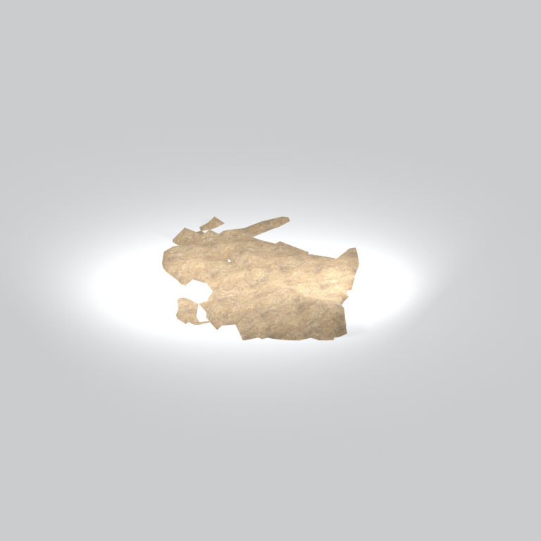

# Cliff component

A native cliff model component. Its specific form and assembly have not been visually reviewed.

[Library](../README.md) | [Category](../tables/cliffs-1.md) | [Source / advanced data](../catalogue.json) | [Credits](../sources-and-credits.md)

**Game filename:** afgh_clff030_vrtn011.fmdl  
**Category:** Terrain &gt; Cliffs  
**Variant:** vrtn011; **LOD:** 0  
**Tags:** cliff, component

## Still reference



## 360-degree reference


The camera circles a static model. This is not a native animation. Source base textures and UVs use approximate studio shading; interaction, collision, complete assembly and FOX shader equivalence are not established.

## Identity and naming

| Field | Value |
|---|---|
| Library ID | mgsv-tpp-afgh_clff030_vrtn011-667560e76570cdce |
| Naming status | path-derived |
| Naming confidence | medium |
| Naming evidence | {"kind": "native-folder", "note": "Conservative folder dictionary; not visual identification, color, function or completeness proof", "source": "cliff"} |
| Native model | /Assets/tpp/environ/object/afghanistan/cliff/afgh_clff030/scenes/afgh_clff030_vrtn011.fmdl |
| Model SHA256 | 85b1f69ffaa4ac713054b292a240888b45907fcb3b25a758db4accc7771cc939 |
| Container | /Assets/mgo/pack/location/afda/pack_common/afda_common.fpk |
| Container SHA256 | 19048457fb21b8b2d25f52c752a427fd9400056cf6565142a9dcc9ad8e637b14 |
| Captured source / location scope | Selected native member/content and captured installed-source chain; full archive SHA/runtime priority unresolved |
| Raw record SHA256 | 90a7853ec9cc530c082fd504433264b40912beee8a710197ec2260d95afeaf86 |

Naming review is descriptive metadata only. It does not change model completion or identify a working game interaction.

## Native LOD inventory

| Native LOD | Triangles | Preview status | Decoded indices SHA256 |
|---|---:|---|---|
| 0 | 456 | rendered | 34118b1dfbb7389a1c09eaef822ed52441be91b540ef8a463ffe8b4e652f7f34 |
| 1 | 276 | not separately rendered | 72707380439795600b78f12aa73f9ad89d3fbad5ce5f3c90d8bd2a1a22968334 |
| 2 | 161 | not separately rendered | 9e65b939ef6a705d2179b2a4dda6d275e23faa40781a30380c69303b9f154724 |
| 3 | 90 | not separately rendered | 64623091198d8543b3dfd2a8e7abc6f986ac2807b65daaf0ffa122a4d0e342af |

Mesh detail and texture pixels/mips are separate. Index hashes describe decoded triangle arrays, not packed index-buffer bytes. Only source-recorded native levels are listed.

<details>
<summary>Texture, source and naming technical metadata</summary>

```json
{
  "source": {
    "nativePath": "/Assets/tpp/environ/object/afghanistan/cliff/afgh_clff030/scenes/afgh_clff030_vrtn011.fmdl",
    "nativeSha256": "85b1f69ffaa4ac713054b292a240888b45907fcb3b25a758db4accc7771cc939",
    "stableIdentity": "/assets/tpp/environ/object/afghanistan/cliff/afgh_clff030/scenes/afgh_clff030_vrtn011.fmdl#85b1f69ffaa4ac713054b292a240888b45907fcb3b25a758db4accc7771cc939#8d44edc8b534df9f483676612d1c987feddb44435f20eb560fef70b2bfca5ae5",
    "container": {
      "nativePath": "/Assets/mgo/pack/location/afda/pack_common/afda_common.fpk",
      "sha256": "19048457fb21b8b2d25f52c752a427fd9400056cf6565142a9dcc9ad8e637b14",
      "status": "Selected installed-source container/member chain captured by community reader"
    },
    "historicalDatOrigin": null,
    "sourceArchiveAtCapture": "master/0/00.dat",
    "locationStatus": "Selected native member/content and captured installed-source chain; full archive SHA/runtime priority unresolved",
    "currentInstalledDatVerified": false,
    "selectedInstalledMemberVerified": true,
    "evidence": {
      "archive_helper_executable_sha256": "6f8e39a436af3b024bbd0504966ab3d5d9d0cb05d86689bf3e83d15e68df613f",
      "archive_helper_source_sha256": "f662d3b63e066a0afc77ffe22ea0e564222d14469648300dba2c4f8e9b43446b",
      "archive_index_recipe": "54acff767f08d76ad6056c5387328759bc883df507788f398de6c2c04fac12db",
      "archive_reader": "Atvaark GzsTool.Core 0.5.3",
      "archive_reader_core_sha256": "9da447ae3c375cce2e46744eeff6af50f1591062afdf479d1a0b49edb47daaa3",
      "archive_tool_and_dictionary_sha256": {
        "CityHash.dll": "def6c4506d461b65e4059b2936b2cbd5f852ba5d1d8a1a527f1c0e6dc7008c8f",
        "GzsTool.Core.dll": "9da447ae3c375cce2e46744eeff6af50f1591062afdf479d1a0b49edb47daaa3",
        "GzsTool.exe": "1a9c5b11e2355383ff485aee7e86abc026f5c1fad729daf8c0fd15ee0aae1c10",
        "Zlib.Portable.dll": "fe84781ba35ca9cc5ff5f73fd08d2a66c59e5257b4573f5fe59743f30bf78e42",
        "fpk_dictionary.txt": "b82f9a8d6c10a68ba9471eca9d815c21355a53b5e68753d8ad7db7fd01bf401d",
        "qar_dictionary.txt": "1558c248ed0a4bb827888261563fbb91a2df4f03999682f85d637ff70d9d5fb2"
      },
      "bytes": 18032,
      "container_chain": [
        {
          "content_sha256": null,
          "depth": 0,
          "id": "3f19555d27c2ebecdfbad26aadd88b9f62e9fb6092c04c712963ef73c67ccb42",
          "index_sha256": "9acd3675d6e1500e0e18430cba0fdc70a5718ad7d6b62f13905891a35d59f18a",
          "kind": "qar",
          "name": "master/0/00.dat",
          "parent_occurrence": null
        },
        {
          "content_sha256": "19048457fb21b8b2d25f52c752a427fd9400056cf6565142a9dcc9ad8e637b14",
          "depth": 1,
          "id": "cff1104ad9341561c9113491a97f31e7dddfa63604f4b3a1dd4e8fafa96f0d61",
          "index_sha256": "7bc2d3ca93cb2ad04aa26e68299971918cd410ce9c990329e0d9f3b834923fab",
          "kind": "fpk",
          "name": "/Assets/mgo/pack/location/afda/pack_common/afda_common.fpk",
          "parent_occurrence": "e354af6a735cde8714338920a5ddd0fe4b043fa04de93ea8fff8b6b954cb965b"
        }
      ],
      "contentSha256": "85b1f69ffaa4ac713054b292a240888b45907fcb3b25a758db4accc7771cc939",
      "member": {
        "actual_size": 18032,
        "compressed_size": null,
        "content_sha256": "85b1f69ffaa4ac713054b292a240888b45907fcb3b25a758db4accc7771cc939",
        "declared_size": 18032,
        "extension": "fmdl",
        "hash_hex": null,
        "name": "/Assets/tpp/environ/object/afghanistan/cliff/afgh_clff030/scenes/afgh_clff030_vrtn011.fmdl",
        "name_origin": "embedded",
        "offset": 8622688,
        "ordinal": 221,
        "path_hash": null,
        "resolved": 1
      },
      "occurrenceId": "01fa4c42bf6905f6e2cd722d19d7f14db29df12037b208fc4770bc448d980a26",
      "occurrence_id": "01fa4c42bf6905f6e2cd722d19d7f14db29df12037b208fc4770bc448d980a26",
      "primary_source_revision": "fc4a8196555638c6cf8aa1b7c8dc34ccd5c69cb5",
      "source_adapter": "community_core_selective_export",
      "source_id": "7f6bb743fb4c487f0e9522f9c7fac280c46cf6b1051e0fc75a93602c8eb451f0",
      "source_path": "master/0/00.dat",
      "source_snapshot": "{\"bytes\":768788480,\"device\":621747392682911458,\"file_id\":844424931596481,\"header_sha256\":\"ead50f0a9a37e4285323b9c6fa0ec75fe75e518c63147e63158eeb2892c6589e\",\"mtime_ns\":1791852224238580700}",
      "virtualPath": "/Assets/tpp/environ/object/afghanistan/cliff/afgh_clff030/scenes/afgh_clff030_vrtn011.fmdl"
    }
  },
  "materials": [
    {
      "sampler": "Base_Tex_SRGB",
      "materialIndex": 0,
      "nativePathHash": "1543222120454736028",
      "nativeVirtualPath": null,
      "nativeBinding": {
        "familyId": "afd874bf3514f24dd903440f514e9bee2117f4aef3b87baab18a63aa18be500f",
        "height": 1024,
        "materialIndex": 0,
        "mipCount": 9,
        "nativeMipCountVerified": true,
        "nativePath": null,
        "nativePathHash": "1543222120454736028",
        "nativeTexture": {
          "additionalFtexsFileCount": 2,
          "depth": 1,
          "ftexsFileCount": 3,
          "height": 1024,
          "metadataBytes": 208,
          "mipCount": 9,
          "mips": [
            {
              "chunks": 32,
              "decodedBytes": 524288,
              "mip": 0,
              "offset": 0,
              "storedBytes": 428944,
              "streamNumber": 3
            },
            {
              "chunks": 8,
              "decodedBytes": 131072,
              "mip": 1,
              "offset": 0,
              "storedBytes": 114224,
              "streamNumber": 2
            },
            {
              "chunks": 2,
              "decodedBytes": 32768,
              "mip": 2,
              "offset": 10016,
              "storedBytes": 28944,
              "streamNumber": 1
            },
            {
              "chunks": 1,
              "decodedBytes": 8192,
              "mip": 3,
              "offset": 2680,
              "storedBytes": 7328,
              "streamNumber": 1
            },
            {
              "chunks": 1,
              "decodedBytes": 2048,
              "mip": 4,
              "offset": 768,
              "storedBytes": 1904,
              "streamNumber": 1
            },
            {
              "chunks": 1,
              "decodedBytes": 512,
              "mip": 5,
              "offset": 232,
              "storedBytes": 528,
              "streamNumber": 1
            },
            {
              "chunks": 1,
              "decodedBytes": 128,
              "mip": 6,
              "offset": 80,
              "storedBytes": 144,
              "streamNumber": 1
            },
            {
              "chunks": 1,
              "decodedBytes": 32,
              "mip": 7,
              "offset": 24,
              "storedBytes": 48,
              "streamNumber": 1
            },
            {
              "chunks": 1,
              "decodedBytes": 8,
              "mip": 8,
              "offset": 0,
              "storedBytes": 16,
              "streamNumber": 1
            }
          ],
          "nativeHeaderHash": "b23b0013970f7be06fbed18de3182438",
          "nrtFlag": 2,
          "pixelFormat": 2,
          "requiredStreamNumbers": [
            1,
            2,
            3
          ],
          "textureType": 16777219,
          "unknownFlags": 273,
          "width": 1024
        },
        "samplerName": "Base_Tex_SRGB",
        "samplerNameHash": "72475356961633",
        "sha256": "bc1fcb0ac6463af572803d7d3b288a2df5f7404e191287bc72442fd016be3cc9",
        "sourceOccurrences": [
          {
            "archive_helper_executable_sha256": "6f8e39a436af3b024bbd0504966ab3d5d9d0cb05d86689bf3e83d15e68df613f",
            "archive_helper_source_sha256": "f662d3b63e066a0afc77ffe22ea0e564222d14469648300dba2c4f8e9b43446b",
            "archive_index_recipe": "54acff767f08d76ad6056c5387328759bc883df507788f398de6c2c04fac12db",
            "archive_reader": "Atvaark GzsTool.Core 0.5.3",
            "archive_reader_core_sha256": "9da447ae3c375cce2e46744eeff6af50f1591062afdf479d1a0b49edb47daaa3",
            "archive_tool_and_dictionary_sha256": {
              "CityHash.dll": "def6c4506d461b65e4059b2936b2cbd5f852ba5d1d8a1a527f1c0e6dc7008c8f",
              "GzsTool.Core.dll": "9da447ae3c375cce2e46744eeff6af50f1591062afdf479d1a0b49edb47daaa3",
              "GzsTool.exe": "1a9c5b11e2355383ff485aee7e86abc026f5c1fad729daf8c0fd15ee0aae1c10",
              "Zlib.Portable.dll": "fe84781ba35ca9cc5ff5f73fd08d2a66c59e5257b4573f5fe59743f30bf78e42",
              "fpk_dictionary.txt": "b82f9a8d6c10a68ba9471eca9d815c21355a53b5e68753d8ad7db7fd01bf401d",
              "qar_dictionary.txt": "1558c248ed0a4bb827888261563fbb91a2df4f03999682f85d637ff70d9d5fb2"
            },
            "bytes": 208,
            "container_chain": [
              {
                "content_sha256": null,
                "depth": 0,
                "id": "3f19555d27c2ebecdfbad26aadd88b9f62e9fb6092c04c712963ef73c67ccb42",
                "index_sha256": "9acd3675d6e1500e0e18430cba0fdc70a5718ad7d6b62f13905891a35d59f18a",
                "kind": "qar",
                "name": "master/0/00.dat",
                "parent_occurrence": null
              },
              {
                "content_sha256": "7784c61d48c2a829a8a3be8bea91819ed320466e84615e1196c12dc4390190ea",
                "depth": 1,
                "id": "a7374ee4090f72cbecb7df25f172141b83da2b51b8b38b375af7a4f0f577fc67",
                "index_sha256": "7f78072384a5e4f07d09223009a06931047d1b3d6ae36512b9bb7ef91d1fe958",
                "kind": "pftxs",
                "name": "/Assets/mgo/pack/location/afda/pack_common/afda_common.pftxs",
                "parent_occurrence": "e3bb44002c453c106548f7190291b4a4c22da16a7eebd82d6a8dac6ab3844ca7"
              }
            ],
            "contentSha256": "a0c21b4d21f0036fb8466144a98f648bfee1d0b3eef0cbdf8038da2237e73b50",
            "member": {
              "actual_size": 208,
              "compressed_size": null,
              "content_sha256": "a0c21b4d21f0036fb8466144a98f648bfee1d0b3eef0cbdf8038da2237e73b50",
              "declared_size": 208,
              "extension": "ftex",
              "hash_hex": "156aa0579b3ac89c",
              "name": "156aa0579b3ac89c.ftex",
              "name_origin": "hash_fallback",
              "offset": 19649296,
              "ordinal": 1496,
              "path_hash": null,
              "resolved": 0
            },
            "occurrenceId": "54fe34a548b7b898b5cc366b6e937e02c812ed63e3c96141af8ce7684d3d9c83",
            "occurrence_id": "54fe34a548b7b898b5cc366b6e937e02c812ed63e3c96141af8ce7684d3d9c83",
            "primary_source_revision": "fc4a8196555638c6cf8aa1b7c8dc34ccd5c69cb5",
            "source_adapter": "community_core_selective_export",
            "source_id": "7f6bb743fb4c487f0e9522f9c7fac280c46cf6b1051e0fc75a93602c8eb451f0",
            "source_path": "master/0/00.dat",
            "source_snapshot": "{\"bytes\":768788480,\"device\":621747392682911458,\"file_id\":844424931596481,\"header_sha256\":\"ead50f0a9a37e4285323b9c6fa0ec75fe75e518c63147e63158eeb2892c6589e\",\"mtime_ns\":1791852224238580700}",
            "virtualPath": "156aa0579b3ac89c.ftex"
          },
          {
            "archive_helper_executable_sha256": "6f8e39a436af3b024bbd0504966ab3d5d9d0cb05d86689bf3e83d15e68df613f",
            "archive_helper_source_sha256": "f662d3b63e066a0afc77ffe22ea0e564222d14469648300dba2c4f8e9b43446b",
            "archive_index_recipe": "54acff767f08d76ad6056c5387328759bc883df507788f398de6c2c04fac12db",
            "archive_reader": "Atvaark GzsTool.Core 0.5.3",
            "archive_reader_core_sha256": "9da447ae3c375cce2e46744eeff6af50f1591062afdf479d1a0b49edb47daaa3",
            "archive_tool_and_dictionary_sha256": {
              "CityHash.dll": "def6c4506d461b65e4059b2936b2cbd5f852ba5d1d8a1a527f1c0e6dc7008c8f",
              "GzsTool.Core.dll": "9da447ae3c375cce2e46744eeff6af50f1591062afdf479d1a0b49edb47daaa3",
              "GzsTool.exe": "1a9c5b11e2355383ff485aee7e86abc026f5c1fad729daf8c0fd15ee0aae1c10",
              "Zlib.Portable.dll": "fe84781ba35ca9cc5ff5f73fd08d2a66c59e5257b4573f5fe59743f30bf78e42",
              "fpk_dictionary.txt": "b82f9a8d6c10a68ba9471eca9d815c21355a53b5e68753d8ad7db7fd01bf401d",
              "qar_dictionary.txt": "1558c248ed0a4bb827888261563fbb91a2df4f03999682f85d637ff70d9d5fb2"
            },
            "bytes": 38976,
            "container_chain": [
              {
                "content_sha256": null,
                "depth": 0,
                "id": "3f19555d27c2ebecdfbad26aadd88b9f62e9fb6092c04c712963ef73c67ccb42",
                "index_sha256": "9acd3675d6e1500e0e18430cba0fdc70a5718ad7d6b62f13905891a35d59f18a",
                "kind": "qar",
                "name": "master/0/00.dat",
                "parent_occurrence": null
              },
              {
                "content_sha256": "7784c61d48c2a829a8a3be8bea91819ed320466e84615e1196c12dc4390190ea",
                "depth": 1,
                "id": "a7374ee4090f72cbecb7df25f172141b83da2b51b8b38b375af7a4f0f577fc67",
                "index_sha256": "7f78072384a5e4f07d09223009a06931047d1b3d6ae36512b9bb7ef91d1fe958",
                "kind": "pftxs",
                "name": "/Assets/mgo/pack/location/afda/pack_common/afda_common.pftxs",
                "parent_occurrence": "e3bb44002c453c106548f7190291b4a4c22da16a7eebd82d6a8dac6ab3844ca7"
              }
            ],
            "contentSha256": "53f192ddfc5e06a0abc7e8b7afc4e1936bd50d4ddac126dd417d1b0b21ca7741",
            "member": {
              "actual_size": 38976,
              "compressed_size": null,
              "content_sha256": "53f192ddfc5e06a0abc7e8b7afc4e1936bd50d4ddac126dd417d1b0b21ca7741",
              "declared_size": 38976,
              "extension": "1.ftexs",
              "hash_hex": "b2c2a0579b3ac89c",
              "name": "b2c2a0579b3ac89c.1.ftexs",
              "name_origin": "hash_fallback",
              "offset": 19649504,
              "ordinal": 1497,
              "path_hash": null,
              "resolved": 0
            },
            "occurrenceId": "20372da04c29518ec6e4c5a48a3331a7930a1aa8a6086623bf412c69995bbf8c",
            "occurrence_id": "20372da04c29518ec6e4c5a48a3331a7930a1aa8a6086623bf412c69995bbf8c",
            "primary_source_revision": "fc4a8196555638c6cf8aa1b7c8dc34ccd5c69cb5",
            "source_adapter": "community_core_selective_export",
            "source_id": "7f6bb743fb4c487f0e9522f9c7fac280c46cf6b1051e0fc75a93602c8eb451f0",
            "source_path": "master/0/00.dat",
            "source_snapshot": "{\"bytes\":768788480,\"device\":621747392682911458,\"file_id\":844424931596481,\"header_sha256\":\"ead50f0a9a37e4285323b9c6fa0ec75fe75e518c63147e63158eeb2892c6589e\",\"mtime_ns\":1791852224238580700}",
            "virtualPath": "b2c2a0579b3ac89c.1.ftexs"
          },
          {
            "archive_helper_executable_sha256": "6f8e39a436af3b024bbd0504966ab3d5d9d0cb05d86689bf3e83d15e68df613f",
            "archive_helper_source_sha256": "f662d3b63e066a0afc77ffe22ea0e564222d14469648300dba2c4f8e9b43446b",
            "archive_index_recipe": "54acff767f08d76ad6056c5387328759bc883df507788f398de6c2c04fac12db",
            "archive_reader": "Atvaark GzsTool.Core 0.5.3",
            "archive_reader_core_sha256": "9da447ae3c375cce2e46744eeff6af50f1591062afdf479d1a0b49edb47daaa3",
            "archive_tool_and_dictionary_sha256": {
              "CityHash.dll": "def6c4506d461b65e4059b2936b2cbd5f852ba5d1d8a1a527f1c0e6dc7008c8f",
              "GzsTool.Core.dll": "9da447ae3c375cce2e46744eeff6af50f1591062afdf479d1a0b49edb47daaa3",
              "GzsTool.exe": "1a9c5b11e2355383ff485aee7e86abc026f5c1fad729daf8c0fd15ee0aae1c10",
              "Zlib.Portable.dll": "fe84781ba35ca9cc5ff5f73fd08d2a66c59e5257b4573f5fe59743f30bf78e42",
              "fpk_dictionary.txt": "b82f9a8d6c10a68ba9471eca9d815c21355a53b5e68753d8ad7db7fd01bf401d",
              "qar_dictionary.txt": "1558c248ed0a4bb827888261563fbb91a2df4f03999682f85d637ff70d9d5fb2"
            },
            "bytes": 114288,
            "container_chain": [
              {
                "content_sha256": null,
                "depth": 0,
                "id": "e73d96973ade76f7a00afdbea486dd110896ace97da0791f56899647de46f210",
                "index_sha256": "5a818609a652a10d90fb90015661d0cb80898096bbb3aac36382172988d8736d",
                "kind": "qar",
                "name": "mgo/texture0.dat",
                "parent_occurrence": null
              }
            ],
            "contentSha256": "c32d5b8231536ad520bc9df8fc58016fbe05eeae3b770c43a2cc78b71919d829",
            "member": {
              "actual_size": 114288,
              "compressed_size": 114288,
              "content_sha256": "c32d5b8231536ad520bc9df8fc58016fbe05eeae3b770c43a2cc78b71919d829",
              "declared_size": 114288,
              "extension": "2.ftexs",
              "hash_hex": "b572a0579b3ac89c",
              "name": "/Assets/tpp/common_source/environ/afghanistan/cm_afgh_rock002/sourceimages/cm_afgh_rock002_v1_bsm.2.ftexs",
              "name_origin": "dictionary",
              "offset": 2112173088,
              "ordinal": 7802,
              "path_hash": "2a0579b3ac89c",
              "resolved": 1
            },
            "occurrenceId": "4e242033725bfc3e56cc265547d67f927370632518cd1a593c94dda777037422",
            "occurrence_id": "4e242033725bfc3e56cc265547d67f927370632518cd1a593c94dda777037422",
            "primary_source_revision": "fc4a8196555638c6cf8aa1b7c8dc34ccd5c69cb5",
            "source_adapter": "community_core_selective_export",
            "source_id": "03f5942f0e1af8040ae05b95c43716d75f5933971d78324bf7cfea291297f3f4",
            "source_path": "mgo/texture0.dat",
            "source_snapshot": "{\"bytes\":4492370944,\"device\":621747392682911458,\"file_id\":562949953639631,\"header_sha256\":\"6108fbacb65c84d041742c39e5ca630745240453b336f1059a13b91943f0b011\",\"mtime_ns\":1791224675562234400}",
            "virtualPath": "/Assets/tpp/common_source/environ/afghanistan/cm_afgh_rock002/sourceimages/cm_afgh_rock002_v1_bsm.2.ftexs"
          },
          {
            "archive_helper_executable_sha256": "6f8e39a436af3b024bbd0504966ab3d5d9d0cb05d86689bf3e83d15e68df613f",
            "archive_helper_source_sha256": "f662d3b63e066a0afc77ffe22ea0e564222d14469648300dba2c4f8e9b43446b",
            "archive_index_recipe": "54acff767f08d76ad6056c5387328759bc883df507788f398de6c2c04fac12db",
            "archive_reader": "Atvaark GzsTool.Core 0.5.3",
            "archive_reader_core_sha256": "9da447ae3c375cce2e46744eeff6af50f1591062afdf479d1a0b49edb47daaa3",
            "archive_tool_and_dictionary_sha256": {
              "CityHash.dll": "def6c4506d461b65e4059b2936b2cbd5f852ba5d1d8a1a527f1c0e6dc7008c8f",
              "GzsTool.Core.dll": "9da447ae3c375cce2e46744eeff6af50f1591062afdf479d1a0b49edb47daaa3",
              "GzsTool.exe": "1a9c5b11e2355383ff485aee7e86abc026f5c1fad729daf8c0fd15ee0aae1c10",
              "Zlib.Portable.dll": "fe84781ba35ca9cc5ff5f73fd08d2a66c59e5257b4573f5fe59743f30bf78e42",
              "fpk_dictionary.txt": "b82f9a8d6c10a68ba9471eca9d815c21355a53b5e68753d8ad7db7fd01bf401d",
              "qar_dictionary.txt": "1558c248ed0a4bb827888261563fbb91a2df4f03999682f85d637ff70d9d5fb2"
            },
            "bytes": 429200,
            "container_chain": [
              {
                "content_sha256": null,
                "depth": 0,
                "id": "0b473016351235050c2f6af21454bd979a0ad4602a9860137c807c894c5eba4d",
                "index_sha256": "ac9b4dae0dd0166db3a6ec8da18524dffebcbaf9004569af631de82913bf49a3",
                "kind": "qar",
                "name": "master/texture2.dat",
                "parent_occurrence": null
              }
            ],
            "contentSha256": "c0a65110226186ed506dbcd4523507dd43994d2e00e48ab186bfcfdecb749b25",
            "member": {
              "actual_size": 429200,
              "compressed_size": 429200,
              "content_sha256": "c0a65110226186ed506dbcd4523507dd43994d2e00e48ab186bfcfdecb749b25",
              "declared_size": 429200,
              "extension": "3.ftexs",
              "hash_hex": "571aa0579b3ac89c",
              "name": "/Assets/tpp/common_source/environ/afghanistan/cm_afgh_rock002/sourceimages/cm_afgh_rock002_v1_bsm.3.ftexs",
              "name_origin": "dictionary",
              "offset": 622634016,
              "ordinal": 2656,
              "path_hash": "2a0579b3ac89c",
              "resolved": 1
            },
            "occurrenceId": "7c2bce287e328bdc825b92beaa7675fa3875e3600068a2507c23ef74fede7046",
            "occurrence_id": "7c2bce287e328bdc825b92beaa7675fa3875e3600068a2507c23ef74fede7046",
            "primary_source_revision": "fc4a8196555638c6cf8aa1b7c8dc34ccd5c69cb5",
            "source_adapter": "community_core_selective_export",
            "source_id": "85e8296057664cbc6ebaf6bd43d1c6d18528bbd8a6fae920bdf4d5eb69f6a93d",
            "source_path": "master/texture2.dat",
            "source_snapshot": "{\"bytes\":2920239104,\"device\":621747392682911458,\"file_id\":562949953639626,\"header_sha256\":\"72bfee707623afb5f3abd8382035d3d4258b4941ac583a56f5a447f47123dcab\",\"mtime_ns\":1791224675561235200}",
            "virtualPath": "/Assets/tpp/common_source/environ/afghanistan/cm_afgh_rock002/sourceimages/cm_afgh_rock002_v1_bsm.3.ftexs"
          }
        ],
        "width": 1024
      },
      "ddsSha256": "bc1fcb0ac6463af572803d7d3b288a2df5f7404e191287bc72442fd016be3cc9",
      "dimensions": [
        1024,
        1024
      ],
      "mipCount": 9,
      "nativeMipCountVerified": true,
      "connectedInPreview": true
    }
  ],
  "quality": {
    "decodedIndicesHashDerivation": "SHA256 of canonical UTF-8 JSON decoded triangle indices grouped by mesh; not packed buffer bytes",
    "highestRetainedGeometricLod": 0,
    "distinctNativeLods": 4,
    "baseTextureDimensions": [
      1024,
      1024
    ],
    "baseTextureNativeMipCount": 9,
    "largerRetainedBaseTextureFound": null,
    "nativeLods": [
      {
        "indicesSha256": "34118b1dfbb7389a1c09eaef822ed52441be91b540ef8a463ffe8b4e652f7f34",
        "nativeLod": 0,
        "triangles": 456
      },
      {
        "indicesSha256": "72707380439795600b78f12aa73f9ad89d3fbad5ce5f3c90d8bd2a1a22968334",
        "nativeLod": 1,
        "triangles": 276
      },
      {
        "indicesSha256": "9e65b939ef6a705d2179b2a4dda6d275e23faa40781a30380c69303b9f154724",
        "nativeLod": 2,
        "triangles": 161
      },
      {
        "indicesSha256": "64623091198d8543b3dfd2a8e7abc6f986ac2807b65daaf0ffa122a4d0e342af",
        "nativeLod": 3,
        "triangles": 90
      }
    ],
    "renderedNativeLods": [
      0
    ],
    "baseTextureSummary": "1024 x 1024; 9 native/DDS mips",
    "highestDetailScope": "Triangle-count comparison within captured FMDL only"
  }
}
```

</details>

[Original source / advanced record](../catalogue.json)
