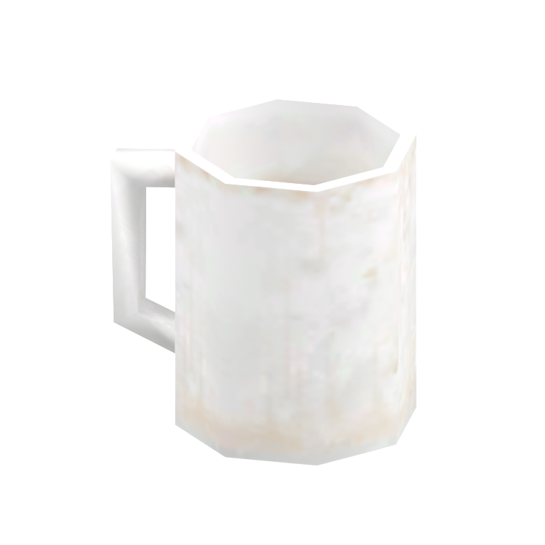
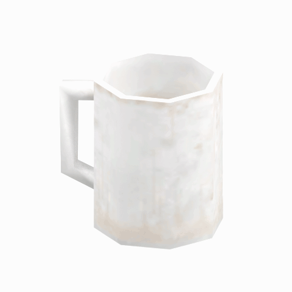

# Unidentified model (afgh_cupp001_br)

Native model reference; a readable object identification has not been reviewed.

[Library](../README.md) | [Category](../tables/unclassified-components-1.md) | [Source / advanced data](../catalogue.json) | [Credits](../sources-and-credits.md)

**Game filename:** afgh_cupp001_br.fmdl  
**Category:** Unclassified &gt; Unclassified components  
**Variant:** No explicit variant token; **LOD:** 0  
**Tags:** 

## Still reference



## 360-degree reference



The camera circles a static model. This is not a native animation. Source base textures and UVs use approximate studio shading; interaction, collision, complete assembly and FOX shader equivalence are not established.

## Identity and naming

| Field | Value |
|---|---|
| Library ID | mgsv-tpp-afgh_cupp001_br-9a08f9747efd311a |
| Naming status | unidentified |
| Naming confidence | unknown |
| Naming evidence | {} |
| Native model | /Assets/tpp/environ/object/afghanistan/cup/afgh_cupp001/scenes/afgh_cupp001_br.fmdl |
| Model SHA256 | 6f94b0738f59854a7d9dd1181134be6bc9a31e8bf71caf6489a739c98114c29e |
| Container | /Assets/mgo/pack/location/afc0/pack_common/afc0_common.fpk |
| Container SHA256 | 20a950cab0d6912ac3a270b90dc6dc673f2d13859eb636819bfa3955fca6e320 |
| Captured source / location scope | Selected native member/content and captured installed-source chain; full archive SHA/runtime priority unresolved |
| Raw record SHA256 | 4cc99f0cd3288aa47a0b962f66937b74bb198a08f6b157e0112aae1b4efbc5f0 |

Naming review is descriptive metadata only. It does not change model completion or identify a working game interaction.

## Native LOD inventory

| Native LOD | Triangles | Preview status | Decoded indices SHA256 |
|---|---:|---|---|
| 0 | 84 | rendered | 1a9a6c0897f935bb54fe7e5966d4107375a0ec9426c6059c4523d2b4ffb5572f |
| 1 | 68 | not separately rendered | 32e87fe70e8fec782f97e0c00eb5cbeed2ceab1d49557eb30856d03804d017c8 |
| 2 | 58 | not separately rendered | 0856e478233570d43745db9e787909a1bd85788aff0580d5139a11f8baf23a5d |
| 3 | 52 | not separately rendered | 2a63650e3cb2f0432774b99f5e2a794272ef2b6cfe025066004ebd04a3b5d312 |

Mesh detail and texture pixels/mips are separate. Index hashes describe decoded triangle arrays, not packed index-buffer bytes. Only source-recorded native levels are listed.

<details>
<summary>Texture, source and naming technical metadata</summary>

```json
{
  "source": {
    "nativePath": "/Assets/tpp/environ/object/afghanistan/cup/afgh_cupp001/scenes/afgh_cupp001_br.fmdl",
    "nativeSha256": "6f94b0738f59854a7d9dd1181134be6bc9a31e8bf71caf6489a739c98114c29e",
    "stableIdentity": "/assets/tpp/environ/object/afghanistan/cup/afgh_cupp001/scenes/afgh_cupp001_br.fmdl#6f94b0738f59854a7d9dd1181134be6bc9a31e8bf71caf6489a739c98114c29e#8d451499f4ed3b1141d9a2dfaa6f96bc4be8cb072c747d04c94c4ea4459b5f6c",
    "container": {
      "nativePath": "/Assets/mgo/pack/location/afc0/pack_common/afc0_common.fpk",
      "sha256": "20a950cab0d6912ac3a270b90dc6dc673f2d13859eb636819bfa3955fca6e320",
      "status": "Selected installed-source container/member chain captured by community reader"
    },
    "historicalDatOrigin": null,
    "sourceArchiveAtCapture": "master/0/00.dat",
    "locationStatus": "Selected native member/content and captured installed-source chain; full archive SHA/runtime priority unresolved",
    "currentInstalledDatVerified": false,
    "selectedInstalledMemberVerified": true,
    "evidence": {
      "archive_helper_executable_sha256": "6f8e39a436af3b024bbd0504966ab3d5d9d0cb05d86689bf3e83d15e68df613f",
      "archive_helper_source_sha256": "f662d3b63e066a0afc77ffe22ea0e564222d14469648300dba2c4f8e9b43446b",
      "archive_index_recipe": "54acff767f08d76ad6056c5387328759bc883df507788f398de6c2c04fac12db",
      "archive_reader": "Atvaark GzsTool.Core 0.5.3",
      "archive_reader_core_sha256": "9da447ae3c375cce2e46744eeff6af50f1591062afdf479d1a0b49edb47daaa3",
      "archive_tool_and_dictionary_sha256": {
        "CityHash.dll": "def6c4506d461b65e4059b2936b2cbd5f852ba5d1d8a1a527f1c0e6dc7008c8f",
        "GzsTool.Core.dll": "9da447ae3c375cce2e46744eeff6af50f1591062afdf479d1a0b49edb47daaa3",
        "GzsTool.exe": "1a9c5b11e2355383ff485aee7e86abc026f5c1fad729daf8c0fd15ee0aae1c10",
        "Zlib.Portable.dll": "fe84781ba35ca9cc5ff5f73fd08d2a66c59e5257b4573f5fe59743f30bf78e42",
        "fpk_dictionary.txt": "b82f9a8d6c10a68ba9471eca9d815c21355a53b5e68753d8ad7db7fd01bf401d",
        "qar_dictionary.txt": "1558c248ed0a4bb827888261563fbb91a2df4f03999682f85d637ff70d9d5fb2"
      },
      "bytes": 5888,
      "container_chain": [
        {
          "content_sha256": null,
          "depth": 0,
          "id": "3f19555d27c2ebecdfbad26aadd88b9f62e9fb6092c04c712963ef73c67ccb42",
          "index_sha256": "9acd3675d6e1500e0e18430cba0fdc70a5718ad7d6b62f13905891a35d59f18a",
          "kind": "qar",
          "name": "master/0/00.dat",
          "parent_occurrence": null
        },
        {
          "content_sha256": "20a950cab0d6912ac3a270b90dc6dc673f2d13859eb636819bfa3955fca6e320",
          "depth": 1,
          "id": "f1334a28f5fb887d989a9c548d11dccada12186358e0a4b4e7fc9831f6f42881",
          "index_sha256": "e15578c97612208569f283c28408f389fb560576e3976adf9d7aa8ed9c9aaf87",
          "kind": "fpk",
          "name": "/Assets/mgo/pack/location/afc0/pack_common/afc0_common.fpk",
          "parent_occurrence": "348190d8da3d429c2cdae58af0494f023c46b80f66da14d484dc54a7e17a97df"
        }
      ],
      "contentSha256": "6f94b0738f59854a7d9dd1181134be6bc9a31e8bf71caf6489a739c98114c29e",
      "member": {
        "actual_size": 5888,
        "compressed_size": null,
        "content_sha256": "6f94b0738f59854a7d9dd1181134be6bc9a31e8bf71caf6489a739c98114c29e",
        "declared_size": 5888,
        "extension": "fmdl",
        "hash_hex": null,
        "name": "/Assets/tpp/environ/object/afghanistan/cup/afgh_cupp001/scenes/afgh_cupp001_br.fmdl",
        "name_origin": "embedded",
        "offset": 5756448,
        "ordinal": 172,
        "path_hash": null,
        "resolved": 1
      },
      "occurrenceId": "6eb5ae864ba8e784faaab906f9d5d2af6a335c1568c48d83f1b81d90185b5694",
      "occurrence_id": "6eb5ae864ba8e784faaab906f9d5d2af6a335c1568c48d83f1b81d90185b5694",
      "primary_source_revision": "fc4a8196555638c6cf8aa1b7c8dc34ccd5c69cb5",
      "source_adapter": "community_core_selective_export",
      "source_id": "7f6bb743fb4c487f0e9522f9c7fac280c46cf6b1051e0fc75a93602c8eb451f0",
      "source_path": "master/0/00.dat",
      "source_snapshot": "{\"bytes\":768788480,\"device\":621747392682911458,\"file_id\":844424931596481,\"header_sha256\":\"ead50f0a9a37e4285323b9c6fa0ec75fe75e518c63147e63158eeb2892c6589e\",\"mtime_ns\":1791852224238580700}",
      "virtualPath": "/Assets/tpp/environ/object/afghanistan/cup/afgh_cupp001/scenes/afgh_cupp001_br.fmdl"
    }
  },
  "materials": [
    {
      "sampler": "Base_Tex_SRGB",
      "materialIndex": 0,
      "nativePathHash": "1542602313695207024",
      "nativeVirtualPath": null,
      "nativeBinding": {
        "familyId": "3171adc31fcfb6ebcc3fc64c689333f0317f407492972075061203b9c62bf753",
        "height": 128,
        "materialIndex": 0,
        "mipCount": 6,
        "nativeMipCountVerified": true,
        "nativePath": null,
        "nativePathHash": "1542602313695207024",
        "nativeTexture": {
          "additionalFtexsFileCount": 0,
          "depth": 1,
          "ftexsFileCount": 1,
          "height": 128,
          "metadataBytes": 160,
          "mipCount": 6,
          "mips": [
            {
              "chunks": 1,
              "decodedBytes": 8192,
              "mip": 0,
              "offset": 2232,
              "storedBytes": 5008,
              "streamNumber": 1
            },
            {
              "chunks": 1,
              "decodedBytes": 2048,
              "mip": 1,
              "offset": 704,
              "storedBytes": 1520,
              "streamNumber": 1
            },
            {
              "chunks": 1,
              "decodedBytes": 512,
              "mip": 2,
              "offset": 232,
              "storedBytes": 464,
              "streamNumber": 1
            },
            {
              "chunks": 1,
              "decodedBytes": 128,
              "mip": 3,
              "offset": 80,
              "storedBytes": 144,
              "streamNumber": 1
            },
            {
              "chunks": 1,
              "decodedBytes": 32,
              "mip": 4,
              "offset": 24,
              "storedBytes": 48,
              "streamNumber": 1
            },
            {
              "chunks": 1,
              "decodedBytes": 8,
              "mip": 5,
              "offset": 0,
              "storedBytes": 16,
              "streamNumber": 1
            }
          ],
          "nativeHeaderHash": "eec875286237fc6f67b1da56281c4b95",
          "nrtFlag": 2,
          "pixelFormat": 2,
          "requiredStreamNumbers": [
            1
          ],
          "textureType": 16777219,
          "unknownFlags": 273,
          "width": 128
        },
        "samplerName": "Base_Tex_SRGB",
        "samplerNameHash": "72475356961633",
        "sha256": "de1edfc97d632dc43dd7e2e6489c3295d1b1e206878d75329de6dfb1628421ec",
        "sourceOccurrences": [
          {
            "archive_helper_executable_sha256": "6f8e39a436af3b024bbd0504966ab3d5d9d0cb05d86689bf3e83d15e68df613f",
            "archive_helper_source_sha256": "f662d3b63e066a0afc77ffe22ea0e564222d14469648300dba2c4f8e9b43446b",
            "archive_index_recipe": "54acff767f08d76ad6056c5387328759bc883df507788f398de6c2c04fac12db",
            "archive_reader": "Atvaark GzsTool.Core 0.5.3",
            "archive_reader_core_sha256": "9da447ae3c375cce2e46744eeff6af50f1591062afdf479d1a0b49edb47daaa3",
            "archive_tool_and_dictionary_sha256": {
              "CityHash.dll": "def6c4506d461b65e4059b2936b2cbd5f852ba5d1d8a1a527f1c0e6dc7008c8f",
              "GzsTool.Core.dll": "9da447ae3c375cce2e46744eeff6af50f1591062afdf479d1a0b49edb47daaa3",
              "GzsTool.exe": "1a9c5b11e2355383ff485aee7e86abc026f5c1fad729daf8c0fd15ee0aae1c10",
              "Zlib.Portable.dll": "fe84781ba35ca9cc5ff5f73fd08d2a66c59e5257b4573f5fe59743f30bf78e42",
              "fpk_dictionary.txt": "b82f9a8d6c10a68ba9471eca9d815c21355a53b5e68753d8ad7db7fd01bf401d",
              "qar_dictionary.txt": "1558c248ed0a4bb827888261563fbb91a2df4f03999682f85d637ff70d9d5fb2"
            },
            "bytes": 160,
            "container_chain": [
              {
                "content_sha256": null,
                "depth": 0,
                "id": "3f19555d27c2ebecdfbad26aadd88b9f62e9fb6092c04c712963ef73c67ccb42",
                "index_sha256": "9acd3675d6e1500e0e18430cba0fdc70a5718ad7d6b62f13905891a35d59f18a",
                "kind": "qar",
                "name": "master/0/00.dat",
                "parent_occurrence": null
              },
              {
                "content_sha256": "c371a18745c941878107bdaf7aef71c13b09b8b3a574360f6e38e0a7172b74e6",
                "depth": 1,
                "id": "13570131ff9ebc75c266205cbdf3461ff4dc51e8a0cb4f7407b0a08fe357052a",
                "index_sha256": "5b8e60a5e6b705cb87973f15c3215fb3733b7a49171030a4c7640da4622a5ca2",
                "kind": "pftxs",
                "name": "/Assets/mgo/pack/location/afc0/pack_common/afc0_common.pftxs",
                "parent_occurrence": "abc314b7f418d61ea6a3e5525bf8f85d22b454b81d3407e6645bfc43339658ac"
              }
            ],
            "contentSha256": "07649d3e08d941e8c3587c26a5fce1baa1a27aa1146e198672c4b146070956ce",
            "member": {
              "actual_size": 160,
              "compressed_size": null,
              "content_sha256": "07649d3e08d941e8c3587c26a5fce1baa1a27aa1146e198672c4b146070956ce",
              "declared_size": 160,
              "extension": "ftex",
              "hash_hex": "15686ca1997f9e70",
              "name": "15686ca1997f9e70.ftex",
              "name_origin": "hash_fallback",
              "offset": 11289568,
              "ordinal": 689,
              "path_hash": null,
              "resolved": 0
            },
            "occurrenceId": "57b9a892adb31b48dfbf6df88d09c8456d7b88885ee3162153abb20f7b1467e8",
            "occurrence_id": "57b9a892adb31b48dfbf6df88d09c8456d7b88885ee3162153abb20f7b1467e8",
            "primary_source_revision": "fc4a8196555638c6cf8aa1b7c8dc34ccd5c69cb5",
            "source_adapter": "community_core_selective_export",
            "source_id": "7f6bb743fb4c487f0e9522f9c7fac280c46cf6b1051e0fc75a93602c8eb451f0",
            "source_path": "master/0/00.dat",
            "source_snapshot": "{\"bytes\":768788480,\"device\":621747392682911458,\"file_id\":844424931596481,\"header_sha256\":\"ead50f0a9a37e4285323b9c6fa0ec75fe75e518c63147e63158eeb2892c6589e\",\"mtime_ns\":1791852224238580700}",
            "virtualPath": "15686ca1997f9e70.ftex"
          },
          {
            "archive_helper_executable_sha256": "6f8e39a436af3b024bbd0504966ab3d5d9d0cb05d86689bf3e83d15e68df613f",
            "archive_helper_source_sha256": "f662d3b63e066a0afc77ffe22ea0e564222d14469648300dba2c4f8e9b43446b",
            "archive_index_recipe": "54acff767f08d76ad6056c5387328759bc883df507788f398de6c2c04fac12db",
            "archive_reader": "Atvaark GzsTool.Core 0.5.3",
            "archive_reader_core_sha256": "9da447ae3c375cce2e46744eeff6af50f1591062afdf479d1a0b49edb47daaa3",
            "archive_tool_and_dictionary_sha256": {
              "CityHash.dll": "def6c4506d461b65e4059b2936b2cbd5f852ba5d1d8a1a527f1c0e6dc7008c8f",
              "GzsTool.Core.dll": "9da447ae3c375cce2e46744eeff6af50f1591062afdf479d1a0b49edb47daaa3",
              "GzsTool.exe": "1a9c5b11e2355383ff485aee7e86abc026f5c1fad729daf8c0fd15ee0aae1c10",
              "Zlib.Portable.dll": "fe84781ba35ca9cc5ff5f73fd08d2a66c59e5257b4573f5fe59743f30bf78e42",
              "fpk_dictionary.txt": "b82f9a8d6c10a68ba9471eca9d815c21355a53b5e68753d8ad7db7fd01bf401d",
              "qar_dictionary.txt": "1558c248ed0a4bb827888261563fbb91a2df4f03999682f85d637ff70d9d5fb2"
            },
            "bytes": 7248,
            "container_chain": [
              {
                "content_sha256": null,
                "depth": 0,
                "id": "0b473016351235050c2f6af21454bd979a0ad4602a9860137c807c894c5eba4d",
                "index_sha256": "ac9b4dae0dd0166db3a6ec8da18524dffebcbaf9004569af631de82913bf49a3",
                "kind": "qar",
                "name": "master/texture2.dat",
                "parent_occurrence": null
              }
            ],
            "contentSha256": "a08fdff36dbef618775966f77cfec7e267c236286ab88f4c6d0340692aecc703",
            "member": {
              "actual_size": 7248,
              "compressed_size": 7248,
              "content_sha256": "a08fdff36dbef618775966f77cfec7e267c236286ab88f4c6d0340692aecc703",
              "declared_size": 7248,
              "extension": "1.ftexs",
              "hash_hex": "b2c06ca1997f9e70",
              "name": "6ca1997f9e70.1.ftexs",
              "name_origin": "hash_fallback",
              "offset": 1643044896,
              "ordinal": 9933,
              "path_hash": "6ca1997f9e70",
              "resolved": 0
            },
            "occurrenceId": "30c5078e299fc78211accde35008756506782877f244ba2a4ff27b8fad3b2cf6",
            "occurrence_id": "30c5078e299fc78211accde35008756506782877f244ba2a4ff27b8fad3b2cf6",
            "primary_source_revision": "fc4a8196555638c6cf8aa1b7c8dc34ccd5c69cb5",
            "source_adapter": "community_core_selective_export",
            "source_id": "85e8296057664cbc6ebaf6bd43d1c6d18528bbd8a6fae920bdf4d5eb69f6a93d",
            "source_path": "master/texture2.dat",
            "source_snapshot": "{\"bytes\":2920239104,\"device\":621747392682911458,\"file_id\":562949953639626,\"header_sha256\":\"72bfee707623afb5f3abd8382035d3d4258b4941ac583a56f5a447f47123dcab\",\"mtime_ns\":1791224675561235200}",
            "virtualPath": "6ca1997f9e70.1.ftexs"
          }
        ],
        "width": 128
      },
      "ddsSha256": "de1edfc97d632dc43dd7e2e6489c3295d1b1e206878d75329de6dfb1628421ec",
      "dimensions": [
        128,
        128
      ],
      "mipCount": 6,
      "nativeMipCountVerified": true,
      "connectedInPreview": true
    }
  ],
  "quality": {
    "decodedIndicesHashDerivation": "SHA256 of canonical UTF-8 JSON decoded triangle indices grouped by mesh; not packed buffer bytes",
    "highestRetainedGeometricLod": 0,
    "distinctNativeLods": 4,
    "baseTextureDimensions": [
      128,
      128
    ],
    "baseTextureNativeMipCount": 6,
    "largerRetainedBaseTextureFound": null,
    "nativeLods": [
      {
        "indicesSha256": "1a9a6c0897f935bb54fe7e5966d4107375a0ec9426c6059c4523d2b4ffb5572f",
        "nativeLod": 0,
        "triangles": 84
      },
      {
        "indicesSha256": "32e87fe70e8fec782f97e0c00eb5cbeed2ceab1d49557eb30856d03804d017c8",
        "nativeLod": 1,
        "triangles": 68
      },
      {
        "indicesSha256": "0856e478233570d43745db9e787909a1bd85788aff0580d5139a11f8baf23a5d",
        "nativeLod": 2,
        "triangles": 58
      },
      {
        "indicesSha256": "2a63650e3cb2f0432774b99f5e2a794272ef2b6cfe025066004ebd04a3b5d312",
        "nativeLod": 3,
        "triangles": 52
      }
    ],
    "renderedNativeLods": [
      0
    ],
    "baseTextureSummary": "128 x 128; 6 native/DDS mips",
    "highestDetailScope": "Triangle-count comparison within captured FMDL only"
  }
}
```

</details>

[Original source / advanced record](../catalogue.json)
