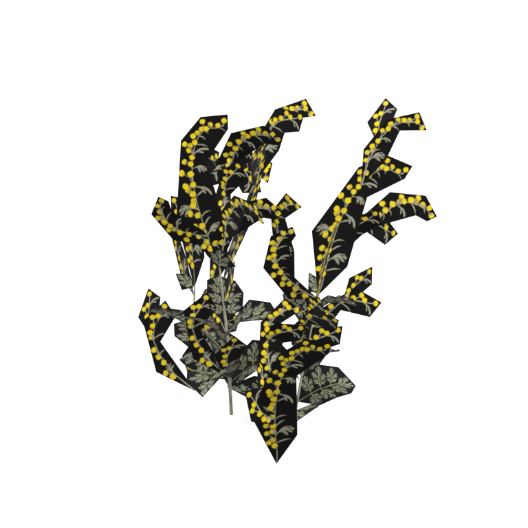
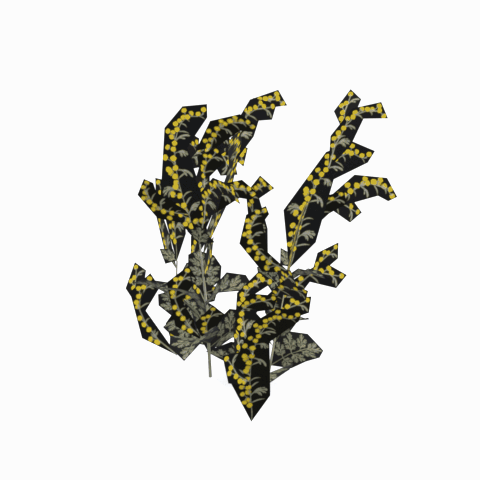

# Unidentified model (afgh_flwr001)

Native model reference; a readable object identification has not been reviewed.

[Library](../README.md) | [Category](../tables/unclassified-components-1.md) | [Source / advanced data](../catalogue.json) | [Credits](../sources-and-credits.md)

**Game filename:** afgh_flwr001.fmdl  
**Category:** Unclassified &gt; Unclassified components  
**Variant:** No explicit variant token; **LOD:** 0  
**Tags:** 

## Still reference



## 360-degree reference



The camera circles a static model. This is not a native animation. Source base textures and UVs use approximate studio shading; interaction, collision, complete assembly and FOX shader equivalence are not established.

## Identity and naming

| Field | Value |
|---|---|
| Library ID | mgsv-tpp-afgh_flwr001-87b4ef794f63b8de |
| Naming status | unidentified |
| Naming confidence | unknown |
| Naming evidence | {} |
| Native model | /Assets/tpp/environ/object/afghanistan/flower/afgh_flwr001/scenes/afgh_flwr001.fmdl |
| Model SHA256 | acd5f15c34c5a783cfc7bbd0bd595f62178b69b0c5450f9ad6c67693cde0f60c |
| Container | /Assets/tpp/pack/location/mafr/pack_common/mafr_common.fpk |
| Container SHA256 | f190fe3f9abedbe057970d3cd4cd0577c2f8c5e3742465b644d9588b9f28c1dd |
| Captured source / location scope | Selected native member/content and captured installed-source chain; full archive SHA/runtime priority unresolved |
| Raw record SHA256 | 4b083410d01052e9ef02df3462235cb8bc7e54eaf7175f4c3eeeae5e4fc4fae0 |

Naming review is descriptive metadata only. It does not change model completion or identify a working game interaction.

## Native LOD inventory

| Native LOD | Triangles | Preview status | Decoded indices SHA256 |
|---|---:|---|---|
| 0 | 402 | rendered | e9c3f25b65b3359cdc390ef8763e22a541c9639fefcbf95a08a85ee35cedb1fa |
| 1 | 400 | not separately rendered | 9b48404edc14d5f25419953abc83c8e2493ed17fb37d4326ad763305d6308c2c |
| 2 | 398 | not separately rendered | bb058594c334143cf1b3a2019df9d46b4331cd23578aefc267c12e6dd0b792e4 |
| 3 | 398 | not separately rendered | bb058594c334143cf1b3a2019df9d46b4331cd23578aefc267c12e6dd0b792e4 |

Mesh detail and texture pixels/mips are separate. Index hashes describe decoded triangle arrays, not packed index-buffer bytes. Only source-recorded native levels are listed.

<details>
<summary>Texture, source and naming technical metadata</summary>

```json
{
  "source": {
    "nativePath": "/Assets/tpp/environ/object/afghanistan/flower/afgh_flwr001/scenes/afgh_flwr001.fmdl",
    "nativeSha256": "acd5f15c34c5a783cfc7bbd0bd595f62178b69b0c5450f9ad6c67693cde0f60c",
    "stableIdentity": "/assets/tpp/environ/object/afghanistan/flower/afgh_flwr001/scenes/afgh_flwr001.fmdl#acd5f15c34c5a783cfc7bbd0bd595f62178b69b0c5450f9ad6c67693cde0f60c#7fb8ee85cc30c485219ea9aa00d101dbd6105a36a124835435768ddeae05e1fa",
    "container": {
      "nativePath": "/Assets/tpp/pack/location/mafr/pack_common/mafr_common.fpk",
      "sha256": "f190fe3f9abedbe057970d3cd4cd0577c2f8c5e3742465b644d9588b9f28c1dd",
      "status": "Selected installed-source container/member chain captured by community reader"
    },
    "historicalDatOrigin": null,
    "sourceArchiveAtCapture": "master/0/00.dat",
    "locationStatus": "Selected native member/content and captured installed-source chain; full archive SHA/runtime priority unresolved",
    "currentInstalledDatVerified": false,
    "selectedInstalledMemberVerified": true,
    "evidence": {
      "archive_helper_executable_sha256": "6f8e39a436af3b024bbd0504966ab3d5d9d0cb05d86689bf3e83d15e68df613f",
      "archive_helper_source_sha256": "f662d3b63e066a0afc77ffe22ea0e564222d14469648300dba2c4f8e9b43446b",
      "archive_index_recipe": "54acff767f08d76ad6056c5387328759bc883df507788f398de6c2c04fac12db",
      "archive_reader": "Atvaark GzsTool.Core 0.5.3",
      "archive_reader_core_sha256": "9da447ae3c375cce2e46744eeff6af50f1591062afdf479d1a0b49edb47daaa3",
      "archive_tool_and_dictionary_sha256": {
        "CityHash.dll": "def6c4506d461b65e4059b2936b2cbd5f852ba5d1d8a1a527f1c0e6dc7008c8f",
        "GzsTool.Core.dll": "9da447ae3c375cce2e46744eeff6af50f1591062afdf479d1a0b49edb47daaa3",
        "GzsTool.exe": "1a9c5b11e2355383ff485aee7e86abc026f5c1fad729daf8c0fd15ee0aae1c10",
        "Zlib.Portable.dll": "fe84781ba35ca9cc5ff5f73fd08d2a66c59e5257b4573f5fe59743f30bf78e42",
        "fpk_dictionary.txt": "b82f9a8d6c10a68ba9471eca9d815c21355a53b5e68753d8ad7db7fd01bf401d",
        "qar_dictionary.txt": "1558c248ed0a4bb827888261563fbb91a2df4f03999682f85d637ff70d9d5fb2"
      },
      "bytes": 21952,
      "container_chain": [
        {
          "content_sha256": null,
          "depth": 0,
          "id": "3f19555d27c2ebecdfbad26aadd88b9f62e9fb6092c04c712963ef73c67ccb42",
          "index_sha256": "9acd3675d6e1500e0e18430cba0fdc70a5718ad7d6b62f13905891a35d59f18a",
          "kind": "qar",
          "name": "master/0/00.dat",
          "parent_occurrence": null
        },
        {
          "content_sha256": "f190fe3f9abedbe057970d3cd4cd0577c2f8c5e3742465b644d9588b9f28c1dd",
          "depth": 1,
          "id": "83d676db80f7630da732fdad03f7fe1025886077b82004976becc58ef390bb63",
          "index_sha256": "14377a1d728f7204eef604f74df308bc5054ed3e46c71785e4ef95c39fe398ab",
          "kind": "fpk",
          "name": "/Assets/tpp/pack/location/mafr/pack_common/mafr_common.fpk",
          "parent_occurrence": "393d9716b360dcbb6d5a57d979acbb87ade6a922d939f1c79a31222858343158"
        }
      ],
      "contentSha256": "acd5f15c34c5a783cfc7bbd0bd595f62178b69b0c5450f9ad6c67693cde0f60c",
      "member": {
        "actual_size": 21952,
        "compressed_size": null,
        "content_sha256": "acd5f15c34c5a783cfc7bbd0bd595f62178b69b0c5450f9ad6c67693cde0f60c",
        "declared_size": 21952,
        "extension": "fmdl",
        "hash_hex": null,
        "name": "/Assets/tpp/environ/object/afghanistan/flower/afgh_flwr001/scenes/afgh_flwr001.fmdl",
        "name_origin": "embedded",
        "offset": 1980416,
        "ordinal": 21,
        "path_hash": null,
        "resolved": 1
      },
      "occurrenceId": "ac3ad77ec16107e76dbca857e58bd40d728e3fd358d16b77a5c87088c3d31c9a",
      "occurrence_id": "ac3ad77ec16107e76dbca857e58bd40d728e3fd358d16b77a5c87088c3d31c9a",
      "primary_source_revision": "fc4a8196555638c6cf8aa1b7c8dc34ccd5c69cb5",
      "source_adapter": "community_core_selective_export",
      "source_id": "7f6bb743fb4c487f0e9522f9c7fac280c46cf6b1051e0fc75a93602c8eb451f0",
      "source_path": "master/0/00.dat",
      "source_snapshot": "{\"bytes\":768788480,\"device\":621747392682911458,\"file_id\":844424931596481,\"header_sha256\":\"ead50f0a9a37e4285323b9c6fa0ec75fe75e518c63147e63158eeb2892c6589e\",\"mtime_ns\":1791852224238580700}",
      "virtualPath": "/Assets/tpp/environ/object/afghanistan/flower/afgh_flwr001/scenes/afgh_flwr001.fmdl"
    }
  },
  "materials": [
    {
      "sampler": "Base_Tex_SRGB",
      "materialIndex": 0,
      "nativePathHash": "1543245601003629831",
      "nativeVirtualPath": null,
      "nativeBinding": {
        "familyId": "ee673996c7ad7e7bc9a8dfb9d58843262384bb608b7225489d059bcc5cc15075",
        "height": 1024,
        "materialIndex": 0,
        "mipCount": 9,
        "nativeMipCountVerified": true,
        "nativePath": null,
        "nativePathHash": "1543245601003629831",
        "nativeTexture": {
          "additionalFtexsFileCount": 2,
          "depth": 1,
          "ftexsFileCount": 3,
          "height": 1024,
          "metadataBytes": 208,
          "mipCount": 9,
          "mips": [
            {
              "chunks": 64,
              "decodedBytes": 1048576,
              "mip": 0,
              "offset": 0,
              "storedBytes": 343456,
              "streamNumber": 3
            },
            {
              "chunks": 16,
              "decodedBytes": 262144,
              "mip": 1,
              "offset": 0,
              "storedBytes": 107856,
              "streamNumber": 2
            },
            {
              "chunks": 4,
              "decodedBytes": 65536,
              "mip": 2,
              "offset": 14672,
              "storedBytes": 32496,
              "streamNumber": 1
            },
            {
              "chunks": 1,
              "decodedBytes": 16384,
              "mip": 3,
              "offset": 4520,
              "storedBytes": 10144,
              "streamNumber": 1
            },
            {
              "chunks": 1,
              "decodedBytes": 4096,
              "mip": 4,
              "offset": 1376,
              "storedBytes": 3136,
              "streamNumber": 1
            },
            {
              "chunks": 1,
              "decodedBytes": 1024,
              "mip": 5,
              "offset": 408,
              "storedBytes": 960,
              "streamNumber": 1
            },
            {
              "chunks": 1,
              "decodedBytes": 256,
              "mip": 6,
              "offset": 128,
              "storedBytes": 272,
              "streamNumber": 1
            },
            {
              "chunks": 1,
              "decodedBytes": 64,
              "mip": 7,
              "offset": 40,
              "storedBytes": 80,
              "streamNumber": 1
            },
            {
              "chunks": 1,
              "decodedBytes": 16,
              "mip": 8,
              "offset": 0,
              "storedBytes": 32,
              "streamNumber": 1
            }
          ],
          "nativeHeaderHash": "32ebd060e6bf7821aea1fd13b53be014",
          "nrtFlag": 2,
          "pixelFormat": 4,
          "requiredStreamNumbers": [
            1,
            2,
            3
          ],
          "textureType": 16777219,
          "unknownFlags": 273,
          "width": 1024
        },
        "samplerName": "Base_Tex_SRGB",
        "samplerNameHash": "72475356961633",
        "sha256": "7c4c8995bb76128f361cc750a4c63b5a073a54b825c03fc3680c08d4658b871d",
        "sourceOccurrences": [
          {
            "archive_helper_executable_sha256": "6f8e39a436af3b024bbd0504966ab3d5d9d0cb05d86689bf3e83d15e68df613f",
            "archive_helper_source_sha256": "f662d3b63e066a0afc77ffe22ea0e564222d14469648300dba2c4f8e9b43446b",
            "archive_index_recipe": "54acff767f08d76ad6056c5387328759bc883df507788f398de6c2c04fac12db",
            "archive_reader": "Atvaark GzsTool.Core 0.5.3",
            "archive_reader_core_sha256": "9da447ae3c375cce2e46744eeff6af50f1591062afdf479d1a0b49edb47daaa3",
            "archive_tool_and_dictionary_sha256": {
              "CityHash.dll": "def6c4506d461b65e4059b2936b2cbd5f852ba5d1d8a1a527f1c0e6dc7008c8f",
              "GzsTool.Core.dll": "9da447ae3c375cce2e46744eeff6af50f1591062afdf479d1a0b49edb47daaa3",
              "GzsTool.exe": "1a9c5b11e2355383ff485aee7e86abc026f5c1fad729daf8c0fd15ee0aae1c10",
              "Zlib.Portable.dll": "fe84781ba35ca9cc5ff5f73fd08d2a66c59e5257b4573f5fe59743f30bf78e42",
              "fpk_dictionary.txt": "b82f9a8d6c10a68ba9471eca9d815c21355a53b5e68753d8ad7db7fd01bf401d",
              "qar_dictionary.txt": "1558c248ed0a4bb827888261563fbb91a2df4f03999682f85d637ff70d9d5fb2"
            },
            "bytes": 208,
            "container_chain": [
              {
                "content_sha256": null,
                "depth": 0,
                "id": "06035c7f54d1fe3fde25c93eb85d5278f37457e9730b7b0dc0553ea567520e6d",
                "index_sha256": "be525e8d33187ab76b3f97935035faac60a4c7ca7fcff3401a0ce712f03c285e",
                "kind": "qar",
                "name": "master/texture3.dat",
                "parent_occurrence": null
              }
            ],
            "contentSha256": "a29f6897ca950e77cee2e9902c9ee27bc47bbfa1373d23e718f5ee7bc30cbb41",
            "member": {
              "actual_size": 208,
              "compressed_size": 208,
              "content_sha256": "a29f6897ca950e77cee2e9902c9ee27bc47bbfa1373d23e718f5ee7bc30cbb41",
              "declared_size": 208,
              "extension": "ftex",
              "hash_hex": "156ab5b299016d07",
              "name": "2b5b299016d07.ftex",
              "name_origin": "hash_fallback",
              "offset": 854093856,
              "ordinal": 7375,
              "path_hash": "2b5b299016d07",
              "resolved": 0
            },
            "occurrenceId": "bd542bc8905ed66c394cfe4e39824e79024608402145e865d3f56e5e991b3b92",
            "occurrence_id": "bd542bc8905ed66c394cfe4e39824e79024608402145e865d3f56e5e991b3b92",
            "primary_source_revision": "fc4a8196555638c6cf8aa1b7c8dc34ccd5c69cb5",
            "source_adapter": "community_core_selective_export",
            "source_id": "8d93a1c4a39e41ca988ccdecf8dbaa5fa7e6f9f82b75bea9a691d2b01de50ef8",
            "source_path": "master/texture3.dat",
            "source_snapshot": "{\"bytes\":1297381376,\"device\":621747392682911458,\"file_id\":562949953639627,\"header_sha256\":\"55c07d7fb3cb3498d10fa3bed93a81ce330553a903fff3222b5bf307bcc7ef0c\",\"mtime_ns\":1791224675561235200}",
            "virtualPath": "2b5b299016d07.ftex"
          },
          {
            "archive_helper_executable_sha256": "6f8e39a436af3b024bbd0504966ab3d5d9d0cb05d86689bf3e83d15e68df613f",
            "archive_helper_source_sha256": "f662d3b63e066a0afc77ffe22ea0e564222d14469648300dba2c4f8e9b43446b",
            "archive_index_recipe": "54acff767f08d76ad6056c5387328759bc883df507788f398de6c2c04fac12db",
            "archive_reader": "Atvaark GzsTool.Core 0.5.3",
            "archive_reader_core_sha256": "9da447ae3c375cce2e46744eeff6af50f1591062afdf479d1a0b49edb47daaa3",
            "archive_tool_and_dictionary_sha256": {
              "CityHash.dll": "def6c4506d461b65e4059b2936b2cbd5f852ba5d1d8a1a527f1c0e6dc7008c8f",
              "GzsTool.Core.dll": "9da447ae3c375cce2e46744eeff6af50f1591062afdf479d1a0b49edb47daaa3",
              "GzsTool.exe": "1a9c5b11e2355383ff485aee7e86abc026f5c1fad729daf8c0fd15ee0aae1c10",
              "Zlib.Portable.dll": "fe84781ba35ca9cc5ff5f73fd08d2a66c59e5257b4573f5fe59743f30bf78e42",
              "fpk_dictionary.txt": "b82f9a8d6c10a68ba9471eca9d815c21355a53b5e68753d8ad7db7fd01bf401d",
              "qar_dictionary.txt": "1558c248ed0a4bb827888261563fbb91a2df4f03999682f85d637ff70d9d5fb2"
            },
            "bytes": 47200,
            "container_chain": [
              {
                "content_sha256": null,
                "depth": 0,
                "id": "436c8cfb4f382de93365b167a61aa81383299b7bad18205d60f1d0beeb3919e3",
                "index_sha256": "2d7b45c6ca65418839618e978562cac336091c06eb56dfe99f762b07a4016960",
                "kind": "qar",
                "name": "master/texture4.dat",
                "parent_occurrence": null
              }
            ],
            "contentSha256": "8634d5d61db39455613f2e8b77f78aed476c907e8b246b27130475873ac1b9ad",
            "member": {
              "actual_size": 47200,
              "compressed_size": 47200,
              "content_sha256": "8634d5d61db39455613f2e8b77f78aed476c907e8b246b27130475873ac1b9ad",
              "declared_size": 47200,
              "extension": "1.ftexs",
              "hash_hex": "b2c2b5b299016d07",
              "name": "2b5b299016d07.1.ftexs",
              "name_origin": "hash_fallback",
              "offset": 824842272,
              "ordinal": 5040,
              "path_hash": "2b5b299016d07",
              "resolved": 0
            },
            "occurrenceId": "20ab94cb956f33b7e07a7731e2c9fb623340ff741d7624bfb07b09ff55123978",
            "occurrence_id": "20ab94cb956f33b7e07a7731e2c9fb623340ff741d7624bfb07b09ff55123978",
            "primary_source_revision": "fc4a8196555638c6cf8aa1b7c8dc34ccd5c69cb5",
            "source_adapter": "community_core_selective_export",
            "source_id": "6c31b98b4db9b88eb76cfcb538f5f34b4729531266a9459584126720a4fc14aa",
            "source_path": "master/texture4.dat",
            "source_snapshot": "{\"bytes\":2031604736,\"device\":621747392682911458,\"file_id\":562949953639628,\"header_sha256\":\"40ee2c6917b338f7f68c49847c97fe92b978506a1ba847fcc94d28c931c8711a\",\"mtime_ns\":1791224675561235200}",
            "virtualPath": "2b5b299016d07.1.ftexs"
          },
          {
            "archive_helper_executable_sha256": "6f8e39a436af3b024bbd0504966ab3d5d9d0cb05d86689bf3e83d15e68df613f",
            "archive_helper_source_sha256": "f662d3b63e066a0afc77ffe22ea0e564222d14469648300dba2c4f8e9b43446b",
            "archive_index_recipe": "54acff767f08d76ad6056c5387328759bc883df507788f398de6c2c04fac12db",
            "archive_reader": "Atvaark GzsTool.Core 0.5.3",
            "archive_reader_core_sha256": "9da447ae3c375cce2e46744eeff6af50f1591062afdf479d1a0b49edb47daaa3",
            "archive_tool_and_dictionary_sha256": {
              "CityHash.dll": "def6c4506d461b65e4059b2936b2cbd5f852ba5d1d8a1a527f1c0e6dc7008c8f",
              "GzsTool.Core.dll": "9da447ae3c375cce2e46744eeff6af50f1591062afdf479d1a0b49edb47daaa3",
              "GzsTool.exe": "1a9c5b11e2355383ff485aee7e86abc026f5c1fad729daf8c0fd15ee0aae1c10",
              "Zlib.Portable.dll": "fe84781ba35ca9cc5ff5f73fd08d2a66c59e5257b4573f5fe59743f30bf78e42",
              "fpk_dictionary.txt": "b82f9a8d6c10a68ba9471eca9d815c21355a53b5e68753d8ad7db7fd01bf401d",
              "qar_dictionary.txt": "1558c248ed0a4bb827888261563fbb91a2df4f03999682f85d637ff70d9d5fb2"
            },
            "bytes": 107984,
            "container_chain": [
              {
                "content_sha256": null,
                "depth": 0,
                "id": "1cc220d9409d7163b6aca295ed89fd8c7befca6a8f849a8d5d09a2499724c863",
                "index_sha256": "5a818609a652a10d90fb90015661d0cb80898096bbb3aac36382172988d8736d",
                "kind": "qar",
                "name": "master/texture5_mgo0.dat",
                "parent_occurrence": null
              }
            ],
            "contentSha256": "e219863ac8adf323b776db8cf9d97af345136631a0cddfa848a831c0a41b3a3c",
            "member": {
              "actual_size": 107984,
              "compressed_size": 107984,
              "content_sha256": "e219863ac8adf323b776db8cf9d97af345136631a0cddfa848a831c0a41b3a3c",
              "declared_size": 107984,
              "extension": "2.ftexs",
              "hash_hex": "b572b5b299016d07",
              "name": "2b5b299016d07.2.ftexs",
              "name_origin": "hash_fallback",
              "offset": 3299183648,
              "ordinal": 12671,
              "path_hash": "2b5b299016d07",
              "resolved": 0
            },
            "occurrenceId": "11b77f8ccaff00776231dfa728f9651d9d39eb417ae643f20af4e75a316035b9",
            "occurrence_id": "11b77f8ccaff00776231dfa728f9651d9d39eb417ae643f20af4e75a316035b9",
            "primary_source_revision": "fc4a8196555638c6cf8aa1b7c8dc34ccd5c69cb5",
            "source_adapter": "community_core_selective_export",
            "source_id": "24f8989ccaae47940dc20e54ba67442ad562ac0032ab6e3d475e927c81444b56",
            "source_path": "master/texture5_mgo0.dat",
            "source_snapshot": "{\"bytes\":4492370944,\"device\":621747392682911458,\"file_id\":13510798883237422,\"header_sha256\":\"6108fbacb65c84d041742c39e5ca630745240453b336f1059a13b91943f0b011\",\"mtime_ns\":1791224675562234400}",
            "virtualPath": "2b5b299016d07.2.ftexs"
          },
          {
            "archive_helper_executable_sha256": "6f8e39a436af3b024bbd0504966ab3d5d9d0cb05d86689bf3e83d15e68df613f",
            "archive_helper_source_sha256": "f662d3b63e066a0afc77ffe22ea0e564222d14469648300dba2c4f8e9b43446b",
            "archive_index_recipe": "54acff767f08d76ad6056c5387328759bc883df507788f398de6c2c04fac12db",
            "archive_reader": "Atvaark GzsTool.Core 0.5.3",
            "archive_reader_core_sha256": "9da447ae3c375cce2e46744eeff6af50f1591062afdf479d1a0b49edb47daaa3",
            "archive_tool_and_dictionary_sha256": {
              "CityHash.dll": "def6c4506d461b65e4059b2936b2cbd5f852ba5d1d8a1a527f1c0e6dc7008c8f",
              "GzsTool.Core.dll": "9da447ae3c375cce2e46744eeff6af50f1591062afdf479d1a0b49edb47daaa3",
              "GzsTool.exe": "1a9c5b11e2355383ff485aee7e86abc026f5c1fad729daf8c0fd15ee0aae1c10",
              "Zlib.Portable.dll": "fe84781ba35ca9cc5ff5f73fd08d2a66c59e5257b4573f5fe59743f30bf78e42",
              "fpk_dictionary.txt": "b82f9a8d6c10a68ba9471eca9d815c21355a53b5e68753d8ad7db7fd01bf401d",
              "qar_dictionary.txt": "1558c248ed0a4bb827888261563fbb91a2df4f03999682f85d637ff70d9d5fb2"
            },
            "bytes": 343968,
            "container_chain": [
              {
                "content_sha256": null,
                "depth": 0,
                "id": "1cc220d9409d7163b6aca295ed89fd8c7befca6a8f849a8d5d09a2499724c863",
                "index_sha256": "5a818609a652a10d90fb90015661d0cb80898096bbb3aac36382172988d8736d",
                "kind": "qar",
                "name": "master/texture5_mgo0.dat",
                "parent_occurrence": null
              }
            ],
            "contentSha256": "c89bf9086d567a9174c12e87691887fe79980a6c64707a2f42692396ab6da069",
            "member": {
              "actual_size": 343968,
              "compressed_size": 343968,
              "content_sha256": "c89bf9086d567a9174c12e87691887fe79980a6c64707a2f42692396ab6da069",
              "declared_size": 343968,
              "extension": "3.ftexs",
              "hash_hex": "571ab5b299016d07",
              "name": "2b5b299016d07.3.ftexs",
              "name_origin": "hash_fallback",
              "offset": 3299292192,
              "ordinal": 12672,
              "path_hash": "2b5b299016d07",
              "resolved": 0
            },
            "occurrenceId": "0d71e6be304220377267bd98c3481cd44c4674213fdc706fcf995dd97bc43d7a",
            "occurrence_id": "0d71e6be304220377267bd98c3481cd44c4674213fdc706fcf995dd97bc43d7a",
            "primary_source_revision": "fc4a8196555638c6cf8aa1b7c8dc34ccd5c69cb5",
            "source_adapter": "community_core_selective_export",
            "source_id": "24f8989ccaae47940dc20e54ba67442ad562ac0032ab6e3d475e927c81444b56",
            "source_path": "master/texture5_mgo0.dat",
            "source_snapshot": "{\"bytes\":4492370944,\"device\":621747392682911458,\"file_id\":13510798883237422,\"header_sha256\":\"6108fbacb65c84d041742c39e5ca630745240453b336f1059a13b91943f0b011\",\"mtime_ns\":1791224675562234400}",
            "virtualPath": "2b5b299016d07.3.ftexs"
          }
        ],
        "width": 1024
      },
      "ddsSha256": "7c4c8995bb76128f361cc750a4c63b5a073a54b825c03fc3680c08d4658b871d",
      "dimensions": [
        1024,
        1024
      ],
      "mipCount": 9,
      "nativeMipCountVerified": true,
      "connectedInPreview": true
    }
  ],
  "quality": {
    "decodedIndicesHashDerivation": "SHA256 of canonical UTF-8 JSON decoded triangle indices grouped by mesh; not packed buffer bytes",
    "highestRetainedGeometricLod": 0,
    "distinctNativeLods": 3,
    "baseTextureDimensions": [
      1024,
      1024
    ],
    "baseTextureNativeMipCount": 9,
    "largerRetainedBaseTextureFound": null,
    "nativeLods": [
      {
        "indicesSha256": "e9c3f25b65b3359cdc390ef8763e22a541c9639fefcbf95a08a85ee35cedb1fa",
        "nativeLod": 0,
        "triangles": 402
      },
      {
        "indicesSha256": "9b48404edc14d5f25419953abc83c8e2493ed17fb37d4326ad763305d6308c2c",
        "nativeLod": 1,
        "triangles": 400
      },
      {
        "indicesSha256": "bb058594c334143cf1b3a2019df9d46b4331cd23578aefc267c12e6dd0b792e4",
        "nativeLod": 2,
        "triangles": 398
      },
      {
        "duplicateOf": 2,
        "indicesSha256": "bb058594c334143cf1b3a2019df9d46b4331cd23578aefc267c12e6dd0b792e4",
        "nativeLod": 3,
        "triangles": 398
      }
    ],
    "renderedNativeLods": [
      0
    ],
    "baseTextureSummary": "1024 x 1024; 9 native/DDS mips",
    "highestDetailScope": "Triangle-count comparison within captured FMDL only"
  }
}
```

</details>

[Original source / advanced record](../catalogue.json)
