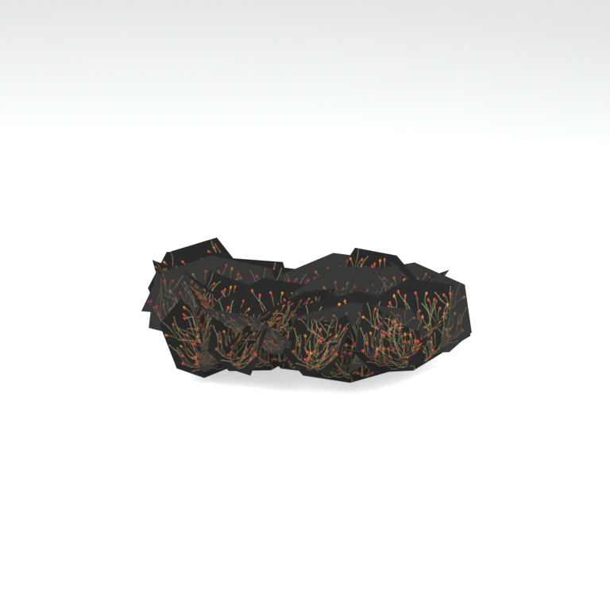
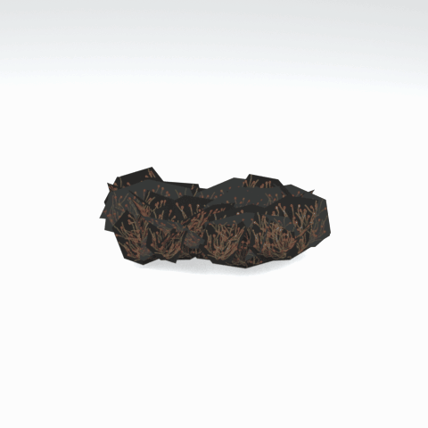

# Unidentified model (afgh_flwr002)

Native model reference; a readable object identification has not been reviewed.

[Library](../README.md) | [Category](../tables/unclassified-components-1.md) | [Source / advanced data](../catalogue.json) | [Credits](../sources-and-credits.md)

**Game filename:** afgh_flwr002.fmdl  
**Category:** Unclassified &gt; Unclassified components  
**Variant:** No explicit variant token; **LOD:** 0  
**Tags:** 

## Still reference



## 360-degree reference



The camera circles a static model. This is not a native animation. Source base textures and UVs use approximate studio shading; interaction, collision, complete assembly and FOX shader equivalence are not established.

## Identity and naming

| Field | Value |
|---|---|
| Library ID | mgsv-tpp-afgh_flwr002-68cfc45e13c2fd0e |
| Naming status | unidentified |
| Naming confidence | unknown |
| Naming evidence | {} |
| Native model | /Assets/tpp/environ/object/afghanistan/flower/afgh_flwr002/scenes/afgh_flwr002.fmdl |
| Model SHA256 | 99753c57c03afdb5a4fa721b764228d42a3f79dc7707cf77c215f7f9175a06ed |
| Container | /Assets/tpp/pack/location/afgh/pack_common/afgh_common.fpk |
| Container SHA256 | 810fe68a28c81299da7ef00849d2905b640d0a2da970f1b312e953a2c7b5df48 |
| Captured source / location scope | Selected native member/content and captured installed-source chain; full archive SHA/runtime priority unresolved |
| Raw record SHA256 | 417f6cdb56ffc9ff807d2f35d661173921149878e4b00c4461245d70d293a6d5 |

Naming review is descriptive metadata only. It does not change model completion or identify a working game interaction.

## Native LOD inventory

| Native LOD | Triangles | Preview status | Decoded indices SHA256 |
|---|---:|---|---|
| 0 | 150 | rendered | 683225c9dc269c3ca8c632ea35c8f173c394dc8571d94aa98074c99526b11c36 |
| 1 | 139 | not separately rendered | 6b43b6fb162f1c9f2059aa603dd6d4cb9215d26b55654fd049add8784d15a48f |
| 2 | 129 | not separately rendered | bfa99066f18f30326411af3ddc38643d1da0919b829540f938674746a5fcee1a |
| 3 | 120 | not separately rendered | a0b6a9e1c8ad76af5819e727236030e6d0838dc121efdb0e21df6038e6bb71a9 |
| 4 | 112 | not separately rendered | b0052b7d888508c9b567fb0a0f4276ddc37a2f046c78a0adf6b704c084bfee84 |
| 5 | 104 | not separately rendered | 23028f407081892c04a92a4ead5b6bdc40923cc3bb7bff8ed4e34746a0717f46 |
| 6 | 97 | not separately rendered | d8d6d69c023d55aff0abcd28f6472542c58b487eb38be3faa1b61fc907879d82 |
| 7 | 91 | not separately rendered | a939a3d2bc29927e267b2a6b447153d3243938159a4dea58957d65d374a901d4 |

Mesh detail and texture pixels/mips are separate. Index hashes describe decoded triangle arrays, not packed index-buffer bytes. Only source-recorded native levels are listed.

<details>
<summary>Texture, source and naming technical metadata</summary>

```json
{
  "source": {
    "nativePath": "/Assets/tpp/environ/object/afghanistan/flower/afgh_flwr002/scenes/afgh_flwr002.fmdl",
    "nativeSha256": "99753c57c03afdb5a4fa721b764228d42a3f79dc7707cf77c215f7f9175a06ed",
    "stableIdentity": "/assets/tpp/environ/object/afghanistan/flower/afgh_flwr002/scenes/afgh_flwr002.fmdl#99753c57c03afdb5a4fa721b764228d42a3f79dc7707cf77c215f7f9175a06ed#a2864d91e36d173df6eb8376fb6ecc471da53e34e08e283be88de5b189bf7005",
    "container": {
      "nativePath": "/Assets/tpp/pack/location/afgh/pack_common/afgh_common.fpk",
      "sha256": "810fe68a28c81299da7ef00849d2905b640d0a2da970f1b312e953a2c7b5df48",
      "status": "Selected installed-source container/member chain captured by community reader"
    },
    "historicalDatOrigin": null,
    "sourceArchiveAtCapture": "master/0/00.dat",
    "locationStatus": "Selected native member/content and captured installed-source chain; full archive SHA/runtime priority unresolved",
    "currentInstalledDatVerified": false,
    "selectedInstalledMemberVerified": true,
    "evidence": {
      "archive_helper_executable_sha256": "6f8e39a436af3b024bbd0504966ab3d5d9d0cb05d86689bf3e83d15e68df613f",
      "archive_helper_source_sha256": "f662d3b63e066a0afc77ffe22ea0e564222d14469648300dba2c4f8e9b43446b",
      "archive_index_recipe": "54acff767f08d76ad6056c5387328759bc883df507788f398de6c2c04fac12db",
      "archive_reader": "Atvaark GzsTool.Core 0.5.3",
      "archive_reader_core_sha256": "9da447ae3c375cce2e46744eeff6af50f1591062afdf479d1a0b49edb47daaa3",
      "archive_tool_and_dictionary_sha256": {
        "CityHash.dll": "def6c4506d461b65e4059b2936b2cbd5f852ba5d1d8a1a527f1c0e6dc7008c8f",
        "GzsTool.Core.dll": "9da447ae3c375cce2e46744eeff6af50f1591062afdf479d1a0b49edb47daaa3",
        "GzsTool.exe": "1a9c5b11e2355383ff485aee7e86abc026f5c1fad729daf8c0fd15ee0aae1c10",
        "Zlib.Portable.dll": "fe84781ba35ca9cc5ff5f73fd08d2a66c59e5257b4573f5fe59743f30bf78e42",
        "fpk_dictionary.txt": "b82f9a8d6c10a68ba9471eca9d815c21355a53b5e68753d8ad7db7fd01bf401d",
        "qar_dictionary.txt": "1558c248ed0a4bb827888261563fbb91a2df4f03999682f85d637ff70d9d5fb2"
      },
      "bytes": 11280,
      "container_chain": [
        {
          "content_sha256": null,
          "depth": 0,
          "id": "3f19555d27c2ebecdfbad26aadd88b9f62e9fb6092c04c712963ef73c67ccb42",
          "index_sha256": "9acd3675d6e1500e0e18430cba0fdc70a5718ad7d6b62f13905891a35d59f18a",
          "kind": "qar",
          "name": "master/0/00.dat",
          "parent_occurrence": null
        },
        {
          "content_sha256": "810fe68a28c81299da7ef00849d2905b640d0a2da970f1b312e953a2c7b5df48",
          "depth": 1,
          "id": "19e9adf189f5f5e9c624197357336d49999dc3525b83bd8c71cf525fcd2100e2",
          "index_sha256": "924ec10c5736f8b618238e2523664271e558a6ad49aefdaf2473ccbad50f1231",
          "kind": "fpk",
          "name": "/Assets/tpp/pack/location/afgh/pack_common/afgh_common.fpk",
          "parent_occurrence": "e35acf6999427a88778266baae8c014a0c20a82388f8ff04caca6a88d977a6d1"
        }
      ],
      "contentSha256": "99753c57c03afdb5a4fa721b764228d42a3f79dc7707cf77c215f7f9175a06ed",
      "member": {
        "actual_size": 11280,
        "compressed_size": null,
        "content_sha256": "99753c57c03afdb5a4fa721b764228d42a3f79dc7707cf77c215f7f9175a06ed",
        "declared_size": 11280,
        "extension": "fmdl",
        "hash_hex": null,
        "name": "/Assets/tpp/environ/object/afghanistan/flower/afgh_flwr002/scenes/afgh_flwr002.fmdl",
        "name_origin": "embedded",
        "offset": 2804640,
        "ordinal": 62,
        "path_hash": null,
        "resolved": 1
      },
      "occurrenceId": "b80e31e5d9b6d1628c4da0aa5878e44e3d6a498efb7344467f5d79e0465e9082",
      "occurrence_id": "b80e31e5d9b6d1628c4da0aa5878e44e3d6a498efb7344467f5d79e0465e9082",
      "primary_source_revision": "fc4a8196555638c6cf8aa1b7c8dc34ccd5c69cb5",
      "source_adapter": "community_core_selective_export",
      "source_id": "7f6bb743fb4c487f0e9522f9c7fac280c46cf6b1051e0fc75a93602c8eb451f0",
      "source_path": "master/0/00.dat",
      "source_snapshot": "{\"bytes\":768788480,\"device\":621747392682911458,\"file_id\":844424931596481,\"header_sha256\":\"ead50f0a9a37e4285323b9c6fa0ec75fe75e518c63147e63158eeb2892c6589e\",\"mtime_ns\":1791852224238580700}",
      "virtualPath": "/Assets/tpp/environ/object/afghanistan/flower/afgh_flwr002/scenes/afgh_flwr002.fmdl"
    }
  },
  "materials": [
    {
      "sampler": "Base_Tex_SRGB",
      "materialIndex": 0,
      "nativePathHash": "1542973611857326236",
      "nativeVirtualPath": null,
      "nativeBinding": {
        "familyId": "f53489fd87c4f625b5a51f0872f264a7943b6597da7ac1861e456251c95b5c6c",
        "height": 512,
        "materialIndex": 0,
        "mipCount": 9,
        "nativeMipCountVerified": true,
        "nativePath": null,
        "nativePathHash": "1542973611857326236",
        "nativeTexture": {
          "additionalFtexsFileCount": 2,
          "depth": 1,
          "ftexsFileCount": 3,
          "height": 512,
          "metadataBytes": 208,
          "mipCount": 9,
          "mips": [
            {
              "chunks": 32,
              "decodedBytes": 524288,
              "mip": 0,
              "offset": 0,
              "storedBytes": 211840,
              "streamNumber": 3
            },
            {
              "chunks": 8,
              "decodedBytes": 131072,
              "mip": 1,
              "offset": 0,
              "storedBytes": 68544,
              "streamNumber": 2
            },
            {
              "chunks": 2,
              "decodedBytes": 32768,
              "mip": 2,
              "offset": 8608,
              "storedBytes": 20384,
              "streamNumber": 1
            },
            {
              "chunks": 1,
              "decodedBytes": 8192,
              "mip": 3,
              "offset": 2568,
              "storedBytes": 6032,
              "streamNumber": 1
            },
            {
              "chunks": 1,
              "decodedBytes": 2048,
              "mip": 4,
              "offset": 768,
              "storedBytes": 1792,
              "streamNumber": 1
            },
            {
              "chunks": 1,
              "decodedBytes": 512,
              "mip": 5,
              "offset": 248,
              "storedBytes": 512,
              "streamNumber": 1
            },
            {
              "chunks": 1,
              "decodedBytes": 128,
              "mip": 6,
              "offset": 96,
              "storedBytes": 144,
              "streamNumber": 1
            },
            {
              "chunks": 1,
              "decodedBytes": 32,
              "mip": 7,
              "offset": 40,
              "storedBytes": 48,
              "streamNumber": 1
            },
            {
              "chunks": 1,
              "decodedBytes": 16,
              "mip": 8,
              "offset": 0,
              "storedBytes": 32,
              "streamNumber": 1
            }
          ],
          "nativeHeaderHash": "b25873c066fa5d7d1567747063107c3b",
          "nrtFlag": 2,
          "pixelFormat": 4,
          "requiredStreamNumbers": [
            1,
            2,
            3
          ],
          "textureType": 16777219,
          "unknownFlags": 273,
          "width": 1024
        },
        "samplerName": "Base_Tex_SRGB",
        "samplerNameHash": "72475356961633",
        "sha256": "f22d4239e9952773e321161b19367632c52b28becf12c71bd457034d2cf0af8b",
        "sourceOccurrences": [
          {
            "archive_helper_executable_sha256": "6f8e39a436af3b024bbd0504966ab3d5d9d0cb05d86689bf3e83d15e68df613f",
            "archive_helper_source_sha256": "f662d3b63e066a0afc77ffe22ea0e564222d14469648300dba2c4f8e9b43446b",
            "archive_index_recipe": "54acff767f08d76ad6056c5387328759bc883df507788f398de6c2c04fac12db",
            "archive_reader": "Atvaark GzsTool.Core 0.5.3",
            "archive_reader_core_sha256": "9da447ae3c375cce2e46744eeff6af50f1591062afdf479d1a0b49edb47daaa3",
            "archive_tool_and_dictionary_sha256": {
              "CityHash.dll": "def6c4506d461b65e4059b2936b2cbd5f852ba5d1d8a1a527f1c0e6dc7008c8f",
              "GzsTool.Core.dll": "9da447ae3c375cce2e46744eeff6af50f1591062afdf479d1a0b49edb47daaa3",
              "GzsTool.exe": "1a9c5b11e2355383ff485aee7e86abc026f5c1fad729daf8c0fd15ee0aae1c10",
              "Zlib.Portable.dll": "fe84781ba35ca9cc5ff5f73fd08d2a66c59e5257b4573f5fe59743f30bf78e42",
              "fpk_dictionary.txt": "b82f9a8d6c10a68ba9471eca9d815c21355a53b5e68753d8ad7db7fd01bf401d",
              "qar_dictionary.txt": "1558c248ed0a4bb827888261563fbb91a2df4f03999682f85d637ff70d9d5fb2"
            },
            "bytes": 208,
            "container_chain": [
              {
                "content_sha256": null,
                "depth": 0,
                "id": "06035c7f54d1fe3fde25c93eb85d5278f37457e9730b7b0dc0553ea567520e6d",
                "index_sha256": "be525e8d33187ab76b3f97935035faac60a4c7ca7fcff3401a0ce712f03c285e",
                "kind": "qar",
                "name": "master/texture3.dat",
                "parent_occurrence": null
              }
            ],
            "contentSha256": "ef0beced88ab01d826a023af797d67b02ff2447d37059dd09adf4bfceb5bf6ea",
            "member": {
              "actual_size": 208,
              "compressed_size": 208,
              "content_sha256": "ef0beced88ab01d826a023af797d67b02ff2447d37059dd09adf4bfceb5bf6ea",
              "declared_size": 208,
              "extension": "ftex",
              "hash_hex": "1569be53308eb09c",
              "name": "1be53308eb09c.ftex",
              "name_origin": "hash_fallback",
              "offset": 854899744,
              "ordinal": 7383,
              "path_hash": "1be53308eb09c",
              "resolved": 0
            },
            "occurrenceId": "5d13e74926c73783cfcdc6b52f2cc2448e8603999ab81d53ed373898664d91c5",
            "occurrence_id": "5d13e74926c73783cfcdc6b52f2cc2448e8603999ab81d53ed373898664d91c5",
            "primary_source_revision": "fc4a8196555638c6cf8aa1b7c8dc34ccd5c69cb5",
            "source_adapter": "community_core_selective_export",
            "source_id": "8d93a1c4a39e41ca988ccdecf8dbaa5fa7e6f9f82b75bea9a691d2b01de50ef8",
            "source_path": "master/texture3.dat",
            "source_snapshot": "{\"bytes\":1297381376,\"device\":621747392682911458,\"file_id\":562949953639627,\"header_sha256\":\"55c07d7fb3cb3498d10fa3bed93a81ce330553a903fff3222b5bf307bcc7ef0c\",\"mtime_ns\":1791224675561235200}",
            "virtualPath": "1be53308eb09c.ftex"
          },
          {
            "archive_helper_executable_sha256": "6f8e39a436af3b024bbd0504966ab3d5d9d0cb05d86689bf3e83d15e68df613f",
            "archive_helper_source_sha256": "f662d3b63e066a0afc77ffe22ea0e564222d14469648300dba2c4f8e9b43446b",
            "archive_index_recipe": "54acff767f08d76ad6056c5387328759bc883df507788f398de6c2c04fac12db",
            "archive_reader": "Atvaark GzsTool.Core 0.5.3",
            "archive_reader_core_sha256": "9da447ae3c375cce2e46744eeff6af50f1591062afdf479d1a0b49edb47daaa3",
            "archive_tool_and_dictionary_sha256": {
              "CityHash.dll": "def6c4506d461b65e4059b2936b2cbd5f852ba5d1d8a1a527f1c0e6dc7008c8f",
              "GzsTool.Core.dll": "9da447ae3c375cce2e46744eeff6af50f1591062afdf479d1a0b49edb47daaa3",
              "GzsTool.exe": "1a9c5b11e2355383ff485aee7e86abc026f5c1fad729daf8c0fd15ee0aae1c10",
              "Zlib.Portable.dll": "fe84781ba35ca9cc5ff5f73fd08d2a66c59e5257b4573f5fe59743f30bf78e42",
              "fpk_dictionary.txt": "b82f9a8d6c10a68ba9471eca9d815c21355a53b5e68753d8ad7db7fd01bf401d",
              "qar_dictionary.txt": "1558c248ed0a4bb827888261563fbb91a2df4f03999682f85d637ff70d9d5fb2"
            },
            "bytes": 29008,
            "container_chain": [
              {
                "content_sha256": null,
                "depth": 0,
                "id": "0b473016351235050c2f6af21454bd979a0ad4602a9860137c807c894c5eba4d",
                "index_sha256": "ac9b4dae0dd0166db3a6ec8da18524dffebcbaf9004569af631de82913bf49a3",
                "kind": "qar",
                "name": "master/texture2.dat",
                "parent_occurrence": null
              }
            ],
            "contentSha256": "981109ae0c498ae8c792a29a69a3bb09383a7d5a8cc92480879710997ef651d1",
            "member": {
              "actual_size": 29008,
              "compressed_size": 29008,
              "content_sha256": "981109ae0c498ae8c792a29a69a3bb09383a7d5a8cc92480879710997ef651d1",
              "declared_size": 29008,
              "extension": "1.ftexs",
              "hash_hex": "b2c1be53308eb09c",
              "name": "1be53308eb09c.1.ftexs",
              "name_origin": "hash_fallback",
              "offset": 1711774752,
              "ordinal": 10586,
              "path_hash": "1be53308eb09c",
              "resolved": 0
            },
            "occurrenceId": "5cb0c55ecb825d4e787bc8e722e826abcae536cdaf9d93ada2ac0fe5df9035de",
            "occurrence_id": "5cb0c55ecb825d4e787bc8e722e826abcae536cdaf9d93ada2ac0fe5df9035de",
            "primary_source_revision": "fc4a8196555638c6cf8aa1b7c8dc34ccd5c69cb5",
            "source_adapter": "community_core_selective_export",
            "source_id": "85e8296057664cbc6ebaf6bd43d1c6d18528bbd8a6fae920bdf4d5eb69f6a93d",
            "source_path": "master/texture2.dat",
            "source_snapshot": "{\"bytes\":2920239104,\"device\":621747392682911458,\"file_id\":562949953639626,\"header_sha256\":\"72bfee707623afb5f3abd8382035d3d4258b4941ac583a56f5a447f47123dcab\",\"mtime_ns\":1791224675561235200}",
            "virtualPath": "1be53308eb09c.1.ftexs"
          },
          {
            "archive_helper_executable_sha256": "6f8e39a436af3b024bbd0504966ab3d5d9d0cb05d86689bf3e83d15e68df613f",
            "archive_helper_source_sha256": "f662d3b63e066a0afc77ffe22ea0e564222d14469648300dba2c4f8e9b43446b",
            "archive_index_recipe": "54acff767f08d76ad6056c5387328759bc883df507788f398de6c2c04fac12db",
            "archive_reader": "Atvaark GzsTool.Core 0.5.3",
            "archive_reader_core_sha256": "9da447ae3c375cce2e46744eeff6af50f1591062afdf479d1a0b49edb47daaa3",
            "archive_tool_and_dictionary_sha256": {
              "CityHash.dll": "def6c4506d461b65e4059b2936b2cbd5f852ba5d1d8a1a527f1c0e6dc7008c8f",
              "GzsTool.Core.dll": "9da447ae3c375cce2e46744eeff6af50f1591062afdf479d1a0b49edb47daaa3",
              "GzsTool.exe": "1a9c5b11e2355383ff485aee7e86abc026f5c1fad729daf8c0fd15ee0aae1c10",
              "Zlib.Portable.dll": "fe84781ba35ca9cc5ff5f73fd08d2a66c59e5257b4573f5fe59743f30bf78e42",
              "fpk_dictionary.txt": "b82f9a8d6c10a68ba9471eca9d815c21355a53b5e68753d8ad7db7fd01bf401d",
              "qar_dictionary.txt": "1558c248ed0a4bb827888261563fbb91a2df4f03999682f85d637ff70d9d5fb2"
            },
            "bytes": 68608,
            "container_chain": [
              {
                "content_sha256": null,
                "depth": 0,
                "id": "06035c7f54d1fe3fde25c93eb85d5278f37457e9730b7b0dc0553ea567520e6d",
                "index_sha256": "be525e8d33187ab76b3f97935035faac60a4c7ca7fcff3401a0ce712f03c285e",
                "kind": "qar",
                "name": "master/texture3.dat",
                "parent_occurrence": null
              }
            ],
            "contentSha256": "a8bdb66aaa14db5826aa12d9c1de5a34460709dfb137cdf6647bf14168fdb6bd",
            "member": {
              "actual_size": 68608,
              "compressed_size": 68608,
              "content_sha256": "a8bdb66aaa14db5826aa12d9c1de5a34460709dfb137cdf6647bf14168fdb6bd",
              "declared_size": 68608,
              "extension": "2.ftexs",
              "hash_hex": "b571be53308eb09c",
              "name": "1be53308eb09c.2.ftexs",
              "name_origin": "hash_fallback",
              "offset": 854617120,
              "ordinal": 7381,
              "path_hash": "1be53308eb09c",
              "resolved": 0
            },
            "occurrenceId": "3db6cae72c97f1fff7c863c14e1050d984b592842b773c5c86f26958d9829ca5",
            "occurrence_id": "3db6cae72c97f1fff7c863c14e1050d984b592842b773c5c86f26958d9829ca5",
            "primary_source_revision": "fc4a8196555638c6cf8aa1b7c8dc34ccd5c69cb5",
            "source_adapter": "community_core_selective_export",
            "source_id": "8d93a1c4a39e41ca988ccdecf8dbaa5fa7e6f9f82b75bea9a691d2b01de50ef8",
            "source_path": "master/texture3.dat",
            "source_snapshot": "{\"bytes\":1297381376,\"device\":621747392682911458,\"file_id\":562949953639627,\"header_sha256\":\"55c07d7fb3cb3498d10fa3bed93a81ce330553a903fff3222b5bf307bcc7ef0c\",\"mtime_ns\":1791224675561235200}",
            "virtualPath": "1be53308eb09c.2.ftexs"
          },
          {
            "archive_helper_executable_sha256": "6f8e39a436af3b024bbd0504966ab3d5d9d0cb05d86689bf3e83d15e68df613f",
            "archive_helper_source_sha256": "f662d3b63e066a0afc77ffe22ea0e564222d14469648300dba2c4f8e9b43446b",
            "archive_index_recipe": "54acff767f08d76ad6056c5387328759bc883df507788f398de6c2c04fac12db",
            "archive_reader": "Atvaark GzsTool.Core 0.5.3",
            "archive_reader_core_sha256": "9da447ae3c375cce2e46744eeff6af50f1591062afdf479d1a0b49edb47daaa3",
            "archive_tool_and_dictionary_sha256": {
              "CityHash.dll": "def6c4506d461b65e4059b2936b2cbd5f852ba5d1d8a1a527f1c0e6dc7008c8f",
              "GzsTool.Core.dll": "9da447ae3c375cce2e46744eeff6af50f1591062afdf479d1a0b49edb47daaa3",
              "GzsTool.exe": "1a9c5b11e2355383ff485aee7e86abc026f5c1fad729daf8c0fd15ee0aae1c10",
              "Zlib.Portable.dll": "fe84781ba35ca9cc5ff5f73fd08d2a66c59e5257b4573f5fe59743f30bf78e42",
              "fpk_dictionary.txt": "b82f9a8d6c10a68ba9471eca9d815c21355a53b5e68753d8ad7db7fd01bf401d",
              "qar_dictionary.txt": "1558c248ed0a4bb827888261563fbb91a2df4f03999682f85d637ff70d9d5fb2"
            },
            "bytes": 212096,
            "container_chain": [
              {
                "content_sha256": null,
                "depth": 0,
                "id": "0b473016351235050c2f6af21454bd979a0ad4602a9860137c807c894c5eba4d",
                "index_sha256": "ac9b4dae0dd0166db3a6ec8da18524dffebcbaf9004569af631de82913bf49a3",
                "kind": "qar",
                "name": "master/texture2.dat",
                "parent_occurrence": null
              }
            ],
            "contentSha256": "b99d7411cd861109e44be7ae8f1942471ebb3c1e04da7a137587e435542db248",
            "member": {
              "actual_size": 212096,
              "compressed_size": 212096,
              "content_sha256": "b99d7411cd861109e44be7ae8f1942471ebb3c1e04da7a137587e435542db248",
              "declared_size": 212096,
              "extension": "3.ftexs",
              "hash_hex": "5719be53308eb09c",
              "name": "1be53308eb09c.3.ftexs",
              "name_origin": "hash_fallback",
              "offset": 1711874080,
              "ordinal": 10588,
              "path_hash": "1be53308eb09c",
              "resolved": 0
            },
            "occurrenceId": "7241bb7653cb60e1df77a3eae1a5e9c938fee547a91bf722fb9778f35bb77048",
            "occurrence_id": "7241bb7653cb60e1df77a3eae1a5e9c938fee547a91bf722fb9778f35bb77048",
            "primary_source_revision": "fc4a8196555638c6cf8aa1b7c8dc34ccd5c69cb5",
            "source_adapter": "community_core_selective_export",
            "source_id": "85e8296057664cbc6ebaf6bd43d1c6d18528bbd8a6fae920bdf4d5eb69f6a93d",
            "source_path": "master/texture2.dat",
            "source_snapshot": "{\"bytes\":2920239104,\"device\":621747392682911458,\"file_id\":562949953639626,\"header_sha256\":\"72bfee707623afb5f3abd8382035d3d4258b4941ac583a56f5a447f47123dcab\",\"mtime_ns\":1791224675561235200}",
            "virtualPath": "1be53308eb09c.3.ftexs"
          }
        ],
        "width": 1024
      },
      "ddsSha256": "f22d4239e9952773e321161b19367632c52b28becf12c71bd457034d2cf0af8b",
      "dimensions": [
        1024,
        512
      ],
      "mipCount": 9,
      "nativeMipCountVerified": true,
      "connectedInPreview": true
    }
  ],
  "quality": {
    "decodedIndicesHashDerivation": "SHA256 of canonical UTF-8 JSON decoded triangle indices grouped by mesh; not packed buffer bytes",
    "highestRetainedGeometricLod": 0,
    "distinctNativeLods": 8,
    "baseTextureDimensions": [
      1024,
      512
    ],
    "baseTextureNativeMipCount": 9,
    "largerRetainedBaseTextureFound": null,
    "nativeLods": [
      {
        "indicesSha256": "683225c9dc269c3ca8c632ea35c8f173c394dc8571d94aa98074c99526b11c36",
        "nativeLod": 0,
        "triangles": 150
      },
      {
        "indicesSha256": "6b43b6fb162f1c9f2059aa603dd6d4cb9215d26b55654fd049add8784d15a48f",
        "nativeLod": 1,
        "triangles": 139
      },
      {
        "indicesSha256": "bfa99066f18f30326411af3ddc38643d1da0919b829540f938674746a5fcee1a",
        "nativeLod": 2,
        "triangles": 129
      },
      {
        "indicesSha256": "a0b6a9e1c8ad76af5819e727236030e6d0838dc121efdb0e21df6038e6bb71a9",
        "nativeLod": 3,
        "triangles": 120
      },
      {
        "indicesSha256": "b0052b7d888508c9b567fb0a0f4276ddc37a2f046c78a0adf6b704c084bfee84",
        "nativeLod": 4,
        "triangles": 112
      },
      {
        "indicesSha256": "23028f407081892c04a92a4ead5b6bdc40923cc3bb7bff8ed4e34746a0717f46",
        "nativeLod": 5,
        "triangles": 104
      },
      {
        "indicesSha256": "d8d6d69c023d55aff0abcd28f6472542c58b487eb38be3faa1b61fc907879d82",
        "nativeLod": 6,
        "triangles": 97
      },
      {
        "indicesSha256": "a939a3d2bc29927e267b2a6b447153d3243938159a4dea58957d65d374a901d4",
        "nativeLod": 7,
        "triangles": 91
      }
    ],
    "renderedNativeLods": [
      0
    ],
    "baseTextureSummary": "1024 x 512; 9 native/DDS mips",
    "highestDetailScope": "Triangle-count comparison within captured FMDL only"
  }
}
```

</details>

[Original source / advanced record](../catalogue.json)
