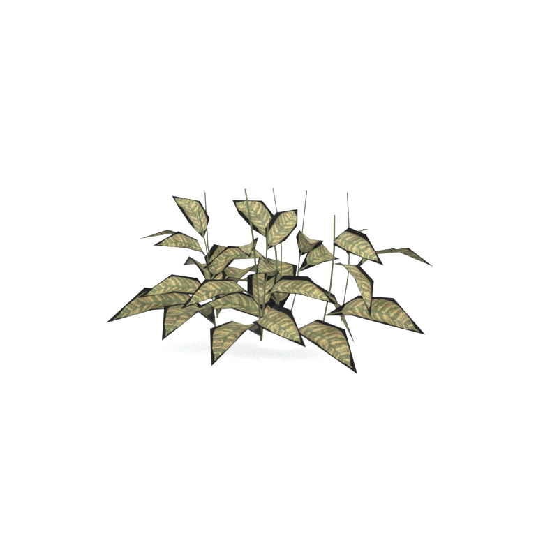
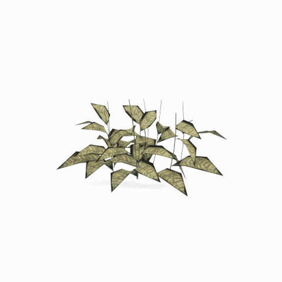

# Unidentified model (afgh_flwr005_vrtn001)

Native model reference; a readable object identification has not been reviewed.

[Library](../README.md) | [Category](../tables/unclassified-components-1.md) | [Source / advanced data](../catalogue.json) | [Credits](../sources-and-credits.md)

**Game filename:** afgh_flwr005_vrtn001.fmdl  
**Category:** Unclassified &gt; Unclassified components  
**Variant:** vrtn001; **LOD:** 0  
**Tags:** 

## Still reference



## 360-degree reference



The camera circles a static model. This is not a native animation. Source base textures and UVs use approximate studio shading; interaction, collision, complete assembly and FOX shader equivalence are not established.

## Identity and naming

| Field | Value |
|---|---|
| Library ID | mgsv-tpp-afgh_flwr005_vrtn001-0ef480094451adae |
| Naming status | unidentified |
| Naming confidence | unknown |
| Naming evidence | {} |
| Native model | /Assets/tpp/environ/object/afghanistan/flower/afgh_flwr005/scenes/afgh_flwr005_vrtn001.fmdl |
| Model SHA256 | ae9b3f2a1ae66b03373c1369f2090c91a4c20d8374f27fa8dfeda9f88c4b7a98 |
| Container | /Assets/tpp/pack/location/afgh/pack_common/afgh_common.fpk |
| Container SHA256 | 810fe68a28c81299da7ef00849d2905b640d0a2da970f1b312e953a2c7b5df48 |
| Captured source / location scope | Selected native member/content and captured installed-source chain; full archive SHA/runtime priority unresolved |
| Raw record SHA256 | d50c202235dd5d407b61751df44733dfe62835ffd92df7355b4199bf1b3f6b92 |

Naming review is descriptive metadata only. It does not change model completion or identify a working game interaction.

## Native LOD inventory

| Native LOD | Triangles | Preview status | Decoded indices SHA256 |
|---|---:|---|---|
| 0 | 434 | rendered | efd354474e2de001031422bcd4411f70314494a0541db98f68e000cf37857246 |
| 1 | 432 | not separately rendered | 4e066fdc1da642117ed8ae8419fe38650fa308728cc6babde12e3df1945489bc |
| 2 | 431 | not separately rendered | de2e668ee5c7aeb0ea9e2a12dd407000d3f4c34759b3b50e1a1a41d6cc21b00c |
| 3 | 430 | not separately rendered | b3ba0be82ee3c4b60079db28e4825926ad6c73aabadfa2a4ed3703b5315ec97e |

Mesh detail and texture pixels/mips are separate. Index hashes describe decoded triangle arrays, not packed index-buffer bytes. Only source-recorded native levels are listed.

<details>
<summary>Texture, source and naming technical metadata</summary>

```json
{
  "source": {
    "nativePath": "/Assets/tpp/environ/object/afghanistan/flower/afgh_flwr005/scenes/afgh_flwr005_vrtn001.fmdl",
    "nativeSha256": "ae9b3f2a1ae66b03373c1369f2090c91a4c20d8374f27fa8dfeda9f88c4b7a98",
    "stableIdentity": "/assets/tpp/environ/object/afghanistan/flower/afgh_flwr005/scenes/afgh_flwr005_vrtn001.fmdl#ae9b3f2a1ae66b03373c1369f2090c91a4c20d8374f27fa8dfeda9f88c4b7a98#e4ffb2fa3fdd1de5fbf2319e566ea48ab2d27c736eba61490280c51e5e4f6f32",
    "container": {
      "nativePath": "/Assets/tpp/pack/location/afgh/pack_common/afgh_common.fpk",
      "sha256": "810fe68a28c81299da7ef00849d2905b640d0a2da970f1b312e953a2c7b5df48",
      "status": "Selected installed-source container/member chain captured by community reader"
    },
    "historicalDatOrigin": null,
    "sourceArchiveAtCapture": "master/0/00.dat",
    "locationStatus": "Selected native member/content and captured installed-source chain; full archive SHA/runtime priority unresolved",
    "currentInstalledDatVerified": false,
    "selectedInstalledMemberVerified": true,
    "evidence": {
      "archive_helper_executable_sha256": "6f8e39a436af3b024bbd0504966ab3d5d9d0cb05d86689bf3e83d15e68df613f",
      "archive_helper_source_sha256": "f662d3b63e066a0afc77ffe22ea0e564222d14469648300dba2c4f8e9b43446b",
      "archive_index_recipe": "54acff767f08d76ad6056c5387328759bc883df507788f398de6c2c04fac12db",
      "archive_reader": "Atvaark GzsTool.Core 0.5.3",
      "archive_reader_core_sha256": "9da447ae3c375cce2e46744eeff6af50f1591062afdf479d1a0b49edb47daaa3",
      "archive_tool_and_dictionary_sha256": {
        "CityHash.dll": "def6c4506d461b65e4059b2936b2cbd5f852ba5d1d8a1a527f1c0e6dc7008c8f",
        "GzsTool.Core.dll": "9da447ae3c375cce2e46744eeff6af50f1591062afdf479d1a0b49edb47daaa3",
        "GzsTool.exe": "1a9c5b11e2355383ff485aee7e86abc026f5c1fad729daf8c0fd15ee0aae1c10",
        "Zlib.Portable.dll": "fe84781ba35ca9cc5ff5f73fd08d2a66c59e5257b4573f5fe59743f30bf78e42",
        "fpk_dictionary.txt": "b82f9a8d6c10a68ba9471eca9d815c21355a53b5e68753d8ad7db7fd01bf401d",
        "qar_dictionary.txt": "1558c248ed0a4bb827888261563fbb91a2df4f03999682f85d637ff70d9d5fb2"
      },
      "bytes": 19360,
      "container_chain": [
        {
          "content_sha256": null,
          "depth": 0,
          "id": "3f19555d27c2ebecdfbad26aadd88b9f62e9fb6092c04c712963ef73c67ccb42",
          "index_sha256": "9acd3675d6e1500e0e18430cba0fdc70a5718ad7d6b62f13905891a35d59f18a",
          "kind": "qar",
          "name": "master/0/00.dat",
          "parent_occurrence": null
        },
        {
          "content_sha256": "810fe68a28c81299da7ef00849d2905b640d0a2da970f1b312e953a2c7b5df48",
          "depth": 1,
          "id": "19e9adf189f5f5e9c624197357336d49999dc3525b83bd8c71cf525fcd2100e2",
          "index_sha256": "924ec10c5736f8b618238e2523664271e558a6ad49aefdaf2473ccbad50f1231",
          "kind": "fpk",
          "name": "/Assets/tpp/pack/location/afgh/pack_common/afgh_common.fpk",
          "parent_occurrence": "e35acf6999427a88778266baae8c014a0c20a82388f8ff04caca6a88d977a6d1"
        }
      ],
      "contentSha256": "ae9b3f2a1ae66b03373c1369f2090c91a4c20d8374f27fa8dfeda9f88c4b7a98",
      "member": {
        "actual_size": 19360,
        "compressed_size": null,
        "content_sha256": "ae9b3f2a1ae66b03373c1369f2090c91a4c20d8374f27fa8dfeda9f88c4b7a98",
        "declared_size": 19360,
        "extension": "fmdl",
        "hash_hex": null,
        "name": "/Assets/tpp/environ/object/afghanistan/flower/afgh_flwr005/scenes/afgh_flwr005_vrtn001.fmdl",
        "name_origin": "embedded",
        "offset": 2932000,
        "ordinal": 68,
        "path_hash": null,
        "resolved": 1
      },
      "occurrenceId": "b3c611bb3c8497d1dba5e85c357e823007bc61d035d1318265860149b8ff48da",
      "occurrence_id": "b3c611bb3c8497d1dba5e85c357e823007bc61d035d1318265860149b8ff48da",
      "primary_source_revision": "fc4a8196555638c6cf8aa1b7c8dc34ccd5c69cb5",
      "source_adapter": "community_core_selective_export",
      "source_id": "7f6bb743fb4c487f0e9522f9c7fac280c46cf6b1051e0fc75a93602c8eb451f0",
      "source_path": "master/0/00.dat",
      "source_snapshot": "{\"bytes\":768788480,\"device\":621747392682911458,\"file_id\":844424931596481,\"header_sha256\":\"ead50f0a9a37e4285323b9c6fa0ec75fe75e518c63147e63158eeb2892c6589e\",\"mtime_ns\":1791852224238580700}",
      "virtualPath": "/Assets/tpp/environ/object/afghanistan/flower/afgh_flwr005/scenes/afgh_flwr005_vrtn001.fmdl"
    }
  },
  "materials": [
    {
      "sampler": "Base_Tex_SRGB",
      "materialIndex": 0,
      "nativePathHash": "1542856266276456206",
      "nativeVirtualPath": null,
      "nativeBinding": {
        "familyId": "8606efa5078403d1245ddc9dd523732c9f221d3baf8b7846b4227415bee298ca",
        "height": 1024,
        "materialIndex": 0,
        "mipCount": 9,
        "nativeMipCountVerified": true,
        "nativePath": null,
        "nativePathHash": "1542856266276456206",
        "nativeTexture": {
          "additionalFtexsFileCount": 2,
          "depth": 1,
          "ftexsFileCount": 3,
          "height": 1024,
          "metadataBytes": 208,
          "mipCount": 9,
          "mips": [
            {
              "chunks": 32,
              "decodedBytes": 524288,
              "mip": 0,
              "offset": 0,
              "storedBytes": 179936,
              "streamNumber": 3
            },
            {
              "chunks": 8,
              "decodedBytes": 131072,
              "mip": 1,
              "offset": 0,
              "storedBytes": 55104,
              "streamNumber": 2
            },
            {
              "chunks": 2,
              "decodedBytes": 32768,
              "mip": 2,
              "offset": 7296,
              "storedBytes": 16192,
              "streamNumber": 1
            },
            {
              "chunks": 1,
              "decodedBytes": 8192,
              "mip": 3,
              "offset": 2328,
              "storedBytes": 4960,
              "streamNumber": 1
            },
            {
              "chunks": 1,
              "decodedBytes": 2048,
              "mip": 4,
              "offset": 752,
              "storedBytes": 1568,
              "streamNumber": 1
            },
            {
              "chunks": 1,
              "decodedBytes": 512,
              "mip": 5,
              "offset": 248,
              "storedBytes": 496,
              "streamNumber": 1
            },
            {
              "chunks": 1,
              "decodedBytes": 128,
              "mip": 6,
              "offset": 96,
              "storedBytes": 144,
              "streamNumber": 1
            },
            {
              "chunks": 1,
              "decodedBytes": 32,
              "mip": 7,
              "offset": 40,
              "storedBytes": 48,
              "streamNumber": 1
            },
            {
              "chunks": 1,
              "decodedBytes": 16,
              "mip": 8,
              "offset": 0,
              "storedBytes": 32,
              "streamNumber": 1
            }
          ],
          "nativeHeaderHash": "2a6b77d5425047c0421f00b115a66a9e",
          "nrtFlag": 2,
          "pixelFormat": 4,
          "requiredStreamNumbers": [
            1,
            2,
            3
          ],
          "textureType": 16777219,
          "unknownFlags": 273,
          "width": 512
        },
        "samplerName": "Base_Tex_SRGB",
        "samplerNameHash": "72475356961633",
        "sha256": "6ac0e8131092a6899de4d42a874d0a9159a2d38ab5e1b0f38e39bfb62c4e620c",
        "sourceOccurrences": [
          {
            "archive_helper_executable_sha256": "6f8e39a436af3b024bbd0504966ab3d5d9d0cb05d86689bf3e83d15e68df613f",
            "archive_helper_source_sha256": "f662d3b63e066a0afc77ffe22ea0e564222d14469648300dba2c4f8e9b43446b",
            "archive_index_recipe": "54acff767f08d76ad6056c5387328759bc883df507788f398de6c2c04fac12db",
            "archive_reader": "Atvaark GzsTool.Core 0.5.3",
            "archive_reader_core_sha256": "9da447ae3c375cce2e46744eeff6af50f1591062afdf479d1a0b49edb47daaa3",
            "archive_tool_and_dictionary_sha256": {
              "CityHash.dll": "def6c4506d461b65e4059b2936b2cbd5f852ba5d1d8a1a527f1c0e6dc7008c8f",
              "GzsTool.Core.dll": "9da447ae3c375cce2e46744eeff6af50f1591062afdf479d1a0b49edb47daaa3",
              "GzsTool.exe": "1a9c5b11e2355383ff485aee7e86abc026f5c1fad729daf8c0fd15ee0aae1c10",
              "Zlib.Portable.dll": "fe84781ba35ca9cc5ff5f73fd08d2a66c59e5257b4573f5fe59743f30bf78e42",
              "fpk_dictionary.txt": "b82f9a8d6c10a68ba9471eca9d815c21355a53b5e68753d8ad7db7fd01bf401d",
              "qar_dictionary.txt": "1558c248ed0a4bb827888261563fbb91a2df4f03999682f85d637ff70d9d5fb2"
            },
            "bytes": 208,
            "container_chain": [
              {
                "content_sha256": null,
                "depth": 0,
                "id": "06035c7f54d1fe3fde25c93eb85d5278f37457e9730b7b0dc0553ea567520e6d",
                "index_sha256": "be525e8d33187ab76b3f97935035faac60a4c7ca7fcff3401a0ce712f03c285e",
                "kind": "qar",
                "name": "master/texture3.dat",
                "parent_occurrence": null
              }
            ],
            "contentSha256": "721c3538182954d6b059acd5707392ed6401b3d5371ce2cfec95f4bd1756100c",
            "member": {
              "actual_size": 208,
              "compressed_size": 208,
              "content_sha256": "721c3538182954d6b059acd5707392ed6401b3d5371ce2cfec95f4bd1756100c",
              "declared_size": 208,
              "extension": "ftex",
              "hash_hex": "156953998ae4c70e",
              "name": "153998ae4c70e.ftex",
              "name_origin": "hash_fallback",
              "offset": 856376352,
              "ordinal": 7403,
              "path_hash": "153998ae4c70e",
              "resolved": 0
            },
            "occurrenceId": "3e8c35713fbfbb5158c403973030b72f8ad2e46ede268b7be5f921b0cd53c37b",
            "occurrence_id": "3e8c35713fbfbb5158c403973030b72f8ad2e46ede268b7be5f921b0cd53c37b",
            "primary_source_revision": "fc4a8196555638c6cf8aa1b7c8dc34ccd5c69cb5",
            "source_adapter": "community_core_selective_export",
            "source_id": "8d93a1c4a39e41ca988ccdecf8dbaa5fa7e6f9f82b75bea9a691d2b01de50ef8",
            "source_path": "master/texture3.dat",
            "source_snapshot": "{\"bytes\":1297381376,\"device\":621747392682911458,\"file_id\":562949953639627,\"header_sha256\":\"55c07d7fb3cb3498d10fa3bed93a81ce330553a903fff3222b5bf307bcc7ef0c\",\"mtime_ns\":1791224675561235200}",
            "virtualPath": "153998ae4c70e.ftex"
          },
          {
            "archive_helper_executable_sha256": "6f8e39a436af3b024bbd0504966ab3d5d9d0cb05d86689bf3e83d15e68df613f",
            "archive_helper_source_sha256": "f662d3b63e066a0afc77ffe22ea0e564222d14469648300dba2c4f8e9b43446b",
            "archive_index_recipe": "54acff767f08d76ad6056c5387328759bc883df507788f398de6c2c04fac12db",
            "archive_reader": "Atvaark GzsTool.Core 0.5.3",
            "archive_reader_core_sha256": "9da447ae3c375cce2e46744eeff6af50f1591062afdf479d1a0b49edb47daaa3",
            "archive_tool_and_dictionary_sha256": {
              "CityHash.dll": "def6c4506d461b65e4059b2936b2cbd5f852ba5d1d8a1a527f1c0e6dc7008c8f",
              "GzsTool.Core.dll": "9da447ae3c375cce2e46744eeff6af50f1591062afdf479d1a0b49edb47daaa3",
              "GzsTool.exe": "1a9c5b11e2355383ff485aee7e86abc026f5c1fad729daf8c0fd15ee0aae1c10",
              "Zlib.Portable.dll": "fe84781ba35ca9cc5ff5f73fd08d2a66c59e5257b4573f5fe59743f30bf78e42",
              "fpk_dictionary.txt": "b82f9a8d6c10a68ba9471eca9d815c21355a53b5e68753d8ad7db7fd01bf401d",
              "qar_dictionary.txt": "1558c248ed0a4bb827888261563fbb91a2df4f03999682f85d637ff70d9d5fb2"
            },
            "bytes": 23504,
            "container_chain": [
              {
                "content_sha256": null,
                "depth": 0,
                "id": "06035c7f54d1fe3fde25c93eb85d5278f37457e9730b7b0dc0553ea567520e6d",
                "index_sha256": "be525e8d33187ab76b3f97935035faac60a4c7ca7fcff3401a0ce712f03c285e",
                "kind": "qar",
                "name": "master/texture3.dat",
                "parent_occurrence": null
              }
            ],
            "contentSha256": "4c2abf45bb8d9a367ff4b43690524d737739f83d89707173a10216cdf3b11086",
            "member": {
              "actual_size": 23504,
              "compressed_size": 23504,
              "content_sha256": "4c2abf45bb8d9a367ff4b43690524d737739f83d89707173a10216cdf3b11086",
              "declared_size": 23504,
              "extension": "1.ftexs",
              "hash_hex": "b2c153998ae4c70e",
              "name": "153998ae4c70e.1.ftexs",
              "name_origin": "hash_fallback",
              "offset": 856117280,
              "ordinal": 7400,
              "path_hash": "153998ae4c70e",
              "resolved": 0
            },
            "occurrenceId": "d84271cae77fc0d56d024c94b67c7bd2efb548dceadeadea61f914ac585394e3",
            "occurrence_id": "d84271cae77fc0d56d024c94b67c7bd2efb548dceadeadea61f914ac585394e3",
            "primary_source_revision": "fc4a8196555638c6cf8aa1b7c8dc34ccd5c69cb5",
            "source_adapter": "community_core_selective_export",
            "source_id": "8d93a1c4a39e41ca988ccdecf8dbaa5fa7e6f9f82b75bea9a691d2b01de50ef8",
            "source_path": "master/texture3.dat",
            "source_snapshot": "{\"bytes\":1297381376,\"device\":621747392682911458,\"file_id\":562949953639627,\"header_sha256\":\"55c07d7fb3cb3498d10fa3bed93a81ce330553a903fff3222b5bf307bcc7ef0c\",\"mtime_ns\":1791224675561235200}",
            "virtualPath": "153998ae4c70e.1.ftexs"
          },
          {
            "archive_helper_executable_sha256": "6f8e39a436af3b024bbd0504966ab3d5d9d0cb05d86689bf3e83d15e68df613f",
            "archive_helper_source_sha256": "f662d3b63e066a0afc77ffe22ea0e564222d14469648300dba2c4f8e9b43446b",
            "archive_index_recipe": "54acff767f08d76ad6056c5387328759bc883df507788f398de6c2c04fac12db",
            "archive_reader": "Atvaark GzsTool.Core 0.5.3",
            "archive_reader_core_sha256": "9da447ae3c375cce2e46744eeff6af50f1591062afdf479d1a0b49edb47daaa3",
            "archive_tool_and_dictionary_sha256": {
              "CityHash.dll": "def6c4506d461b65e4059b2936b2cbd5f852ba5d1d8a1a527f1c0e6dc7008c8f",
              "GzsTool.Core.dll": "9da447ae3c375cce2e46744eeff6af50f1591062afdf479d1a0b49edb47daaa3",
              "GzsTool.exe": "1a9c5b11e2355383ff485aee7e86abc026f5c1fad729daf8c0fd15ee0aae1c10",
              "Zlib.Portable.dll": "fe84781ba35ca9cc5ff5f73fd08d2a66c59e5257b4573f5fe59743f30bf78e42",
              "fpk_dictionary.txt": "b82f9a8d6c10a68ba9471eca9d815c21355a53b5e68753d8ad7db7fd01bf401d",
              "qar_dictionary.txt": "1558c248ed0a4bb827888261563fbb91a2df4f03999682f85d637ff70d9d5fb2"
            },
            "bytes": 55168,
            "container_chain": [
              {
                "content_sha256": null,
                "depth": 0,
                "id": "0b473016351235050c2f6af21454bd979a0ad4602a9860137c807c894c5eba4d",
                "index_sha256": "ac9b4dae0dd0166db3a6ec8da18524dffebcbaf9004569af631de82913bf49a3",
                "kind": "qar",
                "name": "master/texture2.dat",
                "parent_occurrence": null
              }
            ],
            "contentSha256": "2de38aed0156b86f4211231b768d6cb3dd49ab4e06caf2e7c83255c49123e8bf",
            "member": {
              "actual_size": 55168,
              "compressed_size": 55168,
              "content_sha256": "2de38aed0156b86f4211231b768d6cb3dd49ab4e06caf2e7c83255c49123e8bf",
              "declared_size": 55168,
              "extension": "2.ftexs",
              "hash_hex": "b57153998ae4c70e",
              "name": "153998ae4c70e.2.ftexs",
              "name_origin": "hash_fallback",
              "offset": 1713328160,
              "ordinal": 10607,
              "path_hash": "153998ae4c70e",
              "resolved": 0
            },
            "occurrenceId": "1018305c236d66c5544c87776713d8269a6ac7cea77e1d4fd8088ac6ae555f84",
            "occurrence_id": "1018305c236d66c5544c87776713d8269a6ac7cea77e1d4fd8088ac6ae555f84",
            "primary_source_revision": "fc4a8196555638c6cf8aa1b7c8dc34ccd5c69cb5",
            "source_adapter": "community_core_selective_export",
            "source_id": "85e8296057664cbc6ebaf6bd43d1c6d18528bbd8a6fae920bdf4d5eb69f6a93d",
            "source_path": "master/texture2.dat",
            "source_snapshot": "{\"bytes\":2920239104,\"device\":621747392682911458,\"file_id\":562949953639626,\"header_sha256\":\"72bfee707623afb5f3abd8382035d3d4258b4941ac583a56f5a447f47123dcab\",\"mtime_ns\":1791224675561235200}",
            "virtualPath": "153998ae4c70e.2.ftexs"
          },
          {
            "archive_helper_executable_sha256": "6f8e39a436af3b024bbd0504966ab3d5d9d0cb05d86689bf3e83d15e68df613f",
            "archive_helper_source_sha256": "f662d3b63e066a0afc77ffe22ea0e564222d14469648300dba2c4f8e9b43446b",
            "archive_index_recipe": "54acff767f08d76ad6056c5387328759bc883df507788f398de6c2c04fac12db",
            "archive_reader": "Atvaark GzsTool.Core 0.5.3",
            "archive_reader_core_sha256": "9da447ae3c375cce2e46744eeff6af50f1591062afdf479d1a0b49edb47daaa3",
            "archive_tool_and_dictionary_sha256": {
              "CityHash.dll": "def6c4506d461b65e4059b2936b2cbd5f852ba5d1d8a1a527f1c0e6dc7008c8f",
              "GzsTool.Core.dll": "9da447ae3c375cce2e46744eeff6af50f1591062afdf479d1a0b49edb47daaa3",
              "GzsTool.exe": "1a9c5b11e2355383ff485aee7e86abc026f5c1fad729daf8c0fd15ee0aae1c10",
              "Zlib.Portable.dll": "fe84781ba35ca9cc5ff5f73fd08d2a66c59e5257b4573f5fe59743f30bf78e42",
              "fpk_dictionary.txt": "b82f9a8d6c10a68ba9471eca9d815c21355a53b5e68753d8ad7db7fd01bf401d",
              "qar_dictionary.txt": "1558c248ed0a4bb827888261563fbb91a2df4f03999682f85d637ff70d9d5fb2"
            },
            "bytes": 180192,
            "container_chain": [
              {
                "content_sha256": null,
                "depth": 0,
                "id": "06035c7f54d1fe3fde25c93eb85d5278f37457e9730b7b0dc0553ea567520e6d",
                "index_sha256": "be525e8d33187ab76b3f97935035faac60a4c7ca7fcff3401a0ce712f03c285e",
                "kind": "qar",
                "name": "master/texture3.dat",
                "parent_occurrence": null
              }
            ],
            "contentSha256": "c330957d50e9676b7a3fcc6a26d99b323acc314aabb8026611103e9576faf3f6",
            "member": {
              "actual_size": 180192,
              "compressed_size": 180192,
              "content_sha256": "c330957d50e9676b7a3fcc6a26d99b323acc314aabb8026611103e9576faf3f6",
              "declared_size": 180192,
              "extension": "3.ftexs",
              "hash_hex": "571953998ae4c70e",
              "name": "153998ae4c70e.3.ftexs",
              "name_origin": "hash_fallback",
              "offset": 856196128,
              "ordinal": 7402,
              "path_hash": "153998ae4c70e",
              "resolved": 0
            },
            "occurrenceId": "b5f2b00dea7ef25527b3c3210ec84df9b2298d279b3ba00c2c5d5b4ec2522e8e",
            "occurrence_id": "b5f2b00dea7ef25527b3c3210ec84df9b2298d279b3ba00c2c5d5b4ec2522e8e",
            "primary_source_revision": "fc4a8196555638c6cf8aa1b7c8dc34ccd5c69cb5",
            "source_adapter": "community_core_selective_export",
            "source_id": "8d93a1c4a39e41ca988ccdecf8dbaa5fa7e6f9f82b75bea9a691d2b01de50ef8",
            "source_path": "master/texture3.dat",
            "source_snapshot": "{\"bytes\":1297381376,\"device\":621747392682911458,\"file_id\":562949953639627,\"header_sha256\":\"55c07d7fb3cb3498d10fa3bed93a81ce330553a903fff3222b5bf307bcc7ef0c\",\"mtime_ns\":1791224675561235200}",
            "virtualPath": "153998ae4c70e.3.ftexs"
          }
        ],
        "width": 512
      },
      "ddsSha256": "6ac0e8131092a6899de4d42a874d0a9159a2d38ab5e1b0f38e39bfb62c4e620c",
      "dimensions": [
        512,
        1024
      ],
      "mipCount": 9,
      "nativeMipCountVerified": true,
      "connectedInPreview": true
    }
  ],
  "quality": {
    "decodedIndicesHashDerivation": "SHA256 of canonical UTF-8 JSON decoded triangle indices grouped by mesh; not packed buffer bytes",
    "highestRetainedGeometricLod": 0,
    "distinctNativeLods": 4,
    "baseTextureDimensions": [
      512,
      1024
    ],
    "baseTextureNativeMipCount": 9,
    "largerRetainedBaseTextureFound": null,
    "nativeLods": [
      {
        "indicesSha256": "efd354474e2de001031422bcd4411f70314494a0541db98f68e000cf37857246",
        "nativeLod": 0,
        "triangles": 434
      },
      {
        "indicesSha256": "4e066fdc1da642117ed8ae8419fe38650fa308728cc6babde12e3df1945489bc",
        "nativeLod": 1,
        "triangles": 432
      },
      {
        "indicesSha256": "de2e668ee5c7aeb0ea9e2a12dd407000d3f4c34759b3b50e1a1a41d6cc21b00c",
        "nativeLod": 2,
        "triangles": 431
      },
      {
        "indicesSha256": "b3ba0be82ee3c4b60079db28e4825926ad6c73aabadfa2a4ed3703b5315ec97e",
        "nativeLod": 3,
        "triangles": 430
      }
    ],
    "renderedNativeLods": [
      0
    ],
    "baseTextureSummary": "512 x 1024; 9 native/DDS mips",
    "highestDetailScope": "Triangle-count comparison within captured FMDL only"
  }
}
```

</details>

[Original source / advanced record](../catalogue.json)
