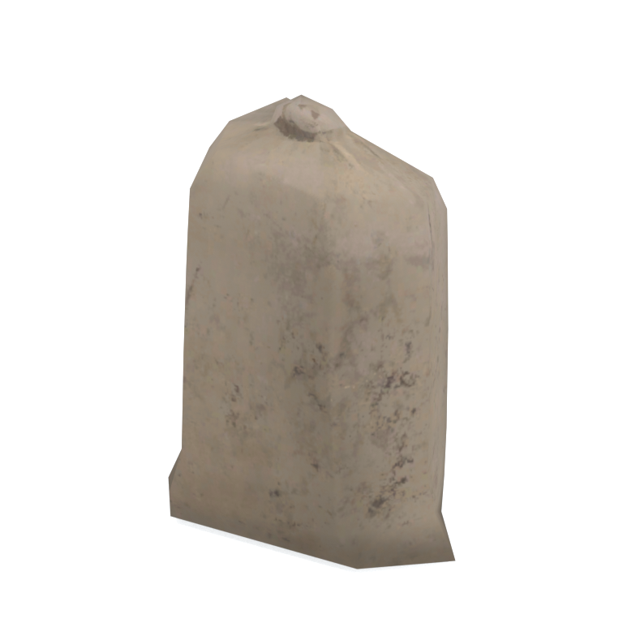
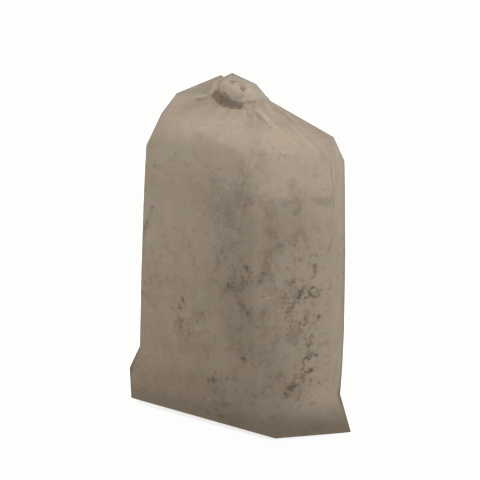

# Unidentified model (afgh_gnsc001_gnsc002)

Native model reference; a readable object identification has not been reviewed.

[Library](../README.md) | [Category](../tables/unclassified-components-1.md) | [Source / advanced data](../catalogue.json) | [Credits](../sources-and-credits.md)

**Game filename:** afgh_gnsc001_gnsc002.fmdl  
**Category:** Unclassified &gt; Unclassified components  
**Variant:** No explicit variant token; **LOD:** 0  
**Tags:** 

## Still reference



## 360-degree reference



The camera circles a static model. This is not a native animation. Source base textures and UVs use approximate studio shading; interaction, collision, complete assembly and FOX shader equivalence are not established.

## Identity and naming

| Field | Value |
|---|---|
| Library ID | mgsv-tpp-afgh_gnsc001_gnsc002-b7e3a93cff6cb5db |
| Naming status | unidentified |
| Naming confidence | unknown |
| Naming evidence | {} |
| Native model | /Assets/tpp/environ/object/afghanistan/gunny_sack/afgh_gnsc001/scenes/afgh_gnsc001_gnsc002.fmdl |
| Model SHA256 | 7c1d6704b570c82c9adedee9bf03f3e39cd5ae9a883eee5f1abffce3e99da2ca |
| Container | /Assets/tpp/pack/location/afgh/pack_common/afgh_common.fpk |
| Container SHA256 | 810fe68a28c81299da7ef00849d2905b640d0a2da970f1b312e953a2c7b5df48 |
| Captured source / location scope | Selected native member/content and captured installed-source chain; full archive SHA/runtime priority unresolved |
| Raw record SHA256 | cb1418080e69055db9b1fd823ddef4b53df922e9d3d81595011bae3e4ba30500 |

Naming review is descriptive metadata only. It does not change model completion or identify a working game interaction.

## Native LOD inventory

| Native LOD | Triangles | Preview status | Decoded indices SHA256 |
|---|---:|---|---|
| 0 | 116 | rendered | 7b525393cf19c0cde82fea4ea9056da9f95308f20e22d5c976d343b246204906 |
| 1 | 104 | not separately rendered | 7589ef92be8c98cb99123c5d4e5752177eed1b1777455fa3b39721c7d8a2c92d |
| 2 | 94 | not separately rendered | ee58cfcda2579b1e76472f3d3d9664778f0ca41bfac3d310b5fdb450da111f5c |
| 3 | 86 | not separately rendered | f0c9061590941ea5680f293c347e62228e6d0f9c042b47b6fae1497940080544 |
| 4 | 78 | not separately rendered | 5f8480a35ee18af072d1838b33cf0e3045e1b4138afb0d62d3f8f2a327df53ce |
| 5 | 70 | not separately rendered | 233af1664d08428be5632134e0f099cfea6d8464ea7edb27ae1e9a535beb86b5 |
| 6 | 64 | not separately rendered | cb36962ff5417942fbfce367acbb5cc66c4b7037441bc4fec875ebea33e8028f |
| 7 | 56 | not separately rendered | 51afb92e66cd42c68e3c71a4b7e8c5020bf8a007568913d08d032b0a869ad977 |

Mesh detail and texture pixels/mips are separate. Index hashes describe decoded triangle arrays, not packed index-buffer bytes. Only source-recorded native levels are listed.

<details>
<summary>Texture, source and naming technical metadata</summary>

```json
{
  "source": {
    "nativePath": "/Assets/tpp/environ/object/afghanistan/gunny_sack/afgh_gnsc001/scenes/afgh_gnsc001_gnsc002.fmdl",
    "nativeSha256": "7c1d6704b570c82c9adedee9bf03f3e39cd5ae9a883eee5f1abffce3e99da2ca",
    "stableIdentity": "/assets/tpp/environ/object/afghanistan/gunny_sack/afgh_gnsc001/scenes/afgh_gnsc001_gnsc002.fmdl#7c1d6704b570c82c9adedee9bf03f3e39cd5ae9a883eee5f1abffce3e99da2ca#677a6c2f0a74f19e3dd42708dfb1c5eb065a02e45d795de801835b3ded1229d9",
    "container": {
      "nativePath": "/Assets/tpp/pack/location/afgh/pack_common/afgh_common.fpk",
      "sha256": "810fe68a28c81299da7ef00849d2905b640d0a2da970f1b312e953a2c7b5df48",
      "status": "Selected installed-source container/member chain captured by community reader"
    },
    "historicalDatOrigin": null,
    "sourceArchiveAtCapture": "master/0/00.dat",
    "locationStatus": "Selected native member/content and captured installed-source chain; full archive SHA/runtime priority unresolved",
    "currentInstalledDatVerified": false,
    "selectedInstalledMemberVerified": true,
    "evidence": {
      "archive_helper_executable_sha256": "6f8e39a436af3b024bbd0504966ab3d5d9d0cb05d86689bf3e83d15e68df613f",
      "archive_helper_source_sha256": "f662d3b63e066a0afc77ffe22ea0e564222d14469648300dba2c4f8e9b43446b",
      "archive_index_recipe": "54acff767f08d76ad6056c5387328759bc883df507788f398de6c2c04fac12db",
      "archive_reader": "Atvaark GzsTool.Core 0.5.3",
      "archive_reader_core_sha256": "9da447ae3c375cce2e46744eeff6af50f1591062afdf479d1a0b49edb47daaa3",
      "archive_tool_and_dictionary_sha256": {
        "CityHash.dll": "def6c4506d461b65e4059b2936b2cbd5f852ba5d1d8a1a527f1c0e6dc7008c8f",
        "GzsTool.Core.dll": "9da447ae3c375cce2e46744eeff6af50f1591062afdf479d1a0b49edb47daaa3",
        "GzsTool.exe": "1a9c5b11e2355383ff485aee7e86abc026f5c1fad729daf8c0fd15ee0aae1c10",
        "Zlib.Portable.dll": "fe84781ba35ca9cc5ff5f73fd08d2a66c59e5257b4573f5fe59743f30bf78e42",
        "fpk_dictionary.txt": "b82f9a8d6c10a68ba9471eca9d815c21355a53b5e68753d8ad7db7fd01bf401d",
        "qar_dictionary.txt": "1558c248ed0a4bb827888261563fbb91a2df4f03999682f85d637ff70d9d5fb2"
      },
      "bytes": 6304,
      "container_chain": [
        {
          "content_sha256": null,
          "depth": 0,
          "id": "3f19555d27c2ebecdfbad26aadd88b9f62e9fb6092c04c712963ef73c67ccb42",
          "index_sha256": "9acd3675d6e1500e0e18430cba0fdc70a5718ad7d6b62f13905891a35d59f18a",
          "kind": "qar",
          "name": "master/0/00.dat",
          "parent_occurrence": null
        },
        {
          "content_sha256": "810fe68a28c81299da7ef00849d2905b640d0a2da970f1b312e953a2c7b5df48",
          "depth": 1,
          "id": "19e9adf189f5f5e9c624197357336d49999dc3525b83bd8c71cf525fcd2100e2",
          "index_sha256": "924ec10c5736f8b618238e2523664271e558a6ad49aefdaf2473ccbad50f1231",
          "kind": "fpk",
          "name": "/Assets/tpp/pack/location/afgh/pack_common/afgh_common.fpk",
          "parent_occurrence": "e35acf6999427a88778266baae8c014a0c20a82388f8ff04caca6a88d977a6d1"
        }
      ],
      "contentSha256": "7c1d6704b570c82c9adedee9bf03f3e39cd5ae9a883eee5f1abffce3e99da2ca",
      "member": {
        "actual_size": 6304,
        "compressed_size": null,
        "content_sha256": "7c1d6704b570c82c9adedee9bf03f3e39cd5ae9a883eee5f1abffce3e99da2ca",
        "declared_size": 6304,
        "extension": "fmdl",
        "hash_hex": null,
        "name": "/Assets/tpp/environ/object/afghanistan/gunny_sack/afgh_gnsc001/scenes/afgh_gnsc001_gnsc002.fmdl",
        "name_origin": "embedded",
        "offset": 3054000,
        "ordinal": 85,
        "path_hash": null,
        "resolved": 1
      },
      "occurrenceId": "6fbad6a6a525958754f8284cc12949e18f273d4297a18c0302e16d6601e2354e",
      "occurrence_id": "6fbad6a6a525958754f8284cc12949e18f273d4297a18c0302e16d6601e2354e",
      "primary_source_revision": "fc4a8196555638c6cf8aa1b7c8dc34ccd5c69cb5",
      "source_adapter": "community_core_selective_export",
      "source_id": "7f6bb743fb4c487f0e9522f9c7fac280c46cf6b1051e0fc75a93602c8eb451f0",
      "source_path": "master/0/00.dat",
      "source_snapshot": "{\"bytes\":768788480,\"device\":621747392682911458,\"file_id\":844424931596481,\"header_sha256\":\"ead50f0a9a37e4285323b9c6fa0ec75fe75e518c63147e63158eeb2892c6589e\",\"mtime_ns\":1791852224238580700}",
      "virtualPath": "/Assets/tpp/environ/object/afghanistan/gunny_sack/afgh_gnsc001/scenes/afgh_gnsc001_gnsc002.fmdl"
    }
  },
  "materials": [
    {
      "sampler": "Base_Tex_SRGB",
      "materialIndex": 0,
      "nativePathHash": "1543217165060097095",
      "nativeVirtualPath": null,
      "nativeBinding": {
        "familyId": "762552ddeedca1e7604e89d3a32b9decbb640c4aac719c6af708031542e04c52",
        "height": 512,
        "materialIndex": 0,
        "mipCount": 8,
        "nativeMipCountVerified": true,
        "nativePath": null,
        "nativePathHash": "1543217165060097095",
        "nativeTexture": {
          "additionalFtexsFileCount": 2,
          "depth": 1,
          "ftexsFileCount": 3,
          "height": 512,
          "metadataBytes": 192,
          "mipCount": 8,
          "mips": [
            {
              "chunks": 8,
              "decodedBytes": 131072,
              "mip": 0,
              "offset": 0,
              "storedBytes": 82864,
              "streamNumber": 3
            },
            {
              "chunks": 2,
              "decodedBytes": 32768,
              "mip": 1,
              "offset": 0,
              "storedBytes": 21856,
              "streamNumber": 2
            },
            {
              "chunks": 1,
              "decodedBytes": 8192,
              "mip": 2,
              "offset": 2248,
              "storedBytes": 5696,
              "streamNumber": 1
            },
            {
              "chunks": 1,
              "decodedBytes": 2048,
              "mip": 3,
              "offset": 704,
              "storedBytes": 1536,
              "streamNumber": 1
            },
            {
              "chunks": 1,
              "decodedBytes": 512,
              "mip": 4,
              "offset": 232,
              "storedBytes": 464,
              "streamNumber": 1
            },
            {
              "chunks": 1,
              "decodedBytes": 128,
              "mip": 5,
              "offset": 80,
              "storedBytes": 144,
              "streamNumber": 1
            },
            {
              "chunks": 1,
              "decodedBytes": 32,
              "mip": 6,
              "offset": 24,
              "storedBytes": 48,
              "streamNumber": 1
            },
            {
              "chunks": 1,
              "decodedBytes": 8,
              "mip": 7,
              "offset": 0,
              "storedBytes": 16,
              "streamNumber": 1
            }
          ],
          "nativeHeaderHash": "646c8ec7370315e1f96c29202261449a",
          "nrtFlag": 2,
          "pixelFormat": 2,
          "requiredStreamNumbers": [
            1,
            2,
            3
          ],
          "textureType": 16777219,
          "unknownFlags": 273,
          "width": 512
        },
        "samplerName": "Base_Tex_SRGB",
        "samplerNameHash": "72475356961633",
        "sha256": "23e71b402eab390ae051d301a3c025d524d5be9981a77af8af24c27cfcdd8954",
        "sourceOccurrences": [
          {
            "archive_helper_executable_sha256": "6f8e39a436af3b024bbd0504966ab3d5d9d0cb05d86689bf3e83d15e68df613f",
            "archive_helper_source_sha256": "f662d3b63e066a0afc77ffe22ea0e564222d14469648300dba2c4f8e9b43446b",
            "archive_index_recipe": "54acff767f08d76ad6056c5387328759bc883df507788f398de6c2c04fac12db",
            "archive_reader": "Atvaark GzsTool.Core 0.5.3",
            "archive_reader_core_sha256": "9da447ae3c375cce2e46744eeff6af50f1591062afdf479d1a0b49edb47daaa3",
            "archive_tool_and_dictionary_sha256": {
              "CityHash.dll": "def6c4506d461b65e4059b2936b2cbd5f852ba5d1d8a1a527f1c0e6dc7008c8f",
              "GzsTool.Core.dll": "9da447ae3c375cce2e46744eeff6af50f1591062afdf479d1a0b49edb47daaa3",
              "GzsTool.exe": "1a9c5b11e2355383ff485aee7e86abc026f5c1fad729daf8c0fd15ee0aae1c10",
              "Zlib.Portable.dll": "fe84781ba35ca9cc5ff5f73fd08d2a66c59e5257b4573f5fe59743f30bf78e42",
              "fpk_dictionary.txt": "b82f9a8d6c10a68ba9471eca9d815c21355a53b5e68753d8ad7db7fd01bf401d",
              "qar_dictionary.txt": "1558c248ed0a4bb827888261563fbb91a2df4f03999682f85d637ff70d9d5fb2"
            },
            "bytes": 192,
            "container_chain": [
              {
                "content_sha256": null,
                "depth": 0,
                "id": "3f19555d27c2ebecdfbad26aadd88b9f62e9fb6092c04c712963ef73c67ccb42",
                "index_sha256": "9acd3675d6e1500e0e18430cba0fdc70a5718ad7d6b62f13905891a35d59f18a",
                "kind": "qar",
                "name": "master/0/00.dat",
                "parent_occurrence": null
              },
              {
                "content_sha256": "2d231e65dd0e258bee24869e50bdc46f93eeb650bb81d42404c08a5376b9a1c2",
                "depth": 1,
                "id": "781fdb390fcb62560fac23f19318bc6caca329344eeb7291ba0508686536e328",
                "index_sha256": "dc5f40a4ac0c7a4290c3cccdaa7abd0c87f4b773f96508f9646721d00343f589",
                "kind": "pftxs",
                "name": "/Assets/mgo/pack/location/afn0/pack_common/afn0_common.pftxs",
                "parent_occurrence": "2c020de573d8fb7e811508359bef43a77a42e08aaa94446a176f01bec1414905"
              }
            ],
            "contentSha256": "c2c0e13762201e39d3cdace7f87f43942f07b97d8f6000b227c1c1ac32c9a351",
            "member": {
              "actual_size": 192,
              "compressed_size": null,
              "content_sha256": "c2c0e13762201e39d3cdace7f87f43942f07b97d8f6000b227c1c1ac32c9a351",
              "declared_size": 192,
              "extension": "ftex",
              "hash_hex": "156a9bd5d6b14447",
              "name": "156a9bd5d6b14447.ftex",
              "name_origin": "hash_fallback",
              "offset": 19176960,
              "ordinal": 1362,
              "path_hash": null,
              "resolved": 0
            },
            "occurrenceId": "52b9c6f4ad8da25eb494c600906f7c2cef97ea80f28ce55bb516b410b34f6fdb",
            "occurrence_id": "52b9c6f4ad8da25eb494c600906f7c2cef97ea80f28ce55bb516b410b34f6fdb",
            "primary_source_revision": "fc4a8196555638c6cf8aa1b7c8dc34ccd5c69cb5",
            "source_adapter": "community_core_selective_export",
            "source_id": "7f6bb743fb4c487f0e9522f9c7fac280c46cf6b1051e0fc75a93602c8eb451f0",
            "source_path": "master/0/00.dat",
            "source_snapshot": "{\"bytes\":768788480,\"device\":621747392682911458,\"file_id\":844424931596481,\"header_sha256\":\"ead50f0a9a37e4285323b9c6fa0ec75fe75e518c63147e63158eeb2892c6589e\",\"mtime_ns\":1791852224238580700}",
            "virtualPath": "156a9bd5d6b14447.ftex"
          },
          {
            "archive_helper_executable_sha256": "6f8e39a436af3b024bbd0504966ab3d5d9d0cb05d86689bf3e83d15e68df613f",
            "archive_helper_source_sha256": "f662d3b63e066a0afc77ffe22ea0e564222d14469648300dba2c4f8e9b43446b",
            "archive_index_recipe": "54acff767f08d76ad6056c5387328759bc883df507788f398de6c2c04fac12db",
            "archive_reader": "Atvaark GzsTool.Core 0.5.3",
            "archive_reader_core_sha256": "9da447ae3c375cce2e46744eeff6af50f1591062afdf479d1a0b49edb47daaa3",
            "archive_tool_and_dictionary_sha256": {
              "CityHash.dll": "def6c4506d461b65e4059b2936b2cbd5f852ba5d1d8a1a527f1c0e6dc7008c8f",
              "GzsTool.Core.dll": "9da447ae3c375cce2e46744eeff6af50f1591062afdf479d1a0b49edb47daaa3",
              "GzsTool.exe": "1a9c5b11e2355383ff485aee7e86abc026f5c1fad729daf8c0fd15ee0aae1c10",
              "Zlib.Portable.dll": "fe84781ba35ca9cc5ff5f73fd08d2a66c59e5257b4573f5fe59743f30bf78e42",
              "fpk_dictionary.txt": "b82f9a8d6c10a68ba9471eca9d815c21355a53b5e68753d8ad7db7fd01bf401d",
              "qar_dictionary.txt": "1558c248ed0a4bb827888261563fbb91a2df4f03999682f85d637ff70d9d5fb2"
            },
            "bytes": 7952,
            "container_chain": [
              {
                "content_sha256": null,
                "depth": 0,
                "id": "436c8cfb4f382de93365b167a61aa81383299b7bad18205d60f1d0beeb3919e3",
                "index_sha256": "2d7b45c6ca65418839618e978562cac336091c06eb56dfe99f762b07a4016960",
                "kind": "qar",
                "name": "master/texture4.dat",
                "parent_occurrence": null
              }
            ],
            "contentSha256": "40acf6da2ddfc0a688f14a9e6212a4fb7ed1bc2d3036f77dada6a63c5a346608",
            "member": {
              "actual_size": 7952,
              "compressed_size": 7952,
              "content_sha256": "40acf6da2ddfc0a688f14a9e6212a4fb7ed1bc2d3036f77dada6a63c5a346608",
              "declared_size": 7952,
              "extension": "1.ftexs",
              "hash_hex": "b2c29bd5d6b14447",
              "name": "29bd5d6b14447.1.ftexs",
              "name_origin": "hash_fallback",
              "offset": 833995808,
              "ordinal": 5108,
              "path_hash": "29bd5d6b14447",
              "resolved": 0
            },
            "occurrenceId": "078d28977bcd37720cc97dedec252cf11fcaa863d9a39e30ae12d4b51a69ee26",
            "occurrence_id": "078d28977bcd37720cc97dedec252cf11fcaa863d9a39e30ae12d4b51a69ee26",
            "primary_source_revision": "fc4a8196555638c6cf8aa1b7c8dc34ccd5c69cb5",
            "source_adapter": "community_core_selective_export",
            "source_id": "6c31b98b4db9b88eb76cfcb538f5f34b4729531266a9459584126720a4fc14aa",
            "source_path": "master/texture4.dat",
            "source_snapshot": "{\"bytes\":2031604736,\"device\":621747392682911458,\"file_id\":562949953639628,\"header_sha256\":\"40ee2c6917b338f7f68c49847c97fe92b978506a1ba847fcc94d28c931c8711a\",\"mtime_ns\":1791224675561235200}",
            "virtualPath": "29bd5d6b14447.1.ftexs"
          },
          {
            "archive_helper_executable_sha256": "6f8e39a436af3b024bbd0504966ab3d5d9d0cb05d86689bf3e83d15e68df613f",
            "archive_helper_source_sha256": "f662d3b63e066a0afc77ffe22ea0e564222d14469648300dba2c4f8e9b43446b",
            "archive_index_recipe": "54acff767f08d76ad6056c5387328759bc883df507788f398de6c2c04fac12db",
            "archive_reader": "Atvaark GzsTool.Core 0.5.3",
            "archive_reader_core_sha256": "9da447ae3c375cce2e46744eeff6af50f1591062afdf479d1a0b49edb47daaa3",
            "archive_tool_and_dictionary_sha256": {
              "CityHash.dll": "def6c4506d461b65e4059b2936b2cbd5f852ba5d1d8a1a527f1c0e6dc7008c8f",
              "GzsTool.Core.dll": "9da447ae3c375cce2e46744eeff6af50f1591062afdf479d1a0b49edb47daaa3",
              "GzsTool.exe": "1a9c5b11e2355383ff485aee7e86abc026f5c1fad729daf8c0fd15ee0aae1c10",
              "Zlib.Portable.dll": "fe84781ba35ca9cc5ff5f73fd08d2a66c59e5257b4573f5fe59743f30bf78e42",
              "fpk_dictionary.txt": "b82f9a8d6c10a68ba9471eca9d815c21355a53b5e68753d8ad7db7fd01bf401d",
              "qar_dictionary.txt": "1558c248ed0a4bb827888261563fbb91a2df4f03999682f85d637ff70d9d5fb2"
            },
            "bytes": 21872,
            "container_chain": [
              {
                "content_sha256": null,
                "depth": 0,
                "id": "436c8cfb4f382de93365b167a61aa81383299b7bad18205d60f1d0beeb3919e3",
                "index_sha256": "2d7b45c6ca65418839618e978562cac336091c06eb56dfe99f762b07a4016960",
                "kind": "qar",
                "name": "master/texture4.dat",
                "parent_occurrence": null
              }
            ],
            "contentSha256": "848eb47fa990e5e11089e664b6dd81c186ab8e7a9865cf68f25062e3529b0228",
            "member": {
              "actual_size": 21872,
              "compressed_size": 21872,
              "content_sha256": "848eb47fa990e5e11089e664b6dd81c186ab8e7a9865cf68f25062e3529b0228",
              "declared_size": 21872,
              "extension": "2.ftexs",
              "hash_hex": "b5729bd5d6b14447",
              "name": "29bd5d6b14447.2.ftexs",
              "name_origin": "hash_fallback",
              "offset": 834004000,
              "ordinal": 5109,
              "path_hash": "29bd5d6b14447",
              "resolved": 0
            },
            "occurrenceId": "3ce5afda2942ddffdc60f1efee3c3622612319197964bf1cc089714c2396fd6c",
            "occurrence_id": "3ce5afda2942ddffdc60f1efee3c3622612319197964bf1cc089714c2396fd6c",
            "primary_source_revision": "fc4a8196555638c6cf8aa1b7c8dc34ccd5c69cb5",
            "source_adapter": "community_core_selective_export",
            "source_id": "6c31b98b4db9b88eb76cfcb538f5f34b4729531266a9459584126720a4fc14aa",
            "source_path": "master/texture4.dat",
            "source_snapshot": "{\"bytes\":2031604736,\"device\":621747392682911458,\"file_id\":562949953639628,\"header_sha256\":\"40ee2c6917b338f7f68c49847c97fe92b978506a1ba847fcc94d28c931c8711a\",\"mtime_ns\":1791224675561235200}",
            "virtualPath": "29bd5d6b14447.2.ftexs"
          },
          {
            "archive_helper_executable_sha256": "6f8e39a436af3b024bbd0504966ab3d5d9d0cb05d86689bf3e83d15e68df613f",
            "archive_helper_source_sha256": "f662d3b63e066a0afc77ffe22ea0e564222d14469648300dba2c4f8e9b43446b",
            "archive_index_recipe": "54acff767f08d76ad6056c5387328759bc883df507788f398de6c2c04fac12db",
            "archive_reader": "Atvaark GzsTool.Core 0.5.3",
            "archive_reader_core_sha256": "9da447ae3c375cce2e46744eeff6af50f1591062afdf479d1a0b49edb47daaa3",
            "archive_tool_and_dictionary_sha256": {
              "CityHash.dll": "def6c4506d461b65e4059b2936b2cbd5f852ba5d1d8a1a527f1c0e6dc7008c8f",
              "GzsTool.Core.dll": "9da447ae3c375cce2e46744eeff6af50f1591062afdf479d1a0b49edb47daaa3",
              "GzsTool.exe": "1a9c5b11e2355383ff485aee7e86abc026f5c1fad729daf8c0fd15ee0aae1c10",
              "Zlib.Portable.dll": "fe84781ba35ca9cc5ff5f73fd08d2a66c59e5257b4573f5fe59743f30bf78e42",
              "fpk_dictionary.txt": "b82f9a8d6c10a68ba9471eca9d815c21355a53b5e68753d8ad7db7fd01bf401d",
              "qar_dictionary.txt": "1558c248ed0a4bb827888261563fbb91a2df4f03999682f85d637ff70d9d5fb2"
            },
            "bytes": 82928,
            "container_chain": [
              {
                "content_sha256": null,
                "depth": 0,
                "id": "1cc220d9409d7163b6aca295ed89fd8c7befca6a8f849a8d5d09a2499724c863",
                "index_sha256": "5a818609a652a10d90fb90015661d0cb80898096bbb3aac36382172988d8736d",
                "kind": "qar",
                "name": "master/texture5_mgo0.dat",
                "parent_occurrence": null
              }
            ],
            "contentSha256": "72146260e22f84d90d4fbbfb104072171e28ab7141dd77e304f8e5f5b5125fa2",
            "member": {
              "actual_size": 82928,
              "compressed_size": 82928,
              "content_sha256": "72146260e22f84d90d4fbbfb104072171e28ab7141dd77e304f8e5f5b5125fa2",
              "declared_size": 82928,
              "extension": "3.ftexs",
              "hash_hex": "571a9bd5d6b14447",
              "name": "29bd5d6b14447.3.ftexs",
              "name_origin": "hash_fallback",
              "offset": 3328838688,
              "ordinal": 12813,
              "path_hash": "29bd5d6b14447",
              "resolved": 0
            },
            "occurrenceId": "107b9bc08cb1fee48e79e7535b855d6c14bd3217bd7bbfa7520ba5b038838ca1",
            "occurrence_id": "107b9bc08cb1fee48e79e7535b855d6c14bd3217bd7bbfa7520ba5b038838ca1",
            "primary_source_revision": "fc4a8196555638c6cf8aa1b7c8dc34ccd5c69cb5",
            "source_adapter": "community_core_selective_export",
            "source_id": "24f8989ccaae47940dc20e54ba67442ad562ac0032ab6e3d475e927c81444b56",
            "source_path": "master/texture5_mgo0.dat",
            "source_snapshot": "{\"bytes\":4492370944,\"device\":621747392682911458,\"file_id\":13510798883237422,\"header_sha256\":\"6108fbacb65c84d041742c39e5ca630745240453b336f1059a13b91943f0b011\",\"mtime_ns\":1791224675562234400}",
            "virtualPath": "29bd5d6b14447.3.ftexs"
          }
        ],
        "width": 512
      },
      "ddsSha256": "23e71b402eab390ae051d301a3c025d524d5be9981a77af8af24c27cfcdd8954",
      "dimensions": [
        512,
        512
      ],
      "mipCount": 8,
      "nativeMipCountVerified": true,
      "connectedInPreview": true
    }
  ],
  "quality": {
    "decodedIndicesHashDerivation": "SHA256 of canonical UTF-8 JSON decoded triangle indices grouped by mesh; not packed buffer bytes",
    "highestRetainedGeometricLod": 0,
    "distinctNativeLods": 8,
    "baseTextureDimensions": [
      512,
      512
    ],
    "baseTextureNativeMipCount": 8,
    "largerRetainedBaseTextureFound": null,
    "nativeLods": [
      {
        "indicesSha256": "7b525393cf19c0cde82fea4ea9056da9f95308f20e22d5c976d343b246204906",
        "nativeLod": 0,
        "triangles": 116
      },
      {
        "indicesSha256": "7589ef92be8c98cb99123c5d4e5752177eed1b1777455fa3b39721c7d8a2c92d",
        "nativeLod": 1,
        "triangles": 104
      },
      {
        "indicesSha256": "ee58cfcda2579b1e76472f3d3d9664778f0ca41bfac3d310b5fdb450da111f5c",
        "nativeLod": 2,
        "triangles": 94
      },
      {
        "indicesSha256": "f0c9061590941ea5680f293c347e62228e6d0f9c042b47b6fae1497940080544",
        "nativeLod": 3,
        "triangles": 86
      },
      {
        "indicesSha256": "5f8480a35ee18af072d1838b33cf0e3045e1b4138afb0d62d3f8f2a327df53ce",
        "nativeLod": 4,
        "triangles": 78
      },
      {
        "indicesSha256": "233af1664d08428be5632134e0f099cfea6d8464ea7edb27ae1e9a535beb86b5",
        "nativeLod": 5,
        "triangles": 70
      },
      {
        "indicesSha256": "cb36962ff5417942fbfce367acbb5cc66c4b7037441bc4fec875ebea33e8028f",
        "nativeLod": 6,
        "triangles": 64
      },
      {
        "indicesSha256": "51afb92e66cd42c68e3c71a4b7e8c5020bf8a007568913d08d032b0a869ad977",
        "nativeLod": 7,
        "triangles": 56
      }
    ],
    "renderedNativeLods": [
      0
    ],
    "baseTextureSummary": "512 x 512; 8 native/DDS mips",
    "highestDetailScope": "Triangle-count comparison within captured FMDL only"
  }
}
```

</details>

[Original source / advanced record](../catalogue.json)
