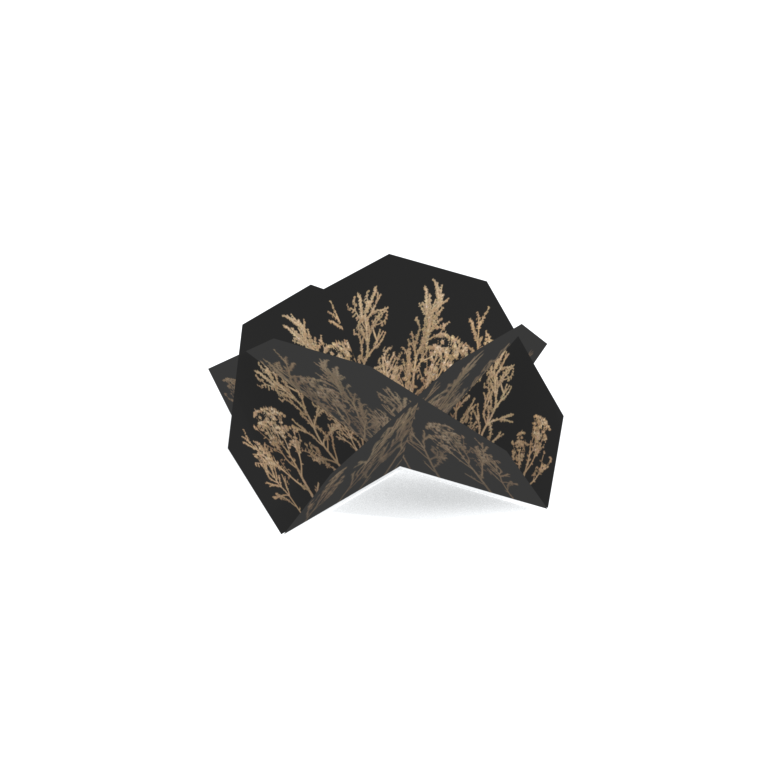
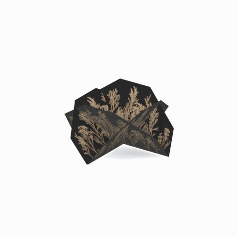

# Unidentified model (afgh_grss003_vrtn001)

Native model reference; a readable object identification has not been reviewed.

[Library](../README.md) | [Category](../tables/unclassified-components-1.md) | [Source / advanced data](../catalogue.json) | [Credits](../sources-and-credits.md)

**Game filename:** afgh_grss003_vrtn001.fmdl  
**Category:** Unclassified &gt; Unclassified components  
**Variant:** vrtn001; **LOD:** 0  
**Tags:** 

## Still reference



## 360-degree reference



The camera circles a static model. This is not a native animation. Source base textures and UVs use approximate studio shading; interaction, collision, complete assembly and FOX shader equivalence are not established.

## Identity and naming

| Field | Value |
|---|---|
| Library ID | mgsv-tpp-afgh_grss003_vrtn001-9ec3b67801f0cd8f |
| Naming status | unidentified |
| Naming confidence | unknown |
| Naming evidence | {} |
| Native model | /Assets/tpp/environ/object/afghanistan/grass/afgh_grss003/scenes/afgh_grss003_vrtn001.fmdl |
| Model SHA256 | a4516577c2c1eea604b9b0e141c3087d641f46ec5d642b97e5b345f6440940bb |
| Container | /Assets/tpp/pack/location/afgh/pack_common/afgh_common.fpk |
| Container SHA256 | 810fe68a28c81299da7ef00849d2905b640d0a2da970f1b312e953a2c7b5df48 |
| Captured source / location scope | Selected native member/content and captured installed-source chain; full archive SHA/runtime priority unresolved |
| Raw record SHA256 | a75e9917648f87424d8de84c7147ad7328082ff7298dbd9360dac37a8814d187 |

Naming review is descriptive metadata only. It does not change model completion or identify a working game interaction.

## Native LOD inventory

| Native LOD | Triangles | Preview status | Decoded indices SHA256 |
|---|---:|---|---|
| 0 | 16 | rendered | 6888188f6423a97ef853b07812fa82df18e658fa231c884185d21f036b05f494 |
| 1 | 13 | not separately rendered | c33b7f0d04f3899b4df3d1115185fcd40768acb2f89c169f9ccaffcac9597f73 |
| 2 | 10 | not separately rendered | b36cfca4f7e7793404d97a4302c1b5b5c7a36937ddf0bf80f9b7575bb7dafa6f |
| 3 | 9 | not separately rendered | 946850bdfac663971fb1740152bc099c46bfcf903b326eb670e503bd9e7a5fb8 |
| 4 | 7 | not separately rendered | 9be46d82ec8ba4867d7cce9b34f77dc2cb008c2eefa968ce825d99489e66705a |
| 5 | 6 | not separately rendered | 6f6951ebe7794f4ae622eb2dd031fc03bec74199e1fc9b779124cb38ceeadc92 |
| 6 | 5 | not separately rendered | ef523065512ce03e03c0384981d0b3dc6aec62c7c65a00660c35a76084588d74 |
| 7 | 4 | not separately rendered | bd0e5d57f91b6d4e5cf6b2a41d43c196fcf8a3c4ba6eea2f6ebcd62137afed8e |

Mesh detail and texture pixels/mips are separate. Index hashes describe decoded triangle arrays, not packed index-buffer bytes. Only source-recorded native levels are listed.

<details>
<summary>Texture, source and naming technical metadata</summary>

```json
{
  "source": {
    "nativePath": "/Assets/tpp/environ/object/afghanistan/grass/afgh_grss003/scenes/afgh_grss003_vrtn001.fmdl",
    "nativeSha256": "a4516577c2c1eea604b9b0e141c3087d641f46ec5d642b97e5b345f6440940bb",
    "stableIdentity": "/assets/tpp/environ/object/afghanistan/grass/afgh_grss003/scenes/afgh_grss003_vrtn001.fmdl#a4516577c2c1eea604b9b0e141c3087d641f46ec5d642b97e5b345f6440940bb#85ee2bee1c6a138b445939543b2f836a490f22e099c11efb33475ceb0e0c6bbd",
    "container": {
      "nativePath": "/Assets/tpp/pack/location/afgh/pack_common/afgh_common.fpk",
      "sha256": "810fe68a28c81299da7ef00849d2905b640d0a2da970f1b312e953a2c7b5df48",
      "status": "Selected installed-source container/member chain captured by community reader"
    },
    "historicalDatOrigin": null,
    "sourceArchiveAtCapture": "master/0/00.dat",
    "locationStatus": "Selected native member/content and captured installed-source chain; full archive SHA/runtime priority unresolved",
    "currentInstalledDatVerified": false,
    "selectedInstalledMemberVerified": true,
    "evidence": {
      "archive_helper_executable_sha256": "6f8e39a436af3b024bbd0504966ab3d5d9d0cb05d86689bf3e83d15e68df613f",
      "archive_helper_source_sha256": "f662d3b63e066a0afc77ffe22ea0e564222d14469648300dba2c4f8e9b43446b",
      "archive_index_recipe": "54acff767f08d76ad6056c5387328759bc883df507788f398de6c2c04fac12db",
      "archive_reader": "Atvaark GzsTool.Core 0.5.3",
      "archive_reader_core_sha256": "9da447ae3c375cce2e46744eeff6af50f1591062afdf479d1a0b49edb47daaa3",
      "archive_tool_and_dictionary_sha256": {
        "CityHash.dll": "def6c4506d461b65e4059b2936b2cbd5f852ba5d1d8a1a527f1c0e6dc7008c8f",
        "GzsTool.Core.dll": "9da447ae3c375cce2e46744eeff6af50f1591062afdf479d1a0b49edb47daaa3",
        "GzsTool.exe": "1a9c5b11e2355383ff485aee7e86abc026f5c1fad729daf8c0fd15ee0aae1c10",
        "Zlib.Portable.dll": "fe84781ba35ca9cc5ff5f73fd08d2a66c59e5257b4573f5fe59743f30bf78e42",
        "fpk_dictionary.txt": "b82f9a8d6c10a68ba9471eca9d815c21355a53b5e68753d8ad7db7fd01bf401d",
        "qar_dictionary.txt": "1558c248ed0a4bb827888261563fbb91a2df4f03999682f85d637ff70d9d5fb2"
      },
      "bytes": 2224,
      "container_chain": [
        {
          "content_sha256": null,
          "depth": 0,
          "id": "3f19555d27c2ebecdfbad26aadd88b9f62e9fb6092c04c712963ef73c67ccb42",
          "index_sha256": "9acd3675d6e1500e0e18430cba0fdc70a5718ad7d6b62f13905891a35d59f18a",
          "kind": "qar",
          "name": "master/0/00.dat",
          "parent_occurrence": null
        },
        {
          "content_sha256": "810fe68a28c81299da7ef00849d2905b640d0a2da970f1b312e953a2c7b5df48",
          "depth": 1,
          "id": "19e9adf189f5f5e9c624197357336d49999dc3525b83bd8c71cf525fcd2100e2",
          "index_sha256": "924ec10c5736f8b618238e2523664271e558a6ad49aefdaf2473ccbad50f1231",
          "kind": "fpk",
          "name": "/Assets/tpp/pack/location/afgh/pack_common/afgh_common.fpk",
          "parent_occurrence": "e35acf6999427a88778266baae8c014a0c20a82388f8ff04caca6a88d977a6d1"
        }
      ],
      "contentSha256": "a4516577c2c1eea604b9b0e141c3087d641f46ec5d642b97e5b345f6440940bb",
      "member": {
        "actual_size": 2224,
        "compressed_size": null,
        "content_sha256": "a4516577c2c1eea604b9b0e141c3087d641f46ec5d642b97e5b345f6440940bb",
        "declared_size": 2224,
        "extension": "fmdl",
        "hash_hex": null,
        "name": "/Assets/tpp/environ/object/afghanistan/grass/afgh_grss003/scenes/afgh_grss003_vrtn001.fmdl",
        "name_origin": "embedded",
        "offset": 2967888,
        "ordinal": 70,
        "path_hash": null,
        "resolved": 1
      },
      "occurrenceId": "05c9915cc4ef6f02db567e080c0d47f4e276db89c27824537b730b143997a2d0",
      "occurrence_id": "05c9915cc4ef6f02db567e080c0d47f4e276db89c27824537b730b143997a2d0",
      "primary_source_revision": "fc4a8196555638c6cf8aa1b7c8dc34ccd5c69cb5",
      "source_adapter": "community_core_selective_export",
      "source_id": "7f6bb743fb4c487f0e9522f9c7fac280c46cf6b1051e0fc75a93602c8eb451f0",
      "source_path": "master/0/00.dat",
      "source_snapshot": "{\"bytes\":768788480,\"device\":621747392682911458,\"file_id\":844424931596481,\"header_sha256\":\"ead50f0a9a37e4285323b9c6fa0ec75fe75e518c63147e63158eeb2892c6589e\",\"mtime_ns\":1791852224238580700}",
      "virtualPath": "/Assets/tpp/environ/object/afghanistan/grass/afgh_grss003/scenes/afgh_grss003_vrtn001.fmdl"
    }
  },
  "materials": [
    {
      "sampler": "Base_Tex_SRGB",
      "materialIndex": 0,
      "nativePathHash": "1543437568273095653",
      "nativeVirtualPath": null,
      "nativeBinding": {
        "familyId": "1fd03aed2201a45b7df53ba943afb9b2210009e7cf1cc7356345b1fa293ac6e9",
        "height": 256,
        "materialIndex": 0,
        "mipCount": 8,
        "nativeMipCountVerified": true,
        "nativePath": null,
        "nativePathHash": "1543437568273095653",
        "nativeTexture": {
          "additionalFtexsFileCount": 2,
          "depth": 1,
          "ftexsFileCount": 3,
          "height": 256,
          "metadataBytes": 192,
          "mipCount": 8,
          "mips": [
            {
              "chunks": 8,
              "decodedBytes": 131072,
              "mip": 0,
              "offset": 0,
              "storedBytes": 66464,
              "streamNumber": 3
            },
            {
              "chunks": 2,
              "decodedBytes": 32768,
              "mip": 1,
              "offset": 0,
              "storedBytes": 20160,
              "streamNumber": 2
            },
            {
              "chunks": 1,
              "decodedBytes": 8192,
              "mip": 2,
              "offset": 2456,
              "storedBytes": 5728,
              "streamNumber": 1
            },
            {
              "chunks": 1,
              "decodedBytes": 2048,
              "mip": 3,
              "offset": 752,
              "storedBytes": 1696,
              "streamNumber": 1
            },
            {
              "chunks": 1,
              "decodedBytes": 512,
              "mip": 4,
              "offset": 248,
              "storedBytes": 496,
              "streamNumber": 1
            },
            {
              "chunks": 1,
              "decodedBytes": 128,
              "mip": 5,
              "offset": 96,
              "storedBytes": 144,
              "streamNumber": 1
            },
            {
              "chunks": 1,
              "decodedBytes": 32,
              "mip": 6,
              "offset": 40,
              "storedBytes": 48,
              "streamNumber": 1
            },
            {
              "chunks": 1,
              "decodedBytes": 16,
              "mip": 7,
              "offset": 0,
              "storedBytes": 32,
              "streamNumber": 1
            }
          ],
          "nativeHeaderHash": "ddb633d63a872468b94f0216c63f9388",
          "nrtFlag": 2,
          "pixelFormat": 4,
          "requiredStreamNumbers": [
            1,
            2,
            3
          ],
          "textureType": 16777219,
          "unknownFlags": 273,
          "width": 512
        },
        "samplerName": "Base_Tex_SRGB",
        "samplerNameHash": "72475356961633",
        "sha256": "aa53693182d8f92ccb9aaa6b98b8ad4b8ab53c8aab695258cd69a8f2b2549630",
        "sourceOccurrences": [
          {
            "archive_helper_executable_sha256": "6f8e39a436af3b024bbd0504966ab3d5d9d0cb05d86689bf3e83d15e68df613f",
            "archive_helper_source_sha256": "f662d3b63e066a0afc77ffe22ea0e564222d14469648300dba2c4f8e9b43446b",
            "archive_index_recipe": "54acff767f08d76ad6056c5387328759bc883df507788f398de6c2c04fac12db",
            "archive_reader": "Atvaark GzsTool.Core 0.5.3",
            "archive_reader_core_sha256": "9da447ae3c375cce2e46744eeff6af50f1591062afdf479d1a0b49edb47daaa3",
            "archive_tool_and_dictionary_sha256": {
              "CityHash.dll": "def6c4506d461b65e4059b2936b2cbd5f852ba5d1d8a1a527f1c0e6dc7008c8f",
              "GzsTool.Core.dll": "9da447ae3c375cce2e46744eeff6af50f1591062afdf479d1a0b49edb47daaa3",
              "GzsTool.exe": "1a9c5b11e2355383ff485aee7e86abc026f5c1fad729daf8c0fd15ee0aae1c10",
              "Zlib.Portable.dll": "fe84781ba35ca9cc5ff5f73fd08d2a66c59e5257b4573f5fe59743f30bf78e42",
              "fpk_dictionary.txt": "b82f9a8d6c10a68ba9471eca9d815c21355a53b5e68753d8ad7db7fd01bf401d",
              "qar_dictionary.txt": "1558c248ed0a4bb827888261563fbb91a2df4f03999682f85d637ff70d9d5fb2"
            },
            "bytes": 192,
            "container_chain": [
              {
                "content_sha256": null,
                "depth": 0,
                "id": "0b473016351235050c2f6af21454bd979a0ad4602a9860137c807c894c5eba4d",
                "index_sha256": "ac9b4dae0dd0166db3a6ec8da18524dffebcbaf9004569af631de82913bf49a3",
                "kind": "qar",
                "name": "master/texture2.dat",
                "parent_occurrence": null
              }
            ],
            "contentSha256": "5929e68b6492a27ecda470996899d89aa5af0c7610bd2ff60b53c2dc21623329",
            "member": {
              "actual_size": 192,
              "compressed_size": 192,
              "content_sha256": "5929e68b6492a27ecda470996899d89aa5af0c7610bd2ff60b53c2dc21623329",
              "declared_size": 192,
              "extension": "ftex",
              "hash_hex": "156b644a75e91be5",
              "name": "/Assets/tpp/environ/object/afghanistan/grass/afgh_grss003/sourceimages/afgh_grss003_v1_bsm_alp.ftex",
              "name_origin": "dictionary",
              "offset": 1757929504,
              "ordinal": 10977,
              "path_hash": "3644a75e91be5",
              "resolved": 1
            },
            "occurrenceId": "e66956157a81c147419d49342b3c45564c15abcb3e7c53820bb270ad4e135810",
            "occurrence_id": "e66956157a81c147419d49342b3c45564c15abcb3e7c53820bb270ad4e135810",
            "primary_source_revision": "fc4a8196555638c6cf8aa1b7c8dc34ccd5c69cb5",
            "source_adapter": "community_core_selective_export",
            "source_id": "85e8296057664cbc6ebaf6bd43d1c6d18528bbd8a6fae920bdf4d5eb69f6a93d",
            "source_path": "master/texture2.dat",
            "source_snapshot": "{\"bytes\":2920239104,\"device\":621747392682911458,\"file_id\":562949953639626,\"header_sha256\":\"72bfee707623afb5f3abd8382035d3d4258b4941ac583a56f5a447f47123dcab\",\"mtime_ns\":1791224675561235200}",
            "virtualPath": "/Assets/tpp/environ/object/afghanistan/grass/afgh_grss003/sourceimages/afgh_grss003_v1_bsm_alp.ftex"
          },
          {
            "archive_helper_executable_sha256": "6f8e39a436af3b024bbd0504966ab3d5d9d0cb05d86689bf3e83d15e68df613f",
            "archive_helper_source_sha256": "f662d3b63e066a0afc77ffe22ea0e564222d14469648300dba2c4f8e9b43446b",
            "archive_index_recipe": "54acff767f08d76ad6056c5387328759bc883df507788f398de6c2c04fac12db",
            "archive_reader": "Atvaark GzsTool.Core 0.5.3",
            "archive_reader_core_sha256": "9da447ae3c375cce2e46744eeff6af50f1591062afdf479d1a0b49edb47daaa3",
            "archive_tool_and_dictionary_sha256": {
              "CityHash.dll": "def6c4506d461b65e4059b2936b2cbd5f852ba5d1d8a1a527f1c0e6dc7008c8f",
              "GzsTool.Core.dll": "9da447ae3c375cce2e46744eeff6af50f1591062afdf479d1a0b49edb47daaa3",
              "GzsTool.exe": "1a9c5b11e2355383ff485aee7e86abc026f5c1fad729daf8c0fd15ee0aae1c10",
              "Zlib.Portable.dll": "fe84781ba35ca9cc5ff5f73fd08d2a66c59e5257b4573f5fe59743f30bf78e42",
              "fpk_dictionary.txt": "b82f9a8d6c10a68ba9471eca9d815c21355a53b5e68753d8ad7db7fd01bf401d",
              "qar_dictionary.txt": "1558c248ed0a4bb827888261563fbb91a2df4f03999682f85d637ff70d9d5fb2"
            },
            "bytes": 8192,
            "container_chain": [
              {
                "content_sha256": null,
                "depth": 0,
                "id": "0b473016351235050c2f6af21454bd979a0ad4602a9860137c807c894c5eba4d",
                "index_sha256": "ac9b4dae0dd0166db3a6ec8da18524dffebcbaf9004569af631de82913bf49a3",
                "kind": "qar",
                "name": "master/texture2.dat",
                "parent_occurrence": null
              }
            ],
            "contentSha256": "b97d60b030d0fcac6d2cd9495ea3f605d356a920cea52660c9a099def8e31c07",
            "member": {
              "actual_size": 8192,
              "compressed_size": 8192,
              "content_sha256": "b97d60b030d0fcac6d2cd9495ea3f605d356a920cea52660c9a099def8e31c07",
              "declared_size": 8192,
              "extension": "1.ftexs",
              "hash_hex": "b2c3644a75e91be5",
              "name": "/Assets/tpp/environ/object/afghanistan/grass/afgh_grss003/sourceimages/afgh_grss003_v1_bsm_alp.1.ftexs",
              "name_origin": "dictionary",
              "offset": 1757833248,
              "ordinal": 10974,
              "path_hash": "3644a75e91be5",
              "resolved": 1
            },
            "occurrenceId": "01aa83107fba5183191e85b12769c8d011fe846688c587db0653c11d59f28f70",
            "occurrence_id": "01aa83107fba5183191e85b12769c8d011fe846688c587db0653c11d59f28f70",
            "primary_source_revision": "fc4a8196555638c6cf8aa1b7c8dc34ccd5c69cb5",
            "source_adapter": "community_core_selective_export",
            "source_id": "85e8296057664cbc6ebaf6bd43d1c6d18528bbd8a6fae920bdf4d5eb69f6a93d",
            "source_path": "master/texture2.dat",
            "source_snapshot": "{\"bytes\":2920239104,\"device\":621747392682911458,\"file_id\":562949953639626,\"header_sha256\":\"72bfee707623afb5f3abd8382035d3d4258b4941ac583a56f5a447f47123dcab\",\"mtime_ns\":1791224675561235200}",
            "virtualPath": "/Assets/tpp/environ/object/afghanistan/grass/afgh_grss003/sourceimages/afgh_grss003_v1_bsm_alp.1.ftexs"
          },
          {
            "archive_helper_executable_sha256": "6f8e39a436af3b024bbd0504966ab3d5d9d0cb05d86689bf3e83d15e68df613f",
            "archive_helper_source_sha256": "f662d3b63e066a0afc77ffe22ea0e564222d14469648300dba2c4f8e9b43446b",
            "archive_index_recipe": "54acff767f08d76ad6056c5387328759bc883df507788f398de6c2c04fac12db",
            "archive_reader": "Atvaark GzsTool.Core 0.5.3",
            "archive_reader_core_sha256": "9da447ae3c375cce2e46744eeff6af50f1591062afdf479d1a0b49edb47daaa3",
            "archive_tool_and_dictionary_sha256": {
              "CityHash.dll": "def6c4506d461b65e4059b2936b2cbd5f852ba5d1d8a1a527f1c0e6dc7008c8f",
              "GzsTool.Core.dll": "9da447ae3c375cce2e46744eeff6af50f1591062afdf479d1a0b49edb47daaa3",
              "GzsTool.exe": "1a9c5b11e2355383ff485aee7e86abc026f5c1fad729daf8c0fd15ee0aae1c10",
              "Zlib.Portable.dll": "fe84781ba35ca9cc5ff5f73fd08d2a66c59e5257b4573f5fe59743f30bf78e42",
              "fpk_dictionary.txt": "b82f9a8d6c10a68ba9471eca9d815c21355a53b5e68753d8ad7db7fd01bf401d",
              "qar_dictionary.txt": "1558c248ed0a4bb827888261563fbb91a2df4f03999682f85d637ff70d9d5fb2"
            },
            "bytes": 20176,
            "container_chain": [
              {
                "content_sha256": null,
                "depth": 0,
                "id": "e73d96973ade76f7a00afdbea486dd110896ace97da0791f56899647de46f210",
                "index_sha256": "5a818609a652a10d90fb90015661d0cb80898096bbb3aac36382172988d8736d",
                "kind": "qar",
                "name": "mgo/texture0.dat",
                "parent_occurrence": null
              }
            ],
            "contentSha256": "7fbdf62584d7235640cf08335f50f1bae0bfd41a373eefa011c1790e974f82ae",
            "member": {
              "actual_size": 20176,
              "compressed_size": 20176,
              "content_sha256": "7fbdf62584d7235640cf08335f50f1bae0bfd41a373eefa011c1790e974f82ae",
              "declared_size": 20176,
              "extension": "2.ftexs",
              "hash_hex": "b573644a75e91be5",
              "name": "/Assets/tpp/environ/object/afghanistan/grass/afgh_grss003/sourceimages/afgh_grss003_v1_bsm_alp.2.ftexs",
              "name_origin": "dictionary",
              "offset": 3319556128,
              "ordinal": 12768,
              "path_hash": "3644a75e91be5",
              "resolved": 1
            },
            "occurrenceId": "13436110b7183234efd3e4b9efde41993e4fab50b011f077ecb44034c7f739c4",
            "occurrence_id": "13436110b7183234efd3e4b9efde41993e4fab50b011f077ecb44034c7f739c4",
            "primary_source_revision": "fc4a8196555638c6cf8aa1b7c8dc34ccd5c69cb5",
            "source_adapter": "community_core_selective_export",
            "source_id": "03f5942f0e1af8040ae05b95c43716d75f5933971d78324bf7cfea291297f3f4",
            "source_path": "mgo/texture0.dat",
            "source_snapshot": "{\"bytes\":4492370944,\"device\":621747392682911458,\"file_id\":562949953639631,\"header_sha256\":\"6108fbacb65c84d041742c39e5ca630745240453b336f1059a13b91943f0b011\",\"mtime_ns\":1791224675562234400}",
            "virtualPath": "/Assets/tpp/environ/object/afghanistan/grass/afgh_grss003/sourceimages/afgh_grss003_v1_bsm_alp.2.ftexs"
          },
          {
            "archive_helper_executable_sha256": "6f8e39a436af3b024bbd0504966ab3d5d9d0cb05d86689bf3e83d15e68df613f",
            "archive_helper_source_sha256": "f662d3b63e066a0afc77ffe22ea0e564222d14469648300dba2c4f8e9b43446b",
            "archive_index_recipe": "54acff767f08d76ad6056c5387328759bc883df507788f398de6c2c04fac12db",
            "archive_reader": "Atvaark GzsTool.Core 0.5.3",
            "archive_reader_core_sha256": "9da447ae3c375cce2e46744eeff6af50f1591062afdf479d1a0b49edb47daaa3",
            "archive_tool_and_dictionary_sha256": {
              "CityHash.dll": "def6c4506d461b65e4059b2936b2cbd5f852ba5d1d8a1a527f1c0e6dc7008c8f",
              "GzsTool.Core.dll": "9da447ae3c375cce2e46744eeff6af50f1591062afdf479d1a0b49edb47daaa3",
              "GzsTool.exe": "1a9c5b11e2355383ff485aee7e86abc026f5c1fad729daf8c0fd15ee0aae1c10",
              "Zlib.Portable.dll": "fe84781ba35ca9cc5ff5f73fd08d2a66c59e5257b4573f5fe59743f30bf78e42",
              "fpk_dictionary.txt": "b82f9a8d6c10a68ba9471eca9d815c21355a53b5e68753d8ad7db7fd01bf401d",
              "qar_dictionary.txt": "1558c248ed0a4bb827888261563fbb91a2df4f03999682f85d637ff70d9d5fb2"
            },
            "bytes": 66528,
            "container_chain": [
              {
                "content_sha256": null,
                "depth": 0,
                "id": "e73d96973ade76f7a00afdbea486dd110896ace97da0791f56899647de46f210",
                "index_sha256": "5a818609a652a10d90fb90015661d0cb80898096bbb3aac36382172988d8736d",
                "kind": "qar",
                "name": "mgo/texture0.dat",
                "parent_occurrence": null
              }
            ],
            "contentSha256": "14e1164fcf7516ffde0cf53f0f86498e8e512d8057993e93ea4e862a055c8428",
            "member": {
              "actual_size": 66528,
              "compressed_size": 66528,
              "content_sha256": "14e1164fcf7516ffde0cf53f0f86498e8e512d8057993e93ea4e862a055c8428",
              "declared_size": 66528,
              "extension": "3.ftexs",
              "hash_hex": "571b644a75e91be5",
              "name": "/Assets/tpp/environ/object/afghanistan/grass/afgh_grss003/sourceimages/afgh_grss003_v1_bsm_alp.3.ftexs",
              "name_origin": "dictionary",
              "offset": 3319576608,
              "ordinal": 12769,
              "path_hash": "3644a75e91be5",
              "resolved": 1
            },
            "occurrenceId": "070b58175ea1dad0106f16dfac63987b8fbf76866b44eba05657f3cc125d01b1",
            "occurrence_id": "070b58175ea1dad0106f16dfac63987b8fbf76866b44eba05657f3cc125d01b1",
            "primary_source_revision": "fc4a8196555638c6cf8aa1b7c8dc34ccd5c69cb5",
            "source_adapter": "community_core_selective_export",
            "source_id": "03f5942f0e1af8040ae05b95c43716d75f5933971d78324bf7cfea291297f3f4",
            "source_path": "mgo/texture0.dat",
            "source_snapshot": "{\"bytes\":4492370944,\"device\":621747392682911458,\"file_id\":562949953639631,\"header_sha256\":\"6108fbacb65c84d041742c39e5ca630745240453b336f1059a13b91943f0b011\",\"mtime_ns\":1791224675562234400}",
            "virtualPath": "/Assets/tpp/environ/object/afghanistan/grass/afgh_grss003/sourceimages/afgh_grss003_v1_bsm_alp.3.ftexs"
          }
        ],
        "width": 512
      },
      "ddsSha256": "aa53693182d8f92ccb9aaa6b98b8ad4b8ab53c8aab695258cd69a8f2b2549630",
      "dimensions": [
        512,
        256
      ],
      "mipCount": 8,
      "nativeMipCountVerified": true,
      "connectedInPreview": true
    }
  ],
  "quality": {
    "decodedIndicesHashDerivation": "SHA256 of canonical UTF-8 JSON decoded triangle indices grouped by mesh; not packed buffer bytes",
    "highestRetainedGeometricLod": 0,
    "distinctNativeLods": 8,
    "baseTextureDimensions": [
      512,
      256
    ],
    "baseTextureNativeMipCount": 8,
    "largerRetainedBaseTextureFound": null,
    "nativeLods": [
      {
        "indicesSha256": "6888188f6423a97ef853b07812fa82df18e658fa231c884185d21f036b05f494",
        "nativeLod": 0,
        "triangles": 16
      },
      {
        "indicesSha256": "c33b7f0d04f3899b4df3d1115185fcd40768acb2f89c169f9ccaffcac9597f73",
        "nativeLod": 1,
        "triangles": 13
      },
      {
        "indicesSha256": "b36cfca4f7e7793404d97a4302c1b5b5c7a36937ddf0bf80f9b7575bb7dafa6f",
        "nativeLod": 2,
        "triangles": 10
      },
      {
        "indicesSha256": "946850bdfac663971fb1740152bc099c46bfcf903b326eb670e503bd9e7a5fb8",
        "nativeLod": 3,
        "triangles": 9
      },
      {
        "indicesSha256": "9be46d82ec8ba4867d7cce9b34f77dc2cb008c2eefa968ce825d99489e66705a",
        "nativeLod": 4,
        "triangles": 7
      },
      {
        "indicesSha256": "6f6951ebe7794f4ae622eb2dd031fc03bec74199e1fc9b779124cb38ceeadc92",
        "nativeLod": 5,
        "triangles": 6
      },
      {
        "indicesSha256": "ef523065512ce03e03c0384981d0b3dc6aec62c7c65a00660c35a76084588d74",
        "nativeLod": 6,
        "triangles": 5
      },
      {
        "indicesSha256": "bd0e5d57f91b6d4e5cf6b2a41d43c196fcf8a3c4ba6eea2f6ebcd62137afed8e",
        "nativeLod": 7,
        "triangles": 4
      }
    ],
    "renderedNativeLods": [
      0
    ],
    "baseTextureSummary": "512 x 256; 8 native/DDS mips",
    "highestDetailScope": "Triangle-count comparison within captured FMDL only"
  }
}
```

</details>

[Original source / advanced record](../catalogue.json)
