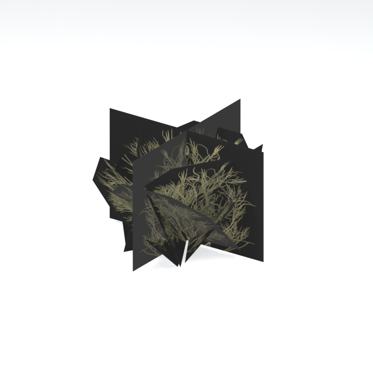
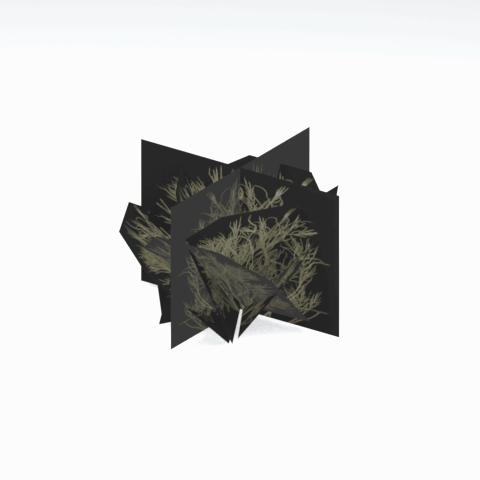

# Unidentified model (afgh_grss009)

Native model reference; a readable object identification has not been reviewed.

[Library](../README.md) | [Category](../tables/unclassified-components-1.md) | [Source / advanced data](../catalogue.json) | [Credits](../sources-and-credits.md)

**Game filename:** afgh_grss009.fmdl  
**Category:** Unclassified &gt; Unclassified components  
**Variant:** No explicit variant token; **LOD:** 0  
**Tags:** 

## Still reference



## 360-degree reference



The camera circles a static model. This is not a native animation. Source base textures and UVs use approximate studio shading; interaction, collision, complete assembly and FOX shader equivalence are not established.

## Identity and naming

| Field | Value |
|---|---|
| Library ID | mgsv-tpp-afgh_grss009-1ca372cd1a38bfe9 |
| Naming status | unidentified |
| Naming confidence | unknown |
| Naming evidence | {} |
| Native model | /Assets/tpp/environ/object/afghanistan/grass/afgh_grss009/scenes/afgh_grss009.fmdl |
| Model SHA256 | 0975244eea5ed28e852dcfeee887d0512324f36dff5eb95b3726f649f093ab97 |
| Container | /Assets/mgo/pack/location/afn0/pack_common/afn0_common.fpk |
| Container SHA256 | 793152d916d15d32b16935c3069b2171c7229092e9d1d3f1dd464e87ea95f415 |
| Captured source / location scope | Selected native member/content and captured installed-source chain; full archive SHA/runtime priority unresolved |
| Raw record SHA256 | fdc3fda2dd7fa20f5c65aa56730d10b256f1c586fa555ca4fead6c0485eb564b |

Naming review is descriptive metadata only. It does not change model completion or identify a working game interaction.

## Native LOD inventory

| Native LOD | Triangles | Preview status | Decoded indices SHA256 |
|---|---:|---|---|
| 0 | 32 | rendered | 7425be83c5489d974abd879245ce764e0fd4d34fc7a4ef1b4eb3c4cb14450aee |
| 1 | 31 | not separately rendered | 355e0d63a5863e5063786a745813192c19a4c05b16843a352c23ac54ed495a39 |
| 2 | 31 | not separately rendered | 355e0d63a5863e5063786a745813192c19a4c05b16843a352c23ac54ed495a39 |
| 3 | 31 | not separately rendered | 355e0d63a5863e5063786a745813192c19a4c05b16843a352c23ac54ed495a39 |
| 4 | 31 | not separately rendered | 355e0d63a5863e5063786a745813192c19a4c05b16843a352c23ac54ed495a39 |
| 5 | 31 | not separately rendered | 355e0d63a5863e5063786a745813192c19a4c05b16843a352c23ac54ed495a39 |
| 6 | 31 | not separately rendered | 355e0d63a5863e5063786a745813192c19a4c05b16843a352c23ac54ed495a39 |
| 7 | 31 | not separately rendered | 355e0d63a5863e5063786a745813192c19a4c05b16843a352c23ac54ed495a39 |

Mesh detail and texture pixels/mips are separate. Index hashes describe decoded triangle arrays, not packed index-buffer bytes. Only source-recorded native levels are listed.

<details>
<summary>Texture, source and naming technical metadata</summary>

```json
{
  "source": {
    "nativePath": "/Assets/tpp/environ/object/afghanistan/grass/afgh_grss009/scenes/afgh_grss009.fmdl",
    "nativeSha256": "0975244eea5ed28e852dcfeee887d0512324f36dff5eb95b3726f649f093ab97",
    "stableIdentity": "/assets/tpp/environ/object/afghanistan/grass/afgh_grss009/scenes/afgh_grss009.fmdl#0975244eea5ed28e852dcfeee887d0512324f36dff5eb95b3726f649f093ab97#2c96abe9c10bf3f107ec7b624a1648aae6ad11c3e2718786b8ea1c6a889ca9cd",
    "container": {
      "nativePath": "/Assets/mgo/pack/location/afn0/pack_common/afn0_common.fpk",
      "sha256": "793152d916d15d32b16935c3069b2171c7229092e9d1d3f1dd464e87ea95f415",
      "status": "Selected installed-source container/member chain captured by community reader"
    },
    "historicalDatOrigin": null,
    "sourceArchiveAtCapture": "master/0/00.dat",
    "locationStatus": "Selected native member/content and captured installed-source chain; full archive SHA/runtime priority unresolved",
    "currentInstalledDatVerified": false,
    "selectedInstalledMemberVerified": true,
    "evidence": {
      "archive_helper_executable_sha256": "6f8e39a436af3b024bbd0504966ab3d5d9d0cb05d86689bf3e83d15e68df613f",
      "archive_helper_source_sha256": "f662d3b63e066a0afc77ffe22ea0e564222d14469648300dba2c4f8e9b43446b",
      "archive_index_recipe": "54acff767f08d76ad6056c5387328759bc883df507788f398de6c2c04fac12db",
      "archive_reader": "Atvaark GzsTool.Core 0.5.3",
      "archive_reader_core_sha256": "9da447ae3c375cce2e46744eeff6af50f1591062afdf479d1a0b49edb47daaa3",
      "archive_tool_and_dictionary_sha256": {
        "CityHash.dll": "def6c4506d461b65e4059b2936b2cbd5f852ba5d1d8a1a527f1c0e6dc7008c8f",
        "GzsTool.Core.dll": "9da447ae3c375cce2e46744eeff6af50f1591062afdf479d1a0b49edb47daaa3",
        "GzsTool.exe": "1a9c5b11e2355383ff485aee7e86abc026f5c1fad729daf8c0fd15ee0aae1c10",
        "Zlib.Portable.dll": "fe84781ba35ca9cc5ff5f73fd08d2a66c59e5257b4573f5fe59743f30bf78e42",
        "fpk_dictionary.txt": "b82f9a8d6c10a68ba9471eca9d815c21355a53b5e68753d8ad7db7fd01bf401d",
        "qar_dictionary.txt": "1558c248ed0a4bb827888261563fbb91a2df4f03999682f85d637ff70d9d5fb2"
      },
      "bytes": 3328,
      "container_chain": [
        {
          "content_sha256": null,
          "depth": 0,
          "id": "3f19555d27c2ebecdfbad26aadd88b9f62e9fb6092c04c712963ef73c67ccb42",
          "index_sha256": "9acd3675d6e1500e0e18430cba0fdc70a5718ad7d6b62f13905891a35d59f18a",
          "kind": "qar",
          "name": "master/0/00.dat",
          "parent_occurrence": null
        },
        {
          "content_sha256": "793152d916d15d32b16935c3069b2171c7229092e9d1d3f1dd464e87ea95f415",
          "depth": 1,
          "id": "cdd16b801ab3d8abcb0eff58c5ffda33e686dfce824b125f6dae66b5b2538516",
          "index_sha256": "b576db71a757f0e278c2d308819efc35b981eb97da938ab92207c1f37446927a",
          "kind": "fpk",
          "name": "/Assets/mgo/pack/location/afn0/pack_common/afn0_common.fpk",
          "parent_occurrence": "629fd67dc6977d93ec9e65215d23dc6a6ff93ef5e14be9b3ffb02ad030ecfdde"
        }
      ],
      "contentSha256": "0975244eea5ed28e852dcfeee887d0512324f36dff5eb95b3726f649f093ab97",
      "member": {
        "actual_size": 3328,
        "compressed_size": null,
        "content_sha256": "0975244eea5ed28e852dcfeee887d0512324f36dff5eb95b3726f649f093ab97",
        "declared_size": 3328,
        "extension": "fmdl",
        "hash_hex": null,
        "name": "/Assets/tpp/environ/object/afghanistan/grass/afgh_grss009/scenes/afgh_grss009.fmdl",
        "name_origin": "embedded",
        "offset": 7036928,
        "ordinal": 229,
        "path_hash": null,
        "resolved": 1
      },
      "occurrenceId": "623c2797a58e258eb12a452a138723882cfa59c618800437263a5fda20c14803",
      "occurrence_id": "623c2797a58e258eb12a452a138723882cfa59c618800437263a5fda20c14803",
      "primary_source_revision": "fc4a8196555638c6cf8aa1b7c8dc34ccd5c69cb5",
      "source_adapter": "community_core_selective_export",
      "source_id": "7f6bb743fb4c487f0e9522f9c7fac280c46cf6b1051e0fc75a93602c8eb451f0",
      "source_path": "master/0/00.dat",
      "source_snapshot": "{\"bytes\":768788480,\"device\":621747392682911458,\"file_id\":844424931596481,\"header_sha256\":\"ead50f0a9a37e4285323b9c6fa0ec75fe75e518c63147e63158eeb2892c6589e\",\"mtime_ns\":1791852224238580700}",
      "virtualPath": "/Assets/tpp/environ/object/afghanistan/grass/afgh_grss009/scenes/afgh_grss009.fmdl"
    }
  },
  "materials": [
    {
      "sampler": "Base_Tex_SRGB",
      "materialIndex": 0,
      "nativePathHash": "1542871665953423936",
      "nativeVirtualPath": null,
      "nativeBinding": {
        "familyId": "cd35787936425c148af177fef14222ce22c2361c16a333e89cdf3c16b7d19184",
        "height": 512,
        "materialIndex": 0,
        "mipCount": 8,
        "nativeMipCountVerified": true,
        "nativePath": null,
        "nativePathHash": "1542871665953423936",
        "nativeTexture": {
          "additionalFtexsFileCount": 2,
          "depth": 1,
          "ftexsFileCount": 3,
          "height": 512,
          "metadataBytes": 192,
          "mipCount": 8,
          "mips": [
            {
              "chunks": 16,
              "decodedBytes": 262144,
              "mip": 0,
              "offset": 0,
              "storedBytes": 154768,
              "streamNumber": 3
            },
            {
              "chunks": 4,
              "decodedBytes": 65536,
              "mip": 1,
              "offset": 0,
              "storedBytes": 44992,
              "streamNumber": 2
            },
            {
              "chunks": 1,
              "decodedBytes": 16384,
              "mip": 2,
              "offset": 4632,
              "storedBytes": 12192,
              "streamNumber": 1
            },
            {
              "chunks": 1,
              "decodedBytes": 4096,
              "mip": 3,
              "offset": 1360,
              "storedBytes": 3264,
              "streamNumber": 1
            },
            {
              "chunks": 1,
              "decodedBytes": 1024,
              "mip": 4,
              "offset": 408,
              "storedBytes": 944,
              "streamNumber": 1
            },
            {
              "chunks": 1,
              "decodedBytes": 256,
              "mip": 5,
              "offset": 128,
              "storedBytes": 272,
              "streamNumber": 1
            },
            {
              "chunks": 1,
              "decodedBytes": 64,
              "mip": 6,
              "offset": 40,
              "storedBytes": 80,
              "streamNumber": 1
            },
            {
              "chunks": 1,
              "decodedBytes": 16,
              "mip": 7,
              "offset": 0,
              "storedBytes": 32,
              "streamNumber": 1
            }
          ],
          "nativeHeaderHash": "ad14e2c9667d4c817eb7aa40be793984",
          "nrtFlag": 2,
          "pixelFormat": 4,
          "requiredStreamNumbers": [
            1,
            2,
            3
          ],
          "textureType": 16777219,
          "unknownFlags": 273,
          "width": 512
        },
        "samplerName": "Base_Tex_SRGB",
        "samplerNameHash": "72475356961633",
        "sha256": "6d93216e3c61c477a56fcfdce87fdae4a91b8a6bac23ae99d6dfb180e6d16bfb",
        "sourceOccurrences": [
          {
            "archive_helper_executable_sha256": "6f8e39a436af3b024bbd0504966ab3d5d9d0cb05d86689bf3e83d15e68df613f",
            "archive_helper_source_sha256": "f662d3b63e066a0afc77ffe22ea0e564222d14469648300dba2c4f8e9b43446b",
            "archive_index_recipe": "54acff767f08d76ad6056c5387328759bc883df507788f398de6c2c04fac12db",
            "archive_reader": "Atvaark GzsTool.Core 0.5.3",
            "archive_reader_core_sha256": "9da447ae3c375cce2e46744eeff6af50f1591062afdf479d1a0b49edb47daaa3",
            "archive_tool_and_dictionary_sha256": {
              "CityHash.dll": "def6c4506d461b65e4059b2936b2cbd5f852ba5d1d8a1a527f1c0e6dc7008c8f",
              "GzsTool.Core.dll": "9da447ae3c375cce2e46744eeff6af50f1591062afdf479d1a0b49edb47daaa3",
              "GzsTool.exe": "1a9c5b11e2355383ff485aee7e86abc026f5c1fad729daf8c0fd15ee0aae1c10",
              "Zlib.Portable.dll": "fe84781ba35ca9cc5ff5f73fd08d2a66c59e5257b4573f5fe59743f30bf78e42",
              "fpk_dictionary.txt": "b82f9a8d6c10a68ba9471eca9d815c21355a53b5e68753d8ad7db7fd01bf401d",
              "qar_dictionary.txt": "1558c248ed0a4bb827888261563fbb91a2df4f03999682f85d637ff70d9d5fb2"
            },
            "bytes": 192,
            "container_chain": [
              {
                "content_sha256": null,
                "depth": 0,
                "id": "3f19555d27c2ebecdfbad26aadd88b9f62e9fb6092c04c712963ef73c67ccb42",
                "index_sha256": "9acd3675d6e1500e0e18430cba0fdc70a5718ad7d6b62f13905891a35d59f18a",
                "kind": "qar",
                "name": "master/0/00.dat",
                "parent_occurrence": null
              },
              {
                "content_sha256": "7784c61d48c2a829a8a3be8bea91819ed320466e84615e1196c12dc4390190ea",
                "depth": 1,
                "id": "a7374ee4090f72cbecb7df25f172141b83da2b51b8b38b375af7a4f0f577fc67",
                "index_sha256": "7f78072384a5e4f07d09223009a06931047d1b3d6ae36512b9bb7ef91d1fe958",
                "kind": "pftxs",
                "name": "/Assets/mgo/pack/location/afda/pack_common/afda_common.pftxs",
                "parent_occurrence": "e3bb44002c453c106548f7190291b4a4c22da16a7eebd82d6a8dac6ab3844ca7"
              }
            ],
            "contentSha256": "a13749c6834056e754eea4a515c6ee96ff6fe0ee576b1e8f70c4abada2d0f5be",
            "member": {
              "actual_size": 192,
              "compressed_size": null,
              "content_sha256": "a13749c6834056e754eea4a515c6ee96ff6fe0ee576b1e8f70c4abada2d0f5be",
              "declared_size": 192,
              "extension": "ftex",
              "hash_hex": "1569619b0f2b4240",
              "name": "1569619b0f2b4240.ftex",
              "name_origin": "hash_fallback",
              "offset": 22791440,
              "ordinal": 1680,
              "path_hash": null,
              "resolved": 0
            },
            "occurrenceId": "68e385afb1d82123726f7a13be6d4ca60ff0a7f729d8d0afbaf28432d6e3c5c9",
            "occurrence_id": "68e385afb1d82123726f7a13be6d4ca60ff0a7f729d8d0afbaf28432d6e3c5c9",
            "primary_source_revision": "fc4a8196555638c6cf8aa1b7c8dc34ccd5c69cb5",
            "source_adapter": "community_core_selective_export",
            "source_id": "7f6bb743fb4c487f0e9522f9c7fac280c46cf6b1051e0fc75a93602c8eb451f0",
            "source_path": "master/0/00.dat",
            "source_snapshot": "{\"bytes\":768788480,\"device\":621747392682911458,\"file_id\":844424931596481,\"header_sha256\":\"ead50f0a9a37e4285323b9c6fa0ec75fe75e518c63147e63158eeb2892c6589e\",\"mtime_ns\":1791852224238580700}",
            "virtualPath": "1569619b0f2b4240.ftex"
          },
          {
            "archive_helper_executable_sha256": "6f8e39a436af3b024bbd0504966ab3d5d9d0cb05d86689bf3e83d15e68df613f",
            "archive_helper_source_sha256": "f662d3b63e066a0afc77ffe22ea0e564222d14469648300dba2c4f8e9b43446b",
            "archive_index_recipe": "54acff767f08d76ad6056c5387328759bc883df507788f398de6c2c04fac12db",
            "archive_reader": "Atvaark GzsTool.Core 0.5.3",
            "archive_reader_core_sha256": "9da447ae3c375cce2e46744eeff6af50f1591062afdf479d1a0b49edb47daaa3",
            "archive_tool_and_dictionary_sha256": {
              "CityHash.dll": "def6c4506d461b65e4059b2936b2cbd5f852ba5d1d8a1a527f1c0e6dc7008c8f",
              "GzsTool.Core.dll": "9da447ae3c375cce2e46744eeff6af50f1591062afdf479d1a0b49edb47daaa3",
              "GzsTool.exe": "1a9c5b11e2355383ff485aee7e86abc026f5c1fad729daf8c0fd15ee0aae1c10",
              "Zlib.Portable.dll": "fe84781ba35ca9cc5ff5f73fd08d2a66c59e5257b4573f5fe59743f30bf78e42",
              "fpk_dictionary.txt": "b82f9a8d6c10a68ba9471eca9d815c21355a53b5e68753d8ad7db7fd01bf401d",
              "qar_dictionary.txt": "1558c248ed0a4bb827888261563fbb91a2df4f03999682f85d637ff70d9d5fb2"
            },
            "bytes": 16832,
            "container_chain": [
              {
                "content_sha256": null,
                "depth": 0,
                "id": "0b473016351235050c2f6af21454bd979a0ad4602a9860137c807c894c5eba4d",
                "index_sha256": "ac9b4dae0dd0166db3a6ec8da18524dffebcbaf9004569af631de82913bf49a3",
                "kind": "qar",
                "name": "master/texture2.dat",
                "parent_occurrence": null
              }
            ],
            "contentSha256": "642e2d71fa2982828fc62c0b6da667742dae4bacc1d335f6df62821e16ad40da",
            "member": {
              "actual_size": 16832,
              "compressed_size": 16832,
              "content_sha256": "642e2d71fa2982828fc62c0b6da667742dae4bacc1d335f6df62821e16ad40da",
              "declared_size": 16832,
              "extension": "1.ftexs",
              "hash_hex": "b2c1619b0f2b4240",
              "name": "/Assets/tpp/environ/object/afghanistan/grass/afgh_grss009/sourceimages/afgh_grss009_v2_bsm_alp.1.ftexs",
              "name_origin": "dictionary",
              "offset": 1757930528,
              "ordinal": 10978,
              "path_hash": "1619b0f2b4240",
              "resolved": 1
            },
            "occurrenceId": "01fdb47ff03bb2850eb68458140f408c816e2c43962f108d95de983cf5992a86",
            "occurrence_id": "01fdb47ff03bb2850eb68458140f408c816e2c43962f108d95de983cf5992a86",
            "primary_source_revision": "fc4a8196555638c6cf8aa1b7c8dc34ccd5c69cb5",
            "source_adapter": "community_core_selective_export",
            "source_id": "85e8296057664cbc6ebaf6bd43d1c6d18528bbd8a6fae920bdf4d5eb69f6a93d",
            "source_path": "master/texture2.dat",
            "source_snapshot": "{\"bytes\":2920239104,\"device\":621747392682911458,\"file_id\":562949953639626,\"header_sha256\":\"72bfee707623afb5f3abd8382035d3d4258b4941ac583a56f5a447f47123dcab\",\"mtime_ns\":1791224675561235200}",
            "virtualPath": "/Assets/tpp/environ/object/afghanistan/grass/afgh_grss009/sourceimages/afgh_grss009_v2_bsm_alp.1.ftexs"
          },
          {
            "archive_helper_executable_sha256": "6f8e39a436af3b024bbd0504966ab3d5d9d0cb05d86689bf3e83d15e68df613f",
            "archive_helper_source_sha256": "f662d3b63e066a0afc77ffe22ea0e564222d14469648300dba2c4f8e9b43446b",
            "archive_index_recipe": "54acff767f08d76ad6056c5387328759bc883df507788f398de6c2c04fac12db",
            "archive_reader": "Atvaark GzsTool.Core 0.5.3",
            "archive_reader_core_sha256": "9da447ae3c375cce2e46744eeff6af50f1591062afdf479d1a0b49edb47daaa3",
            "archive_tool_and_dictionary_sha256": {
              "CityHash.dll": "def6c4506d461b65e4059b2936b2cbd5f852ba5d1d8a1a527f1c0e6dc7008c8f",
              "GzsTool.Core.dll": "9da447ae3c375cce2e46744eeff6af50f1591062afdf479d1a0b49edb47daaa3",
              "GzsTool.exe": "1a9c5b11e2355383ff485aee7e86abc026f5c1fad729daf8c0fd15ee0aae1c10",
              "Zlib.Portable.dll": "fe84781ba35ca9cc5ff5f73fd08d2a66c59e5257b4573f5fe59743f30bf78e42",
              "fpk_dictionary.txt": "b82f9a8d6c10a68ba9471eca9d815c21355a53b5e68753d8ad7db7fd01bf401d",
              "qar_dictionary.txt": "1558c248ed0a4bb827888261563fbb91a2df4f03999682f85d637ff70d9d5fb2"
            },
            "bytes": 45024,
            "container_chain": [
              {
                "content_sha256": null,
                "depth": 0,
                "id": "e73d96973ade76f7a00afdbea486dd110896ace97da0791f56899647de46f210",
                "index_sha256": "5a818609a652a10d90fb90015661d0cb80898096bbb3aac36382172988d8736d",
                "kind": "qar",
                "name": "mgo/texture0.dat",
                "parent_occurrence": null
              }
            ],
            "contentSha256": "60d7158cb3f06eacaeecb7d60f660a051ce92ee62eef77e278101977b83706bb",
            "member": {
              "actual_size": 45024,
              "compressed_size": 45024,
              "content_sha256": "60d7158cb3f06eacaeecb7d60f660a051ce92ee62eef77e278101977b83706bb",
              "declared_size": 45024,
              "extension": "2.ftexs",
              "hash_hex": "b571619b0f2b4240",
              "name": "/Assets/tpp/environ/object/afghanistan/grass/afgh_grss009/sourceimages/afgh_grss009_v2_bsm_alp.2.ftexs",
              "name_origin": "dictionary",
              "offset": 3319643168,
              "ordinal": 12770,
              "path_hash": "1619b0f2b4240",
              "resolved": 1
            },
            "occurrenceId": "3de4ad69f95a1182e65d4358db3359d00ca52de1103785d7fe85511e6b481012",
            "occurrence_id": "3de4ad69f95a1182e65d4358db3359d00ca52de1103785d7fe85511e6b481012",
            "primary_source_revision": "fc4a8196555638c6cf8aa1b7c8dc34ccd5c69cb5",
            "source_adapter": "community_core_selective_export",
            "source_id": "03f5942f0e1af8040ae05b95c43716d75f5933971d78324bf7cfea291297f3f4",
            "source_path": "mgo/texture0.dat",
            "source_snapshot": "{\"bytes\":4492370944,\"device\":621747392682911458,\"file_id\":562949953639631,\"header_sha256\":\"6108fbacb65c84d041742c39e5ca630745240453b336f1059a13b91943f0b011\",\"mtime_ns\":1791224675562234400}",
            "virtualPath": "/Assets/tpp/environ/object/afghanistan/grass/afgh_grss009/sourceimages/afgh_grss009_v2_bsm_alp.2.ftexs"
          },
          {
            "archive_helper_executable_sha256": "6f8e39a436af3b024bbd0504966ab3d5d9d0cb05d86689bf3e83d15e68df613f",
            "archive_helper_source_sha256": "f662d3b63e066a0afc77ffe22ea0e564222d14469648300dba2c4f8e9b43446b",
            "archive_index_recipe": "54acff767f08d76ad6056c5387328759bc883df507788f398de6c2c04fac12db",
            "archive_reader": "Atvaark GzsTool.Core 0.5.3",
            "archive_reader_core_sha256": "9da447ae3c375cce2e46744eeff6af50f1591062afdf479d1a0b49edb47daaa3",
            "archive_tool_and_dictionary_sha256": {
              "CityHash.dll": "def6c4506d461b65e4059b2936b2cbd5f852ba5d1d8a1a527f1c0e6dc7008c8f",
              "GzsTool.Core.dll": "9da447ae3c375cce2e46744eeff6af50f1591062afdf479d1a0b49edb47daaa3",
              "GzsTool.exe": "1a9c5b11e2355383ff485aee7e86abc026f5c1fad729daf8c0fd15ee0aae1c10",
              "Zlib.Portable.dll": "fe84781ba35ca9cc5ff5f73fd08d2a66c59e5257b4573f5fe59743f30bf78e42",
              "fpk_dictionary.txt": "b82f9a8d6c10a68ba9471eca9d815c21355a53b5e68753d8ad7db7fd01bf401d",
              "qar_dictionary.txt": "1558c248ed0a4bb827888261563fbb91a2df4f03999682f85d637ff70d9d5fb2"
            },
            "bytes": 154896,
            "container_chain": [
              {
                "content_sha256": null,
                "depth": 0,
                "id": "e73d96973ade76f7a00afdbea486dd110896ace97da0791f56899647de46f210",
                "index_sha256": "5a818609a652a10d90fb90015661d0cb80898096bbb3aac36382172988d8736d",
                "kind": "qar",
                "name": "mgo/texture0.dat",
                "parent_occurrence": null
              }
            ],
            "contentSha256": "9b43c134ab21672fc9832bbcf893ab4d71559a5102806d511c5716ca6fb54112",
            "member": {
              "actual_size": 154896,
              "compressed_size": 154896,
              "content_sha256": "9b43c134ab21672fc9832bbcf893ab4d71559a5102806d511c5716ca6fb54112",
              "declared_size": 154896,
              "extension": "3.ftexs",
              "hash_hex": "5719619b0f2b4240",
              "name": "/Assets/tpp/environ/object/afghanistan/grass/afgh_grss009/sourceimages/afgh_grss009_v2_bsm_alp.3.ftexs",
              "name_origin": "dictionary",
              "offset": 3319688224,
              "ordinal": 12771,
              "path_hash": "1619b0f2b4240",
              "resolved": 1
            },
            "occurrenceId": "0a05f9b9ec7b77fe3068ff056322d642c422a7d06468e12128f78a22b8c07999",
            "occurrence_id": "0a05f9b9ec7b77fe3068ff056322d642c422a7d06468e12128f78a22b8c07999",
            "primary_source_revision": "fc4a8196555638c6cf8aa1b7c8dc34ccd5c69cb5",
            "source_adapter": "community_core_selective_export",
            "source_id": "03f5942f0e1af8040ae05b95c43716d75f5933971d78324bf7cfea291297f3f4",
            "source_path": "mgo/texture0.dat",
            "source_snapshot": "{\"bytes\":4492370944,\"device\":621747392682911458,\"file_id\":562949953639631,\"header_sha256\":\"6108fbacb65c84d041742c39e5ca630745240453b336f1059a13b91943f0b011\",\"mtime_ns\":1791224675562234400}",
            "virtualPath": "/Assets/tpp/environ/object/afghanistan/grass/afgh_grss009/sourceimages/afgh_grss009_v2_bsm_alp.3.ftexs"
          }
        ],
        "width": 512
      },
      "ddsSha256": "6d93216e3c61c477a56fcfdce87fdae4a91b8a6bac23ae99d6dfb180e6d16bfb",
      "dimensions": [
        512,
        512
      ],
      "mipCount": 8,
      "nativeMipCountVerified": true,
      "connectedInPreview": true
    }
  ],
  "quality": {
    "decodedIndicesHashDerivation": "SHA256 of canonical UTF-8 JSON decoded triangle indices grouped by mesh; not packed buffer bytes",
    "highestRetainedGeometricLod": 0,
    "distinctNativeLods": 2,
    "baseTextureDimensions": [
      512,
      512
    ],
    "baseTextureNativeMipCount": 8,
    "largerRetainedBaseTextureFound": null,
    "nativeLods": [
      {
        "indicesSha256": "7425be83c5489d974abd879245ce764e0fd4d34fc7a4ef1b4eb3c4cb14450aee",
        "nativeLod": 0,
        "triangles": 32
      },
      {
        "indicesSha256": "355e0d63a5863e5063786a745813192c19a4c05b16843a352c23ac54ed495a39",
        "nativeLod": 1,
        "triangles": 31
      },
      {
        "duplicateOf": 1,
        "indicesSha256": "355e0d63a5863e5063786a745813192c19a4c05b16843a352c23ac54ed495a39",
        "nativeLod": 2,
        "triangles": 31
      },
      {
        "duplicateOf": 1,
        "indicesSha256": "355e0d63a5863e5063786a745813192c19a4c05b16843a352c23ac54ed495a39",
        "nativeLod": 3,
        "triangles": 31
      },
      {
        "duplicateOf": 1,
        "indicesSha256": "355e0d63a5863e5063786a745813192c19a4c05b16843a352c23ac54ed495a39",
        "nativeLod": 4,
        "triangles": 31
      },
      {
        "duplicateOf": 1,
        "indicesSha256": "355e0d63a5863e5063786a745813192c19a4c05b16843a352c23ac54ed495a39",
        "nativeLod": 5,
        "triangles": 31
      },
      {
        "duplicateOf": 1,
        "indicesSha256": "355e0d63a5863e5063786a745813192c19a4c05b16843a352c23ac54ed495a39",
        "nativeLod": 6,
        "triangles": 31
      },
      {
        "duplicateOf": 1,
        "indicesSha256": "355e0d63a5863e5063786a745813192c19a4c05b16843a352c23ac54ed495a39",
        "nativeLod": 7,
        "triangles": 31
      }
    ],
    "renderedNativeLods": [
      0
    ],
    "baseTextureSummary": "512 x 512; 8 native/DDS mips",
    "highestDetailScope": "Triangle-count comparison within captured FMDL only"
  }
}
```

</details>

[Original source / advanced record](../catalogue.json)
