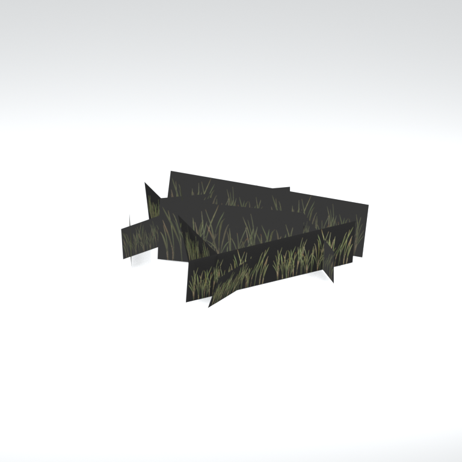
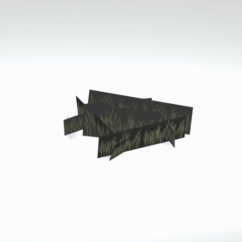

# Unidentified model (afgh_grss022_vrtn001)

Native model reference; a readable object identification has not been reviewed.

[Library](../README.md) | [Category](../tables/unclassified-components-1.md) | [Source / advanced data](../catalogue.json) | [Credits](../sources-and-credits.md)

**Game filename:** afgh_grss022_vrtn001.fmdl  
**Category:** Unclassified &gt; Unclassified components  
**Variant:** vrtn001; **LOD:** 0  
**Tags:** 

## Still reference



## 360-degree reference



The camera circles a static model. This is not a native animation. Source base textures and UVs use approximate studio shading; interaction, collision, complete assembly and FOX shader equivalence are not established.

## Identity and naming

| Field | Value |
|---|---|
| Library ID | mgsv-tpp-afgh_grss022_vrtn001-7ae8c287151b1513 |
| Naming status | unidentified |
| Naming confidence | unknown |
| Naming evidence | {} |
| Native model | /Assets/tpp/environ/object/afghanistan/grass/afgh_grss022/scenes/afgh_grss022_vrtn001.fmdl |
| Model SHA256 | 1e5bb49045bdfe799f0a5ddff513c09fbedae2bd79c5f26a027d0bd616c75af4 |
| Container | /Assets/tpp/pack/location/afgh/pack_common/afgh_common.fpk |
| Container SHA256 | 810fe68a28c81299da7ef00849d2905b640d0a2da970f1b312e953a2c7b5df48 |
| Captured source / location scope | Selected native member/content and captured installed-source chain; full archive SHA/runtime priority unresolved |
| Raw record SHA256 | b2433dd4000a217df2a9fb8cad25d224cbec567552e081a19b2c6de7f4481467 |

Naming review is descriptive metadata only. It does not change model completion or identify a working game interaction.

## Native LOD inventory

| Native LOD | Triangles | Preview status | Decoded indices SHA256 |
|---|---:|---|---|
| 0 | 26 | rendered | c0acce1bb4f95672b0116c8df471439727822fe9633c47abcdefe91c2e420cce |
| 1 | 23 | not separately rendered | d0a574214892007c2c87aa7239bc809b0075c340635f000f03be693b7a7a87a4 |
| 2 | 20 | not separately rendered | 93bebbc9bbb3cff1ab1c21dd622ea08794445f16450a320d4c0a8bf255ff81f5 |
| 3 | 19 | not separately rendered | 611331a3e24717ab30b21be81593699604ea773d3e73c8af45874ae6894590e3 |
| 4 | 17 | not separately rendered | 91345c7869738f55bc13db76e9d759a520e5030d13774328070f30047a833ed1 |
| 5 | 16 | not separately rendered | 513a66cd8fc846ddd39f0893e4936df57c77382f470ede166ad59fc9ec4c965b |
| 6 | 15 | not separately rendered | 62ffd319e5e77bf8d70678ac2439faeba95c09df282b426c0555b6c27272a5d2 |
| 7 | 13 | not separately rendered | 5439dea33f19d0ff8c4336fbcb0aa43e6dec3440e6f776d2f354070807ad66b7 |

Mesh detail and texture pixels/mips are separate. Index hashes describe decoded triangle arrays, not packed index-buffer bytes. Only source-recorded native levels are listed.

<details>
<summary>Texture, source and naming technical metadata</summary>

```json
{
  "source": {
    "nativePath": "/Assets/tpp/environ/object/afghanistan/grass/afgh_grss022/scenes/afgh_grss022_vrtn001.fmdl",
    "nativeSha256": "1e5bb49045bdfe799f0a5ddff513c09fbedae2bd79c5f26a027d0bd616c75af4",
    "stableIdentity": "/assets/tpp/environ/object/afghanistan/grass/afgh_grss022/scenes/afgh_grss022_vrtn001.fmdl#1e5bb49045bdfe799f0a5ddff513c09fbedae2bd79c5f26a027d0bd616c75af4#afeceae4c6d2ae778d29c37cd6c475d8c49e630294c75c2b49cc784491b80da3",
    "container": {
      "nativePath": "/Assets/tpp/pack/location/afgh/pack_common/afgh_common.fpk",
      "sha256": "810fe68a28c81299da7ef00849d2905b640d0a2da970f1b312e953a2c7b5df48",
      "status": "Selected installed-source container/member chain captured by community reader"
    },
    "historicalDatOrigin": null,
    "sourceArchiveAtCapture": "master/0/00.dat",
    "locationStatus": "Selected native member/content and captured installed-source chain; full archive SHA/runtime priority unresolved",
    "currentInstalledDatVerified": false,
    "selectedInstalledMemberVerified": true,
    "evidence": {
      "archive_helper_executable_sha256": "6f8e39a436af3b024bbd0504966ab3d5d9d0cb05d86689bf3e83d15e68df613f",
      "archive_helper_source_sha256": "f662d3b63e066a0afc77ffe22ea0e564222d14469648300dba2c4f8e9b43446b",
      "archive_index_recipe": "54acff767f08d76ad6056c5387328759bc883df507788f398de6c2c04fac12db",
      "archive_reader": "Atvaark GzsTool.Core 0.5.3",
      "archive_reader_core_sha256": "9da447ae3c375cce2e46744eeff6af50f1591062afdf479d1a0b49edb47daaa3",
      "archive_tool_and_dictionary_sha256": {
        "CityHash.dll": "def6c4506d461b65e4059b2936b2cbd5f852ba5d1d8a1a527f1c0e6dc7008c8f",
        "GzsTool.Core.dll": "9da447ae3c375cce2e46744eeff6af50f1591062afdf479d1a0b49edb47daaa3",
        "GzsTool.exe": "1a9c5b11e2355383ff485aee7e86abc026f5c1fad729daf8c0fd15ee0aae1c10",
        "Zlib.Portable.dll": "fe84781ba35ca9cc5ff5f73fd08d2a66c59e5257b4573f5fe59743f30bf78e42",
        "fpk_dictionary.txt": "b82f9a8d6c10a68ba9471eca9d815c21355a53b5e68753d8ad7db7fd01bf401d",
        "qar_dictionary.txt": "1558c248ed0a4bb827888261563fbb91a2df4f03999682f85d637ff70d9d5fb2"
      },
      "bytes": 3664,
      "container_chain": [
        {
          "content_sha256": null,
          "depth": 0,
          "id": "3f19555d27c2ebecdfbad26aadd88b9f62e9fb6092c04c712963ef73c67ccb42",
          "index_sha256": "9acd3675d6e1500e0e18430cba0fdc70a5718ad7d6b62f13905891a35d59f18a",
          "kind": "qar",
          "name": "master/0/00.dat",
          "parent_occurrence": null
        },
        {
          "content_sha256": "810fe68a28c81299da7ef00849d2905b640d0a2da970f1b312e953a2c7b5df48",
          "depth": 1,
          "id": "19e9adf189f5f5e9c624197357336d49999dc3525b83bd8c71cf525fcd2100e2",
          "index_sha256": "924ec10c5736f8b618238e2523664271e558a6ad49aefdaf2473ccbad50f1231",
          "kind": "fpk",
          "name": "/Assets/tpp/pack/location/afgh/pack_common/afgh_common.fpk",
          "parent_occurrence": "e35acf6999427a88778266baae8c014a0c20a82388f8ff04caca6a88d977a6d1"
        }
      ],
      "contentSha256": "1e5bb49045bdfe799f0a5ddff513c09fbedae2bd79c5f26a027d0bd616c75af4",
      "member": {
        "actual_size": 3664,
        "compressed_size": null,
        "content_sha256": "1e5bb49045bdfe799f0a5ddff513c09fbedae2bd79c5f26a027d0bd616c75af4",
        "declared_size": 3664,
        "extension": "fmdl",
        "hash_hex": null,
        "name": "/Assets/tpp/environ/object/afghanistan/grass/afgh_grss022/scenes/afgh_grss022_vrtn001.fmdl",
        "name_origin": "embedded",
        "offset": 2975072,
        "ordinal": 73,
        "path_hash": null,
        "resolved": 1
      },
      "occurrenceId": "3df5a4a8224721a5935c605cad97231408ce9abba627b46cb420d60cffb3731e",
      "occurrence_id": "3df5a4a8224721a5935c605cad97231408ce9abba627b46cb420d60cffb3731e",
      "primary_source_revision": "fc4a8196555638c6cf8aa1b7c8dc34ccd5c69cb5",
      "source_adapter": "community_core_selective_export",
      "source_id": "7f6bb743fb4c487f0e9522f9c7fac280c46cf6b1051e0fc75a93602c8eb451f0",
      "source_path": "master/0/00.dat",
      "source_snapshot": "{\"bytes\":768788480,\"device\":621747392682911458,\"file_id\":844424931596481,\"header_sha256\":\"ead50f0a9a37e4285323b9c6fa0ec75fe75e518c63147e63158eeb2892c6589e\",\"mtime_ns\":1791852224238580700}",
      "virtualPath": "/Assets/tpp/environ/object/afghanistan/grass/afgh_grss022/scenes/afgh_grss022_vrtn001.fmdl"
    }
  },
  "materials": [
    {
      "sampler": "Base_Tex_SRGB",
      "materialIndex": 0,
      "nativePathHash": "1542885314322062762",
      "nativeVirtualPath": null,
      "nativeBinding": {
        "familyId": "b904a4c0504d03c584bb55b6854adc7a670b385ccc87c40adb4614b9e6eadb90",
        "height": 256,
        "materialIndex": 0,
        "mipCount": 8,
        "nativeMipCountVerified": true,
        "nativePath": null,
        "nativePathHash": "1542885314322062762",
        "nativeTexture": {
          "additionalFtexsFileCount": 2,
          "depth": 1,
          "ftexsFileCount": 3,
          "height": 256,
          "metadataBytes": 192,
          "mipCount": 8,
          "mips": [
            {
              "chunks": 8,
              "decodedBytes": 131072,
              "mip": 0,
              "offset": 0,
              "storedBytes": 46048,
              "streamNumber": 3
            },
            {
              "chunks": 2,
              "decodedBytes": 32768,
              "mip": 1,
              "offset": 0,
              "storedBytes": 16336,
              "streamNumber": 2
            },
            {
              "chunks": 1,
              "decodedBytes": 8192,
              "mip": 2,
              "offset": 2472,
              "storedBytes": 5312,
              "streamNumber": 1
            },
            {
              "chunks": 1,
              "decodedBytes": 2048,
              "mip": 3,
              "offset": 768,
              "storedBytes": 1696,
              "streamNumber": 1
            },
            {
              "chunks": 1,
              "decodedBytes": 512,
              "mip": 4,
              "offset": 248,
              "storedBytes": 512,
              "streamNumber": 1
            },
            {
              "chunks": 1,
              "decodedBytes": 128,
              "mip": 5,
              "offset": 96,
              "storedBytes": 144,
              "streamNumber": 1
            },
            {
              "chunks": 1,
              "decodedBytes": 32,
              "mip": 6,
              "offset": 40,
              "storedBytes": 48,
              "streamNumber": 1
            },
            {
              "chunks": 1,
              "decodedBytes": 16,
              "mip": 7,
              "offset": 0,
              "storedBytes": 32,
              "streamNumber": 1
            }
          ],
          "nativeHeaderHash": "2b9fde14cb557f90f05b4524372dbaf0",
          "nrtFlag": 2,
          "pixelFormat": 4,
          "requiredStreamNumbers": [
            1,
            2,
            3
          ],
          "textureType": 16777219,
          "unknownFlags": 273,
          "width": 512
        },
        "samplerName": "Base_Tex_SRGB",
        "samplerNameHash": "72475356961633",
        "sha256": "7644c9845408e08ac3779e5cfae2ab10e21783357fda395354c0589e324c5546",
        "sourceOccurrences": [
          {
            "archive_helper_executable_sha256": "6f8e39a436af3b024bbd0504966ab3d5d9d0cb05d86689bf3e83d15e68df613f",
            "archive_helper_source_sha256": "f662d3b63e066a0afc77ffe22ea0e564222d14469648300dba2c4f8e9b43446b",
            "archive_index_recipe": "54acff767f08d76ad6056c5387328759bc883df507788f398de6c2c04fac12db",
            "archive_reader": "Atvaark GzsTool.Core 0.5.3",
            "archive_reader_core_sha256": "9da447ae3c375cce2e46744eeff6af50f1591062afdf479d1a0b49edb47daaa3",
            "archive_tool_and_dictionary_sha256": {
              "CityHash.dll": "def6c4506d461b65e4059b2936b2cbd5f852ba5d1d8a1a527f1c0e6dc7008c8f",
              "GzsTool.Core.dll": "9da447ae3c375cce2e46744eeff6af50f1591062afdf479d1a0b49edb47daaa3",
              "GzsTool.exe": "1a9c5b11e2355383ff485aee7e86abc026f5c1fad729daf8c0fd15ee0aae1c10",
              "Zlib.Portable.dll": "fe84781ba35ca9cc5ff5f73fd08d2a66c59e5257b4573f5fe59743f30bf78e42",
              "fpk_dictionary.txt": "b82f9a8d6c10a68ba9471eca9d815c21355a53b5e68753d8ad7db7fd01bf401d",
              "qar_dictionary.txt": "1558c248ed0a4bb827888261563fbb91a2df4f03999682f85d637ff70d9d5fb2"
            },
            "bytes": 192,
            "container_chain": [
              {
                "content_sha256": null,
                "depth": 0,
                "id": "ed06436b87a33093d4ecc183bbe92a4270efb3b69334c9f78610d9c26d72543e",
                "index_sha256": "cbeecab235114828cf8a954288095c1e2547bfa06667c7b1e0b45c19774105d1",
                "kind": "qar",
                "name": "master/texture0.dat",
                "parent_occurrence": null
              }
            ],
            "contentSha256": "0e0be0cab73d222b9bb172068130bcdc1c7f411d85528a9c12e58e6bb9dbb307",
            "member": {
              "actual_size": 192,
              "compressed_size": 192,
              "content_sha256": "0e0be0cab73d222b9bb172068130bcdc1c7f411d85528a9c12e58e6bb9dbb307",
              "declared_size": 192,
              "extension": "ftex",
              "hash_hex": "15696e04d1555daa",
              "name": "/Assets/tpp/environ/object/afghanistan/grass/afgh_grss022/sourceimages/afgh_grss022_d2_bsm_alp.ftex",
              "name_origin": "dictionary",
              "offset": 2528456736,
              "ordinal": 12748,
              "path_hash": "16e04d1555daa",
              "resolved": 1
            },
            "occurrenceId": "d7576d102c830772941c07ce92fade758764e3245c74e73dbbb5f909b464791c",
            "occurrence_id": "d7576d102c830772941c07ce92fade758764e3245c74e73dbbb5f909b464791c",
            "primary_source_revision": "fc4a8196555638c6cf8aa1b7c8dc34ccd5c69cb5",
            "source_adapter": "community_core_selective_export",
            "source_id": "7bfac7ec2859af21676ae22ed9ddff5e6d4adaddf146059b0948f2ab8ef9e2f4",
            "source_path": "master/texture0.dat",
            "source_snapshot": "{\"bytes\":3527175168,\"device\":621747392682911458,\"file_id\":562949953639624,\"header_sha256\":\"be81f77de9943687926d5790cc5a960e18e93064af4db3c3c35dabc542fee1ed\",\"mtime_ns\":1791224675560236900}",
            "virtualPath": "/Assets/tpp/environ/object/afghanistan/grass/afgh_grss022/sourceimages/afgh_grss022_d2_bsm_alp.ftex"
          },
          {
            "archive_helper_executable_sha256": "6f8e39a436af3b024bbd0504966ab3d5d9d0cb05d86689bf3e83d15e68df613f",
            "archive_helper_source_sha256": "f662d3b63e066a0afc77ffe22ea0e564222d14469648300dba2c4f8e9b43446b",
            "archive_index_recipe": "54acff767f08d76ad6056c5387328759bc883df507788f398de6c2c04fac12db",
            "archive_reader": "Atvaark GzsTool.Core 0.5.3",
            "archive_reader_core_sha256": "9da447ae3c375cce2e46744eeff6af50f1591062afdf479d1a0b49edb47daaa3",
            "archive_tool_and_dictionary_sha256": {
              "CityHash.dll": "def6c4506d461b65e4059b2936b2cbd5f852ba5d1d8a1a527f1c0e6dc7008c8f",
              "GzsTool.Core.dll": "9da447ae3c375cce2e46744eeff6af50f1591062afdf479d1a0b49edb47daaa3",
              "GzsTool.exe": "1a9c5b11e2355383ff485aee7e86abc026f5c1fad729daf8c0fd15ee0aae1c10",
              "Zlib.Portable.dll": "fe84781ba35ca9cc5ff5f73fd08d2a66c59e5257b4573f5fe59743f30bf78e42",
              "fpk_dictionary.txt": "b82f9a8d6c10a68ba9471eca9d815c21355a53b5e68753d8ad7db7fd01bf401d",
              "qar_dictionary.txt": "1558c248ed0a4bb827888261563fbb91a2df4f03999682f85d637ff70d9d5fb2"
            },
            "bytes": 7792,
            "container_chain": [
              {
                "content_sha256": null,
                "depth": 0,
                "id": "ed06436b87a33093d4ecc183bbe92a4270efb3b69334c9f78610d9c26d72543e",
                "index_sha256": "cbeecab235114828cf8a954288095c1e2547bfa06667c7b1e0b45c19774105d1",
                "kind": "qar",
                "name": "master/texture0.dat",
                "parent_occurrence": null
              }
            ],
            "contentSha256": "36bd0e3ae22ac0a70296291790561c3f566807c6459e4f0b320bcd655829a096",
            "member": {
              "actual_size": 7792,
              "compressed_size": 7792,
              "content_sha256": "36bd0e3ae22ac0a70296291790561c3f566807c6459e4f0b320bcd655829a096",
              "declared_size": 7792,
              "extension": "1.ftexs",
              "hash_hex": "b2c16e04d1555daa",
              "name": "/Assets/tpp/environ/object/afghanistan/grass/afgh_grss022/sourceimages/afgh_grss022_d2_bsm_alp.1.ftexs",
              "name_origin": "dictionary",
              "offset": 2528385056,
              "ordinal": 12745,
              "path_hash": "16e04d1555daa",
              "resolved": 1
            },
            "occurrenceId": "ccc1d31b8d27e4ac2d52c2590e1debea07c9d27efdf69268b10758d4d97508ac",
            "occurrence_id": "ccc1d31b8d27e4ac2d52c2590e1debea07c9d27efdf69268b10758d4d97508ac",
            "primary_source_revision": "fc4a8196555638c6cf8aa1b7c8dc34ccd5c69cb5",
            "source_adapter": "community_core_selective_export",
            "source_id": "7bfac7ec2859af21676ae22ed9ddff5e6d4adaddf146059b0948f2ab8ef9e2f4",
            "source_path": "master/texture0.dat",
            "source_snapshot": "{\"bytes\":3527175168,\"device\":621747392682911458,\"file_id\":562949953639624,\"header_sha256\":\"be81f77de9943687926d5790cc5a960e18e93064af4db3c3c35dabc542fee1ed\",\"mtime_ns\":1791224675560236900}",
            "virtualPath": "/Assets/tpp/environ/object/afghanistan/grass/afgh_grss022/sourceimages/afgh_grss022_d2_bsm_alp.1.ftexs"
          },
          {
            "archive_helper_executable_sha256": "6f8e39a436af3b024bbd0504966ab3d5d9d0cb05d86689bf3e83d15e68df613f",
            "archive_helper_source_sha256": "f662d3b63e066a0afc77ffe22ea0e564222d14469648300dba2c4f8e9b43446b",
            "archive_index_recipe": "54acff767f08d76ad6056c5387328759bc883df507788f398de6c2c04fac12db",
            "archive_reader": "Atvaark GzsTool.Core 0.5.3",
            "archive_reader_core_sha256": "9da447ae3c375cce2e46744eeff6af50f1591062afdf479d1a0b49edb47daaa3",
            "archive_tool_and_dictionary_sha256": {
              "CityHash.dll": "def6c4506d461b65e4059b2936b2cbd5f852ba5d1d8a1a527f1c0e6dc7008c8f",
              "GzsTool.Core.dll": "9da447ae3c375cce2e46744eeff6af50f1591062afdf479d1a0b49edb47daaa3",
              "GzsTool.exe": "1a9c5b11e2355383ff485aee7e86abc026f5c1fad729daf8c0fd15ee0aae1c10",
              "Zlib.Portable.dll": "fe84781ba35ca9cc5ff5f73fd08d2a66c59e5257b4573f5fe59743f30bf78e42",
              "fpk_dictionary.txt": "b82f9a8d6c10a68ba9471eca9d815c21355a53b5e68753d8ad7db7fd01bf401d",
              "qar_dictionary.txt": "1558c248ed0a4bb827888261563fbb91a2df4f03999682f85d637ff70d9d5fb2"
            },
            "bytes": 16352,
            "container_chain": [
              {
                "content_sha256": null,
                "depth": 0,
                "id": "1cc220d9409d7163b6aca295ed89fd8c7befca6a8f849a8d5d09a2499724c863",
                "index_sha256": "5a818609a652a10d90fb90015661d0cb80898096bbb3aac36382172988d8736d",
                "kind": "qar",
                "name": "master/texture5_mgo0.dat",
                "parent_occurrence": null
              }
            ],
            "contentSha256": "b7447cf8de55aaa3a8501670cdca5d3712078345b0bc86c15d48fd413f5f6820",
            "member": {
              "actual_size": 16352,
              "compressed_size": 16352,
              "content_sha256": "b7447cf8de55aaa3a8501670cdca5d3712078345b0bc86c15d48fd413f5f6820",
              "declared_size": 16352,
              "extension": "2.ftexs",
              "hash_hex": "b5716e04d1555daa",
              "name": "/Assets/tpp/environ/object/afghanistan/grass/afgh_grss022/sourceimages/afgh_grss022_d2_bsm_alp.2.ftexs",
              "name_origin": "dictionary",
              "offset": 3319843872,
              "ordinal": 12772,
              "path_hash": "16e04d1555daa",
              "resolved": 1
            },
            "occurrenceId": "2208187c32043a0383958e647ec031b6026e4ec3704789b3c441d5d8b96395e7",
            "occurrence_id": "2208187c32043a0383958e647ec031b6026e4ec3704789b3c441d5d8b96395e7",
            "primary_source_revision": "fc4a8196555638c6cf8aa1b7c8dc34ccd5c69cb5",
            "source_adapter": "community_core_selective_export",
            "source_id": "24f8989ccaae47940dc20e54ba67442ad562ac0032ab6e3d475e927c81444b56",
            "source_path": "master/texture5_mgo0.dat",
            "source_snapshot": "{\"bytes\":4492370944,\"device\":621747392682911458,\"file_id\":13510798883237422,\"header_sha256\":\"6108fbacb65c84d041742c39e5ca630745240453b336f1059a13b91943f0b011\",\"mtime_ns\":1791224675562234400}",
            "virtualPath": "/Assets/tpp/environ/object/afghanistan/grass/afgh_grss022/sourceimages/afgh_grss022_d2_bsm_alp.2.ftexs"
          },
          {
            "archive_helper_executable_sha256": "6f8e39a436af3b024bbd0504966ab3d5d9d0cb05d86689bf3e83d15e68df613f",
            "archive_helper_source_sha256": "f662d3b63e066a0afc77ffe22ea0e564222d14469648300dba2c4f8e9b43446b",
            "archive_index_recipe": "54acff767f08d76ad6056c5387328759bc883df507788f398de6c2c04fac12db",
            "archive_reader": "Atvaark GzsTool.Core 0.5.3",
            "archive_reader_core_sha256": "9da447ae3c375cce2e46744eeff6af50f1591062afdf479d1a0b49edb47daaa3",
            "archive_tool_and_dictionary_sha256": {
              "CityHash.dll": "def6c4506d461b65e4059b2936b2cbd5f852ba5d1d8a1a527f1c0e6dc7008c8f",
              "GzsTool.Core.dll": "9da447ae3c375cce2e46744eeff6af50f1591062afdf479d1a0b49edb47daaa3",
              "GzsTool.exe": "1a9c5b11e2355383ff485aee7e86abc026f5c1fad729daf8c0fd15ee0aae1c10",
              "Zlib.Portable.dll": "fe84781ba35ca9cc5ff5f73fd08d2a66c59e5257b4573f5fe59743f30bf78e42",
              "fpk_dictionary.txt": "b82f9a8d6c10a68ba9471eca9d815c21355a53b5e68753d8ad7db7fd01bf401d",
              "qar_dictionary.txt": "1558c248ed0a4bb827888261563fbb91a2df4f03999682f85d637ff70d9d5fb2"
            },
            "bytes": 46112,
            "container_chain": [
              {
                "content_sha256": null,
                "depth": 0,
                "id": "e73d96973ade76f7a00afdbea486dd110896ace97da0791f56899647de46f210",
                "index_sha256": "5a818609a652a10d90fb90015661d0cb80898096bbb3aac36382172988d8736d",
                "kind": "qar",
                "name": "mgo/texture0.dat",
                "parent_occurrence": null
              }
            ],
            "contentSha256": "acc36dae14b0a0e47384b971b43668d9e3a37fc209de2b09be1c5c2cdb1a8fa5",
            "member": {
              "actual_size": 46112,
              "compressed_size": 46112,
              "content_sha256": "acc36dae14b0a0e47384b971b43668d9e3a37fc209de2b09be1c5c2cdb1a8fa5",
              "declared_size": 46112,
              "extension": "3.ftexs",
              "hash_hex": "57196e04d1555daa",
              "name": "/Assets/tpp/environ/object/afghanistan/grass/afgh_grss022/sourceimages/afgh_grss022_d2_bsm_alp.3.ftexs",
              "name_origin": "dictionary",
              "offset": 3319860256,
              "ordinal": 12773,
              "path_hash": "16e04d1555daa",
              "resolved": 1
            },
            "occurrenceId": "10b471ea11f6db5d8ede0fc54480ffe12141454e90818b9a7137b14cda1b3001",
            "occurrence_id": "10b471ea11f6db5d8ede0fc54480ffe12141454e90818b9a7137b14cda1b3001",
            "primary_source_revision": "fc4a8196555638c6cf8aa1b7c8dc34ccd5c69cb5",
            "source_adapter": "community_core_selective_export",
            "source_id": "03f5942f0e1af8040ae05b95c43716d75f5933971d78324bf7cfea291297f3f4",
            "source_path": "mgo/texture0.dat",
            "source_snapshot": "{\"bytes\":4492370944,\"device\":621747392682911458,\"file_id\":562949953639631,\"header_sha256\":\"6108fbacb65c84d041742c39e5ca630745240453b336f1059a13b91943f0b011\",\"mtime_ns\":1791224675562234400}",
            "virtualPath": "/Assets/tpp/environ/object/afghanistan/grass/afgh_grss022/sourceimages/afgh_grss022_d2_bsm_alp.3.ftexs"
          }
        ],
        "width": 512
      },
      "ddsSha256": "7644c9845408e08ac3779e5cfae2ab10e21783357fda395354c0589e324c5546",
      "dimensions": [
        512,
        256
      ],
      "mipCount": 8,
      "nativeMipCountVerified": true,
      "connectedInPreview": true
    }
  ],
  "quality": {
    "decodedIndicesHashDerivation": "SHA256 of canonical UTF-8 JSON decoded triangle indices grouped by mesh; not packed buffer bytes",
    "highestRetainedGeometricLod": 0,
    "distinctNativeLods": 8,
    "baseTextureDimensions": [
      512,
      256
    ],
    "baseTextureNativeMipCount": 8,
    "largerRetainedBaseTextureFound": null,
    "nativeLods": [
      {
        "indicesSha256": "c0acce1bb4f95672b0116c8df471439727822fe9633c47abcdefe91c2e420cce",
        "nativeLod": 0,
        "triangles": 26
      },
      {
        "indicesSha256": "d0a574214892007c2c87aa7239bc809b0075c340635f000f03be693b7a7a87a4",
        "nativeLod": 1,
        "triangles": 23
      },
      {
        "indicesSha256": "93bebbc9bbb3cff1ab1c21dd622ea08794445f16450a320d4c0a8bf255ff81f5",
        "nativeLod": 2,
        "triangles": 20
      },
      {
        "indicesSha256": "611331a3e24717ab30b21be81593699604ea773d3e73c8af45874ae6894590e3",
        "nativeLod": 3,
        "triangles": 19
      },
      {
        "indicesSha256": "91345c7869738f55bc13db76e9d759a520e5030d13774328070f30047a833ed1",
        "nativeLod": 4,
        "triangles": 17
      },
      {
        "indicesSha256": "513a66cd8fc846ddd39f0893e4936df57c77382f470ede166ad59fc9ec4c965b",
        "nativeLod": 5,
        "triangles": 16
      },
      {
        "indicesSha256": "62ffd319e5e77bf8d70678ac2439faeba95c09df282b426c0555b6c27272a5d2",
        "nativeLod": 6,
        "triangles": 15
      },
      {
        "indicesSha256": "5439dea33f19d0ff8c4336fbcb0aa43e6dec3440e6f776d2f354070807ad66b7",
        "nativeLod": 7,
        "triangles": 13
      }
    ],
    "renderedNativeLods": [
      0
    ],
    "baseTextureSummary": "512 x 256; 8 native/DDS mips",
    "highestDetailScope": "Triangle-count comparison within captured FMDL only"
  }
}
```

</details>

[Original source / advanced record](../catalogue.json)
