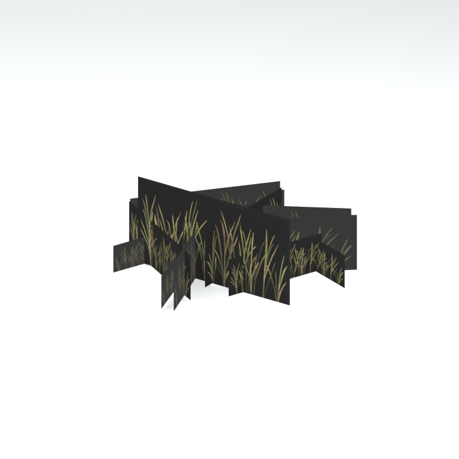
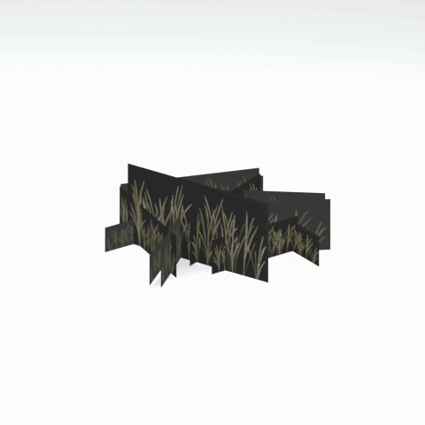

# Unidentified model (afgh_grss022_vrtn002)

Native model reference; a readable object identification has not been reviewed.

[Library](../README.md) | [Category](../tables/unclassified-components-1.md) | [Source / advanced data](../catalogue.json) | [Credits](../sources-and-credits.md)

**Game filename:** afgh_grss022_vrtn002.fmdl  
**Category:** Unclassified &gt; Unclassified components  
**Variant:** vrtn002; **LOD:** 0  
**Tags:** 

## Still reference



## 360-degree reference



The camera circles a static model. This is not a native animation. Source base textures and UVs use approximate studio shading; interaction, collision, complete assembly and FOX shader equivalence are not established.

## Identity and naming

| Field | Value |
|---|---|
| Library ID | mgsv-tpp-afgh_grss022_vrtn002-0ef2f946c353fa65 |
| Naming status | unidentified |
| Naming confidence | unknown |
| Naming evidence | {} |
| Native model | /Assets/tpp/environ/object/afghanistan/grass/afgh_grss022/scenes/afgh_grss022_vrtn002.fmdl |
| Model SHA256 | b3eee689cb413adce706d497f94463afa9992949efa63c330780d59d1f5e7645 |
| Container | /Assets/tpp/pack/location/afgh/pack_common/afgh_common.fpk |
| Container SHA256 | 810fe68a28c81299da7ef00849d2905b640d0a2da970f1b312e953a2c7b5df48 |
| Captured source / location scope | Selected native member/content and captured installed-source chain; full archive SHA/runtime priority unresolved |
| Raw record SHA256 | 61ddbd6f896c3ab05910fa81dc01042ca9edd5afd6ca33d43081332fbde1a7c0 |

Naming review is descriptive metadata only. It does not change model completion or identify a working game interaction.

## Native LOD inventory

| Native LOD | Triangles | Preview status | Decoded indices SHA256 |
|---|---:|---|---|
| 0 | 26 | rendered | 12b2e9c06c2654cce9efec48fb099e51748f7686b595a19c3da0f7eb980e38c6 |
| 1 | 24 | not separately rendered | e2128726ff26690337099e679c97d7c8db027265cb7b69f24cce5d06a8ddd95a |
| 2 | 23 | not separately rendered | 93fa04ea32ad547b5dd7c6ce3ac234d82e684c02c6e59b916b92931fe4573fd8 |
| 3 | 22 | not separately rendered | 5f4333dda35dd14495137e307466c13144a806ad7055ff438396ce5f81cbec6b |
| 4 | 21 | not separately rendered | e732d0c970ca99d09d2b09628db44183f48dddc7598cfa968052d2dab3d56365 |
| 5 | 20 | not separately rendered | 6aa7528b3a32441a3b71165928d7c544b4a23999effd3741858328ac3ec95b01 |
| 6 | 20 | not separately rendered | e8a8ebda262c3d72b440237bbb615a7b9ab7426a23290d0622f44a02fc92e818 |
| 7 | 18 | not separately rendered | f3604b6ecc16a57448380d6c5fc9df2ed8dce34bd7a79eec41bd16f3c271d8c2 |

Mesh detail and texture pixels/mips are separate. Index hashes describe decoded triangle arrays, not packed index-buffer bytes. Only source-recorded native levels are listed.

<details>
<summary>Texture, source and naming technical metadata</summary>

```json
{
  "source": {
    "nativePath": "/Assets/tpp/environ/object/afghanistan/grass/afgh_grss022/scenes/afgh_grss022_vrtn002.fmdl",
    "nativeSha256": "b3eee689cb413adce706d497f94463afa9992949efa63c330780d59d1f5e7645",
    "stableIdentity": "/assets/tpp/environ/object/afghanistan/grass/afgh_grss022/scenes/afgh_grss022_vrtn002.fmdl#b3eee689cb413adce706d497f94463afa9992949efa63c330780d59d1f5e7645#59cdd2e8e0d3acd6500cd12b53be6326237962c3db5a78341ddd2444993f319a",
    "container": {
      "nativePath": "/Assets/tpp/pack/location/afgh/pack_common/afgh_common.fpk",
      "sha256": "810fe68a28c81299da7ef00849d2905b640d0a2da970f1b312e953a2c7b5df48",
      "status": "Selected installed-source container/member chain captured by community reader"
    },
    "historicalDatOrigin": null,
    "sourceArchiveAtCapture": "master/0/00.dat",
    "locationStatus": "Selected native member/content and captured installed-source chain; full archive SHA/runtime priority unresolved",
    "currentInstalledDatVerified": false,
    "selectedInstalledMemberVerified": true,
    "evidence": {
      "archive_helper_executable_sha256": "6f8e39a436af3b024bbd0504966ab3d5d9d0cb05d86689bf3e83d15e68df613f",
      "archive_helper_source_sha256": "f662d3b63e066a0afc77ffe22ea0e564222d14469648300dba2c4f8e9b43446b",
      "archive_index_recipe": "54acff767f08d76ad6056c5387328759bc883df507788f398de6c2c04fac12db",
      "archive_reader": "Atvaark GzsTool.Core 0.5.3",
      "archive_reader_core_sha256": "9da447ae3c375cce2e46744eeff6af50f1591062afdf479d1a0b49edb47daaa3",
      "archive_tool_and_dictionary_sha256": {
        "CityHash.dll": "def6c4506d461b65e4059b2936b2cbd5f852ba5d1d8a1a527f1c0e6dc7008c8f",
        "GzsTool.Core.dll": "9da447ae3c375cce2e46744eeff6af50f1591062afdf479d1a0b49edb47daaa3",
        "GzsTool.exe": "1a9c5b11e2355383ff485aee7e86abc026f5c1fad729daf8c0fd15ee0aae1c10",
        "Zlib.Portable.dll": "fe84781ba35ca9cc5ff5f73fd08d2a66c59e5257b4573f5fe59743f30bf78e42",
        "fpk_dictionary.txt": "b82f9a8d6c10a68ba9471eca9d815c21355a53b5e68753d8ad7db7fd01bf401d",
        "qar_dictionary.txt": "1558c248ed0a4bb827888261563fbb91a2df4f03999682f85d637ff70d9d5fb2"
      },
      "bytes": 4064,
      "container_chain": [
        {
          "content_sha256": null,
          "depth": 0,
          "id": "3f19555d27c2ebecdfbad26aadd88b9f62e9fb6092c04c712963ef73c67ccb42",
          "index_sha256": "9acd3675d6e1500e0e18430cba0fdc70a5718ad7d6b62f13905891a35d59f18a",
          "kind": "qar",
          "name": "master/0/00.dat",
          "parent_occurrence": null
        },
        {
          "content_sha256": "810fe68a28c81299da7ef00849d2905b640d0a2da970f1b312e953a2c7b5df48",
          "depth": 1,
          "id": "19e9adf189f5f5e9c624197357336d49999dc3525b83bd8c71cf525fcd2100e2",
          "index_sha256": "924ec10c5736f8b618238e2523664271e558a6ad49aefdaf2473ccbad50f1231",
          "kind": "fpk",
          "name": "/Assets/tpp/pack/location/afgh/pack_common/afgh_common.fpk",
          "parent_occurrence": "e35acf6999427a88778266baae8c014a0c20a82388f8ff04caca6a88d977a6d1"
        }
      ],
      "contentSha256": "b3eee689cb413adce706d497f94463afa9992949efa63c330780d59d1f5e7645",
      "member": {
        "actual_size": 4064,
        "compressed_size": null,
        "content_sha256": "b3eee689cb413adce706d497f94463afa9992949efa63c330780d59d1f5e7645",
        "declared_size": 4064,
        "extension": "fmdl",
        "hash_hex": null,
        "name": "/Assets/tpp/environ/object/afghanistan/grass/afgh_grss022/scenes/afgh_grss022_vrtn002.fmdl",
        "name_origin": "embedded",
        "offset": 2978736,
        "ordinal": 74,
        "path_hash": null,
        "resolved": 1
      },
      "occurrenceId": "c1aa63ed8bb1ce627da66fefe499ac027f4ce656fb8e525ca2397ce0d49aee65",
      "occurrence_id": "c1aa63ed8bb1ce627da66fefe499ac027f4ce656fb8e525ca2397ce0d49aee65",
      "primary_source_revision": "fc4a8196555638c6cf8aa1b7c8dc34ccd5c69cb5",
      "source_adapter": "community_core_selective_export",
      "source_id": "7f6bb743fb4c487f0e9522f9c7fac280c46cf6b1051e0fc75a93602c8eb451f0",
      "source_path": "master/0/00.dat",
      "source_snapshot": "{\"bytes\":768788480,\"device\":621747392682911458,\"file_id\":844424931596481,\"header_sha256\":\"ead50f0a9a37e4285323b9c6fa0ec75fe75e518c63147e63158eeb2892c6589e\",\"mtime_ns\":1791852224238580700}",
      "virtualPath": "/Assets/tpp/environ/object/afghanistan/grass/afgh_grss022/scenes/afgh_grss022_vrtn002.fmdl"
    }
  },
  "materials": [
    {
      "sampler": "Base_Tex_SRGB",
      "materialIndex": 0,
      "nativePathHash": "1542508379938432084",
      "nativeVirtualPath": null,
      "nativeBinding": {
        "familyId": "a73243ffbb4ac47184fc6c8ceb5ed983123cb6fb5d037d281f2d95fafa383f8b",
        "height": 256,
        "materialIndex": 0,
        "mipCount": 8,
        "nativeMipCountVerified": true,
        "nativePath": null,
        "nativePathHash": "1542508379938432084",
        "nativeTexture": {
          "additionalFtexsFileCount": 2,
          "depth": 1,
          "ftexsFileCount": 3,
          "height": 256,
          "metadataBytes": 192,
          "mipCount": 8,
          "mips": [
            {
              "chunks": 8,
              "decodedBytes": 131072,
              "mip": 0,
              "offset": 0,
              "storedBytes": 53696,
              "streamNumber": 3
            },
            {
              "chunks": 2,
              "decodedBytes": 32768,
              "mip": 1,
              "offset": 0,
              "storedBytes": 18256,
              "streamNumber": 2
            },
            {
              "chunks": 1,
              "decodedBytes": 8192,
              "mip": 2,
              "offset": 2584,
              "storedBytes": 5776,
              "streamNumber": 1
            },
            {
              "chunks": 1,
              "decodedBytes": 2048,
              "mip": 3,
              "offset": 784,
              "storedBytes": 1792,
              "streamNumber": 1
            },
            {
              "chunks": 1,
              "decodedBytes": 512,
              "mip": 4,
              "offset": 248,
              "storedBytes": 528,
              "streamNumber": 1
            },
            {
              "chunks": 1,
              "decodedBytes": 128,
              "mip": 5,
              "offset": 96,
              "storedBytes": 144,
              "streamNumber": 1
            },
            {
              "chunks": 1,
              "decodedBytes": 32,
              "mip": 6,
              "offset": 40,
              "storedBytes": 48,
              "streamNumber": 1
            },
            {
              "chunks": 1,
              "decodedBytes": 16,
              "mip": 7,
              "offset": 0,
              "storedBytes": 32,
              "streamNumber": 1
            }
          ],
          "nativeHeaderHash": "d0a67417d8ddd99c67f98c38a3565caf",
          "nrtFlag": 2,
          "pixelFormat": 4,
          "requiredStreamNumbers": [
            1,
            2,
            3
          ],
          "textureType": 16777219,
          "unknownFlags": 273,
          "width": 512
        },
        "samplerName": "Base_Tex_SRGB",
        "samplerNameHash": "72475356961633",
        "sha256": "67092c256849e3ee41abbe24958d8ff1485653b557337901ea8ac9c3724d28cc",
        "sourceOccurrences": [
          {
            "archive_helper_executable_sha256": "6f8e39a436af3b024bbd0504966ab3d5d9d0cb05d86689bf3e83d15e68df613f",
            "archive_helper_source_sha256": "f662d3b63e066a0afc77ffe22ea0e564222d14469648300dba2c4f8e9b43446b",
            "archive_index_recipe": "54acff767f08d76ad6056c5387328759bc883df507788f398de6c2c04fac12db",
            "archive_reader": "Atvaark GzsTool.Core 0.5.3",
            "archive_reader_core_sha256": "9da447ae3c375cce2e46744eeff6af50f1591062afdf479d1a0b49edb47daaa3",
            "archive_tool_and_dictionary_sha256": {
              "CityHash.dll": "def6c4506d461b65e4059b2936b2cbd5f852ba5d1d8a1a527f1c0e6dc7008c8f",
              "GzsTool.Core.dll": "9da447ae3c375cce2e46744eeff6af50f1591062afdf479d1a0b49edb47daaa3",
              "GzsTool.exe": "1a9c5b11e2355383ff485aee7e86abc026f5c1fad729daf8c0fd15ee0aae1c10",
              "Zlib.Portable.dll": "fe84781ba35ca9cc5ff5f73fd08d2a66c59e5257b4573f5fe59743f30bf78e42",
              "fpk_dictionary.txt": "b82f9a8d6c10a68ba9471eca9d815c21355a53b5e68753d8ad7db7fd01bf401d",
              "qar_dictionary.txt": "1558c248ed0a4bb827888261563fbb91a2df4f03999682f85d637ff70d9d5fb2"
            },
            "bytes": 192,
            "container_chain": [
              {
                "content_sha256": null,
                "depth": 0,
                "id": "06035c7f54d1fe3fde25c93eb85d5278f37457e9730b7b0dc0553ea567520e6d",
                "index_sha256": "be525e8d33187ab76b3f97935035faac60a4c7ca7fcff3401a0ce712f03c285e",
                "kind": "qar",
                "name": "master/texture3.dat",
                "parent_occurrence": null
              }
            ],
            "contentSha256": "3ce09bd69f54125cbff41fda36b9bed078816c561f30335ccf194bc4d7edd5cf",
            "member": {
              "actual_size": 192,
              "compressed_size": 192,
              "content_sha256": "3ce09bd69f54125cbff41fda36b9bed078816c561f30335ccf194bc4d7edd5cf",
              "declared_size": 192,
              "extension": "ftex",
              "hash_hex": "15681732f14b2454",
              "name": "1732f14b2454.ftex",
              "name_origin": "hash_fallback",
              "offset": 860832800,
              "ordinal": 7439,
              "path_hash": "1732f14b2454",
              "resolved": 0
            },
            "occurrenceId": "0e813c9bfa16236ffcd29202bd0a65ab7f17a101a61c50766f25dfe4813521fb",
            "occurrence_id": "0e813c9bfa16236ffcd29202bd0a65ab7f17a101a61c50766f25dfe4813521fb",
            "primary_source_revision": "fc4a8196555638c6cf8aa1b7c8dc34ccd5c69cb5",
            "source_adapter": "community_core_selective_export",
            "source_id": "8d93a1c4a39e41ca988ccdecf8dbaa5fa7e6f9f82b75bea9a691d2b01de50ef8",
            "source_path": "master/texture3.dat",
            "source_snapshot": "{\"bytes\":1297381376,\"device\":621747392682911458,\"file_id\":562949953639627,\"header_sha256\":\"55c07d7fb3cb3498d10fa3bed93a81ce330553a903fff3222b5bf307bcc7ef0c\",\"mtime_ns\":1791224675561235200}",
            "virtualPath": "1732f14b2454.ftex"
          },
          {
            "archive_helper_executable_sha256": "6f8e39a436af3b024bbd0504966ab3d5d9d0cb05d86689bf3e83d15e68df613f",
            "archive_helper_source_sha256": "f662d3b63e066a0afc77ffe22ea0e564222d14469648300dba2c4f8e9b43446b",
            "archive_index_recipe": "54acff767f08d76ad6056c5387328759bc883df507788f398de6c2c04fac12db",
            "archive_reader": "Atvaark GzsTool.Core 0.5.3",
            "archive_reader_core_sha256": "9da447ae3c375cce2e46744eeff6af50f1591062afdf479d1a0b49edb47daaa3",
            "archive_tool_and_dictionary_sha256": {
              "CityHash.dll": "def6c4506d461b65e4059b2936b2cbd5f852ba5d1d8a1a527f1c0e6dc7008c8f",
              "GzsTool.Core.dll": "9da447ae3c375cce2e46744eeff6af50f1591062afdf479d1a0b49edb47daaa3",
              "GzsTool.exe": "1a9c5b11e2355383ff485aee7e86abc026f5c1fad729daf8c0fd15ee0aae1c10",
              "Zlib.Portable.dll": "fe84781ba35ca9cc5ff5f73fd08d2a66c59e5257b4573f5fe59743f30bf78e42",
              "fpk_dictionary.txt": "b82f9a8d6c10a68ba9471eca9d815c21355a53b5e68753d8ad7db7fd01bf401d",
              "qar_dictionary.txt": "1558c248ed0a4bb827888261563fbb91a2df4f03999682f85d637ff70d9d5fb2"
            },
            "bytes": 8368,
            "container_chain": [
              {
                "content_sha256": null,
                "depth": 0,
                "id": "0b473016351235050c2f6af21454bd979a0ad4602a9860137c807c894c5eba4d",
                "index_sha256": "ac9b4dae0dd0166db3a6ec8da18524dffebcbaf9004569af631de82913bf49a3",
                "kind": "qar",
                "name": "master/texture2.dat",
                "parent_occurrence": null
              }
            ],
            "contentSha256": "f5d6d071ff312b01b21fde2e8c177f2e6ae1bc2110c710e2304c5e43d4a3b3d4",
            "member": {
              "actual_size": 8368,
              "compressed_size": 8368,
              "content_sha256": "f5d6d071ff312b01b21fde2e8c177f2e6ae1bc2110c710e2304c5e43d4a3b3d4",
              "declared_size": 8368,
              "extension": "1.ftexs",
              "hash_hex": "b2c01732f14b2454",
              "name": "1732f14b2454.1.ftexs",
              "name_origin": "hash_fallback",
              "offset": 1758309408,
              "ordinal": 10994,
              "path_hash": "1732f14b2454",
              "resolved": 0
            },
            "occurrenceId": "52616e636ddf730123c22a538f7f0a8fd16f77ea061a622277cd1230b09c8fda",
            "occurrence_id": "52616e636ddf730123c22a538f7f0a8fd16f77ea061a622277cd1230b09c8fda",
            "primary_source_revision": "fc4a8196555638c6cf8aa1b7c8dc34ccd5c69cb5",
            "source_adapter": "community_core_selective_export",
            "source_id": "85e8296057664cbc6ebaf6bd43d1c6d18528bbd8a6fae920bdf4d5eb69f6a93d",
            "source_path": "master/texture2.dat",
            "source_snapshot": "{\"bytes\":2920239104,\"device\":621747392682911458,\"file_id\":562949953639626,\"header_sha256\":\"72bfee707623afb5f3abd8382035d3d4258b4941ac583a56f5a447f47123dcab\",\"mtime_ns\":1791224675561235200}",
            "virtualPath": "1732f14b2454.1.ftexs"
          },
          {
            "archive_helper_executable_sha256": "6f8e39a436af3b024bbd0504966ab3d5d9d0cb05d86689bf3e83d15e68df613f",
            "archive_helper_source_sha256": "f662d3b63e066a0afc77ffe22ea0e564222d14469648300dba2c4f8e9b43446b",
            "archive_index_recipe": "54acff767f08d76ad6056c5387328759bc883df507788f398de6c2c04fac12db",
            "archive_reader": "Atvaark GzsTool.Core 0.5.3",
            "archive_reader_core_sha256": "9da447ae3c375cce2e46744eeff6af50f1591062afdf479d1a0b49edb47daaa3",
            "archive_tool_and_dictionary_sha256": {
              "CityHash.dll": "def6c4506d461b65e4059b2936b2cbd5f852ba5d1d8a1a527f1c0e6dc7008c8f",
              "GzsTool.Core.dll": "9da447ae3c375cce2e46744eeff6af50f1591062afdf479d1a0b49edb47daaa3",
              "GzsTool.exe": "1a9c5b11e2355383ff485aee7e86abc026f5c1fad729daf8c0fd15ee0aae1c10",
              "Zlib.Portable.dll": "fe84781ba35ca9cc5ff5f73fd08d2a66c59e5257b4573f5fe59743f30bf78e42",
              "fpk_dictionary.txt": "b82f9a8d6c10a68ba9471eca9d815c21355a53b5e68753d8ad7db7fd01bf401d",
              "qar_dictionary.txt": "1558c248ed0a4bb827888261563fbb91a2df4f03999682f85d637ff70d9d5fb2"
            },
            "bytes": 18272,
            "container_chain": [
              {
                "content_sha256": null,
                "depth": 0,
                "id": "0b473016351235050c2f6af21454bd979a0ad4602a9860137c807c894c5eba4d",
                "index_sha256": "ac9b4dae0dd0166db3a6ec8da18524dffebcbaf9004569af631de82913bf49a3",
                "kind": "qar",
                "name": "master/texture2.dat",
                "parent_occurrence": null
              }
            ],
            "contentSha256": "daf8f211dc6a11d807c98adb98e3e02bb6c59bd71e7d43076becd503b3aca60d",
            "member": {
              "actual_size": 18272,
              "compressed_size": 18272,
              "content_sha256": "daf8f211dc6a11d807c98adb98e3e02bb6c59bd71e7d43076becd503b3aca60d",
              "declared_size": 18272,
              "extension": "2.ftexs",
              "hash_hex": "b5701732f14b2454",
              "name": "1732f14b2454.2.ftexs",
              "name_origin": "hash_fallback",
              "offset": 1758318624,
              "ordinal": 10995,
              "path_hash": "1732f14b2454",
              "resolved": 0
            },
            "occurrenceId": "016b89bcad0df6429737e484dfcbfd112b4547cdbe4f84959a4172930c22b651",
            "occurrence_id": "016b89bcad0df6429737e484dfcbfd112b4547cdbe4f84959a4172930c22b651",
            "primary_source_revision": "fc4a8196555638c6cf8aa1b7c8dc34ccd5c69cb5",
            "source_adapter": "community_core_selective_export",
            "source_id": "85e8296057664cbc6ebaf6bd43d1c6d18528bbd8a6fae920bdf4d5eb69f6a93d",
            "source_path": "master/texture2.dat",
            "source_snapshot": "{\"bytes\":2920239104,\"device\":621747392682911458,\"file_id\":562949953639626,\"header_sha256\":\"72bfee707623afb5f3abd8382035d3d4258b4941ac583a56f5a447f47123dcab\",\"mtime_ns\":1791224675561235200}",
            "virtualPath": "1732f14b2454.2.ftexs"
          },
          {
            "archive_helper_executable_sha256": "6f8e39a436af3b024bbd0504966ab3d5d9d0cb05d86689bf3e83d15e68df613f",
            "archive_helper_source_sha256": "f662d3b63e066a0afc77ffe22ea0e564222d14469648300dba2c4f8e9b43446b",
            "archive_index_recipe": "54acff767f08d76ad6056c5387328759bc883df507788f398de6c2c04fac12db",
            "archive_reader": "Atvaark GzsTool.Core 0.5.3",
            "archive_reader_core_sha256": "9da447ae3c375cce2e46744eeff6af50f1591062afdf479d1a0b49edb47daaa3",
            "archive_tool_and_dictionary_sha256": {
              "CityHash.dll": "def6c4506d461b65e4059b2936b2cbd5f852ba5d1d8a1a527f1c0e6dc7008c8f",
              "GzsTool.Core.dll": "9da447ae3c375cce2e46744eeff6af50f1591062afdf479d1a0b49edb47daaa3",
              "GzsTool.exe": "1a9c5b11e2355383ff485aee7e86abc026f5c1fad729daf8c0fd15ee0aae1c10",
              "Zlib.Portable.dll": "fe84781ba35ca9cc5ff5f73fd08d2a66c59e5257b4573f5fe59743f30bf78e42",
              "fpk_dictionary.txt": "b82f9a8d6c10a68ba9471eca9d815c21355a53b5e68753d8ad7db7fd01bf401d",
              "qar_dictionary.txt": "1558c248ed0a4bb827888261563fbb91a2df4f03999682f85d637ff70d9d5fb2"
            },
            "bytes": 53760,
            "container_chain": [
              {
                "content_sha256": null,
                "depth": 0,
                "id": "1cc220d9409d7163b6aca295ed89fd8c7befca6a8f849a8d5d09a2499724c863",
                "index_sha256": "5a818609a652a10d90fb90015661d0cb80898096bbb3aac36382172988d8736d",
                "kind": "qar",
                "name": "master/texture5_mgo0.dat",
                "parent_occurrence": null
              }
            ],
            "contentSha256": "236f1759f3e6a2175bf6b1fb8bc658dc5ce64e63aa258b58162ef689513c9ce0",
            "member": {
              "actual_size": 53760,
              "compressed_size": 53760,
              "content_sha256": "236f1759f3e6a2175bf6b1fb8bc658dc5ce64e63aa258b58162ef689513c9ce0",
              "declared_size": 53760,
              "extension": "3.ftexs",
              "hash_hex": "57181732f14b2454",
              "name": "1732f14b2454.3.ftexs",
              "name_origin": "hash_fallback",
              "offset": 3320044576,
              "ordinal": 12779,
              "path_hash": "1732f14b2454",
              "resolved": 0
            },
            "occurrenceId": "70e0854dea6d172d1be512e6a422de635ec07835b50398db753f6f913fa9cfc8",
            "occurrence_id": "70e0854dea6d172d1be512e6a422de635ec07835b50398db753f6f913fa9cfc8",
            "primary_source_revision": "fc4a8196555638c6cf8aa1b7c8dc34ccd5c69cb5",
            "source_adapter": "community_core_selective_export",
            "source_id": "24f8989ccaae47940dc20e54ba67442ad562ac0032ab6e3d475e927c81444b56",
            "source_path": "master/texture5_mgo0.dat",
            "source_snapshot": "{\"bytes\":4492370944,\"device\":621747392682911458,\"file_id\":13510798883237422,\"header_sha256\":\"6108fbacb65c84d041742c39e5ca630745240453b336f1059a13b91943f0b011\",\"mtime_ns\":1791224675562234400}",
            "virtualPath": "1732f14b2454.3.ftexs"
          }
        ],
        "width": 512
      },
      "ddsSha256": "67092c256849e3ee41abbe24958d8ff1485653b557337901ea8ac9c3724d28cc",
      "dimensions": [
        512,
        256
      ],
      "mipCount": 8,
      "nativeMipCountVerified": true,
      "connectedInPreview": true
    }
  ],
  "quality": {
    "decodedIndicesHashDerivation": "SHA256 of canonical UTF-8 JSON decoded triangle indices grouped by mesh; not packed buffer bytes",
    "highestRetainedGeometricLod": 0,
    "distinctNativeLods": 8,
    "baseTextureDimensions": [
      512,
      256
    ],
    "baseTextureNativeMipCount": 8,
    "largerRetainedBaseTextureFound": null,
    "nativeLods": [
      {
        "indicesSha256": "12b2e9c06c2654cce9efec48fb099e51748f7686b595a19c3da0f7eb980e38c6",
        "nativeLod": 0,
        "triangles": 26
      },
      {
        "indicesSha256": "e2128726ff26690337099e679c97d7c8db027265cb7b69f24cce5d06a8ddd95a",
        "nativeLod": 1,
        "triangles": 24
      },
      {
        "indicesSha256": "93fa04ea32ad547b5dd7c6ce3ac234d82e684c02c6e59b916b92931fe4573fd8",
        "nativeLod": 2,
        "triangles": 23
      },
      {
        "indicesSha256": "5f4333dda35dd14495137e307466c13144a806ad7055ff438396ce5f81cbec6b",
        "nativeLod": 3,
        "triangles": 22
      },
      {
        "indicesSha256": "e732d0c970ca99d09d2b09628db44183f48dddc7598cfa968052d2dab3d56365",
        "nativeLod": 4,
        "triangles": 21
      },
      {
        "indicesSha256": "6aa7528b3a32441a3b71165928d7c544b4a23999effd3741858328ac3ec95b01",
        "nativeLod": 5,
        "triangles": 20
      },
      {
        "indicesSha256": "e8a8ebda262c3d72b440237bbb615a7b9ab7426a23290d0622f44a02fc92e818",
        "nativeLod": 6,
        "triangles": 20
      },
      {
        "indicesSha256": "f3604b6ecc16a57448380d6c5fc9df2ed8dce34bd7a79eec41bd16f3c271d8c2",
        "nativeLod": 7,
        "triangles": 18
      }
    ],
    "renderedNativeLods": [
      0
    ],
    "baseTextureSummary": "512 x 256; 8 native/DDS mips",
    "highestDetailScope": "Triangle-count comparison within captured FMDL only"
  }
}
```

</details>

[Original source / advanced record](../catalogue.json)
