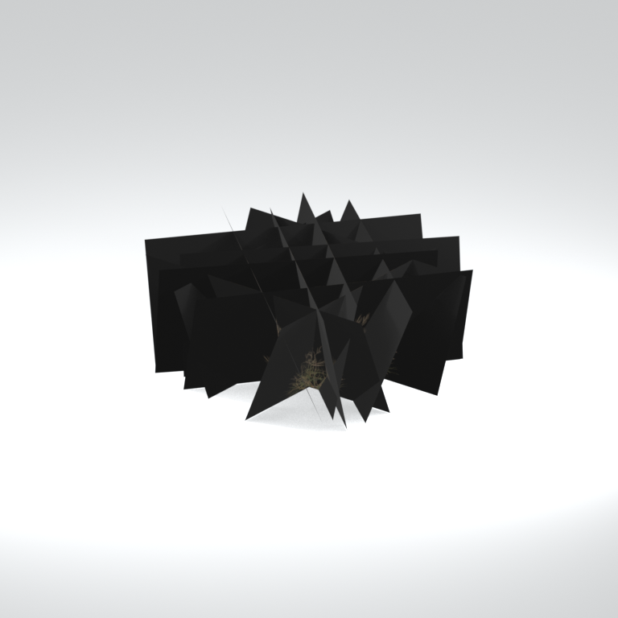
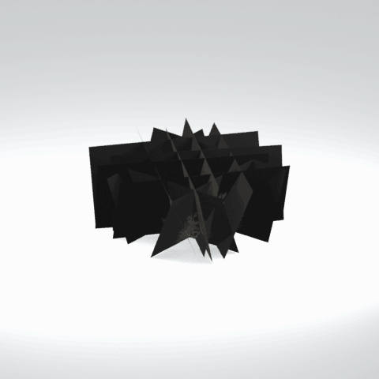

# Unidentified model (afgh_grss024)

Native model reference; a readable object identification has not been reviewed.

[Library](../README.md) | [Category](../tables/unclassified-components-1.md) | [Source / advanced data](../catalogue.json) | [Credits](../sources-and-credits.md)

**Game filename:** afgh_grss024.fmdl  
**Category:** Unclassified &gt; Unclassified components  
**Variant:** No explicit variant token; **LOD:** 0  
**Tags:** 

## Still reference



## 360-degree reference



The camera circles a static model. This is not a native animation. Source base textures and UVs use approximate studio shading; interaction, collision, complete assembly and FOX shader equivalence are not established.

## Identity and naming

| Field | Value |
|---|---|
| Library ID | mgsv-tpp-afgh_grss024-df529028b79925e6 |
| Naming status | unidentified |
| Naming confidence | unknown |
| Naming evidence | {} |
| Native model | /Assets/tpp/environ/object/afghanistan/grass/afgh_grss024/scenes/afgh_grss024.fmdl |
| Model SHA256 | 08d4b4795b6546ad1efb344c5ed712955f11f636d8a894f8d4bcac4700694fbc |
| Container | /Assets/tpp/pack/location/afgh/pack_common/afgh_common.fpk |
| Container SHA256 | 810fe68a28c81299da7ef00849d2905b640d0a2da970f1b312e953a2c7b5df48 |
| Captured source / location scope | Selected native member/content and captured installed-source chain; full archive SHA/runtime priority unresolved |
| Raw record SHA256 | f93cd83fddf1e2e6b0f45e1ecdc0ad7d504d198703692fa8e48be78d2864b132 |

Naming review is descriptive metadata only. It does not change model completion or identify a working game interaction.

## Native LOD inventory

| Native LOD | Triangles | Preview status | Decoded indices SHA256 |
|---|---:|---|---|
| 0 | 24 | rendered | 0b66361ef5ad832f8c304586b7b1ba1c2bb47f5dfe60fddeb416c22c5d7b9b05 |
| 1 | 23 | not separately rendered | 95e826fc9ab94a478c81bbff5bf928e8ba169602484c7a5127720cf58a9e4698 |
| 2 | 23 | not separately rendered | 95e826fc9ab94a478c81bbff5bf928e8ba169602484c7a5127720cf58a9e4698 |
| 3 | 23 | not separately rendered | 95e826fc9ab94a478c81bbff5bf928e8ba169602484c7a5127720cf58a9e4698 |
| 4 | 23 | not separately rendered | 95e826fc9ab94a478c81bbff5bf928e8ba169602484c7a5127720cf58a9e4698 |
| 5 | 23 | not separately rendered | 95e826fc9ab94a478c81bbff5bf928e8ba169602484c7a5127720cf58a9e4698 |
| 6 | 23 | not separately rendered | 95e826fc9ab94a478c81bbff5bf928e8ba169602484c7a5127720cf58a9e4698 |
| 7 | 23 | not separately rendered | 95e826fc9ab94a478c81bbff5bf928e8ba169602484c7a5127720cf58a9e4698 |

Mesh detail and texture pixels/mips are separate. Index hashes describe decoded triangle arrays, not packed index-buffer bytes. Only source-recorded native levels are listed.

<details>
<summary>Texture, source and naming technical metadata</summary>

```json
{
  "source": {
    "nativePath": "/Assets/tpp/environ/object/afghanistan/grass/afgh_grss024/scenes/afgh_grss024.fmdl",
    "nativeSha256": "08d4b4795b6546ad1efb344c5ed712955f11f636d8a894f8d4bcac4700694fbc",
    "stableIdentity": "/assets/tpp/environ/object/afghanistan/grass/afgh_grss024/scenes/afgh_grss024.fmdl#08d4b4795b6546ad1efb344c5ed712955f11f636d8a894f8d4bcac4700694fbc#42eef66b399742f3a583abecf5c5b3ace2e1b767aba6934b977bc1b119769e69",
    "container": {
      "nativePath": "/Assets/tpp/pack/location/afgh/pack_common/afgh_common.fpk",
      "sha256": "810fe68a28c81299da7ef00849d2905b640d0a2da970f1b312e953a2c7b5df48",
      "status": "Selected installed-source container/member chain captured by community reader"
    },
    "historicalDatOrigin": null,
    "sourceArchiveAtCapture": "master/0/00.dat",
    "locationStatus": "Selected native member/content and captured installed-source chain; full archive SHA/runtime priority unresolved",
    "currentInstalledDatVerified": false,
    "selectedInstalledMemberVerified": true,
    "evidence": {
      "archive_helper_executable_sha256": "6f8e39a436af3b024bbd0504966ab3d5d9d0cb05d86689bf3e83d15e68df613f",
      "archive_helper_source_sha256": "f662d3b63e066a0afc77ffe22ea0e564222d14469648300dba2c4f8e9b43446b",
      "archive_index_recipe": "54acff767f08d76ad6056c5387328759bc883df507788f398de6c2c04fac12db",
      "archive_reader": "Atvaark GzsTool.Core 0.5.3",
      "archive_reader_core_sha256": "9da447ae3c375cce2e46744eeff6af50f1591062afdf479d1a0b49edb47daaa3",
      "archive_tool_and_dictionary_sha256": {
        "CityHash.dll": "def6c4506d461b65e4059b2936b2cbd5f852ba5d1d8a1a527f1c0e6dc7008c8f",
        "GzsTool.Core.dll": "9da447ae3c375cce2e46744eeff6af50f1591062afdf479d1a0b49edb47daaa3",
        "GzsTool.exe": "1a9c5b11e2355383ff485aee7e86abc026f5c1fad729daf8c0fd15ee0aae1c10",
        "Zlib.Portable.dll": "fe84781ba35ca9cc5ff5f73fd08d2a66c59e5257b4573f5fe59743f30bf78e42",
        "fpk_dictionary.txt": "b82f9a8d6c10a68ba9471eca9d815c21355a53b5e68753d8ad7db7fd01bf401d",
        "qar_dictionary.txt": "1558c248ed0a4bb827888261563fbb91a2df4f03999682f85d637ff70d9d5fb2"
      },
      "bytes": 2832,
      "container_chain": [
        {
          "content_sha256": null,
          "depth": 0,
          "id": "3f19555d27c2ebecdfbad26aadd88b9f62e9fb6092c04c712963ef73c67ccb42",
          "index_sha256": "9acd3675d6e1500e0e18430cba0fdc70a5718ad7d6b62f13905891a35d59f18a",
          "kind": "qar",
          "name": "master/0/00.dat",
          "parent_occurrence": null
        },
        {
          "content_sha256": "810fe68a28c81299da7ef00849d2905b640d0a2da970f1b312e953a2c7b5df48",
          "depth": 1,
          "id": "19e9adf189f5f5e9c624197357336d49999dc3525b83bd8c71cf525fcd2100e2",
          "index_sha256": "924ec10c5736f8b618238e2523664271e558a6ad49aefdaf2473ccbad50f1231",
          "kind": "fpk",
          "name": "/Assets/tpp/pack/location/afgh/pack_common/afgh_common.fpk",
          "parent_occurrence": "e35acf6999427a88778266baae8c014a0c20a82388f8ff04caca6a88d977a6d1"
        }
      ],
      "contentSha256": "08d4b4795b6546ad1efb344c5ed712955f11f636d8a894f8d4bcac4700694fbc",
      "member": {
        "actual_size": 2832,
        "compressed_size": null,
        "content_sha256": "08d4b4795b6546ad1efb344c5ed712955f11f636d8a894f8d4bcac4700694fbc",
        "declared_size": 2832,
        "extension": "fmdl",
        "hash_hex": null,
        "name": "/Assets/tpp/environ/object/afghanistan/grass/afgh_grss024/scenes/afgh_grss024.fmdl",
        "name_origin": "embedded",
        "offset": 2990784,
        "ordinal": 77,
        "path_hash": null,
        "resolved": 1
      },
      "occurrenceId": "21c488fe5676818c23d390026a95ad92de5b01cf8235c72221af08fb2bbfb310",
      "occurrence_id": "21c488fe5676818c23d390026a95ad92de5b01cf8235c72221af08fb2bbfb310",
      "primary_source_revision": "fc4a8196555638c6cf8aa1b7c8dc34ccd5c69cb5",
      "source_adapter": "community_core_selective_export",
      "source_id": "7f6bb743fb4c487f0e9522f9c7fac280c46cf6b1051e0fc75a93602c8eb451f0",
      "source_path": "master/0/00.dat",
      "source_snapshot": "{\"bytes\":768788480,\"device\":621747392682911458,\"file_id\":844424931596481,\"header_sha256\":\"ead50f0a9a37e4285323b9c6fa0ec75fe75e518c63147e63158eeb2892c6589e\",\"mtime_ns\":1791852224238580700}",
      "virtualPath": "/Assets/tpp/environ/object/afghanistan/grass/afgh_grss024/scenes/afgh_grss024.fmdl"
    }
  },
  "materials": [
    {
      "sampler": "Base_Tex_SRGB",
      "materialIndex": 0,
      "nativePathHash": "1543010567074838528",
      "nativeVirtualPath": null,
      "nativeBinding": {
        "familyId": "3fbb53a0984b2803491e1c3598b468d83ae7de21c7350e839c089c0e26f45d28",
        "height": 256,
        "materialIndex": 0,
        "mipCount": 9,
        "nativeMipCountVerified": true,
        "nativePath": null,
        "nativePathHash": "1543010567074838528",
        "nativeTexture": {
          "additionalFtexsFileCount": 2,
          "depth": 1,
          "ftexsFileCount": 3,
          "height": 256,
          "metadataBytes": 208,
          "mipCount": 9,
          "mips": [
            {
              "chunks": 16,
              "decodedBytes": 262144,
              "mip": 0,
              "offset": 0,
              "storedBytes": 73856,
              "streamNumber": 3
            },
            {
              "chunks": 4,
              "decodedBytes": 65536,
              "mip": 1,
              "offset": 0,
              "storedBytes": 22704,
              "streamNumber": 2
            },
            {
              "chunks": 1,
              "decodedBytes": 16384,
              "mip": 2,
              "offset": 2768,
              "storedBytes": 6288,
              "streamNumber": 1
            },
            {
              "chunks": 1,
              "decodedBytes": 4096,
              "mip": 3,
              "offset": 952,
              "storedBytes": 1808,
              "streamNumber": 1
            },
            {
              "chunks": 1,
              "decodedBytes": 1024,
              "mip": 4,
              "offset": 384,
              "storedBytes": 560,
              "streamNumber": 1
            },
            {
              "chunks": 1,
              "decodedBytes": 256,
              "mip": 5,
              "offset": 184,
              "storedBytes": 192,
              "streamNumber": 1
            },
            {
              "chunks": 1,
              "decodedBytes": 64,
              "mip": 6,
              "offset": 96,
              "storedBytes": 80,
              "streamNumber": 1
            },
            {
              "chunks": 1,
              "decodedBytes": 32,
              "mip": 7,
              "offset": 40,
              "storedBytes": 48,
              "streamNumber": 1
            },
            {
              "chunks": 1,
              "decodedBytes": 16,
              "mip": 8,
              "offset": 0,
              "storedBytes": 32,
              "streamNumber": 1
            }
          ],
          "nativeHeaderHash": "c6626a0b6fb66bcf581dd068f7a37272",
          "nrtFlag": 2,
          "pixelFormat": 4,
          "requiredStreamNumbers": [
            1,
            2,
            3
          ],
          "textureType": 16777219,
          "unknownFlags": 273,
          "width": 1024
        },
        "samplerName": "Base_Tex_SRGB",
        "samplerNameHash": "72475356961633",
        "sha256": "d13fdf94756cfce63131b2edc9582125b5c2e3b0704166a8fc25867dc9235073",
        "sourceOccurrences": [
          {
            "archive_helper_executable_sha256": "6f8e39a436af3b024bbd0504966ab3d5d9d0cb05d86689bf3e83d15e68df613f",
            "archive_helper_source_sha256": "f662d3b63e066a0afc77ffe22ea0e564222d14469648300dba2c4f8e9b43446b",
            "archive_index_recipe": "54acff767f08d76ad6056c5387328759bc883df507788f398de6c2c04fac12db",
            "archive_reader": "Atvaark GzsTool.Core 0.5.3",
            "archive_reader_core_sha256": "9da447ae3c375cce2e46744eeff6af50f1591062afdf479d1a0b49edb47daaa3",
            "archive_tool_and_dictionary_sha256": {
              "CityHash.dll": "def6c4506d461b65e4059b2936b2cbd5f852ba5d1d8a1a527f1c0e6dc7008c8f",
              "GzsTool.Core.dll": "9da447ae3c375cce2e46744eeff6af50f1591062afdf479d1a0b49edb47daaa3",
              "GzsTool.exe": "1a9c5b11e2355383ff485aee7e86abc026f5c1fad729daf8c0fd15ee0aae1c10",
              "Zlib.Portable.dll": "fe84781ba35ca9cc5ff5f73fd08d2a66c59e5257b4573f5fe59743f30bf78e42",
              "fpk_dictionary.txt": "b82f9a8d6c10a68ba9471eca9d815c21355a53b5e68753d8ad7db7fd01bf401d",
              "qar_dictionary.txt": "1558c248ed0a4bb827888261563fbb91a2df4f03999682f85d637ff70d9d5fb2"
            },
            "bytes": 208,
            "container_chain": [
              {
                "content_sha256": null,
                "depth": 0,
                "id": "0b473016351235050c2f6af21454bd979a0ad4602a9860137c807c894c5eba4d",
                "index_sha256": "ac9b4dae0dd0166db3a6ec8da18524dffebcbaf9004569af631de82913bf49a3",
                "kind": "qar",
                "name": "master/texture2.dat",
                "parent_occurrence": null
              }
            ],
            "contentSha256": "ed15e8348139d13d454c3f491c0a4653ebe50b45553216de657aaa4167004fef",
            "member": {
              "actual_size": 208,
              "compressed_size": 208,
              "content_sha256": "ed15e8348139d13d454c3f491c0a4653ebe50b45553216de657aaa4167004fef",
              "declared_size": 208,
              "extension": "ftex",
              "hash_hex": "1569dfef7f2b7800",
              "name": "/Assets/tpp/environ/object/afghanistan/grass/afgh_grss024/sourceimages/afgh_grss024_bsm_alp.ftex",
              "name_origin": "dictionary",
              "offset": 1758499872,
              "ordinal": 11001,
              "path_hash": "1dfef7f2b7800",
              "resolved": 1
            },
            "occurrenceId": "1b53360c8fb0780e024da3d874afe1744b377a5f57fc8ceef22330c1241da1c4",
            "occurrence_id": "1b53360c8fb0780e024da3d874afe1744b377a5f57fc8ceef22330c1241da1c4",
            "primary_source_revision": "fc4a8196555638c6cf8aa1b7c8dc34ccd5c69cb5",
            "source_adapter": "community_core_selective_export",
            "source_id": "85e8296057664cbc6ebaf6bd43d1c6d18528bbd8a6fae920bdf4d5eb69f6a93d",
            "source_path": "master/texture2.dat",
            "source_snapshot": "{\"bytes\":2920239104,\"device\":621747392682911458,\"file_id\":562949953639626,\"header_sha256\":\"72bfee707623afb5f3abd8382035d3d4258b4941ac583a56f5a447f47123dcab\",\"mtime_ns\":1791224675561235200}",
            "virtualPath": "/Assets/tpp/environ/object/afghanistan/grass/afgh_grss024/sourceimages/afgh_grss024_bsm_alp.ftex"
          },
          {
            "archive_helper_executable_sha256": "6f8e39a436af3b024bbd0504966ab3d5d9d0cb05d86689bf3e83d15e68df613f",
            "archive_helper_source_sha256": "f662d3b63e066a0afc77ffe22ea0e564222d14469648300dba2c4f8e9b43446b",
            "archive_index_recipe": "54acff767f08d76ad6056c5387328759bc883df507788f398de6c2c04fac12db",
            "archive_reader": "Atvaark GzsTool.Core 0.5.3",
            "archive_reader_core_sha256": "9da447ae3c375cce2e46744eeff6af50f1591062afdf479d1a0b49edb47daaa3",
            "archive_tool_and_dictionary_sha256": {
              "CityHash.dll": "def6c4506d461b65e4059b2936b2cbd5f852ba5d1d8a1a527f1c0e6dc7008c8f",
              "GzsTool.Core.dll": "9da447ae3c375cce2e46744eeff6af50f1591062afdf479d1a0b49edb47daaa3",
              "GzsTool.exe": "1a9c5b11e2355383ff485aee7e86abc026f5c1fad729daf8c0fd15ee0aae1c10",
              "Zlib.Portable.dll": "fe84781ba35ca9cc5ff5f73fd08d2a66c59e5257b4573f5fe59743f30bf78e42",
              "fpk_dictionary.txt": "b82f9a8d6c10a68ba9471eca9d815c21355a53b5e68753d8ad7db7fd01bf401d",
              "qar_dictionary.txt": "1558c248ed0a4bb827888261563fbb91a2df4f03999682f85d637ff70d9d5fb2"
            },
            "bytes": 9064,
            "container_chain": [
              {
                "content_sha256": null,
                "depth": 0,
                "id": "0b473016351235050c2f6af21454bd979a0ad4602a9860137c807c894c5eba4d",
                "index_sha256": "ac9b4dae0dd0166db3a6ec8da18524dffebcbaf9004569af631de82913bf49a3",
                "kind": "qar",
                "name": "master/texture2.dat",
                "parent_occurrence": null
              }
            ],
            "contentSha256": "19b8b56277bfd9f04b279f72ca06c39c7580378cc422efa9359abc530030df3a",
            "member": {
              "actual_size": 9064,
              "compressed_size": 9064,
              "content_sha256": "19b8b56277bfd9f04b279f72ca06c39c7580378cc422efa9359abc530030df3a",
              "declared_size": 9064,
              "extension": "1.ftexs",
              "hash_hex": "b2c1dfef7f2b7800",
              "name": "/Assets/tpp/environ/object/afghanistan/grass/afgh_grss024/sourceimages/afgh_grss024_bsm_alp.1.ftexs",
              "name_origin": "dictionary",
              "offset": 1758392352,
              "ordinal": 10998,
              "path_hash": "1dfef7f2b7800",
              "resolved": 1
            },
            "occurrenceId": "e45c2d29a84acdd540a8126ba29d63e3080d2ce3137cfd56a84a1fc69ab5c700",
            "occurrence_id": "e45c2d29a84acdd540a8126ba29d63e3080d2ce3137cfd56a84a1fc69ab5c700",
            "primary_source_revision": "fc4a8196555638c6cf8aa1b7c8dc34ccd5c69cb5",
            "source_adapter": "community_core_selective_export",
            "source_id": "85e8296057664cbc6ebaf6bd43d1c6d18528bbd8a6fae920bdf4d5eb69f6a93d",
            "source_path": "master/texture2.dat",
            "source_snapshot": "{\"bytes\":2920239104,\"device\":621747392682911458,\"file_id\":562949953639626,\"header_sha256\":\"72bfee707623afb5f3abd8382035d3d4258b4941ac583a56f5a447f47123dcab\",\"mtime_ns\":1791224675561235200}",
            "virtualPath": "/Assets/tpp/environ/object/afghanistan/grass/afgh_grss024/sourceimages/afgh_grss024_bsm_alp.1.ftexs"
          },
          {
            "archive_helper_executable_sha256": "6f8e39a436af3b024bbd0504966ab3d5d9d0cb05d86689bf3e83d15e68df613f",
            "archive_helper_source_sha256": "f662d3b63e066a0afc77ffe22ea0e564222d14469648300dba2c4f8e9b43446b",
            "archive_index_recipe": "54acff767f08d76ad6056c5387328759bc883df507788f398de6c2c04fac12db",
            "archive_reader": "Atvaark GzsTool.Core 0.5.3",
            "archive_reader_core_sha256": "9da447ae3c375cce2e46744eeff6af50f1591062afdf479d1a0b49edb47daaa3",
            "archive_tool_and_dictionary_sha256": {
              "CityHash.dll": "def6c4506d461b65e4059b2936b2cbd5f852ba5d1d8a1a527f1c0e6dc7008c8f",
              "GzsTool.Core.dll": "9da447ae3c375cce2e46744eeff6af50f1591062afdf479d1a0b49edb47daaa3",
              "GzsTool.exe": "1a9c5b11e2355383ff485aee7e86abc026f5c1fad729daf8c0fd15ee0aae1c10",
              "Zlib.Portable.dll": "fe84781ba35ca9cc5ff5f73fd08d2a66c59e5257b4573f5fe59743f30bf78e42",
              "fpk_dictionary.txt": "b82f9a8d6c10a68ba9471eca9d815c21355a53b5e68753d8ad7db7fd01bf401d",
              "qar_dictionary.txt": "1558c248ed0a4bb827888261563fbb91a2df4f03999682f85d637ff70d9d5fb2"
            },
            "bytes": 22736,
            "container_chain": [
              {
                "content_sha256": null,
                "depth": 0,
                "id": "0b473016351235050c2f6af21454bd979a0ad4602a9860137c807c894c5eba4d",
                "index_sha256": "ac9b4dae0dd0166db3a6ec8da18524dffebcbaf9004569af631de82913bf49a3",
                "kind": "qar",
                "name": "master/texture2.dat",
                "parent_occurrence": null
              }
            ],
            "contentSha256": "cfba9b1a22b2656f1ebf6e94f9bcdaeeaf3fe129270ea3b4c835faedf85a36ad",
            "member": {
              "actual_size": 22736,
              "compressed_size": 22736,
              "content_sha256": "cfba9b1a22b2656f1ebf6e94f9bcdaeeaf3fe129270ea3b4c835faedf85a36ad",
              "declared_size": 22736,
              "extension": "2.ftexs",
              "hash_hex": "b571dfef7f2b7800",
              "name": "/Assets/tpp/environ/object/afghanistan/grass/afgh_grss024/sourceimages/afgh_grss024_bsm_alp.2.ftexs",
              "name_origin": "dictionary",
              "offset": 1758401568,
              "ordinal": 10999,
              "path_hash": "1dfef7f2b7800",
              "resolved": 1
            },
            "occurrenceId": "8ec9320fc09f6cc9fc69893c3a83b35cb3542776905cb7d25c7292025bea2fc0",
            "occurrence_id": "8ec9320fc09f6cc9fc69893c3a83b35cb3542776905cb7d25c7292025bea2fc0",
            "primary_source_revision": "fc4a8196555638c6cf8aa1b7c8dc34ccd5c69cb5",
            "source_adapter": "community_core_selective_export",
            "source_id": "85e8296057664cbc6ebaf6bd43d1c6d18528bbd8a6fae920bdf4d5eb69f6a93d",
            "source_path": "master/texture2.dat",
            "source_snapshot": "{\"bytes\":2920239104,\"device\":621747392682911458,\"file_id\":562949953639626,\"header_sha256\":\"72bfee707623afb5f3abd8382035d3d4258b4941ac583a56f5a447f47123dcab\",\"mtime_ns\":1791224675561235200}",
            "virtualPath": "/Assets/tpp/environ/object/afghanistan/grass/afgh_grss024/sourceimages/afgh_grss024_bsm_alp.2.ftexs"
          },
          {
            "archive_helper_executable_sha256": "6f8e39a436af3b024bbd0504966ab3d5d9d0cb05d86689bf3e83d15e68df613f",
            "archive_helper_source_sha256": "f662d3b63e066a0afc77ffe22ea0e564222d14469648300dba2c4f8e9b43446b",
            "archive_index_recipe": "54acff767f08d76ad6056c5387328759bc883df507788f398de6c2c04fac12db",
            "archive_reader": "Atvaark GzsTool.Core 0.5.3",
            "archive_reader_core_sha256": "9da447ae3c375cce2e46744eeff6af50f1591062afdf479d1a0b49edb47daaa3",
            "archive_tool_and_dictionary_sha256": {
              "CityHash.dll": "def6c4506d461b65e4059b2936b2cbd5f852ba5d1d8a1a527f1c0e6dc7008c8f",
              "GzsTool.Core.dll": "9da447ae3c375cce2e46744eeff6af50f1591062afdf479d1a0b49edb47daaa3",
              "GzsTool.exe": "1a9c5b11e2355383ff485aee7e86abc026f5c1fad729daf8c0fd15ee0aae1c10",
              "Zlib.Portable.dll": "fe84781ba35ca9cc5ff5f73fd08d2a66c59e5257b4573f5fe59743f30bf78e42",
              "fpk_dictionary.txt": "b82f9a8d6c10a68ba9471eca9d815c21355a53b5e68753d8ad7db7fd01bf401d",
              "qar_dictionary.txt": "1558c248ed0a4bb827888261563fbb91a2df4f03999682f85d637ff70d9d5fb2"
            },
            "bytes": 73984,
            "container_chain": [
              {
                "content_sha256": null,
                "depth": 0,
                "id": "0b473016351235050c2f6af21454bd979a0ad4602a9860137c807c894c5eba4d",
                "index_sha256": "ac9b4dae0dd0166db3a6ec8da18524dffebcbaf9004569af631de82913bf49a3",
                "kind": "qar",
                "name": "master/texture2.dat",
                "parent_occurrence": null
              }
            ],
            "contentSha256": "ff179c8b8b2b6a5b04fa1fbe340ab06a3b8d90789dae0007b15415259c00eefc",
            "member": {
              "actual_size": 73984,
              "compressed_size": 73984,
              "content_sha256": "ff179c8b8b2b6a5b04fa1fbe340ab06a3b8d90789dae0007b15415259c00eefc",
              "declared_size": 73984,
              "extension": "3.ftexs",
              "hash_hex": "5719dfef7f2b7800",
              "name": "/Assets/tpp/environ/object/afghanistan/grass/afgh_grss024/sourceimages/afgh_grss024_bsm_alp.3.ftexs",
              "name_origin": "dictionary",
              "offset": 1758425120,
              "ordinal": 11000,
              "path_hash": "1dfef7f2b7800",
              "resolved": 1
            },
            "occurrenceId": "a7853314a417d30ffeabc8ba73ed761540aafb8ac2ac87ccd7a5be0d52687a55",
            "occurrence_id": "a7853314a417d30ffeabc8ba73ed761540aafb8ac2ac87ccd7a5be0d52687a55",
            "primary_source_revision": "fc4a8196555638c6cf8aa1b7c8dc34ccd5c69cb5",
            "source_adapter": "community_core_selective_export",
            "source_id": "85e8296057664cbc6ebaf6bd43d1c6d18528bbd8a6fae920bdf4d5eb69f6a93d",
            "source_path": "master/texture2.dat",
            "source_snapshot": "{\"bytes\":2920239104,\"device\":621747392682911458,\"file_id\":562949953639626,\"header_sha256\":\"72bfee707623afb5f3abd8382035d3d4258b4941ac583a56f5a447f47123dcab\",\"mtime_ns\":1791224675561235200}",
            "virtualPath": "/Assets/tpp/environ/object/afghanistan/grass/afgh_grss024/sourceimages/afgh_grss024_bsm_alp.3.ftexs"
          }
        ],
        "width": 1024
      },
      "ddsSha256": "d13fdf94756cfce63131b2edc9582125b5c2e3b0704166a8fc25867dc9235073",
      "dimensions": [
        1024,
        256
      ],
      "mipCount": 9,
      "nativeMipCountVerified": true,
      "connectedInPreview": true
    }
  ],
  "quality": {
    "decodedIndicesHashDerivation": "SHA256 of canonical UTF-8 JSON decoded triangle indices grouped by mesh; not packed buffer bytes",
    "highestRetainedGeometricLod": 0,
    "distinctNativeLods": 2,
    "baseTextureDimensions": [
      1024,
      256
    ],
    "baseTextureNativeMipCount": 9,
    "largerRetainedBaseTextureFound": null,
    "nativeLods": [
      {
        "indicesSha256": "0b66361ef5ad832f8c304586b7b1ba1c2bb47f5dfe60fddeb416c22c5d7b9b05",
        "nativeLod": 0,
        "triangles": 24
      },
      {
        "indicesSha256": "95e826fc9ab94a478c81bbff5bf928e8ba169602484c7a5127720cf58a9e4698",
        "nativeLod": 1,
        "triangles": 23
      },
      {
        "duplicateOf": 1,
        "indicesSha256": "95e826fc9ab94a478c81bbff5bf928e8ba169602484c7a5127720cf58a9e4698",
        "nativeLod": 2,
        "triangles": 23
      },
      {
        "duplicateOf": 1,
        "indicesSha256": "95e826fc9ab94a478c81bbff5bf928e8ba169602484c7a5127720cf58a9e4698",
        "nativeLod": 3,
        "triangles": 23
      },
      {
        "duplicateOf": 1,
        "indicesSha256": "95e826fc9ab94a478c81bbff5bf928e8ba169602484c7a5127720cf58a9e4698",
        "nativeLod": 4,
        "triangles": 23
      },
      {
        "duplicateOf": 1,
        "indicesSha256": "95e826fc9ab94a478c81bbff5bf928e8ba169602484c7a5127720cf58a9e4698",
        "nativeLod": 5,
        "triangles": 23
      },
      {
        "duplicateOf": 1,
        "indicesSha256": "95e826fc9ab94a478c81bbff5bf928e8ba169602484c7a5127720cf58a9e4698",
        "nativeLod": 6,
        "triangles": 23
      },
      {
        "duplicateOf": 1,
        "indicesSha256": "95e826fc9ab94a478c81bbff5bf928e8ba169602484c7a5127720cf58a9e4698",
        "nativeLod": 7,
        "triangles": 23
      }
    ],
    "renderedNativeLods": [
      0
    ],
    "baseTextureSummary": "1024 x 256; 9 native/DDS mips",
    "highestDetailScope": "Triangle-count comparison within captured FMDL only"
  }
}
```

</details>

[Original source / advanced record](../catalogue.json)
