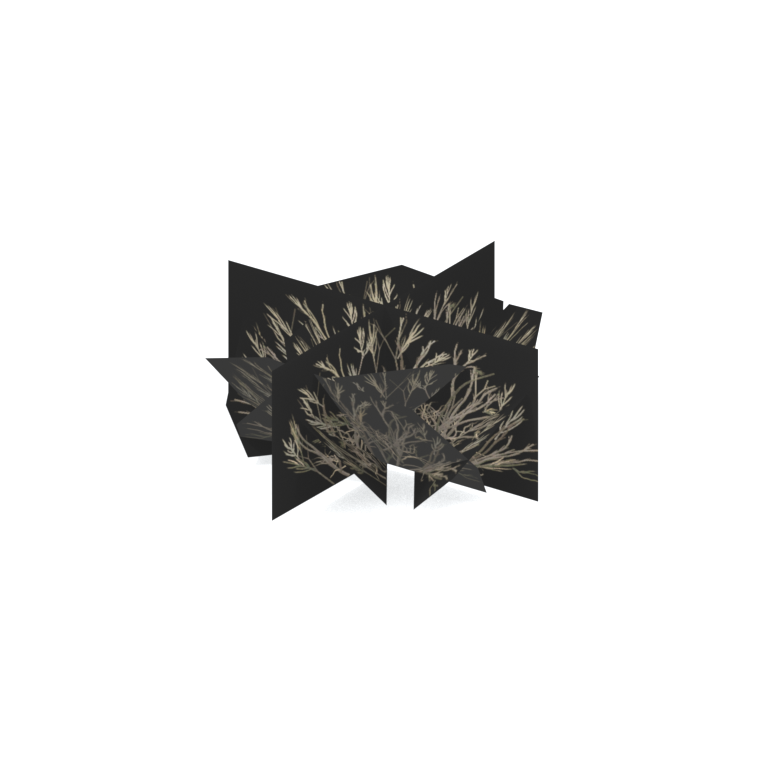
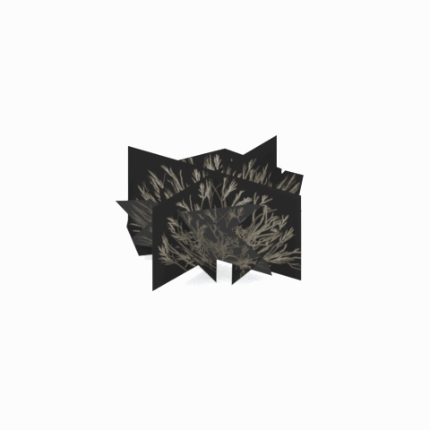

# Unidentified model (afgh_grss024_vrtn002)

Native model reference; a readable object identification has not been reviewed.

[Library](../README.md) | [Category](../tables/unclassified-components-1.md) | [Source / advanced data](../catalogue.json) | [Credits](../sources-and-credits.md)

**Game filename:** afgh_grss024_vrtn002.fmdl  
**Category:** Unclassified &gt; Unclassified components  
**Variant:** vrtn002; **LOD:** 0  
**Tags:** 

## Still reference



## 360-degree reference



The camera circles a static model. This is not a native animation. Source base textures and UVs use approximate studio shading; interaction, collision, complete assembly and FOX shader equivalence are not established.

## Identity and naming

| Field | Value |
|---|---|
| Library ID | mgsv-tpp-afgh_grss024_vrtn002-cbb6b8a0aaab8bc3 |
| Naming status | unidentified |
| Naming confidence | unknown |
| Naming evidence | {} |
| Native model | /Assets/tpp/environ/object/afghanistan/grass/afgh_grss024/scenes/afgh_grss024_vrtn002.fmdl |
| Model SHA256 | 2c4dcd1f53bbf0fc50926fd0af7c912708ede73a9dce10a4bccd497dd175ebdd |
| Container | /Assets/mgo/pack/location/afn0/pack_common/afn0_common.fpk |
| Container SHA256 | 793152d916d15d32b16935c3069b2171c7229092e9d1d3f1dd464e87ea95f415 |
| Captured source / location scope | Selected native member/content and captured installed-source chain; full archive SHA/runtime priority unresolved |
| Raw record SHA256 | ff009ca95bf9e20ae33d9d018dcf9f14b7e87da0d57bd027c488ce8912b04e04 |

Naming review is descriptive metadata only. It does not change model completion or identify a working game interaction.

## Native LOD inventory

| Native LOD | Triangles | Preview status | Decoded indices SHA256 |
|---|---:|---|---|
| 0 | 26 | rendered | 31855fca82df6e53683c1c958ff05aae668ddc66b94830f67cc8bb5a8dd9f495 |
| 1 | 25 | not separately rendered | aa4c42d218ba77dc4ea16ba53ff111a0784576951baab5bbe3e137611b92e762 |
| 2 | 25 | not separately rendered | aa4c42d218ba77dc4ea16ba53ff111a0784576951baab5bbe3e137611b92e762 |
| 3 | 25 | not separately rendered | aa4c42d218ba77dc4ea16ba53ff111a0784576951baab5bbe3e137611b92e762 |
| 4 | 25 | not separately rendered | aa4c42d218ba77dc4ea16ba53ff111a0784576951baab5bbe3e137611b92e762 |
| 5 | 25 | not separately rendered | aa4c42d218ba77dc4ea16ba53ff111a0784576951baab5bbe3e137611b92e762 |
| 6 | 25 | not separately rendered | aa4c42d218ba77dc4ea16ba53ff111a0784576951baab5bbe3e137611b92e762 |
| 7 | 25 | not separately rendered | aa4c42d218ba77dc4ea16ba53ff111a0784576951baab5bbe3e137611b92e762 |

Mesh detail and texture pixels/mips are separate. Index hashes describe decoded triangle arrays, not packed index-buffer bytes. Only source-recorded native levels are listed.

<details>
<summary>Texture, source and naming technical metadata</summary>

```json
{
  "source": {
    "nativePath": "/Assets/tpp/environ/object/afghanistan/grass/afgh_grss024/scenes/afgh_grss024_vrtn002.fmdl",
    "nativeSha256": "2c4dcd1f53bbf0fc50926fd0af7c912708ede73a9dce10a4bccd497dd175ebdd",
    "stableIdentity": "/assets/tpp/environ/object/afghanistan/grass/afgh_grss024/scenes/afgh_grss024_vrtn002.fmdl#2c4dcd1f53bbf0fc50926fd0af7c912708ede73a9dce10a4bccd497dd175ebdd#f31c09eed72a93757b419d56bb23caabde1f199d50259ceb809d4ba2e38789a8",
    "container": {
      "nativePath": "/Assets/mgo/pack/location/afn0/pack_common/afn0_common.fpk",
      "sha256": "793152d916d15d32b16935c3069b2171c7229092e9d1d3f1dd464e87ea95f415",
      "status": "Selected installed-source container/member chain captured by community reader"
    },
    "historicalDatOrigin": null,
    "sourceArchiveAtCapture": "master/0/00.dat",
    "locationStatus": "Selected native member/content and captured installed-source chain; full archive SHA/runtime priority unresolved",
    "currentInstalledDatVerified": false,
    "selectedInstalledMemberVerified": true,
    "evidence": {
      "archive_helper_executable_sha256": "6f8e39a436af3b024bbd0504966ab3d5d9d0cb05d86689bf3e83d15e68df613f",
      "archive_helper_source_sha256": "f662d3b63e066a0afc77ffe22ea0e564222d14469648300dba2c4f8e9b43446b",
      "archive_index_recipe": "54acff767f08d76ad6056c5387328759bc883df507788f398de6c2c04fac12db",
      "archive_reader": "Atvaark GzsTool.Core 0.5.3",
      "archive_reader_core_sha256": "9da447ae3c375cce2e46744eeff6af50f1591062afdf479d1a0b49edb47daaa3",
      "archive_tool_and_dictionary_sha256": {
        "CityHash.dll": "def6c4506d461b65e4059b2936b2cbd5f852ba5d1d8a1a527f1c0e6dc7008c8f",
        "GzsTool.Core.dll": "9da447ae3c375cce2e46744eeff6af50f1591062afdf479d1a0b49edb47daaa3",
        "GzsTool.exe": "1a9c5b11e2355383ff485aee7e86abc026f5c1fad729daf8c0fd15ee0aae1c10",
        "Zlib.Portable.dll": "fe84781ba35ca9cc5ff5f73fd08d2a66c59e5257b4573f5fe59743f30bf78e42",
        "fpk_dictionary.txt": "b82f9a8d6c10a68ba9471eca9d815c21355a53b5e68753d8ad7db7fd01bf401d",
        "qar_dictionary.txt": "1558c248ed0a4bb827888261563fbb91a2df4f03999682f85d637ff70d9d5fb2"
      },
      "bytes": 2944,
      "container_chain": [
        {
          "content_sha256": null,
          "depth": 0,
          "id": "3f19555d27c2ebecdfbad26aadd88b9f62e9fb6092c04c712963ef73c67ccb42",
          "index_sha256": "9acd3675d6e1500e0e18430cba0fdc70a5718ad7d6b62f13905891a35d59f18a",
          "kind": "qar",
          "name": "master/0/00.dat",
          "parent_occurrence": null
        },
        {
          "content_sha256": "793152d916d15d32b16935c3069b2171c7229092e9d1d3f1dd464e87ea95f415",
          "depth": 1,
          "id": "cdd16b801ab3d8abcb0eff58c5ffda33e686dfce824b125f6dae66b5b2538516",
          "index_sha256": "b576db71a757f0e278c2d308819efc35b981eb97da938ab92207c1f37446927a",
          "kind": "fpk",
          "name": "/Assets/mgo/pack/location/afn0/pack_common/afn0_common.fpk",
          "parent_occurrence": "629fd67dc6977d93ec9e65215d23dc6a6ff93ef5e14be9b3ffb02ad030ecfdde"
        }
      ],
      "contentSha256": "2c4dcd1f53bbf0fc50926fd0af7c912708ede73a9dce10a4bccd497dd175ebdd",
      "member": {
        "actual_size": 2944,
        "compressed_size": null,
        "content_sha256": "2c4dcd1f53bbf0fc50926fd0af7c912708ede73a9dce10a4bccd497dd175ebdd",
        "declared_size": 2944,
        "extension": "fmdl",
        "hash_hex": null,
        "name": "/Assets/tpp/environ/object/afghanistan/grass/afgh_grss024/scenes/afgh_grss024_vrtn002.fmdl",
        "name_origin": "embedded",
        "offset": 7051296,
        "ordinal": 233,
        "path_hash": null,
        "resolved": 1
      },
      "occurrenceId": "210c8c3697d5f3b2d01b49d21d446951d12ce1554c0e9c2455629ac7613f5af1",
      "occurrence_id": "210c8c3697d5f3b2d01b49d21d446951d12ce1554c0e9c2455629ac7613f5af1",
      "primary_source_revision": "fc4a8196555638c6cf8aa1b7c8dc34ccd5c69cb5",
      "source_adapter": "community_core_selective_export",
      "source_id": "7f6bb743fb4c487f0e9522f9c7fac280c46cf6b1051e0fc75a93602c8eb451f0",
      "source_path": "master/0/00.dat",
      "source_snapshot": "{\"bytes\":768788480,\"device\":621747392682911458,\"file_id\":844424931596481,\"header_sha256\":\"ead50f0a9a37e4285323b9c6fa0ec75fe75e518c63147e63158eeb2892c6589e\",\"mtime_ns\":1791852224238580700}",
      "virtualPath": "/Assets/tpp/environ/object/afghanistan/grass/afgh_grss024/scenes/afgh_grss024_vrtn002.fmdl"
    }
  },
  "materials": [
    {
      "sampler": "Base_Tex_SRGB",
      "materialIndex": 0,
      "nativePathHash": "1542926055330903464",
      "nativeVirtualPath": null,
      "nativeBinding": {
        "familyId": "4969dd7e54896be5c43efd8115ff47bcb932858435535b5dd98389926c16e85b",
        "height": 256,
        "materialIndex": 0,
        "mipCount": 8,
        "nativeMipCountVerified": true,
        "nativePath": null,
        "nativePathHash": "1542926055330903464",
        "nativeTexture": {
          "additionalFtexsFileCount": 2,
          "depth": 1,
          "ftexsFileCount": 3,
          "height": 256,
          "metadataBytes": 192,
          "mipCount": 8,
          "mips": [
            {
              "chunks": 8,
              "decodedBytes": 131072,
              "mip": 0,
              "offset": 0,
              "storedBytes": 80192,
              "streamNumber": 3
            },
            {
              "chunks": 2,
              "decodedBytes": 32768,
              "mip": 1,
              "offset": 0,
              "storedBytes": 22608,
              "streamNumber": 2
            },
            {
              "chunks": 1,
              "decodedBytes": 8192,
              "mip": 2,
              "offset": 2456,
              "storedBytes": 6128,
              "streamNumber": 1
            },
            {
              "chunks": 1,
              "decodedBytes": 2048,
              "mip": 3,
              "offset": 752,
              "storedBytes": 1696,
              "streamNumber": 1
            },
            {
              "chunks": 1,
              "decodedBytes": 512,
              "mip": 4,
              "offset": 248,
              "storedBytes": 496,
              "streamNumber": 1
            },
            {
              "chunks": 1,
              "decodedBytes": 128,
              "mip": 5,
              "offset": 96,
              "storedBytes": 144,
              "streamNumber": 1
            },
            {
              "chunks": 1,
              "decodedBytes": 32,
              "mip": 6,
              "offset": 40,
              "storedBytes": 48,
              "streamNumber": 1
            },
            {
              "chunks": 1,
              "decodedBytes": 16,
              "mip": 7,
              "offset": 0,
              "storedBytes": 32,
              "streamNumber": 1
            }
          ],
          "nativeHeaderHash": "ecc3906b7145c4534cd62e0936fd8520",
          "nrtFlag": 2,
          "pixelFormat": 4,
          "requiredStreamNumbers": [
            1,
            2,
            3
          ],
          "textureType": 16777219,
          "unknownFlags": 273,
          "width": 512
        },
        "samplerName": "Base_Tex_SRGB",
        "samplerNameHash": "72475356961633",
        "sha256": "1faa5157b876f14a12a5a8d3737abee2c4e7102bb51be95d9b9a20573bb384f1",
        "sourceOccurrences": [
          {
            "archive_helper_executable_sha256": "6f8e39a436af3b024bbd0504966ab3d5d9d0cb05d86689bf3e83d15e68df613f",
            "archive_helper_source_sha256": "f662d3b63e066a0afc77ffe22ea0e564222d14469648300dba2c4f8e9b43446b",
            "archive_index_recipe": "54acff767f08d76ad6056c5387328759bc883df507788f398de6c2c04fac12db",
            "archive_reader": "Atvaark GzsTool.Core 0.5.3",
            "archive_reader_core_sha256": "9da447ae3c375cce2e46744eeff6af50f1591062afdf479d1a0b49edb47daaa3",
            "archive_tool_and_dictionary_sha256": {
              "CityHash.dll": "def6c4506d461b65e4059b2936b2cbd5f852ba5d1d8a1a527f1c0e6dc7008c8f",
              "GzsTool.Core.dll": "9da447ae3c375cce2e46744eeff6af50f1591062afdf479d1a0b49edb47daaa3",
              "GzsTool.exe": "1a9c5b11e2355383ff485aee7e86abc026f5c1fad729daf8c0fd15ee0aae1c10",
              "Zlib.Portable.dll": "fe84781ba35ca9cc5ff5f73fd08d2a66c59e5257b4573f5fe59743f30bf78e42",
              "fpk_dictionary.txt": "b82f9a8d6c10a68ba9471eca9d815c21355a53b5e68753d8ad7db7fd01bf401d",
              "qar_dictionary.txt": "1558c248ed0a4bb827888261563fbb91a2df4f03999682f85d637ff70d9d5fb2"
            },
            "bytes": 192,
            "container_chain": [
              {
                "content_sha256": null,
                "depth": 0,
                "id": "3f19555d27c2ebecdfbad26aadd88b9f62e9fb6092c04c712963ef73c67ccb42",
                "index_sha256": "9acd3675d6e1500e0e18430cba0fdc70a5718ad7d6b62f13905891a35d59f18a",
                "kind": "qar",
                "name": "master/0/00.dat",
                "parent_occurrence": null
              },
              {
                "content_sha256": "7784c61d48c2a829a8a3be8bea91819ed320466e84615e1196c12dc4390190ea",
                "depth": 1,
                "id": "a7374ee4090f72cbecb7df25f172141b83da2b51b8b38b375af7a4f0f577fc67",
                "index_sha256": "7f78072384a5e4f07d09223009a06931047d1b3d6ae36512b9bb7ef91d1fe958",
                "kind": "pftxs",
                "name": "/Assets/mgo/pack/location/afda/pack_common/afda_common.pftxs",
                "parent_occurrence": "e3bb44002c453c106548f7190291b4a4c22da16a7eebd82d6a8dac6ab3844ca7"
              }
            ],
            "contentSha256": "81e829dc882da9abf93c3f1e2e9f9b878d2db4dc8db5f60035309b8ef2f1d944",
            "member": {
              "actual_size": 192,
              "compressed_size": null,
              "content_sha256": "81e829dc882da9abf93c3f1e2e9f9b878d2db4dc8db5f60035309b8ef2f1d944",
              "declared_size": 192,
              "extension": "ftex",
              "hash_hex": "1569931292b175a8",
              "name": "1569931292b175a8.ftex",
              "name_origin": "hash_fallback",
              "offset": 22846560,
              "ordinal": 1690,
              "path_hash": null,
              "resolved": 0
            },
            "occurrenceId": "36ec22057f9c9723fe059e22c52e655346c025bad8492a8a3fff40521e37f875",
            "occurrence_id": "36ec22057f9c9723fe059e22c52e655346c025bad8492a8a3fff40521e37f875",
            "primary_source_revision": "fc4a8196555638c6cf8aa1b7c8dc34ccd5c69cb5",
            "source_adapter": "community_core_selective_export",
            "source_id": "7f6bb743fb4c487f0e9522f9c7fac280c46cf6b1051e0fc75a93602c8eb451f0",
            "source_path": "master/0/00.dat",
            "source_snapshot": "{\"bytes\":768788480,\"device\":621747392682911458,\"file_id\":844424931596481,\"header_sha256\":\"ead50f0a9a37e4285323b9c6fa0ec75fe75e518c63147e63158eeb2892c6589e\",\"mtime_ns\":1791852224238580700}",
            "virtualPath": "1569931292b175a8.ftex"
          },
          {
            "archive_helper_executable_sha256": "6f8e39a436af3b024bbd0504966ab3d5d9d0cb05d86689bf3e83d15e68df613f",
            "archive_helper_source_sha256": "f662d3b63e066a0afc77ffe22ea0e564222d14469648300dba2c4f8e9b43446b",
            "archive_index_recipe": "54acff767f08d76ad6056c5387328759bc883df507788f398de6c2c04fac12db",
            "archive_reader": "Atvaark GzsTool.Core 0.5.3",
            "archive_reader_core_sha256": "9da447ae3c375cce2e46744eeff6af50f1591062afdf479d1a0b49edb47daaa3",
            "archive_tool_and_dictionary_sha256": {
              "CityHash.dll": "def6c4506d461b65e4059b2936b2cbd5f852ba5d1d8a1a527f1c0e6dc7008c8f",
              "GzsTool.Core.dll": "9da447ae3c375cce2e46744eeff6af50f1591062afdf479d1a0b49edb47daaa3",
              "GzsTool.exe": "1a9c5b11e2355383ff485aee7e86abc026f5c1fad729daf8c0fd15ee0aae1c10",
              "Zlib.Portable.dll": "fe84781ba35ca9cc5ff5f73fd08d2a66c59e5257b4573f5fe59743f30bf78e42",
              "fpk_dictionary.txt": "b82f9a8d6c10a68ba9471eca9d815c21355a53b5e68753d8ad7db7fd01bf401d",
              "qar_dictionary.txt": "1558c248ed0a4bb827888261563fbb91a2df4f03999682f85d637ff70d9d5fb2"
            },
            "bytes": 8592,
            "container_chain": [
              {
                "content_sha256": null,
                "depth": 0,
                "id": "3f19555d27c2ebecdfbad26aadd88b9f62e9fb6092c04c712963ef73c67ccb42",
                "index_sha256": "9acd3675d6e1500e0e18430cba0fdc70a5718ad7d6b62f13905891a35d59f18a",
                "kind": "qar",
                "name": "master/0/00.dat",
                "parent_occurrence": null
              },
              {
                "content_sha256": "2d231e65dd0e258bee24869e50bdc46f93eeb650bb81d42404c08a5376b9a1c2",
                "depth": 1,
                "id": "781fdb390fcb62560fac23f19318bc6caca329344eeb7291ba0508686536e328",
                "index_sha256": "dc5f40a4ac0c7a4290c3cccdaa7abd0c87f4b773f96508f9646721d00343f589",
                "kind": "pftxs",
                "name": "/Assets/mgo/pack/location/afn0/pack_common/afn0_common.pftxs",
                "parent_occurrence": "2c020de573d8fb7e811508359bef43a77a42e08aaa94446a176f01bec1414905"
              }
            ],
            "contentSha256": "41566e1022a9c2e4c9fee8a255682423f4a94553b2e2a6db93646a7818a75ac9",
            "member": {
              "actual_size": 8592,
              "compressed_size": null,
              "content_sha256": "41566e1022a9c2e4c9fee8a255682423f4a94553b2e2a6db93646a7818a75ac9",
              "declared_size": 8592,
              "extension": "1.ftexs",
              "hash_hex": "b2c1931292b175a8",
              "name": "b2c1931292b175a8.1.ftexs",
              "name_origin": "hash_fallback",
              "offset": 18806192,
              "ordinal": 1347,
              "path_hash": null,
              "resolved": 0
            },
            "occurrenceId": "66345d4a7364ce28f2baadcf129443c65d2e6a7b576686942cf2446e45709352",
            "occurrence_id": "66345d4a7364ce28f2baadcf129443c65d2e6a7b576686942cf2446e45709352",
            "primary_source_revision": "fc4a8196555638c6cf8aa1b7c8dc34ccd5c69cb5",
            "source_adapter": "community_core_selective_export",
            "source_id": "7f6bb743fb4c487f0e9522f9c7fac280c46cf6b1051e0fc75a93602c8eb451f0",
            "source_path": "master/0/00.dat",
            "source_snapshot": "{\"bytes\":768788480,\"device\":621747392682911458,\"file_id\":844424931596481,\"header_sha256\":\"ead50f0a9a37e4285323b9c6fa0ec75fe75e518c63147e63158eeb2892c6589e\",\"mtime_ns\":1791852224238580700}",
            "virtualPath": "b2c1931292b175a8.1.ftexs"
          },
          {
            "archive_helper_executable_sha256": "6f8e39a436af3b024bbd0504966ab3d5d9d0cb05d86689bf3e83d15e68df613f",
            "archive_helper_source_sha256": "f662d3b63e066a0afc77ffe22ea0e564222d14469648300dba2c4f8e9b43446b",
            "archive_index_recipe": "54acff767f08d76ad6056c5387328759bc883df507788f398de6c2c04fac12db",
            "archive_reader": "Atvaark GzsTool.Core 0.5.3",
            "archive_reader_core_sha256": "9da447ae3c375cce2e46744eeff6af50f1591062afdf479d1a0b49edb47daaa3",
            "archive_tool_and_dictionary_sha256": {
              "CityHash.dll": "def6c4506d461b65e4059b2936b2cbd5f852ba5d1d8a1a527f1c0e6dc7008c8f",
              "GzsTool.Core.dll": "9da447ae3c375cce2e46744eeff6af50f1591062afdf479d1a0b49edb47daaa3",
              "GzsTool.exe": "1a9c5b11e2355383ff485aee7e86abc026f5c1fad729daf8c0fd15ee0aae1c10",
              "Zlib.Portable.dll": "fe84781ba35ca9cc5ff5f73fd08d2a66c59e5257b4573f5fe59743f30bf78e42",
              "fpk_dictionary.txt": "b82f9a8d6c10a68ba9471eca9d815c21355a53b5e68753d8ad7db7fd01bf401d",
              "qar_dictionary.txt": "1558c248ed0a4bb827888261563fbb91a2df4f03999682f85d637ff70d9d5fb2"
            },
            "bytes": 22624,
            "container_chain": [
              {
                "content_sha256": null,
                "depth": 0,
                "id": "e73d96973ade76f7a00afdbea486dd110896ace97da0791f56899647de46f210",
                "index_sha256": "5a818609a652a10d90fb90015661d0cb80898096bbb3aac36382172988d8736d",
                "kind": "qar",
                "name": "mgo/texture0.dat",
                "parent_occurrence": null
              }
            ],
            "contentSha256": "5ccd0672012c95ce261410d2781aa647048bf9829debbb942586f23705074f28",
            "member": {
              "actual_size": 22624,
              "compressed_size": 22624,
              "content_sha256": "5ccd0672012c95ce261410d2781aa647048bf9829debbb942586f23705074f28",
              "declared_size": 22624,
              "extension": "2.ftexs",
              "hash_hex": "b571931292b175a8",
              "name": "/Assets/tpp/environ/object/afghanistan/grass/afgh_grss024/sourceimages/afgh_grss024_v2_bsm_alp.2.ftexs",
              "name_origin": "dictionary",
              "offset": 3320250400,
              "ordinal": 12782,
              "path_hash": "1931292b175a8",
              "resolved": 1
            },
            "occurrenceId": "10557bdabf440c96ce146400f15530aab7a90e7f72e1c454f22c6b20423f2c95",
            "occurrence_id": "10557bdabf440c96ce146400f15530aab7a90e7f72e1c454f22c6b20423f2c95",
            "primary_source_revision": "fc4a8196555638c6cf8aa1b7c8dc34ccd5c69cb5",
            "source_adapter": "community_core_selective_export",
            "source_id": "03f5942f0e1af8040ae05b95c43716d75f5933971d78324bf7cfea291297f3f4",
            "source_path": "mgo/texture0.dat",
            "source_snapshot": "{\"bytes\":4492370944,\"device\":621747392682911458,\"file_id\":562949953639631,\"header_sha256\":\"6108fbacb65c84d041742c39e5ca630745240453b336f1059a13b91943f0b011\",\"mtime_ns\":1791224675562234400}",
            "virtualPath": "/Assets/tpp/environ/object/afghanistan/grass/afgh_grss024/sourceimages/afgh_grss024_v2_bsm_alp.2.ftexs"
          },
          {
            "archive_helper_executable_sha256": "6f8e39a436af3b024bbd0504966ab3d5d9d0cb05d86689bf3e83d15e68df613f",
            "archive_helper_source_sha256": "f662d3b63e066a0afc77ffe22ea0e564222d14469648300dba2c4f8e9b43446b",
            "archive_index_recipe": "54acff767f08d76ad6056c5387328759bc883df507788f398de6c2c04fac12db",
            "archive_reader": "Atvaark GzsTool.Core 0.5.3",
            "archive_reader_core_sha256": "9da447ae3c375cce2e46744eeff6af50f1591062afdf479d1a0b49edb47daaa3",
            "archive_tool_and_dictionary_sha256": {
              "CityHash.dll": "def6c4506d461b65e4059b2936b2cbd5f852ba5d1d8a1a527f1c0e6dc7008c8f",
              "GzsTool.Core.dll": "9da447ae3c375cce2e46744eeff6af50f1591062afdf479d1a0b49edb47daaa3",
              "GzsTool.exe": "1a9c5b11e2355383ff485aee7e86abc026f5c1fad729daf8c0fd15ee0aae1c10",
              "Zlib.Portable.dll": "fe84781ba35ca9cc5ff5f73fd08d2a66c59e5257b4573f5fe59743f30bf78e42",
              "fpk_dictionary.txt": "b82f9a8d6c10a68ba9471eca9d815c21355a53b5e68753d8ad7db7fd01bf401d",
              "qar_dictionary.txt": "1558c248ed0a4bb827888261563fbb91a2df4f03999682f85d637ff70d9d5fb2"
            },
            "bytes": 80256,
            "container_chain": [
              {
                "content_sha256": null,
                "depth": 0,
                "id": "0b473016351235050c2f6af21454bd979a0ad4602a9860137c807c894c5eba4d",
                "index_sha256": "ac9b4dae0dd0166db3a6ec8da18524dffebcbaf9004569af631de82913bf49a3",
                "kind": "qar",
                "name": "master/texture2.dat",
                "parent_occurrence": null
              }
            ],
            "contentSha256": "8279273ec88de4865f05e95f675fed202f970e53a13741292b5f683e45b347a5",
            "member": {
              "actual_size": 80256,
              "compressed_size": 80256,
              "content_sha256": "8279273ec88de4865f05e95f675fed202f970e53a13741292b5f683e45b347a5",
              "declared_size": 80256,
              "extension": "3.ftexs",
              "hash_hex": "5719931292b175a8",
              "name": "/Assets/tpp/environ/object/afghanistan/grass/afgh_grss024/sourceimages/afgh_grss024_v2_bsm_alp.3.ftexs",
              "name_origin": "dictionary",
              "offset": 1758815264,
              "ordinal": 11012,
              "path_hash": "1931292b175a8",
              "resolved": 1
            },
            "occurrenceId": "47def7442139d4783a9817ea1248f8498f36165ffb79fe4bfe05d654928b49e5",
            "occurrence_id": "47def7442139d4783a9817ea1248f8498f36165ffb79fe4bfe05d654928b49e5",
            "primary_source_revision": "fc4a8196555638c6cf8aa1b7c8dc34ccd5c69cb5",
            "source_adapter": "community_core_selective_export",
            "source_id": "85e8296057664cbc6ebaf6bd43d1c6d18528bbd8a6fae920bdf4d5eb69f6a93d",
            "source_path": "master/texture2.dat",
            "source_snapshot": "{\"bytes\":2920239104,\"device\":621747392682911458,\"file_id\":562949953639626,\"header_sha256\":\"72bfee707623afb5f3abd8382035d3d4258b4941ac583a56f5a447f47123dcab\",\"mtime_ns\":1791224675561235200}",
            "virtualPath": "/Assets/tpp/environ/object/afghanistan/grass/afgh_grss024/sourceimages/afgh_grss024_v2_bsm_alp.3.ftexs"
          }
        ],
        "width": 512
      },
      "ddsSha256": "1faa5157b876f14a12a5a8d3737abee2c4e7102bb51be95d9b9a20573bb384f1",
      "dimensions": [
        512,
        256
      ],
      "mipCount": 8,
      "nativeMipCountVerified": true,
      "connectedInPreview": true
    }
  ],
  "quality": {
    "decodedIndicesHashDerivation": "SHA256 of canonical UTF-8 JSON decoded triangle indices grouped by mesh; not packed buffer bytes",
    "highestRetainedGeometricLod": 0,
    "distinctNativeLods": 2,
    "baseTextureDimensions": [
      512,
      256
    ],
    "baseTextureNativeMipCount": 8,
    "largerRetainedBaseTextureFound": null,
    "nativeLods": [
      {
        "indicesSha256": "31855fca82df6e53683c1c958ff05aae668ddc66b94830f67cc8bb5a8dd9f495",
        "nativeLod": 0,
        "triangles": 26
      },
      {
        "indicesSha256": "aa4c42d218ba77dc4ea16ba53ff111a0784576951baab5bbe3e137611b92e762",
        "nativeLod": 1,
        "triangles": 25
      },
      {
        "duplicateOf": 1,
        "indicesSha256": "aa4c42d218ba77dc4ea16ba53ff111a0784576951baab5bbe3e137611b92e762",
        "nativeLod": 2,
        "triangles": 25
      },
      {
        "duplicateOf": 1,
        "indicesSha256": "aa4c42d218ba77dc4ea16ba53ff111a0784576951baab5bbe3e137611b92e762",
        "nativeLod": 3,
        "triangles": 25
      },
      {
        "duplicateOf": 1,
        "indicesSha256": "aa4c42d218ba77dc4ea16ba53ff111a0784576951baab5bbe3e137611b92e762",
        "nativeLod": 4,
        "triangles": 25
      },
      {
        "duplicateOf": 1,
        "indicesSha256": "aa4c42d218ba77dc4ea16ba53ff111a0784576951baab5bbe3e137611b92e762",
        "nativeLod": 5,
        "triangles": 25
      },
      {
        "duplicateOf": 1,
        "indicesSha256": "aa4c42d218ba77dc4ea16ba53ff111a0784576951baab5bbe3e137611b92e762",
        "nativeLod": 6,
        "triangles": 25
      },
      {
        "duplicateOf": 1,
        "indicesSha256": "aa4c42d218ba77dc4ea16ba53ff111a0784576951baab5bbe3e137611b92e762",
        "nativeLod": 7,
        "triangles": 25
      }
    ],
    "renderedNativeLods": [
      0
    ],
    "baseTextureSummary": "512 x 256; 8 native/DDS mips",
    "highestDetailScope": "Triangle-count comparison within captured FMDL only"
  }
}
```

</details>

[Original source / advanced record](../catalogue.json)
