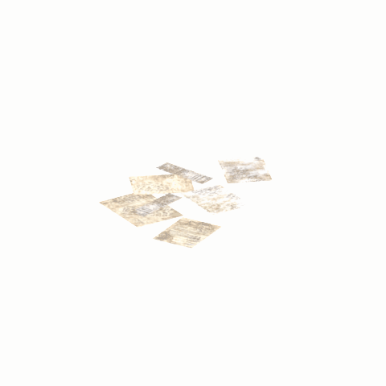

# Unidentified model (afgh_pstr002_vrtn006)

Native model reference; a readable object identification has not been reviewed.

[Library](../README.md) | [Category](../tables/unclassified-components-1.md) | [Source / advanced data](../catalogue.json) | [Credits](../sources-and-credits.md)

**Game filename:** afgh_pstr002_vrtn006.fmdl  
**Category:** Unclassified &gt; Unclassified components  
**Variant:** vrtn006; **LOD:** 0  
**Tags:** 

## Still reference


## 360-degree reference



The camera circles a static model. This is not a native animation. Source base textures and UVs use approximate studio shading; interaction, collision, complete assembly and FOX shader equivalence are not established.

## Identity and naming

| Field | Value |
|---|---|
| Library ID | mgsv-tpp-afgh_pstr002_vrtn006-dad41af632877891 |
| Naming status | unidentified |
| Naming confidence | unknown |
| Naming evidence | {} |
| Native model | /Assets/tpp/environ/object/afghanistan/poster/afgh_pstr002/scenes/afgh_pstr002_vrtn006.fmdl |
| Model SHA256 | 698764c0c14c29efad174272995a12c6fd81ace8867a011752f0ba999be16330 |
| Container | /Assets/mgo/pack/location/afc0/pack_common/afc0_common.fpk |
| Container SHA256 | 20a950cab0d6912ac3a270b90dc6dc673f2d13859eb636819bfa3955fca6e320 |
| Captured source / location scope | Selected native member/content and captured installed-source chain; full archive SHA/runtime priority unresolved |
| Raw record SHA256 | 09c04ad99084b007c2441c0b924dfc9dce304674c6b7c2a66debb061728965c3 |

Naming review is descriptive metadata only. It does not change model completion or identify a working game interaction.

## Native LOD inventory

| Native LOD | Triangles | Preview status | Decoded indices SHA256 |
|---|---:|---|---|
| 0 | 14 | rendered | 05878658e4ac4a7019592727a5a5f29f4d8282e79857c58443381b80f48c7702 |
| 1 | 10 | not separately rendered | 511d5285c563e201aa464b3a98ca16d95e0c3c7cec7751df6d34c6f790b82f2d |
| 2 | 9 | not separately rendered | 8d279bff3b2b3a1ee246f993bd6ed2f9f644f9bcb3304585a1dba71a57584a6c |
| 3 | 7 | not separately rendered | 5feb3e7f8449f55cdaa035c8066498383e6bfbd6630ade283318aa2c4125d9c6 |

Mesh detail and texture pixels/mips are separate. Index hashes describe decoded triangle arrays, not packed index-buffer bytes. Only source-recorded native levels are listed.

<details>
<summary>Texture, source and naming technical metadata</summary>

```json
{
  "source": {
    "nativePath": "/Assets/tpp/environ/object/afghanistan/poster/afgh_pstr002/scenes/afgh_pstr002_vrtn006.fmdl",
    "nativeSha256": "698764c0c14c29efad174272995a12c6fd81ace8867a011752f0ba999be16330",
    "stableIdentity": "/assets/tpp/environ/object/afghanistan/poster/afgh_pstr002/scenes/afgh_pstr002_vrtn006.fmdl#698764c0c14c29efad174272995a12c6fd81ace8867a011752f0ba999be16330#3d4e582f99a7d66d4df29e39c705469ee39922538ec98646186531ebbb478487",
    "container": {
      "nativePath": "/Assets/mgo/pack/location/afc0/pack_common/afc0_common.fpk",
      "sha256": "20a950cab0d6912ac3a270b90dc6dc673f2d13859eb636819bfa3955fca6e320",
      "status": "Selected installed-source container/member chain captured by community reader"
    },
    "historicalDatOrigin": null,
    "sourceArchiveAtCapture": "master/0/00.dat",
    "locationStatus": "Selected native member/content and captured installed-source chain; full archive SHA/runtime priority unresolved",
    "currentInstalledDatVerified": false,
    "selectedInstalledMemberVerified": true,
    "evidence": {
      "archive_helper_executable_sha256": "6f8e39a436af3b024bbd0504966ab3d5d9d0cb05d86689bf3e83d15e68df613f",
      "archive_helper_source_sha256": "f662d3b63e066a0afc77ffe22ea0e564222d14469648300dba2c4f8e9b43446b",
      "archive_index_recipe": "54acff767f08d76ad6056c5387328759bc883df507788f398de6c2c04fac12db",
      "archive_reader": "Atvaark GzsTool.Core 0.5.3",
      "archive_reader_core_sha256": "9da447ae3c375cce2e46744eeff6af50f1591062afdf479d1a0b49edb47daaa3",
      "archive_tool_and_dictionary_sha256": {
        "CityHash.dll": "def6c4506d461b65e4059b2936b2cbd5f852ba5d1d8a1a527f1c0e6dc7008c8f",
        "GzsTool.Core.dll": "9da447ae3c375cce2e46744eeff6af50f1591062afdf479d1a0b49edb47daaa3",
        "GzsTool.exe": "1a9c5b11e2355383ff485aee7e86abc026f5c1fad729daf8c0fd15ee0aae1c10",
        "Zlib.Portable.dll": "fe84781ba35ca9cc5ff5f73fd08d2a66c59e5257b4573f5fe59743f30bf78e42",
        "fpk_dictionary.txt": "b82f9a8d6c10a68ba9471eca9d815c21355a53b5e68753d8ad7db7fd01bf401d",
        "qar_dictionary.txt": "1558c248ed0a4bb827888261563fbb91a2df4f03999682f85d637ff70d9d5fb2"
      },
      "bytes": 1904,
      "container_chain": [
        {
          "content_sha256": null,
          "depth": 0,
          "id": "3f19555d27c2ebecdfbad26aadd88b9f62e9fb6092c04c712963ef73c67ccb42",
          "index_sha256": "9acd3675d6e1500e0e18430cba0fdc70a5718ad7d6b62f13905891a35d59f18a",
          "kind": "qar",
          "name": "master/0/00.dat",
          "parent_occurrence": null
        },
        {
          "content_sha256": "20a950cab0d6912ac3a270b90dc6dc673f2d13859eb636819bfa3955fca6e320",
          "depth": 1,
          "id": "f1334a28f5fb887d989a9c548d11dccada12186358e0a4b4e7fc9831f6f42881",
          "index_sha256": "e15578c97612208569f283c28408f389fb560576e3976adf9d7aa8ed9c9aaf87",
          "kind": "fpk",
          "name": "/Assets/mgo/pack/location/afc0/pack_common/afc0_common.fpk",
          "parent_occurrence": "348190d8da3d429c2cdae58af0494f023c46b80f66da14d484dc54a7e17a97df"
        }
      ],
      "contentSha256": "698764c0c14c29efad174272995a12c6fd81ace8867a011752f0ba999be16330",
      "member": {
        "actual_size": 1904,
        "compressed_size": null,
        "content_sha256": "698764c0c14c29efad174272995a12c6fd81ace8867a011752f0ba999be16330",
        "declared_size": 1904,
        "extension": "fmdl",
        "hash_hex": null,
        "name": "/Assets/tpp/environ/object/afghanistan/poster/afgh_pstr002/scenes/afgh_pstr002_vrtn006.fmdl",
        "name_origin": "embedded",
        "offset": 5793904,
        "ordinal": 179,
        "path_hash": null,
        "resolved": 1
      },
      "occurrenceId": "0e106adeb63544e6f9a41f936562c3af601d12e71d6834a41d87e119cbabac30",
      "occurrence_id": "0e106adeb63544e6f9a41f936562c3af601d12e71d6834a41d87e119cbabac30",
      "primary_source_revision": "fc4a8196555638c6cf8aa1b7c8dc34ccd5c69cb5",
      "source_adapter": "community_core_selective_export",
      "source_id": "7f6bb743fb4c487f0e9522f9c7fac280c46cf6b1051e0fc75a93602c8eb451f0",
      "source_path": "master/0/00.dat",
      "source_snapshot": "{\"bytes\":768788480,\"device\":621747392682911458,\"file_id\":844424931596481,\"header_sha256\":\"ead50f0a9a37e4285323b9c6fa0ec75fe75e518c63147e63158eeb2892c6589e\",\"mtime_ns\":1791852224238580700}",
      "virtualPath": "/Assets/tpp/environ/object/afghanistan/poster/afgh_pstr002/scenes/afgh_pstr002_vrtn006.fmdl"
    }
  },
  "materials": [
    {
      "sampler": "Base_Tex_SRGB",
      "materialIndex": 0,
      "nativePathHash": "1543383164912312177",
      "nativeVirtualPath": null,
      "nativeBinding": {
        "familyId": "34e4f2066c2cc02b2459ab47ac003d3173e15f99c501638018983642534d1742",
        "height": 512,
        "materialIndex": 0,
        "mipCount": 8,
        "nativeMipCountVerified": true,
        "nativePath": null,
        "nativePathHash": "1543383164912312177",
        "nativeTexture": {
          "additionalFtexsFileCount": 2,
          "depth": 1,
          "ftexsFileCount": 3,
          "height": 512,
          "metadataBytes": 192,
          "mipCount": 8,
          "mips": [
            {
              "chunks": 8,
              "decodedBytes": 131072,
              "mip": 0,
              "offset": 0,
              "storedBytes": 106816,
              "streamNumber": 3
            },
            {
              "chunks": 2,
              "decodedBytes": 32768,
              "mip": 1,
              "offset": 0,
              "storedBytes": 28464,
              "streamNumber": 2
            },
            {
              "chunks": 1,
              "decodedBytes": 8192,
              "mip": 2,
              "offset": 2744,
              "storedBytes": 7408,
              "streamNumber": 1
            },
            {
              "chunks": 1,
              "decodedBytes": 2048,
              "mip": 3,
              "offset": 768,
              "storedBytes": 1968,
              "streamNumber": 1
            },
            {
              "chunks": 1,
              "decodedBytes": 512,
              "mip": 4,
              "offset": 232,
              "storedBytes": 528,
              "streamNumber": 1
            },
            {
              "chunks": 1,
              "decodedBytes": 128,
              "mip": 5,
              "offset": 80,
              "storedBytes": 144,
              "streamNumber": 1
            },
            {
              "chunks": 1,
              "decodedBytes": 32,
              "mip": 6,
              "offset": 24,
              "storedBytes": 48,
              "streamNumber": 1
            },
            {
              "chunks": 1,
              "decodedBytes": 8,
              "mip": 7,
              "offset": 0,
              "storedBytes": 16,
              "streamNumber": 1
            }
          ],
          "nativeHeaderHash": "64a661be5582eecca6334f72d29ff266",
          "nrtFlag": 2,
          "pixelFormat": 2,
          "requiredStreamNumbers": [
            1,
            2,
            3
          ],
          "textureType": 16777219,
          "unknownFlags": 273,
          "width": 512
        },
        "samplerName": "Base_Tex_SRGB",
        "samplerNameHash": "72475356961633",
        "sha256": "ec546ee9347f94449fbdbd1e54171a267e3211ac414bc0e18eda27a8025fee39",
        "sourceOccurrences": [
          {
            "archive_helper_executable_sha256": "6f8e39a436af3b024bbd0504966ab3d5d9d0cb05d86689bf3e83d15e68df613f",
            "archive_helper_source_sha256": "f662d3b63e066a0afc77ffe22ea0e564222d14469648300dba2c4f8e9b43446b",
            "archive_index_recipe": "54acff767f08d76ad6056c5387328759bc883df507788f398de6c2c04fac12db",
            "archive_reader": "Atvaark GzsTool.Core 0.5.3",
            "archive_reader_core_sha256": "9da447ae3c375cce2e46744eeff6af50f1591062afdf479d1a0b49edb47daaa3",
            "archive_tool_and_dictionary_sha256": {
              "CityHash.dll": "def6c4506d461b65e4059b2936b2cbd5f852ba5d1d8a1a527f1c0e6dc7008c8f",
              "GzsTool.Core.dll": "9da447ae3c375cce2e46744eeff6af50f1591062afdf479d1a0b49edb47daaa3",
              "GzsTool.exe": "1a9c5b11e2355383ff485aee7e86abc026f5c1fad729daf8c0fd15ee0aae1c10",
              "Zlib.Portable.dll": "fe84781ba35ca9cc5ff5f73fd08d2a66c59e5257b4573f5fe59743f30bf78e42",
              "fpk_dictionary.txt": "b82f9a8d6c10a68ba9471eca9d815c21355a53b5e68753d8ad7db7fd01bf401d",
              "qar_dictionary.txt": "1558c248ed0a4bb827888261563fbb91a2df4f03999682f85d637ff70d9d5fb2"
            },
            "bytes": 192,
            "container_chain": [
              {
                "content_sha256": null,
                "depth": 0,
                "id": "ed06436b87a33093d4ecc183bbe92a4270efb3b69334c9f78610d9c26d72543e",
                "index_sha256": "cbeecab235114828cf8a954288095c1e2547bfa06667c7b1e0b45c19774105d1",
                "kind": "qar",
                "name": "master/texture0.dat",
                "parent_occurrence": null
              }
            ],
            "contentSha256": "c5b37d2d3e9bf25082ef1e6794a7c6fa66f6359bf61885b5899e5e5426919766",
            "member": {
              "actual_size": 192,
              "compressed_size": 192,
              "content_sha256": "c5b37d2d3e9bf25082ef1e6794a7c6fa66f6359bf61885b5899e5e5426919766",
              "declared_size": 192,
              "extension": "ftex",
              "hash_hex": "156b32cfb0ea9f71",
              "name": "/Assets/tpp/environ/object/afghanistan/poster/afgh_pstr002/sourceimages/afgh_pstr002_pc_bsm.ftex",
              "name_origin": "dictionary",
              "offset": 2529048608,
              "ordinal": 12773,
              "path_hash": "332cfb0ea9f71",
              "resolved": 1
            },
            "occurrenceId": "67ea20fbe55f0b702ff3cb176ef8e6209196f27c441ef24af9642b349a8c4626",
            "occurrence_id": "67ea20fbe55f0b702ff3cb176ef8e6209196f27c441ef24af9642b349a8c4626",
            "primary_source_revision": "fc4a8196555638c6cf8aa1b7c8dc34ccd5c69cb5",
            "source_adapter": "community_core_selective_export",
            "source_id": "7bfac7ec2859af21676ae22ed9ddff5e6d4adaddf146059b0948f2ab8ef9e2f4",
            "source_path": "master/texture0.dat",
            "source_snapshot": "{\"bytes\":3527175168,\"device\":621747392682911458,\"file_id\":562949953639624,\"header_sha256\":\"be81f77de9943687926d5790cc5a960e18e93064af4db3c3c35dabc542fee1ed\",\"mtime_ns\":1791224675560236900}",
            "virtualPath": "/Assets/tpp/environ/object/afghanistan/poster/afgh_pstr002/sourceimages/afgh_pstr002_pc_bsm.ftex"
          },
          {
            "archive_helper_executable_sha256": "6f8e39a436af3b024bbd0504966ab3d5d9d0cb05d86689bf3e83d15e68df613f",
            "archive_helper_source_sha256": "f662d3b63e066a0afc77ffe22ea0e564222d14469648300dba2c4f8e9b43446b",
            "archive_index_recipe": "54acff767f08d76ad6056c5387328759bc883df507788f398de6c2c04fac12db",
            "archive_reader": "Atvaark GzsTool.Core 0.5.3",
            "archive_reader_core_sha256": "9da447ae3c375cce2e46744eeff6af50f1591062afdf479d1a0b49edb47daaa3",
            "archive_tool_and_dictionary_sha256": {
              "CityHash.dll": "def6c4506d461b65e4059b2936b2cbd5f852ba5d1d8a1a527f1c0e6dc7008c8f",
              "GzsTool.Core.dll": "9da447ae3c375cce2e46744eeff6af50f1591062afdf479d1a0b49edb47daaa3",
              "GzsTool.exe": "1a9c5b11e2355383ff485aee7e86abc026f5c1fad729daf8c0fd15ee0aae1c10",
              "Zlib.Portable.dll": "fe84781ba35ca9cc5ff5f73fd08d2a66c59e5257b4573f5fe59743f30bf78e42",
              "fpk_dictionary.txt": "b82f9a8d6c10a68ba9471eca9d815c21355a53b5e68753d8ad7db7fd01bf401d",
              "qar_dictionary.txt": "1558c248ed0a4bb827888261563fbb91a2df4f03999682f85d637ff70d9d5fb2"
            },
            "bytes": 10160,
            "container_chain": [
              {
                "content_sha256": null,
                "depth": 0,
                "id": "3f19555d27c2ebecdfbad26aadd88b9f62e9fb6092c04c712963ef73c67ccb42",
                "index_sha256": "9acd3675d6e1500e0e18430cba0fdc70a5718ad7d6b62f13905891a35d59f18a",
                "kind": "qar",
                "name": "master/0/00.dat",
                "parent_occurrence": null
              },
              {
                "content_sha256": "c371a18745c941878107bdaf7aef71c13b09b8b3a574360f6e38e0a7172b74e6",
                "depth": 1,
                "id": "13570131ff9ebc75c266205cbdf3461ff4dc51e8a0cb4f7407b0a08fe357052a",
                "index_sha256": "5b8e60a5e6b705cb87973f15c3215fb3733b7a49171030a4c7640da4622a5ca2",
                "kind": "pftxs",
                "name": "/Assets/mgo/pack/location/afc0/pack_common/afc0_common.pftxs",
                "parent_occurrence": "abc314b7f418d61ea6a3e5525bf8f85d22b454b81d3407e6645bfc43339658ac"
              }
            ],
            "contentSha256": "46981203c9bc90d5b280c96effed840658f013d50883f605b727ac25741c957c",
            "member": {
              "actual_size": 10160,
              "compressed_size": null,
              "content_sha256": "46981203c9bc90d5b280c96effed840658f013d50883f605b727ac25741c957c",
              "declared_size": 10160,
              "extension": "1.ftexs",
              "hash_hex": "b2c332cfb0ea9f71",
              "name": "b2c332cfb0ea9f71.1.ftexs",
              "name_origin": "hash_fallback",
              "offset": 11439552,
              "ordinal": 720,
              "path_hash": null,
              "resolved": 0
            },
            "occurrenceId": "1010f5c454b7a1707b91cd90b173a3611cd181212b626844368b84e3b1df3dfe",
            "occurrence_id": "1010f5c454b7a1707b91cd90b173a3611cd181212b626844368b84e3b1df3dfe",
            "primary_source_revision": "fc4a8196555638c6cf8aa1b7c8dc34ccd5c69cb5",
            "source_adapter": "community_core_selective_export",
            "source_id": "7f6bb743fb4c487f0e9522f9c7fac280c46cf6b1051e0fc75a93602c8eb451f0",
            "source_path": "master/0/00.dat",
            "source_snapshot": "{\"bytes\":768788480,\"device\":621747392682911458,\"file_id\":844424931596481,\"header_sha256\":\"ead50f0a9a37e4285323b9c6fa0ec75fe75e518c63147e63158eeb2892c6589e\",\"mtime_ns\":1791852224238580700}",
            "virtualPath": "b2c332cfb0ea9f71.1.ftexs"
          },
          {
            "archive_helper_executable_sha256": "6f8e39a436af3b024bbd0504966ab3d5d9d0cb05d86689bf3e83d15e68df613f",
            "archive_helper_source_sha256": "f662d3b63e066a0afc77ffe22ea0e564222d14469648300dba2c4f8e9b43446b",
            "archive_index_recipe": "54acff767f08d76ad6056c5387328759bc883df507788f398de6c2c04fac12db",
            "archive_reader": "Atvaark GzsTool.Core 0.5.3",
            "archive_reader_core_sha256": "9da447ae3c375cce2e46744eeff6af50f1591062afdf479d1a0b49edb47daaa3",
            "archive_tool_and_dictionary_sha256": {
              "CityHash.dll": "def6c4506d461b65e4059b2936b2cbd5f852ba5d1d8a1a527f1c0e6dc7008c8f",
              "GzsTool.Core.dll": "9da447ae3c375cce2e46744eeff6af50f1591062afdf479d1a0b49edb47daaa3",
              "GzsTool.exe": "1a9c5b11e2355383ff485aee7e86abc026f5c1fad729daf8c0fd15ee0aae1c10",
              "Zlib.Portable.dll": "fe84781ba35ca9cc5ff5f73fd08d2a66c59e5257b4573f5fe59743f30bf78e42",
              "fpk_dictionary.txt": "b82f9a8d6c10a68ba9471eca9d815c21355a53b5e68753d8ad7db7fd01bf401d",
              "qar_dictionary.txt": "1558c248ed0a4bb827888261563fbb91a2df4f03999682f85d637ff70d9d5fb2"
            },
            "bytes": 28480,
            "container_chain": [
              {
                "content_sha256": null,
                "depth": 0,
                "id": "1cc220d9409d7163b6aca295ed89fd8c7befca6a8f849a8d5d09a2499724c863",
                "index_sha256": "5a818609a652a10d90fb90015661d0cb80898096bbb3aac36382172988d8736d",
                "kind": "qar",
                "name": "master/texture5_mgo0.dat",
                "parent_occurrence": null
              }
            ],
            "contentSha256": "77379ccbeec53a72a7c3e150605c0e9e57c78bb20e5828d3f9f63645a19bfa3f",
            "member": {
              "actual_size": 28480,
              "compressed_size": 28480,
              "content_sha256": "77379ccbeec53a72a7c3e150605c0e9e57c78bb20e5828d3f9f63645a19bfa3f",
              "declared_size": 28480,
              "extension": "2.ftexs",
              "hash_hex": "b57332cfb0ea9f71",
              "name": "/Assets/tpp/environ/object/afghanistan/poster/afgh_pstr002/sourceimages/afgh_pstr002_pc_bsm.2.ftexs",
              "name_origin": "dictionary",
              "offset": 3366852640,
              "ordinal": 13018,
              "path_hash": "332cfb0ea9f71",
              "resolved": 1
            },
            "occurrenceId": "374c862161df614c8a895f73fa520dd7c682fe24ebecd4b9de27aa1f8a2afc0f",
            "occurrence_id": "374c862161df614c8a895f73fa520dd7c682fe24ebecd4b9de27aa1f8a2afc0f",
            "primary_source_revision": "fc4a8196555638c6cf8aa1b7c8dc34ccd5c69cb5",
            "source_adapter": "community_core_selective_export",
            "source_id": "24f8989ccaae47940dc20e54ba67442ad562ac0032ab6e3d475e927c81444b56",
            "source_path": "master/texture5_mgo0.dat",
            "source_snapshot": "{\"bytes\":4492370944,\"device\":621747392682911458,\"file_id\":13510798883237422,\"header_sha256\":\"6108fbacb65c84d041742c39e5ca630745240453b336f1059a13b91943f0b011\",\"mtime_ns\":1791224675562234400}",
            "virtualPath": "/Assets/tpp/environ/object/afghanistan/poster/afgh_pstr002/sourceimages/afgh_pstr002_pc_bsm.2.ftexs"
          },
          {
            "archive_helper_executable_sha256": "6f8e39a436af3b024bbd0504966ab3d5d9d0cb05d86689bf3e83d15e68df613f",
            "archive_helper_source_sha256": "f662d3b63e066a0afc77ffe22ea0e564222d14469648300dba2c4f8e9b43446b",
            "archive_index_recipe": "54acff767f08d76ad6056c5387328759bc883df507788f398de6c2c04fac12db",
            "archive_reader": "Atvaark GzsTool.Core 0.5.3",
            "archive_reader_core_sha256": "9da447ae3c375cce2e46744eeff6af50f1591062afdf479d1a0b49edb47daaa3",
            "archive_tool_and_dictionary_sha256": {
              "CityHash.dll": "def6c4506d461b65e4059b2936b2cbd5f852ba5d1d8a1a527f1c0e6dc7008c8f",
              "GzsTool.Core.dll": "9da447ae3c375cce2e46744eeff6af50f1591062afdf479d1a0b49edb47daaa3",
              "GzsTool.exe": "1a9c5b11e2355383ff485aee7e86abc026f5c1fad729daf8c0fd15ee0aae1c10",
              "Zlib.Portable.dll": "fe84781ba35ca9cc5ff5f73fd08d2a66c59e5257b4573f5fe59743f30bf78e42",
              "fpk_dictionary.txt": "b82f9a8d6c10a68ba9471eca9d815c21355a53b5e68753d8ad7db7fd01bf401d",
              "qar_dictionary.txt": "1558c248ed0a4bb827888261563fbb91a2df4f03999682f85d637ff70d9d5fb2"
            },
            "bytes": 106880,
            "container_chain": [
              {
                "content_sha256": null,
                "depth": 0,
                "id": "e73d96973ade76f7a00afdbea486dd110896ace97da0791f56899647de46f210",
                "index_sha256": "5a818609a652a10d90fb90015661d0cb80898096bbb3aac36382172988d8736d",
                "kind": "qar",
                "name": "mgo/texture0.dat",
                "parent_occurrence": null
              }
            ],
            "contentSha256": "6461009967bdba27adcaf113e386c22821eddf8a2956046c12d3deb504bffacc",
            "member": {
              "actual_size": 106880,
              "compressed_size": 106880,
              "content_sha256": "6461009967bdba27adcaf113e386c22821eddf8a2956046c12d3deb504bffacc",
              "declared_size": 106880,
              "extension": "3.ftexs",
              "hash_hex": "571b32cfb0ea9f71",
              "name": "/Assets/tpp/environ/object/afghanistan/poster/afgh_pstr002/sourceimages/afgh_pstr002_pc_bsm.3.ftexs",
              "name_origin": "dictionary",
              "offset": 3366881312,
              "ordinal": 13019,
              "path_hash": "332cfb0ea9f71",
              "resolved": 1
            },
            "occurrenceId": "82500a9bde932bea268cfd1e0c84bd6ea18141acf693e33dc6015f456da11ecd",
            "occurrence_id": "82500a9bde932bea268cfd1e0c84bd6ea18141acf693e33dc6015f456da11ecd",
            "primary_source_revision": "fc4a8196555638c6cf8aa1b7c8dc34ccd5c69cb5",
            "source_adapter": "community_core_selective_export",
            "source_id": "03f5942f0e1af8040ae05b95c43716d75f5933971d78324bf7cfea291297f3f4",
            "source_path": "mgo/texture0.dat",
            "source_snapshot": "{\"bytes\":4492370944,\"device\":621747392682911458,\"file_id\":562949953639631,\"header_sha256\":\"6108fbacb65c84d041742c39e5ca630745240453b336f1059a13b91943f0b011\",\"mtime_ns\":1791224675562234400}",
            "virtualPath": "/Assets/tpp/environ/object/afghanistan/poster/afgh_pstr002/sourceimages/afgh_pstr002_pc_bsm.3.ftexs"
          }
        ],
        "width": 512
      },
      "ddsSha256": "ec546ee9347f94449fbdbd1e54171a267e3211ac414bc0e18eda27a8025fee39",
      "dimensions": [
        512,
        512
      ],
      "mipCount": 8,
      "nativeMipCountVerified": true,
      "connectedInPreview": true
    }
  ],
  "quality": {
    "decodedIndicesHashDerivation": "SHA256 of canonical UTF-8 JSON decoded triangle indices grouped by mesh; not packed buffer bytes",
    "highestRetainedGeometricLod": 0,
    "distinctNativeLods": 4,
    "baseTextureDimensions": [
      512,
      512
    ],
    "baseTextureNativeMipCount": 8,
    "largerRetainedBaseTextureFound": null,
    "nativeLods": [
      {
        "indicesSha256": "05878658e4ac4a7019592727a5a5f29f4d8282e79857c58443381b80f48c7702",
        "nativeLod": 0,
        "triangles": 14
      },
      {
        "indicesSha256": "511d5285c563e201aa464b3a98ca16d95e0c3c7cec7751df6d34c6f790b82f2d",
        "nativeLod": 1,
        "triangles": 10
      },
      {
        "indicesSha256": "8d279bff3b2b3a1ee246f993bd6ed2f9f644f9bcb3304585a1dba71a57584a6c",
        "nativeLod": 2,
        "triangles": 9
      },
      {
        "indicesSha256": "5feb3e7f8449f55cdaa035c8066498383e6bfbd6630ade283318aa2c4125d9c6",
        "nativeLod": 3,
        "triangles": 7
      }
    ],
    "renderedNativeLods": [
      0
    ],
    "baseTextureSummary": "512 x 512; 8 native/DDS mips",
    "highestDetailScope": "Triangle-count comparison within captured FMDL only"
  }
}
```

</details>

[Original source / advanced record](../catalogue.json)
