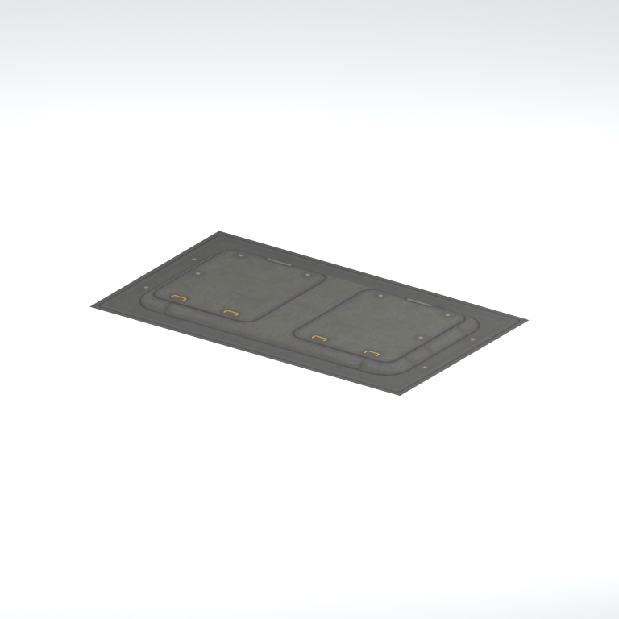
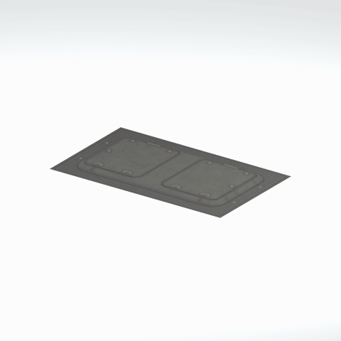

# Unidentified model (cm_mtbs_htch002)

Native model reference; a readable object identification has not been reviewed.

[Library](../README.md) | [Category](../tables/unclassified-components-1.md) | [Source / advanced data](../catalogue.json) | [Credits](../sources-and-credits.md)

**Game filename:** cm_mtbs_htch002.fmdl  
**Category:** Unclassified &gt; Unclassified components  
**Variant:** No explicit variant token; **LOD:** 0  
**Tags:** 

## Still reference



## 360-degree reference



The camera circles a static model. This is not a native animation. Source base textures and UVs use approximate studio shading; interaction, collision, complete assembly and FOX shader equivalence are not established.

## Identity and naming

| Field | Value |
|---|---|
| Library ID | mgsv-tpp-cm_mtbs_htch002-84bc1e26bdffa583 |
| Naming status | unidentified |
| Naming confidence | unknown |
| Naming evidence | {} |
| Native model | /Assets/tpp/common_source/environ/mother_base/cm_mtbs_htch002/scenes/cm_mtbs_htch002.fmdl |
| Model SHA256 | 523cf8c49f49f1e28f7e4659b7ad04068a3ff9818313b3c2f420ee011c119f98 |
| Container | /Assets/tpp/pack/location/mtbs/pack_unique/mtbs_unique_0000.fpk |
| Container SHA256 | 05e9eb2302282ce7adea2eba11e56c0491ec126d7ec1b048b5bb0e53b15ea973 |
| Captured source / location scope | Selected native member/content and captured installed-source chain; full archive SHA/runtime priority unresolved |
| Raw record SHA256 | 9ca906e82559ba242b258f0223ab892b020f4610981c5358dd6d86cdab2e9f55 |

Naming review is descriptive metadata only. It does not change model completion or identify a working game interaction.

## Native LOD inventory

| Native LOD | Triangles | Preview status | Decoded indices SHA256 |
|---|---:|---|---|
| 0 | 56 | rendered | 53b1bedbe5667aa84b3298ac1e8a8b05c3db2c784e46167cd80b3f0d6f6a1346 |
| 1 | 44 | not separately rendered | ae65d1159604442eb69c36bc033d039d970388dfbff6d3fd16f2412416738427 |
| 2 | 38 | not separately rendered | 6c2398e5e5cbbc9c858745e809e22211c3bcb54a483d32bb109db438f44ca710 |
| 3 | 32 | not separately rendered | 3da53317df1670e13fd74332d414ad968f42fafcb7605176da1b5946193e1e9f |

Mesh detail and texture pixels/mips are separate. Index hashes describe decoded triangle arrays, not packed index-buffer bytes. Only source-recorded native levels are listed.

<details>
<summary>Texture, source and naming technical metadata</summary>

```json
{
  "source": {
    "nativePath": "/Assets/tpp/common_source/environ/mother_base/cm_mtbs_htch002/scenes/cm_mtbs_htch002.fmdl",
    "nativeSha256": "523cf8c49f49f1e28f7e4659b7ad04068a3ff9818313b3c2f420ee011c119f98",
    "stableIdentity": "/assets/tpp/common_source/environ/mother_base/cm_mtbs_htch002/scenes/cm_mtbs_htch002.fmdl#523cf8c49f49f1e28f7e4659b7ad04068a3ff9818313b3c2f420ee011c119f98#2d20ed2a663f6ed461276349903f50fcf9dbc2cb5f8c1686e236747c15ae93de",
    "container": {
      "nativePath": "/Assets/tpp/pack/location/mtbs/pack_unique/mtbs_unique_0000.fpk",
      "sha256": "05e9eb2302282ce7adea2eba11e56c0491ec126d7ec1b048b5bb0e53b15ea973",
      "status": "Selected installed-source container/member chain captured by community reader"
    },
    "historicalDatOrigin": null,
    "sourceArchiveAtCapture": "master/0/00.dat",
    "locationStatus": "Selected native member/content and captured installed-source chain; full archive SHA/runtime priority unresolved",
    "currentInstalledDatVerified": false,
    "selectedInstalledMemberVerified": true,
    "evidence": {
      "archive_helper_executable_sha256": "6f8e39a436af3b024bbd0504966ab3d5d9d0cb05d86689bf3e83d15e68df613f",
      "archive_helper_source_sha256": "f662d3b63e066a0afc77ffe22ea0e564222d14469648300dba2c4f8e9b43446b",
      "archive_index_recipe": "54acff767f08d76ad6056c5387328759bc883df507788f398de6c2c04fac12db",
      "archive_reader": "Atvaark GzsTool.Core 0.5.3",
      "archive_reader_core_sha256": "9da447ae3c375cce2e46744eeff6af50f1591062afdf479d1a0b49edb47daaa3",
      "archive_tool_and_dictionary_sha256": {
        "CityHash.dll": "def6c4506d461b65e4059b2936b2cbd5f852ba5d1d8a1a527f1c0e6dc7008c8f",
        "GzsTool.Core.dll": "9da447ae3c375cce2e46744eeff6af50f1591062afdf479d1a0b49edb47daaa3",
        "GzsTool.exe": "1a9c5b11e2355383ff485aee7e86abc026f5c1fad729daf8c0fd15ee0aae1c10",
        "Zlib.Portable.dll": "fe84781ba35ca9cc5ff5f73fd08d2a66c59e5257b4573f5fe59743f30bf78e42",
        "fpk_dictionary.txt": "b82f9a8d6c10a68ba9471eca9d815c21355a53b5e68753d8ad7db7fd01bf401d",
        "qar_dictionary.txt": "1558c248ed0a4bb827888261563fbb91a2df4f03999682f85d637ff70d9d5fb2"
      },
      "bytes": 3040,
      "container_chain": [
        {
          "content_sha256": null,
          "depth": 0,
          "id": "3f19555d27c2ebecdfbad26aadd88b9f62e9fb6092c04c712963ef73c67ccb42",
          "index_sha256": "9acd3675d6e1500e0e18430cba0fdc70a5718ad7d6b62f13905891a35d59f18a",
          "kind": "qar",
          "name": "master/0/00.dat",
          "parent_occurrence": null
        },
        {
          "content_sha256": "05e9eb2302282ce7adea2eba11e56c0491ec126d7ec1b048b5bb0e53b15ea973",
          "depth": 1,
          "id": "c3ab5fa547baaffedfde55b3ee16e80d27d1292dbcd112cdacf9f6df9636fa05",
          "index_sha256": "928b49f622f602c9f072128a474d48284d69db58dcefe051f7208d409d281da8",
          "kind": "fpk",
          "name": "/Assets/tpp/pack/location/mtbs/pack_unique/mtbs_unique_0000.fpk",
          "parent_occurrence": "b1758feccee5d490a240d2195c2364fd70bf1375302a76cb3fd5e1d2a4af2c77"
        }
      ],
      "contentSha256": "523cf8c49f49f1e28f7e4659b7ad04068a3ff9818313b3c2f420ee011c119f98",
      "member": {
        "actual_size": 3040,
        "compressed_size": null,
        "content_sha256": "523cf8c49f49f1e28f7e4659b7ad04068a3ff9818313b3c2f420ee011c119f98",
        "declared_size": 3040,
        "extension": "fmdl",
        "hash_hex": null,
        "name": "/Assets/tpp/common_source/environ/mother_base/cm_mtbs_htch002/scenes/cm_mtbs_htch002.fmdl",
        "name_origin": "embedded",
        "offset": 601264,
        "ordinal": 6,
        "path_hash": null,
        "resolved": 1
      },
      "occurrenceId": "83c3fd61a51aeb241cf63598237528324dc590c2751a6fac69d04055a2a870a5",
      "occurrence_id": "83c3fd61a51aeb241cf63598237528324dc590c2751a6fac69d04055a2a870a5",
      "primary_source_revision": "fc4a8196555638c6cf8aa1b7c8dc34ccd5c69cb5",
      "source_adapter": "community_core_selective_export",
      "source_id": "7f6bb743fb4c487f0e9522f9c7fac280c46cf6b1051e0fc75a93602c8eb451f0",
      "source_path": "master/0/00.dat",
      "source_snapshot": "{\"bytes\":768788480,\"device\":621747392682911458,\"file_id\":844424931596481,\"header_sha256\":\"ead50f0a9a37e4285323b9c6fa0ec75fe75e518c63147e63158eeb2892c6589e\",\"mtime_ns\":1791852224238580700}",
      "virtualPath": "/Assets/tpp/common_source/environ/mother_base/cm_mtbs_htch002/scenes/cm_mtbs_htch002.fmdl"
    }
  },
  "materials": [
    {
      "sampler": "Base_Tex_SRGB",
      "materialIndex": 0,
      "nativePathHash": "1543125936188490038",
      "nativeVirtualPath": null,
      "nativeBinding": {
        "familyId": "d8f6798404aa69d2e2b9802b4c23e95544562a7c5981987fdcda2cfd3aef70f8",
        "height": 512,
        "materialIndex": 0,
        "mipCount": 8,
        "nativeMipCountVerified": true,
        "nativePath": null,
        "nativePathHash": "1543125936188490038",
        "nativeTexture": {
          "additionalFtexsFileCount": 2,
          "depth": 1,
          "ftexsFileCount": 3,
          "height": 512,
          "metadataBytes": 192,
          "mipCount": 8,
          "mips": [
            {
              "chunks": 8,
              "decodedBytes": 131072,
              "mip": 0,
              "offset": 0,
              "storedBytes": 77904,
              "streamNumber": 3
            },
            {
              "chunks": 2,
              "decodedBytes": 32768,
              "mip": 1,
              "offset": 0,
              "storedBytes": 19312,
              "streamNumber": 2
            },
            {
              "chunks": 1,
              "decodedBytes": 8192,
              "mip": 2,
              "offset": 1912,
              "storedBytes": 4752,
              "streamNumber": 1
            },
            {
              "chunks": 1,
              "decodedBytes": 2048,
              "mip": 3,
              "offset": 624,
              "storedBytes": 1280,
              "streamNumber": 1
            },
            {
              "chunks": 1,
              "decodedBytes": 512,
              "mip": 4,
              "offset": 216,
              "storedBytes": 400,
              "streamNumber": 1
            },
            {
              "chunks": 1,
              "decodedBytes": 128,
              "mip": 5,
              "offset": 80,
              "storedBytes": 128,
              "streamNumber": 1
            },
            {
              "chunks": 1,
              "decodedBytes": 32,
              "mip": 6,
              "offset": 24,
              "storedBytes": 48,
              "streamNumber": 1
            },
            {
              "chunks": 1,
              "decodedBytes": 8,
              "mip": 7,
              "offset": 0,
              "storedBytes": 16,
              "streamNumber": 1
            }
          ],
          "nativeHeaderHash": "8ded4cde8533e79d88f3907434d8e346",
          "nrtFlag": 2,
          "pixelFormat": 2,
          "requiredStreamNumbers": [
            1,
            2,
            3
          ],
          "textureType": 16777219,
          "unknownFlags": 273,
          "width": 512
        },
        "samplerName": "Base_Tex_SRGB",
        "samplerNameHash": "72475356961633",
        "sha256": "bce455e563bcac214c5308aa7196e62418626c648855b3e399ae2c7bcb0a7376",
        "sourceOccurrences": [
          {
            "archive_helper_executable_sha256": "6f8e39a436af3b024bbd0504966ab3d5d9d0cb05d86689bf3e83d15e68df613f",
            "archive_helper_source_sha256": "f662d3b63e066a0afc77ffe22ea0e564222d14469648300dba2c4f8e9b43446b",
            "archive_index_recipe": "54acff767f08d76ad6056c5387328759bc883df507788f398de6c2c04fac12db",
            "archive_reader": "Atvaark GzsTool.Core 0.5.3",
            "archive_reader_core_sha256": "9da447ae3c375cce2e46744eeff6af50f1591062afdf479d1a0b49edb47daaa3",
            "archive_tool_and_dictionary_sha256": {
              "CityHash.dll": "def6c4506d461b65e4059b2936b2cbd5f852ba5d1d8a1a527f1c0e6dc7008c8f",
              "GzsTool.Core.dll": "9da447ae3c375cce2e46744eeff6af50f1591062afdf479d1a0b49edb47daaa3",
              "GzsTool.exe": "1a9c5b11e2355383ff485aee7e86abc026f5c1fad729daf8c0fd15ee0aae1c10",
              "Zlib.Portable.dll": "fe84781ba35ca9cc5ff5f73fd08d2a66c59e5257b4573f5fe59743f30bf78e42",
              "fpk_dictionary.txt": "b82f9a8d6c10a68ba9471eca9d815c21355a53b5e68753d8ad7db7fd01bf401d",
              "qar_dictionary.txt": "1558c248ed0a4bb827888261563fbb91a2df4f03999682f85d637ff70d9d5fb2"
            },
            "bytes": 192,
            "container_chain": [
              {
                "content_sha256": null,
                "depth": 0,
                "id": "06035c7f54d1fe3fde25c93eb85d5278f37457e9730b7b0dc0553ea567520e6d",
                "index_sha256": "be525e8d33187ab76b3f97935035faac60a4c7ca7fcff3401a0ce712f03c285e",
                "kind": "qar",
                "name": "master/texture3.dat",
                "parent_occurrence": null
              }
            ],
            "contentSha256": "59965b27a7a48c37f17b482fac6c995f5e7dbff03d2e94bf61ea5d00d324a545",
            "member": {
              "actual_size": 192,
              "compressed_size": 192,
              "content_sha256": "59965b27a7a48c37f17b482fac6c995f5e7dbff03d2e94bf61ea5d00d324a545",
              "declared_size": 192,
              "extension": "ftex",
              "hash_hex": "156a48dcf6350136",
              "name": "248dcf6350136.ftex",
              "name_origin": "hash_fallback",
              "offset": 645358624,
              "ordinal": 3899,
              "path_hash": "248dcf6350136",
              "resolved": 0
            },
            "occurrenceId": "1ead007ea8d2ca89d580aca7d3264a759629ed39121af5a286a3db6cc403ee03",
            "occurrence_id": "1ead007ea8d2ca89d580aca7d3264a759629ed39121af5a286a3db6cc403ee03",
            "primary_source_revision": "fc4a8196555638c6cf8aa1b7c8dc34ccd5c69cb5",
            "source_adapter": "community_core_selective_export",
            "source_id": "8d93a1c4a39e41ca988ccdecf8dbaa5fa7e6f9f82b75bea9a691d2b01de50ef8",
            "source_path": "master/texture3.dat",
            "source_snapshot": "{\"bytes\":1297381376,\"device\":621747392682911458,\"file_id\":562949953639627,\"header_sha256\":\"55c07d7fb3cb3498d10fa3bed93a81ce330553a903fff3222b5bf307bcc7ef0c\",\"mtime_ns\":1791224675561235200}",
            "virtualPath": "248dcf6350136.ftex"
          },
          {
            "archive_helper_executable_sha256": "6f8e39a436af3b024bbd0504966ab3d5d9d0cb05d86689bf3e83d15e68df613f",
            "archive_helper_source_sha256": "f662d3b63e066a0afc77ffe22ea0e564222d14469648300dba2c4f8e9b43446b",
            "archive_index_recipe": "54acff767f08d76ad6056c5387328759bc883df507788f398de6c2c04fac12db",
            "archive_reader": "Atvaark GzsTool.Core 0.5.3",
            "archive_reader_core_sha256": "9da447ae3c375cce2e46744eeff6af50f1591062afdf479d1a0b49edb47daaa3",
            "archive_tool_and_dictionary_sha256": {
              "CityHash.dll": "def6c4506d461b65e4059b2936b2cbd5f852ba5d1d8a1a527f1c0e6dc7008c8f",
              "GzsTool.Core.dll": "9da447ae3c375cce2e46744eeff6af50f1591062afdf479d1a0b49edb47daaa3",
              "GzsTool.exe": "1a9c5b11e2355383ff485aee7e86abc026f5c1fad729daf8c0fd15ee0aae1c10",
              "Zlib.Portable.dll": "fe84781ba35ca9cc5ff5f73fd08d2a66c59e5257b4573f5fe59743f30bf78e42",
              "fpk_dictionary.txt": "b82f9a8d6c10a68ba9471eca9d815c21355a53b5e68753d8ad7db7fd01bf401d",
              "qar_dictionary.txt": "1558c248ed0a4bb827888261563fbb91a2df4f03999682f85d637ff70d9d5fb2"
            },
            "bytes": 6672,
            "container_chain": [
              {
                "content_sha256": null,
                "depth": 0,
                "id": "06035c7f54d1fe3fde25c93eb85d5278f37457e9730b7b0dc0553ea567520e6d",
                "index_sha256": "be525e8d33187ab76b3f97935035faac60a4c7ca7fcff3401a0ce712f03c285e",
                "kind": "qar",
                "name": "master/texture3.dat",
                "parent_occurrence": null
              }
            ],
            "contentSha256": "bbbcb13a0b40e3fbd3e575d38a10c746d7f268a98ae6c58503630f5682ecafa8",
            "member": {
              "actual_size": 6672,
              "compressed_size": 6672,
              "content_sha256": "bbbcb13a0b40e3fbd3e575d38a10c746d7f268a98ae6c58503630f5682ecafa8",
              "declared_size": 6672,
              "extension": "1.ftexs",
              "hash_hex": "b2c248dcf6350136",
              "name": "248dcf6350136.1.ftexs",
              "name_origin": "hash_fallback",
              "offset": 645253152,
              "ordinal": 3896,
              "path_hash": "248dcf6350136",
              "resolved": 0
            },
            "occurrenceId": "5896b290120044e79aa09343a1f20061371efb4c141aa4b15d6160d836359c80",
            "occurrence_id": "5896b290120044e79aa09343a1f20061371efb4c141aa4b15d6160d836359c80",
            "primary_source_revision": "fc4a8196555638c6cf8aa1b7c8dc34ccd5c69cb5",
            "source_adapter": "community_core_selective_export",
            "source_id": "8d93a1c4a39e41ca988ccdecf8dbaa5fa7e6f9f82b75bea9a691d2b01de50ef8",
            "source_path": "master/texture3.dat",
            "source_snapshot": "{\"bytes\":1297381376,\"device\":621747392682911458,\"file_id\":562949953639627,\"header_sha256\":\"55c07d7fb3cb3498d10fa3bed93a81ce330553a903fff3222b5bf307bcc7ef0c\",\"mtime_ns\":1791224675561235200}",
            "virtualPath": "248dcf6350136.1.ftexs"
          },
          {
            "archive_helper_executable_sha256": "6f8e39a436af3b024bbd0504966ab3d5d9d0cb05d86689bf3e83d15e68df613f",
            "archive_helper_source_sha256": "f662d3b63e066a0afc77ffe22ea0e564222d14469648300dba2c4f8e9b43446b",
            "archive_index_recipe": "54acff767f08d76ad6056c5387328759bc883df507788f398de6c2c04fac12db",
            "archive_reader": "Atvaark GzsTool.Core 0.5.3",
            "archive_reader_core_sha256": "9da447ae3c375cce2e46744eeff6af50f1591062afdf479d1a0b49edb47daaa3",
            "archive_tool_and_dictionary_sha256": {
              "CityHash.dll": "def6c4506d461b65e4059b2936b2cbd5f852ba5d1d8a1a527f1c0e6dc7008c8f",
              "GzsTool.Core.dll": "9da447ae3c375cce2e46744eeff6af50f1591062afdf479d1a0b49edb47daaa3",
              "GzsTool.exe": "1a9c5b11e2355383ff485aee7e86abc026f5c1fad729daf8c0fd15ee0aae1c10",
              "Zlib.Portable.dll": "fe84781ba35ca9cc5ff5f73fd08d2a66c59e5257b4573f5fe59743f30bf78e42",
              "fpk_dictionary.txt": "b82f9a8d6c10a68ba9471eca9d815c21355a53b5e68753d8ad7db7fd01bf401d",
              "qar_dictionary.txt": "1558c248ed0a4bb827888261563fbb91a2df4f03999682f85d637ff70d9d5fb2"
            },
            "bytes": 19328,
            "container_chain": [
              {
                "content_sha256": null,
                "depth": 0,
                "id": "1cc220d9409d7163b6aca295ed89fd8c7befca6a8f849a8d5d09a2499724c863",
                "index_sha256": "5a818609a652a10d90fb90015661d0cb80898096bbb3aac36382172988d8736d",
                "kind": "qar",
                "name": "master/texture5_mgo0.dat",
                "parent_occurrence": null
              }
            ],
            "contentSha256": "56be6dbe03a98e50c850bc15e8b309eba841fdf985c98a149cce251bb97e9158",
            "member": {
              "actual_size": 19328,
              "compressed_size": 19328,
              "content_sha256": "56be6dbe03a98e50c850bc15e8b309eba841fdf985c98a149cce251bb97e9158",
              "declared_size": 19328,
              "extension": "2.ftexs",
              "hash_hex": "b57248dcf6350136",
              "name": "248dcf6350136.2.ftexs",
              "name_origin": "hash_fallback",
              "offset": 2713560096,
              "ordinal": 9801,
              "path_hash": "248dcf6350136",
              "resolved": 0
            },
            "occurrenceId": "88f176b392b18945d10e5e10fc823acbe264e6272241d5cb27b5c61e2d601125",
            "occurrence_id": "88f176b392b18945d10e5e10fc823acbe264e6272241d5cb27b5c61e2d601125",
            "primary_source_revision": "fc4a8196555638c6cf8aa1b7c8dc34ccd5c69cb5",
            "source_adapter": "community_core_selective_export",
            "source_id": "24f8989ccaae47940dc20e54ba67442ad562ac0032ab6e3d475e927c81444b56",
            "source_path": "master/texture5_mgo0.dat",
            "source_snapshot": "{\"bytes\":4492370944,\"device\":621747392682911458,\"file_id\":13510798883237422,\"header_sha256\":\"6108fbacb65c84d041742c39e5ca630745240453b336f1059a13b91943f0b011\",\"mtime_ns\":1791224675562234400}",
            "virtualPath": "248dcf6350136.2.ftexs"
          },
          {
            "archive_helper_executable_sha256": "6f8e39a436af3b024bbd0504966ab3d5d9d0cb05d86689bf3e83d15e68df613f",
            "archive_helper_source_sha256": "f662d3b63e066a0afc77ffe22ea0e564222d14469648300dba2c4f8e9b43446b",
            "archive_index_recipe": "54acff767f08d76ad6056c5387328759bc883df507788f398de6c2c04fac12db",
            "archive_reader": "Atvaark GzsTool.Core 0.5.3",
            "archive_reader_core_sha256": "9da447ae3c375cce2e46744eeff6af50f1591062afdf479d1a0b49edb47daaa3",
            "archive_tool_and_dictionary_sha256": {
              "CityHash.dll": "def6c4506d461b65e4059b2936b2cbd5f852ba5d1d8a1a527f1c0e6dc7008c8f",
              "GzsTool.Core.dll": "9da447ae3c375cce2e46744eeff6af50f1591062afdf479d1a0b49edb47daaa3",
              "GzsTool.exe": "1a9c5b11e2355383ff485aee7e86abc026f5c1fad729daf8c0fd15ee0aae1c10",
              "Zlib.Portable.dll": "fe84781ba35ca9cc5ff5f73fd08d2a66c59e5257b4573f5fe59743f30bf78e42",
              "fpk_dictionary.txt": "b82f9a8d6c10a68ba9471eca9d815c21355a53b5e68753d8ad7db7fd01bf401d",
              "qar_dictionary.txt": "1558c248ed0a4bb827888261563fbb91a2df4f03999682f85d637ff70d9d5fb2"
            },
            "bytes": 77968,
            "container_chain": [
              {
                "content_sha256": null,
                "depth": 0,
                "id": "06035c7f54d1fe3fde25c93eb85d5278f37457e9730b7b0dc0553ea567520e6d",
                "index_sha256": "be525e8d33187ab76b3f97935035faac60a4c7ca7fcff3401a0ce712f03c285e",
                "kind": "qar",
                "name": "master/texture3.dat",
                "parent_occurrence": null
              }
            ],
            "contentSha256": "fe4cee498432be243806847bb95f0206892d73a80a7e4cba88a41d656e369151",
            "member": {
              "actual_size": 77968,
              "compressed_size": 77968,
              "content_sha256": "fe4cee498432be243806847bb95f0206892d73a80a7e4cba88a41d656e369151",
              "declared_size": 77968,
              "extension": "3.ftexs",
              "hash_hex": "571a48dcf6350136",
              "name": "248dcf6350136.3.ftexs",
              "name_origin": "hash_fallback",
              "offset": 645279776,
              "ordinal": 3898,
              "path_hash": "248dcf6350136",
              "resolved": 0
            },
            "occurrenceId": "239cc0cf6f9754b0716e85c32cdec44add7343733d96a4b1af551bf90282ac86",
            "occurrence_id": "239cc0cf6f9754b0716e85c32cdec44add7343733d96a4b1af551bf90282ac86",
            "primary_source_revision": "fc4a8196555638c6cf8aa1b7c8dc34ccd5c69cb5",
            "source_adapter": "community_core_selective_export",
            "source_id": "8d93a1c4a39e41ca988ccdecf8dbaa5fa7e6f9f82b75bea9a691d2b01de50ef8",
            "source_path": "master/texture3.dat",
            "source_snapshot": "{\"bytes\":1297381376,\"device\":621747392682911458,\"file_id\":562949953639627,\"header_sha256\":\"55c07d7fb3cb3498d10fa3bed93a81ce330553a903fff3222b5bf307bcc7ef0c\",\"mtime_ns\":1791224675561235200}",
            "virtualPath": "248dcf6350136.3.ftexs"
          }
        ],
        "width": 512
      },
      "ddsSha256": "bce455e563bcac214c5308aa7196e62418626c648855b3e399ae2c7bcb0a7376",
      "dimensions": [
        512,
        512
      ],
      "mipCount": 8,
      "nativeMipCountVerified": true,
      "connectedInPreview": true
    }
  ],
  "quality": {
    "decodedIndicesHashDerivation": "SHA256 of canonical UTF-8 JSON decoded triangle indices grouped by mesh; not packed buffer bytes",
    "highestRetainedGeometricLod": 0,
    "distinctNativeLods": 4,
    "baseTextureDimensions": [
      512,
      512
    ],
    "baseTextureNativeMipCount": 8,
    "largerRetainedBaseTextureFound": null,
    "nativeLods": [
      {
        "indicesSha256": "53b1bedbe5667aa84b3298ac1e8a8b05c3db2c784e46167cd80b3f0d6f6a1346",
        "nativeLod": 0,
        "triangles": 56
      },
      {
        "indicesSha256": "ae65d1159604442eb69c36bc033d039d970388dfbff6d3fd16f2412416738427",
        "nativeLod": 1,
        "triangles": 44
      },
      {
        "indicesSha256": "6c2398e5e5cbbc9c858745e809e22211c3bcb54a483d32bb109db438f44ca710",
        "nativeLod": 2,
        "triangles": 38
      },
      {
        "indicesSha256": "3da53317df1670e13fd74332d414ad968f42fafcb7605176da1b5946193e1e9f",
        "nativeLod": 3,
        "triangles": 32
      }
    ],
    "renderedNativeLods": [
      0
    ],
    "baseTextureSummary": "512 x 512; 8 native/DDS mips",
    "highestDetailScope": "Triangle-count comparison within captured FMDL only"
  }
}
```

</details>

[Original source / advanced record](../catalogue.json)
