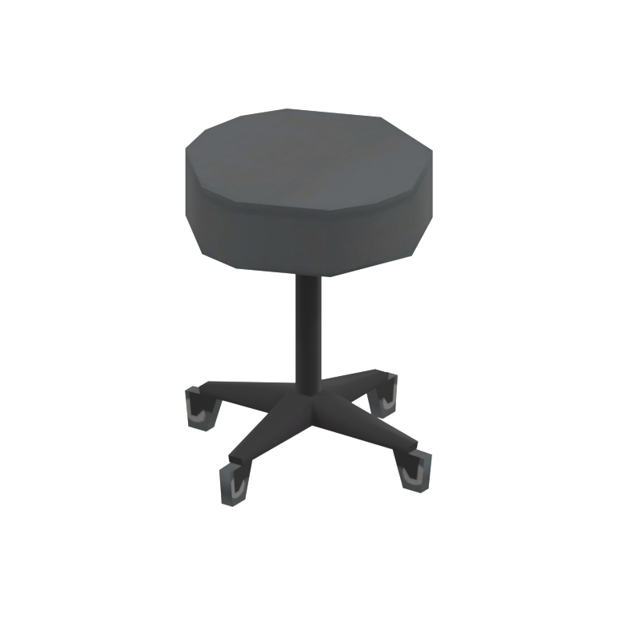
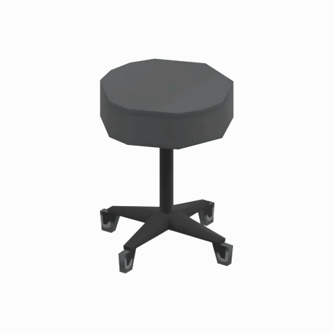

# Rolling stool

A round padded stool on a five-caster base, shown as a static reference for medical or workshop seating.

[Library](../README.md) | [Category](../tables/seating-1.md) | [Source / advanced data](../catalogue.json) | [Credits](../sources-and-credits.md)

**Game filename:** cypr_char001.fmdl  
**Category:** Furniture &gt; Seating  
**Variant:** No explicit variant token; **LOD:** 2  
**Tags:** stool, rolling-stool, seating, furniture, medical, casters, paz-room, cyprus

## Still reference



## 360-degree reference



The camera circles a static model. This is not a native animation. Source base textures and UVs use approximate studio shading; interaction, collision, complete assembly and FOX shader equivalence are not established.

## Identity and naming

| Field | Value |
|---|---|
| Library ID | mgsv-tpp-cypr_char001-af15e4cfc6f2-lod2 |
| Naming status | reviewed |
| Naming confidence | high |
| Naming evidence | {"kind": "accepted-existing", "native_path": "/Assets/tpp/environ/object/cyprus/chair/cypr_char001/scenes/cypr_char001.fmdl", "note": "Original accepted display name, category, subcategory, description and tags retained exactly; no relabeling.", "source": "media/asset-previews/2026-10-16-seating/mgsv-tpp-cypr_char001-af15e4cfc6f2.png"} |
| Native model | /Assets/tpp/environ/object/cyprus/chair/cypr_char001/scenes/cypr_char001.fmdl |
| Model SHA256 | af15e4cfc6f2ef15b7fb4c310157deeb3c23236d9956abb5ce62d2eb48ca9128 |
| Container | /Assets/tpp/pack/location/mtbs/pack_unique/mtbs_unique_0040.fpk |
| Container SHA256 | 6ca583eb49087f8444eb123edee8756504dd48d26a9ab4a27e5c3e775e1f0682 |
| Captured source / location scope | Exact retained native member/container checked; historical outer DAT origin only |
| Raw record SHA256 | 7451e997cbf8a71737c67332a81f3c2f3f58d426fde2f9ff61501a6209e8eb04 |

Naming review is descriptive metadata only. It does not change model completion or identify a working game interaction.

## Native LOD inventory

| Native LOD | Triangles | Preview status | Decoded indices SHA256 |
|---|---:|---|---|
| 0 | 196 | rendered | e1c35dcb4bf6d7a3fa2ae3b47befc3848a8132b1c7cf73ae23cbb274f201f2bf |
| 1 | 160 | rendered | 81130df7c30a815db1f9d787e3582202aa0e1b8d00fff7c59fb6c16222aba6b6 |
| 2 | 140 | rendered | 1c5bd699c7dd2b2d3e5cf5014f4dcc3dfcc4591b9d904b36ae7775a0d115a62d |
| 3 | 128 | rendered | e3ea05cb33f31af5e6a0951da4c41a61fb41b39f1c90c04b7d1ab8de593147b2 |

Mesh detail and texture pixels/mips are separate. Index hashes describe decoded triangle arrays, not packed index-buffer bytes. Only source-recorded native levels are listed.

<details>
<summary>Texture, source and naming technical metadata</summary>

```json
{
  "source": {
    "nativePath": "/Assets/tpp/environ/object/cyprus/chair/cypr_char001/scenes/cypr_char001.fmdl",
    "nativeSha256": "af15e4cfc6f2ef15b7fb4c310157deeb3c23236d9956abb5ce62d2eb48ca9128",
    "stableIdentity": "/assets/tpp/environ/object/cyprus/chair/cypr_char001/scenes/cypr_char001.fmdl#af15e4cfc6f2ef15b7fb4c310157deeb3c23236d9956abb5ce62d2eb48ca9128",
    "container": {
      "nativePath": "/Assets/tpp/pack/location/mtbs/pack_unique/mtbs_unique_0040.fpk",
      "sha256": "6ca583eb49087f8444eb123edee8756504dd48d26a9ab4a27e5c3e775e1f0682",
      "status": "retained FPK payload/path-string and saved member receipt verified"
    },
    "historicalDatOrigin": "master/chunk3.dat",
    "locationStatus": "Exact retained native member/container checked; historical outer DAT origin only",
    "currentInstalledDatVerified": false,
    "dictionaryResolutionRequiredForModelPath": false
  },
  "materials": [
    {
      "sampler": "Base_Tex_SRGB",
      "nativePathHash": "1542909980015461867",
      "nativeVirtualPath": null,
      "ddsSha256": "ca87c815ea318972b4399ff99437d6c223497aca1cd4c9e59e1929deb0aefffd",
      "dimensions": [
        256,
        128
      ],
      "sourceIdentityStatus": "retained native sampler/hash binding; converted DDS content rehashed for this reference",
      "connectedInPreview": true
    },
    {
      "sampler": "NormalMap_Tex_NRM",
      "nativePathHash": "1542783776467754232",
      "nativeVirtualPath": null,
      "ddsSha256": "abc11422a47f210a1ccdf9b5cdb2e79d33f7eaf43cef1930d303d7a973f71bf7",
      "dimensions": [
        256,
        128
      ],
      "sourceIdentityStatus": "retained native sampler/hash binding; converted DDS content rehashed for this reference",
      "connectedInPreview": false
    },
    {
      "sampler": "SpecularMap_Tex_LIN",
      "nativePathHash": "1542816710267766770",
      "nativeVirtualPath": null,
      "ddsSha256": "6c4c5ef0f67fdd20ea6748886664f403450a5e2243bf560d2bec79aa5db1476f",
      "dimensions": [
        256,
        128
      ],
      "sourceIdentityStatus": "retained native sampler/hash binding; converted DDS content rehashed for this reference",
      "connectedInPreview": false
    },
    {
      "sampler": "MatParamMap_Tex_LIN",
      "nativePathHash": "1543086025496588626",
      "nativeVirtualPath": null,
      "ddsSha256": "f1fed95e73fae34e5d42ca5e0fc267a2c94d91c19d56274291b2320f84405a32",
      "dimensions": [
        256,
        128
      ],
      "sourceIdentityStatus": "retained native sampler/hash binding; converted DDS content rehashed for this reference",
      "connectedInPreview": false
    }
  ],
  "quality": {
    "scope": "Retained exact family/source records only; not all-game maximum quality",
    "highestRetainedGeometricLod": 0,
    "distinctNativeLods": 4,
    "baseTextureDimensions": [
      256,
      128
    ],
    "baseTextureNativeMipCount": 7,
    "largerRetainedBaseTextureFound": false,
    "geometryAndTextureQualityAreSeparate": true,
    "shaderFidelity": "Actual base texture/UVs; approximate studio shading; normal/specular/material channels not used",
    "comparisonImage": "media/asset-previews/2026-10-16-seating-quality/mgsv-tpp-cypr_char001-af15e4cfc6f2-lod-comparison.png",
    "variants": [
      {
        "id": "mgsv-tpp-cypr_char001-af15e4cfc6f2-lod0",
        "nativeLod": 0,
        "triangles": 196,
        "qualityLabel": "Highest retained geometric detail",
        "nativeIndicesSha256": "e1c35dcb4bf6d7a3fa2ae3b47befc3848a8132b1c7cf73ae23cbb274f201f2bf",
        "reusesOriginalPreview": true,
        "preview": {
          "still": "media/asset-previews/2026-10-16-seating/mgsv-tpp-cypr_char001-af15e4cfc6f2.png",
          "turntable": "media/asset-previews/2026-10-16-seating/mgsv-tpp-cypr_char001-af15e4cfc6f2-360.gif",
          "thumbnail": "media/asset-previews/2026-10-16-seating/mgsv-tpp-cypr_char001-af15e4cfc6f2-thumb.png",
          "stillDimensions": [
            768,
            768
          ],
          "gifDimensions": [
            480,
            480
          ],
          "thumbnailDimensions": [
            160,
            160
          ],
          "gifFrames": 48,
          "frameDelayMs": 100,
          "durationMs": 4800,
          "loop": 0,
          "angleStepDegrees": 7.5,
          "cameraStartAngleDegrees": 35,
          "cameraOrbitDegrees": 360,
          "nativeAnimation": false,
          "background": "light neutral/white studio",
          "blenderVersion": "5.2.2",
          "textureRendering": "Actual retained base-color DDS/UVs; approximate Principled studio material/lighting",
          "nativeShaderEquivalent": false,
          "media": [
            {
              "name": "mgsv-tpp-cypr_char001-af15e4cfc6f2.png",
              "sha256": "9a9a6b770da85a36a26e1dc4f02a62c262ee1fc91ecc658a2e521583467383c2",
              "bytes": 134239,
              "path": "media/asset-previews/2026-10-16-seating/mgsv-tpp-cypr_char001-af15e4cfc6f2.png"
            },
            {
              "name": "mgsv-tpp-cypr_char001-af15e4cfc6f2-360.gif",
              "sha256": "425e9c0308c6f8d520f7233036886e1ca4237dd449c654abdde970c0c450531d",
              "bytes": 759364,
              "path": "media/asset-previews/2026-10-16-seating/mgsv-tpp-cypr_char001-af15e4cfc6f2-360.gif"
            },
            {
              "name": "mgsv-tpp-cypr_char001-af15e4cfc6f2-thumb.png",
              "sha256": "1d706754b032ababdbd1b644910806ce50f8f1cccfefe50cbdbe2d30ec5925ce",
              "bytes": 8807,
              "path": "media/asset-previews/2026-10-16-seating/mgsv-tpp-cypr_char001-af15e4cfc6f2-thumb.png"
            }
          ]
        }
      },
      {
        "id": "mgsv-tpp-cypr_char001-af15e4cfc6f2-lod1",
        "nativeLod": 1,
        "triangles": 160,
        "qualityLabel": "Reduced geometric detail 1",
        "nativeIndicesSha256": "81130df7c30a815db1f9d787e3582202aa0e1b8d00fff7c59fb6c16222aba6b6",
        "reusesOriginalPreview": false,
        "preview": {
          "still": "media/asset-previews/2026-10-16-seating-quality/mgsv-tpp-cypr_char001-af15e4cfc6f2-lod1.png",
          "turntable": "media/asset-previews/2026-10-16-seating-quality/mgsv-tpp-cypr_char001-af15e4cfc6f2-lod1-360.gif",
          "thumbnail": "media/asset-previews/2026-10-16-seating-quality/mgsv-tpp-cypr_char001-af15e4cfc6f2-lod1-thumb.png",
          "stillDimensions": [
            768,
            768
          ],
          "gifDimensions": [
            480,
            480
          ],
          "thumbnailDimensions": [
            160,
            160
          ],
          "gifFrames": 48,
          "frameDelayMs": 100,
          "durationMs": 4800,
          "loop": 0,
          "nativeAnimation": false,
          "nativeShaderEquivalent": false,
          "media": [
            {
              "name": "mgsv-tpp-cypr_char001-af15e4cfc6f2-lod1.png",
              "sha256": "66dabb389546bd2c7c04f6a044feb73578318ac139b33b31e581e7d27d042c9f",
              "bytes": 131632,
              "path": "media/asset-previews/2026-10-16-seating-quality/mgsv-tpp-cypr_char001-af15e4cfc6f2-lod1.png"
            },
            {
              "name": "mgsv-tpp-cypr_char001-af15e4cfc6f2-lod1-360.gif",
              "sha256": "694299b199436d94bd9c0dc816dbbe0007a6b684bbd1cac8c8ef1004ac5f3bd6",
              "bytes": 744215,
              "path": "media/asset-previews/2026-10-16-seating-quality/mgsv-tpp-cypr_char001-af15e4cfc6f2-lod1-360.gif"
            },
            {
              "name": "mgsv-tpp-cypr_char001-af15e4cfc6f2-lod1-thumb.png",
              "sha256": "9c8f35c985ffd4988d3e577ef0f4cc28da0b693b85a9a596c1f811a59a916f5e",
              "bytes": 8613,
              "path": "media/asset-previews/2026-10-16-seating-quality/mgsv-tpp-cypr_char001-af15e4cfc6f2-lod1-thumb.png"
            }
          ]
        }
      },
      {
        "id": "mgsv-tpp-cypr_char001-af15e4cfc6f2-lod2",
        "nativeLod": 2,
        "triangles": 140,
        "qualityLabel": "Reduced geometric detail 2",
        "nativeIndicesSha256": "1c5bd699c7dd2b2d3e5cf5014f4dcc3dfcc4591b9d904b36ae7775a0d115a62d",
        "reusesOriginalPreview": false,
        "preview": {
          "still": "media/asset-previews/2026-10-16-seating-quality/mgsv-tpp-cypr_char001-af15e4cfc6f2-lod2.png",
          "turntable": "media/asset-previews/2026-10-16-seating-quality/mgsv-tpp-cypr_char001-af15e4cfc6f2-lod2-360.gif",
          "thumbnail": "media/asset-previews/2026-10-16-seating-quality/mgsv-tpp-cypr_char001-af15e4cfc6f2-lod2-thumb.png",
          "stillDimensions": [
            768,
            768
          ],
          "gifDimensions": [
            480,
            480
          ],
          "thumbnailDimensions": [
            160,
            160
          ],
          "gifFrames": 48,
          "frameDelayMs": 100,
          "durationMs": 4800,
          "loop": 0,
          "nativeAnimation": false,
          "nativeShaderEquivalent": false,
          "media": [
            {
              "name": "mgsv-tpp-cypr_char001-af15e4cfc6f2-lod2.png",
              "sha256": "7724ee42b868cee4726dbbc444af6bbae3c3c6b71e730e70eae1bf15d50e5313",
              "bytes": 130121,
              "path": "media/asset-previews/2026-10-16-seating-quality/mgsv-tpp-cypr_char001-af15e4cfc6f2-lod2.png"
            },
            {
              "name": "mgsv-tpp-cypr_char001-af15e4cfc6f2-lod2-360.gif",
              "sha256": "d119a2ebe42905520d115f3e4141a3555bc5733c34206cefa78626106670da37",
              "bytes": 736706,
              "path": "media/asset-previews/2026-10-16-seating-quality/mgsv-tpp-cypr_char001-af15e4cfc6f2-lod2-360.gif"
            },
            {
              "name": "mgsv-tpp-cypr_char001-af15e4cfc6f2-lod2-thumb.png",
              "sha256": "bdd84db18e875fa50c23d071741d30e98e0e7918df4a7d14c2daaa60ca4d9634",
              "bytes": 8603,
              "path": "media/asset-previews/2026-10-16-seating-quality/mgsv-tpp-cypr_char001-af15e4cfc6f2-lod2-thumb.png"
            }
          ]
        }
      },
      {
        "id": "mgsv-tpp-cypr_char001-af15e4cfc6f2-lod3",
        "nativeLod": 3,
        "triangles": 128,
        "qualityLabel": "Reduced geometric detail 3",
        "nativeIndicesSha256": "e3ea05cb33f31af5e6a0951da4c41a61fb41b39f1c90c04b7d1ab8de593147b2",
        "reusesOriginalPreview": false,
        "preview": {
          "still": "media/asset-previews/2026-10-16-seating-quality/mgsv-tpp-cypr_char001-af15e4cfc6f2-lod3.png",
          "turntable": "media/asset-previews/2026-10-16-seating-quality/mgsv-tpp-cypr_char001-af15e4cfc6f2-lod3-360.gif",
          "thumbnail": "media/asset-previews/2026-10-16-seating-quality/mgsv-tpp-cypr_char001-af15e4cfc6f2-lod3-thumb.png",
          "stillDimensions": [
            768,
            768
          ],
          "gifDimensions": [
            480,
            480
          ],
          "thumbnailDimensions": [
            160,
            160
          ],
          "gifFrames": 48,
          "frameDelayMs": 100,
          "durationMs": 4800,
          "loop": 0,
          "nativeAnimation": false,
          "nativeShaderEquivalent": false,
          "media": [
            {
              "name": "mgsv-tpp-cypr_char001-af15e4cfc6f2-lod3.png",
              "sha256": "755745f5fbcf829d004d372bf92ef996ca4b8797929e1bc77da1c22bd01b45a8",
              "bytes": 125419,
              "path": "media/asset-previews/2026-10-16-seating-quality/mgsv-tpp-cypr_char001-af15e4cfc6f2-lod3.png"
            },
            {
              "name": "mgsv-tpp-cypr_char001-af15e4cfc6f2-lod3-360.gif",
              "sha256": "992ba5d44a8a7d8dfe055199de6c548c9c73f2dc6901a8def668e795c563ae7f",
              "bytes": 719020,
              "path": "media/asset-previews/2026-10-16-seating-quality/mgsv-tpp-cypr_char001-af15e4cfc6f2-lod3-360.gif"
            },
            {
              "name": "mgsv-tpp-cypr_char001-af15e4cfc6f2-lod3-thumb.png",
              "sha256": "a574363513153870a3c7b1eb7b8f014e9ffdbb846668233126d1145f012899e8",
              "bytes": 8314,
              "path": "media/asset-previews/2026-10-16-seating-quality/mgsv-tpp-cypr_char001-af15e4cfc6f2-lod3-thumb.png"
            }
          ]
        }
      }
    ],
    "textureBindings": [
      {
        "sampler": "Base_Tex_SRGB",
        "nativePathHash": "1542909980015461867",
        "nativeTexturePath": null,
        "dimensions": [
          256,
          128
        ],
        "nativeMipCount": 7,
        "ddsMipCount": 7,
        "ddsSha256": "ca87c815ea318972b4399ff99437d6c223497aca1cd4c9e59e1929deb0aefffd",
        "ftexHeaderSha256": "dcdefdf1a4d8030b7e722e627d04fb20b0ec3480de62de949b7be51c6e0f5fe2",
        "nativeMipDimensionsFromHeader": [
          [
            256,
            128
          ],
          [
            128,
            64
          ],
          [
            64,
            32
          ],
          [
            32,
            16
          ],
          [
            16,
            8
          ],
          [
            8,
            4
          ],
          [
            4,
            2
          ]
        ],
        "usedInPreview": true,
        "note": "Mip dimensions derived from actual native/DDS header counts; retained chain preserved privately; no mip-level comparison renders"
      },
      {
        "sampler": "NormalMap_Tex_NRM",
        "nativePathHash": "1542783776467754232",
        "nativeTexturePath": null,
        "dimensions": [
          256,
          128
        ],
        "nativeMipCount": 7,
        "ddsMipCount": 7,
        "ddsSha256": "abc11422a47f210a1ccdf9b5cdb2e79d33f7eaf43cef1930d303d7a973f71bf7",
        "ftexHeaderSha256": "e981f1fd4f521d841fec43d00844b2d8edb8433f8cf1b0ed1b24df0249a5a3a1",
        "nativeMipDimensionsFromHeader": [
          [
            256,
            128
          ],
          [
            128,
            64
          ],
          [
            64,
            32
          ],
          [
            32,
            16
          ],
          [
            16,
            8
          ],
          [
            8,
            4
          ],
          [
            4,
            2
          ]
        ],
        "usedInPreview": false,
        "note": "Mip dimensions derived from actual native/DDS header counts; retained chain preserved privately; no mip-level comparison renders"
      },
      {
        "sampler": "SpecularMap_Tex_LIN",
        "nativePathHash": "1542816710267766770",
        "nativeTexturePath": null,
        "dimensions": [
          256,
          128
        ],
        "nativeMipCount": 7,
        "ddsMipCount": 7,
        "ddsSha256": "6c4c5ef0f67fdd20ea6748886664f403450a5e2243bf560d2bec79aa5db1476f",
        "ftexHeaderSha256": "1305129a7f828d0415c1b1a216f9b608018562bb99199797b0edc2d0ed5de97c",
        "nativeMipDimensionsFromHeader": [
          [
            256,
            128
          ],
          [
            128,
            64
          ],
          [
            64,
            32
          ],
          [
            32,
            16
          ],
          [
            16,
            8
          ],
          [
            8,
            4
          ],
          [
            4,
            2
          ]
        ],
        "usedInPreview": false,
        "note": "Mip dimensions derived from actual native/DDS header counts; retained chain preserved privately; no mip-level comparison renders"
      },
      {
        "sampler": "MatParamMap_Tex_LIN",
        "nativePathHash": "1543086025496588626",
        "nativeTexturePath": null,
        "dimensions": [
          256,
          128
        ],
        "nativeMipCount": 7,
        "ddsMipCount": 7,
        "ddsSha256": "f1fed95e73fae34e5d42ca5e0fc267a2c94d91c19d56274291b2320f84405a32",
        "ftexHeaderSha256": "56f27bedd6ec73d3d48a205193322d2cae34588c52befbf99e27d2df627e330a",
        "nativeMipDimensionsFromHeader": [
          [
            256,
            128
          ],
          [
            128,
            64
          ],
          [
            64,
            32
          ],
          [
            32,
            16
          ],
          [
            16,
            8
          ],
          [
            8,
            4
          ],
          [
            4,
            2
          ]
        ],
        "usedInPreview": false,
        "note": "Mip dimensions derived from actual native/DDS header counts; retained chain preserved privately; no mip-level comparison renders"
      }
    ],
    "provenance": "quality-provenance.json"
  }
}
```

</details>

[Original source / advanced record](../catalogue.json)

[Parent reference and LOD comparison](mgsv-tpp-cypr_char001-af15e4cfc6f2.md#native-lod-comparison)
