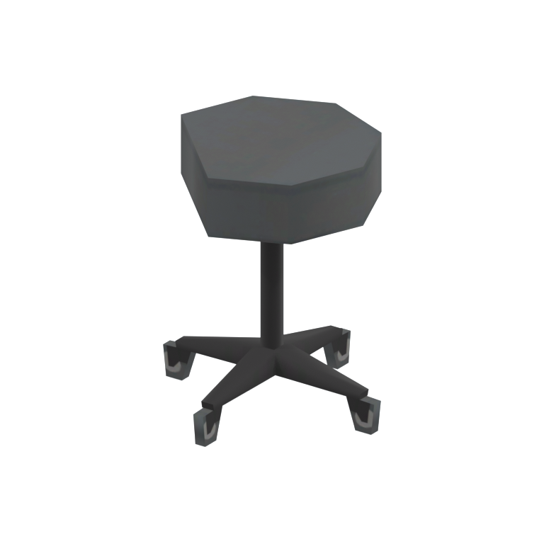
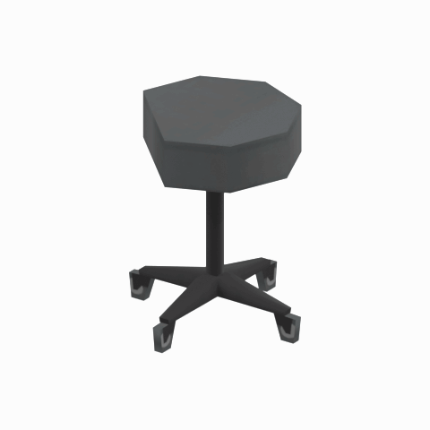

# Rolling stool - LOD3

A round padded stool on a five-caster base, shown as a static reference for medical or workshop seating.

[Rolling stool overview and comparison](mgsv-tpp-cypr_char001-af15e4cfc6f2.md#native-lod-comparison) | [Seating table](../tables/seating-1.md) | [Quality/source evidence](../quality-provenance.json) | [Credits](../sources-and-credits.md)

**LOD3: Reduced geometric detail 3; 128 triangles.** Base texture: 256x128 pixels with 7 native mip levels. This selects a real face set in the same original model; it is not a synthetic simplification or a separate source-model version.

## Still reference

## 360-degree reference

Camera orbit only: 48angles at 7.5-degree increments, 100ms/frame, 4.8-second loop. The asset is static; this is not native animation. Framing/native bounds and base texture are held fixed across all four geometric LODs.

## Source identity

| Field | Value |
|---|---|
| Original native FMDL | `/Assets/tpp/environ/object/cyprus/chair/cypr_char001/scenes/cypr_char001.fmdl` |
| Native FMDL SHA256 | `af15e4cfc6f2ef15b7fb4c310157deeb3c23236d9956abb5ce62d2eb48ca9128` |
| Native LOD | 3 |
| Triangles | 128 |
| Native LOD index bytes SHA256 | `e3ea05cb33f31af5e6a0951da4c41a61fb41b39f1c90c04b7d1ab8de593147b2` |
| Retained FPK | `/Assets/tpp/pack/location/mtbs/pack_unique/mtbs_unique_0040.fpk` |
| Retained FPK SHA256 | `6ca583eb49087f8444eb123edee8756504dd48d26a9ab4a27e5c3e775e1f0682` |
| Historical DAT | `master/chunk3.dat`; current installed DAT content/version unverified |
| Base texture | 256x128 pixels; 7 native mip levels; actual retained content |

Native FMDL LOD index-buffer ranges were directly checked against retained face caches. Identical model copies in other retained containers are deduplicated in the quality/source record. LOD0 is the most detailed by triangle count in this retained family; runtime distance/selection thresholds have not been tested. Mip chains are recorded/preserved privately, not rendered as a LOD-by-mip product.

Game model/textures: Konami. Project owner: arsenal-pt. Authored reference preparation: OpenAI Codex (AI/LLM); [community tool credits](../sources-and-credits.md). Only actual base-color texture/UVs drive approximate studio shading; native normal/specular/material maps are recorded separately. No higher detail was invented, upscaled or subdivided; no FOX shader, physics or native gameplay equivalence is claimed. Original game assets and clean render frames remain private.
