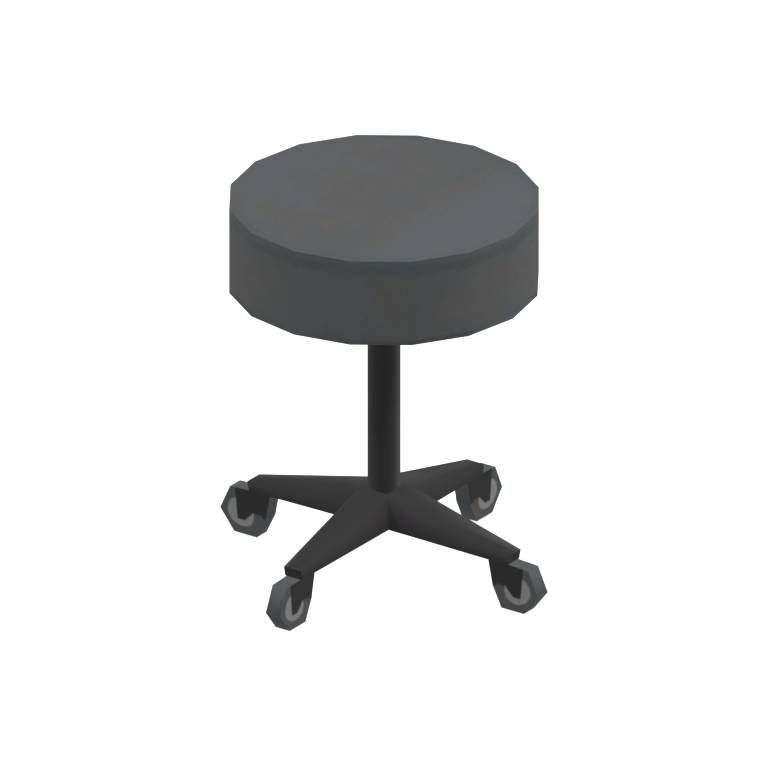
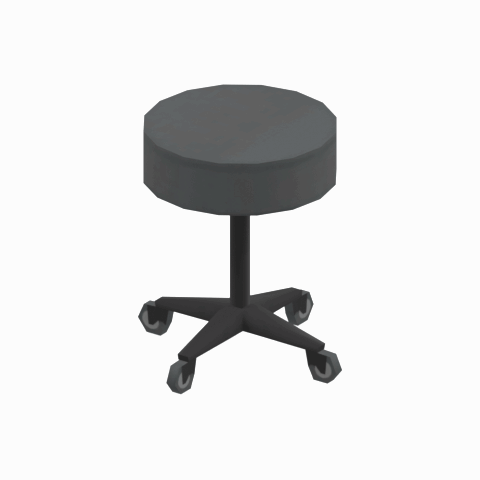
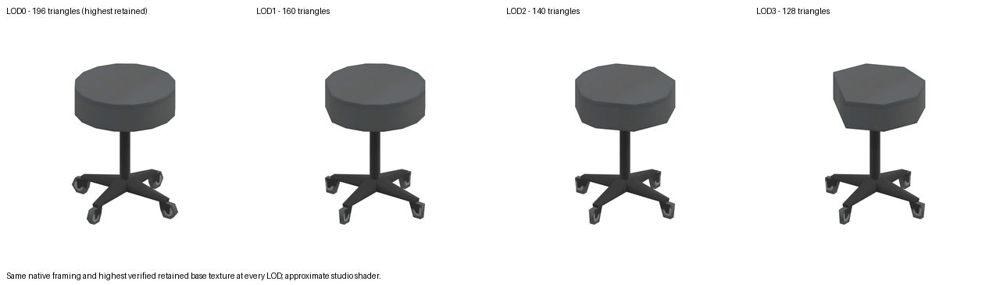
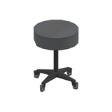
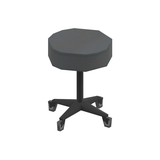
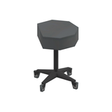

# Rolling stool

A round padded stool on a five-caster base, shown as a static reference for medical or workshop seating.

[Seating table](../tables/seating-1.md) | [Library](../README.md) | [Credits and evidence rules](../sources-and-credits.md)

## Still reference

## 360-degree reference

The camera circles a static model. This is not a native game animation. Actual retained base-color texture/UVs are shown with approximate studio materials and lighting; this is not proof of FOX shader or gameplay equivalence.

## Identity and location

| Field | Value |
|---|---|
| Category | Furniture > Seating |
| Tags | stool, rolling-stool, seating, furniture, medical, casters, paz-room, cyprus |
| Source namespace | cyprus; this does not establish exclusive original use |
| Observed retained use | Retained resident Medical/Paz room static furnishings. |
| Native model | `/Assets/tpp/environ/object/cyprus/chair/cypr_char001/scenes/cypr_char001.fmdl` |
| Native SHA256 | `af15e4cfc6f2ef15b7fb4c310157deeb3c23236d9956abb5ce62d2eb48ca9128` |
| FPK | `/Assets/tpp/pack/location/mtbs/pack_unique/mtbs_unique_0040.fpk` |
| Retained FPK SHA256 | `6ca583eb49087f8444eb123edee8756504dd48d26a9ab4a27e5c3e775e1f0682` |
| Historical DAT origin | `master/chunk3.dat`; current installed DAT unverified |
| Location evidence | Retained indexed member identity plus unique byte-exact FMDL payload and indexed path string in retained FPK; no fresh extraction/current DAT check |
| Selected geometry | LOD0; 196 triangles; native geometry/UV inputs unchanged |
| Native bounds | `[[-0.28547701239585876, 0.0006501000025309622, -0.28547701239585876], [0.28547701239585876, 0.5999996066093445, 0.28547701239585876]]` (native coordinate units) |
| Preview | Blender5.2.2;768px still;480px GIF;48angles/7.5degrees;100ms each;4.8seconds;160px static thumbnail |

## Texture bindings

Bindings below are source metadata. Only the actual base-color texture drives this approximate preview. Native texture virtual paths are unknown where stored by hash; the DDS hashes identify retained converted content, not fabricated game filenames.

| Sampler | Native path hash | Native virtual path | Retained DDS SHA256 | Dimensions |
|---|---|---|---|---|
| Base_Tex_SRGB | `1542909980015461867` | Unknown; hash identity retained | `ca87c815ea318972b4399ff99437d6c223497aca1cd4c9e59e1929deb0aefffd` | 256x128 |
| NormalMap_Tex_NRM | `1542783776467754232` | Unknown; hash identity retained | `abc11422a47f210a1ccdf9b5cdb2e79d33f7eaf43cef1930d303d7a973f71bf7` | 256x128 |
| SpecularMap_Tex_LIN | `1542816710267766770` | Unknown; hash identity retained | `6c4c5ef0f67fdd20ea6748886664f403450a5e2243bf560d2bec79aa5db1476f` | 256x128 |
| MatParamMap_Tex_LIN | `1543086025496588626` | Unknown; hash identity retained | `f1fed95e73fae34e5d42ca5e0fc267a2c94d91c19d56274291b2320f84405a32` | 256x128 |

## Native LOD comparison

All four native face sets use the same source bounds, framing and highest verified retained base-color texture. LOD0 has the most triangles for this model in these retained inputs. Mesh detail is separate from texture resolution and approximate studio shading. No larger retained base version was found; this does not establish absence elsewhere in the game.

| Preview | Native LOD | Geometric detail | Triangles | Base texture | Open selected view |
|---|---|---|---:|---|---|
|  | LOD0 | Highest retained geometric detail | 196 | 256x128; 7 mips | [Existing original reference](#still-reference) |
|  | LOD1 | Reduced geometric detail 1 | 160 | 256x128; 7 mips | [Still and 360-degree view](mgsv-tpp-cypr_char001-af15e4cfc6f2-lod1.md) |
|  | LOD2 | Reduced geometric detail 2 | 140 | 256x128; 7 mips | [Still and 360-degree view](mgsv-tpp-cypr_char001-af15e4cfc6f2-lod2.md) |
|  | LOD3 | Reduced geometric detail 3 | 128 | 256x128; 7 mips | [Still and 360-degree view](mgsv-tpp-cypr_char001-af15e4cfc6f2-lod3.md) |

### Texture channels and mip counts

These native/DDS header sizes are separate from geometric LOD. Only the base map is used in the studio preview; other channels are catalogued rather than treated as engine-perfect shading.

| Channel | Pixels | Native/DDS mip levels | Used in preview |
|---|---|---:|---|
| Base_Tex_SRGB | 256x128 | 7 | Base color only |
| NormalMap_Tex_NRM | 256x128 | 7 | Recorded, not applied |
| SpecularMap_Tex_LIN | 256x128 | 7 | Recorded, not applied |
| MatParamMap_Tex_LIN | 256x128 | 7 | Recorded, not applied |

[Exact native LOD/deduplicated source mappings, texture hashes and declared mip dimensions](../quality-provenance.json). No original textures or geometry are included.

## Attribution and limits

Game model and textures: Konami. Reference preparation is AI/LLM-authored using the established community tool pipeline; see [central credits](../sources-and-credits.md). The repository owner is arsenal-pt. Game artwork is not covered by the original-code license.

Friendly labels and tags come from native folder identity, recorded scene use and reviewed preview appearance. Runtime interaction, folding/rolling/wheel movement, collisions, progression and native material response were not tested. A use tag is a search aid, not a promised mechanic.

No source FMDL, texture, archive, decoded geometry or blend is provided. The [catalogue](../catalogue.json) includes this entry and media hashes; clean frames and original sources remain private.
