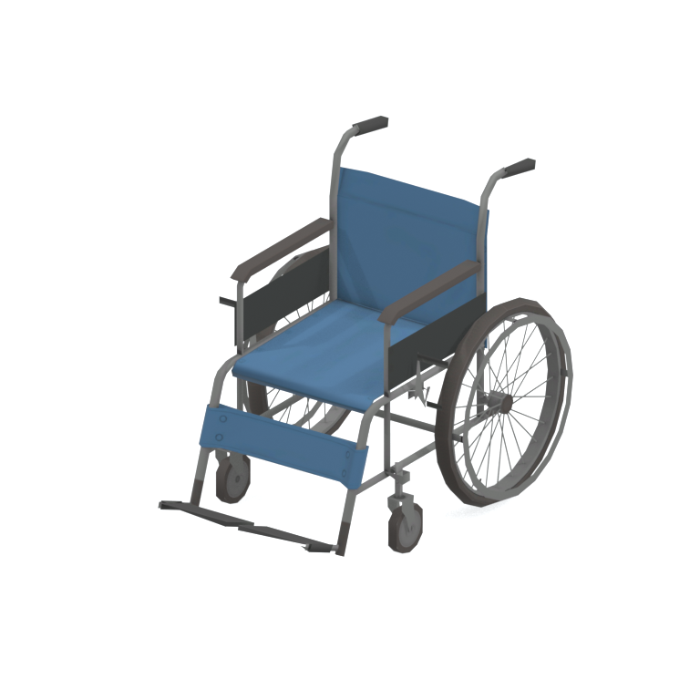
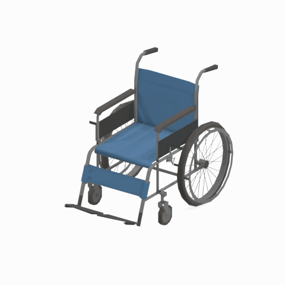

# Wheelchair - LOD2

A blue wheelchair with large rear wheels, push handles and front footrests, shown as a static medical-furniture reference.

[Wheelchair overview and comparison](mgsv-tpp-cypr_whch001-68d6a4c0c875.md#native-lod-comparison) | [Seating table](../tables/seating-1.md) | [Quality/source evidence](../quality-provenance.json) | [Credits](../sources-and-credits.md)

**LOD2: Reduced geometric detail 2; 1384 triangles.** Base texture: 1024x1024 pixels with 9 native mip levels. This selects a real face set in the same original model; it is not a synthetic simplification or a separate source-model version.

## Still reference

## 360-degree reference

Camera orbit only: 48angles at 7.5-degree increments, 100ms/frame, 4.8-second loop. The asset is static; this is not native animation. Framing/native bounds and base texture are held fixed across all four geometric LODs.

## Source identity

| Field | Value |
|---|---|
| Original native FMDL | `/Assets/tpp/environ/object/cyprus/wheelchair/cypr_whch001/scenes/cypr_whch001.fmdl` |
| Native FMDL SHA256 | `68d6a4c0c87566273d3281c7059fbeddf9b6d55252b37eea77495cc338648441` |
| Native LOD | 2 |
| Triangles | 1384 |
| Native LOD index bytes SHA256 | `d734daf9d5868bd66f94485c8e1a49fa2086e1558b2bc7b8c3a6678ca4343120` |
| Retained FPK | `/Assets/tpp/pack/location/mtbs/pack_unique/mtbs_unique_0040.fpk` |
| Retained FPK SHA256 | `6ca583eb49087f8444eb123edee8756504dd48d26a9ab4a27e5c3e775e1f0682` |
| Historical DAT | `master/chunk3.dat`; current installed DAT content/version unverified |
| Base texture | 1024x1024 pixels; 9 native mip levels; actual retained content |

Native FMDL LOD index-buffer ranges were directly checked against retained face caches. Identical model copies in other retained containers are deduplicated in the quality/source record. LOD0 is the most detailed by triangle count in this retained family; runtime distance/selection thresholds have not been tested. Mip chains are recorded/preserved privately, not rendered as a LOD-by-mip product.

Game model/textures: Konami. Project owner: arsenal-pt. Authored reference preparation: OpenAI Codex (AI/LLM); [community tool credits](../sources-and-credits.md). Only actual base-color texture/UVs drive approximate studio shading; native normal/specular/material maps are recorded separately. No higher detail was invented, upscaled or subdivided; no FOX shader, physics or native gameplay equivalence is claimed. Original game assets and clean render frames remain private.
