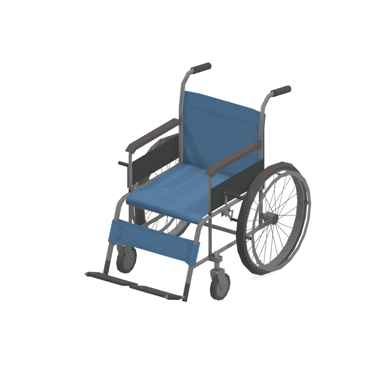
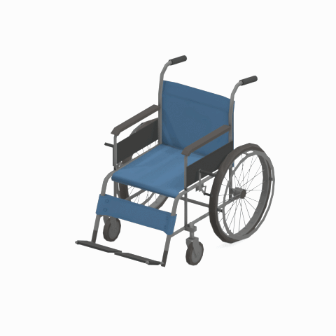
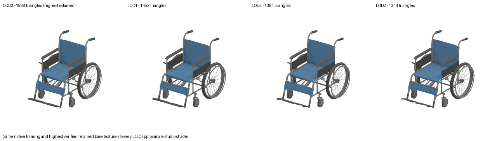
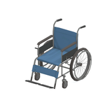
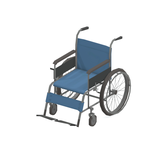

# Wheelchair

A blue wheelchair with large rear wheels, push handles and front footrests, shown as a static medical-furniture reference.

[Library](../README.md) | [Category](../tables/seating-1.md) | [Source / advanced data](../catalogue.json) | [Credits](../sources-and-credits.md)

**Game filename:** cypr_whch001.fmdl  
**Category:** Furniture &gt; Seating  
**Variant:** No explicit variant token; **LOD:** 0  
**Tags:** wheelchair, medical, seating, mobility, blue-upholstery, paz-room, cyprus

## Still reference



## 360-degree reference



The camera circles a static model. This is not a native animation. Source base textures and UVs use approximate studio shading; interaction, collision, complete assembly and FOX shader equivalence are not established.

## Identity and naming

| Field | Value |
|---|---|
| Library ID | mgsv-tpp-cypr_whch001-68d6a4c0c875 |
| Naming status | reviewed |
| Naming confidence | high |
| Naming evidence | {"kind": "accepted-existing", "native_path": "/Assets/tpp/environ/object/cyprus/wheelchair/cypr_whch001/scenes/cypr_whch001.fmdl", "note": "Original accepted display name, category, subcategory, description and tags retained exactly; no relabeling.", "source": "media/asset-previews/2026-10-16-seating/mgsv-tpp-cypr_whch001-68d6a4c0c875.png"} |
| Native model | /Assets/tpp/environ/object/cyprus/wheelchair/cypr_whch001/scenes/cypr_whch001.fmdl |
| Model SHA256 | 68d6a4c0c87566273d3281c7059fbeddf9b6d55252b37eea77495cc338648441 |
| Container | /Assets/tpp/pack/location/mtbs/pack_unique/mtbs_unique_0040.fpk |
| Container SHA256 | 6ca583eb49087f8444eb123edee8756504dd48d26a9ab4a27e5c3e775e1f0682 |
| Captured source / location scope | Exact retained native member/container checked; historical outer DAT origin only |
| Raw record SHA256 | 06f64b0bdcdff32e2ba05fc1e55fea4ca4cdcd51c20da43a92aa9630a315491e |

Naming review is descriptive metadata only. It does not change model completion or identify a working game interaction.

## Native LOD inventory

| Native LOD | Triangles | Preview status | Decoded indices SHA256 |
|---|---:|---|---|
| 0 | 1588 | rendered | da8982e48a06b28ae8b92e673e69561189d4944e8e59a14c32bfd60bb044683e |
| 1 | 1452 | rendered | 79862d7dbbabd48a80ee2f4bc269fe2c997950f3025c9758728d1f3f36b37c74 |
| 2 | 1384 | rendered | d734daf9d5868bd66f94485c8e1a49fa2086e1558b2bc7b8c3a6678ca4343120 |
| 3 | 1344 | rendered | fdf6901544e403ac01f6454b2409bcb582446c2105afdd519b302696c96ff778 |

Mesh detail and texture pixels/mips are separate. Index hashes describe decoded triangle arrays, not packed index-buffer bytes. Only source-recorded native levels are listed.

<details>
<summary>Texture, source and naming technical metadata</summary>

```json
{
  "source": {
    "nativePath": "/Assets/tpp/environ/object/cyprus/wheelchair/cypr_whch001/scenes/cypr_whch001.fmdl",
    "nativeSha256": "68d6a4c0c87566273d3281c7059fbeddf9b6d55252b37eea77495cc338648441",
    "stableIdentity": "/assets/tpp/environ/object/cyprus/wheelchair/cypr_whch001/scenes/cypr_whch001.fmdl#68d6a4c0c87566273d3281c7059fbeddf9b6d55252b37eea77495cc338648441",
    "container": {
      "nativePath": "/Assets/tpp/pack/location/mtbs/pack_unique/mtbs_unique_0040.fpk",
      "sha256": "6ca583eb49087f8444eb123edee8756504dd48d26a9ab4a27e5c3e775e1f0682",
      "status": "retained FPK payload/path-string and saved member receipt verified"
    },
    "historicalDatOrigin": "master/chunk3.dat",
    "locationStatus": "Exact retained native member/container checked; historical outer DAT origin only",
    "currentInstalledDatVerified": false,
    "dictionaryResolutionRequiredForModelPath": false
  },
  "materials": [
    {
      "sampler": "Base_Tex_SRGB",
      "nativePathHash": "1542794976997329743",
      "nativeVirtualPath": null,
      "ddsSha256": "60edb4993e25dd7a2d22ccc7c9845601be9236ca6f60d33f52a84a8aad457f40",
      "dimensions": [
        1024,
        1024
      ],
      "sourceIdentityStatus": "retained native sampler/hash binding; converted DDS content rehashed for this reference",
      "connectedInPreview": true
    },
    {
      "sampler": "NormalMap_Tex_NRM",
      "nativePathHash": "1542752255105725688",
      "nativeVirtualPath": null,
      "ddsSha256": "b51262b24200a77a9cdb0fd16733bf43fd3f8c84c5f2850f94b44001660009c5",
      "dimensions": [
        1024,
        1024
      ],
      "sourceIdentityStatus": "retained native sampler/hash binding; converted DDS content rehashed for this reference",
      "connectedInPreview": false
    },
    {
      "sampler": "SpecularMap_Tex_LIN",
      "nativePathHash": "1542548934547970504",
      "nativeVirtualPath": null,
      "ddsSha256": "1a058399ed921f5c57770ed9b4a7c844d3f08233666449bdb861748a5253bba5",
      "dimensions": [
        1024,
        1024
      ],
      "sourceIdentityStatus": "retained native sampler/hash binding; converted DDS content rehashed for this reference",
      "connectedInPreview": false
    },
    {
      "sampler": "MatParamMap_Tex_LIN",
      "nativePathHash": "1542754739783832592",
      "nativeVirtualPath": null,
      "ddsSha256": "a68d3563596aab885f962266eebdbe1d4477ab09da98e26bd0eea7d452828b3d",
      "dimensions": [
        1024,
        1024
      ],
      "sourceIdentityStatus": "retained native sampler/hash binding; converted DDS content rehashed for this reference",
      "connectedInPreview": false
    }
  ],
  "quality": {
    "scope": "Retained exact family/source records only; not all-game maximum quality",
    "highestRetainedGeometricLod": 0,
    "distinctNativeLods": 4,
    "baseTextureDimensions": [
      1024,
      1024
    ],
    "baseTextureNativeMipCount": 9,
    "largerRetainedBaseTextureFound": false,
    "geometryAndTextureQualityAreSeparate": true,
    "shaderFidelity": "Actual base texture/UVs; approximate studio shading; normal/specular/material channels not used",
    "comparisonImage": "media/asset-previews/2026-10-16-seating-quality/mgsv-tpp-cypr_whch001-68d6a4c0c875-lod-comparison.png",
    "variants": [
      {
        "id": "mgsv-tpp-cypr_whch001-68d6a4c0c875-lod0",
        "nativeLod": 0,
        "triangles": 1588,
        "qualityLabel": "Highest retained geometric detail",
        "nativeIndicesSha256": "da8982e48a06b28ae8b92e673e69561189d4944e8e59a14c32bfd60bb044683e",
        "reusesOriginalPreview": true,
        "preview": {
          "still": "media/asset-previews/2026-10-16-seating/mgsv-tpp-cypr_whch001-68d6a4c0c875.png",
          "turntable": "media/asset-previews/2026-10-16-seating/mgsv-tpp-cypr_whch001-68d6a4c0c875-360.gif",
          "thumbnail": "media/asset-previews/2026-10-16-seating/mgsv-tpp-cypr_whch001-68d6a4c0c875-thumb.png",
          "stillDimensions": [
            768,
            768
          ],
          "gifDimensions": [
            480,
            480
          ],
          "thumbnailDimensions": [
            160,
            160
          ],
          "gifFrames": 48,
          "frameDelayMs": 100,
          "durationMs": 4800,
          "loop": 0,
          "angleStepDegrees": 7.5,
          "cameraStartAngleDegrees": 35,
          "cameraOrbitDegrees": 360,
          "nativeAnimation": false,
          "background": "light neutral/white studio",
          "blenderVersion": "5.2.2",
          "textureRendering": "Actual retained base-color DDS/UVs; approximate Principled studio material/lighting",
          "nativeShaderEquivalent": false,
          "media": [
            {
              "name": "mgsv-tpp-cypr_whch001-68d6a4c0c875.png",
              "sha256": "6efd2c11bcea190bb0907497d324d313911b792bdc199263ea97517d1f06ef9b",
              "bytes": 204819,
              "path": "media/asset-previews/2026-10-16-seating/mgsv-tpp-cypr_whch001-68d6a4c0c875.png"
            },
            {
              "name": "mgsv-tpp-cypr_whch001-68d6a4c0c875-360.gif",
              "sha256": "d1f3fc1360e8291b064030d333261e6be57e0efe0fb89488f299a1c2583af21a",
              "bytes": 1217352,
              "path": "media/asset-previews/2026-10-16-seating/mgsv-tpp-cypr_whch001-68d6a4c0c875-360.gif"
            },
            {
              "name": "mgsv-tpp-cypr_whch001-68d6a4c0c875-thumb.png",
              "sha256": "e9094a99bbdc234496b59d0e1c38474eeb8251dd1c319c356808bad3222140ca",
              "bytes": 15006,
              "path": "media/asset-previews/2026-10-16-seating/mgsv-tpp-cypr_whch001-68d6a4c0c875-thumb.png"
            }
          ]
        }
      },
      {
        "id": "mgsv-tpp-cypr_whch001-68d6a4c0c875-lod1",
        "nativeLod": 1,
        "triangles": 1452,
        "qualityLabel": "Reduced geometric detail 1",
        "nativeIndicesSha256": "79862d7dbbabd48a80ee2f4bc269fe2c997950f3025c9758728d1f3f36b37c74",
        "reusesOriginalPreview": false,
        "preview": {
          "still": "media/asset-previews/2026-10-16-seating-quality/mgsv-tpp-cypr_whch001-68d6a4c0c875-lod1.png",
          "turntable": "media/asset-previews/2026-10-16-seating-quality/mgsv-tpp-cypr_whch001-68d6a4c0c875-lod1-360.gif",
          "thumbnail": "media/asset-previews/2026-10-16-seating-quality/mgsv-tpp-cypr_whch001-68d6a4c0c875-lod1-thumb.png",
          "stillDimensions": [
            768,
            768
          ],
          "gifDimensions": [
            480,
            480
          ],
          "thumbnailDimensions": [
            160,
            160
          ],
          "gifFrames": 48,
          "frameDelayMs": 100,
          "durationMs": 4800,
          "loop": 0,
          "nativeAnimation": false,
          "nativeShaderEquivalent": false,
          "media": [
            {
              "name": "mgsv-tpp-cypr_whch001-68d6a4c0c875-lod1.png",
              "sha256": "7e021abc6ea078959a7623c7b480664146158e246353c54baa7d10b707aa7376",
              "bytes": 203784,
              "path": "media/asset-previews/2026-10-16-seating-quality/mgsv-tpp-cypr_whch001-68d6a4c0c875-lod1.png"
            },
            {
              "name": "mgsv-tpp-cypr_whch001-68d6a4c0c875-lod1-360.gif",
              "sha256": "4350bcee776a9839dfabe142d33c7a8e681e3846d33bb54b1850a6aca80861c0",
              "bytes": 1209182,
              "path": "media/asset-previews/2026-10-16-seating-quality/mgsv-tpp-cypr_whch001-68d6a4c0c875-lod1-360.gif"
            },
            {
              "name": "mgsv-tpp-cypr_whch001-68d6a4c0c875-lod1-thumb.png",
              "sha256": "62b8a88f270d813cb5780987b40ad1afb1c26f78f9b8a03e273e136f15c97dcc",
              "bytes": 14928,
              "path": "media/asset-previews/2026-10-16-seating-quality/mgsv-tpp-cypr_whch001-68d6a4c0c875-lod1-thumb.png"
            }
          ]
        }
      },
      {
        "id": "mgsv-tpp-cypr_whch001-68d6a4c0c875-lod2",
        "nativeLod": 2,
        "triangles": 1384,
        "qualityLabel": "Reduced geometric detail 2",
        "nativeIndicesSha256": "d734daf9d5868bd66f94485c8e1a49fa2086e1558b2bc7b8c3a6678ca4343120",
        "reusesOriginalPreview": false,
        "preview": {
          "still": "media/asset-previews/2026-10-16-seating-quality/mgsv-tpp-cypr_whch001-68d6a4c0c875-lod2.png",
          "turntable": "media/asset-previews/2026-10-16-seating-quality/mgsv-tpp-cypr_whch001-68d6a4c0c875-lod2-360.gif",
          "thumbnail": "media/asset-previews/2026-10-16-seating-quality/mgsv-tpp-cypr_whch001-68d6a4c0c875-lod2-thumb.png",
          "stillDimensions": [
            768,
            768
          ],
          "gifDimensions": [
            480,
            480
          ],
          "thumbnailDimensions": [
            160,
            160
          ],
          "gifFrames": 48,
          "frameDelayMs": 100,
          "durationMs": 4800,
          "loop": 0,
          "nativeAnimation": false,
          "nativeShaderEquivalent": false,
          "media": [
            {
              "name": "mgsv-tpp-cypr_whch001-68d6a4c0c875-lod2.png",
              "sha256": "104b3f461edd50c3c4f4c723036e1e5beb4832f8d51c395eef2b964aa9611c17",
              "bytes": 203101,
              "path": "media/asset-previews/2026-10-16-seating-quality/mgsv-tpp-cypr_whch001-68d6a4c0c875-lod2.png"
            },
            {
              "name": "mgsv-tpp-cypr_whch001-68d6a4c0c875-lod2-360.gif",
              "sha256": "215c5f6b9e6cf98c640f169939854bd8519d8cade0b91725597f6f8cc57dfc86",
              "bytes": 1206101,
              "path": "media/asset-previews/2026-10-16-seating-quality/mgsv-tpp-cypr_whch001-68d6a4c0c875-lod2-360.gif"
            },
            {
              "name": "mgsv-tpp-cypr_whch001-68d6a4c0c875-lod2-thumb.png",
              "sha256": "ec2ab3c9070dda71a9208e132386220ddd541eb49ace6d94ef36d32a071e1092",
              "bytes": 14865,
              "path": "media/asset-previews/2026-10-16-seating-quality/mgsv-tpp-cypr_whch001-68d6a4c0c875-lod2-thumb.png"
            }
          ]
        }
      },
      {
        "id": "mgsv-tpp-cypr_whch001-68d6a4c0c875-lod3",
        "nativeLod": 3,
        "triangles": 1344,
        "qualityLabel": "Reduced geometric detail 3",
        "nativeIndicesSha256": "fdf6901544e403ac01f6454b2409bcb582446c2105afdd519b302696c96ff778",
        "reusesOriginalPreview": false,
        "preview": {
          "still": "media/asset-previews/2026-10-16-seating-quality/mgsv-tpp-cypr_whch001-68d6a4c0c875-lod3.png",
          "turntable": "media/asset-previews/2026-10-16-seating-quality/mgsv-tpp-cypr_whch001-68d6a4c0c875-lod3-360.gif",
          "thumbnail": "media/asset-previews/2026-10-16-seating-quality/mgsv-tpp-cypr_whch001-68d6a4c0c875-lod3-thumb.png",
          "stillDimensions": [
            768,
            768
          ],
          "gifDimensions": [
            480,
            480
          ],
          "thumbnailDimensions": [
            160,
            160
          ],
          "gifFrames": 48,
          "frameDelayMs": 100,
          "durationMs": 4800,
          "loop": 0,
          "nativeAnimation": false,
          "nativeShaderEquivalent": false,
          "media": [
            {
              "name": "mgsv-tpp-cypr_whch001-68d6a4c0c875-lod3.png",
              "sha256": "ba54d293c9a3a50ad13221280ccbf6f43dafe23ea6a50a11579eb04495cc7cba",
              "bytes": 202510,
              "path": "media/asset-previews/2026-10-16-seating-quality/mgsv-tpp-cypr_whch001-68d6a4c0c875-lod3.png"
            },
            {
              "name": "mgsv-tpp-cypr_whch001-68d6a4c0c875-lod3-360.gif",
              "sha256": "cfb6c9a7589f2b3a861ec3985103ae58c7f618d06747ca6698ab4d836908bba6",
              "bytes": 1220592,
              "path": "media/asset-previews/2026-10-16-seating-quality/mgsv-tpp-cypr_whch001-68d6a4c0c875-lod3-360.gif"
            },
            {
              "name": "mgsv-tpp-cypr_whch001-68d6a4c0c875-lod3-thumb.png",
              "sha256": "0b3805dfcb53d45d1a8f007304bda4827c7b04d9374218b3a0a7391f4f284776",
              "bytes": 14825,
              "path": "media/asset-previews/2026-10-16-seating-quality/mgsv-tpp-cypr_whch001-68d6a4c0c875-lod3-thumb.png"
            }
          ]
        }
      }
    ],
    "textureBindings": [
      {
        "sampler": "Base_Tex_SRGB",
        "nativePathHash": "1542794976997329743",
        "nativeTexturePath": null,
        "dimensions": [
          1024,
          1024
        ],
        "nativeMipCount": 9,
        "ddsMipCount": 9,
        "ddsSha256": "60edb4993e25dd7a2d22ccc7c9845601be9236ca6f60d33f52a84a8aad457f40",
        "ftexHeaderSha256": "7ae7cc1700220f981de9ac4fe9721c916ce5a9b95f0403d02f71cd85acf57568",
        "nativeMipDimensionsFromHeader": [
          [
            1024,
            1024
          ],
          [
            512,
            512
          ],
          [
            256,
            256
          ],
          [
            128,
            128
          ],
          [
            64,
            64
          ],
          [
            32,
            32
          ],
          [
            16,
            16
          ],
          [
            8,
            8
          ],
          [
            4,
            4
          ]
        ],
        "usedInPreview": true,
        "note": "Mip dimensions derived from actual native/DDS header counts; retained chain preserved privately; no mip-level comparison renders"
      },
      {
        "sampler": "NormalMap_Tex_NRM",
        "nativePathHash": "1542752255105725688",
        "nativeTexturePath": null,
        "dimensions": [
          1024,
          1024
        ],
        "nativeMipCount": 9,
        "ddsMipCount": 9,
        "ddsSha256": "b51262b24200a77a9cdb0fd16733bf43fd3f8c84c5f2850f94b44001660009c5",
        "ftexHeaderSha256": "c4feaa4749e6495ebb19570c45199a5ff005d9934e5df93554286fb4bc8b3306",
        "nativeMipDimensionsFromHeader": [
          [
            1024,
            1024
          ],
          [
            512,
            512
          ],
          [
            256,
            256
          ],
          [
            128,
            128
          ],
          [
            64,
            64
          ],
          [
            32,
            32
          ],
          [
            16,
            16
          ],
          [
            8,
            8
          ],
          [
            4,
            4
          ]
        ],
        "usedInPreview": false,
        "note": "Mip dimensions derived from actual native/DDS header counts; retained chain preserved privately; no mip-level comparison renders"
      },
      {
        "sampler": "SpecularMap_Tex_LIN",
        "nativePathHash": "1542548934547970504",
        "nativeTexturePath": null,
        "dimensions": [
          1024,
          1024
        ],
        "nativeMipCount": 9,
        "ddsMipCount": 9,
        "ddsSha256": "1a058399ed921f5c57770ed9b4a7c844d3f08233666449bdb861748a5253bba5",
        "ftexHeaderSha256": "df36a60256a61a18462132e894d3ccac84d0d8c54c3c9f6059cc351cd27507d4",
        "nativeMipDimensionsFromHeader": [
          [
            1024,
            1024
          ],
          [
            512,
            512
          ],
          [
            256,
            256
          ],
          [
            128,
            128
          ],
          [
            64,
            64
          ],
          [
            32,
            32
          ],
          [
            16,
            16
          ],
          [
            8,
            8
          ],
          [
            4,
            4
          ]
        ],
        "usedInPreview": false,
        "note": "Mip dimensions derived from actual native/DDS header counts; retained chain preserved privately; no mip-level comparison renders"
      },
      {
        "sampler": "MatParamMap_Tex_LIN",
        "nativePathHash": "1542754739783832592",
        "nativeTexturePath": null,
        "dimensions": [
          1024,
          1024
        ],
        "nativeMipCount": 9,
        "ddsMipCount": 9,
        "ddsSha256": "a68d3563596aab885f962266eebdbe1d4477ab09da98e26bd0eea7d452828b3d",
        "ftexHeaderSha256": "1ed6fd0342d1315dd436f8295e56078a78a1f8045b2ffdad2d56f8072b16afed",
        "nativeMipDimensionsFromHeader": [
          [
            1024,
            1024
          ],
          [
            512,
            512
          ],
          [
            256,
            256
          ],
          [
            128,
            128
          ],
          [
            64,
            64
          ],
          [
            32,
            32
          ],
          [
            16,
            16
          ],
          [
            8,
            8
          ],
          [
            4,
            4
          ]
        ],
        "usedInPreview": false,
        "note": "Mip dimensions derived from actual native/DDS header counts; retained chain preserved privately; no mip-level comparison renders"
      }
    ],
    "provenance": "quality-provenance.json"
  }
}
```

</details>

[Original source / advanced record](../catalogue.json)

## Native LOD comparison



| Preview | Native LOD | Geometric detail | Triangles | Open |
|---|---|---|---:|---|
| [](#still-reference) | LOD0 | Highest retained geometric detail | 1588 | [Still and 360 view](#still-reference) |
| [](mgsv-tpp-cypr_whch001-68d6a4c0c875-lod1.md) | LOD1 | Reduced geometric detail 1 | 1452 | [Still and 360 view](mgsv-tpp-cypr_whch001-68d6a4c0c875-lod1.md) |
| [](mgsv-tpp-cypr_whch001-68d6a4c0c875-lod2.md) | LOD2 | Reduced geometric detail 2 | 1384 | [Still and 360 view](mgsv-tpp-cypr_whch001-68d6a4c0c875-lod2.md) |
| [](mgsv-tpp-cypr_whch001-68d6a4c0c875-lod3.md) | LOD3 | Reduced geometric detail 3 | 1344 | [Still and 360 view](mgsv-tpp-cypr_whch001-68d6a4c0c875-lod3.md) |
