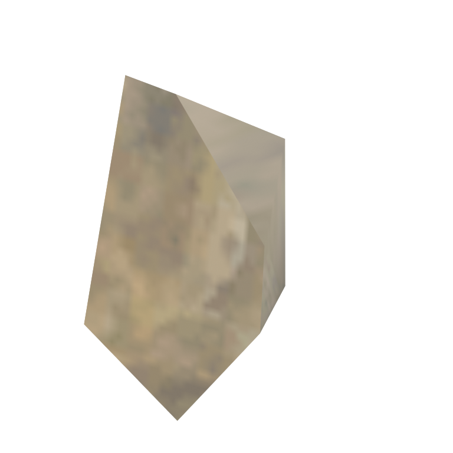
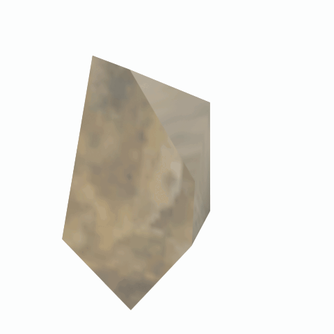

# Unidentified model (fxm_fragment02)

Native model reference; a readable object identification has not been reviewed.

[Library](../README.md) | [Category](../tables/unclassified-components-1.md) | [Source / advanced data](../catalogue.json) | [Credits](../sources-and-credits.md)

**Game filename:** fxm_fragment02.fmdl  
**Category:** Unclassified &gt; Unclassified components  
**Variant:** No explicit variant token; **LOD:** 0  
**Tags:** 

## Still reference



## 360-degree reference



The camera circles a static model. This is not a native animation. Source base textures and UVs use approximate studio shading; interaction, collision, complete assembly and FOX shader equivalence are not established.

## Identity and naming

| Field | Value |
|---|---|
| Library ID | mgsv-tpp-fxm_fragment02-82289c702f858ba5 |
| Naming status | unidentified |
| Naming confidence | unknown |
| Naming evidence | {} |
| Native model | /Assets/tpp/effect/vfx_model/fxm_fragment/scenes/fxm_fragment02.fmdl |
| Model SHA256 | 7ba39ca1abc94aa92926a604a106df45f6b91b45ed3e50d65d37368ea7203163 |
| Container | /Assets/tpp/pack/location/mtbs/pack_common/mtbs_common.fpk |
| Container SHA256 | f7ddb798a4e23e5f2a9196adb3076b6c3733fcc3e4186fd7216535320d726248 |
| Captured source / location scope | Selected native member/content and captured installed-source chain; full archive SHA/runtime priority unresolved |
| Raw record SHA256 | 4d2ddd7213796a423d19b5ac76a809cc290662ca5798367bca7900be0f8a310a |

Naming review is descriptive metadata only. It does not change model completion or identify a working game interaction.

## Native LOD inventory

| Native LOD | Triangles | Preview status | Decoded indices SHA256 |
|---|---:|---|---|
| 0 | 14 | rendered | ca74fa256f8ba6a364c3effb10e50b9875fd9e3eaab596d70516e27acb7832ea |
| 1 | 8 | not separately rendered | f5ca860cbd2fad83df375e219f3c642db02f8bc4600e9593f06a60e6864bc003 |
| 2 | 4 | not separately rendered | e93493b4a964b0ac38c5b46af4235ef7581bc44a22b7ebf2852bea7f118d117d |
| 3 | 2 | not separately rendered | 2a27815227296b1132325991652e399715383262a9767afa5e40f6767c004d96 |

Mesh detail and texture pixels/mips are separate. Index hashes describe decoded triangle arrays, not packed index-buffer bytes. Only source-recorded native levels are listed.

<details>
<summary>Texture, source and naming technical metadata</summary>

```json
{
  "source": {
    "nativePath": "/Assets/tpp/effect/vfx_model/fxm_fragment/scenes/fxm_fragment02.fmdl",
    "nativeSha256": "7ba39ca1abc94aa92926a604a106df45f6b91b45ed3e50d65d37368ea7203163",
    "stableIdentity": "/assets/tpp/effect/vfx_model/fxm_fragment/scenes/fxm_fragment02.fmdl#7ba39ca1abc94aa92926a604a106df45f6b91b45ed3e50d65d37368ea7203163#3c6c084aaf5aa428885b976f41ad237e54ebf799bc45bd2c08dfb30d6a328d53",
    "container": {
      "nativePath": "/Assets/tpp/pack/location/mtbs/pack_common/mtbs_common.fpk",
      "sha256": "f7ddb798a4e23e5f2a9196adb3076b6c3733fcc3e4186fd7216535320d726248",
      "status": "Selected installed-source container/member chain captured by community reader"
    },
    "historicalDatOrigin": null,
    "sourceArchiveAtCapture": "master/0/00.dat",
    "locationStatus": "Selected native member/content and captured installed-source chain; full archive SHA/runtime priority unresolved",
    "currentInstalledDatVerified": false,
    "selectedInstalledMemberVerified": true,
    "evidence": {
      "archive_helper_executable_sha256": "6f8e39a436af3b024bbd0504966ab3d5d9d0cb05d86689bf3e83d15e68df613f",
      "archive_helper_source_sha256": "f662d3b63e066a0afc77ffe22ea0e564222d14469648300dba2c4f8e9b43446b",
      "archive_index_recipe": "54acff767f08d76ad6056c5387328759bc883df507788f398de6c2c04fac12db",
      "archive_reader": "Atvaark GzsTool.Core 0.5.3",
      "archive_reader_core_sha256": "9da447ae3c375cce2e46744eeff6af50f1591062afdf479d1a0b49edb47daaa3",
      "archive_tool_and_dictionary_sha256": {
        "CityHash.dll": "def6c4506d461b65e4059b2936b2cbd5f852ba5d1d8a1a527f1c0e6dc7008c8f",
        "GzsTool.Core.dll": "9da447ae3c375cce2e46744eeff6af50f1591062afdf479d1a0b49edb47daaa3",
        "GzsTool.exe": "1a9c5b11e2355383ff485aee7e86abc026f5c1fad729daf8c0fd15ee0aae1c10",
        "Zlib.Portable.dll": "fe84781ba35ca9cc5ff5f73fd08d2a66c59e5257b4573f5fe59743f30bf78e42",
        "fpk_dictionary.txt": "b82f9a8d6c10a68ba9471eca9d815c21355a53b5e68753d8ad7db7fd01bf401d",
        "qar_dictionary.txt": "1558c248ed0a4bb827888261563fbb91a2df4f03999682f85d637ff70d9d5fb2"
      },
      "bytes": 1472,
      "container_chain": [
        {
          "content_sha256": null,
          "depth": 0,
          "id": "3f19555d27c2ebecdfbad26aadd88b9f62e9fb6092c04c712963ef73c67ccb42",
          "index_sha256": "9acd3675d6e1500e0e18430cba0fdc70a5718ad7d6b62f13905891a35d59f18a",
          "kind": "qar",
          "name": "master/0/00.dat",
          "parent_occurrence": null
        },
        {
          "content_sha256": "f7ddb798a4e23e5f2a9196adb3076b6c3733fcc3e4186fd7216535320d726248",
          "depth": 1,
          "id": "efc8f460b89e5e96c5422338b8a6dafb50a683d9e36c78a2faa275a72a81085b",
          "index_sha256": "3867a5c7a682f09a97afaf0cb3933f6e768d1740e37520d50f52e5ad7b9f80ff",
          "kind": "fpk",
          "name": "/Assets/tpp/pack/location/mtbs/pack_common/mtbs_common.fpk",
          "parent_occurrence": "5fbc20a41a9a3388b41626d6a767d7ecc7ab903d9e3e6dd13cc306ec816d763a"
        }
      ],
      "contentSha256": "7ba39ca1abc94aa92926a604a106df45f6b91b45ed3e50d65d37368ea7203163",
      "member": {
        "actual_size": 1472,
        "compressed_size": null,
        "content_sha256": "7ba39ca1abc94aa92926a604a106df45f6b91b45ed3e50d65d37368ea7203163",
        "declared_size": 1472,
        "extension": "fmdl",
        "hash_hex": null,
        "name": "/Assets/tpp/effect/vfx_model/fxm_fragment/scenes/fxm_fragment02.fmdl",
        "name_origin": "embedded",
        "offset": 454880,
        "ordinal": 26,
        "path_hash": null,
        "resolved": 1
      },
      "occurrenceId": "79b997160cf1caf987a66efff4dcd0452c1da1876d327d994e5a070e63faaf8c",
      "occurrence_id": "79b997160cf1caf987a66efff4dcd0452c1da1876d327d994e5a070e63faaf8c",
      "primary_source_revision": "fc4a8196555638c6cf8aa1b7c8dc34ccd5c69cb5",
      "source_adapter": "community_core_selective_export",
      "source_id": "7f6bb743fb4c487f0e9522f9c7fac280c46cf6b1051e0fc75a93602c8eb451f0",
      "source_path": "master/0/00.dat",
      "source_snapshot": "{\"bytes\":768788480,\"device\":621747392682911458,\"file_id\":844424931596481,\"header_sha256\":\"ead50f0a9a37e4285323b9c6fa0ec75fe75e518c63147e63158eeb2892c6589e\",\"mtime_ns\":1791852224238580700}",
      "virtualPath": "/Assets/tpp/effect/vfx_model/fxm_fragment/scenes/fxm_fragment02.fmdl"
    }
  },
  "materials": [
    {
      "sampler": "Base_Tex_SRGB",
      "materialIndex": 0,
      "nativePathHash": "1543544404298840377",
      "nativeVirtualPath": null,
      "nativeBinding": {
        "familyId": "2dc4caeb7dfe2c4e88a8bdc88261a7f9dce5e96368690c1270db173e6e732cf3",
        "height": 128,
        "materialIndex": 0,
        "mipCount": 6,
        "nativeMipCountVerified": true,
        "nativePath": null,
        "nativePathHash": "1543544404298840377",
        "nativeTexture": {
          "additionalFtexsFileCount": 0,
          "depth": 1,
          "ftexsFileCount": 1,
          "height": 128,
          "metadataBytes": 160,
          "mipCount": 6,
          "mips": [
            {
              "chunks": 1,
              "decodedBytes": 8192,
              "mip": 0,
              "offset": 2520,
              "storedBytes": 6128,
              "streamNumber": 1
            },
            {
              "chunks": 1,
              "decodedBytes": 2048,
              "mip": 1,
              "offset": 752,
              "storedBytes": 1760,
              "streamNumber": 1
            },
            {
              "chunks": 1,
              "decodedBytes": 512,
              "mip": 2,
              "offset": 232,
              "storedBytes": 512,
              "streamNumber": 1
            },
            {
              "chunks": 1,
              "decodedBytes": 128,
              "mip": 3,
              "offset": 80,
              "storedBytes": 144,
              "streamNumber": 1
            },
            {
              "chunks": 1,
              "decodedBytes": 32,
              "mip": 4,
              "offset": 24,
              "storedBytes": 48,
              "streamNumber": 1
            },
            {
              "chunks": 1,
              "decodedBytes": 8,
              "mip": 5,
              "offset": 0,
              "storedBytes": 16,
              "streamNumber": 1
            }
          ],
          "nativeHeaderHash": "2e7bdb83cbb3462f3b133ab591fe8037",
          "nrtFlag": 2,
          "pixelFormat": 2,
          "requiredStreamNumbers": [
            1
          ],
          "textureType": 16777219,
          "unknownFlags": 273,
          "width": 128
        },
        "samplerName": "Base_Tex_SRGB",
        "samplerNameHash": "72475356961633",
        "sha256": "2c104ee7dab3e814ec8c21b56b9ccd29aa0af04b695ce2062b9caea23b899179",
        "sourceOccurrences": [
          {
            "archive_helper_executable_sha256": "6f8e39a436af3b024bbd0504966ab3d5d9d0cb05d86689bf3e83d15e68df613f",
            "archive_helper_source_sha256": "f662d3b63e066a0afc77ffe22ea0e564222d14469648300dba2c4f8e9b43446b",
            "archive_index_recipe": "54acff767f08d76ad6056c5387328759bc883df507788f398de6c2c04fac12db",
            "archive_reader": "Atvaark GzsTool.Core 0.5.3",
            "archive_reader_core_sha256": "9da447ae3c375cce2e46744eeff6af50f1591062afdf479d1a0b49edb47daaa3",
            "archive_tool_and_dictionary_sha256": {
              "CityHash.dll": "def6c4506d461b65e4059b2936b2cbd5f852ba5d1d8a1a527f1c0e6dc7008c8f",
              "GzsTool.Core.dll": "9da447ae3c375cce2e46744eeff6af50f1591062afdf479d1a0b49edb47daaa3",
              "GzsTool.exe": "1a9c5b11e2355383ff485aee7e86abc026f5c1fad729daf8c0fd15ee0aae1c10",
              "Zlib.Portable.dll": "fe84781ba35ca9cc5ff5f73fd08d2a66c59e5257b4573f5fe59743f30bf78e42",
              "fpk_dictionary.txt": "b82f9a8d6c10a68ba9471eca9d815c21355a53b5e68753d8ad7db7fd01bf401d",
              "qar_dictionary.txt": "1558c248ed0a4bb827888261563fbb91a2df4f03999682f85d637ff70d9d5fb2"
            },
            "bytes": 160,
            "container_chain": [
              {
                "content_sha256": null,
                "depth": 0,
                "id": "ed06436b87a33093d4ecc183bbe92a4270efb3b69334c9f78610d9c26d72543e",
                "index_sha256": "cbeecab235114828cf8a954288095c1e2547bfa06667c7b1e0b45c19774105d1",
                "kind": "qar",
                "name": "master/texture0.dat",
                "parent_occurrence": null
              }
            ],
            "contentSha256": "e395282b5259da4250bf7cd13cb92228669691d8339965fd7cdc7e7ff5301253",
            "member": {
              "actual_size": 160,
              "compressed_size": 160,
              "content_sha256": "e395282b5259da4250bf7cd13cb92228669691d8339965fd7cdc7e7ff5301253",
              "declared_size": 160,
              "extension": "ftex",
              "hash_hex": "156bc57529463939",
              "name": "3c57529463939.ftex",
              "name_origin": "hash_fallback",
              "offset": 2442845216,
              "ordinal": 12114,
              "path_hash": "3c57529463939",
              "resolved": 0
            },
            "occurrenceId": "c4125c288cf323fc14fdb56962a2d33326b8598d13c30e3eecff7603d28fd5a8",
            "occurrence_id": "c4125c288cf323fc14fdb56962a2d33326b8598d13c30e3eecff7603d28fd5a8",
            "primary_source_revision": "fc4a8196555638c6cf8aa1b7c8dc34ccd5c69cb5",
            "source_adapter": "community_core_selective_export",
            "source_id": "7bfac7ec2859af21676ae22ed9ddff5e6d4adaddf146059b0948f2ab8ef9e2f4",
            "source_path": "master/texture0.dat",
            "source_snapshot": "{\"bytes\":3527175168,\"device\":621747392682911458,\"file_id\":562949953639624,\"header_sha256\":\"be81f77de9943687926d5790cc5a960e18e93064af4db3c3c35dabc542fee1ed\",\"mtime_ns\":1791224675560236900}",
            "virtualPath": "3c57529463939.ftex"
          },
          {
            "archive_helper_executable_sha256": "6f8e39a436af3b024bbd0504966ab3d5d9d0cb05d86689bf3e83d15e68df613f",
            "archive_helper_source_sha256": "f662d3b63e066a0afc77ffe22ea0e564222d14469648300dba2c4f8e9b43446b",
            "archive_index_recipe": "54acff767f08d76ad6056c5387328759bc883df507788f398de6c2c04fac12db",
            "archive_reader": "Atvaark GzsTool.Core 0.5.3",
            "archive_reader_core_sha256": "9da447ae3c375cce2e46744eeff6af50f1591062afdf479d1a0b49edb47daaa3",
            "archive_tool_and_dictionary_sha256": {
              "CityHash.dll": "def6c4506d461b65e4059b2936b2cbd5f852ba5d1d8a1a527f1c0e6dc7008c8f",
              "GzsTool.Core.dll": "9da447ae3c375cce2e46744eeff6af50f1591062afdf479d1a0b49edb47daaa3",
              "GzsTool.exe": "1a9c5b11e2355383ff485aee7e86abc026f5c1fad729daf8c0fd15ee0aae1c10",
              "Zlib.Portable.dll": "fe84781ba35ca9cc5ff5f73fd08d2a66c59e5257b4573f5fe59743f30bf78e42",
              "fpk_dictionary.txt": "b82f9a8d6c10a68ba9471eca9d815c21355a53b5e68753d8ad7db7fd01bf401d",
              "qar_dictionary.txt": "1558c248ed0a4bb827888261563fbb91a2df4f03999682f85d637ff70d9d5fb2"
            },
            "bytes": 8656,
            "container_chain": [
              {
                "content_sha256": null,
                "depth": 0,
                "id": "ed06436b87a33093d4ecc183bbe92a4270efb3b69334c9f78610d9c26d72543e",
                "index_sha256": "cbeecab235114828cf8a954288095c1e2547bfa06667c7b1e0b45c19774105d1",
                "kind": "qar",
                "name": "master/texture0.dat",
                "parent_occurrence": null
              }
            ],
            "contentSha256": "8e2abc8085d3ed36ac24e5b2f7b260fff934fd41d9c41d58b8a5d4113c4e27e9",
            "member": {
              "actual_size": 8656,
              "compressed_size": 8656,
              "content_sha256": "8e2abc8085d3ed36ac24e5b2f7b260fff934fd41d9c41d58b8a5d4113c4e27e9",
              "declared_size": 8656,
              "extension": "1.ftexs",
              "hash_hex": "b2c3c57529463939",
              "name": "3c57529463939.1.ftexs",
              "name_origin": "hash_fallback",
              "offset": 2442836000,
              "ordinal": 12113,
              "path_hash": "3c57529463939",
              "resolved": 0
            },
            "occurrenceId": "77c6280f573d09fd13923bedc872f306f7921baa2611f7a32be76bb481a1d398",
            "occurrence_id": "77c6280f573d09fd13923bedc872f306f7921baa2611f7a32be76bb481a1d398",
            "primary_source_revision": "fc4a8196555638c6cf8aa1b7c8dc34ccd5c69cb5",
            "source_adapter": "community_core_selective_export",
            "source_id": "7bfac7ec2859af21676ae22ed9ddff5e6d4adaddf146059b0948f2ab8ef9e2f4",
            "source_path": "master/texture0.dat",
            "source_snapshot": "{\"bytes\":3527175168,\"device\":621747392682911458,\"file_id\":562949953639624,\"header_sha256\":\"be81f77de9943687926d5790cc5a960e18e93064af4db3c3c35dabc542fee1ed\",\"mtime_ns\":1791224675560236900}",
            "virtualPath": "3c57529463939.1.ftexs"
          }
        ],
        "width": 128
      },
      "ddsSha256": "2c104ee7dab3e814ec8c21b56b9ccd29aa0af04b695ce2062b9caea23b899179",
      "dimensions": [
        128,
        128
      ],
      "mipCount": 6,
      "nativeMipCountVerified": true,
      "connectedInPreview": true
    }
  ],
  "quality": {
    "decodedIndicesHashDerivation": "SHA256 of canonical UTF-8 JSON decoded triangle indices grouped by mesh; not packed buffer bytes",
    "highestRetainedGeometricLod": 0,
    "distinctNativeLods": 4,
    "baseTextureDimensions": [
      128,
      128
    ],
    "baseTextureNativeMipCount": 6,
    "largerRetainedBaseTextureFound": null,
    "nativeLods": [
      {
        "indicesSha256": "ca74fa256f8ba6a364c3effb10e50b9875fd9e3eaab596d70516e27acb7832ea",
        "nativeLod": 0,
        "triangles": 14
      },
      {
        "indicesSha256": "f5ca860cbd2fad83df375e219f3c642db02f8bc4600e9593f06a60e6864bc003",
        "nativeLod": 1,
        "triangles": 8
      },
      {
        "indicesSha256": "e93493b4a964b0ac38c5b46af4235ef7581bc44a22b7ebf2852bea7f118d117d",
        "nativeLod": 2,
        "triangles": 4
      },
      {
        "indicesSha256": "2a27815227296b1132325991652e399715383262a9767afa5e40f6767c004d96",
        "nativeLod": 3,
        "triangles": 2
      }
    ],
    "renderedNativeLods": [
      0
    ],
    "baseTextureSummary": "128 x 128; 6 native/DDS mips",
    "highestDetailScope": "Triangle-count comparison within captured FMDL only"
  }
}
```

</details>

[Original source / advanced record](../catalogue.json)
