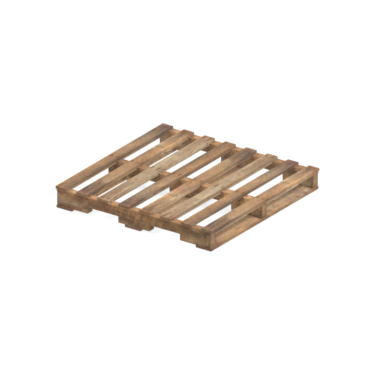
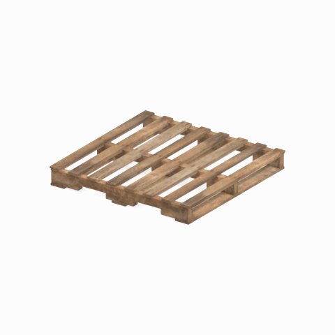

# Unidentified model (gntn_pllt002_vrtn001)

Native model reference; a readable object identification has not been reviewed.

[Library](../README.md) | [Category](../tables/unclassified-components-1.md) | [Source / advanced data](../catalogue.json) | [Credits](../sources-and-credits.md)

**Game filename:** gntn_pllt002_vrtn001.fmdl  
**Category:** Unclassified &gt; Unclassified components  
**Variant:** vrtn001; **LOD:** 0  
**Tags:** 

## Still reference



## 360-degree reference



The camera circles a static model. This is not a native animation. Source base textures and UVs use approximate studio shading; interaction, collision, complete assembly and FOX shader equivalence are not established.

## Identity and naming

| Field | Value |
|---|---|
| Library ID | mgsv-tpp-gntn_pllt002_vrtn001-4009be9852b8f0dd |
| Naming status | unidentified |
| Naming confidence | unknown |
| Naming evidence | {} |
| Native model | /Assets/tpp/environ/object/guantanamo/pallet/gntn_pllt002/scenes/gntn_pllt002_vrtn001.fmdl |
| Model SHA256 | 85366a24f598fa24aadca8455e0baaefad656c976755da15634a121a0fdff166 |
| Container | /Assets/mgo/pack/location/afc0/pack_common/afc0_common.fpk |
| Container SHA256 | 20a950cab0d6912ac3a270b90dc6dc673f2d13859eb636819bfa3955fca6e320 |
| Captured source / location scope | Selected native member/content and captured installed-source chain; full archive SHA/runtime priority unresolved |
| Raw record SHA256 | 982de30980c39a790b713af92df21711d37b77f34e15d05086d7ad8732884ac8 |

Naming review is descriptive metadata only. It does not change model completion or identify a working game interaction.

## Native LOD inventory

| Native LOD | Triangles | Preview status | Decoded indices SHA256 |
|---|---:|---|---|
| 0 | 406 | rendered | 7de289eefa7ea88dcd8d6acaa026c2ef5887ce2a89ae50e4e02058d868ba9e17 |
| 1 | 406 | not separately rendered | 7de289eefa7ea88dcd8d6acaa026c2ef5887ce2a89ae50e4e02058d868ba9e17 |
| 2 | 406 | not separately rendered | 7de289eefa7ea88dcd8d6acaa026c2ef5887ce2a89ae50e4e02058d868ba9e17 |
| 3 | 406 | not separately rendered | 7de289eefa7ea88dcd8d6acaa026c2ef5887ce2a89ae50e4e02058d868ba9e17 |
| 4 | 406 | not separately rendered | 7de289eefa7ea88dcd8d6acaa026c2ef5887ce2a89ae50e4e02058d868ba9e17 |
| 5 | 406 | not separately rendered | 7de289eefa7ea88dcd8d6acaa026c2ef5887ce2a89ae50e4e02058d868ba9e17 |
| 6 | 406 | not separately rendered | 7de289eefa7ea88dcd8d6acaa026c2ef5887ce2a89ae50e4e02058d868ba9e17 |
| 7 | 406 | not separately rendered | 7de289eefa7ea88dcd8d6acaa026c2ef5887ce2a89ae50e4e02058d868ba9e17 |

Mesh detail and texture pixels/mips are separate. Index hashes describe decoded triangle arrays, not packed index-buffer bytes. Only source-recorded native levels are listed.

<details>
<summary>Texture, source and naming technical metadata</summary>

```json
{
  "source": {
    "nativePath": "/Assets/tpp/environ/object/guantanamo/pallet/gntn_pllt002/scenes/gntn_pllt002_vrtn001.fmdl",
    "nativeSha256": "85366a24f598fa24aadca8455e0baaefad656c976755da15634a121a0fdff166",
    "stableIdentity": "/assets/tpp/environ/object/guantanamo/pallet/gntn_pllt002/scenes/gntn_pllt002_vrtn001.fmdl#85366a24f598fa24aadca8455e0baaefad656c976755da15634a121a0fdff166#e6a35b3c046f59967b605b607af39c94f4b7d7e13d0d73c2b745858b2bd6e1f1",
    "container": {
      "nativePath": "/Assets/mgo/pack/location/afc0/pack_common/afc0_common.fpk",
      "sha256": "20a950cab0d6912ac3a270b90dc6dc673f2d13859eb636819bfa3955fca6e320",
      "status": "Selected installed-source container/member chain captured by community reader"
    },
    "historicalDatOrigin": null,
    "sourceArchiveAtCapture": "master/0/00.dat",
    "locationStatus": "Selected native member/content and captured installed-source chain; full archive SHA/runtime priority unresolved",
    "currentInstalledDatVerified": false,
    "selectedInstalledMemberVerified": true,
    "evidence": {
      "archive_helper_executable_sha256": "6f8e39a436af3b024bbd0504966ab3d5d9d0cb05d86689bf3e83d15e68df613f",
      "archive_helper_source_sha256": "f662d3b63e066a0afc77ffe22ea0e564222d14469648300dba2c4f8e9b43446b",
      "archive_index_recipe": "54acff767f08d76ad6056c5387328759bc883df507788f398de6c2c04fac12db",
      "archive_reader": "Atvaark GzsTool.Core 0.5.3",
      "archive_reader_core_sha256": "9da447ae3c375cce2e46744eeff6af50f1591062afdf479d1a0b49edb47daaa3",
      "archive_tool_and_dictionary_sha256": {
        "CityHash.dll": "def6c4506d461b65e4059b2936b2cbd5f852ba5d1d8a1a527f1c0e6dc7008c8f",
        "GzsTool.Core.dll": "9da447ae3c375cce2e46744eeff6af50f1591062afdf479d1a0b49edb47daaa3",
        "GzsTool.exe": "1a9c5b11e2355383ff485aee7e86abc026f5c1fad729daf8c0fd15ee0aae1c10",
        "Zlib.Portable.dll": "fe84781ba35ca9cc5ff5f73fd08d2a66c59e5257b4573f5fe59743f30bf78e42",
        "fpk_dictionary.txt": "b82f9a8d6c10a68ba9471eca9d815c21355a53b5e68753d8ad7db7fd01bf401d",
        "qar_dictionary.txt": "1558c248ed0a4bb827888261563fbb91a2df4f03999682f85d637ff70d9d5fb2"
      },
      "bytes": 26384,
      "container_chain": [
        {
          "content_sha256": null,
          "depth": 0,
          "id": "3f19555d27c2ebecdfbad26aadd88b9f62e9fb6092c04c712963ef73c67ccb42",
          "index_sha256": "9acd3675d6e1500e0e18430cba0fdc70a5718ad7d6b62f13905891a35d59f18a",
          "kind": "qar",
          "name": "master/0/00.dat",
          "parent_occurrence": null
        },
        {
          "content_sha256": "20a950cab0d6912ac3a270b90dc6dc673f2d13859eb636819bfa3955fca6e320",
          "depth": 1,
          "id": "f1334a28f5fb887d989a9c548d11dccada12186358e0a4b4e7fc9831f6f42881",
          "index_sha256": "e15578c97612208569f283c28408f389fb560576e3976adf9d7aa8ed9c9aaf87",
          "kind": "fpk",
          "name": "/Assets/mgo/pack/location/afc0/pack_common/afc0_common.fpk",
          "parent_occurrence": "348190d8da3d429c2cdae58af0494f023c46b80f66da14d484dc54a7e17a97df"
        }
      ],
      "contentSha256": "85366a24f598fa24aadca8455e0baaefad656c976755da15634a121a0fdff166",
      "member": {
        "actual_size": 26384,
        "compressed_size": null,
        "content_sha256": "85366a24f598fa24aadca8455e0baaefad656c976755da15634a121a0fdff166",
        "declared_size": 26384,
        "extension": "fmdl",
        "hash_hex": null,
        "name": "/Assets/tpp/environ/object/guantanamo/pallet/gntn_pllt002/scenes/gntn_pllt002_vrtn001.fmdl",
        "name_origin": "embedded",
        "offset": 6044656,
        "ordinal": 192,
        "path_hash": null,
        "resolved": 1
      },
      "occurrenceId": "02db6bb04d72dd99b3664c5f11f50e9ac9f29927ec91555dd3b02cd1b5de12bf",
      "occurrence_id": "02db6bb04d72dd99b3664c5f11f50e9ac9f29927ec91555dd3b02cd1b5de12bf",
      "primary_source_revision": "fc4a8196555638c6cf8aa1b7c8dc34ccd5c69cb5",
      "source_adapter": "community_core_selective_export",
      "source_id": "7f6bb743fb4c487f0e9522f9c7fac280c46cf6b1051e0fc75a93602c8eb451f0",
      "source_path": "master/0/00.dat",
      "source_snapshot": "{\"bytes\":768788480,\"device\":621747392682911458,\"file_id\":844424931596481,\"header_sha256\":\"ead50f0a9a37e4285323b9c6fa0ec75fe75e518c63147e63158eeb2892c6589e\",\"mtime_ns\":1791852224238580700}",
      "virtualPath": "/Assets/tpp/environ/object/guantanamo/pallet/gntn_pllt002/scenes/gntn_pllt002_vrtn001.fmdl"
    }
  },
  "materials": [
    {
      "sampler": "Base_Tex_SRGB",
      "materialIndex": 0,
      "nativePathHash": "1543387847843686151",
      "nativeVirtualPath": null,
      "nativeBinding": {
        "familyId": "8e882d1466030e9761f3a0ff9958ec6022d47a271ae6245eec1f9c6188ab249d",
        "height": 256,
        "materialIndex": 0,
        "mipCount": 7,
        "nativeMipCountVerified": true,
        "nativePath": null,
        "nativePathHash": "1543387847843686151",
        "nativeTexture": {
          "additionalFtexsFileCount": 1,
          "depth": 1,
          "ftexsFileCount": 2,
          "height": 256,
          "metadataBytes": 176,
          "mipCount": 7,
          "mips": [
            {
              "chunks": 2,
              "decodedBytes": 32768,
              "mip": 0,
              "offset": 0,
              "storedBytes": 26080,
              "streamNumber": 2
            },
            {
              "chunks": 1,
              "decodedBytes": 8192,
              "mip": 1,
              "offset": 2616,
              "storedBytes": 6880,
              "streamNumber": 1
            },
            {
              "chunks": 1,
              "decodedBytes": 2048,
              "mip": 2,
              "offset": 768,
              "storedBytes": 1840,
              "streamNumber": 1
            },
            {
              "chunks": 1,
              "decodedBytes": 512,
              "mip": 3,
              "offset": 232,
              "storedBytes": 528,
              "streamNumber": 1
            },
            {
              "chunks": 1,
              "decodedBytes": 128,
              "mip": 4,
              "offset": 80,
              "storedBytes": 144,
              "streamNumber": 1
            },
            {
              "chunks": 1,
              "decodedBytes": 32,
              "mip": 5,
              "offset": 24,
              "storedBytes": 48,
              "streamNumber": 1
            },
            {
              "chunks": 1,
              "decodedBytes": 8,
              "mip": 6,
              "offset": 0,
              "storedBytes": 16,
              "streamNumber": 1
            }
          ],
          "nativeHeaderHash": "654ee331501096efd5142ce1acc3b3c1",
          "nrtFlag": 2,
          "pixelFormat": 2,
          "requiredStreamNumbers": [
            1,
            2
          ],
          "textureType": 16777219,
          "unknownFlags": 273,
          "width": 256
        },
        "samplerName": "Base_Tex_SRGB",
        "samplerNameHash": "72475356961633",
        "sha256": "75751b633da66240a813fab4d366fa90e36e49ad092c7362b5b177ebad1b16ab",
        "sourceOccurrences": [
          {
            "archive_helper_executable_sha256": "6f8e39a436af3b024bbd0504966ab3d5d9d0cb05d86689bf3e83d15e68df613f",
            "archive_helper_source_sha256": "f662d3b63e066a0afc77ffe22ea0e564222d14469648300dba2c4f8e9b43446b",
            "archive_index_recipe": "54acff767f08d76ad6056c5387328759bc883df507788f398de6c2c04fac12db",
            "archive_reader": "Atvaark GzsTool.Core 0.5.3",
            "archive_reader_core_sha256": "9da447ae3c375cce2e46744eeff6af50f1591062afdf479d1a0b49edb47daaa3",
            "archive_tool_and_dictionary_sha256": {
              "CityHash.dll": "def6c4506d461b65e4059b2936b2cbd5f852ba5d1d8a1a527f1c0e6dc7008c8f",
              "GzsTool.Core.dll": "9da447ae3c375cce2e46744eeff6af50f1591062afdf479d1a0b49edb47daaa3",
              "GzsTool.exe": "1a9c5b11e2355383ff485aee7e86abc026f5c1fad729daf8c0fd15ee0aae1c10",
              "Zlib.Portable.dll": "fe84781ba35ca9cc5ff5f73fd08d2a66c59e5257b4573f5fe59743f30bf78e42",
              "fpk_dictionary.txt": "b82f9a8d6c10a68ba9471eca9d815c21355a53b5e68753d8ad7db7fd01bf401d",
              "qar_dictionary.txt": "1558c248ed0a4bb827888261563fbb91a2df4f03999682f85d637ff70d9d5fb2"
            },
            "bytes": 176,
            "container_chain": [
              {
                "content_sha256": null,
                "depth": 0,
                "id": "436c8cfb4f382de93365b167a61aa81383299b7bad18205d60f1d0beeb3919e3",
                "index_sha256": "2d7b45c6ca65418839618e978562cac336091c06eb56dfe99f762b07a4016960",
                "kind": "qar",
                "name": "master/texture4.dat",
                "parent_occurrence": null
              }
            ],
            "contentSha256": "d5fc9232b08a883bdd6c5cbc6773701142d3b48276b1deeac2ec99ed5ac9b1bb",
            "member": {
              "actual_size": 176,
              "compressed_size": 176,
              "content_sha256": "d5fc9232b08a883bdd6c5cbc6773701142d3b48276b1deeac2ec99ed5ac9b1bb",
              "declared_size": 176,
              "extension": "ftex",
              "hash_hex": "156b37120560a707",
              "name": "/Assets/tpp/environ/object/guantanamo/pallet/gntn_pllt002/sourceimages/gntn_pllt002_ma_bsm.ftex",
              "name_origin": "dictionary",
              "offset": 937813024,
              "ordinal": 6343,
              "path_hash": "337120560a707",
              "resolved": 1
            },
            "occurrenceId": "02f1edee20ddbf00975a6134a986cd4a1a8dabe89192417ee81f3d657e8bbc8d",
            "occurrence_id": "02f1edee20ddbf00975a6134a986cd4a1a8dabe89192417ee81f3d657e8bbc8d",
            "primary_source_revision": "fc4a8196555638c6cf8aa1b7c8dc34ccd5c69cb5",
            "source_adapter": "community_core_selective_export",
            "source_id": "6c31b98b4db9b88eb76cfcb538f5f34b4729531266a9459584126720a4fc14aa",
            "source_path": "master/texture4.dat",
            "source_snapshot": "{\"bytes\":2031604736,\"device\":621747392682911458,\"file_id\":562949953639628,\"header_sha256\":\"40ee2c6917b338f7f68c49847c97fe92b978506a1ba847fcc94d28c931c8711a\",\"mtime_ns\":1791224675561235200}",
            "virtualPath": "/Assets/tpp/environ/object/guantanamo/pallet/gntn_pllt002/sourceimages/gntn_pllt002_ma_bsm.ftex"
          },
          {
            "archive_helper_executable_sha256": "6f8e39a436af3b024bbd0504966ab3d5d9d0cb05d86689bf3e83d15e68df613f",
            "archive_helper_source_sha256": "f662d3b63e066a0afc77ffe22ea0e564222d14469648300dba2c4f8e9b43446b",
            "archive_index_recipe": "54acff767f08d76ad6056c5387328759bc883df507788f398de6c2c04fac12db",
            "archive_reader": "Atvaark GzsTool.Core 0.5.3",
            "archive_reader_core_sha256": "9da447ae3c375cce2e46744eeff6af50f1591062afdf479d1a0b49edb47daaa3",
            "archive_tool_and_dictionary_sha256": {
              "CityHash.dll": "def6c4506d461b65e4059b2936b2cbd5f852ba5d1d8a1a527f1c0e6dc7008c8f",
              "GzsTool.Core.dll": "9da447ae3c375cce2e46744eeff6af50f1591062afdf479d1a0b49edb47daaa3",
              "GzsTool.exe": "1a9c5b11e2355383ff485aee7e86abc026f5c1fad729daf8c0fd15ee0aae1c10",
              "Zlib.Portable.dll": "fe84781ba35ca9cc5ff5f73fd08d2a66c59e5257b4573f5fe59743f30bf78e42",
              "fpk_dictionary.txt": "b82f9a8d6c10a68ba9471eca9d815c21355a53b5e68753d8ad7db7fd01bf401d",
              "qar_dictionary.txt": "1558c248ed0a4bb827888261563fbb91a2df4f03999682f85d637ff70d9d5fb2"
            },
            "bytes": 9504,
            "container_chain": [
              {
                "content_sha256": null,
                "depth": 0,
                "id": "3f19555d27c2ebecdfbad26aadd88b9f62e9fb6092c04c712963ef73c67ccb42",
                "index_sha256": "9acd3675d6e1500e0e18430cba0fdc70a5718ad7d6b62f13905891a35d59f18a",
                "kind": "qar",
                "name": "master/0/00.dat",
                "parent_occurrence": null
              },
              {
                "content_sha256": "c371a18745c941878107bdaf7aef71c13b09b8b3a574360f6e38e0a7172b74e6",
                "depth": 1,
                "id": "13570131ff9ebc75c266205cbdf3461ff4dc51e8a0cb4f7407b0a08fe357052a",
                "index_sha256": "5b8e60a5e6b705cb87973f15c3215fb3733b7a49171030a4c7640da4622a5ca2",
                "kind": "pftxs",
                "name": "/Assets/mgo/pack/location/afc0/pack_common/afc0_common.pftxs",
                "parent_occurrence": "abc314b7f418d61ea6a3e5525bf8f85d22b454b81d3407e6645bfc43339658ac"
              }
            ],
            "contentSha256": "9d75788f83416c608eed92f56f37c66e3567588e47cb266fd31ecba8ebef1264",
            "member": {
              "actual_size": 9504,
              "compressed_size": null,
              "content_sha256": "9d75788f83416c608eed92f56f37c66e3567588e47cb266fd31ecba8ebef1264",
              "declared_size": 9504,
              "extension": "1.ftexs",
              "hash_hex": "b2c337120560a707",
              "name": "b2c337120560a707.1.ftexs",
              "name_origin": "hash_fallback",
              "offset": 12982048,
              "ordinal": 836,
              "path_hash": null,
              "resolved": 0
            },
            "occurrenceId": "daa22f27431dff2cdbe5d1a59ba0a1df2f5ba3c4327f6ac94e50c2dcdb4685a6",
            "occurrence_id": "daa22f27431dff2cdbe5d1a59ba0a1df2f5ba3c4327f6ac94e50c2dcdb4685a6",
            "primary_source_revision": "fc4a8196555638c6cf8aa1b7c8dc34ccd5c69cb5",
            "source_adapter": "community_core_selective_export",
            "source_id": "7f6bb743fb4c487f0e9522f9c7fac280c46cf6b1051e0fc75a93602c8eb451f0",
            "source_path": "master/0/00.dat",
            "source_snapshot": "{\"bytes\":768788480,\"device\":621747392682911458,\"file_id\":844424931596481,\"header_sha256\":\"ead50f0a9a37e4285323b9c6fa0ec75fe75e518c63147e63158eeb2892c6589e\",\"mtime_ns\":1791852224238580700}",
            "virtualPath": "b2c337120560a707.1.ftexs"
          },
          {
            "archive_helper_executable_sha256": "6f8e39a436af3b024bbd0504966ab3d5d9d0cb05d86689bf3e83d15e68df613f",
            "archive_helper_source_sha256": "f662d3b63e066a0afc77ffe22ea0e564222d14469648300dba2c4f8e9b43446b",
            "archive_index_recipe": "54acff767f08d76ad6056c5387328759bc883df507788f398de6c2c04fac12db",
            "archive_reader": "Atvaark GzsTool.Core 0.5.3",
            "archive_reader_core_sha256": "9da447ae3c375cce2e46744eeff6af50f1591062afdf479d1a0b49edb47daaa3",
            "archive_tool_and_dictionary_sha256": {
              "CityHash.dll": "def6c4506d461b65e4059b2936b2cbd5f852ba5d1d8a1a527f1c0e6dc7008c8f",
              "GzsTool.Core.dll": "9da447ae3c375cce2e46744eeff6af50f1591062afdf479d1a0b49edb47daaa3",
              "GzsTool.exe": "1a9c5b11e2355383ff485aee7e86abc026f5c1fad729daf8c0fd15ee0aae1c10",
              "Zlib.Portable.dll": "fe84781ba35ca9cc5ff5f73fd08d2a66c59e5257b4573f5fe59743f30bf78e42",
              "fpk_dictionary.txt": "b82f9a8d6c10a68ba9471eca9d815c21355a53b5e68753d8ad7db7fd01bf401d",
              "qar_dictionary.txt": "1558c248ed0a4bb827888261563fbb91a2df4f03999682f85d637ff70d9d5fb2"
            },
            "bytes": 26096,
            "container_chain": [
              {
                "content_sha256": null,
                "depth": 0,
                "id": "e73d96973ade76f7a00afdbea486dd110896ace97da0791f56899647de46f210",
                "index_sha256": "5a818609a652a10d90fb90015661d0cb80898096bbb3aac36382172988d8736d",
                "kind": "qar",
                "name": "mgo/texture0.dat",
                "parent_occurrence": null
              }
            ],
            "contentSha256": "071ff3716af5f2959adc23204917a9016e1b5791f7c2923cbfc155ec93ade788",
            "member": {
              "actual_size": 26096,
              "compressed_size": 26096,
              "content_sha256": "071ff3716af5f2959adc23204917a9016e1b5791f7c2923cbfc155ec93ade788",
              "declared_size": 26096,
              "extension": "2.ftexs",
              "hash_hex": "b57337120560a707",
              "name": "/Assets/tpp/environ/object/guantanamo/pallet/gntn_pllt002/sourceimages/gntn_pllt002_ma_bsm.2.ftexs",
              "name_origin": "dictionary",
              "offset": 3649468448,
              "ordinal": 14654,
              "path_hash": "337120560a707",
              "resolved": 1
            },
            "occurrenceId": "35b6e2aa41baa1e6cc6c75397eab8f8bdd8e76b67000438ca01a17ff180b0c39",
            "occurrence_id": "35b6e2aa41baa1e6cc6c75397eab8f8bdd8e76b67000438ca01a17ff180b0c39",
            "primary_source_revision": "fc4a8196555638c6cf8aa1b7c8dc34ccd5c69cb5",
            "source_adapter": "community_core_selective_export",
            "source_id": "03f5942f0e1af8040ae05b95c43716d75f5933971d78324bf7cfea291297f3f4",
            "source_path": "mgo/texture0.dat",
            "source_snapshot": "{\"bytes\":4492370944,\"device\":621747392682911458,\"file_id\":562949953639631,\"header_sha256\":\"6108fbacb65c84d041742c39e5ca630745240453b336f1059a13b91943f0b011\",\"mtime_ns\":1791224675562234400}",
            "virtualPath": "/Assets/tpp/environ/object/guantanamo/pallet/gntn_pllt002/sourceimages/gntn_pllt002_ma_bsm.2.ftexs"
          }
        ],
        "width": 256
      },
      "ddsSha256": "75751b633da66240a813fab4d366fa90e36e49ad092c7362b5b177ebad1b16ab",
      "dimensions": [
        256,
        256
      ],
      "mipCount": 7,
      "nativeMipCountVerified": true,
      "connectedInPreview": true
    }
  ],
  "quality": {
    "decodedIndicesHashDerivation": "SHA256 of canonical UTF-8 JSON decoded triangle indices grouped by mesh; not packed buffer bytes",
    "highestRetainedGeometricLod": 0,
    "distinctNativeLods": 1,
    "baseTextureDimensions": [
      256,
      256
    ],
    "baseTextureNativeMipCount": 7,
    "largerRetainedBaseTextureFound": null,
    "nativeLods": [
      {
        "indicesSha256": "7de289eefa7ea88dcd8d6acaa026c2ef5887ce2a89ae50e4e02058d868ba9e17",
        "nativeLod": 0,
        "triangles": 406
      },
      {
        "duplicateOf": 0,
        "indicesSha256": "7de289eefa7ea88dcd8d6acaa026c2ef5887ce2a89ae50e4e02058d868ba9e17",
        "nativeLod": 1,
        "triangles": 406
      },
      {
        "duplicateOf": 0,
        "indicesSha256": "7de289eefa7ea88dcd8d6acaa026c2ef5887ce2a89ae50e4e02058d868ba9e17",
        "nativeLod": 2,
        "triangles": 406
      },
      {
        "duplicateOf": 0,
        "indicesSha256": "7de289eefa7ea88dcd8d6acaa026c2ef5887ce2a89ae50e4e02058d868ba9e17",
        "nativeLod": 3,
        "triangles": 406
      },
      {
        "duplicateOf": 0,
        "indicesSha256": "7de289eefa7ea88dcd8d6acaa026c2ef5887ce2a89ae50e4e02058d868ba9e17",
        "nativeLod": 4,
        "triangles": 406
      },
      {
        "duplicateOf": 0,
        "indicesSha256": "7de289eefa7ea88dcd8d6acaa026c2ef5887ce2a89ae50e4e02058d868ba9e17",
        "nativeLod": 5,
        "triangles": 406
      },
      {
        "duplicateOf": 0,
        "indicesSha256": "7de289eefa7ea88dcd8d6acaa026c2ef5887ce2a89ae50e4e02058d868ba9e17",
        "nativeLod": 6,
        "triangles": 406
      },
      {
        "duplicateOf": 0,
        "indicesSha256": "7de289eefa7ea88dcd8d6acaa026c2ef5887ce2a89ae50e4e02058d868ba9e17",
        "nativeLod": 7,
        "triangles": 406
      }
    ],
    "renderedNativeLods": [
      0
    ],
    "baseTextureSummary": "256 x 256; 7 native/DDS mips",
    "highestDetailScope": "Triangle-count comparison within captured FMDL only"
  }
}
```

</details>

[Original source / advanced record](../catalogue.json)
