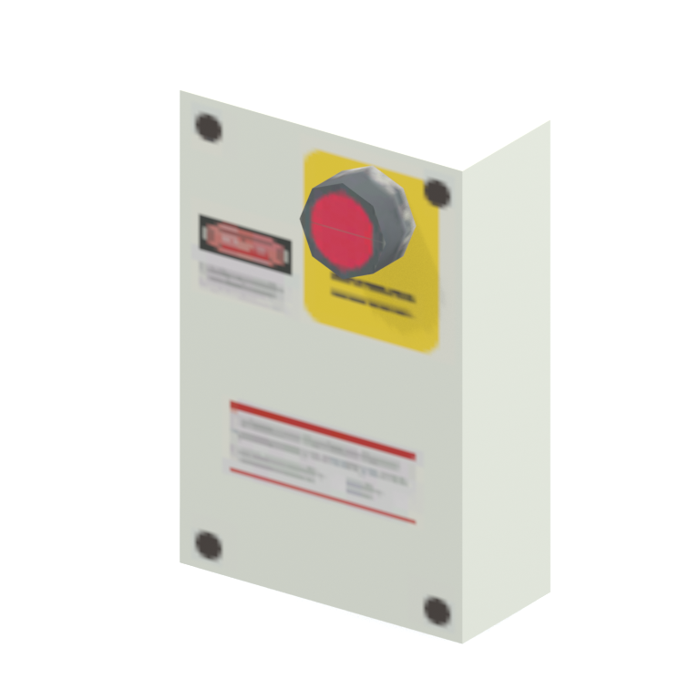

# Emergency-stop / control switch panel

A small control panel with a red emergency-stop style switch. The model namespace is guantanamo; its retained occurrence is on Mother Base. No working interaction is claimed.

[Equipment table](../tables/equipment-batch-1.md) | [Library](../README.md) | [Credits](../sources-and-credits.md) | [Batch source data](../batch-provenance.json)

## Still reference

## 360-degree reference

Static model; 48 camera views, 100ms/frame,4.8-second loop. This is a reference-camera orbit, not native animation. Actual retained base textures/UVs use approximate studio lighting. FOX shader, collision, interactions and complete assembly are untested.

## Identity and source

| Field | Value |
|---|---|
| Category | Equipment > Controls and fixtures |
| Tags | switch, control-panel, emergency-stop, guantanamo-namespace |
| Native model | `/Assets/tpp/environ/object/guantanamo/switch/gntn_swtc001/scenes/gntn_swtc001_vrtn001.fmdl` |
| Native SHA256 | `2254517a6e54acff6679613ab4da0fc3b16a2245da763046ab7b387749fd4e3d` |
| Retained container | `/Assets/tpp/pack/location/mtbs/pack_area/mtbs_area_ly003_cl02.fpk` |
| Retained container SHA256 | `a8cab67888b906b8dbbb2866ef5dde1c95dd8b05c2ec2966722cb39e36134d3c` |
| Location evidence | Retained member record joined by native SHA/path; selected raw hash rechecked. Archive not freshly unpacked. |
| Current installed DAT / priority | Not verified; outer DAT unknown for this record |
| Upstream preparation | Retained pre-extracted native FMDL/converted DDS; no converter invoked by this job |

Source namespace is a path identity, not exclusive original use. Lowercased lookup keys are separate from the exact retained member spelling.

## Quality and native LOD inventory

Texture pixels/mips, geometric detail and approximate studio shader fidelity are separate. Only LOD0 was rendered for this imported batch. Other levels are inventoried, not newly previewed; identical decoded index sets map to their recorded counterpart. The decoded-indices hash uses UTF-8 canonical JSON of triangle-index lists grouped by mesh, not the original packed index-buffer bytes. No upscaling or invented geometry.

| Native LOD | Triangles | Decoded indices SHA256 | Duplicate mapping | Preview status |
|---|---:|---|---|---|
| 0 | 32 | `4248c0b0faedad5fef0fc09d626fd1a6568ba28b9a1f5d12c86d8e4be32a7d31` | Distinct within retained model | Rendered above |
| 1 | 32 | `4248c0b0faedad5fef0fc09d626fd1a6568ba28b9a1f5d12c86d8e4be32a7d31` | LOD0 | Same index set as LOD0; no separate preview |
| 2 | 32 | `4248c0b0faedad5fef0fc09d626fd1a6568ba28b9a1f5d12c86d8e4be32a7d31` | LOD0 | Same index set as LOD0; no separate preview |
| 3 | 32 | `4248c0b0faedad5fef0fc09d626fd1a6568ba28b9a1f5d12c86d8e4be32a7d31` | LOD0 | Same index set as LOD0; no separate preview |

## Base textures

| Material | Native sampler / path hash | Pixels | Mip levels | Retained DDS SHA256 |
|---|---|---|---|---|
| 0 | Unknown sampler name (base binding) / `1542731748840806724` | 512 x 256 | 8 native/header verified | `6286ca660bd6439b8baf920e6edf23dd683e97b50ca700c7fdbc0f1fecc06517` |

Texture virtual filenames are unknown where only native hashes are available. Larger native textures elsewhere in the game were not searched. Only actual base-color maps are applied; normal/specular/packed shader channels are not recreated.

## Attribution and limits

Game models/textures: Konami. Project owner: arsenal-pt. Authored importer/metadata/reference work: OpenAI Codex (AI/LLM). [Community tools and detailed credits](../sources-and-credits.md). No endorsement is implied. Game artwork is outside the original-code license.

Only rendered references and descriptive metadata are distributed. Raw assets, native files, textures, decoded geometry, Blender scenes, private source paths and clean frame caches remain private. [Catalogue](../catalogue.json) and [batch provenance](../batch-provenance.json) preserve identity and media hashes.
