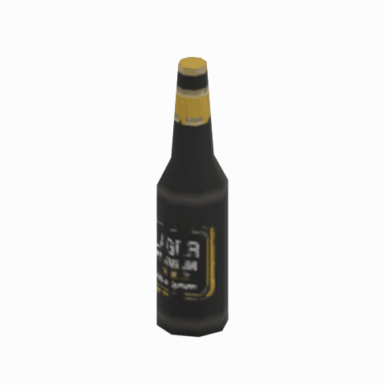

# Unidentified model (mafr_bttl001_br)

Native model reference; a readable object identification has not been reviewed.

[Library](../README.md) | [Category](../tables/unclassified-components-1.md) | [Source / advanced data](../catalogue.json) | [Credits](../sources-and-credits.md)

**Game filename:** mafr_bttl001_br.fmdl  
**Category:** Unclassified &gt; Unclassified components  
**Variant:** No explicit variant token; **LOD:** 0  
**Tags:** 

## Still reference


## 360-degree reference



The camera circles a static model. This is not a native animation. Source base textures and UVs use approximate studio shading; interaction, collision, complete assembly and FOX shader equivalence are not established.

## Identity and naming

| Field | Value |
|---|---|
| Library ID | mgsv-tpp-mafr_bttl001_br-43366cba83af1d01 |
| Naming status | unidentified |
| Naming confidence | unknown |
| Naming evidence | {} |
| Native model | /Assets/tpp/environ/object/middle_africa/bottle/mafr_bttl001/scenes/mafr_bttl001_br.fmdl |
| Model SHA256 | 14aceab87e3128476b00121e06dea0e819cecf2a3a8f32f1e48439eb17e4f63f |
| Container | /Assets/mgo/pack/location/afc0/pack_common/afc0_common.fpk |
| Container SHA256 | 20a950cab0d6912ac3a270b90dc6dc673f2d13859eb636819bfa3955fca6e320 |
| Captured source / location scope | Selected native member/content and captured installed-source chain; full archive SHA/runtime priority unresolved |
| Raw record SHA256 | 21d97430bca91eb84b3e82c23eb06bfdff7e6d3ef64ded3432e370dd4d5c7800 |

Naming review is descriptive metadata only. It does not change model completion or identify a working game interaction.

## Native LOD inventory

| Native LOD | Triangles | Preview status | Decoded indices SHA256 |
|---|---:|---|---|
| 0 | 60 | rendered | fa0950c0c84f134790c410d38ff170bce71b2a05ca14d84a59688d4b8e13a285 |
| 1 | 44 | not separately rendered | 6209fc37882b9cedd6d11649f15805fe580864815e84b24a6e75651b38e889a1 |
| 2 | 34 | not separately rendered | 5aaada260aa05b23aa5fc0066e58ed616e129b917b45086cf1606765fa9e4dc1 |
| 3 | 28 | not separately rendered | 663af9b30014a9cc2bdde52c081670f839e1687ecc44dd4f58a388011e3ac0a2 |

Mesh detail and texture pixels/mips are separate. Index hashes describe decoded triangle arrays, not packed index-buffer bytes. Only source-recorded native levels are listed.

<details>
<summary>Texture, source and naming technical metadata</summary>

```json
{
  "source": {
    "nativePath": "/Assets/tpp/environ/object/middle_africa/bottle/mafr_bttl001/scenes/mafr_bttl001_br.fmdl",
    "nativeSha256": "14aceab87e3128476b00121e06dea0e819cecf2a3a8f32f1e48439eb17e4f63f",
    "stableIdentity": "/assets/tpp/environ/object/middle_africa/bottle/mafr_bttl001/scenes/mafr_bttl001_br.fmdl#14aceab87e3128476b00121e06dea0e819cecf2a3a8f32f1e48439eb17e4f63f#32f4c76ee479abaaf4b6bd8cdc212b15fedfcdfbbe365b12bff66443f0d171c8",
    "container": {
      "nativePath": "/Assets/mgo/pack/location/afc0/pack_common/afc0_common.fpk",
      "sha256": "20a950cab0d6912ac3a270b90dc6dc673f2d13859eb636819bfa3955fca6e320",
      "status": "Selected installed-source container/member chain captured by community reader"
    },
    "historicalDatOrigin": null,
    "sourceArchiveAtCapture": "master/0/00.dat",
    "locationStatus": "Selected native member/content and captured installed-source chain; full archive SHA/runtime priority unresolved",
    "currentInstalledDatVerified": false,
    "selectedInstalledMemberVerified": true,
    "evidence": {
      "archive_helper_executable_sha256": "6f8e39a436af3b024bbd0504966ab3d5d9d0cb05d86689bf3e83d15e68df613f",
      "archive_helper_source_sha256": "f662d3b63e066a0afc77ffe22ea0e564222d14469648300dba2c4f8e9b43446b",
      "archive_index_recipe": "54acff767f08d76ad6056c5387328759bc883df507788f398de6c2c04fac12db",
      "archive_reader": "Atvaark GzsTool.Core 0.5.3",
      "archive_reader_core_sha256": "9da447ae3c375cce2e46744eeff6af50f1591062afdf479d1a0b49edb47daaa3",
      "archive_tool_and_dictionary_sha256": {
        "CityHash.dll": "def6c4506d461b65e4059b2936b2cbd5f852ba5d1d8a1a527f1c0e6dc7008c8f",
        "GzsTool.Core.dll": "9da447ae3c375cce2e46744eeff6af50f1591062afdf479d1a0b49edb47daaa3",
        "GzsTool.exe": "1a9c5b11e2355383ff485aee7e86abc026f5c1fad729daf8c0fd15ee0aae1c10",
        "Zlib.Portable.dll": "fe84781ba35ca9cc5ff5f73fd08d2a66c59e5257b4573f5fe59743f30bf78e42",
        "fpk_dictionary.txt": "b82f9a8d6c10a68ba9471eca9d815c21355a53b5e68753d8ad7db7fd01bf401d",
        "qar_dictionary.txt": "1558c248ed0a4bb827888261563fbb91a2df4f03999682f85d637ff70d9d5fb2"
      },
      "bytes": 3216,
      "container_chain": [
        {
          "content_sha256": null,
          "depth": 0,
          "id": "3f19555d27c2ebecdfbad26aadd88b9f62e9fb6092c04c712963ef73c67ccb42",
          "index_sha256": "9acd3675d6e1500e0e18430cba0fdc70a5718ad7d6b62f13905891a35d59f18a",
          "kind": "qar",
          "name": "master/0/00.dat",
          "parent_occurrence": null
        },
        {
          "content_sha256": "20a950cab0d6912ac3a270b90dc6dc673f2d13859eb636819bfa3955fca6e320",
          "depth": 1,
          "id": "f1334a28f5fb887d989a9c548d11dccada12186358e0a4b4e7fc9831f6f42881",
          "index_sha256": "e15578c97612208569f283c28408f389fb560576e3976adf9d7aa8ed9c9aaf87",
          "kind": "fpk",
          "name": "/Assets/mgo/pack/location/afc0/pack_common/afc0_common.fpk",
          "parent_occurrence": "348190d8da3d429c2cdae58af0494f023c46b80f66da14d484dc54a7e17a97df"
        }
      ],
      "contentSha256": "14aceab87e3128476b00121e06dea0e819cecf2a3a8f32f1e48439eb17e4f63f",
      "member": {
        "actual_size": 3216,
        "compressed_size": null,
        "content_sha256": "14aceab87e3128476b00121e06dea0e819cecf2a3a8f32f1e48439eb17e4f63f",
        "declared_size": 3216,
        "extension": "fmdl",
        "hash_hex": null,
        "name": "/Assets/tpp/environ/object/middle_africa/bottle/mafr_bttl001/scenes/mafr_bttl001_br.fmdl",
        "name_origin": "embedded",
        "offset": 6178032,
        "ordinal": 201,
        "path_hash": null,
        "resolved": 1
      },
      "occurrenceId": "d0d0a60f3dc9c925d9fe04e79a2f90f22099d43a80b865017609456212e63be5",
      "occurrence_id": "d0d0a60f3dc9c925d9fe04e79a2f90f22099d43a80b865017609456212e63be5",
      "primary_source_revision": "fc4a8196555638c6cf8aa1b7c8dc34ccd5c69cb5",
      "source_adapter": "community_core_selective_export",
      "source_id": "7f6bb743fb4c487f0e9522f9c7fac280c46cf6b1051e0fc75a93602c8eb451f0",
      "source_path": "master/0/00.dat",
      "source_snapshot": "{\"bytes\":768788480,\"device\":621747392682911458,\"file_id\":844424931596481,\"header_sha256\":\"ead50f0a9a37e4285323b9c6fa0ec75fe75e518c63147e63158eeb2892c6589e\",\"mtime_ns\":1791852224238580700}",
      "virtualPath": "/Assets/tpp/environ/object/middle_africa/bottle/mafr_bttl001/scenes/mafr_bttl001_br.fmdl"
    }
  },
  "materials": [
    {
      "sampler": "Base_Tex_SRGB",
      "materialIndex": 0,
      "nativePathHash": "1542915707429264667",
      "nativeVirtualPath": null,
      "nativeBinding": {
        "familyId": "7b677895e00c510bde835a7f29bfbaf3ca274c10e1aef7e6c53dbccb1a986b54",
        "height": 128,
        "materialIndex": 0,
        "mipCount": 6,
        "nativeMipCountVerified": true,
        "nativePath": null,
        "nativePathHash": "1542915707429264667",
        "nativeTexture": {
          "additionalFtexsFileCount": 0,
          "depth": 1,
          "ftexsFileCount": 1,
          "height": 128,
          "metadataBytes": 160,
          "mipCount": 6,
          "mips": [
            {
              "chunks": 1,
              "decodedBytes": 8192,
              "mip": 0,
              "offset": 1432,
              "storedBytes": 1808,
              "streamNumber": 1
            },
            {
              "chunks": 1,
              "decodedBytes": 2048,
              "mip": 1,
              "offset": 560,
              "storedBytes": 864,
              "streamNumber": 1
            },
            {
              "chunks": 1,
              "decodedBytes": 512,
              "mip": 2,
              "offset": 216,
              "storedBytes": 336,
              "streamNumber": 1
            },
            {
              "chunks": 1,
              "decodedBytes": 128,
              "mip": 3,
              "offset": 80,
              "storedBytes": 128,
              "streamNumber": 1
            },
            {
              "chunks": 1,
              "decodedBytes": 32,
              "mip": 4,
              "offset": 24,
              "storedBytes": 48,
              "streamNumber": 1
            },
            {
              "chunks": 1,
              "decodedBytes": 8,
              "mip": 5,
              "offset": 0,
              "storedBytes": 16,
              "streamNumber": 1
            }
          ],
          "nativeHeaderHash": "8c359d8bdf3103368427df9f40fd31d2",
          "nrtFlag": 2,
          "pixelFormat": 2,
          "requiredStreamNumbers": [
            1
          ],
          "textureType": 16777219,
          "unknownFlags": 273,
          "width": 128
        },
        "samplerName": "Base_Tex_SRGB",
        "samplerNameHash": "72475356961633",
        "sha256": "304094b055f23caf67b51f8fb615111cb133836ece6f21bef2c0780d6252f8f0",
        "sourceOccurrences": [
          {
            "archive_helper_executable_sha256": "6f8e39a436af3b024bbd0504966ab3d5d9d0cb05d86689bf3e83d15e68df613f",
            "archive_helper_source_sha256": "f662d3b63e066a0afc77ffe22ea0e564222d14469648300dba2c4f8e9b43446b",
            "archive_index_recipe": "54acff767f08d76ad6056c5387328759bc883df507788f398de6c2c04fac12db",
            "archive_reader": "Atvaark GzsTool.Core 0.5.3",
            "archive_reader_core_sha256": "9da447ae3c375cce2e46744eeff6af50f1591062afdf479d1a0b49edb47daaa3",
            "archive_tool_and_dictionary_sha256": {
              "CityHash.dll": "def6c4506d461b65e4059b2936b2cbd5f852ba5d1d8a1a527f1c0e6dc7008c8f",
              "GzsTool.Core.dll": "9da447ae3c375cce2e46744eeff6af50f1591062afdf479d1a0b49edb47daaa3",
              "GzsTool.exe": "1a9c5b11e2355383ff485aee7e86abc026f5c1fad729daf8c0fd15ee0aae1c10",
              "Zlib.Portable.dll": "fe84781ba35ca9cc5ff5f73fd08d2a66c59e5257b4573f5fe59743f30bf78e42",
              "fpk_dictionary.txt": "b82f9a8d6c10a68ba9471eca9d815c21355a53b5e68753d8ad7db7fd01bf401d",
              "qar_dictionary.txt": "1558c248ed0a4bb827888261563fbb91a2df4f03999682f85d637ff70d9d5fb2"
            },
            "bytes": 160,
            "container_chain": [
              {
                "content_sha256": null,
                "depth": 0,
                "id": "3f19555d27c2ebecdfbad26aadd88b9f62e9fb6092c04c712963ef73c67ccb42",
                "index_sha256": "9acd3675d6e1500e0e18430cba0fdc70a5718ad7d6b62f13905891a35d59f18a",
                "kind": "qar",
                "name": "master/0/00.dat",
                "parent_occurrence": null
              },
              {
                "content_sha256": "c371a18745c941878107bdaf7aef71c13b09b8b3a574360f6e38e0a7172b74e6",
                "depth": 1,
                "id": "13570131ff9ebc75c266205cbdf3461ff4dc51e8a0cb4f7407b0a08fe357052a",
                "index_sha256": "5b8e60a5e6b705cb87973f15c3215fb3733b7a49171030a4c7640da4622a5ca2",
                "kind": "pftxs",
                "name": "/Assets/mgo/pack/location/afc0/pack_common/afc0_common.pftxs",
                "parent_occurrence": "abc314b7f418d61ea6a3e5525bf8f85d22b454b81d3407e6645bfc43339658ac"
              }
            ],
            "contentSha256": "dcdc35c717a6b83d2bf77c1c816d15afb8d97fdff01cca99eb1a0b69a8d1f990",
            "member": {
              "actual_size": 160,
              "compressed_size": null,
              "content_sha256": "dcdc35c717a6b83d2bf77c1c816d15afb8d97fdff01cca99eb1a0b69a8d1f990",
              "declared_size": 160,
              "extension": "ftex",
              "hash_hex": "156989a943b11d1b",
              "name": "156989a943b11d1b.ftex",
              "name_origin": "hash_fallback",
              "offset": 13662640,
              "ordinal": 883,
              "path_hash": null,
              "resolved": 0
            },
            "occurrenceId": "2ab633e29bb5daef3dcc9d94dc90afb6fc089abb5d2364fb091a36802a3a8ec8",
            "occurrence_id": "2ab633e29bb5daef3dcc9d94dc90afb6fc089abb5d2364fb091a36802a3a8ec8",
            "primary_source_revision": "fc4a8196555638c6cf8aa1b7c8dc34ccd5c69cb5",
            "source_adapter": "community_core_selective_export",
            "source_id": "7f6bb743fb4c487f0e9522f9c7fac280c46cf6b1051e0fc75a93602c8eb451f0",
            "source_path": "master/0/00.dat",
            "source_snapshot": "{\"bytes\":768788480,\"device\":621747392682911458,\"file_id\":844424931596481,\"header_sha256\":\"ead50f0a9a37e4285323b9c6fa0ec75fe75e518c63147e63158eeb2892c6589e\",\"mtime_ns\":1791852224238580700}",
            "virtualPath": "156989a943b11d1b.ftex"
          },
          {
            "archive_helper_executable_sha256": "6f8e39a436af3b024bbd0504966ab3d5d9d0cb05d86689bf3e83d15e68df613f",
            "archive_helper_source_sha256": "f662d3b63e066a0afc77ffe22ea0e564222d14469648300dba2c4f8e9b43446b",
            "archive_index_recipe": "54acff767f08d76ad6056c5387328759bc883df507788f398de6c2c04fac12db",
            "archive_reader": "Atvaark GzsTool.Core 0.5.3",
            "archive_reader_core_sha256": "9da447ae3c375cce2e46744eeff6af50f1591062afdf479d1a0b49edb47daaa3",
            "archive_tool_and_dictionary_sha256": {
              "CityHash.dll": "def6c4506d461b65e4059b2936b2cbd5f852ba5d1d8a1a527f1c0e6dc7008c8f",
              "GzsTool.Core.dll": "9da447ae3c375cce2e46744eeff6af50f1591062afdf479d1a0b49edb47daaa3",
              "GzsTool.exe": "1a9c5b11e2355383ff485aee7e86abc026f5c1fad729daf8c0fd15ee0aae1c10",
              "Zlib.Portable.dll": "fe84781ba35ca9cc5ff5f73fd08d2a66c59e5257b4573f5fe59743f30bf78e42",
              "fpk_dictionary.txt": "b82f9a8d6c10a68ba9471eca9d815c21355a53b5e68753d8ad7db7fd01bf401d",
              "qar_dictionary.txt": "1558c248ed0a4bb827888261563fbb91a2df4f03999682f85d637ff70d9d5fb2"
            },
            "bytes": 3248,
            "container_chain": [
              {
                "content_sha256": null,
                "depth": 0,
                "id": "436c8cfb4f382de93365b167a61aa81383299b7bad18205d60f1d0beeb3919e3",
                "index_sha256": "2d7b45c6ca65418839618e978562cac336091c06eb56dfe99f762b07a4016960",
                "kind": "qar",
                "name": "master/texture4.dat",
                "parent_occurrence": null
              }
            ],
            "contentSha256": "ea88c852cac2d79ba07fe7b5003c1e257acbaa299409944d6de7853ba70a05e7",
            "member": {
              "actual_size": 3248,
              "compressed_size": 3248,
              "content_sha256": "ea88c852cac2d79ba07fe7b5003c1e257acbaa299409944d6de7853ba70a05e7",
              "declared_size": 3248,
              "extension": "1.ftexs",
              "hash_hex": "b2c189a943b11d1b",
              "name": "189a943b11d1b.1.ftexs",
              "name_origin": "hash_fallback",
              "offset": 362881056,
              "ordinal": 1867,
              "path_hash": "189a943b11d1b",
              "resolved": 0
            },
            "occurrenceId": "35b8c213003bfe9f8dab985bc3497678f9327878a65aed3c50f8a6d5967dbb7d",
            "occurrence_id": "35b8c213003bfe9f8dab985bc3497678f9327878a65aed3c50f8a6d5967dbb7d",
            "primary_source_revision": "fc4a8196555638c6cf8aa1b7c8dc34ccd5c69cb5",
            "source_adapter": "community_core_selective_export",
            "source_id": "6c31b98b4db9b88eb76cfcb538f5f34b4729531266a9459584126720a4fc14aa",
            "source_path": "master/texture4.dat",
            "source_snapshot": "{\"bytes\":2031604736,\"device\":621747392682911458,\"file_id\":562949953639628,\"header_sha256\":\"40ee2c6917b338f7f68c49847c97fe92b978506a1ba847fcc94d28c931c8711a\",\"mtime_ns\":1791224675561235200}",
            "virtualPath": "189a943b11d1b.1.ftexs"
          }
        ],
        "width": 128
      },
      "ddsSha256": "304094b055f23caf67b51f8fb615111cb133836ece6f21bef2c0780d6252f8f0",
      "dimensions": [
        128,
        128
      ],
      "mipCount": 6,
      "nativeMipCountVerified": true,
      "connectedInPreview": true
    }
  ],
  "quality": {
    "decodedIndicesHashDerivation": "SHA256 of canonical UTF-8 JSON decoded triangle indices grouped by mesh; not packed buffer bytes",
    "highestRetainedGeometricLod": 0,
    "distinctNativeLods": 4,
    "baseTextureDimensions": [
      128,
      128
    ],
    "baseTextureNativeMipCount": 6,
    "largerRetainedBaseTextureFound": null,
    "nativeLods": [
      {
        "indicesSha256": "fa0950c0c84f134790c410d38ff170bce71b2a05ca14d84a59688d4b8e13a285",
        "nativeLod": 0,
        "triangles": 60
      },
      {
        "indicesSha256": "6209fc37882b9cedd6d11649f15805fe580864815e84b24a6e75651b38e889a1",
        "nativeLod": 1,
        "triangles": 44
      },
      {
        "indicesSha256": "5aaada260aa05b23aa5fc0066e58ed616e129b917b45086cf1606765fa9e4dc1",
        "nativeLod": 2,
        "triangles": 34
      },
      {
        "indicesSha256": "663af9b30014a9cc2bdde52c081670f839e1687ecc44dd4f58a388011e3ac0a2",
        "nativeLod": 3,
        "triangles": 28
      }
    ],
    "renderedNativeLods": [
      0
    ],
    "baseTextureSummary": "128 x 128; 6 native/DDS mips",
    "highestDetailScope": "Triangle-count comparison within captured FMDL only"
  }
}
```

</details>

[Original source / advanced record](../catalogue.json)
