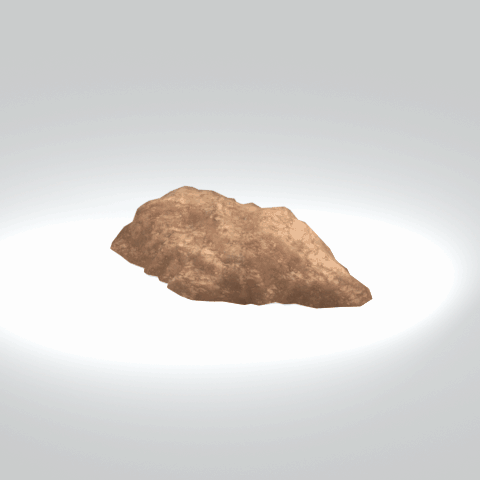

# Cliff component

A native cliff model component. Its specific form and assembly have not been visually reviewed.

[Library](../README.md) | [Category](../tables/cliffs-1.md) | [Source / advanced data](../catalogue.json) | [Credits](../sources-and-credits.md)

**Game filename:** mafr_clff018_vrtn002.fmdl  
**Category:** Terrain &gt; Cliffs  
**Variant:** vrtn002; **LOD:** 0  
**Tags:** cliff, component

## Still reference


## 360-degree reference



The camera circles a static model. This is not a native animation. Source base textures and UVs use approximate studio shading; interaction, collision, complete assembly and FOX shader equivalence are not established.

## Identity and naming

| Field | Value |
|---|---|
| Library ID | mgsv-tpp-mafr_clff018_vrtn002-e8c24b910fc72423 |
| Naming status | path-derived |
| Naming confidence | medium |
| Naming evidence | {"kind": "native-folder", "note": "Conservative folder dictionary; not visual identification, color, function or completeness proof", "source": "cliff"} |
| Native model | /Assets/tpp/environ/object/middle_africa/cliff/mafr_clff018/scenes/mafr_clff018_vrtn002.fmdl |
| Model SHA256 | 4dafaa091f00896621bd2aec7491d1ea2e9cd580ff855fff0e4bcbf0dd95226d |
| Container | /Assets/mgo/pack/location/afc0/pack_common/afc0_common.fpk |
| Container SHA256 | 20a950cab0d6912ac3a270b90dc6dc673f2d13859eb636819bfa3955fca6e320 |
| Captured source / location scope | Selected native member/content and captured installed-source chain; full archive SHA/runtime priority unresolved |
| Raw record SHA256 | 730ed9b95fcc9f7bcd8b1da05662e5781d595ed87b78fc5ad5852b3adc22d58c |

Naming review is descriptive metadata only. It does not change model completion or identify a working game interaction.

## Native LOD inventory

| Native LOD | Triangles | Preview status | Decoded indices SHA256 |
|---|---:|---|---|
| 0 | 372 | rendered | c2f100823349bcf42f38ea76e7c5c3534a7fc2ebe41f3205f361faebccf0fc17 |
| 1 | 274 | not separately rendered | 8db792e8d5fc8b1f91c23f8e734ba0456a9cf33b85bfa11425a7160f4f7b2aad |
| 2 | 202 | not separately rendered | ade30e3a6550f7ba77682e1b03546b93760cd13d9057b5ca480cd49c97f040d6 |
| 3 | 150 | not separately rendered | c43b4853af8faa3bd67a9e6ecf5902b5b1fe9c77d097b175567204438cb890e0 |

Mesh detail and texture pixels/mips are separate. Index hashes describe decoded triangle arrays, not packed index-buffer bytes. Only source-recorded native levels are listed.

<details>
<summary>Texture, source and naming technical metadata</summary>

```json
{
  "source": {
    "nativePath": "/Assets/tpp/environ/object/middle_africa/cliff/mafr_clff018/scenes/mafr_clff018_vrtn002.fmdl",
    "nativeSha256": "4dafaa091f00896621bd2aec7491d1ea2e9cd580ff855fff0e4bcbf0dd95226d",
    "stableIdentity": "/assets/tpp/environ/object/middle_africa/cliff/mafr_clff018/scenes/mafr_clff018_vrtn002.fmdl#4dafaa091f00896621bd2aec7491d1ea2e9cd580ff855fff0e4bcbf0dd95226d#3fbf5f0f012e839331e7866e0f8b84104ec9e1d3bade45ba260e12450176b7e9",
    "container": {
      "nativePath": "/Assets/mgo/pack/location/afc0/pack_common/afc0_common.fpk",
      "sha256": "20a950cab0d6912ac3a270b90dc6dc673f2d13859eb636819bfa3955fca6e320",
      "status": "Selected installed-source container/member chain captured by community reader"
    },
    "historicalDatOrigin": null,
    "sourceArchiveAtCapture": "master/0/00.dat",
    "locationStatus": "Selected native member/content and captured installed-source chain; full archive SHA/runtime priority unresolved",
    "currentInstalledDatVerified": false,
    "selectedInstalledMemberVerified": true,
    "evidence": {
      "archive_helper_executable_sha256": "6f8e39a436af3b024bbd0504966ab3d5d9d0cb05d86689bf3e83d15e68df613f",
      "archive_helper_source_sha256": "f662d3b63e066a0afc77ffe22ea0e564222d14469648300dba2c4f8e9b43446b",
      "archive_index_recipe": "54acff767f08d76ad6056c5387328759bc883df507788f398de6c2c04fac12db",
      "archive_reader": "Atvaark GzsTool.Core 0.5.3",
      "archive_reader_core_sha256": "9da447ae3c375cce2e46744eeff6af50f1591062afdf479d1a0b49edb47daaa3",
      "archive_tool_and_dictionary_sha256": {
        "CityHash.dll": "def6c4506d461b65e4059b2936b2cbd5f852ba5d1d8a1a527f1c0e6dc7008c8f",
        "GzsTool.Core.dll": "9da447ae3c375cce2e46744eeff6af50f1591062afdf479d1a0b49edb47daaa3",
        "GzsTool.exe": "1a9c5b11e2355383ff485aee7e86abc026f5c1fad729daf8c0fd15ee0aae1c10",
        "Zlib.Portable.dll": "fe84781ba35ca9cc5ff5f73fd08d2a66c59e5257b4573f5fe59743f30bf78e42",
        "fpk_dictionary.txt": "b82f9a8d6c10a68ba9471eca9d815c21355a53b5e68753d8ad7db7fd01bf401d",
        "qar_dictionary.txt": "1558c248ed0a4bb827888261563fbb91a2df4f03999682f85d637ff70d9d5fb2"
      },
      "bytes": 12912,
      "container_chain": [
        {
          "content_sha256": null,
          "depth": 0,
          "id": "3f19555d27c2ebecdfbad26aadd88b9f62e9fb6092c04c712963ef73c67ccb42",
          "index_sha256": "9acd3675d6e1500e0e18430cba0fdc70a5718ad7d6b62f13905891a35d59f18a",
          "kind": "qar",
          "name": "master/0/00.dat",
          "parent_occurrence": null
        },
        {
          "content_sha256": "20a950cab0d6912ac3a270b90dc6dc673f2d13859eb636819bfa3955fca6e320",
          "depth": 1,
          "id": "f1334a28f5fb887d989a9c548d11dccada12186358e0a4b4e7fc9831f6f42881",
          "index_sha256": "e15578c97612208569f283c28408f389fb560576e3976adf9d7aa8ed9c9aaf87",
          "kind": "fpk",
          "name": "/Assets/mgo/pack/location/afc0/pack_common/afc0_common.fpk",
          "parent_occurrence": "348190d8da3d429c2cdae58af0494f023c46b80f66da14d484dc54a7e17a97df"
        }
      ],
      "contentSha256": "4dafaa091f00896621bd2aec7491d1ea2e9cd580ff855fff0e4bcbf0dd95226d",
      "member": {
        "actual_size": 12912,
        "compressed_size": null,
        "content_sha256": "4dafaa091f00896621bd2aec7491d1ea2e9cd580ff855fff0e4bcbf0dd95226d",
        "declared_size": 12912,
        "extension": "fmdl",
        "hash_hex": null,
        "name": "/Assets/tpp/environ/object/middle_africa/cliff/mafr_clff018/scenes/mafr_clff018_vrtn002.fmdl",
        "name_origin": "embedded",
        "offset": 6625616,
        "ordinal": 226,
        "path_hash": null,
        "resolved": 1
      },
      "occurrenceId": "c9d17e6a4c2f93bb1c5c15459ca03d92f75c20f303a42877a6a6685ecd157c5d",
      "occurrence_id": "c9d17e6a4c2f93bb1c5c15459ca03d92f75c20f303a42877a6a6685ecd157c5d",
      "primary_source_revision": "fc4a8196555638c6cf8aa1b7c8dc34ccd5c69cb5",
      "source_adapter": "community_core_selective_export",
      "source_id": "7f6bb743fb4c487f0e9522f9c7fac280c46cf6b1051e0fc75a93602c8eb451f0",
      "source_path": "master/0/00.dat",
      "source_snapshot": "{\"bytes\":768788480,\"device\":621747392682911458,\"file_id\":844424931596481,\"header_sha256\":\"ead50f0a9a37e4285323b9c6fa0ec75fe75e518c63147e63158eeb2892c6589e\",\"mtime_ns\":1791852224238580700}",
      "virtualPath": "/Assets/tpp/environ/object/middle_africa/cliff/mafr_clff018/scenes/mafr_clff018_vrtn002.fmdl"
    }
  },
  "materials": [
    {
      "sampler": "Base_Tex_SRGB",
      "materialIndex": 0,
      "nativePathHash": "1543212677264228610",
      "nativeVirtualPath": null,
      "nativeBinding": {
        "familyId": "3c81031bacb3a29fac0886122298087de8211339638b023c214d560f0637c2b0",
        "height": 2048,
        "materialIndex": 0,
        "mipCount": 10,
        "nativeMipCountVerified": true,
        "nativePath": null,
        "nativePathHash": "1543212677264228610",
        "nativeTexture": {
          "additionalFtexsFileCount": 2,
          "depth": 1,
          "ftexsFileCount": 3,
          "height": 2048,
          "metadataBytes": 224,
          "mipCount": 10,
          "mips": [
            {
              "chunks": 128,
              "decodedBytes": 2097152,
              "mip": 0,
              "offset": 0,
              "storedBytes": 1638080,
              "streamNumber": 3
            },
            {
              "chunks": 32,
              "decodedBytes": 524288,
              "mip": 1,
              "offset": 0,
              "storedBytes": 423280,
              "streamNumber": 2
            },
            {
              "chunks": 8,
              "decodedBytes": 131072,
              "mip": 2,
              "offset": 35488,
              "storedBytes": 106304,
              "streamNumber": 1
            },
            {
              "chunks": 2,
              "decodedBytes": 32768,
              "mip": 3,
              "offset": 9136,
              "storedBytes": 26336,
              "streamNumber": 1
            },
            {
              "chunks": 1,
              "decodedBytes": 8192,
              "mip": 4,
              "offset": 2552,
              "storedBytes": 6576,
              "streamNumber": 1
            },
            {
              "chunks": 1,
              "decodedBytes": 2048,
              "mip": 5,
              "offset": 752,
              "storedBytes": 1792,
              "streamNumber": 1
            },
            {
              "chunks": 1,
              "decodedBytes": 512,
              "mip": 6,
              "offset": 232,
              "storedBytes": 512,
              "streamNumber": 1
            },
            {
              "chunks": 1,
              "decodedBytes": 128,
              "mip": 7,
              "offset": 80,
              "storedBytes": 144,
              "streamNumber": 1
            },
            {
              "chunks": 1,
              "decodedBytes": 32,
              "mip": 8,
              "offset": 24,
              "storedBytes": 48,
              "streamNumber": 1
            },
            {
              "chunks": 1,
              "decodedBytes": 8,
              "mip": 9,
              "offset": 0,
              "storedBytes": 16,
              "streamNumber": 1
            }
          ],
          "nativeHeaderHash": "bdf23cb9ac1d7d9fd479fc0b2ebcdecd",
          "nrtFlag": 2,
          "pixelFormat": 2,
          "requiredStreamNumbers": [
            1,
            2,
            3
          ],
          "textureType": 16777219,
          "unknownFlags": 273,
          "width": 2048
        },
        "samplerName": "Base_Tex_SRGB",
        "samplerNameHash": "72475356961633",
        "sha256": "41fe30d1625c2255c98cb0e749e27e1473434a476be34a5d666b8f415e8670ee",
        "sourceOccurrences": [
          {
            "archive_helper_executable_sha256": "6f8e39a436af3b024bbd0504966ab3d5d9d0cb05d86689bf3e83d15e68df613f",
            "archive_helper_source_sha256": "f662d3b63e066a0afc77ffe22ea0e564222d14469648300dba2c4f8e9b43446b",
            "archive_index_recipe": "54acff767f08d76ad6056c5387328759bc883df507788f398de6c2c04fac12db",
            "archive_reader": "Atvaark GzsTool.Core 0.5.3",
            "archive_reader_core_sha256": "9da447ae3c375cce2e46744eeff6af50f1591062afdf479d1a0b49edb47daaa3",
            "archive_tool_and_dictionary_sha256": {
              "CityHash.dll": "def6c4506d461b65e4059b2936b2cbd5f852ba5d1d8a1a527f1c0e6dc7008c8f",
              "GzsTool.Core.dll": "9da447ae3c375cce2e46744eeff6af50f1591062afdf479d1a0b49edb47daaa3",
              "GzsTool.exe": "1a9c5b11e2355383ff485aee7e86abc026f5c1fad729daf8c0fd15ee0aae1c10",
              "Zlib.Portable.dll": "fe84781ba35ca9cc5ff5f73fd08d2a66c59e5257b4573f5fe59743f30bf78e42",
              "fpk_dictionary.txt": "b82f9a8d6c10a68ba9471eca9d815c21355a53b5e68753d8ad7db7fd01bf401d",
              "qar_dictionary.txt": "1558c248ed0a4bb827888261563fbb91a2df4f03999682f85d637ff70d9d5fb2"
            },
            "bytes": 224,
            "container_chain": [
              {
                "content_sha256": null,
                "depth": 0,
                "id": "436c8cfb4f382de93365b167a61aa81383299b7bad18205d60f1d0beeb3919e3",
                "index_sha256": "2d7b45c6ca65418839618e978562cac336091c06eb56dfe99f762b07a4016960",
                "kind": "qar",
                "name": "master/texture4.dat",
                "parent_occurrence": null
              }
            ],
            "contentSha256": "6aefb85237c9d0c46d67d9f351296614eba424c0a952f2fa6882544c78950fca",
            "member": {
              "actual_size": 224,
              "compressed_size": 224,
              "content_sha256": "6aefb85237c9d0c46d67d9f351296614eba424c0a952f2fa6882544c78950fca",
              "declared_size": 224,
              "extension": "ftex",
              "hash_hex": "156a97c0f136c102",
              "name": "297c0f136c102.ftex",
              "name_origin": "hash_fallback",
              "offset": 1128987680,
              "ordinal": 7935,
              "path_hash": "297c0f136c102",
              "resolved": 0
            },
            "occurrenceId": "2e5901b505bb6986363a3a2e0c579b2d92169765fef9266e75634f93d4c14fd7",
            "occurrence_id": "2e5901b505bb6986363a3a2e0c579b2d92169765fef9266e75634f93d4c14fd7",
            "primary_source_revision": "fc4a8196555638c6cf8aa1b7c8dc34ccd5c69cb5",
            "source_adapter": "community_core_selective_export",
            "source_id": "6c31b98b4db9b88eb76cfcb538f5f34b4729531266a9459584126720a4fc14aa",
            "source_path": "master/texture4.dat",
            "source_snapshot": "{\"bytes\":2031604736,\"device\":621747392682911458,\"file_id\":562949953639628,\"header_sha256\":\"40ee2c6917b338f7f68c49847c97fe92b978506a1ba847fcc94d28c931c8711a\",\"mtime_ns\":1791224675561235200}",
            "virtualPath": "297c0f136c102.ftex"
          },
          {
            "archive_helper_executable_sha256": "6f8e39a436af3b024bbd0504966ab3d5d9d0cb05d86689bf3e83d15e68df613f",
            "archive_helper_source_sha256": "f662d3b63e066a0afc77ffe22ea0e564222d14469648300dba2c4f8e9b43446b",
            "archive_index_recipe": "54acff767f08d76ad6056c5387328759bc883df507788f398de6c2c04fac12db",
            "archive_reader": "Atvaark GzsTool.Core 0.5.3",
            "archive_reader_core_sha256": "9da447ae3c375cce2e46744eeff6af50f1591062afdf479d1a0b49edb47daaa3",
            "archive_tool_and_dictionary_sha256": {
              "CityHash.dll": "def6c4506d461b65e4059b2936b2cbd5f852ba5d1d8a1a527f1c0e6dc7008c8f",
              "GzsTool.Core.dll": "9da447ae3c375cce2e46744eeff6af50f1591062afdf479d1a0b49edb47daaa3",
              "GzsTool.exe": "1a9c5b11e2355383ff485aee7e86abc026f5c1fad729daf8c0fd15ee0aae1c10",
              "Zlib.Portable.dll": "fe84781ba35ca9cc5ff5f73fd08d2a66c59e5257b4573f5fe59743f30bf78e42",
              "fpk_dictionary.txt": "b82f9a8d6c10a68ba9471eca9d815c21355a53b5e68753d8ad7db7fd01bf401d",
              "qar_dictionary.txt": "1558c248ed0a4bb827888261563fbb91a2df4f03999682f85d637ff70d9d5fb2"
            },
            "bytes": 141856,
            "container_chain": [
              {
                "content_sha256": null,
                "depth": 0,
                "id": "436c8cfb4f382de93365b167a61aa81383299b7bad18205d60f1d0beeb3919e3",
                "index_sha256": "2d7b45c6ca65418839618e978562cac336091c06eb56dfe99f762b07a4016960",
                "kind": "qar",
                "name": "master/texture4.dat",
                "parent_occurrence": null
              }
            ],
            "contentSha256": "c52367193511f980eacf5b60ebb92a6f2ec37889c229fa827aca0abe6bb09476",
            "member": {
              "actual_size": 141856,
              "compressed_size": 141856,
              "content_sha256": "c52367193511f980eacf5b60ebb92a6f2ec37889c229fa827aca0abe6bb09476",
              "declared_size": 141856,
              "extension": "1.ftexs",
              "hash_hex": "b2c297c0f136c102",
              "name": "297c0f136c102.1.ftexs",
              "name_origin": "hash_fallback",
              "offset": 1126781984,
              "ordinal": 7932,
              "path_hash": "297c0f136c102",
              "resolved": 0
            },
            "occurrenceId": "ba8ca37f263b2e0dd0e1cb910022d5118554628b0ba5faaacb337e534589414a",
            "occurrence_id": "ba8ca37f263b2e0dd0e1cb910022d5118554628b0ba5faaacb337e534589414a",
            "primary_source_revision": "fc4a8196555638c6cf8aa1b7c8dc34ccd5c69cb5",
            "source_adapter": "community_core_selective_export",
            "source_id": "6c31b98b4db9b88eb76cfcb538f5f34b4729531266a9459584126720a4fc14aa",
            "source_path": "master/texture4.dat",
            "source_snapshot": "{\"bytes\":2031604736,\"device\":621747392682911458,\"file_id\":562949953639628,\"header_sha256\":\"40ee2c6917b338f7f68c49847c97fe92b978506a1ba847fcc94d28c931c8711a\",\"mtime_ns\":1791224675561235200}",
            "virtualPath": "297c0f136c102.1.ftexs"
          },
          {
            "archive_helper_executable_sha256": "6f8e39a436af3b024bbd0504966ab3d5d9d0cb05d86689bf3e83d15e68df613f",
            "archive_helper_source_sha256": "f662d3b63e066a0afc77ffe22ea0e564222d14469648300dba2c4f8e9b43446b",
            "archive_index_recipe": "54acff767f08d76ad6056c5387328759bc883df507788f398de6c2c04fac12db",
            "archive_reader": "Atvaark GzsTool.Core 0.5.3",
            "archive_reader_core_sha256": "9da447ae3c375cce2e46744eeff6af50f1591062afdf479d1a0b49edb47daaa3",
            "archive_tool_and_dictionary_sha256": {
              "CityHash.dll": "def6c4506d461b65e4059b2936b2cbd5f852ba5d1d8a1a527f1c0e6dc7008c8f",
              "GzsTool.Core.dll": "9da447ae3c375cce2e46744eeff6af50f1591062afdf479d1a0b49edb47daaa3",
              "GzsTool.exe": "1a9c5b11e2355383ff485aee7e86abc026f5c1fad729daf8c0fd15ee0aae1c10",
              "Zlib.Portable.dll": "fe84781ba35ca9cc5ff5f73fd08d2a66c59e5257b4573f5fe59743f30bf78e42",
              "fpk_dictionary.txt": "b82f9a8d6c10a68ba9471eca9d815c21355a53b5e68753d8ad7db7fd01bf401d",
              "qar_dictionary.txt": "1558c248ed0a4bb827888261563fbb91a2df4f03999682f85d637ff70d9d5fb2"
            },
            "bytes": 423536,
            "container_chain": [
              {
                "content_sha256": null,
                "depth": 0,
                "id": "1cc220d9409d7163b6aca295ed89fd8c7befca6a8f849a8d5d09a2499724c863",
                "index_sha256": "5a818609a652a10d90fb90015661d0cb80898096bbb3aac36382172988d8736d",
                "kind": "qar",
                "name": "master/texture5_mgo0.dat",
                "parent_occurrence": null
              }
            ],
            "contentSha256": "a6d8c1dd91575624de744242e0170f8d090a0914fd67abf637ce0321e1dedfa4",
            "member": {
              "actual_size": 423536,
              "compressed_size": 423536,
              "content_sha256": "a6d8c1dd91575624de744242e0170f8d090a0914fd67abf637ce0321e1dedfa4",
              "declared_size": 423536,
              "extension": "2.ftexs",
              "hash_hex": "b57297c0f136c102",
              "name": "297c0f136c102.2.ftexs",
              "name_origin": "hash_fallback",
              "offset": 3774623776,
              "ordinal": 15267,
              "path_hash": "297c0f136c102",
              "resolved": 0
            },
            "occurrenceId": "605a1f9a8f8033dc83918ec5c168e6f91452df9df1bcd6324906cf0a28873f29",
            "occurrence_id": "605a1f9a8f8033dc83918ec5c168e6f91452df9df1bcd6324906cf0a28873f29",
            "primary_source_revision": "fc4a8196555638c6cf8aa1b7c8dc34ccd5c69cb5",
            "source_adapter": "community_core_selective_export",
            "source_id": "24f8989ccaae47940dc20e54ba67442ad562ac0032ab6e3d475e927c81444b56",
            "source_path": "master/texture5_mgo0.dat",
            "source_snapshot": "{\"bytes\":4492370944,\"device\":621747392682911458,\"file_id\":13510798883237422,\"header_sha256\":\"6108fbacb65c84d041742c39e5ca630745240453b336f1059a13b91943f0b011\",\"mtime_ns\":1791224675562234400}",
            "virtualPath": "297c0f136c102.2.ftexs"
          },
          {
            "archive_helper_executable_sha256": "6f8e39a436af3b024bbd0504966ab3d5d9d0cb05d86689bf3e83d15e68df613f",
            "archive_helper_source_sha256": "f662d3b63e066a0afc77ffe22ea0e564222d14469648300dba2c4f8e9b43446b",
            "archive_index_recipe": "54acff767f08d76ad6056c5387328759bc883df507788f398de6c2c04fac12db",
            "archive_reader": "Atvaark GzsTool.Core 0.5.3",
            "archive_reader_core_sha256": "9da447ae3c375cce2e46744eeff6af50f1591062afdf479d1a0b49edb47daaa3",
            "archive_tool_and_dictionary_sha256": {
              "CityHash.dll": "def6c4506d461b65e4059b2936b2cbd5f852ba5d1d8a1a527f1c0e6dc7008c8f",
              "GzsTool.Core.dll": "9da447ae3c375cce2e46744eeff6af50f1591062afdf479d1a0b49edb47daaa3",
              "GzsTool.exe": "1a9c5b11e2355383ff485aee7e86abc026f5c1fad729daf8c0fd15ee0aae1c10",
              "Zlib.Portable.dll": "fe84781ba35ca9cc5ff5f73fd08d2a66c59e5257b4573f5fe59743f30bf78e42",
              "fpk_dictionary.txt": "b82f9a8d6c10a68ba9471eca9d815c21355a53b5e68753d8ad7db7fd01bf401d",
              "qar_dictionary.txt": "1558c248ed0a4bb827888261563fbb91a2df4f03999682f85d637ff70d9d5fb2"
            },
            "bytes": 1639104,
            "container_chain": [
              {
                "content_sha256": null,
                "depth": 0,
                "id": "1cc220d9409d7163b6aca295ed89fd8c7befca6a8f849a8d5d09a2499724c863",
                "index_sha256": "5a818609a652a10d90fb90015661d0cb80898096bbb3aac36382172988d8736d",
                "kind": "qar",
                "name": "master/texture5_mgo0.dat",
                "parent_occurrence": null
              }
            ],
            "contentSha256": "47be060329f99997200c478f23a25190054572f916b51ccb07bb991e4203edd7",
            "member": {
              "actual_size": 1639104,
              "compressed_size": 1639104,
              "content_sha256": "47be060329f99997200c478f23a25190054572f916b51ccb07bb991e4203edd7",
              "declared_size": 1639104,
              "extension": "3.ftexs",
              "hash_hex": "571a97c0f136c102",
              "name": "297c0f136c102.3.ftexs",
              "name_origin": "hash_fallback",
              "offset": 3775047712,
              "ordinal": 15268,
              "path_hash": "297c0f136c102",
              "resolved": 0
            },
            "occurrenceId": "920d728b8d4f2778baedf42d01b2a4feb1866bc651d2f961f166c87c9c163494",
            "occurrence_id": "920d728b8d4f2778baedf42d01b2a4feb1866bc651d2f961f166c87c9c163494",
            "primary_source_revision": "fc4a8196555638c6cf8aa1b7c8dc34ccd5c69cb5",
            "source_adapter": "community_core_selective_export",
            "source_id": "24f8989ccaae47940dc20e54ba67442ad562ac0032ab6e3d475e927c81444b56",
            "source_path": "master/texture5_mgo0.dat",
            "source_snapshot": "{\"bytes\":4492370944,\"device\":621747392682911458,\"file_id\":13510798883237422,\"header_sha256\":\"6108fbacb65c84d041742c39e5ca630745240453b336f1059a13b91943f0b011\",\"mtime_ns\":1791224675562234400}",
            "virtualPath": "297c0f136c102.3.ftexs"
          }
        ],
        "width": 2048
      },
      "ddsSha256": "41fe30d1625c2255c98cb0e749e27e1473434a476be34a5d666b8f415e8670ee",
      "dimensions": [
        2048,
        2048
      ],
      "mipCount": 10,
      "nativeMipCountVerified": true,
      "connectedInPreview": true
    }
  ],
  "quality": {
    "decodedIndicesHashDerivation": "SHA256 of canonical UTF-8 JSON decoded triangle indices grouped by mesh; not packed buffer bytes",
    "highestRetainedGeometricLod": 0,
    "distinctNativeLods": 4,
    "baseTextureDimensions": [
      2048,
      2048
    ],
    "baseTextureNativeMipCount": 10,
    "largerRetainedBaseTextureFound": null,
    "nativeLods": [
      {
        "indicesSha256": "c2f100823349bcf42f38ea76e7c5c3534a7fc2ebe41f3205f361faebccf0fc17",
        "nativeLod": 0,
        "triangles": 372
      },
      {
        "indicesSha256": "8db792e8d5fc8b1f91c23f8e734ba0456a9cf33b85bfa11425a7160f4f7b2aad",
        "nativeLod": 1,
        "triangles": 274
      },
      {
        "indicesSha256": "ade30e3a6550f7ba77682e1b03546b93760cd13d9057b5ca480cd49c97f040d6",
        "nativeLod": 2,
        "triangles": 202
      },
      {
        "indicesSha256": "c43b4853af8faa3bd67a9e6ecf5902b5b1fe9c77d097b175567204438cb890e0",
        "nativeLod": 3,
        "triangles": 150
      }
    ],
    "renderedNativeLods": [
      0
    ],
    "baseTextureSummary": "2048 x 2048; 10 native/DDS mips",
    "highestDetailScope": "Triangle-count comparison within captured FMDL only"
  }
}
```

</details>

[Original source / advanced record](../catalogue.json)
