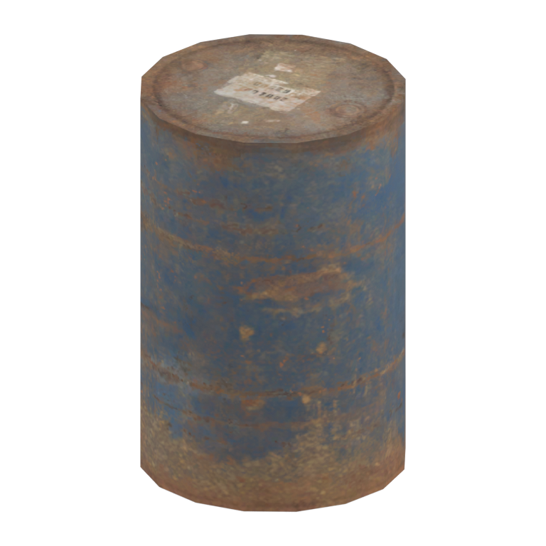
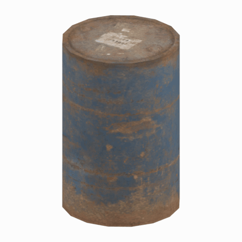

# Unidentified model (mafr_drum001_vrtn001)

Native model reference; a readable object identification has not been reviewed.

[Library](../README.md) | [Category](../tables/unclassified-components-1.md) | [Source / advanced data](../catalogue.json) | [Credits](../sources-and-credits.md)

**Game filename:** mafr_drum001_vrtn001.fmdl  
**Category:** Unclassified &gt; Unclassified components  
**Variant:** vrtn001; **LOD:** 0  
**Tags:** 

## Still reference



## 360-degree reference



The camera circles a static model. This is not a native animation. Source base textures and UVs use approximate studio shading; interaction, collision, complete assembly and FOX shader equivalence are not established.

## Identity and naming

| Field | Value |
|---|---|
| Library ID | mgsv-tpp-mafr_drum001_vrtn001-c0c7b2b398dc9a52 |
| Naming status | unidentified |
| Naming confidence | unknown |
| Naming evidence | {} |
| Native model | /Assets/tpp/environ/object/middle_africa/drum/mafr_drum001/scenes/mafr_drum001_vrtn001.fmdl |
| Model SHA256 | 08bf7dec8ae6c9d9b162f49c8226fd77f058d154920a8d3535425e72ba9cbfd4 |
| Container | /Assets/mgo/pack/location/afc0/pack_common/afc0_common.fpk |
| Container SHA256 | 20a950cab0d6912ac3a270b90dc6dc673f2d13859eb636819bfa3955fca6e320 |
| Captured source / location scope | Selected native member/content and captured installed-source chain; full archive SHA/runtime priority unresolved |
| Raw record SHA256 | f2a5c8a3af2eaf877cddc665fcdd31af82ee3f53d56bc55d0da3cd0bf0dfe4c0 |

Naming review is descriptive metadata only. It does not change model completion or identify a working game interaction.

## Native LOD inventory

| Native LOD | Triangles | Preview status | Decoded indices SHA256 |
|---|---:|---|---|
| 0 | 60 | rendered | b0ae63d5eae02215b3bdbb63aaa6953f38d1148411dc54b56962d52456a8ec8b |
| 1 | 54 | not separately rendered | e040d0f74fc8ffb3c184a7908480ead1776f8a013573c8c632b51e5e7dfdf736 |
| 2 | 48 | not separately rendered | 9a8fe73f28fc8116eadf52b1e48f260747ee66c468efcb1f19fa55511b58eb84 |
| 3 | 44 | not separately rendered | 0a3daf7a929e06ba6b585980248b442e5f4ee3cf9aba233bae33620fc43358d7 |
| 4 | 40 | not separately rendered | a9532d923a3ea1ead676722e1e8a75b3d210919aa4419fe81b26589aa01c4657 |
| 5 | 36 | not separately rendered | 9a4cce408ad334a60b96bf9435af37e845a14353bc840c51492f2ad8162b8962 |
| 6 | 32 | not separately rendered | 6fe9121753f3c55fbc4ffee6dce036909a8ab1a484a3b1e75fd31f74dfc735fe |
| 7 | 28 | not separately rendered | bb10b22f0b0ec895c400a54c8c9c4b269962d1e07cc6144976703aef5934d8f0 |

Mesh detail and texture pixels/mips are separate. Index hashes describe decoded triangle arrays, not packed index-buffer bytes. Only source-recorded native levels are listed.

<details>
<summary>Texture, source and naming technical metadata</summary>

```json
{
  "source": {
    "nativePath": "/Assets/tpp/environ/object/middle_africa/drum/mafr_drum001/scenes/mafr_drum001_vrtn001.fmdl",
    "nativeSha256": "08bf7dec8ae6c9d9b162f49c8226fd77f058d154920a8d3535425e72ba9cbfd4",
    "stableIdentity": "/assets/tpp/environ/object/middle_africa/drum/mafr_drum001/scenes/mafr_drum001_vrtn001.fmdl#08bf7dec8ae6c9d9b162f49c8226fd77f058d154920a8d3535425e72ba9cbfd4#594e462d5a516edde09fe4d511b007af7865b2105fb248d84786d2e061488996",
    "container": {
      "nativePath": "/Assets/mgo/pack/location/afc0/pack_common/afc0_common.fpk",
      "sha256": "20a950cab0d6912ac3a270b90dc6dc673f2d13859eb636819bfa3955fca6e320",
      "status": "Selected installed-source container/member chain captured by community reader"
    },
    "historicalDatOrigin": null,
    "sourceArchiveAtCapture": "master/0/00.dat",
    "locationStatus": "Selected native member/content and captured installed-source chain; full archive SHA/runtime priority unresolved",
    "currentInstalledDatVerified": false,
    "selectedInstalledMemberVerified": true,
    "evidence": {
      "archive_helper_executable_sha256": "6f8e39a436af3b024bbd0504966ab3d5d9d0cb05d86689bf3e83d15e68df613f",
      "archive_helper_source_sha256": "f662d3b63e066a0afc77ffe22ea0e564222d14469648300dba2c4f8e9b43446b",
      "archive_index_recipe": "54acff767f08d76ad6056c5387328759bc883df507788f398de6c2c04fac12db",
      "archive_reader": "Atvaark GzsTool.Core 0.5.3",
      "archive_reader_core_sha256": "9da447ae3c375cce2e46744eeff6af50f1591062afdf479d1a0b49edb47daaa3",
      "archive_tool_and_dictionary_sha256": {
        "CityHash.dll": "def6c4506d461b65e4059b2936b2cbd5f852ba5d1d8a1a527f1c0e6dc7008c8f",
        "GzsTool.Core.dll": "9da447ae3c375cce2e46744eeff6af50f1591062afdf479d1a0b49edb47daaa3",
        "GzsTool.exe": "1a9c5b11e2355383ff485aee7e86abc026f5c1fad729daf8c0fd15ee0aae1c10",
        "Zlib.Portable.dll": "fe84781ba35ca9cc5ff5f73fd08d2a66c59e5257b4573f5fe59743f30bf78e42",
        "fpk_dictionary.txt": "b82f9a8d6c10a68ba9471eca9d815c21355a53b5e68753d8ad7db7fd01bf401d",
        "qar_dictionary.txt": "1558c248ed0a4bb827888261563fbb91a2df4f03999682f85d637ff70d9d5fb2"
      },
      "bytes": 4368,
      "container_chain": [
        {
          "content_sha256": null,
          "depth": 0,
          "id": "3f19555d27c2ebecdfbad26aadd88b9f62e9fb6092c04c712963ef73c67ccb42",
          "index_sha256": "9acd3675d6e1500e0e18430cba0fdc70a5718ad7d6b62f13905891a35d59f18a",
          "kind": "qar",
          "name": "master/0/00.dat",
          "parent_occurrence": null
        },
        {
          "content_sha256": "20a950cab0d6912ac3a270b90dc6dc673f2d13859eb636819bfa3955fca6e320",
          "depth": 1,
          "id": "f1334a28f5fb887d989a9c548d11dccada12186358e0a4b4e7fc9831f6f42881",
          "index_sha256": "e15578c97612208569f283c28408f389fb560576e3976adf9d7aa8ed9c9aaf87",
          "kind": "fpk",
          "name": "/Assets/mgo/pack/location/afc0/pack_common/afc0_common.fpk",
          "parent_occurrence": "348190d8da3d429c2cdae58af0494f023c46b80f66da14d484dc54a7e17a97df"
        }
      ],
      "contentSha256": "08bf7dec8ae6c9d9b162f49c8226fd77f058d154920a8d3535425e72ba9cbfd4",
      "member": {
        "actual_size": 4368,
        "compressed_size": null,
        "content_sha256": "08bf7dec8ae6c9d9b162f49c8226fd77f058d154920a8d3535425e72ba9cbfd4",
        "declared_size": 4368,
        "extension": "fmdl",
        "hash_hex": null,
        "name": "/Assets/tpp/environ/object/middle_africa/drum/mafr_drum001/scenes/mafr_drum001_vrtn001.fmdl",
        "name_origin": "embedded",
        "offset": 6840352,
        "ordinal": 242,
        "path_hash": null,
        "resolved": 1
      },
      "occurrenceId": "796e9e4501c4bc89a4c4376109047af54b0443d4d9ce75a698a7ef931d4cdea1",
      "occurrence_id": "796e9e4501c4bc89a4c4376109047af54b0443d4d9ce75a698a7ef931d4cdea1",
      "primary_source_revision": "fc4a8196555638c6cf8aa1b7c8dc34ccd5c69cb5",
      "source_adapter": "community_core_selective_export",
      "source_id": "7f6bb743fb4c487f0e9522f9c7fac280c46cf6b1051e0fc75a93602c8eb451f0",
      "source_path": "master/0/00.dat",
      "source_snapshot": "{\"bytes\":768788480,\"device\":621747392682911458,\"file_id\":844424931596481,\"header_sha256\":\"ead50f0a9a37e4285323b9c6fa0ec75fe75e518c63147e63158eeb2892c6589e\",\"mtime_ns\":1791852224238580700}",
      "virtualPath": "/Assets/tpp/environ/object/middle_africa/drum/mafr_drum001/scenes/mafr_drum001_vrtn001.fmdl"
    }
  },
  "materials": [
    {
      "sampler": "Base_Tex_SRGB",
      "materialIndex": 0,
      "nativePathHash": "1542926217291451468",
      "nativeVirtualPath": null,
      "nativeBinding": {
        "familyId": "5c57dc93d401d4a5cad309bcf06080e8eed71759ab431da1929604c2dedaec9a",
        "height": 512,
        "materialIndex": 0,
        "mipCount": 8,
        "nativeMipCountVerified": true,
        "nativePath": null,
        "nativePathHash": "1542926217291451468",
        "nativeTexture": {
          "additionalFtexsFileCount": 2,
          "depth": 1,
          "ftexsFileCount": 3,
          "height": 512,
          "metadataBytes": 192,
          "mipCount": 8,
          "mips": [
            {
              "chunks": 8,
              "decodedBytes": 131072,
              "mip": 0,
              "offset": 0,
              "storedBytes": 103280,
              "streamNumber": 3
            },
            {
              "chunks": 2,
              "decodedBytes": 32768,
              "mip": 1,
              "offset": 0,
              "storedBytes": 26784,
              "streamNumber": 2
            },
            {
              "chunks": 1,
              "decodedBytes": 8192,
              "mip": 2,
              "offset": 2568,
              "storedBytes": 6832,
              "streamNumber": 1
            },
            {
              "chunks": 1,
              "decodedBytes": 2048,
              "mip": 3,
              "offset": 752,
              "storedBytes": 1808,
              "streamNumber": 1
            },
            {
              "chunks": 1,
              "decodedBytes": 512,
              "mip": 4,
              "offset": 232,
              "storedBytes": 512,
              "streamNumber": 1
            },
            {
              "chunks": 1,
              "decodedBytes": 128,
              "mip": 5,
              "offset": 80,
              "storedBytes": 144,
              "streamNumber": 1
            },
            {
              "chunks": 1,
              "decodedBytes": 32,
              "mip": 6,
              "offset": 24,
              "storedBytes": 48,
              "streamNumber": 1
            },
            {
              "chunks": 1,
              "decodedBytes": 8,
              "mip": 7,
              "offset": 0,
              "storedBytes": 16,
              "streamNumber": 1
            }
          ],
          "nativeHeaderHash": "38994cee2cf800035f9fff0d88273798",
          "nrtFlag": 2,
          "pixelFormat": 2,
          "requiredStreamNumbers": [
            1,
            2,
            3
          ],
          "textureType": 16777219,
          "unknownFlags": 273,
          "width": 512
        },
        "samplerName": "Base_Tex_SRGB",
        "samplerNameHash": "72475356961633",
        "sha256": "02d0f3a4595a9c3f5df385465e9f5f6dcc725798772bd93a5317fba9b0804672",
        "sourceOccurrences": [
          {
            "archive_helper_executable_sha256": "6f8e39a436af3b024bbd0504966ab3d5d9d0cb05d86689bf3e83d15e68df613f",
            "archive_helper_source_sha256": "f662d3b63e066a0afc77ffe22ea0e564222d14469648300dba2c4f8e9b43446b",
            "archive_index_recipe": "54acff767f08d76ad6056c5387328759bc883df507788f398de6c2c04fac12db",
            "archive_reader": "Atvaark GzsTool.Core 0.5.3",
            "archive_reader_core_sha256": "9da447ae3c375cce2e46744eeff6af50f1591062afdf479d1a0b49edb47daaa3",
            "archive_tool_and_dictionary_sha256": {
              "CityHash.dll": "def6c4506d461b65e4059b2936b2cbd5f852ba5d1d8a1a527f1c0e6dc7008c8f",
              "GzsTool.Core.dll": "9da447ae3c375cce2e46744eeff6af50f1591062afdf479d1a0b49edb47daaa3",
              "GzsTool.exe": "1a9c5b11e2355383ff485aee7e86abc026f5c1fad729daf8c0fd15ee0aae1c10",
              "Zlib.Portable.dll": "fe84781ba35ca9cc5ff5f73fd08d2a66c59e5257b4573f5fe59743f30bf78e42",
              "fpk_dictionary.txt": "b82f9a8d6c10a68ba9471eca9d815c21355a53b5e68753d8ad7db7fd01bf401d",
              "qar_dictionary.txt": "1558c248ed0a4bb827888261563fbb91a2df4f03999682f85d637ff70d9d5fb2"
            },
            "bytes": 192,
            "container_chain": [
              {
                "content_sha256": null,
                "depth": 0,
                "id": "0b473016351235050c2f6af21454bd979a0ad4602a9860137c807c894c5eba4d",
                "index_sha256": "ac9b4dae0dd0166db3a6ec8da18524dffebcbaf9004569af631de82913bf49a3",
                "kind": "qar",
                "name": "master/texture2.dat",
                "parent_occurrence": null
              }
            ],
            "contentSha256": "aedeb45427a1a288c67b5d8f526c5f585f9546bb2a4772775396c6d916cc7717",
            "member": {
              "actual_size": 192,
              "compressed_size": 192,
              "content_sha256": "aedeb45427a1a288c67b5d8f526c5f585f9546bb2a4772775396c6d916cc7717",
              "declared_size": 192,
              "extension": "ftex",
              "hash_hex": "15699338484b4c4c",
              "name": "19338484b4c4c.ftex",
              "name_origin": "hash_fallback",
              "offset": 2584644640,
              "ordinal": 18077,
              "path_hash": "19338484b4c4c",
              "resolved": 0
            },
            "occurrenceId": "63e976fe72adffe5f2bce10753d8b09a69983f4af7e5cc1a4fe0d7c835c8f2e4",
            "occurrence_id": "63e976fe72adffe5f2bce10753d8b09a69983f4af7e5cc1a4fe0d7c835c8f2e4",
            "primary_source_revision": "fc4a8196555638c6cf8aa1b7c8dc34ccd5c69cb5",
            "source_adapter": "community_core_selective_export",
            "source_id": "85e8296057664cbc6ebaf6bd43d1c6d18528bbd8a6fae920bdf4d5eb69f6a93d",
            "source_path": "master/texture2.dat",
            "source_snapshot": "{\"bytes\":2920239104,\"device\":621747392682911458,\"file_id\":562949953639626,\"header_sha256\":\"72bfee707623afb5f3abd8382035d3d4258b4941ac583a56f5a447f47123dcab\",\"mtime_ns\":1791224675561235200}",
            "virtualPath": "19338484b4c4c.ftex"
          },
          {
            "archive_helper_executable_sha256": "6f8e39a436af3b024bbd0504966ab3d5d9d0cb05d86689bf3e83d15e68df613f",
            "archive_helper_source_sha256": "f662d3b63e066a0afc77ffe22ea0e564222d14469648300dba2c4f8e9b43446b",
            "archive_index_recipe": "54acff767f08d76ad6056c5387328759bc883df507788f398de6c2c04fac12db",
            "archive_reader": "Atvaark GzsTool.Core 0.5.3",
            "archive_reader_core_sha256": "9da447ae3c375cce2e46744eeff6af50f1591062afdf479d1a0b49edb47daaa3",
            "archive_tool_and_dictionary_sha256": {
              "CityHash.dll": "def6c4506d461b65e4059b2936b2cbd5f852ba5d1d8a1a527f1c0e6dc7008c8f",
              "GzsTool.Core.dll": "9da447ae3c375cce2e46744eeff6af50f1591062afdf479d1a0b49edb47daaa3",
              "GzsTool.exe": "1a9c5b11e2355383ff485aee7e86abc026f5c1fad729daf8c0fd15ee0aae1c10",
              "Zlib.Portable.dll": "fe84781ba35ca9cc5ff5f73fd08d2a66c59e5257b4573f5fe59743f30bf78e42",
              "fpk_dictionary.txt": "b82f9a8d6c10a68ba9471eca9d815c21355a53b5e68753d8ad7db7fd01bf401d",
              "qar_dictionary.txt": "1558c248ed0a4bb827888261563fbb91a2df4f03999682f85d637ff70d9d5fb2"
            },
            "bytes": 9408,
            "container_chain": [
              {
                "content_sha256": null,
                "depth": 0,
                "id": "0b473016351235050c2f6af21454bd979a0ad4602a9860137c807c894c5eba4d",
                "index_sha256": "ac9b4dae0dd0166db3a6ec8da18524dffebcbaf9004569af631de82913bf49a3",
                "kind": "qar",
                "name": "master/texture2.dat",
                "parent_occurrence": null
              }
            ],
            "contentSha256": "fca228b549e843188c3002ffafe6e19d9bc9d4c9c6f5b3b9b5c3fc007f92a1f2",
            "member": {
              "actual_size": 9408,
              "compressed_size": 9408,
              "content_sha256": "fca228b549e843188c3002ffafe6e19d9bc9d4c9c6f5b3b9b5c3fc007f92a1f2",
              "declared_size": 9408,
              "extension": "1.ftexs",
              "hash_hex": "b2c19338484b4c4c",
              "name": "19338484b4c4c.1.ftexs",
              "name_origin": "hash_fallback",
              "offset": 2584503328,
              "ordinal": 18074,
              "path_hash": "19338484b4c4c",
              "resolved": 0
            },
            "occurrenceId": "118a593c661e5050e7186ed21369fe33f6b55233d41bf32b48accbb326f35a06",
            "occurrence_id": "118a593c661e5050e7186ed21369fe33f6b55233d41bf32b48accbb326f35a06",
            "primary_source_revision": "fc4a8196555638c6cf8aa1b7c8dc34ccd5c69cb5",
            "source_adapter": "community_core_selective_export",
            "source_id": "85e8296057664cbc6ebaf6bd43d1c6d18528bbd8a6fae920bdf4d5eb69f6a93d",
            "source_path": "master/texture2.dat",
            "source_snapshot": "{\"bytes\":2920239104,\"device\":621747392682911458,\"file_id\":562949953639626,\"header_sha256\":\"72bfee707623afb5f3abd8382035d3d4258b4941ac583a56f5a447f47123dcab\",\"mtime_ns\":1791224675561235200}",
            "virtualPath": "19338484b4c4c.1.ftexs"
          },
          {
            "archive_helper_executable_sha256": "6f8e39a436af3b024bbd0504966ab3d5d9d0cb05d86689bf3e83d15e68df613f",
            "archive_helper_source_sha256": "f662d3b63e066a0afc77ffe22ea0e564222d14469648300dba2c4f8e9b43446b",
            "archive_index_recipe": "54acff767f08d76ad6056c5387328759bc883df507788f398de6c2c04fac12db",
            "archive_reader": "Atvaark GzsTool.Core 0.5.3",
            "archive_reader_core_sha256": "9da447ae3c375cce2e46744eeff6af50f1591062afdf479d1a0b49edb47daaa3",
            "archive_tool_and_dictionary_sha256": {
              "CityHash.dll": "def6c4506d461b65e4059b2936b2cbd5f852ba5d1d8a1a527f1c0e6dc7008c8f",
              "GzsTool.Core.dll": "9da447ae3c375cce2e46744eeff6af50f1591062afdf479d1a0b49edb47daaa3",
              "GzsTool.exe": "1a9c5b11e2355383ff485aee7e86abc026f5c1fad729daf8c0fd15ee0aae1c10",
              "Zlib.Portable.dll": "fe84781ba35ca9cc5ff5f73fd08d2a66c59e5257b4573f5fe59743f30bf78e42",
              "fpk_dictionary.txt": "b82f9a8d6c10a68ba9471eca9d815c21355a53b5e68753d8ad7db7fd01bf401d",
              "qar_dictionary.txt": "1558c248ed0a4bb827888261563fbb91a2df4f03999682f85d637ff70d9d5fb2"
            },
            "bytes": 26800,
            "container_chain": [
              {
                "content_sha256": null,
                "depth": 0,
                "id": "e73d96973ade76f7a00afdbea486dd110896ace97da0791f56899647de46f210",
                "index_sha256": "5a818609a652a10d90fb90015661d0cb80898096bbb3aac36382172988d8736d",
                "kind": "qar",
                "name": "mgo/texture0.dat",
                "parent_occurrence": null
              }
            ],
            "contentSha256": "505c9466fb09b6b22bb5ff06b8c8e8a71f5e799b6f4fb0988b18bbb2af8353eb",
            "member": {
              "actual_size": 26800,
              "compressed_size": 26800,
              "content_sha256": "505c9466fb09b6b22bb5ff06b8c8e8a71f5e799b6f4fb0988b18bbb2af8353eb",
              "declared_size": 26800,
              "extension": "2.ftexs",
              "hash_hex": "b5719338484b4c4c",
              "name": "19338484b4c4c.2.ftexs",
              "name_origin": "hash_fallback",
              "offset": 3813957664,
              "ordinal": 15407,
              "path_hash": "19338484b4c4c",
              "resolved": 0
            },
            "occurrenceId": "40cd69c9c54fd3c66738c93d563203b238b7f54e18d1e9bf4a6b5a180a351a6d",
            "occurrence_id": "40cd69c9c54fd3c66738c93d563203b238b7f54e18d1e9bf4a6b5a180a351a6d",
            "primary_source_revision": "fc4a8196555638c6cf8aa1b7c8dc34ccd5c69cb5",
            "source_adapter": "community_core_selective_export",
            "source_id": "03f5942f0e1af8040ae05b95c43716d75f5933971d78324bf7cfea291297f3f4",
            "source_path": "mgo/texture0.dat",
            "source_snapshot": "{\"bytes\":4492370944,\"device\":621747392682911458,\"file_id\":562949953639631,\"header_sha256\":\"6108fbacb65c84d041742c39e5ca630745240453b336f1059a13b91943f0b011\",\"mtime_ns\":1791224675562234400}",
            "virtualPath": "19338484b4c4c.2.ftexs"
          },
          {
            "archive_helper_executable_sha256": "6f8e39a436af3b024bbd0504966ab3d5d9d0cb05d86689bf3e83d15e68df613f",
            "archive_helper_source_sha256": "f662d3b63e066a0afc77ffe22ea0e564222d14469648300dba2c4f8e9b43446b",
            "archive_index_recipe": "54acff767f08d76ad6056c5387328759bc883df507788f398de6c2c04fac12db",
            "archive_reader": "Atvaark GzsTool.Core 0.5.3",
            "archive_reader_core_sha256": "9da447ae3c375cce2e46744eeff6af50f1591062afdf479d1a0b49edb47daaa3",
            "archive_tool_and_dictionary_sha256": {
              "CityHash.dll": "def6c4506d461b65e4059b2936b2cbd5f852ba5d1d8a1a527f1c0e6dc7008c8f",
              "GzsTool.Core.dll": "9da447ae3c375cce2e46744eeff6af50f1591062afdf479d1a0b49edb47daaa3",
              "GzsTool.exe": "1a9c5b11e2355383ff485aee7e86abc026f5c1fad729daf8c0fd15ee0aae1c10",
              "Zlib.Portable.dll": "fe84781ba35ca9cc5ff5f73fd08d2a66c59e5257b4573f5fe59743f30bf78e42",
              "fpk_dictionary.txt": "b82f9a8d6c10a68ba9471eca9d815c21355a53b5e68753d8ad7db7fd01bf401d",
              "qar_dictionary.txt": "1558c248ed0a4bb827888261563fbb91a2df4f03999682f85d637ff70d9d5fb2"
            },
            "bytes": 103344,
            "container_chain": [
              {
                "content_sha256": null,
                "depth": 0,
                "id": "1cc220d9409d7163b6aca295ed89fd8c7befca6a8f849a8d5d09a2499724c863",
                "index_sha256": "5a818609a652a10d90fb90015661d0cb80898096bbb3aac36382172988d8736d",
                "kind": "qar",
                "name": "master/texture5_mgo0.dat",
                "parent_occurrence": null
              }
            ],
            "contentSha256": "a6f61f5c3a616f91e949760f06ed3a4f505af69a054a252412197168641023a5",
            "member": {
              "actual_size": 103344,
              "compressed_size": 103344,
              "content_sha256": "a6f61f5c3a616f91e949760f06ed3a4f505af69a054a252412197168641023a5",
              "declared_size": 103344,
              "extension": "3.ftexs",
              "hash_hex": "57199338484b4c4c",
              "name": "19338484b4c4c.3.ftexs",
              "name_origin": "hash_fallback",
              "offset": 3813985312,
              "ordinal": 15408,
              "path_hash": "19338484b4c4c",
              "resolved": 0
            },
            "occurrenceId": "0175116ccff5c79faea20a081191e65877978b49e04260e9867a0342ebbc3e1f",
            "occurrence_id": "0175116ccff5c79faea20a081191e65877978b49e04260e9867a0342ebbc3e1f",
            "primary_source_revision": "fc4a8196555638c6cf8aa1b7c8dc34ccd5c69cb5",
            "source_adapter": "community_core_selective_export",
            "source_id": "24f8989ccaae47940dc20e54ba67442ad562ac0032ab6e3d475e927c81444b56",
            "source_path": "master/texture5_mgo0.dat",
            "source_snapshot": "{\"bytes\":4492370944,\"device\":621747392682911458,\"file_id\":13510798883237422,\"header_sha256\":\"6108fbacb65c84d041742c39e5ca630745240453b336f1059a13b91943f0b011\",\"mtime_ns\":1791224675562234400}",
            "virtualPath": "19338484b4c4c.3.ftexs"
          }
        ],
        "width": 512
      },
      "ddsSha256": "02d0f3a4595a9c3f5df385465e9f5f6dcc725798772bd93a5317fba9b0804672",
      "dimensions": [
        512,
        512
      ],
      "mipCount": 8,
      "nativeMipCountVerified": true,
      "connectedInPreview": true
    }
  ],
  "quality": {
    "decodedIndicesHashDerivation": "SHA256 of canonical UTF-8 JSON decoded triangle indices grouped by mesh; not packed buffer bytes",
    "highestRetainedGeometricLod": 0,
    "distinctNativeLods": 8,
    "baseTextureDimensions": [
      512,
      512
    ],
    "baseTextureNativeMipCount": 8,
    "largerRetainedBaseTextureFound": null,
    "nativeLods": [
      {
        "indicesSha256": "b0ae63d5eae02215b3bdbb63aaa6953f38d1148411dc54b56962d52456a8ec8b",
        "nativeLod": 0,
        "triangles": 60
      },
      {
        "indicesSha256": "e040d0f74fc8ffb3c184a7908480ead1776f8a013573c8c632b51e5e7dfdf736",
        "nativeLod": 1,
        "triangles": 54
      },
      {
        "indicesSha256": "9a8fe73f28fc8116eadf52b1e48f260747ee66c468efcb1f19fa55511b58eb84",
        "nativeLod": 2,
        "triangles": 48
      },
      {
        "indicesSha256": "0a3daf7a929e06ba6b585980248b442e5f4ee3cf9aba233bae33620fc43358d7",
        "nativeLod": 3,
        "triangles": 44
      },
      {
        "indicesSha256": "a9532d923a3ea1ead676722e1e8a75b3d210919aa4419fe81b26589aa01c4657",
        "nativeLod": 4,
        "triangles": 40
      },
      {
        "indicesSha256": "9a4cce408ad334a60b96bf9435af37e845a14353bc840c51492f2ad8162b8962",
        "nativeLod": 5,
        "triangles": 36
      },
      {
        "indicesSha256": "6fe9121753f3c55fbc4ffee6dce036909a8ab1a484a3b1e75fd31f74dfc735fe",
        "nativeLod": 6,
        "triangles": 32
      },
      {
        "indicesSha256": "bb10b22f0b0ec895c400a54c8c9c4b269962d1e07cc6144976703aef5934d8f0",
        "nativeLod": 7,
        "triangles": 28
      }
    ],
    "renderedNativeLods": [
      0
    ],
    "baseTextureSummary": "512 x 512; 8 native/DDS mips",
    "highestDetailScope": "Triangle-count comparison within captured FMDL only"
  }
}
```

</details>

[Original source / advanced record](../catalogue.json)
