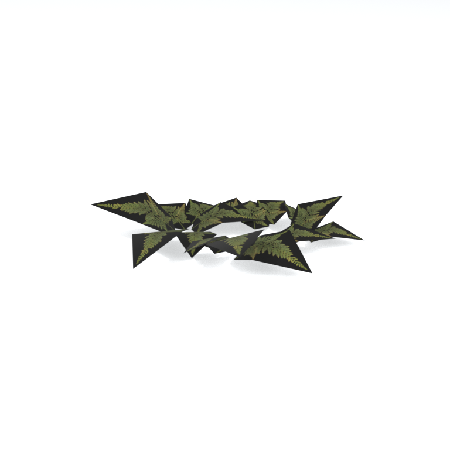
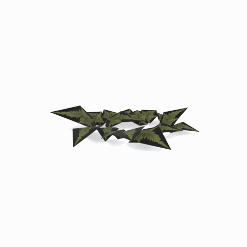

# Unidentified model (mafr_grss009_vrtn002)

Native model reference; a readable object identification has not been reviewed.

[Library](../README.md) | [Category](../tables/unclassified-components-1.md) | [Source / advanced data](../catalogue.json) | [Credits](../sources-and-credits.md)

**Game filename:** mafr_grss009_vrtn002.fmdl  
**Category:** Unclassified &gt; Unclassified components  
**Variant:** vrtn002; **LOD:** 0  
**Tags:** 

## Still reference



## 360-degree reference



The camera circles a static model. This is not a native animation. Source base textures and UVs use approximate studio shading; interaction, collision, complete assembly and FOX shader equivalence are not established.

## Identity and naming

| Field | Value |
|---|---|
| Library ID | mgsv-tpp-mafr_grss009_vrtn002-0e964844a2584f69 |
| Naming status | unidentified |
| Naming confidence | unknown |
| Naming evidence | {} |
| Native model | /Assets/tpp/environ/object/middle_africa/grass/mafr_grss009/scenes/mafr_grss009_vrtn002.fmdl |
| Model SHA256 | 25526051abeaf1fc3f97b6234b19d210fadfe5e4f4cb6e7b1f59912e0fc7de1e |
| Container | /Assets/mgo/pack/location/afc0/pack_common/afc0_common.fpk |
| Container SHA256 | 20a950cab0d6912ac3a270b90dc6dc673f2d13859eb636819bfa3955fca6e320 |
| Captured source / location scope | Selected native member/content and captured installed-source chain; full archive SHA/runtime priority unresolved |
| Raw record SHA256 | e4d7ce9b5d092c1debf75d3cc229c709ef5a71be85775222cc1127b803bf9a0d |

Naming review is descriptive metadata only. It does not change model completion or identify a working game interaction.

## Native LOD inventory

| Native LOD | Triangles | Preview status | Decoded indices SHA256 |
|---|---:|---|---|
| 0 | 64 | rendered | 2e8bad7b1a5b79ed36ecaf94233fb057d0c62cf02fe5eb08c7b7efea695e6fbf |
| 1 | 51 | not separately rendered | 88cdb51735b2348d842865d3bb33b0eb6522738a261f0713f2c49c3d677af8f4 |
| 2 | 42 | not separately rendered | 7c556635865afb53b199ff0b8054d9ed483496c4de760e2802357fd58a45a286 |
| 3 | 34 | not separately rendered | 6234fcb6c1deff38f7bca325945680c72ed2cac552307f1b0e974a76289e3b99 |
| 4 | 28 | not separately rendered | 8b89d3b2a4d148f3f456a1a8462f63ddfcd150171c5b544cf4ffb1f273204c38 |
| 5 | 23 | not separately rendered | a5e0d317a61f760ab3792ae7878f450978fcd26b2c306fa80be9b32896223d3d |
| 6 | 20 | not separately rendered | cc0beba311a967a8fd8d15385f38a2d7c765daa1070861dfa170a97d073015e5 |
| 7 | 16 | not separately rendered | 551a1d5154308bc282cb7bc645afa5f8369a044b3c0389bf6ec3b578ba196e49 |

Mesh detail and texture pixels/mips are separate. Index hashes describe decoded triangle arrays, not packed index-buffer bytes. Only source-recorded native levels are listed.

<details>
<summary>Texture, source and naming technical metadata</summary>

```json
{
  "source": {
    "nativePath": "/Assets/tpp/environ/object/middle_africa/grass/mafr_grss009/scenes/mafr_grss009_vrtn002.fmdl",
    "nativeSha256": "25526051abeaf1fc3f97b6234b19d210fadfe5e4f4cb6e7b1f59912e0fc7de1e",
    "stableIdentity": "/assets/tpp/environ/object/middle_africa/grass/mafr_grss009/scenes/mafr_grss009_vrtn002.fmdl#25526051abeaf1fc3f97b6234b19d210fadfe5e4f4cb6e7b1f59912e0fc7de1e#5d8535d305659a6b853515bab09106ef5fa068dbb4520d584a442526d7d3a453",
    "container": {
      "nativePath": "/Assets/mgo/pack/location/afc0/pack_common/afc0_common.fpk",
      "sha256": "20a950cab0d6912ac3a270b90dc6dc673f2d13859eb636819bfa3955fca6e320",
      "status": "Selected installed-source container/member chain captured by community reader"
    },
    "historicalDatOrigin": null,
    "sourceArchiveAtCapture": "master/0/00.dat",
    "locationStatus": "Selected native member/content and captured installed-source chain; full archive SHA/runtime priority unresolved",
    "currentInstalledDatVerified": false,
    "selectedInstalledMemberVerified": true,
    "evidence": {
      "archive_helper_executable_sha256": "6f8e39a436af3b024bbd0504966ab3d5d9d0cb05d86689bf3e83d15e68df613f",
      "archive_helper_source_sha256": "f662d3b63e066a0afc77ffe22ea0e564222d14469648300dba2c4f8e9b43446b",
      "archive_index_recipe": "54acff767f08d76ad6056c5387328759bc883df507788f398de6c2c04fac12db",
      "archive_reader": "Atvaark GzsTool.Core 0.5.3",
      "archive_reader_core_sha256": "9da447ae3c375cce2e46744eeff6af50f1591062afdf479d1a0b49edb47daaa3",
      "archive_tool_and_dictionary_sha256": {
        "CityHash.dll": "def6c4506d461b65e4059b2936b2cbd5f852ba5d1d8a1a527f1c0e6dc7008c8f",
        "GzsTool.Core.dll": "9da447ae3c375cce2e46744eeff6af50f1591062afdf479d1a0b49edb47daaa3",
        "GzsTool.exe": "1a9c5b11e2355383ff485aee7e86abc026f5c1fad729daf8c0fd15ee0aae1c10",
        "Zlib.Portable.dll": "fe84781ba35ca9cc5ff5f73fd08d2a66c59e5257b4573f5fe59743f30bf78e42",
        "fpk_dictionary.txt": "b82f9a8d6c10a68ba9471eca9d815c21355a53b5e68753d8ad7db7fd01bf401d",
        "qar_dictionary.txt": "1558c248ed0a4bb827888261563fbb91a2df4f03999682f85d637ff70d9d5fb2"
      },
      "bytes": 5344,
      "container_chain": [
        {
          "content_sha256": null,
          "depth": 0,
          "id": "3f19555d27c2ebecdfbad26aadd88b9f62e9fb6092c04c712963ef73c67ccb42",
          "index_sha256": "9acd3675d6e1500e0e18430cba0fdc70a5718ad7d6b62f13905891a35d59f18a",
          "kind": "qar",
          "name": "master/0/00.dat",
          "parent_occurrence": null
        },
        {
          "content_sha256": "20a950cab0d6912ac3a270b90dc6dc673f2d13859eb636819bfa3955fca6e320",
          "depth": 1,
          "id": "f1334a28f5fb887d989a9c548d11dccada12186358e0a4b4e7fc9831f6f42881",
          "index_sha256": "e15578c97612208569f283c28408f389fb560576e3976adf9d7aa8ed9c9aaf87",
          "kind": "fpk",
          "name": "/Assets/mgo/pack/location/afc0/pack_common/afc0_common.fpk",
          "parent_occurrence": "348190d8da3d429c2cdae58af0494f023c46b80f66da14d484dc54a7e17a97df"
        }
      ],
      "contentSha256": "25526051abeaf1fc3f97b6234b19d210fadfe5e4f4cb6e7b1f59912e0fc7de1e",
      "member": {
        "actual_size": 5344,
        "compressed_size": null,
        "content_sha256": "25526051abeaf1fc3f97b6234b19d210fadfe5e4f4cb6e7b1f59912e0fc7de1e",
        "declared_size": 5344,
        "extension": "fmdl",
        "hash_hex": null,
        "name": "/Assets/tpp/environ/object/middle_africa/grass/mafr_grss009/scenes/mafr_grss009_vrtn002.fmdl",
        "name_origin": "embedded",
        "offset": 7021968,
        "ordinal": 259,
        "path_hash": null,
        "resolved": 1
      },
      "occurrenceId": "f984509e6c2cd4c7012ac72d9374a3f3306cfde61889684e8e12d16f1c810f84",
      "occurrence_id": "f984509e6c2cd4c7012ac72d9374a3f3306cfde61889684e8e12d16f1c810f84",
      "primary_source_revision": "fc4a8196555638c6cf8aa1b7c8dc34ccd5c69cb5",
      "source_adapter": "community_core_selective_export",
      "source_id": "7f6bb743fb4c487f0e9522f9c7fac280c46cf6b1051e0fc75a93602c8eb451f0",
      "source_path": "master/0/00.dat",
      "source_snapshot": "{\"bytes\":768788480,\"device\":621747392682911458,\"file_id\":844424931596481,\"header_sha256\":\"ead50f0a9a37e4285323b9c6fa0ec75fe75e518c63147e63158eeb2892c6589e\",\"mtime_ns\":1791852224238580700}",
      "virtualPath": "/Assets/tpp/environ/object/middle_africa/grass/mafr_grss009/scenes/mafr_grss009_vrtn002.fmdl"
    }
  },
  "materials": [
    {
      "sampler": "Base_Tex_SRGB",
      "materialIndex": 0,
      "nativePathHash": "1543025667942059403",
      "nativeVirtualPath": null,
      "nativeBinding": {
        "familyId": "77b2e5bc8b3e26f4cd7b0dbb7e8ee7f799e170814ecf70e99d265d122db0585d",
        "height": 512,
        "materialIndex": 0,
        "mipCount": 8,
        "nativeMipCountVerified": true,
        "nativePath": null,
        "nativePathHash": "1543025667942059403",
        "nativeTexture": {
          "additionalFtexsFileCount": 2,
          "depth": 1,
          "ftexsFileCount": 3,
          "height": 512,
          "metadataBytes": 192,
          "mipCount": 8,
          "mips": [
            {
              "chunks": 8,
              "decodedBytes": 131072,
              "mip": 0,
              "offset": 0,
              "storedBytes": 43184,
              "streamNumber": 3
            },
            {
              "chunks": 2,
              "decodedBytes": 32768,
              "mip": 1,
              "offset": 0,
              "storedBytes": 13904,
              "streamNumber": 2
            },
            {
              "chunks": 1,
              "decodedBytes": 8192,
              "mip": 2,
              "offset": 2024,
              "storedBytes": 4208,
              "streamNumber": 1
            },
            {
              "chunks": 1,
              "decodedBytes": 2048,
              "mip": 3,
              "offset": 704,
              "storedBytes": 1312,
              "streamNumber": 1
            },
            {
              "chunks": 1,
              "decodedBytes": 512,
              "mip": 4,
              "offset": 248,
              "storedBytes": 448,
              "streamNumber": 1
            },
            {
              "chunks": 1,
              "decodedBytes": 128,
              "mip": 5,
              "offset": 96,
              "storedBytes": 144,
              "streamNumber": 1
            },
            {
              "chunks": 1,
              "decodedBytes": 32,
              "mip": 6,
              "offset": 40,
              "storedBytes": 48,
              "streamNumber": 1
            },
            {
              "chunks": 1,
              "decodedBytes": 16,
              "mip": 7,
              "offset": 0,
              "storedBytes": 32,
              "streamNumber": 1
            }
          ],
          "nativeHeaderHash": "5305ccf10bbf782114f2fd05bdc253fa",
          "nrtFlag": 2,
          "pixelFormat": 4,
          "requiredStreamNumbers": [
            1,
            2,
            3
          ],
          "textureType": 16777219,
          "unknownFlags": 273,
          "width": 256
        },
        "samplerName": "Base_Tex_SRGB",
        "samplerNameHash": "72475356961633",
        "sha256": "c6550061a06af0a548bc2d5cea4fca28b0e651cb889953547e8cd5d7a73c96ec",
        "sourceOccurrences": [
          {
            "archive_helper_executable_sha256": "6f8e39a436af3b024bbd0504966ab3d5d9d0cb05d86689bf3e83d15e68df613f",
            "archive_helper_source_sha256": "f662d3b63e066a0afc77ffe22ea0e564222d14469648300dba2c4f8e9b43446b",
            "archive_index_recipe": "54acff767f08d76ad6056c5387328759bc883df507788f398de6c2c04fac12db",
            "archive_reader": "Atvaark GzsTool.Core 0.5.3",
            "archive_reader_core_sha256": "9da447ae3c375cce2e46744eeff6af50f1591062afdf479d1a0b49edb47daaa3",
            "archive_tool_and_dictionary_sha256": {
              "CityHash.dll": "def6c4506d461b65e4059b2936b2cbd5f852ba5d1d8a1a527f1c0e6dc7008c8f",
              "GzsTool.Core.dll": "9da447ae3c375cce2e46744eeff6af50f1591062afdf479d1a0b49edb47daaa3",
              "GzsTool.exe": "1a9c5b11e2355383ff485aee7e86abc026f5c1fad729daf8c0fd15ee0aae1c10",
              "Zlib.Portable.dll": "fe84781ba35ca9cc5ff5f73fd08d2a66c59e5257b4573f5fe59743f30bf78e42",
              "fpk_dictionary.txt": "b82f9a8d6c10a68ba9471eca9d815c21355a53b5e68753d8ad7db7fd01bf401d",
              "qar_dictionary.txt": "1558c248ed0a4bb827888261563fbb91a2df4f03999682f85d637ff70d9d5fb2"
            },
            "bytes": 192,
            "container_chain": [
              {
                "content_sha256": null,
                "depth": 0,
                "id": "436c8cfb4f382de93365b167a61aa81383299b7bad18205d60f1d0beeb3919e3",
                "index_sha256": "2d7b45c6ca65418839618e978562cac336091c06eb56dfe99f762b07a4016960",
                "kind": "qar",
                "name": "master/texture4.dat",
                "parent_occurrence": null
              }
            ],
            "contentSha256": "698aba58668a94d056f4574101cc0b472496c536302dc93aa60849e48397214b",
            "member": {
              "actual_size": 192,
              "compressed_size": 192,
              "content_sha256": "698aba58668a94d056f4574101cc0b472496c536302dc93aa60849e48397214b",
              "declared_size": 192,
              "extension": "ftex",
              "hash_hex": "1569edab70ff0d8b",
              "name": "/Assets/tpp/environ/object/middle_africa/grass/mafr_grss009/sourceimages/mafr_grss009_bsm_alp.ftex",
              "name_origin": "dictionary",
              "offset": 1256341536,
              "ordinal": 9143,
              "path_hash": "1edab70ff0d8b",
              "resolved": 1
            },
            "occurrenceId": "8bc8e07b7bb3710c1ac09d1e580a2365ef63f0419c24ee56cef084802c0b7680",
            "occurrence_id": "8bc8e07b7bb3710c1ac09d1e580a2365ef63f0419c24ee56cef084802c0b7680",
            "primary_source_revision": "fc4a8196555638c6cf8aa1b7c8dc34ccd5c69cb5",
            "source_adapter": "community_core_selective_export",
            "source_id": "6c31b98b4db9b88eb76cfcb538f5f34b4729531266a9459584126720a4fc14aa",
            "source_path": "master/texture4.dat",
            "source_snapshot": "{\"bytes\":2031604736,\"device\":621747392682911458,\"file_id\":562949953639628,\"header_sha256\":\"40ee2c6917b338f7f68c49847c97fe92b978506a1ba847fcc94d28c931c8711a\",\"mtime_ns\":1791224675561235200}",
            "virtualPath": "/Assets/tpp/environ/object/middle_africa/grass/mafr_grss009/sourceimages/mafr_grss009_bsm_alp.ftex"
          },
          {
            "archive_helper_executable_sha256": "6f8e39a436af3b024bbd0504966ab3d5d9d0cb05d86689bf3e83d15e68df613f",
            "archive_helper_source_sha256": "f662d3b63e066a0afc77ffe22ea0e564222d14469648300dba2c4f8e9b43446b",
            "archive_index_recipe": "54acff767f08d76ad6056c5387328759bc883df507788f398de6c2c04fac12db",
            "archive_reader": "Atvaark GzsTool.Core 0.5.3",
            "archive_reader_core_sha256": "9da447ae3c375cce2e46744eeff6af50f1591062afdf479d1a0b49edb47daaa3",
            "archive_tool_and_dictionary_sha256": {
              "CityHash.dll": "def6c4506d461b65e4059b2936b2cbd5f852ba5d1d8a1a527f1c0e6dc7008c8f",
              "GzsTool.Core.dll": "9da447ae3c375cce2e46744eeff6af50f1591062afdf479d1a0b49edb47daaa3",
              "GzsTool.exe": "1a9c5b11e2355383ff485aee7e86abc026f5c1fad729daf8c0fd15ee0aae1c10",
              "Zlib.Portable.dll": "fe84781ba35ca9cc5ff5f73fd08d2a66c59e5257b4573f5fe59743f30bf78e42",
              "fpk_dictionary.txt": "b82f9a8d6c10a68ba9471eca9d815c21355a53b5e68753d8ad7db7fd01bf401d",
              "qar_dictionary.txt": "1558c248ed0a4bb827888261563fbb91a2df4f03999682f85d637ff70d9d5fb2"
            },
            "bytes": 6240,
            "container_chain": [
              {
                "content_sha256": null,
                "depth": 0,
                "id": "3f19555d27c2ebecdfbad26aadd88b9f62e9fb6092c04c712963ef73c67ccb42",
                "index_sha256": "9acd3675d6e1500e0e18430cba0fdc70a5718ad7d6b62f13905891a35d59f18a",
                "kind": "qar",
                "name": "master/0/00.dat",
                "parent_occurrence": null
              },
              {
                "content_sha256": "c371a18745c941878107bdaf7aef71c13b09b8b3a574360f6e38e0a7172b74e6",
                "depth": 1,
                "id": "13570131ff9ebc75c266205cbdf3461ff4dc51e8a0cb4f7407b0a08fe357052a",
                "index_sha256": "5b8e60a5e6b705cb87973f15c3215fb3733b7a49171030a4c7640da4622a5ca2",
                "kind": "pftxs",
                "name": "/Assets/mgo/pack/location/afc0/pack_common/afc0_common.pftxs",
                "parent_occurrence": "abc314b7f418d61ea6a3e5525bf8f85d22b454b81d3407e6645bfc43339658ac"
              }
            ],
            "contentSha256": "40b6379081b954ec5db6763230114028249627fd01b02b043635ddbac12be266",
            "member": {
              "actual_size": 6240,
              "compressed_size": null,
              "content_sha256": "40b6379081b954ec5db6763230114028249627fd01b02b043635ddbac12be266",
              "declared_size": 6240,
              "extension": "1.ftexs",
              "hash_hex": "b2c1edab70ff0d8b",
              "name": "b2c1edab70ff0d8b.1.ftexs",
              "name_origin": "hash_fallback",
              "offset": 19850032,
              "ordinal": 1294,
              "path_hash": null,
              "resolved": 0
            },
            "occurrenceId": "39ffb3d6ff5f36210329856ae3ac3c1a190eeb95286d5a40c6724b5717171b24",
            "occurrence_id": "39ffb3d6ff5f36210329856ae3ac3c1a190eeb95286d5a40c6724b5717171b24",
            "primary_source_revision": "fc4a8196555638c6cf8aa1b7c8dc34ccd5c69cb5",
            "source_adapter": "community_core_selective_export",
            "source_id": "7f6bb743fb4c487f0e9522f9c7fac280c46cf6b1051e0fc75a93602c8eb451f0",
            "source_path": "master/0/00.dat",
            "source_snapshot": "{\"bytes\":768788480,\"device\":621747392682911458,\"file_id\":844424931596481,\"header_sha256\":\"ead50f0a9a37e4285323b9c6fa0ec75fe75e518c63147e63158eeb2892c6589e\",\"mtime_ns\":1791852224238580700}",
            "virtualPath": "b2c1edab70ff0d8b.1.ftexs"
          },
          {
            "archive_helper_executable_sha256": "6f8e39a436af3b024bbd0504966ab3d5d9d0cb05d86689bf3e83d15e68df613f",
            "archive_helper_source_sha256": "f662d3b63e066a0afc77ffe22ea0e564222d14469648300dba2c4f8e9b43446b",
            "archive_index_recipe": "54acff767f08d76ad6056c5387328759bc883df507788f398de6c2c04fac12db",
            "archive_reader": "Atvaark GzsTool.Core 0.5.3",
            "archive_reader_core_sha256": "9da447ae3c375cce2e46744eeff6af50f1591062afdf479d1a0b49edb47daaa3",
            "archive_tool_and_dictionary_sha256": {
              "CityHash.dll": "def6c4506d461b65e4059b2936b2cbd5f852ba5d1d8a1a527f1c0e6dc7008c8f",
              "GzsTool.Core.dll": "9da447ae3c375cce2e46744eeff6af50f1591062afdf479d1a0b49edb47daaa3",
              "GzsTool.exe": "1a9c5b11e2355383ff485aee7e86abc026f5c1fad729daf8c0fd15ee0aae1c10",
              "Zlib.Portable.dll": "fe84781ba35ca9cc5ff5f73fd08d2a66c59e5257b4573f5fe59743f30bf78e42",
              "fpk_dictionary.txt": "b82f9a8d6c10a68ba9471eca9d815c21355a53b5e68753d8ad7db7fd01bf401d",
              "qar_dictionary.txt": "1558c248ed0a4bb827888261563fbb91a2df4f03999682f85d637ff70d9d5fb2"
            },
            "bytes": 13920,
            "container_chain": [
              {
                "content_sha256": null,
                "depth": 0,
                "id": "1cc220d9409d7163b6aca295ed89fd8c7befca6a8f849a8d5d09a2499724c863",
                "index_sha256": "5a818609a652a10d90fb90015661d0cb80898096bbb3aac36382172988d8736d",
                "kind": "qar",
                "name": "master/texture5_mgo0.dat",
                "parent_occurrence": null
              }
            ],
            "contentSha256": "6d7f248053d515b830d90ef52eaa1fd2e9fa9964f25e89ac7232d4c9924be533",
            "member": {
              "actual_size": 13920,
              "compressed_size": 13920,
              "content_sha256": "6d7f248053d515b830d90ef52eaa1fd2e9fa9964f25e89ac7232d4c9924be533",
              "declared_size": 13920,
              "extension": "2.ftexs",
              "hash_hex": "b571edab70ff0d8b",
              "name": "/Assets/tpp/environ/object/middle_africa/grass/mafr_grss009/sourceimages/mafr_grss009_bsm_alp.2.ftexs",
              "name_origin": "dictionary",
              "offset": 3833823264,
              "ordinal": 15554,
              "path_hash": "1edab70ff0d8b",
              "resolved": 1
            },
            "occurrenceId": "0eafc5cb8a815e5811d2b25cd9d88e6439378e3300d18670a3049aa3a8ebcbdd",
            "occurrence_id": "0eafc5cb8a815e5811d2b25cd9d88e6439378e3300d18670a3049aa3a8ebcbdd",
            "primary_source_revision": "fc4a8196555638c6cf8aa1b7c8dc34ccd5c69cb5",
            "source_adapter": "community_core_selective_export",
            "source_id": "24f8989ccaae47940dc20e54ba67442ad562ac0032ab6e3d475e927c81444b56",
            "source_path": "master/texture5_mgo0.dat",
            "source_snapshot": "{\"bytes\":4492370944,\"device\":621747392682911458,\"file_id\":13510798883237422,\"header_sha256\":\"6108fbacb65c84d041742c39e5ca630745240453b336f1059a13b91943f0b011\",\"mtime_ns\":1791224675562234400}",
            "virtualPath": "/Assets/tpp/environ/object/middle_africa/grass/mafr_grss009/sourceimages/mafr_grss009_bsm_alp.2.ftexs"
          },
          {
            "archive_helper_executable_sha256": "6f8e39a436af3b024bbd0504966ab3d5d9d0cb05d86689bf3e83d15e68df613f",
            "archive_helper_source_sha256": "f662d3b63e066a0afc77ffe22ea0e564222d14469648300dba2c4f8e9b43446b",
            "archive_index_recipe": "54acff767f08d76ad6056c5387328759bc883df507788f398de6c2c04fac12db",
            "archive_reader": "Atvaark GzsTool.Core 0.5.3",
            "archive_reader_core_sha256": "9da447ae3c375cce2e46744eeff6af50f1591062afdf479d1a0b49edb47daaa3",
            "archive_tool_and_dictionary_sha256": {
              "CityHash.dll": "def6c4506d461b65e4059b2936b2cbd5f852ba5d1d8a1a527f1c0e6dc7008c8f",
              "GzsTool.Core.dll": "9da447ae3c375cce2e46744eeff6af50f1591062afdf479d1a0b49edb47daaa3",
              "GzsTool.exe": "1a9c5b11e2355383ff485aee7e86abc026f5c1fad729daf8c0fd15ee0aae1c10",
              "Zlib.Portable.dll": "fe84781ba35ca9cc5ff5f73fd08d2a66c59e5257b4573f5fe59743f30bf78e42",
              "fpk_dictionary.txt": "b82f9a8d6c10a68ba9471eca9d815c21355a53b5e68753d8ad7db7fd01bf401d",
              "qar_dictionary.txt": "1558c248ed0a4bb827888261563fbb91a2df4f03999682f85d637ff70d9d5fb2"
            },
            "bytes": 43248,
            "container_chain": [
              {
                "content_sha256": null,
                "depth": 0,
                "id": "436c8cfb4f382de93365b167a61aa81383299b7bad18205d60f1d0beeb3919e3",
                "index_sha256": "2d7b45c6ca65418839618e978562cac336091c06eb56dfe99f762b07a4016960",
                "kind": "qar",
                "name": "master/texture4.dat",
                "parent_occurrence": null
              }
            ],
            "contentSha256": "480aea589b6595da6a31406ff58c142f354ec342685f3456d6399053e30de25f",
            "member": {
              "actual_size": 43248,
              "compressed_size": 43248,
              "content_sha256": "480aea589b6595da6a31406ff58c142f354ec342685f3456d6399053e30de25f",
              "declared_size": 43248,
              "extension": "3.ftexs",
              "hash_hex": "5719edab70ff0d8b",
              "name": "/Assets/tpp/environ/object/middle_africa/grass/mafr_grss009/sourceimages/mafr_grss009_bsm_alp.3.ftexs",
              "name_origin": "dictionary",
              "offset": 1256297504,
              "ordinal": 9142,
              "path_hash": "1edab70ff0d8b",
              "resolved": 1
            },
            "occurrenceId": "37a34793dc7c05dd521b553d5e61371c654fe8cd930a039485f1116b14b03974",
            "occurrence_id": "37a34793dc7c05dd521b553d5e61371c654fe8cd930a039485f1116b14b03974",
            "primary_source_revision": "fc4a8196555638c6cf8aa1b7c8dc34ccd5c69cb5",
            "source_adapter": "community_core_selective_export",
            "source_id": "6c31b98b4db9b88eb76cfcb538f5f34b4729531266a9459584126720a4fc14aa",
            "source_path": "master/texture4.dat",
            "source_snapshot": "{\"bytes\":2031604736,\"device\":621747392682911458,\"file_id\":562949953639628,\"header_sha256\":\"40ee2c6917b338f7f68c49847c97fe92b978506a1ba847fcc94d28c931c8711a\",\"mtime_ns\":1791224675561235200}",
            "virtualPath": "/Assets/tpp/environ/object/middle_africa/grass/mafr_grss009/sourceimages/mafr_grss009_bsm_alp.3.ftexs"
          }
        ],
        "width": 256
      },
      "ddsSha256": "c6550061a06af0a548bc2d5cea4fca28b0e651cb889953547e8cd5d7a73c96ec",
      "dimensions": [
        256,
        512
      ],
      "mipCount": 8,
      "nativeMipCountVerified": true,
      "connectedInPreview": true
    }
  ],
  "quality": {
    "decodedIndicesHashDerivation": "SHA256 of canonical UTF-8 JSON decoded triangle indices grouped by mesh; not packed buffer bytes",
    "highestRetainedGeometricLod": 0,
    "distinctNativeLods": 8,
    "baseTextureDimensions": [
      256,
      512
    ],
    "baseTextureNativeMipCount": 8,
    "largerRetainedBaseTextureFound": null,
    "nativeLods": [
      {
        "indicesSha256": "2e8bad7b1a5b79ed36ecaf94233fb057d0c62cf02fe5eb08c7b7efea695e6fbf",
        "nativeLod": 0,
        "triangles": 64
      },
      {
        "indicesSha256": "88cdb51735b2348d842865d3bb33b0eb6522738a261f0713f2c49c3d677af8f4",
        "nativeLod": 1,
        "triangles": 51
      },
      {
        "indicesSha256": "7c556635865afb53b199ff0b8054d9ed483496c4de760e2802357fd58a45a286",
        "nativeLod": 2,
        "triangles": 42
      },
      {
        "indicesSha256": "6234fcb6c1deff38f7bca325945680c72ed2cac552307f1b0e974a76289e3b99",
        "nativeLod": 3,
        "triangles": 34
      },
      {
        "indicesSha256": "8b89d3b2a4d148f3f456a1a8462f63ddfcd150171c5b544cf4ffb1f273204c38",
        "nativeLod": 4,
        "triangles": 28
      },
      {
        "indicesSha256": "a5e0d317a61f760ab3792ae7878f450978fcd26b2c306fa80be9b32896223d3d",
        "nativeLod": 5,
        "triangles": 23
      },
      {
        "indicesSha256": "cc0beba311a967a8fd8d15385f38a2d7c765daa1070861dfa170a97d073015e5",
        "nativeLod": 6,
        "triangles": 20
      },
      {
        "indicesSha256": "551a1d5154308bc282cb7bc645afa5f8369a044b3c0389bf6ec3b578ba196e49",
        "nativeLod": 7,
        "triangles": 16
      }
    ],
    "renderedNativeLods": [
      0
    ],
    "baseTextureSummary": "256 x 512; 8 native/DDS mips",
    "highestDetailScope": "Triangle-count comparison within captured FMDL only"
  }
}
```

</details>

[Original source / advanced record](../catalogue.json)
