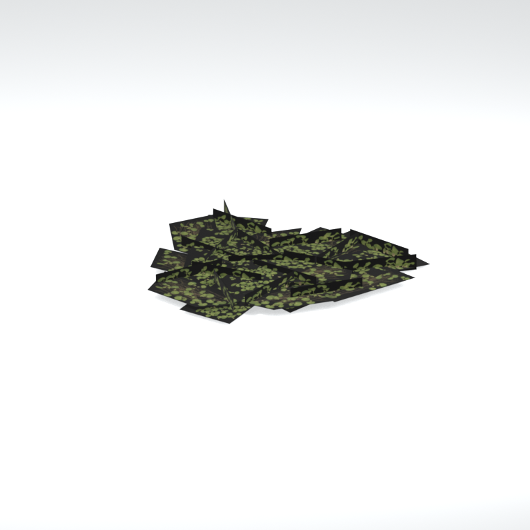
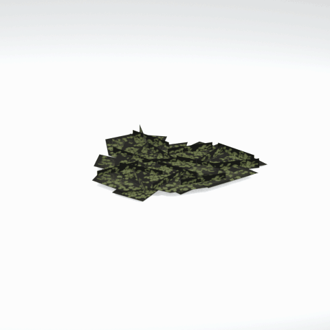

# Unidentified model (mafr_grss019)

Native model reference; a readable object identification has not been reviewed.

[Library](../README.md) | [Category](../tables/unclassified-components-1.md) | [Source / advanced data](../catalogue.json) | [Credits](../sources-and-credits.md)

**Game filename:** mafr_grss019.fmdl  
**Category:** Unclassified &gt; Unclassified components  
**Variant:** No explicit variant token; **LOD:** 0  
**Tags:** 

## Still reference



## 360-degree reference



The camera circles a static model. This is not a native animation. Source base textures and UVs use approximate studio shading; interaction, collision, complete assembly and FOX shader equivalence are not established.

## Identity and naming

| Field | Value |
|---|---|
| Library ID | mgsv-tpp-mafr_grss019-69c6c19bc109e294 |
| Naming status | unidentified |
| Naming confidence | unknown |
| Naming evidence | {} |
| Native model | /Assets/tpp/environ/object/middle_africa/grass/mafr_grss019/scenes/mafr_grss019.fmdl |
| Model SHA256 | eba8793e6ce9e9abcc17db95abe1f3df2939aca99947077b54747952d6e92f2d |
| Container | /Assets/mgo/pack/location/afc0/pack_common/afc0_common.fpk |
| Container SHA256 | 20a950cab0d6912ac3a270b90dc6dc673f2d13859eb636819bfa3955fca6e320 |
| Captured source / location scope | Selected native member/content and captured installed-source chain; full archive SHA/runtime priority unresolved |
| Raw record SHA256 | b26fe7da206b3d16365a38b57d1f7cab025a1a5836abc2f2745f923e59a71bc5 |

Naming review is descriptive metadata only. It does not change model completion or identify a working game interaction.

## Native LOD inventory

| Native LOD | Triangles | Preview status | Decoded indices SHA256 |
|---|---:|---|---|
| 0 | 74 | rendered | ac2e754245520341e133e66e8f21392ac3366a94ca92d5b3d3d4fb988a273e6a |
| 1 | 74 | not separately rendered | ac2e754245520341e133e66e8f21392ac3366a94ca92d5b3d3d4fb988a273e6a |
| 2 | 74 | not separately rendered | ac2e754245520341e133e66e8f21392ac3366a94ca92d5b3d3d4fb988a273e6a |
| 3 | 74 | not separately rendered | ac2e754245520341e133e66e8f21392ac3366a94ca92d5b3d3d4fb988a273e6a |
| 4 | 74 | not separately rendered | ac2e754245520341e133e66e8f21392ac3366a94ca92d5b3d3d4fb988a273e6a |
| 5 | 74 | not separately rendered | ac2e754245520341e133e66e8f21392ac3366a94ca92d5b3d3d4fb988a273e6a |
| 6 | 74 | not separately rendered | ac2e754245520341e133e66e8f21392ac3366a94ca92d5b3d3d4fb988a273e6a |
| 7 | 74 | not separately rendered | ac2e754245520341e133e66e8f21392ac3366a94ca92d5b3d3d4fb988a273e6a |

Mesh detail and texture pixels/mips are separate. Index hashes describe decoded triangle arrays, not packed index-buffer bytes. Only source-recorded native levels are listed.

<details>
<summary>Texture, source and naming technical metadata</summary>

```json
{
  "source": {
    "nativePath": "/Assets/tpp/environ/object/middle_africa/grass/mafr_grss019/scenes/mafr_grss019.fmdl",
    "nativeSha256": "eba8793e6ce9e9abcc17db95abe1f3df2939aca99947077b54747952d6e92f2d",
    "stableIdentity": "/assets/tpp/environ/object/middle_africa/grass/mafr_grss019/scenes/mafr_grss019.fmdl#eba8793e6ce9e9abcc17db95abe1f3df2939aca99947077b54747952d6e92f2d#aea2ea374bef48efce652138e13143e25dcb74a6a1911fdec25f5a28c7af8c78",
    "container": {
      "nativePath": "/Assets/mgo/pack/location/afc0/pack_common/afc0_common.fpk",
      "sha256": "20a950cab0d6912ac3a270b90dc6dc673f2d13859eb636819bfa3955fca6e320",
      "status": "Selected installed-source container/member chain captured by community reader"
    },
    "historicalDatOrigin": null,
    "sourceArchiveAtCapture": "master/0/00.dat",
    "locationStatus": "Selected native member/content and captured installed-source chain; full archive SHA/runtime priority unresolved",
    "currentInstalledDatVerified": false,
    "selectedInstalledMemberVerified": true,
    "evidence": {
      "archive_helper_executable_sha256": "6f8e39a436af3b024bbd0504966ab3d5d9d0cb05d86689bf3e83d15e68df613f",
      "archive_helper_source_sha256": "f662d3b63e066a0afc77ffe22ea0e564222d14469648300dba2c4f8e9b43446b",
      "archive_index_recipe": "54acff767f08d76ad6056c5387328759bc883df507788f398de6c2c04fac12db",
      "archive_reader": "Atvaark GzsTool.Core 0.5.3",
      "archive_reader_core_sha256": "9da447ae3c375cce2e46744eeff6af50f1591062afdf479d1a0b49edb47daaa3",
      "archive_tool_and_dictionary_sha256": {
        "CityHash.dll": "def6c4506d461b65e4059b2936b2cbd5f852ba5d1d8a1a527f1c0e6dc7008c8f",
        "GzsTool.Core.dll": "9da447ae3c375cce2e46744eeff6af50f1591062afdf479d1a0b49edb47daaa3",
        "GzsTool.exe": "1a9c5b11e2355383ff485aee7e86abc026f5c1fad729daf8c0fd15ee0aae1c10",
        "Zlib.Portable.dll": "fe84781ba35ca9cc5ff5f73fd08d2a66c59e5257b4573f5fe59743f30bf78e42",
        "fpk_dictionary.txt": "b82f9a8d6c10a68ba9471eca9d815c21355a53b5e68753d8ad7db7fd01bf401d",
        "qar_dictionary.txt": "1558c248ed0a4bb827888261563fbb91a2df4f03999682f85d637ff70d9d5fb2"
      },
      "bytes": 5872,
      "container_chain": [
        {
          "content_sha256": null,
          "depth": 0,
          "id": "3f19555d27c2ebecdfbad26aadd88b9f62e9fb6092c04c712963ef73c67ccb42",
          "index_sha256": "9acd3675d6e1500e0e18430cba0fdc70a5718ad7d6b62f13905891a35d59f18a",
          "kind": "qar",
          "name": "master/0/00.dat",
          "parent_occurrence": null
        },
        {
          "content_sha256": "20a950cab0d6912ac3a270b90dc6dc673f2d13859eb636819bfa3955fca6e320",
          "depth": 1,
          "id": "f1334a28f5fb887d989a9c548d11dccada12186358e0a4b4e7fc9831f6f42881",
          "index_sha256": "e15578c97612208569f283c28408f389fb560576e3976adf9d7aa8ed9c9aaf87",
          "kind": "fpk",
          "name": "/Assets/mgo/pack/location/afc0/pack_common/afc0_common.fpk",
          "parent_occurrence": "348190d8da3d429c2cdae58af0494f023c46b80f66da14d484dc54a7e17a97df"
        }
      ],
      "contentSha256": "eba8793e6ce9e9abcc17db95abe1f3df2939aca99947077b54747952d6e92f2d",
      "member": {
        "actual_size": 5872,
        "compressed_size": null,
        "content_sha256": "eba8793e6ce9e9abcc17db95abe1f3df2939aca99947077b54747952d6e92f2d",
        "declared_size": 5872,
        "extension": "fmdl",
        "hash_hex": null,
        "name": "/Assets/tpp/environ/object/middle_africa/grass/mafr_grss019/scenes/mafr_grss019.fmdl",
        "name_origin": "embedded",
        "offset": 7027312,
        "ordinal": 260,
        "path_hash": null,
        "resolved": 1
      },
      "occurrenceId": "30d7fdde4203fa4b4a73ee536640cdb69f0b9d7e2c8a4a22002f4f1b3e9a390e",
      "occurrence_id": "30d7fdde4203fa4b4a73ee536640cdb69f0b9d7e2c8a4a22002f4f1b3e9a390e",
      "primary_source_revision": "fc4a8196555638c6cf8aa1b7c8dc34ccd5c69cb5",
      "source_adapter": "community_core_selective_export",
      "source_id": "7f6bb743fb4c487f0e9522f9c7fac280c46cf6b1051e0fc75a93602c8eb451f0",
      "source_path": "master/0/00.dat",
      "source_snapshot": "{\"bytes\":768788480,\"device\":621747392682911458,\"file_id\":844424931596481,\"header_sha256\":\"ead50f0a9a37e4285323b9c6fa0ec75fe75e518c63147e63158eeb2892c6589e\",\"mtime_ns\":1791852224238580700}",
      "virtualPath": "/Assets/tpp/environ/object/middle_africa/grass/mafr_grss019/scenes/mafr_grss019.fmdl"
    }
  },
  "materials": [
    {
      "sampler": "Base_Tex_SRGB",
      "materialIndex": 0,
      "nativePathHash": "1543043156752742310",
      "nativeVirtualPath": null,
      "nativeBinding": {
        "familyId": "e1c8668b0977250ab0f2899965d5464ae049e587bc55230a642cdc511e83e3e8",
        "height": 256,
        "materialIndex": 0,
        "mipCount": 8,
        "nativeMipCountVerified": true,
        "nativePath": null,
        "nativePathHash": "1543043156752742310",
        "nativeTexture": {
          "additionalFtexsFileCount": 2,
          "depth": 1,
          "ftexsFileCount": 3,
          "height": 256,
          "metadataBytes": 192,
          "mipCount": 8,
          "mips": [
            {
              "chunks": 8,
              "decodedBytes": 131072,
              "mip": 0,
              "offset": 0,
              "storedBytes": 49648,
              "streamNumber": 3
            },
            {
              "chunks": 2,
              "decodedBytes": 32768,
              "mip": 1,
              "offset": 0,
              "storedBytes": 16720,
              "streamNumber": 2
            },
            {
              "chunks": 1,
              "decodedBytes": 8192,
              "mip": 2,
              "offset": 2504,
              "storedBytes": 5424,
              "streamNumber": 1
            },
            {
              "chunks": 1,
              "decodedBytes": 2048,
              "mip": 3,
              "offset": 784,
              "storedBytes": 1712,
              "streamNumber": 1
            },
            {
              "chunks": 1,
              "decodedBytes": 512,
              "mip": 4,
              "offset": 248,
              "storedBytes": 528,
              "streamNumber": 1
            },
            {
              "chunks": 1,
              "decodedBytes": 128,
              "mip": 5,
              "offset": 96,
              "storedBytes": 144,
              "streamNumber": 1
            },
            {
              "chunks": 1,
              "decodedBytes": 32,
              "mip": 6,
              "offset": 40,
              "storedBytes": 48,
              "streamNumber": 1
            },
            {
              "chunks": 1,
              "decodedBytes": 16,
              "mip": 7,
              "offset": 0,
              "storedBytes": 32,
              "streamNumber": 1
            }
          ],
          "nativeHeaderHash": "e106f93b2833fbb7687dd9df3f2bb720",
          "nrtFlag": 2,
          "pixelFormat": 4,
          "requiredStreamNumbers": [
            1,
            2,
            3
          ],
          "textureType": 16777219,
          "unknownFlags": 273,
          "width": 512
        },
        "samplerName": "Base_Tex_SRGB",
        "samplerNameHash": "72475356961633",
        "sha256": "ae4e26ed1c09bae81a27ec3f557168f5640f34df67518fc38dcbf2d2bcad02ae",
        "sourceOccurrences": [
          {
            "archive_helper_executable_sha256": "6f8e39a436af3b024bbd0504966ab3d5d9d0cb05d86689bf3e83d15e68df613f",
            "archive_helper_source_sha256": "f662d3b63e066a0afc77ffe22ea0e564222d14469648300dba2c4f8e9b43446b",
            "archive_index_recipe": "54acff767f08d76ad6056c5387328759bc883df507788f398de6c2c04fac12db",
            "archive_reader": "Atvaark GzsTool.Core 0.5.3",
            "archive_reader_core_sha256": "9da447ae3c375cce2e46744eeff6af50f1591062afdf479d1a0b49edb47daaa3",
            "archive_tool_and_dictionary_sha256": {
              "CityHash.dll": "def6c4506d461b65e4059b2936b2cbd5f852ba5d1d8a1a527f1c0e6dc7008c8f",
              "GzsTool.Core.dll": "9da447ae3c375cce2e46744eeff6af50f1591062afdf479d1a0b49edb47daaa3",
              "GzsTool.exe": "1a9c5b11e2355383ff485aee7e86abc026f5c1fad729daf8c0fd15ee0aae1c10",
              "Zlib.Portable.dll": "fe84781ba35ca9cc5ff5f73fd08d2a66c59e5257b4573f5fe59743f30bf78e42",
              "fpk_dictionary.txt": "b82f9a8d6c10a68ba9471eca9d815c21355a53b5e68753d8ad7db7fd01bf401d",
              "qar_dictionary.txt": "1558c248ed0a4bb827888261563fbb91a2df4f03999682f85d637ff70d9d5fb2"
            },
            "bytes": 192,
            "container_chain": [
              {
                "content_sha256": null,
                "depth": 0,
                "id": "436c8cfb4f382de93365b167a61aa81383299b7bad18205d60f1d0beeb3919e3",
                "index_sha256": "2d7b45c6ca65418839618e978562cac336091c06eb56dfe99f762b07a4016960",
                "kind": "qar",
                "name": "master/texture4.dat",
                "parent_occurrence": null
              }
            ],
            "contentSha256": "b52a9c037064993ab4b6375e5ba50d21de30772156c93e0c46c17c1aa5bcaf24",
            "member": {
              "actual_size": 192,
              "compressed_size": 192,
              "content_sha256": "b52a9c037064993ab4b6375e5ba50d21de30772156c93e0c46c17c1aa5bcaf24",
              "declared_size": 192,
              "extension": "ftex",
              "hash_hex": "1569fd935f5837a6",
              "name": "/Assets/tpp/environ/object/middle_africa/grass/mafr_grss019/sourceimages/mafr_grss019_bsm_alp.ftex",
              "name_origin": "dictionary",
              "offset": 1258337312,
              "ordinal": 9204,
              "path_hash": "1fd935f5837a6",
              "resolved": 1
            },
            "occurrenceId": "25c75debae46a4221fac7ee817f552941c76f281607e96828aaae6fa25b74a8d",
            "occurrence_id": "25c75debae46a4221fac7ee817f552941c76f281607e96828aaae6fa25b74a8d",
            "primary_source_revision": "fc4a8196555638c6cf8aa1b7c8dc34ccd5c69cb5",
            "source_adapter": "community_core_selective_export",
            "source_id": "6c31b98b4db9b88eb76cfcb538f5f34b4729531266a9459584126720a4fc14aa",
            "source_path": "master/texture4.dat",
            "source_snapshot": "{\"bytes\":2031604736,\"device\":621747392682911458,\"file_id\":562949953639628,\"header_sha256\":\"40ee2c6917b338f7f68c49847c97fe92b978506a1ba847fcc94d28c931c8711a\",\"mtime_ns\":1791224675561235200}",
            "virtualPath": "/Assets/tpp/environ/object/middle_africa/grass/mafr_grss019/sourceimages/mafr_grss019_bsm_alp.ftex"
          },
          {
            "archive_helper_executable_sha256": "6f8e39a436af3b024bbd0504966ab3d5d9d0cb05d86689bf3e83d15e68df613f",
            "archive_helper_source_sha256": "f662d3b63e066a0afc77ffe22ea0e564222d14469648300dba2c4f8e9b43446b",
            "archive_index_recipe": "54acff767f08d76ad6056c5387328759bc883df507788f398de6c2c04fac12db",
            "archive_reader": "Atvaark GzsTool.Core 0.5.3",
            "archive_reader_core_sha256": "9da447ae3c375cce2e46744eeff6af50f1591062afdf479d1a0b49edb47daaa3",
            "archive_tool_and_dictionary_sha256": {
              "CityHash.dll": "def6c4506d461b65e4059b2936b2cbd5f852ba5d1d8a1a527f1c0e6dc7008c8f",
              "GzsTool.Core.dll": "9da447ae3c375cce2e46744eeff6af50f1591062afdf479d1a0b49edb47daaa3",
              "GzsTool.exe": "1a9c5b11e2355383ff485aee7e86abc026f5c1fad729daf8c0fd15ee0aae1c10",
              "Zlib.Portable.dll": "fe84781ba35ca9cc5ff5f73fd08d2a66c59e5257b4573f5fe59743f30bf78e42",
              "fpk_dictionary.txt": "b82f9a8d6c10a68ba9471eca9d815c21355a53b5e68753d8ad7db7fd01bf401d",
              "qar_dictionary.txt": "1558c248ed0a4bb827888261563fbb91a2df4f03999682f85d637ff70d9d5fb2"
            },
            "bytes": 7936,
            "container_chain": [
              {
                "content_sha256": null,
                "depth": 0,
                "id": "436c8cfb4f382de93365b167a61aa81383299b7bad18205d60f1d0beeb3919e3",
                "index_sha256": "2d7b45c6ca65418839618e978562cac336091c06eb56dfe99f762b07a4016960",
                "kind": "qar",
                "name": "master/texture4.dat",
                "parent_occurrence": null
              }
            ],
            "contentSha256": "c09c1bb82b7c3fd6acd83aa6ef56ec335c4b7a36954a10d907d7e5e89de1abdb",
            "member": {
              "actual_size": 7936,
              "compressed_size": 7936,
              "content_sha256": "c09c1bb82b7c3fd6acd83aa6ef56ec335c4b7a36954a10d907d7e5e89de1abdb",
              "declared_size": 7936,
              "extension": "1.ftexs",
              "hash_hex": "b2c1fd935f5837a6",
              "name": "/Assets/tpp/environ/object/middle_africa/grass/mafr_grss019/sourceimages/mafr_grss019_bsm_alp.1.ftexs",
              "name_origin": "dictionary",
              "offset": 1258261536,
              "ordinal": 9201,
              "path_hash": "1fd935f5837a6",
              "resolved": 1
            },
            "occurrenceId": "26c00546065e805f4fc7cc4d8e412a09dcf77f7e2c0608e4b460362997955d83",
            "occurrence_id": "26c00546065e805f4fc7cc4d8e412a09dcf77f7e2c0608e4b460362997955d83",
            "primary_source_revision": "fc4a8196555638c6cf8aa1b7c8dc34ccd5c69cb5",
            "source_adapter": "community_core_selective_export",
            "source_id": "6c31b98b4db9b88eb76cfcb538f5f34b4729531266a9459584126720a4fc14aa",
            "source_path": "master/texture4.dat",
            "source_snapshot": "{\"bytes\":2031604736,\"device\":621747392682911458,\"file_id\":562949953639628,\"header_sha256\":\"40ee2c6917b338f7f68c49847c97fe92b978506a1ba847fcc94d28c931c8711a\",\"mtime_ns\":1791224675561235200}",
            "virtualPath": "/Assets/tpp/environ/object/middle_africa/grass/mafr_grss019/sourceimages/mafr_grss019_bsm_alp.1.ftexs"
          },
          {
            "archive_helper_executable_sha256": "6f8e39a436af3b024bbd0504966ab3d5d9d0cb05d86689bf3e83d15e68df613f",
            "archive_helper_source_sha256": "f662d3b63e066a0afc77ffe22ea0e564222d14469648300dba2c4f8e9b43446b",
            "archive_index_recipe": "54acff767f08d76ad6056c5387328759bc883df507788f398de6c2c04fac12db",
            "archive_reader": "Atvaark GzsTool.Core 0.5.3",
            "archive_reader_core_sha256": "9da447ae3c375cce2e46744eeff6af50f1591062afdf479d1a0b49edb47daaa3",
            "archive_tool_and_dictionary_sha256": {
              "CityHash.dll": "def6c4506d461b65e4059b2936b2cbd5f852ba5d1d8a1a527f1c0e6dc7008c8f",
              "GzsTool.Core.dll": "9da447ae3c375cce2e46744eeff6af50f1591062afdf479d1a0b49edb47daaa3",
              "GzsTool.exe": "1a9c5b11e2355383ff485aee7e86abc026f5c1fad729daf8c0fd15ee0aae1c10",
              "Zlib.Portable.dll": "fe84781ba35ca9cc5ff5f73fd08d2a66c59e5257b4573f5fe59743f30bf78e42",
              "fpk_dictionary.txt": "b82f9a8d6c10a68ba9471eca9d815c21355a53b5e68753d8ad7db7fd01bf401d",
              "qar_dictionary.txt": "1558c248ed0a4bb827888261563fbb91a2df4f03999682f85d637ff70d9d5fb2"
            },
            "bytes": 16736,
            "container_chain": [
              {
                "content_sha256": null,
                "depth": 0,
                "id": "436c8cfb4f382de93365b167a61aa81383299b7bad18205d60f1d0beeb3919e3",
                "index_sha256": "2d7b45c6ca65418839618e978562cac336091c06eb56dfe99f762b07a4016960",
                "kind": "qar",
                "name": "master/texture4.dat",
                "parent_occurrence": null
              }
            ],
            "contentSha256": "8acf784854612925cffb3259f8d90744c2440ebfdf31caa0d9c13af22fe69d4f",
            "member": {
              "actual_size": 16736,
              "compressed_size": 16736,
              "content_sha256": "8acf784854612925cffb3259f8d90744c2440ebfdf31caa0d9c13af22fe69d4f",
              "declared_size": 16736,
              "extension": "2.ftexs",
              "hash_hex": "b571fd935f5837a6",
              "name": "/Assets/tpp/environ/object/middle_africa/grass/mafr_grss019/sourceimages/mafr_grss019_bsm_alp.2.ftexs",
              "name_origin": "dictionary",
              "offset": 1258269728,
              "ordinal": 9202,
              "path_hash": "1fd935f5837a6",
              "resolved": 1
            },
            "occurrenceId": "11658667716cbbba098defe5f4508392359feb55b47b3fca5c318ad15d3a71a5",
            "occurrence_id": "11658667716cbbba098defe5f4508392359feb55b47b3fca5c318ad15d3a71a5",
            "primary_source_revision": "fc4a8196555638c6cf8aa1b7c8dc34ccd5c69cb5",
            "source_adapter": "community_core_selective_export",
            "source_id": "6c31b98b4db9b88eb76cfcb538f5f34b4729531266a9459584126720a4fc14aa",
            "source_path": "master/texture4.dat",
            "source_snapshot": "{\"bytes\":2031604736,\"device\":621747392682911458,\"file_id\":562949953639628,\"header_sha256\":\"40ee2c6917b338f7f68c49847c97fe92b978506a1ba847fcc94d28c931c8711a\",\"mtime_ns\":1791224675561235200}",
            "virtualPath": "/Assets/tpp/environ/object/middle_africa/grass/mafr_grss019/sourceimages/mafr_grss019_bsm_alp.2.ftexs"
          },
          {
            "archive_helper_executable_sha256": "6f8e39a436af3b024bbd0504966ab3d5d9d0cb05d86689bf3e83d15e68df613f",
            "archive_helper_source_sha256": "f662d3b63e066a0afc77ffe22ea0e564222d14469648300dba2c4f8e9b43446b",
            "archive_index_recipe": "54acff767f08d76ad6056c5387328759bc883df507788f398de6c2c04fac12db",
            "archive_reader": "Atvaark GzsTool.Core 0.5.3",
            "archive_reader_core_sha256": "9da447ae3c375cce2e46744eeff6af50f1591062afdf479d1a0b49edb47daaa3",
            "archive_tool_and_dictionary_sha256": {
              "CityHash.dll": "def6c4506d461b65e4059b2936b2cbd5f852ba5d1d8a1a527f1c0e6dc7008c8f",
              "GzsTool.Core.dll": "9da447ae3c375cce2e46744eeff6af50f1591062afdf479d1a0b49edb47daaa3",
              "GzsTool.exe": "1a9c5b11e2355383ff485aee7e86abc026f5c1fad729daf8c0fd15ee0aae1c10",
              "Zlib.Portable.dll": "fe84781ba35ca9cc5ff5f73fd08d2a66c59e5257b4573f5fe59743f30bf78e42",
              "fpk_dictionary.txt": "b82f9a8d6c10a68ba9471eca9d815c21355a53b5e68753d8ad7db7fd01bf401d",
              "qar_dictionary.txt": "1558c248ed0a4bb827888261563fbb91a2df4f03999682f85d637ff70d9d5fb2"
            },
            "bytes": 49712,
            "container_chain": [
              {
                "content_sha256": null,
                "depth": 0,
                "id": "0b473016351235050c2f6af21454bd979a0ad4602a9860137c807c894c5eba4d",
                "index_sha256": "ac9b4dae0dd0166db3a6ec8da18524dffebcbaf9004569af631de82913bf49a3",
                "kind": "qar",
                "name": "master/texture2.dat",
                "parent_occurrence": null
              }
            ],
            "contentSha256": "6453b589919ea7a586f7ae16723af0b0b6b740fe29aa10ac4b1d90ab12e2cd6e",
            "member": {
              "actual_size": 49712,
              "compressed_size": 49712,
              "content_sha256": "6453b589919ea7a586f7ae16723af0b0b6b740fe29aa10ac4b1d90ab12e2cd6e",
              "declared_size": 49712,
              "extension": "3.ftexs",
              "hash_hex": "5719fd935f5837a6",
              "name": "/Assets/tpp/environ/object/middle_africa/grass/mafr_grss019/sourceimages/mafr_grss019_bsm_alp.3.ftexs",
              "name_origin": "dictionary",
              "offset": 2591114272,
              "ordinal": 18229,
              "path_hash": "1fd935f5837a6",
              "resolved": 1
            },
            "occurrenceId": "0d11736151b380172b645db127e969f0d493efb1c90bffd4e6c516616f4604b6",
            "occurrence_id": "0d11736151b380172b645db127e969f0d493efb1c90bffd4e6c516616f4604b6",
            "primary_source_revision": "fc4a8196555638c6cf8aa1b7c8dc34ccd5c69cb5",
            "source_adapter": "community_core_selective_export",
            "source_id": "85e8296057664cbc6ebaf6bd43d1c6d18528bbd8a6fae920bdf4d5eb69f6a93d",
            "source_path": "master/texture2.dat",
            "source_snapshot": "{\"bytes\":2920239104,\"device\":621747392682911458,\"file_id\":562949953639626,\"header_sha256\":\"72bfee707623afb5f3abd8382035d3d4258b4941ac583a56f5a447f47123dcab\",\"mtime_ns\":1791224675561235200}",
            "virtualPath": "/Assets/tpp/environ/object/middle_africa/grass/mafr_grss019/sourceimages/mafr_grss019_bsm_alp.3.ftexs"
          }
        ],
        "width": 512
      },
      "ddsSha256": "ae4e26ed1c09bae81a27ec3f557168f5640f34df67518fc38dcbf2d2bcad02ae",
      "dimensions": [
        512,
        256
      ],
      "mipCount": 8,
      "nativeMipCountVerified": true,
      "connectedInPreview": true
    }
  ],
  "quality": {
    "decodedIndicesHashDerivation": "SHA256 of canonical UTF-8 JSON decoded triangle indices grouped by mesh; not packed buffer bytes",
    "highestRetainedGeometricLod": 0,
    "distinctNativeLods": 1,
    "baseTextureDimensions": [
      512,
      256
    ],
    "baseTextureNativeMipCount": 8,
    "largerRetainedBaseTextureFound": null,
    "nativeLods": [
      {
        "indicesSha256": "ac2e754245520341e133e66e8f21392ac3366a94ca92d5b3d3d4fb988a273e6a",
        "nativeLod": 0,
        "triangles": 74
      },
      {
        "duplicateOf": 0,
        "indicesSha256": "ac2e754245520341e133e66e8f21392ac3366a94ca92d5b3d3d4fb988a273e6a",
        "nativeLod": 1,
        "triangles": 74
      },
      {
        "duplicateOf": 0,
        "indicesSha256": "ac2e754245520341e133e66e8f21392ac3366a94ca92d5b3d3d4fb988a273e6a",
        "nativeLod": 2,
        "triangles": 74
      },
      {
        "duplicateOf": 0,
        "indicesSha256": "ac2e754245520341e133e66e8f21392ac3366a94ca92d5b3d3d4fb988a273e6a",
        "nativeLod": 3,
        "triangles": 74
      },
      {
        "duplicateOf": 0,
        "indicesSha256": "ac2e754245520341e133e66e8f21392ac3366a94ca92d5b3d3d4fb988a273e6a",
        "nativeLod": 4,
        "triangles": 74
      },
      {
        "duplicateOf": 0,
        "indicesSha256": "ac2e754245520341e133e66e8f21392ac3366a94ca92d5b3d3d4fb988a273e6a",
        "nativeLod": 5,
        "triangles": 74
      },
      {
        "duplicateOf": 0,
        "indicesSha256": "ac2e754245520341e133e66e8f21392ac3366a94ca92d5b3d3d4fb988a273e6a",
        "nativeLod": 6,
        "triangles": 74
      },
      {
        "duplicateOf": 0,
        "indicesSha256": "ac2e754245520341e133e66e8f21392ac3366a94ca92d5b3d3d4fb988a273e6a",
        "nativeLod": 7,
        "triangles": 74
      }
    ],
    "renderedNativeLods": [
      0
    ],
    "baseTextureSummary": "512 x 256; 8 native/DDS mips",
    "highestDetailScope": "Triangle-count comparison within captured FMDL only"
  }
}
```

</details>

[Original source / advanced record](../catalogue.json)
