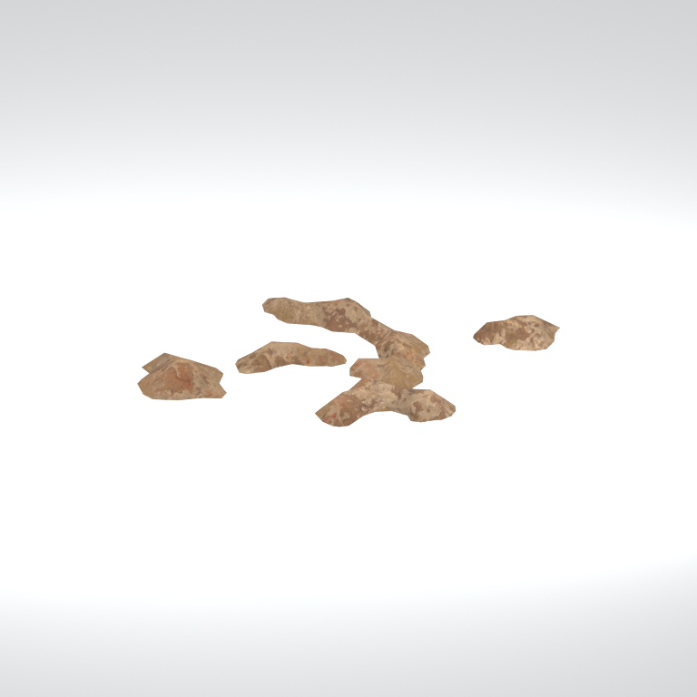
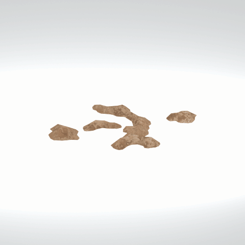

# Unidentified model (mafr_mudd001_vrtn002)

Native model reference; a readable object identification has not been reviewed.

[Library](../README.md) | [Category](../tables/unclassified-components-1.md) | [Source / advanced data](../catalogue.json) | [Credits](../sources-and-credits.md)

**Game filename:** mafr_mudd001_vrtn002.fmdl  
**Category:** Unclassified &gt; Unclassified components  
**Variant:** vrtn002; **LOD:** 0  
**Tags:** 

## Still reference



## 360-degree reference



The camera circles a static model. This is not a native animation. Source base textures and UVs use approximate studio shading; interaction, collision, complete assembly and FOX shader equivalence are not established.

## Identity and naming

| Field | Value |
|---|---|
| Library ID | mgsv-tpp-mafr_mudd001_vrtn002-4cf80491d5e32c0a |
| Naming status | unidentified |
| Naming confidence | unknown |
| Naming evidence | {} |
| Native model | /Assets/tpp/environ/object/middle_africa/mud/mafr_mudd001/scenes/mafr_mudd001_vrtn002.fmdl |
| Model SHA256 | 049195107845015180a47783b73e1a6dc5fcc93d6a9624795136b0e2d86e7b28 |
| Container | /Assets/mgo/pack/location/afc0/pack_common/afc0_common.fpk |
| Container SHA256 | 20a950cab0d6912ac3a270b90dc6dc673f2d13859eb636819bfa3955fca6e320 |
| Captured source / location scope | Selected native member/content and captured installed-source chain; full archive SHA/runtime priority unresolved |
| Raw record SHA256 | 18003df9535cffd7925dde67a895aec5e95398a46c0dc031f9a375c76f110bb8 |

Naming review is descriptive metadata only. It does not change model completion or identify a working game interaction.

## Native LOD inventory

| Native LOD | Triangles | Preview status | Decoded indices SHA256 |
|---|---:|---|---|
| 0 | 210 | rendered | 490765ed727bae8f541592fd5a73871c91590f147af5729e79887a6cc750e21a |
| 1 | 132 | not separately rendered | 8cf17a459de5717d5e706b89087ae9a9dfcafbd1b273a60c969032a153e40162 |
| 2 | 77 | not separately rendered | 5986bf76f2f51de066ec0e14eeb462e14b2bb4fab3df88d2e919324fcab4daca |
| 3 | 42 | not separately rendered | 5ed74a99f55651b99171669b1dcdaf26867263225d8ca74265165fe3c5d512cd |

Mesh detail and texture pixels/mips are separate. Index hashes describe decoded triangle arrays, not packed index-buffer bytes. Only source-recorded native levels are listed.

<details>
<summary>Texture, source and naming technical metadata</summary>

```json
{
  "source": {
    "nativePath": "/Assets/tpp/environ/object/middle_africa/mud/mafr_mudd001/scenes/mafr_mudd001_vrtn002.fmdl",
    "nativeSha256": "049195107845015180a47783b73e1a6dc5fcc93d6a9624795136b0e2d86e7b28",
    "stableIdentity": "/assets/tpp/environ/object/middle_africa/mud/mafr_mudd001/scenes/mafr_mudd001_vrtn002.fmdl#049195107845015180a47783b73e1a6dc5fcc93d6a9624795136b0e2d86e7b28#66188c3f62ca2a4c9a6ecb0a334949ce3f426d0e8dc9451afa042931859de80e",
    "container": {
      "nativePath": "/Assets/mgo/pack/location/afc0/pack_common/afc0_common.fpk",
      "sha256": "20a950cab0d6912ac3a270b90dc6dc673f2d13859eb636819bfa3955fca6e320",
      "status": "Selected installed-source container/member chain captured by community reader"
    },
    "historicalDatOrigin": null,
    "sourceArchiveAtCapture": "master/0/00.dat",
    "locationStatus": "Selected native member/content and captured installed-source chain; full archive SHA/runtime priority unresolved",
    "currentInstalledDatVerified": false,
    "selectedInstalledMemberVerified": true,
    "evidence": {
      "archive_helper_executable_sha256": "6f8e39a436af3b024bbd0504966ab3d5d9d0cb05d86689bf3e83d15e68df613f",
      "archive_helper_source_sha256": "f662d3b63e066a0afc77ffe22ea0e564222d14469648300dba2c4f8e9b43446b",
      "archive_index_recipe": "54acff767f08d76ad6056c5387328759bc883df507788f398de6c2c04fac12db",
      "archive_reader": "Atvaark GzsTool.Core 0.5.3",
      "archive_reader_core_sha256": "9da447ae3c375cce2e46744eeff6af50f1591062afdf479d1a0b49edb47daaa3",
      "archive_tool_and_dictionary_sha256": {
        "CityHash.dll": "def6c4506d461b65e4059b2936b2cbd5f852ba5d1d8a1a527f1c0e6dc7008c8f",
        "GzsTool.Core.dll": "9da447ae3c375cce2e46744eeff6af50f1591062afdf479d1a0b49edb47daaa3",
        "GzsTool.exe": "1a9c5b11e2355383ff485aee7e86abc026f5c1fad729daf8c0fd15ee0aae1c10",
        "Zlib.Portable.dll": "fe84781ba35ca9cc5ff5f73fd08d2a66c59e5257b4573f5fe59743f30bf78e42",
        "fpk_dictionary.txt": "b82f9a8d6c10a68ba9471eca9d815c21355a53b5e68753d8ad7db7fd01bf401d",
        "qar_dictionary.txt": "1558c248ed0a4bb827888261563fbb91a2df4f03999682f85d637ff70d9d5fb2"
      },
      "bytes": 8704,
      "container_chain": [
        {
          "content_sha256": null,
          "depth": 0,
          "id": "3f19555d27c2ebecdfbad26aadd88b9f62e9fb6092c04c712963ef73c67ccb42",
          "index_sha256": "9acd3675d6e1500e0e18430cba0fdc70a5718ad7d6b62f13905891a35d59f18a",
          "kind": "qar",
          "name": "master/0/00.dat",
          "parent_occurrence": null
        },
        {
          "content_sha256": "20a950cab0d6912ac3a270b90dc6dc673f2d13859eb636819bfa3955fca6e320",
          "depth": 1,
          "id": "f1334a28f5fb887d989a9c548d11dccada12186358e0a4b4e7fc9831f6f42881",
          "index_sha256": "e15578c97612208569f283c28408f389fb560576e3976adf9d7aa8ed9c9aaf87",
          "kind": "fpk",
          "name": "/Assets/mgo/pack/location/afc0/pack_common/afc0_common.fpk",
          "parent_occurrence": "348190d8da3d429c2cdae58af0494f023c46b80f66da14d484dc54a7e17a97df"
        }
      ],
      "contentSha256": "049195107845015180a47783b73e1a6dc5fcc93d6a9624795136b0e2d86e7b28",
      "member": {
        "actual_size": 8704,
        "compressed_size": null,
        "content_sha256": "049195107845015180a47783b73e1a6dc5fcc93d6a9624795136b0e2d86e7b28",
        "declared_size": 8704,
        "extension": "fmdl",
        "hash_hex": null,
        "name": "/Assets/tpp/environ/object/middle_africa/mud/mafr_mudd001/scenes/mafr_mudd001_vrtn002.fmdl",
        "name_origin": "embedded",
        "offset": 7843648,
        "ordinal": 296,
        "path_hash": null,
        "resolved": 1
      },
      "occurrenceId": "a5f6072f52faf74c999b86573cae527b2a1cfa916f663955eac4f2d8a17b1411",
      "occurrence_id": "a5f6072f52faf74c999b86573cae527b2a1cfa916f663955eac4f2d8a17b1411",
      "primary_source_revision": "fc4a8196555638c6cf8aa1b7c8dc34ccd5c69cb5",
      "source_adapter": "community_core_selective_export",
      "source_id": "7f6bb743fb4c487f0e9522f9c7fac280c46cf6b1051e0fc75a93602c8eb451f0",
      "source_path": "master/0/00.dat",
      "source_snapshot": "{\"bytes\":768788480,\"device\":621747392682911458,\"file_id\":844424931596481,\"header_sha256\":\"ead50f0a9a37e4285323b9c6fa0ec75fe75e518c63147e63158eeb2892c6589e\",\"mtime_ns\":1791852224238580700}",
      "virtualPath": "/Assets/tpp/environ/object/middle_africa/mud/mafr_mudd001/scenes/mafr_mudd001_vrtn002.fmdl"
    }
  },
  "materials": [
    {
      "sampler": "Base_Tex_SRGB",
      "materialIndex": 0,
      "nativePathHash": "1542839475356957547",
      "nativeVirtualPath": null,
      "nativeBinding": {
        "familyId": "c6e6bddf292852e44922f89c67e947d6838ea19802fcd786618c32fd2f9d65d8",
        "height": 2048,
        "materialIndex": 0,
        "mipCount": 10,
        "nativeMipCountVerified": true,
        "nativePath": null,
        "nativePathHash": "1542839475356957547",
        "nativeTexture": {
          "additionalFtexsFileCount": 2,
          "depth": 1,
          "ftexsFileCount": 3,
          "height": 2048,
          "metadataBytes": 224,
          "mipCount": 10,
          "mips": [
            {
              "chunks": 128,
              "decodedBytes": 2097152,
              "mip": 0,
              "offset": 0,
              "storedBytes": 1599040,
              "streamNumber": 3
            },
            {
              "chunks": 32,
              "decodedBytes": 524288,
              "mip": 1,
              "offset": 0,
              "storedBytes": 422016,
              "streamNumber": 2
            },
            {
              "chunks": 8,
              "decodedBytes": 131072,
              "mip": 2,
              "offset": 36320,
              "storedBytes": 107568,
              "streamNumber": 1
            },
            {
              "chunks": 2,
              "decodedBytes": 32768,
              "mip": 3,
              "offset": 9392,
              "storedBytes": 26912,
              "streamNumber": 1
            },
            {
              "chunks": 1,
              "decodedBytes": 8192,
              "mip": 4,
              "offset": 2568,
              "storedBytes": 6816,
              "streamNumber": 1
            },
            {
              "chunks": 1,
              "decodedBytes": 2048,
              "mip": 5,
              "offset": 752,
              "storedBytes": 1808,
              "streamNumber": 1
            },
            {
              "chunks": 1,
              "decodedBytes": 512,
              "mip": 6,
              "offset": 232,
              "storedBytes": 512,
              "streamNumber": 1
            },
            {
              "chunks": 1,
              "decodedBytes": 128,
              "mip": 7,
              "offset": 80,
              "storedBytes": 144,
              "streamNumber": 1
            },
            {
              "chunks": 1,
              "decodedBytes": 32,
              "mip": 8,
              "offset": 24,
              "storedBytes": 48,
              "streamNumber": 1
            },
            {
              "chunks": 1,
              "decodedBytes": 8,
              "mip": 9,
              "offset": 0,
              "storedBytes": 16,
              "streamNumber": 1
            }
          ],
          "nativeHeaderHash": "cc10cb7f87a10b757db2971ec925547a",
          "nrtFlag": 2,
          "pixelFormat": 2,
          "requiredStreamNumbers": [
            1,
            2,
            3
          ],
          "textureType": 16777219,
          "unknownFlags": 273,
          "width": 2048
        },
        "samplerName": "Base_Tex_SRGB",
        "samplerNameHash": "72475356961633",
        "sha256": "2d464db18078accd28be5431ef1c782751b579010f2b0ee278fd5708a9a01af7",
        "sourceOccurrences": [
          {
            "archive_helper_executable_sha256": "6f8e39a436af3b024bbd0504966ab3d5d9d0cb05d86689bf3e83d15e68df613f",
            "archive_helper_source_sha256": "f662d3b63e066a0afc77ffe22ea0e564222d14469648300dba2c4f8e9b43446b",
            "archive_index_recipe": "54acff767f08d76ad6056c5387328759bc883df507788f398de6c2c04fac12db",
            "archive_reader": "Atvaark GzsTool.Core 0.5.3",
            "archive_reader_core_sha256": "9da447ae3c375cce2e46744eeff6af50f1591062afdf479d1a0b49edb47daaa3",
            "archive_tool_and_dictionary_sha256": {
              "CityHash.dll": "def6c4506d461b65e4059b2936b2cbd5f852ba5d1d8a1a527f1c0e6dc7008c8f",
              "GzsTool.Core.dll": "9da447ae3c375cce2e46744eeff6af50f1591062afdf479d1a0b49edb47daaa3",
              "GzsTool.exe": "1a9c5b11e2355383ff485aee7e86abc026f5c1fad729daf8c0fd15ee0aae1c10",
              "Zlib.Portable.dll": "fe84781ba35ca9cc5ff5f73fd08d2a66c59e5257b4573f5fe59743f30bf78e42",
              "fpk_dictionary.txt": "b82f9a8d6c10a68ba9471eca9d815c21355a53b5e68753d8ad7db7fd01bf401d",
              "qar_dictionary.txt": "1558c248ed0a4bb827888261563fbb91a2df4f03999682f85d637ff70d9d5fb2"
            },
            "bytes": 224,
            "container_chain": [
              {
                "content_sha256": null,
                "depth": 0,
                "id": "3f19555d27c2ebecdfbad26aadd88b9f62e9fb6092c04c712963ef73c67ccb42",
                "index_sha256": "9acd3675d6e1500e0e18430cba0fdc70a5718ad7d6b62f13905891a35d59f18a",
                "kind": "qar",
                "name": "master/0/00.dat",
                "parent_occurrence": null
              },
              {
                "content_sha256": "c371a18745c941878107bdaf7aef71c13b09b8b3a574360f6e38e0a7172b74e6",
                "depth": 1,
                "id": "13570131ff9ebc75c266205cbdf3461ff4dc51e8a0cb4f7407b0a08fe357052a",
                "index_sha256": "5b8e60a5e6b705cb87973f15c3215fb3733b7a49171030a4c7640da4622a5ca2",
                "kind": "pftxs",
                "name": "/Assets/mgo/pack/location/afc0/pack_common/afc0_common.pftxs",
                "parent_occurrence": "abc314b7f418d61ea6a3e5525bf8f85d22b454b81d3407e6645bfc43339658ac"
              }
            ],
            "contentSha256": "b1e6c485e1093c1d3e7a433c9460bc9cafdcba7cb37f6bf091db6f3921a61d92",
            "member": {
              "actual_size": 224,
              "compressed_size": null,
              "content_sha256": "b1e6c485e1093c1d3e7a433c9460bc9cafdcba7cb37f6bf091db6f3921a61d92",
              "declared_size": 224,
              "extension": "ftex",
              "hash_hex": "156944541a19fb6b",
              "name": "156944541a19fb6b.ftex",
              "name_origin": "hash_fallback",
              "offset": 23224992,
              "ordinal": 1555,
              "path_hash": null,
              "resolved": 0
            },
            "occurrenceId": "75ad37c233e6802a6c9c233bae9feb2e57de59024796e108606b40e34fa7a608",
            "occurrence_id": "75ad37c233e6802a6c9c233bae9feb2e57de59024796e108606b40e34fa7a608",
            "primary_source_revision": "fc4a8196555638c6cf8aa1b7c8dc34ccd5c69cb5",
            "source_adapter": "community_core_selective_export",
            "source_id": "7f6bb743fb4c487f0e9522f9c7fac280c46cf6b1051e0fc75a93602c8eb451f0",
            "source_path": "master/0/00.dat",
            "source_snapshot": "{\"bytes\":768788480,\"device\":621747392682911458,\"file_id\":844424931596481,\"header_sha256\":\"ead50f0a9a37e4285323b9c6fa0ec75fe75e518c63147e63158eeb2892c6589e\",\"mtime_ns\":1791852224238580700}",
            "virtualPath": "156944541a19fb6b.ftex"
          },
          {
            "archive_helper_executable_sha256": "6f8e39a436af3b024bbd0504966ab3d5d9d0cb05d86689bf3e83d15e68df613f",
            "archive_helper_source_sha256": "f662d3b63e066a0afc77ffe22ea0e564222d14469648300dba2c4f8e9b43446b",
            "archive_index_recipe": "54acff767f08d76ad6056c5387328759bc883df507788f398de6c2c04fac12db",
            "archive_reader": "Atvaark GzsTool.Core 0.5.3",
            "archive_reader_core_sha256": "9da447ae3c375cce2e46744eeff6af50f1591062afdf479d1a0b49edb47daaa3",
            "archive_tool_and_dictionary_sha256": {
              "CityHash.dll": "def6c4506d461b65e4059b2936b2cbd5f852ba5d1d8a1a527f1c0e6dc7008c8f",
              "GzsTool.Core.dll": "9da447ae3c375cce2e46744eeff6af50f1591062afdf479d1a0b49edb47daaa3",
              "GzsTool.exe": "1a9c5b11e2355383ff485aee7e86abc026f5c1fad729daf8c0fd15ee0aae1c10",
              "Zlib.Portable.dll": "fe84781ba35ca9cc5ff5f73fd08d2a66c59e5257b4573f5fe59743f30bf78e42",
              "fpk_dictionary.txt": "b82f9a8d6c10a68ba9471eca9d815c21355a53b5e68753d8ad7db7fd01bf401d",
              "qar_dictionary.txt": "1558c248ed0a4bb827888261563fbb91a2df4f03999682f85d637ff70d9d5fb2"
            },
            "bytes": 143952,
            "container_chain": [
              {
                "content_sha256": null,
                "depth": 0,
                "id": "436c8cfb4f382de93365b167a61aa81383299b7bad18205d60f1d0beeb3919e3",
                "index_sha256": "2d7b45c6ca65418839618e978562cac336091c06eb56dfe99f762b07a4016960",
                "kind": "qar",
                "name": "master/texture4.dat",
                "parent_occurrence": null
              }
            ],
            "contentSha256": "fdac502379c23876c6f80af5c9b35af81f962e5ba57425f69ae6ce92f663d627",
            "member": {
              "actual_size": 143952,
              "compressed_size": 143952,
              "content_sha256": "fdac502379c23876c6f80af5c9b35af81f962e5ba57425f69ae6ce92f663d627",
              "declared_size": 143952,
              "extension": "1.ftexs",
              "hash_hex": "b2c144541a19fb6b",
              "name": "/Assets/tpp/environ/object/middle_africa/mud/mafr_mudd001/sourceimages/mafr_mudd001_ed_bsm.1.ftexs",
              "name_origin": "dictionary",
              "offset": 1413836832,
              "ordinal": 10876,
              "path_hash": "144541a19fb6b",
              "resolved": 1
            },
            "occurrenceId": "09a68445b534bf4b7d0e014dc6165e4baceac817ab4aa6370b4a85ec01059827",
            "occurrence_id": "09a68445b534bf4b7d0e014dc6165e4baceac817ab4aa6370b4a85ec01059827",
            "primary_source_revision": "fc4a8196555638c6cf8aa1b7c8dc34ccd5c69cb5",
            "source_adapter": "community_core_selective_export",
            "source_id": "6c31b98b4db9b88eb76cfcb538f5f34b4729531266a9459584126720a4fc14aa",
            "source_path": "master/texture4.dat",
            "source_snapshot": "{\"bytes\":2031604736,\"device\":621747392682911458,\"file_id\":562949953639628,\"header_sha256\":\"40ee2c6917b338f7f68c49847c97fe92b978506a1ba847fcc94d28c931c8711a\",\"mtime_ns\":1791224675561235200}",
            "virtualPath": "/Assets/tpp/environ/object/middle_africa/mud/mafr_mudd001/sourceimages/mafr_mudd001_ed_bsm.1.ftexs"
          },
          {
            "archive_helper_executable_sha256": "6f8e39a436af3b024bbd0504966ab3d5d9d0cb05d86689bf3e83d15e68df613f",
            "archive_helper_source_sha256": "f662d3b63e066a0afc77ffe22ea0e564222d14469648300dba2c4f8e9b43446b",
            "archive_index_recipe": "54acff767f08d76ad6056c5387328759bc883df507788f398de6c2c04fac12db",
            "archive_reader": "Atvaark GzsTool.Core 0.5.3",
            "archive_reader_core_sha256": "9da447ae3c375cce2e46744eeff6af50f1591062afdf479d1a0b49edb47daaa3",
            "archive_tool_and_dictionary_sha256": {
              "CityHash.dll": "def6c4506d461b65e4059b2936b2cbd5f852ba5d1d8a1a527f1c0e6dc7008c8f",
              "GzsTool.Core.dll": "9da447ae3c375cce2e46744eeff6af50f1591062afdf479d1a0b49edb47daaa3",
              "GzsTool.exe": "1a9c5b11e2355383ff485aee7e86abc026f5c1fad729daf8c0fd15ee0aae1c10",
              "Zlib.Portable.dll": "fe84781ba35ca9cc5ff5f73fd08d2a66c59e5257b4573f5fe59743f30bf78e42",
              "fpk_dictionary.txt": "b82f9a8d6c10a68ba9471eca9d815c21355a53b5e68753d8ad7db7fd01bf401d",
              "qar_dictionary.txt": "1558c248ed0a4bb827888261563fbb91a2df4f03999682f85d637ff70d9d5fb2"
            },
            "bytes": 422272,
            "container_chain": [
              {
                "content_sha256": null,
                "depth": 0,
                "id": "e73d96973ade76f7a00afdbea486dd110896ace97da0791f56899647de46f210",
                "index_sha256": "5a818609a652a10d90fb90015661d0cb80898096bbb3aac36382172988d8736d",
                "kind": "qar",
                "name": "mgo/texture0.dat",
                "parent_occurrence": null
              }
            ],
            "contentSha256": "15c2c17ee3b27e3e2e83f271d0f33e76183f1dda219a138b87f214e879c6c4e4",
            "member": {
              "actual_size": 422272,
              "compressed_size": 422272,
              "content_sha256": "15c2c17ee3b27e3e2e83f271d0f33e76183f1dda219a138b87f214e879c6c4e4",
              "declared_size": 422272,
              "extension": "2.ftexs",
              "hash_hex": "b57144541a19fb6b",
              "name": "/Assets/tpp/environ/object/middle_africa/mud/mafr_mudd001/sourceimages/mafr_mudd001_ed_bsm.2.ftexs",
              "name_origin": "dictionary",
              "offset": 3924748320,
              "ordinal": 16062,
              "path_hash": "144541a19fb6b",
              "resolved": 1
            },
            "occurrenceId": "1200cf5d4824d1ac3d8d305e11491dd0bc3e4a856c10d7d41486afdc2aac9fb0",
            "occurrence_id": "1200cf5d4824d1ac3d8d305e11491dd0bc3e4a856c10d7d41486afdc2aac9fb0",
            "primary_source_revision": "fc4a8196555638c6cf8aa1b7c8dc34ccd5c69cb5",
            "source_adapter": "community_core_selective_export",
            "source_id": "03f5942f0e1af8040ae05b95c43716d75f5933971d78324bf7cfea291297f3f4",
            "source_path": "mgo/texture0.dat",
            "source_snapshot": "{\"bytes\":4492370944,\"device\":621747392682911458,\"file_id\":562949953639631,\"header_sha256\":\"6108fbacb65c84d041742c39e5ca630745240453b336f1059a13b91943f0b011\",\"mtime_ns\":1791224675562234400}",
            "virtualPath": "/Assets/tpp/environ/object/middle_africa/mud/mafr_mudd001/sourceimages/mafr_mudd001_ed_bsm.2.ftexs"
          },
          {
            "archive_helper_executable_sha256": "6f8e39a436af3b024bbd0504966ab3d5d9d0cb05d86689bf3e83d15e68df613f",
            "archive_helper_source_sha256": "f662d3b63e066a0afc77ffe22ea0e564222d14469648300dba2c4f8e9b43446b",
            "archive_index_recipe": "54acff767f08d76ad6056c5387328759bc883df507788f398de6c2c04fac12db",
            "archive_reader": "Atvaark GzsTool.Core 0.5.3",
            "archive_reader_core_sha256": "9da447ae3c375cce2e46744eeff6af50f1591062afdf479d1a0b49edb47daaa3",
            "archive_tool_and_dictionary_sha256": {
              "CityHash.dll": "def6c4506d461b65e4059b2936b2cbd5f852ba5d1d8a1a527f1c0e6dc7008c8f",
              "GzsTool.Core.dll": "9da447ae3c375cce2e46744eeff6af50f1591062afdf479d1a0b49edb47daaa3",
              "GzsTool.exe": "1a9c5b11e2355383ff485aee7e86abc026f5c1fad729daf8c0fd15ee0aae1c10",
              "Zlib.Portable.dll": "fe84781ba35ca9cc5ff5f73fd08d2a66c59e5257b4573f5fe59743f30bf78e42",
              "fpk_dictionary.txt": "b82f9a8d6c10a68ba9471eca9d815c21355a53b5e68753d8ad7db7fd01bf401d",
              "qar_dictionary.txt": "1558c248ed0a4bb827888261563fbb91a2df4f03999682f85d637ff70d9d5fb2"
            },
            "bytes": 1600064,
            "container_chain": [
              {
                "content_sha256": null,
                "depth": 0,
                "id": "436c8cfb4f382de93365b167a61aa81383299b7bad18205d60f1d0beeb3919e3",
                "index_sha256": "2d7b45c6ca65418839618e978562cac336091c06eb56dfe99f762b07a4016960",
                "kind": "qar",
                "name": "master/texture4.dat",
                "parent_occurrence": null
              }
            ],
            "contentSha256": "f1579d8e66fd1ce2c5f6c203dcf370a1f71df722c6531c6af6e8c806e6ef9565",
            "member": {
              "actual_size": 1600064,
              "compressed_size": 1600064,
              "content_sha256": "f1579d8e66fd1ce2c5f6c203dcf370a1f71df722c6531c6af6e8c806e6ef9565",
              "declared_size": 1600064,
              "extension": "3.ftexs",
              "hash_hex": "571944541a19fb6b",
              "name": "/Assets/tpp/environ/object/middle_africa/mud/mafr_mudd001/sourceimages/mafr_mudd001_ed_bsm.3.ftexs",
              "name_origin": "dictionary",
              "offset": 1414404128,
              "ordinal": 10878,
              "path_hash": "144541a19fb6b",
              "resolved": 1
            },
            "occurrenceId": "89ccde440bd45c2d200fbedf941a2bb983a32fd49b7bed320641ec7b97858d07",
            "occurrence_id": "89ccde440bd45c2d200fbedf941a2bb983a32fd49b7bed320641ec7b97858d07",
            "primary_source_revision": "fc4a8196555638c6cf8aa1b7c8dc34ccd5c69cb5",
            "source_adapter": "community_core_selective_export",
            "source_id": "6c31b98b4db9b88eb76cfcb538f5f34b4729531266a9459584126720a4fc14aa",
            "source_path": "master/texture4.dat",
            "source_snapshot": "{\"bytes\":2031604736,\"device\":621747392682911458,\"file_id\":562949953639628,\"header_sha256\":\"40ee2c6917b338f7f68c49847c97fe92b978506a1ba847fcc94d28c931c8711a\",\"mtime_ns\":1791224675561235200}",
            "virtualPath": "/Assets/tpp/environ/object/middle_africa/mud/mafr_mudd001/sourceimages/mafr_mudd001_ed_bsm.3.ftexs"
          }
        ],
        "width": 2048
      },
      "ddsSha256": "2d464db18078accd28be5431ef1c782751b579010f2b0ee278fd5708a9a01af7",
      "dimensions": [
        2048,
        2048
      ],
      "mipCount": 10,
      "nativeMipCountVerified": true,
      "connectedInPreview": true
    }
  ],
  "quality": {
    "decodedIndicesHashDerivation": "SHA256 of canonical UTF-8 JSON decoded triangle indices grouped by mesh; not packed buffer bytes",
    "highestRetainedGeometricLod": 0,
    "distinctNativeLods": 4,
    "baseTextureDimensions": [
      2048,
      2048
    ],
    "baseTextureNativeMipCount": 10,
    "largerRetainedBaseTextureFound": null,
    "nativeLods": [
      {
        "indicesSha256": "490765ed727bae8f541592fd5a73871c91590f147af5729e79887a6cc750e21a",
        "nativeLod": 0,
        "triangles": 210
      },
      {
        "indicesSha256": "8cf17a459de5717d5e706b89087ae9a9dfcafbd1b273a60c969032a153e40162",
        "nativeLod": 1,
        "triangles": 132
      },
      {
        "indicesSha256": "5986bf76f2f51de066ec0e14eeb462e14b2bb4fab3df88d2e919324fcab4daca",
        "nativeLod": 2,
        "triangles": 77
      },
      {
        "indicesSha256": "5ed74a99f55651b99171669b1dcdaf26867263225d8ca74265165fe3c5d512cd",
        "nativeLod": 3,
        "triangles": 42
      }
    ],
    "renderedNativeLods": [
      0
    ],
    "baseTextureSummary": "2048 x 2048; 10 native/DDS mips",
    "highestDetailScope": "Triangle-count comparison within captured FMDL only"
  }
}
```

</details>

[Original source / advanced record](../catalogue.json)
