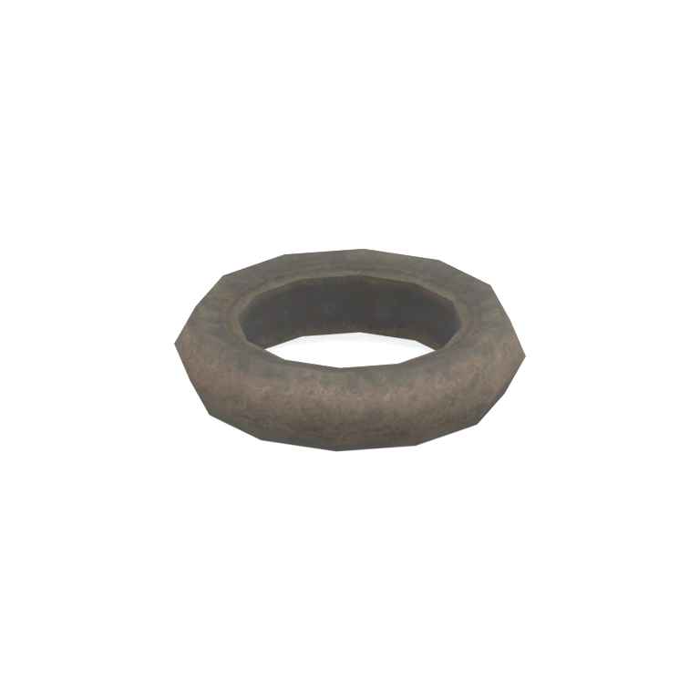
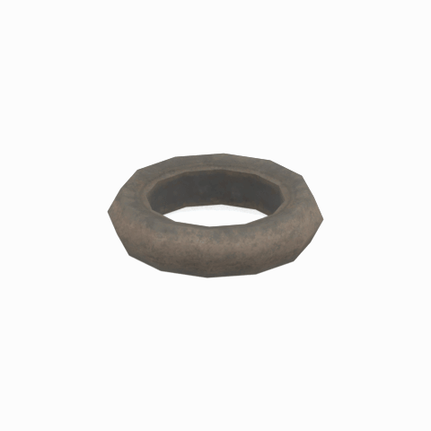

# Unidentified model (mafr_tire001)

Native model reference; a readable object identification has not been reviewed.

[Library](../README.md) | [Category](../tables/unclassified-components-1.md) | [Source / advanced data](../catalogue.json) | [Credits](../sources-and-credits.md)

**Game filename:** mafr_tire001.fmdl  
**Category:** Unclassified &gt; Unclassified components  
**Variant:** No explicit variant token; **LOD:** 0  
**Tags:** 

## Still reference



## 360-degree reference



The camera circles a static model. This is not a native animation. Source base textures and UVs use approximate studio shading; interaction, collision, complete assembly and FOX shader equivalence are not established.

## Identity and naming

| Field | Value |
|---|---|
| Library ID | mgsv-tpp-mafr_tire001-bfcd33127983d23b |
| Naming status | unidentified |
| Naming confidence | unknown |
| Naming evidence | {} |
| Native model | /Assets/tpp/environ/object/middle_africa/tire/mafr_tire001/scenes/mafr_tire001.fmdl |
| Model SHA256 | e8b5aefc6dfa3ecedd0bb8a0a2dd8f57a0c6ab42169fd51c3164832c66c00b19 |
| Container | /Assets/mgo/pack/location/afc0/pack_common/afc0_common.fpk |
| Container SHA256 | 20a950cab0d6912ac3a270b90dc6dc673f2d13859eb636819bfa3955fca6e320 |
| Captured source / location scope | Selected native member/content and captured installed-source chain; full archive SHA/runtime priority unresolved |
| Raw record SHA256 | b29ee931d672122a02b5510c246a73d8f3c38bb048661eb370d19b802188295c |

Naming review is descriptive metadata only. It does not change model completion or identify a working game interaction.

## Native LOD inventory

| Native LOD | Triangles | Preview status | Decoded indices SHA256 |
|---|---:|---|---|
| 0 | 120 | rendered | fb4a72804656d4b96b82f88d597c8f689c5d8b7327927e97e49d50d52e6246a1 |
| 1 | 112 | not separately rendered | c77d69be3a5274135e013097b000405babe1c73ddbb838d2191ba038116666f4 |
| 2 | 104 | not separately rendered | 3ce939a9e81ca0fe096a283c61d71968873b87e89d6b1f03931ef17750fac89a |
| 3 | 98 | not separately rendered | a5421a91e4537b86361c997a350d69e6835149a626b4f95234561140c52982a4 |

Mesh detail and texture pixels/mips are separate. Index hashes describe decoded triangle arrays, not packed index-buffer bytes. Only source-recorded native levels are listed.

<details>
<summary>Texture, source and naming technical metadata</summary>

```json
{
  "source": {
    "nativePath": "/Assets/tpp/environ/object/middle_africa/tire/mafr_tire001/scenes/mafr_tire001.fmdl",
    "nativeSha256": "e8b5aefc6dfa3ecedd0bb8a0a2dd8f57a0c6ab42169fd51c3164832c66c00b19",
    "stableIdentity": "/assets/tpp/environ/object/middle_africa/tire/mafr_tire001/scenes/mafr_tire001.fmdl#e8b5aefc6dfa3ecedd0bb8a0a2dd8f57a0c6ab42169fd51c3164832c66c00b19#1874c08befd6eacb66a4cc0be588aae73a7b7cfa48b9503c3a89cb7ee36ea94b",
    "container": {
      "nativePath": "/Assets/mgo/pack/location/afc0/pack_common/afc0_common.fpk",
      "sha256": "20a950cab0d6912ac3a270b90dc6dc673f2d13859eb636819bfa3955fca6e320",
      "status": "Selected installed-source container/member chain captured by community reader"
    },
    "historicalDatOrigin": null,
    "sourceArchiveAtCapture": "master/0/00.dat",
    "locationStatus": "Selected native member/content and captured installed-source chain; full archive SHA/runtime priority unresolved",
    "currentInstalledDatVerified": false,
    "selectedInstalledMemberVerified": true,
    "evidence": {
      "archive_helper_executable_sha256": "6f8e39a436af3b024bbd0504966ab3d5d9d0cb05d86689bf3e83d15e68df613f",
      "archive_helper_source_sha256": "f662d3b63e066a0afc77ffe22ea0e564222d14469648300dba2c4f8e9b43446b",
      "archive_index_recipe": "54acff767f08d76ad6056c5387328759bc883df507788f398de6c2c04fac12db",
      "archive_reader": "Atvaark GzsTool.Core 0.5.3",
      "archive_reader_core_sha256": "9da447ae3c375cce2e46744eeff6af50f1591062afdf479d1a0b49edb47daaa3",
      "archive_tool_and_dictionary_sha256": {
        "CityHash.dll": "def6c4506d461b65e4059b2936b2cbd5f852ba5d1d8a1a527f1c0e6dc7008c8f",
        "GzsTool.Core.dll": "9da447ae3c375cce2e46744eeff6af50f1591062afdf479d1a0b49edb47daaa3",
        "GzsTool.exe": "1a9c5b11e2355383ff485aee7e86abc026f5c1fad729daf8c0fd15ee0aae1c10",
        "Zlib.Portable.dll": "fe84781ba35ca9cc5ff5f73fd08d2a66c59e5257b4573f5fe59743f30bf78e42",
        "fpk_dictionary.txt": "b82f9a8d6c10a68ba9471eca9d815c21355a53b5e68753d8ad7db7fd01bf401d",
        "qar_dictionary.txt": "1558c248ed0a4bb827888261563fbb91a2df4f03999682f85d637ff70d9d5fb2"
      },
      "bytes": 6048,
      "container_chain": [
        {
          "content_sha256": null,
          "depth": 0,
          "id": "3f19555d27c2ebecdfbad26aadd88b9f62e9fb6092c04c712963ef73c67ccb42",
          "index_sha256": "9acd3675d6e1500e0e18430cba0fdc70a5718ad7d6b62f13905891a35d59f18a",
          "kind": "qar",
          "name": "master/0/00.dat",
          "parent_occurrence": null
        },
        {
          "content_sha256": "20a950cab0d6912ac3a270b90dc6dc673f2d13859eb636819bfa3955fca6e320",
          "depth": 1,
          "id": "f1334a28f5fb887d989a9c548d11dccada12186358e0a4b4e7fc9831f6f42881",
          "index_sha256": "e15578c97612208569f283c28408f389fb560576e3976adf9d7aa8ed9c9aaf87",
          "kind": "fpk",
          "name": "/Assets/mgo/pack/location/afc0/pack_common/afc0_common.fpk",
          "parent_occurrence": "348190d8da3d429c2cdae58af0494f023c46b80f66da14d484dc54a7e17a97df"
        }
      ],
      "contentSha256": "e8b5aefc6dfa3ecedd0bb8a0a2dd8f57a0c6ab42169fd51c3164832c66c00b19",
      "member": {
        "actual_size": 6048,
        "compressed_size": null,
        "content_sha256": "e8b5aefc6dfa3ecedd0bb8a0a2dd8f57a0c6ab42169fd51c3164832c66c00b19",
        "declared_size": 6048,
        "extension": "fmdl",
        "hash_hex": null,
        "name": "/Assets/tpp/environ/object/middle_africa/tire/mafr_tire001/scenes/mafr_tire001.fmdl",
        "name_origin": "embedded",
        "offset": 8260912,
        "ordinal": 326,
        "path_hash": null,
        "resolved": 1
      },
      "occurrenceId": "c9d3b8e5a323259f85cf61c217107fd8c63dd7ea4441821cd95ae348d83a31b2",
      "occurrence_id": "c9d3b8e5a323259f85cf61c217107fd8c63dd7ea4441821cd95ae348d83a31b2",
      "primary_source_revision": "fc4a8196555638c6cf8aa1b7c8dc34ccd5c69cb5",
      "source_adapter": "community_core_selective_export",
      "source_id": "7f6bb743fb4c487f0e9522f9c7fac280c46cf6b1051e0fc75a93602c8eb451f0",
      "source_path": "master/0/00.dat",
      "source_snapshot": "{\"bytes\":768788480,\"device\":621747392682911458,\"file_id\":844424931596481,\"header_sha256\":\"ead50f0a9a37e4285323b9c6fa0ec75fe75e518c63147e63158eeb2892c6589e\",\"mtime_ns\":1791852224238580700}",
      "virtualPath": "/Assets/tpp/environ/object/middle_africa/tire/mafr_tire001/scenes/mafr_tire001.fmdl"
    }
  },
  "materials": [
    {
      "sampler": "Base_Tex_SRGB",
      "materialIndex": 0,
      "nativePathHash": "1542584215200190712",
      "nativeVirtualPath": null,
      "nativeBinding": {
        "familyId": "a18354dcf38605bf12775851ed80fc9ee357024bc87f6d517b096d6ce9a3371a",
        "height": 128,
        "materialIndex": 0,
        "mipCount": 7,
        "nativeMipCountVerified": true,
        "nativePath": null,
        "nativePathHash": "1542584215200190712",
        "nativeTexture": {
          "additionalFtexsFileCount": 1,
          "depth": 1,
          "ftexsFileCount": 2,
          "height": 128,
          "metadataBytes": 176,
          "mipCount": 7,
          "mips": [
            {
              "chunks": 1,
              "decodedBytes": 16384,
              "mip": 0,
              "offset": 0,
              "storedBytes": 11376,
              "streamNumber": 2
            },
            {
              "chunks": 1,
              "decodedBytes": 4096,
              "mip": 1,
              "offset": 1224,
              "storedBytes": 2976,
              "streamNumber": 1
            },
            {
              "chunks": 1,
              "decodedBytes": 1024,
              "mip": 2,
              "offset": 400,
              "storedBytes": 816,
              "streamNumber": 1
            },
            {
              "chunks": 1,
              "decodedBytes": 256,
              "mip": 3,
              "offset": 152,
              "storedBytes": 240,
              "streamNumber": 1
            },
            {
              "chunks": 1,
              "decodedBytes": 64,
              "mip": 4,
              "offset": 64,
              "storedBytes": 80,
              "streamNumber": 1
            },
            {
              "chunks": 1,
              "decodedBytes": 16,
              "mip": 5,
              "offset": 24,
              "storedBytes": 32,
              "streamNumber": 1
            },
            {
              "chunks": 1,
              "decodedBytes": 8,
              "mip": 6,
              "offset": 0,
              "storedBytes": 16,
              "streamNumber": 1
            }
          ],
          "nativeHeaderHash": "1cc8dde643c8e270595e94d1bfa9dcd9",
          "nrtFlag": 2,
          "pixelFormat": 2,
          "requiredStreamNumbers": [
            1,
            2
          ],
          "textureType": 16777219,
          "unknownFlags": 273,
          "width": 256
        },
        "samplerName": "Base_Tex_SRGB",
        "samplerNameHash": "72475356961633",
        "sha256": "358e6b0a817b901d63be31055d07ca5f519a8a2e84dea4cffc2d8118322998bc",
        "sourceOccurrences": [
          {
            "archive_helper_executable_sha256": "6f8e39a436af3b024bbd0504966ab3d5d9d0cb05d86689bf3e83d15e68df613f",
            "archive_helper_source_sha256": "f662d3b63e066a0afc77ffe22ea0e564222d14469648300dba2c4f8e9b43446b",
            "archive_index_recipe": "54acff767f08d76ad6056c5387328759bc883df507788f398de6c2c04fac12db",
            "archive_reader": "Atvaark GzsTool.Core 0.5.3",
            "archive_reader_core_sha256": "9da447ae3c375cce2e46744eeff6af50f1591062afdf479d1a0b49edb47daaa3",
            "archive_tool_and_dictionary_sha256": {
              "CityHash.dll": "def6c4506d461b65e4059b2936b2cbd5f852ba5d1d8a1a527f1c0e6dc7008c8f",
              "GzsTool.Core.dll": "9da447ae3c375cce2e46744eeff6af50f1591062afdf479d1a0b49edb47daaa3",
              "GzsTool.exe": "1a9c5b11e2355383ff485aee7e86abc026f5c1fad729daf8c0fd15ee0aae1c10",
              "Zlib.Portable.dll": "fe84781ba35ca9cc5ff5f73fd08d2a66c59e5257b4573f5fe59743f30bf78e42",
              "fpk_dictionary.txt": "b82f9a8d6c10a68ba9471eca9d815c21355a53b5e68753d8ad7db7fd01bf401d",
              "qar_dictionary.txt": "1558c248ed0a4bb827888261563fbb91a2df4f03999682f85d637ff70d9d5fb2"
            },
            "bytes": 176,
            "container_chain": [
              {
                "content_sha256": null,
                "depth": 0,
                "id": "ed06436b87a33093d4ecc183bbe92a4270efb3b69334c9f78610d9c26d72543e",
                "index_sha256": "cbeecab235114828cf8a954288095c1e2547bfa06667c7b1e0b45c19774105d1",
                "kind": "qar",
                "name": "master/texture0.dat",
                "parent_occurrence": null
              }
            ],
            "contentSha256": "5af7b3ab3fc5179686027a59edd4926bf42bd2d9d96095f4d30472cc09da7da5",
            "member": {
              "actual_size": 176,
              "compressed_size": 176,
              "content_sha256": "5af7b3ab3fc5179686027a59edd4926bf42bd2d9d96095f4d30472cc09da7da5",
              "declared_size": 176,
              "extension": "ftex",
              "hash_hex": "15685c2bb721d0f8",
              "name": "/Assets/tpp/environ/object/middle_africa/tire/mafr_tire001/sourceimages/mafr_tire001_bsm.ftex",
              "name_origin": "dictionary",
              "offset": 2778466336,
              "ordinal": 16797,
              "path_hash": "5c2bb721d0f8",
              "resolved": 1
            },
            "occurrenceId": "0e28f5d3646d11b42cedb96224cfc0695f342f3488baca160c128d9c2bec0904",
            "occurrence_id": "0e28f5d3646d11b42cedb96224cfc0695f342f3488baca160c128d9c2bec0904",
            "primary_source_revision": "fc4a8196555638c6cf8aa1b7c8dc34ccd5c69cb5",
            "source_adapter": "community_core_selective_export",
            "source_id": "7bfac7ec2859af21676ae22ed9ddff5e6d4adaddf146059b0948f2ab8ef9e2f4",
            "source_path": "master/texture0.dat",
            "source_snapshot": "{\"bytes\":3527175168,\"device\":621747392682911458,\"file_id\":562949953639624,\"header_sha256\":\"be81f77de9943687926d5790cc5a960e18e93064af4db3c3c35dabc542fee1ed\",\"mtime_ns\":1791224675560236900}",
            "virtualPath": "/Assets/tpp/environ/object/middle_africa/tire/mafr_tire001/sourceimages/mafr_tire001_bsm.ftex"
          },
          {
            "archive_helper_executable_sha256": "6f8e39a436af3b024bbd0504966ab3d5d9d0cb05d86689bf3e83d15e68df613f",
            "archive_helper_source_sha256": "f662d3b63e066a0afc77ffe22ea0e564222d14469648300dba2c4f8e9b43446b",
            "archive_index_recipe": "54acff767f08d76ad6056c5387328759bc883df507788f398de6c2c04fac12db",
            "archive_reader": "Atvaark GzsTool.Core 0.5.3",
            "archive_reader_core_sha256": "9da447ae3c375cce2e46744eeff6af50f1591062afdf479d1a0b49edb47daaa3",
            "archive_tool_and_dictionary_sha256": {
              "CityHash.dll": "def6c4506d461b65e4059b2936b2cbd5f852ba5d1d8a1a527f1c0e6dc7008c8f",
              "GzsTool.Core.dll": "9da447ae3c375cce2e46744eeff6af50f1591062afdf479d1a0b49edb47daaa3",
              "GzsTool.exe": "1a9c5b11e2355383ff485aee7e86abc026f5c1fad729daf8c0fd15ee0aae1c10",
              "Zlib.Portable.dll": "fe84781ba35ca9cc5ff5f73fd08d2a66c59e5257b4573f5fe59743f30bf78e42",
              "fpk_dictionary.txt": "b82f9a8d6c10a68ba9471eca9d815c21355a53b5e68753d8ad7db7fd01bf401d",
              "qar_dictionary.txt": "1558c248ed0a4bb827888261563fbb91a2df4f03999682f85d637ff70d9d5fb2"
            },
            "bytes": 4208,
            "container_chain": [
              {
                "content_sha256": null,
                "depth": 0,
                "id": "ed06436b87a33093d4ecc183bbe92a4270efb3b69334c9f78610d9c26d72543e",
                "index_sha256": "cbeecab235114828cf8a954288095c1e2547bfa06667c7b1e0b45c19774105d1",
                "kind": "qar",
                "name": "master/texture0.dat",
                "parent_occurrence": null
              }
            ],
            "contentSha256": "66386db6f425c5aa32e35d31b6f096e077743b1ec849f409d1a8905c1455499f",
            "member": {
              "actual_size": 4208,
              "compressed_size": 4208,
              "content_sha256": "66386db6f425c5aa32e35d31b6f096e077743b1ec849f409d1a8905c1455499f",
              "declared_size": 4208,
              "extension": "1.ftexs",
              "hash_hex": "b2c05c2bb721d0f8",
              "name": "/Assets/tpp/environ/object/middle_africa/tire/mafr_tire001/sourceimages/mafr_tire001_bsm.1.ftexs",
              "name_origin": "dictionary",
              "offset": 2778448928,
              "ordinal": 16795,
              "path_hash": "5c2bb721d0f8",
              "resolved": 1
            },
            "occurrenceId": "035f5b67a956f3423229e8d5c5f4fe11b104d676fab743e7e4a5b22a6730d617",
            "occurrence_id": "035f5b67a956f3423229e8d5c5f4fe11b104d676fab743e7e4a5b22a6730d617",
            "primary_source_revision": "fc4a8196555638c6cf8aa1b7c8dc34ccd5c69cb5",
            "source_adapter": "community_core_selective_export",
            "source_id": "7bfac7ec2859af21676ae22ed9ddff5e6d4adaddf146059b0948f2ab8ef9e2f4",
            "source_path": "master/texture0.dat",
            "source_snapshot": "{\"bytes\":3527175168,\"device\":621747392682911458,\"file_id\":562949953639624,\"header_sha256\":\"be81f77de9943687926d5790cc5a960e18e93064af4db3c3c35dabc542fee1ed\",\"mtime_ns\":1791224675560236900}",
            "virtualPath": "/Assets/tpp/environ/object/middle_africa/tire/mafr_tire001/sourceimages/mafr_tire001_bsm.1.ftexs"
          },
          {
            "archive_helper_executable_sha256": "6f8e39a436af3b024bbd0504966ab3d5d9d0cb05d86689bf3e83d15e68df613f",
            "archive_helper_source_sha256": "f662d3b63e066a0afc77ffe22ea0e564222d14469648300dba2c4f8e9b43446b",
            "archive_index_recipe": "54acff767f08d76ad6056c5387328759bc883df507788f398de6c2c04fac12db",
            "archive_reader": "Atvaark GzsTool.Core 0.5.3",
            "archive_reader_core_sha256": "9da447ae3c375cce2e46744eeff6af50f1591062afdf479d1a0b49edb47daaa3",
            "archive_tool_and_dictionary_sha256": {
              "CityHash.dll": "def6c4506d461b65e4059b2936b2cbd5f852ba5d1d8a1a527f1c0e6dc7008c8f",
              "GzsTool.Core.dll": "9da447ae3c375cce2e46744eeff6af50f1591062afdf479d1a0b49edb47daaa3",
              "GzsTool.exe": "1a9c5b11e2355383ff485aee7e86abc026f5c1fad729daf8c0fd15ee0aae1c10",
              "Zlib.Portable.dll": "fe84781ba35ca9cc5ff5f73fd08d2a66c59e5257b4573f5fe59743f30bf78e42",
              "fpk_dictionary.txt": "b82f9a8d6c10a68ba9471eca9d815c21355a53b5e68753d8ad7db7fd01bf401d",
              "qar_dictionary.txt": "1558c248ed0a4bb827888261563fbb91a2df4f03999682f85d637ff70d9d5fb2"
            },
            "bytes": 11384,
            "container_chain": [
              {
                "content_sha256": null,
                "depth": 0,
                "id": "e73d96973ade76f7a00afdbea486dd110896ace97da0791f56899647de46f210",
                "index_sha256": "5a818609a652a10d90fb90015661d0cb80898096bbb3aac36382172988d8736d",
                "kind": "qar",
                "name": "mgo/texture0.dat",
                "parent_occurrence": null
              }
            ],
            "contentSha256": "fadd380a6b5a78989c2ef4d47e018170d2e6e0c6f03dc011b426efe12f236f74",
            "member": {
              "actual_size": 11384,
              "compressed_size": 11384,
              "content_sha256": "fadd380a6b5a78989c2ef4d47e018170d2e6e0c6f03dc011b426efe12f236f74",
              "declared_size": 11384,
              "extension": "2.ftexs",
              "hash_hex": "b5705c2bb721d0f8",
              "name": "/Assets/tpp/environ/object/middle_africa/tire/mafr_tire001/sourceimages/mafr_tire001_bsm.2.ftexs",
              "name_origin": "dictionary",
              "offset": 4050416672,
              "ordinal": 16642,
              "path_hash": "5c2bb721d0f8",
              "resolved": 1
            },
            "occurrenceId": "7bf15e97e125b84a6239bd8233c9efd7a8c47dff24f053fe1d4129ba8b298f79",
            "occurrence_id": "7bf15e97e125b84a6239bd8233c9efd7a8c47dff24f053fe1d4129ba8b298f79",
            "primary_source_revision": "fc4a8196555638c6cf8aa1b7c8dc34ccd5c69cb5",
            "source_adapter": "community_core_selective_export",
            "source_id": "03f5942f0e1af8040ae05b95c43716d75f5933971d78324bf7cfea291297f3f4",
            "source_path": "mgo/texture0.dat",
            "source_snapshot": "{\"bytes\":4492370944,\"device\":621747392682911458,\"file_id\":562949953639631,\"header_sha256\":\"6108fbacb65c84d041742c39e5ca630745240453b336f1059a13b91943f0b011\",\"mtime_ns\":1791224675562234400}",
            "virtualPath": "/Assets/tpp/environ/object/middle_africa/tire/mafr_tire001/sourceimages/mafr_tire001_bsm.2.ftexs"
          }
        ],
        "width": 256
      },
      "ddsSha256": "358e6b0a817b901d63be31055d07ca5f519a8a2e84dea4cffc2d8118322998bc",
      "dimensions": [
        256,
        128
      ],
      "mipCount": 7,
      "nativeMipCountVerified": true,
      "connectedInPreview": true
    }
  ],
  "quality": {
    "decodedIndicesHashDerivation": "SHA256 of canonical UTF-8 JSON decoded triangle indices grouped by mesh; not packed buffer bytes",
    "highestRetainedGeometricLod": 0,
    "distinctNativeLods": 4,
    "baseTextureDimensions": [
      256,
      128
    ],
    "baseTextureNativeMipCount": 7,
    "largerRetainedBaseTextureFound": null,
    "nativeLods": [
      {
        "indicesSha256": "fb4a72804656d4b96b82f88d597c8f689c5d8b7327927e97e49d50d52e6246a1",
        "nativeLod": 0,
        "triangles": 120
      },
      {
        "indicesSha256": "c77d69be3a5274135e013097b000405babe1c73ddbb838d2191ba038116666f4",
        "nativeLod": 1,
        "triangles": 112
      },
      {
        "indicesSha256": "3ce939a9e81ca0fe096a283c61d71968873b87e89d6b1f03931ef17750fac89a",
        "nativeLod": 2,
        "triangles": 104
      },
      {
        "indicesSha256": "a5421a91e4537b86361c997a350d69e6835149a626b4f95234561140c52982a4",
        "nativeLod": 3,
        "triangles": 98
      }
    ],
    "renderedNativeLods": [
      0
    ],
    "baseTextureSummary": "256 x 128; 7 native/DDS mips",
    "highestDetailScope": "Triangle-count comparison within captured FMDL only"
  }
}
```

</details>

[Original source / advanced record](../catalogue.json)
