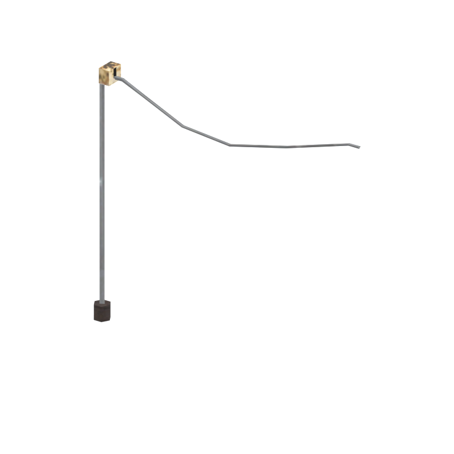
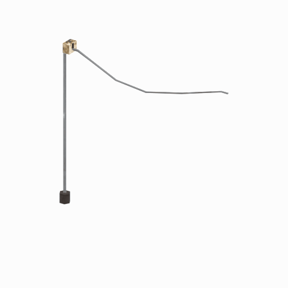

# mgoa lght001

Textured static native model reference; assembly and interactivity are not inferred.

[Discovered static models table](../tables/discovered-static-models-4b29110f-batch-1.md) | [Library](../README.md) | [Credits](../sources-and-credits.md) | [Batch source data](../batch-provenance.json)

## Still reference

## 360-degree reference

Static model; 48 camera views, 100ms/frame,4.8-second loop. This is a reference-camera orbit, not native animation. Actual captured base textures/UVs use approximate studio lighting. FOX shader, collision, interactions and complete assembly are untested.

## Identity and source

| Field | Value |
|---|---|
| Category | Discovered static models > Installed-source static components |
| Tags | static model, native model, mgoa_lght001 |
| Native model | `/Assets/mgo/environ/object/mgo_afgh/light/mgoa_lght001/scenes/mgoa_lght001.fmdl` |
| Native SHA256 | `861bb174c3ac0c98740954155f239c2ccbeeb5b68fe392063815a5b0792883e0` |
| Captured source container | `/Assets/mgo/pack/location/afc0/pack_common/afc0_common.fpk` |
| Captured source container SHA256 | `20a950cab0d6912ac3a270b90dc6dc673f2d13859eb636819bfa3955fca6e320` |
| Location evidence | Selected native member/content and captured installed-source chain; full archive SHA/runtime priority unresolved |
| Current installed DAT / priority | Captured as-installed chain; full archive SHA and effective runtime priority unresolved |
| Upstream preparation | Selective installed-archive staging by the credited GzsTool Core bridge; actual complete FTEX-family conversion by FtexTool; automatic native inspection and reference rendering. |

Source namespace is a path identity, not exclusive original use. Lowercased lookup keys are separate from the exact retained member spelling.

## Quality and native LOD inventory

Texture pixels/mips, geometric detail and approximate studio shader fidelity are separate. Only LOD0 was rendered for this imported batch. Other levels are inventoried, not newly previewed; identical decoded index sets map to their recorded counterpart. The decoded-indices hash uses UTF-8 canonical JSON of triangle-index lists grouped by mesh, not the original packed index-buffer bytes. No upscaling or invented geometry.

| Native LOD | Triangles | Decoded indices SHA256 | Duplicate mapping | Preview status |
|---|---:|---|---|---|
| 0 | 86 | `823ac0ae0d468bc4997a05b4f338828403519f4d140f7e71bb85515465872ee7` | Distinct within retained model | Rendered above |
| 1 | 80 | `19755d38c51e00153f0e15ef48171f13ac8f6db17c9f4f3664e221df91a23197` | Distinct within retained model | Not rendered |
| 2 | 76 | `881e98eef1d6469771de4628468709477fe8050b6ebed1f9b4ab0d703ec3addf` | Distinct within retained model | Not rendered |
| 3 | 74 | `efeed1f3e929aded4691d397b785cc3bf1e6de681becd61f09e68d88b712e33f` | Distinct within retained model | Not rendered |

## Base textures

| Material | Native sampler / path hash | Pixels | Mip levels | Retained DDS SHA256 |
|---|---|---|---|---|
| 0 | Base_Tex_SRGB / `1542912741250313474` | 128 x 128 | 6 native/header verified | `40cd9a779ee879c730e4e04c79bf5197a1efb08d0916b5dac6d49d458d248b8e` |

Texture virtual filenames are unknown where only native hashes are available. Larger native textures elsewhere in the game were not searched. Only actual base-color maps are applied; normal/specular/packed shader channels are not recreated.

## Attribution and limits

Game models/textures: Konami. Project owner: arsenal-pt. Authored importer/metadata/reference work: OpenAI Codex (AI/LLM). [Community tools and detailed credits](../sources-and-credits.md). No endorsement is implied. Game artwork is outside the original-code license.

Only rendered references and descriptive metadata are distributed. Raw assets, native files, textures, decoded geometry, Blender scenes, private source paths and clean frame caches remain private. [Catalogue](../catalogue.json) and [batch provenance](../batch-provenance.json) preserve identity and media hashes.

## Captured base-texture locations

| Material | Actual native texture path | Complete family identity |
|---|---|---|
| 0 | `Unknown; native binding retained` | `3a16404be3073da8fd970617f941807ec66e7ecfa22b1b4debb2ebac76a31f71` |
