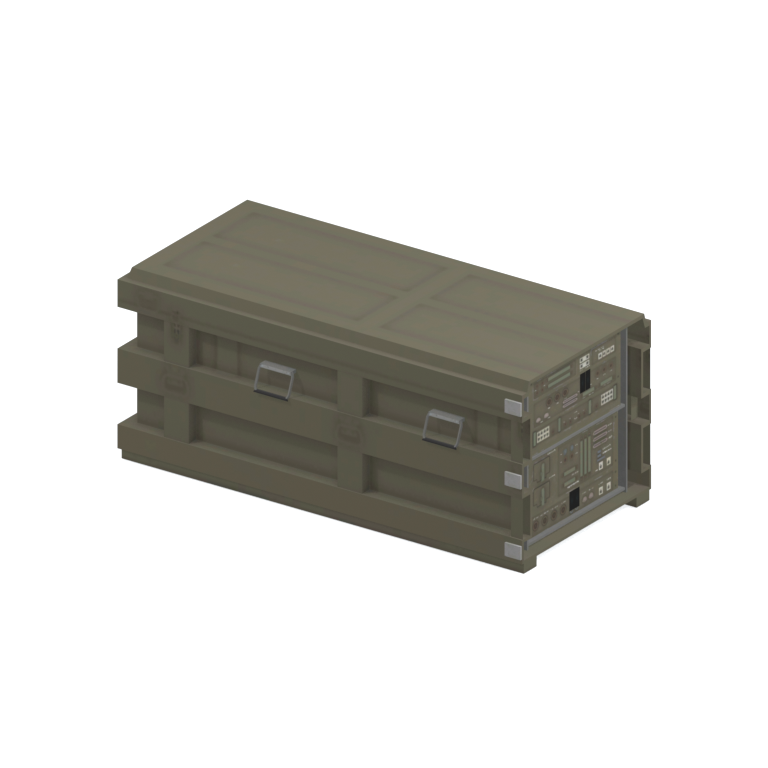
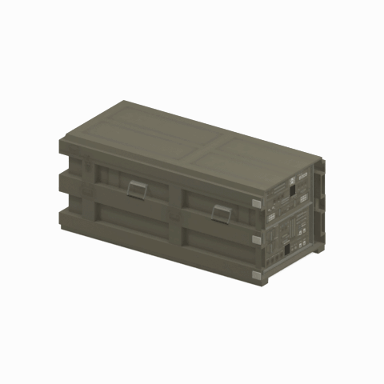

# mgoa tlbx001 vrtn002

Textured static native model reference; assembly and interactivity are not inferred.

[Discovered static models table](../tables/discovered-static-models-4b29110f-batch-1.md) | [Library](../README.md) | [Credits](../sources-and-credits.md) | [Batch source data](../batch-provenance.json)

## Still reference

## 360-degree reference

Static model; 48 camera views, 100ms/frame,4.8-second loop. This is a reference-camera orbit, not native animation. Actual captured base textures/UVs use approximate studio lighting. FOX shader, collision, interactions and complete assembly are untested.

## Identity and source

| Field | Value |
|---|---|
| Category | Discovered static models > Installed-source static components |
| Tags | static model, native model, mgoa_tlbx001_vrtn002 |
| Native model | `/Assets/mgo/environ/object/mgo_afgh/toolbox/mgoa_tlbx001/scenes/mgoa_tlbx001_vrtn002.fmdl` |
| Native SHA256 | `adccb5a4d51dfdc270365e400026764b4c6ac13d6bc3ac1e6c37b642b7ee7682` |
| Captured source container | `/Assets/mgo/pack/location/afc0/pack_common/afc0_common.fpk` |
| Captured source container SHA256 | `20a950cab0d6912ac3a270b90dc6dc673f2d13859eb636819bfa3955fca6e320` |
| Location evidence | Selected native member/content and captured installed-source chain; full archive SHA/runtime priority unresolved |
| Current installed DAT / priority | Captured as-installed chain; full archive SHA and effective runtime priority unresolved |
| Upstream preparation | Selective installed-archive staging by the credited GzsTool Core bridge; actual complete FTEX-family conversion by FtexTool; automatic native inspection and reference rendering. |

Source namespace is a path identity, not exclusive original use. Lowercased lookup keys are separate from the exact retained member spelling.

## Quality and native LOD inventory

Texture pixels/mips, geometric detail and approximate studio shader fidelity are separate. Only LOD0 was rendered for this imported batch. Other levels are inventoried, not newly previewed; identical decoded index sets map to their recorded counterpart. The decoded-indices hash uses UTF-8 canonical JSON of triangle-index lists grouped by mesh, not the original packed index-buffer bytes. No upscaling or invented geometry.

| Native LOD | Triangles | Decoded indices SHA256 | Duplicate mapping | Preview status |
|---|---:|---|---|---|
| 0 | 928 | `aadaac8f1e01a01f0641467cbc90706a7522ef673836f7cf59fcc9b7f5630334` | Distinct within retained model | Rendered above |
| 1 | 700 | `fb5eb487f5c9b90fc88b3b763fac632e63d2f63a4fa696b477d4e0d2c45d22cd` | Distinct within retained model | Not rendered |
| 2 | 581 | `1f99c2f0198d7229b6a2612d1d01bf9f5aa1888eab8500bcdca02fb6cc9165b2` | Distinct within retained model | Not rendered |
| 3 | 533 | `edc6d6bf63e9506790de7126672939644c8c06b2e407ce5fc7c41480ea6df1dc` | Distinct within retained model | Not rendered |

## Base textures

| Material | Native sampler / path hash | Pixels | Mip levels | Retained DDS SHA256 |
|---|---|---|---|---|
| 0 | Base_Tex_SRGB / `1543041940118732889` | 1024 x 512 | 9 native/header verified | `f859db52318c70a64f3c2ecc3b7bcdf79f8f1096e946e7505a8ff4d7f8d0b3ef` |
| 1 | Base_Tex_SRGB / `1543527986023263228` | 512 x 256 | 8 native/header verified | `54f0226cd4818ac486de6519681170379d8889130ec6f11a02cb6fbd64720dcd` |
| 2 | Base_Tex_SRGB / `1542954442932575850` | 1024 x 1024 | 9 native/header verified | `c7e9589328dd6775f04f07cb98b36e0495c92fba8b10380706c8b91ed5e6c6a8` |
| 3 | Base_Tex_SRGB / `1542627402872693420` | 128 x 128 | 6 native/header verified | `cca7c7863388f7250874879d882a671bf5aaee5c2b80acbeea9db6e7a82b4f6f` |

Texture virtual filenames are unknown where only native hashes are available. Larger native textures elsewhere in the game were not searched. Only actual base-color maps are applied; normal/specular/packed shader channels are not recreated.

## Attribution and limits

Game models/textures: Konami. Project owner: arsenal-pt. Authored importer/metadata/reference work: OpenAI Codex (AI/LLM). [Community tools and detailed credits](../sources-and-credits.md). No endorsement is implied. Game artwork is outside the original-code license.

Only rendered references and descriptive metadata are distributed. Raw assets, native files, textures, decoded geometry, Blender scenes, private source paths and clean frame caches remain private. [Catalogue](../catalogue.json) and [batch provenance](../batch-provenance.json) preserve identity and media hashes.

## Captured base-texture locations

| Material | Actual native texture path | Complete family identity |
|---|---|---|
| 0 | `Unknown; native binding retained` | `b15f9533163d3e26ad1bdbf546e50d22100528a2f8887ae0659091c346399f24` |
| 1 | `Unknown; native binding retained` | `76e3e26c5efe3086aba03bf22eeb7496a5e95eebeb5b41743a874776cf252997` |
| 2 | `Unknown; native binding retained` | `bb1e32358eacb1988f233b265f8c20f8d1527d7318f6a6ca00653034fef8f0f8` |
| 3 | `Unknown; native binding retained` | `1a53689f325384ae84f7dfbcc1cae3a3034d0b76ebc90d574f02709c24d65921` |
