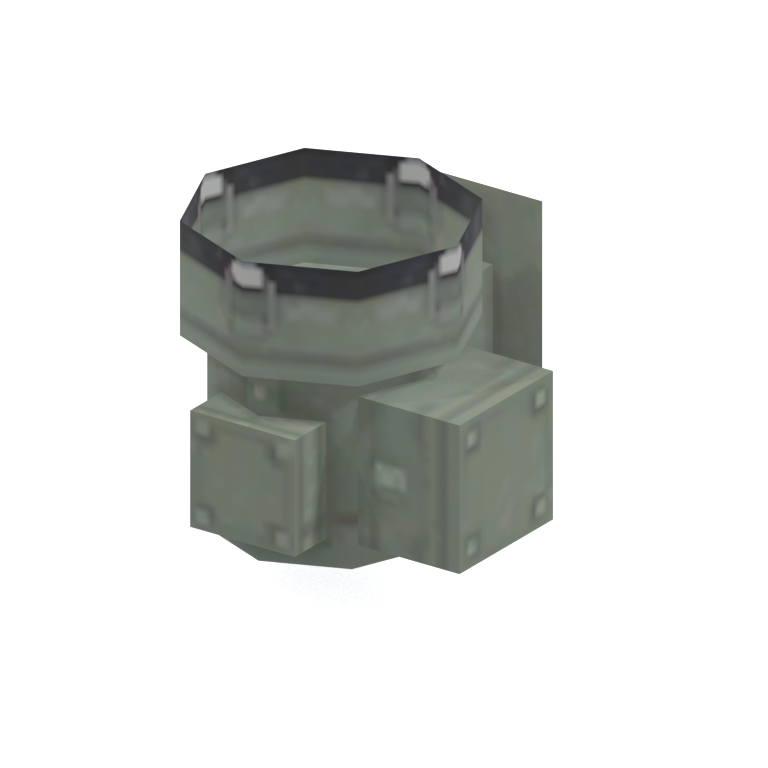
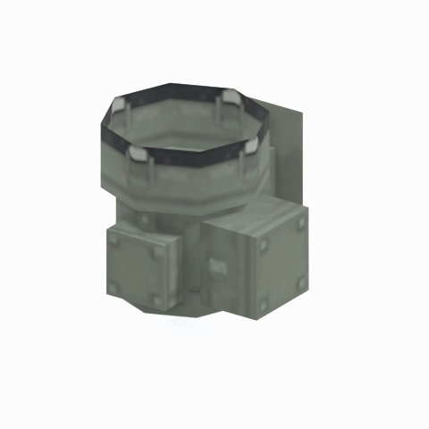

# Unidentified model (mgob_allm002)

Native model reference; a readable object identification has not been reviewed.

[Library](../README.md) | [Category](../tables/unclassified-components-1.md) | [Source / advanced data](../catalogue.json) | [Credits](../sources-and-credits.md)

**Game filename:** mgob_allm002.fmdl  
**Category:** Unclassified &gt; Unclassified components  
**Variant:** No explicit variant token; **LOD:** 0  
**Tags:** 

## Still reference



## 360-degree reference



The camera circles a static model. This is not a native animation. Source base textures and UVs use approximate studio shading; interaction, collision, complete assembly and FOX shader equivalence are not established.

## Identity and naming

| Field | Value |
|---|---|
| Library ID | mgsv-tpp-mgob_allm002-15b0c8fd8a4dacb8 |
| Naming status | unidentified |
| Naming confidence | unknown |
| Naming evidence | {} |
| Native model | /Assets/mgo/environ/object/mgo_mtbs/alarm_lamp/mgob_allm002/scenes/mgob_allm002.fmdl |
| Model SHA256 | fc34b4bad4cb7522d538bad083158fd64f3b39a9eb6a0090afe2979c319148c8 |
| Container | /Assets/mgo/pack/location/afc1/pack_common/afc1_common.fpk |
| Container SHA256 | cf9aff37b860d362b6723fe700775983cc61ae7d7f23b6de70df9ba489a966da |
| Captured source / location scope | Selected native member/content and captured installed-source chain; full archive SHA/runtime priority unresolved |
| Raw record SHA256 | 0d19aae5307dc8537506d8dab457f468d373e437c26c4b106b76060b518b2e46 |

Naming review is descriptive metadata only. It does not change model completion or identify a working game interaction.

## Native LOD inventory

| Native LOD | Triangles | Preview status | Decoded indices SHA256 |
|---|---:|---|---|
| 0 | 74 | rendered | f7c809bbbafa338422d249abf5e379917cb6b675749bd7fbe4d32289bcca0ee0 |
| 1 | 67 | not separately rendered | 5d0874f0172c53b7814561f5a816c581fc53f4b2574f020fe56f5073aea21757 |
| 2 | 65 | not separately rendered | b4b159a3c0b422f4d567faff8cd16c4ee291f9ffd0dbfb6d5d718768c2f2e102 |
| 3 | 62 | not separately rendered | 43fc7d2fb412aef963b5a73976d30d4fe506b34a48bca00534e10b23b141dca9 |

Mesh detail and texture pixels/mips are separate. Index hashes describe decoded triangle arrays, not packed index-buffer bytes. Only source-recorded native levels are listed.

<details>
<summary>Texture, source and naming technical metadata</summary>

```json
{
  "source": {
    "nativePath": "/Assets/mgo/environ/object/mgo_mtbs/alarm_lamp/mgob_allm002/scenes/mgob_allm002.fmdl",
    "nativeSha256": "fc34b4bad4cb7522d538bad083158fd64f3b39a9eb6a0090afe2979c319148c8",
    "stableIdentity": "/assets/mgo/environ/object/mgo_mtbs/alarm_lamp/mgob_allm002/scenes/mgob_allm002.fmdl#fc34b4bad4cb7522d538bad083158fd64f3b39a9eb6a0090afe2979c319148c8#7cb5848ee85619b10cf4c2885b6502782315808f4337047608e31144d1ccc135",
    "container": {
      "nativePath": "/Assets/mgo/pack/location/afc1/pack_common/afc1_common.fpk",
      "sha256": "cf9aff37b860d362b6723fe700775983cc61ae7d7f23b6de70df9ba489a966da",
      "status": "Selected installed-source container/member chain captured by community reader"
    },
    "historicalDatOrigin": null,
    "sourceArchiveAtCapture": "master/0/00.dat",
    "locationStatus": "Selected native member/content and captured installed-source chain; full archive SHA/runtime priority unresolved",
    "currentInstalledDatVerified": false,
    "selectedInstalledMemberVerified": true,
    "evidence": {
      "archive_helper_executable_sha256": "6f8e39a436af3b024bbd0504966ab3d5d9d0cb05d86689bf3e83d15e68df613f",
      "archive_helper_source_sha256": "f662d3b63e066a0afc77ffe22ea0e564222d14469648300dba2c4f8e9b43446b",
      "archive_index_recipe": "54acff767f08d76ad6056c5387328759bc883df507788f398de6c2c04fac12db",
      "archive_reader": "Atvaark GzsTool.Core 0.5.3",
      "archive_reader_core_sha256": "9da447ae3c375cce2e46744eeff6af50f1591062afdf479d1a0b49edb47daaa3",
      "archive_tool_and_dictionary_sha256": {
        "CityHash.dll": "def6c4506d461b65e4059b2936b2cbd5f852ba5d1d8a1a527f1c0e6dc7008c8f",
        "GzsTool.Core.dll": "9da447ae3c375cce2e46744eeff6af50f1591062afdf479d1a0b49edb47daaa3",
        "GzsTool.exe": "1a9c5b11e2355383ff485aee7e86abc026f5c1fad729daf8c0fd15ee0aae1c10",
        "Zlib.Portable.dll": "fe84781ba35ca9cc5ff5f73fd08d2a66c59e5257b4573f5fe59743f30bf78e42",
        "fpk_dictionary.txt": "b82f9a8d6c10a68ba9471eca9d815c21355a53b5e68753d8ad7db7fd01bf401d",
        "qar_dictionary.txt": "1558c248ed0a4bb827888261563fbb91a2df4f03999682f85d637ff70d9d5fb2"
      },
      "bytes": 5696,
      "container_chain": [
        {
          "content_sha256": null,
          "depth": 0,
          "id": "3f19555d27c2ebecdfbad26aadd88b9f62e9fb6092c04c712963ef73c67ccb42",
          "index_sha256": "9acd3675d6e1500e0e18430cba0fdc70a5718ad7d6b62f13905891a35d59f18a",
          "kind": "qar",
          "name": "master/0/00.dat",
          "parent_occurrence": null
        },
        {
          "content_sha256": "cf9aff37b860d362b6723fe700775983cc61ae7d7f23b6de70df9ba489a966da",
          "depth": 1,
          "id": "6f51e2cefeb81d4be84fd97795833addfdc97724952faa48b68b04b91276c2d6",
          "index_sha256": "093dbba03abdf3c5222bb14076d11b2f349a959ae6521fed333d73e2731c6090",
          "kind": "fpk",
          "name": "/Assets/mgo/pack/location/afc1/pack_common/afc1_common.fpk",
          "parent_occurrence": "dc78337c139fb86a3d388f65ba968ecf0c752819c6074e53d3482c1ed223b489"
        }
      ],
      "contentSha256": "fc34b4bad4cb7522d538bad083158fd64f3b39a9eb6a0090afe2979c319148c8",
      "member": {
        "actual_size": 5696,
        "compressed_size": null,
        "content_sha256": "fc34b4bad4cb7522d538bad083158fd64f3b39a9eb6a0090afe2979c319148c8",
        "declared_size": 5696,
        "extension": "fmdl",
        "hash_hex": null,
        "name": "/Assets/mgo/environ/object/mgo_mtbs/alarm_lamp/mgob_allm002/scenes/mgob_allm002.fmdl",
        "name_origin": "embedded",
        "offset": 8029536,
        "ordinal": 189,
        "path_hash": null,
        "resolved": 1
      },
      "occurrenceId": "fe7937e6f2a49ce071836bbe4b21592913b5dcaa5d4fde8cb37e85876c7fd4f6",
      "occurrence_id": "fe7937e6f2a49ce071836bbe4b21592913b5dcaa5d4fde8cb37e85876c7fd4f6",
      "primary_source_revision": "fc4a8196555638c6cf8aa1b7c8dc34ccd5c69cb5",
      "source_adapter": "community_core_selective_export",
      "source_id": "7f6bb743fb4c487f0e9522f9c7fac280c46cf6b1051e0fc75a93602c8eb451f0",
      "source_path": "master/0/00.dat",
      "source_snapshot": "{\"bytes\":768788480,\"device\":621747392682911458,\"file_id\":844424931596481,\"header_sha256\":\"ead50f0a9a37e4285323b9c6fa0ec75fe75e518c63147e63158eeb2892c6589e\",\"mtime_ns\":1791852224238580700}",
      "virtualPath": "/Assets/mgo/environ/object/mgo_mtbs/alarm_lamp/mgob_allm002/scenes/mgob_allm002.fmdl"
    }
  },
  "materials": [
    {
      "sampler": "Base_Tex_SRGB",
      "materialIndex": 0,
      "nativePathHash": "1542577951601133093",
      "nativeVirtualPath": null,
      "nativeBinding": {
        "familyId": "ac80bd4a188c1c344b0134dfe0fd4879ff7d5d8df226cba30d0d6fdfdac5cedd",
        "height": 128,
        "materialIndex": 0,
        "mipCount": 6,
        "nativeMipCountVerified": true,
        "nativePath": null,
        "nativePathHash": "1542577951601133093",
        "nativeTexture": {
          "additionalFtexsFileCount": 0,
          "depth": 1,
          "ftexsFileCount": 1,
          "height": 128,
          "metadataBytes": 160,
          "mipCount": 6,
          "mips": [
            {
              "chunks": 1,
              "decodedBytes": 8192,
              "mip": 0,
              "offset": 2376,
              "storedBytes": 5456,
              "streamNumber": 1
            },
            {
              "chunks": 1,
              "decodedBytes": 2048,
              "mip": 1,
              "offset": 752,
              "storedBytes": 1616,
              "streamNumber": 1
            },
            {
              "chunks": 1,
              "decodedBytes": 512,
              "mip": 2,
              "offset": 232,
              "storedBytes": 512,
              "streamNumber": 1
            },
            {
              "chunks": 1,
              "decodedBytes": 128,
              "mip": 3,
              "offset": 80,
              "storedBytes": 144,
              "streamNumber": 1
            },
            {
              "chunks": 1,
              "decodedBytes": 32,
              "mip": 4,
              "offset": 24,
              "storedBytes": 48,
              "streamNumber": 1
            },
            {
              "chunks": 1,
              "decodedBytes": 8,
              "mip": 5,
              "offset": 0,
              "storedBytes": 16,
              "streamNumber": 1
            }
          ],
          "nativeHeaderHash": "0e4cdb3c9e3841ebfeb59f7972037056",
          "nrtFlag": 2,
          "pixelFormat": 2,
          "requiredStreamNumbers": [
            1
          ],
          "textureType": 16777219,
          "unknownFlags": 273,
          "width": 128
        },
        "samplerName": "Base_Tex_SRGB",
        "samplerNameHash": "72475356961633",
        "sha256": "44cd4ac348d05d25c23acd14e07ef12a7bc26075f43d185c937f020877e2eaf2",
        "sourceOccurrences": [
          {
            "archive_helper_executable_sha256": "6f8e39a436af3b024bbd0504966ab3d5d9d0cb05d86689bf3e83d15e68df613f",
            "archive_helper_source_sha256": "f662d3b63e066a0afc77ffe22ea0e564222d14469648300dba2c4f8e9b43446b",
            "archive_index_recipe": "54acff767f08d76ad6056c5387328759bc883df507788f398de6c2c04fac12db",
            "archive_reader": "Atvaark GzsTool.Core 0.5.3",
            "archive_reader_core_sha256": "9da447ae3c375cce2e46744eeff6af50f1591062afdf479d1a0b49edb47daaa3",
            "archive_tool_and_dictionary_sha256": {
              "CityHash.dll": "def6c4506d461b65e4059b2936b2cbd5f852ba5d1d8a1a527f1c0e6dc7008c8f",
              "GzsTool.Core.dll": "9da447ae3c375cce2e46744eeff6af50f1591062afdf479d1a0b49edb47daaa3",
              "GzsTool.exe": "1a9c5b11e2355383ff485aee7e86abc026f5c1fad729daf8c0fd15ee0aae1c10",
              "Zlib.Portable.dll": "fe84781ba35ca9cc5ff5f73fd08d2a66c59e5257b4573f5fe59743f30bf78e42",
              "fpk_dictionary.txt": "b82f9a8d6c10a68ba9471eca9d815c21355a53b5e68753d8ad7db7fd01bf401d",
              "qar_dictionary.txt": "1558c248ed0a4bb827888261563fbb91a2df4f03999682f85d637ff70d9d5fb2"
            },
            "bytes": 160,
            "container_chain": [
              {
                "content_sha256": null,
                "depth": 0,
                "id": "06035c7f54d1fe3fde25c93eb85d5278f37457e9730b7b0dc0553ea567520e6d",
                "index_sha256": "be525e8d33187ab76b3f97935035faac60a4c7ca7fcff3401a0ce712f03c285e",
                "kind": "qar",
                "name": "master/texture3.dat",
                "parent_occurrence": null
              }
            ],
            "contentSha256": "dc14bd2308ae8aac63a411bf11fb1305d78b6f3fbc5bd82a22b1c231c9f8cd10",
            "member": {
              "actual_size": 160,
              "compressed_size": 160,
              "content_sha256": "dc14bd2308ae8aac63a411bf11fb1305d78b6f3fbc5bd82a22b1c231c9f8cd10",
              "declared_size": 160,
              "extension": "ftex",
              "hash_hex": "156856795b890625",
              "name": "/Assets/tpp/environ/object/mother_base/alarm_lamp/mtbs_allm002/sourceimages/mtbs_allm002_bsm.ftex",
              "name_origin": "dictionary",
              "offset": 914123808,
              "ordinal": 8365,
              "path_hash": "56795b890625",
              "resolved": 1
            },
            "occurrenceId": "48ba9be618ea9c2d819aa15d5a89d3d6c183b7f8197c76389a67bd26caf55eef",
            "occurrence_id": "48ba9be618ea9c2d819aa15d5a89d3d6c183b7f8197c76389a67bd26caf55eef",
            "primary_source_revision": "fc4a8196555638c6cf8aa1b7c8dc34ccd5c69cb5",
            "source_adapter": "community_core_selective_export",
            "source_id": "8d93a1c4a39e41ca988ccdecf8dbaa5fa7e6f9f82b75bea9a691d2b01de50ef8",
            "source_path": "master/texture3.dat",
            "source_snapshot": "{\"bytes\":1297381376,\"device\":621747392682911458,\"file_id\":562949953639627,\"header_sha256\":\"55c07d7fb3cb3498d10fa3bed93a81ce330553a903fff3222b5bf307bcc7ef0c\",\"mtime_ns\":1791224675561235200}",
            "virtualPath": "/Assets/tpp/environ/object/mother_base/alarm_lamp/mtbs_allm002/sourceimages/mtbs_allm002_bsm.ftex"
          },
          {
            "archive_helper_executable_sha256": "6f8e39a436af3b024bbd0504966ab3d5d9d0cb05d86689bf3e83d15e68df613f",
            "archive_helper_source_sha256": "f662d3b63e066a0afc77ffe22ea0e564222d14469648300dba2c4f8e9b43446b",
            "archive_index_recipe": "54acff767f08d76ad6056c5387328759bc883df507788f398de6c2c04fac12db",
            "archive_reader": "Atvaark GzsTool.Core 0.5.3",
            "archive_reader_core_sha256": "9da447ae3c375cce2e46744eeff6af50f1591062afdf479d1a0b49edb47daaa3",
            "archive_tool_and_dictionary_sha256": {
              "CityHash.dll": "def6c4506d461b65e4059b2936b2cbd5f852ba5d1d8a1a527f1c0e6dc7008c8f",
              "GzsTool.Core.dll": "9da447ae3c375cce2e46744eeff6af50f1591062afdf479d1a0b49edb47daaa3",
              "GzsTool.exe": "1a9c5b11e2355383ff485aee7e86abc026f5c1fad729daf8c0fd15ee0aae1c10",
              "Zlib.Portable.dll": "fe84781ba35ca9cc5ff5f73fd08d2a66c59e5257b4573f5fe59743f30bf78e42",
              "fpk_dictionary.txt": "b82f9a8d6c10a68ba9471eca9d815c21355a53b5e68753d8ad7db7fd01bf401d",
              "qar_dictionary.txt": "1558c248ed0a4bb827888261563fbb91a2df4f03999682f85d637ff70d9d5fb2"
            },
            "bytes": 7840,
            "container_chain": [
              {
                "content_sha256": null,
                "depth": 0,
                "id": "0b473016351235050c2f6af21454bd979a0ad4602a9860137c807c894c5eba4d",
                "index_sha256": "ac9b4dae0dd0166db3a6ec8da18524dffebcbaf9004569af631de82913bf49a3",
                "kind": "qar",
                "name": "master/texture2.dat",
                "parent_occurrence": null
              }
            ],
            "contentSha256": "8ae69e7e9d41968f3bd84e9e13aba33476685898415b387611c23a5393b6599f",
            "member": {
              "actual_size": 7840,
              "compressed_size": 7840,
              "content_sha256": "8ae69e7e9d41968f3bd84e9e13aba33476685898415b387611c23a5393b6599f",
              "declared_size": 7840,
              "extension": "1.ftexs",
              "hash_hex": "b2c056795b890625",
              "name": "/Assets/tpp/environ/object/mother_base/alarm_lamp/mtbs_allm002/sourceimages/mtbs_allm002_bsm.1.ftexs",
              "name_origin": "dictionary",
              "offset": 2641923104,
              "ordinal": 18832,
              "path_hash": "56795b890625",
              "resolved": 1
            },
            "occurrenceId": "80eceb3de265f634b3722a6a615787ef5be56ae2f8b90493b94427b2836bf453",
            "occurrence_id": "80eceb3de265f634b3722a6a615787ef5be56ae2f8b90493b94427b2836bf453",
            "primary_source_revision": "fc4a8196555638c6cf8aa1b7c8dc34ccd5c69cb5",
            "source_adapter": "community_core_selective_export",
            "source_id": "85e8296057664cbc6ebaf6bd43d1c6d18528bbd8a6fae920bdf4d5eb69f6a93d",
            "source_path": "master/texture2.dat",
            "source_snapshot": "{\"bytes\":2920239104,\"device\":621747392682911458,\"file_id\":562949953639626,\"header_sha256\":\"72bfee707623afb5f3abd8382035d3d4258b4941ac583a56f5a447f47123dcab\",\"mtime_ns\":1791224675561235200}",
            "virtualPath": "/Assets/tpp/environ/object/mother_base/alarm_lamp/mtbs_allm002/sourceimages/mtbs_allm002_bsm.1.ftexs"
          }
        ],
        "width": 128
      },
      "ddsSha256": "44cd4ac348d05d25c23acd14e07ef12a7bc26075f43d185c937f020877e2eaf2",
      "dimensions": [
        128,
        128
      ],
      "mipCount": 6,
      "nativeMipCountVerified": true,
      "connectedInPreview": true
    }
  ],
  "quality": {
    "decodedIndicesHashDerivation": "SHA256 of canonical UTF-8 JSON decoded triangle indices grouped by mesh; not packed buffer bytes",
    "highestRetainedGeometricLod": 0,
    "distinctNativeLods": 4,
    "baseTextureDimensions": [
      128,
      128
    ],
    "baseTextureNativeMipCount": 6,
    "largerRetainedBaseTextureFound": null,
    "nativeLods": [
      {
        "indicesSha256": "f7c809bbbafa338422d249abf5e379917cb6b675749bd7fbe4d32289bcca0ee0",
        "nativeLod": 0,
        "triangles": 74
      },
      {
        "indicesSha256": "5d0874f0172c53b7814561f5a816c581fc53f4b2574f020fe56f5073aea21757",
        "nativeLod": 1,
        "triangles": 67
      },
      {
        "indicesSha256": "b4b159a3c0b422f4d567faff8cd16c4ee291f9ffd0dbfb6d5d718768c2f2e102",
        "nativeLod": 2,
        "triangles": 65
      },
      {
        "indicesSha256": "43fc7d2fb412aef963b5a73976d30d4fe506b34a48bca00534e10b23b141dca9",
        "nativeLod": 3,
        "triangles": 62
      }
    ],
    "renderedNativeLods": [
      0
    ],
    "baseTextureSummary": "128 x 128; 6 native/DDS mips",
    "highestDetailScope": "Triangle-count comparison within captured FMDL only"
  }
}
```

</details>

[Original source / advanced record](../catalogue.json)
