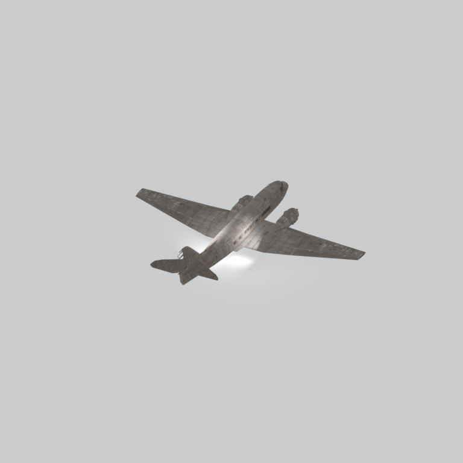
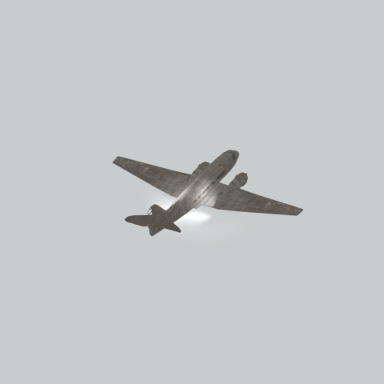

# mgom arpl001

Textured static native model reference; assembly and interactivity are not inferred.

[Discovered static models table](../tables/discovered-static-models-4b29110f-batch-1.md) | [Library](../README.md) | [Credits](../sources-and-credits.md) | [Batch source data](../batch-provenance.json)

## Still reference

## 360-degree reference

Static model; 48 camera views, 100ms/frame,4.8-second loop. This is a reference-camera orbit, not native animation. Actual captured base textures/UVs use approximate studio lighting. FOX shader, collision, interactions and complete assembly are untested.

## Identity and source

| Field | Value |
|---|---|
| Category | Discovered static models > Installed-source static components |
| Tags | static model, native model, mgom_arpl001 |
| Native model | `/Assets/mgo/environ/object/mgo_mafr/airplane/mgom_arpl001/scenes/mgom_arpl001.fmdl` |
| Native SHA256 | `513f630d0287082bc21e2f3f1798d9f4a007439c69742377adf795405434c60b` |
| Captured source container | `/Assets/mgo/pack/location/afc0/pack_common/afc0_common.fpk` |
| Captured source container SHA256 | `20a950cab0d6912ac3a270b90dc6dc673f2d13859eb636819bfa3955fca6e320` |
| Location evidence | Selected native member/content and captured installed-source chain; full archive SHA/runtime priority unresolved |
| Current installed DAT / priority | Captured as-installed chain; full archive SHA and effective runtime priority unresolved |
| Upstream preparation | Selective installed-archive staging by the credited GzsTool Core bridge; actual complete FTEX-family conversion by FtexTool; automatic native inspection and reference rendering. |

Source namespace is a path identity, not exclusive original use. Lowercased lookup keys are separate from the exact retained member spelling.

## Quality and native LOD inventory

Texture pixels/mips, geometric detail and approximate studio shader fidelity are separate. Only LOD0 was rendered for this imported batch. Other levels are inventoried, not newly previewed; identical decoded index sets map to their recorded counterpart. The decoded-indices hash uses UTF-8 canonical JSON of triangle-index lists grouped by mesh, not the original packed index-buffer bytes. No upscaling or invented geometry.

| Native LOD | Triangles | Decoded indices SHA256 | Duplicate mapping | Preview status |
|---|---:|---|---|---|
| 0 | 2217 | `83342f4974599942bb74be8b1ac9c30835dbef558e5b8a5003a85d999ba42385` | Distinct within retained model | Rendered above |
| 1 | 1957 | `df49390fea6d42258e673e059028f2f86a479f902fe77cc2a58e5c014d2de38f` | Distinct within retained model | Not rendered |
| 2 | 1733 | `b759fe5b0d33747add3f34beea9e9fe9969e6316af2759e08ddf2042aa0d03fe` | Distinct within retained model | Not rendered |
| 3 | 1552 | `058e74bd3914ac7acdea7f0e2994730a249bf03f2951dd822d01f712259a6a8c` | Distinct within retained model | Not rendered |

## Base textures

| Material | Native sampler / path hash | Pixels | Mip levels | Retained DDS SHA256 |
|---|---|---|---|---|
| 0 | Base_Tex_SRGB / `1542631475078329006` | 2048 x 2048 | 10 native/header verified | `c4ff5740ad0c24c72b28633aca3ec853728e234fc37dff044485700b34e8a76d` |
| 1 | Base_Tex_SRGB / `1542711445663180328` | 2048 x 2048 | 10 native/header verified | `e853f98702aab9b3a18139ffbfbcfb30665dbf97a7fff430889ddb72c12cc80d` |

Texture virtual filenames are unknown where only native hashes are available. Larger native textures elsewhere in the game were not searched. Only actual base-color maps are applied; normal/specular/packed shader channels are not recreated.

## Attribution and limits

Game models/textures: Konami. Project owner: arsenal-pt. Authored importer/metadata/reference work: OpenAI Codex (AI/LLM). [Community tools and detailed credits](../sources-and-credits.md). No endorsement is implied. Game artwork is outside the original-code license.

Only rendered references and descriptive metadata are distributed. Raw assets, native files, textures, decoded geometry, Blender scenes, private source paths and clean frame caches remain private. [Catalogue](../catalogue.json) and [batch provenance](../batch-provenance.json) preserve identity and media hashes.

## Captured base-texture locations

| Material | Actual native texture path | Complete family identity |
|---|---|---|
| 0 | `Unknown; native binding retained` | `1b79ee5456428016b96e70d4bcd811b53aed985494c2f16118f3439b8913a6fe` |
| 1 | `Unknown; native binding retained` | `eec4c14e40ed84872917d702fa2462653acdac70d7c367df932c636feacbb6e5` |
