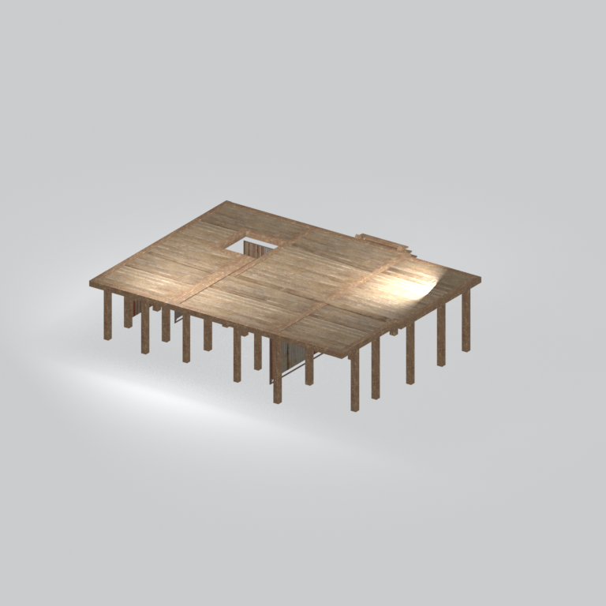
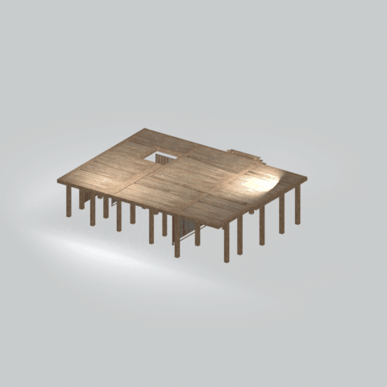

# mgom base001 vrtn001

Textured static native model reference; assembly and interactivity are not inferred.

[Discovered static models table](../tables/discovered-static-models-4b29110f-batch-1.md) | [Library](../README.md) | [Credits](../sources-and-credits.md) | [Batch source data](../batch-provenance.json)

## Still reference

## 360-degree reference

Static model; 48 camera views, 100ms/frame,4.8-second loop. This is a reference-camera orbit, not native animation. Actual captured base textures/UVs use approximate studio lighting. FOX shader, collision, interactions and complete assembly are untested.

## Identity and source

| Field | Value |
|---|---|
| Category | Discovered static models > Installed-source static components |
| Tags | static model, native model, mgom_base001_vrtn001 |
| Native model | `/Assets/mgo/environ/object/mgo_mafr/base/mgom_base001/scenes/mgom_base001_vrtn001.fmdl` |
| Native SHA256 | `09c62c3d5d078ab932c106b45d8c2a21fac4ceb77ff13c21449341eaa4d9c1c9` |
| Captured source container | `/Assets/mgo/pack/location/afc0/pack_common/afc0_common.fpk` |
| Captured source container SHA256 | `20a950cab0d6912ac3a270b90dc6dc673f2d13859eb636819bfa3955fca6e320` |
| Location evidence | Selected native member/content and captured installed-source chain; full archive SHA/runtime priority unresolved |
| Current installed DAT / priority | Captured as-installed chain; full archive SHA and effective runtime priority unresolved |
| Upstream preparation | Selective installed-archive staging by the credited GzsTool Core bridge; actual complete FTEX-family conversion by FtexTool; automatic native inspection and reference rendering. |

Source namespace is a path identity, not exclusive original use. Lowercased lookup keys are separate from the exact retained member spelling.

## Quality and native LOD inventory

Texture pixels/mips, geometric detail and approximate studio shader fidelity are separate. Only LOD0 was rendered for this imported batch. Other levels are inventoried, not newly previewed; identical decoded index sets map to their recorded counterpart. The decoded-indices hash uses UTF-8 canonical JSON of triangle-index lists grouped by mesh, not the original packed index-buffer bytes. No upscaling or invented geometry.

| Native LOD | Triangles | Decoded indices SHA256 | Duplicate mapping | Preview status |
|---|---:|---|---|---|
| 0 | 1460 | `be96e5b367909c8812061a178d2c036b7f080ca4be3882ddcfdd3136d01bb87d` | Distinct within retained model | Rendered above |
| 1 | 1399 | `9b75b4d6ccec0da6209ed5187c2fc57ee440a63475f75753ce41299e6e40e625` | Distinct within retained model | Not rendered |
| 2 | 1357 | `aff38e15b1ce135441daac5a40f30d1d02979540a9e4ca830377ef8b4dc855d7` | Distinct within retained model | Not rendered |
| 3 | 1331 | `b8c9ee24ca408b1757c5a727bf50ccfe1896becb30decad3267970bf8219ced1` | Distinct within retained model | Not rendered |

## Base textures

| Material | Native sampler / path hash | Pixels | Mip levels | Retained DDS SHA256 |
|---|---|---|---|---|
| 0 | Base_Tex_SRGB / `1542982338289062322` | 1024 x 1024 | 9 native/header verified | `b334b1c040d9065d90e11298c5e690a9b60fa4a4af55b04819ebc3f75f2d5ce8` |
| 1 | Base_Tex_SRGB / `1543276963785070273` | 1024 x 1024 | 9 native/header verified | `6d68ed79a989bae1e12721ffcdc2e6b8da6334b32cd9542a7d276356298ad987` |
| 2 | Base_Tex_SRGB / `1543563823901730016` | 1024 x 1024 | 9 native/header verified | `bb876f9b58b5921e096322c501de2e4d4ed116436a37c81d84dd14fc1b0a2c7b` |
| 3 | Base_Tex_SRGB / `1543023013975133429` | 1024 x 1024 | 9 native/header verified | `e9938c2c78f65e2b33271d9a8be67ab2c795025a9333cafda1cd84b8d2e9947f` |
| 4 | Base_Tex_SRGB / `1542917244957653286` | 1024 x 1024 | 9 native/header verified | `97bbdafefe3a452432f2c48614c2d1ecbb7b02fac94b0d48b31de94627870305` |

Texture virtual filenames are unknown where only native hashes are available. Larger native textures elsewhere in the game were not searched. Only actual base-color maps are applied; normal/specular/packed shader channels are not recreated.

## Attribution and limits

Game models/textures: Konami. Project owner: arsenal-pt. Authored importer/metadata/reference work: OpenAI Codex (AI/LLM). [Community tools and detailed credits](../sources-and-credits.md). No endorsement is implied. Game artwork is outside the original-code license.

Only rendered references and descriptive metadata are distributed. Raw assets, native files, textures, decoded geometry, Blender scenes, private source paths and clean frame caches remain private. [Catalogue](../catalogue.json) and [batch provenance](../batch-provenance.json) preserve identity and media hashes.

## Captured base-texture locations

| Material | Actual native texture path | Complete family identity |
|---|---|---|
| 0 | `Unknown; native binding retained` | `9a6abc9f8eab9cd5ff8288aecea82bfd4d6939d7dc0227259151a602695d3a4f` |
| 1 | `Unknown; native binding retained` | `9addf44a20e4d652b2a21ac411fed0a5723575918721c59519d29d731061e131` |
| 2 | `Unknown; native binding retained` | `1a9c94e28f62f2f9efa07c4fc4b1fc99b891c25f47678cb80e49ca90220215f2` |
| 3 | `Unknown; native binding retained` | `1f3d203c5bfb732659a9e92004539d965eb04c7a855dbc16cf1b8b0ee41f0b0d` |
| 4 | `Unknown; native binding retained` | `a32068e8c965d377899ea7bf5f7ba64e4c54835d2d81fa509b2ffa54c39a6e71` |
