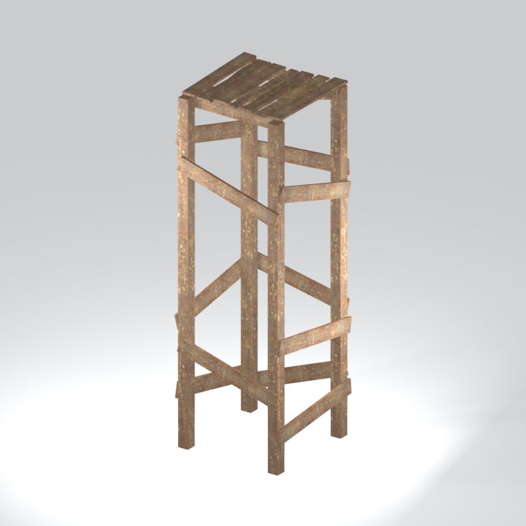
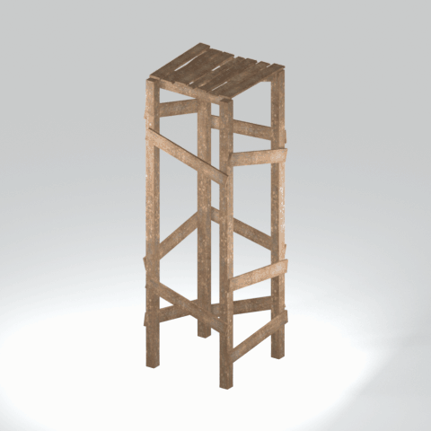

# mgom brdg002 vrtn004

Textured static native model reference; assembly and interactivity are not inferred.

[Discovered static models table](../tables/discovered-static-models-4b29110f-batch-1.md) | [Library](../README.md) | [Credits](../sources-and-credits.md) | [Batch source data](../batch-provenance.json)

## Still reference

## 360-degree reference

Static model; 48 camera views, 100ms/frame,4.8-second loop. This is a reference-camera orbit, not native animation. Actual captured base textures/UVs use approximate studio lighting. FOX shader, collision, interactions and complete assembly are untested.

## Identity and source

| Field | Value |
|---|---|
| Category | Discovered static models > Installed-source static components |
| Tags | static model, native model, mgom_brdg002_vrtn004 |
| Native model | `/Assets/mgo/environ/object/mgo_mafr/bridge/mgom_brdg002/scenes/mgom_brdg002_vrtn004.fmdl` |
| Native SHA256 | `d11c77122b21280a2877de7f157359d23e9a03723142dcee4cd08357ae3d1e5b` |
| Captured source container | `/Assets/mgo/pack/location/afc0/pack_common/afc0_common.fpk` |
| Captured source container SHA256 | `20a950cab0d6912ac3a270b90dc6dc673f2d13859eb636819bfa3955fca6e320` |
| Location evidence | Selected native member/content and captured installed-source chain; full archive SHA/runtime priority unresolved |
| Current installed DAT / priority | Captured as-installed chain; full archive SHA and effective runtime priority unresolved |
| Upstream preparation | Selective installed-archive staging by the credited GzsTool Core bridge; actual complete FTEX-family conversion by FtexTool; automatic native inspection and reference rendering. |

Source namespace is a path identity, not exclusive original use. Lowercased lookup keys are separate from the exact retained member spelling.

## Quality and native LOD inventory

Texture pixels/mips, geometric detail and approximate studio shader fidelity are separate. Only LOD0 was rendered for this imported batch. Other levels are inventoried, not newly previewed; identical decoded index sets map to their recorded counterpart. The decoded-indices hash uses UTF-8 canonical JSON of triangle-index lists grouped by mesh, not the original packed index-buffer bytes. No upscaling or invented geometry.

| Native LOD | Triangles | Decoded indices SHA256 | Duplicate mapping | Preview status |
|---|---:|---|---|---|
| 0 | 348 | `37c46287a786bd255c8564d0af8c724b7e1bf547e4d3e7b699d5324f8638eca0` | Distinct within retained model | Rendered above |
| 1 | 318 | `eb37a2197da77badc8218bf1fe43ad11acb154377d0d43dbf921a447ddc3f712` | Distinct within retained model | Not rendered |
| 2 | 302 | `4b4a498fd17a27c01977bd904e0a853a6171306976a5d81cc8dfb785e416721c` | Distinct within retained model | Not rendered |
| 3 | 292 | `346f947eb50cec7ab967279be0a33a5d06cda5f8713c7d251f871dc98c50a276` | Distinct within retained model | Not rendered |

## Base textures

| Material | Native sampler / path hash | Pixels | Mip levels | Retained DDS SHA256 |
|---|---|---|---|---|
| 0 | Base_Tex_SRGB / `1542917244957653286` | 1024 x 1024 | 9 native/header verified | `97bbdafefe3a452432f2c48614c2d1ecbb7b02fac94b0d48b31de94627870305` |

Texture virtual filenames are unknown where only native hashes are available. Larger native textures elsewhere in the game were not searched. Only actual base-color maps are applied; normal/specular/packed shader channels are not recreated.

## Attribution and limits

Game models/textures: Konami. Project owner: arsenal-pt. Authored importer/metadata/reference work: OpenAI Codex (AI/LLM). [Community tools and detailed credits](../sources-and-credits.md). No endorsement is implied. Game artwork is outside the original-code license.

Only rendered references and descriptive metadata are distributed. Raw assets, native files, textures, decoded geometry, Blender scenes, private source paths and clean frame caches remain private. [Catalogue](../catalogue.json) and [batch provenance](../batch-provenance.json) preserve identity and media hashes.

## Captured base-texture locations

| Material | Actual native texture path | Complete family identity |
|---|---|---|
| 0 | `Unknown; native binding retained` | `a32068e8c965d377899ea7bf5f7ba64e4c54835d2d81fa509b2ffa54c39a6e71` |
