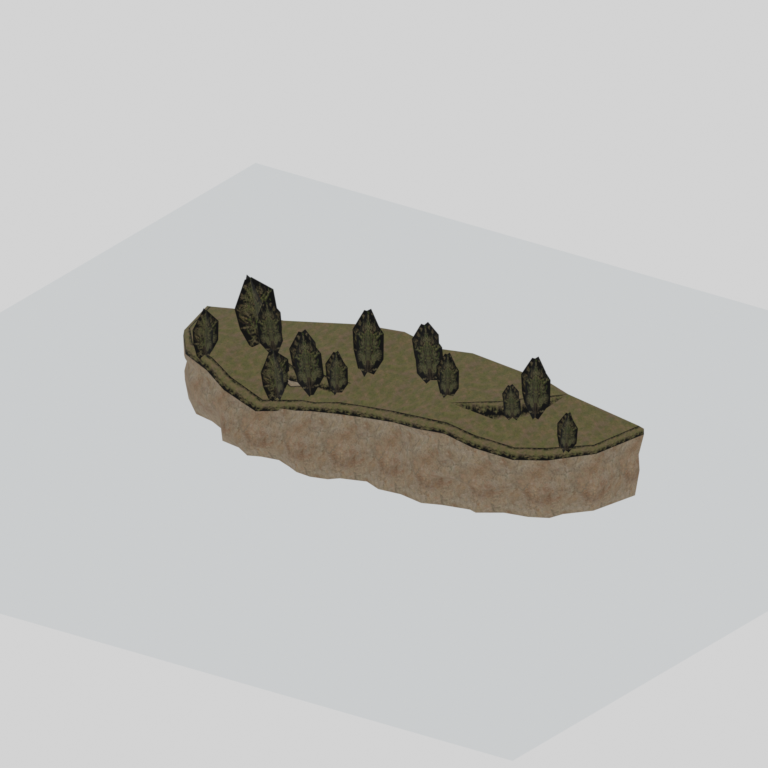
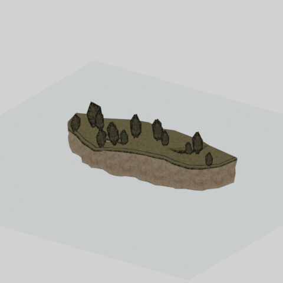

# mgom clff007 rock001

Textured static native model reference; assembly and interactivity are not inferred.

[Discovered static models table](../tables/discovered-static-models-4b29110f-batch-1.md) | [Library](../README.md) | [Credits](../sources-and-credits.md) | [Batch source data](../batch-provenance.json)

## Still reference

## 360-degree reference

Static model; 48 camera views, 100ms/frame,4.8-second loop. This is a reference-camera orbit, not native animation. Actual captured base textures/UVs use approximate studio lighting. FOX shader, collision, interactions and complete assembly are untested.

## Identity and source

| Field | Value |
|---|---|
| Category | Discovered static models > Installed-source static components |
| Tags | static model, native model, mgom_clff007_rock001 |
| Native model | `/Assets/mgo/environ/object/mgo_mafr/cliff/mgom_clff007/scenes/mgom_clff007_rock001.fmdl` |
| Native SHA256 | `e1bb166c8bf9b1de44be3169a3b7db3a3ef03cb11afad769c15d5e0da54abccb` |
| Captured source container | `/Assets/mgo/pack/location/afc0/pack_common/afc0_common.fpk` |
| Captured source container SHA256 | `20a950cab0d6912ac3a270b90dc6dc673f2d13859eb636819bfa3955fca6e320` |
| Location evidence | Selected native member/content and captured installed-source chain; full archive SHA/runtime priority unresolved |
| Current installed DAT / priority | Captured as-installed chain; full archive SHA and effective runtime priority unresolved |
| Upstream preparation | Selective installed-archive staging by the credited GzsTool Core bridge; actual complete FTEX-family conversion by FtexTool; automatic native inspection and reference rendering. |

Source namespace is a path identity, not exclusive original use. Lowercased lookup keys are separate from the exact retained member spelling.

## Quality and native LOD inventory

Texture pixels/mips, geometric detail and approximate studio shader fidelity are separate. Only LOD0 was rendered for this imported batch. Other levels are inventoried, not newly previewed; identical decoded index sets map to their recorded counterpart. The decoded-indices hash uses UTF-8 canonical JSON of triangle-index lists grouped by mesh, not the original packed index-buffer bytes. No upscaling or invented geometry.

| Native LOD | Triangles | Decoded indices SHA256 | Duplicate mapping | Preview status |
|---|---:|---|---|---|
| 0 | 664 | `8976e61e7acbc69cdae97182ce55dd65dc9e4e369b8e758cb58a37b7d1101859` | Distinct within retained model | Rendered above |
| 1 | 664 | `8976e61e7acbc69cdae97182ce55dd65dc9e4e369b8e758cb58a37b7d1101859` | LOD0 | Same index set as LOD0; no separate preview |
| 2 | 664 | `8976e61e7acbc69cdae97182ce55dd65dc9e4e369b8e758cb58a37b7d1101859` | LOD0 | Same index set as LOD0; no separate preview |
| 3 | 664 | `8976e61e7acbc69cdae97182ce55dd65dc9e4e369b8e758cb58a37b7d1101859` | LOD0 | Same index set as LOD0; no separate preview |

## Base textures

| Material | Native sampler / path hash | Pixels | Mip levels | Retained DDS SHA256 |
|---|---|---|---|---|
| 0 | Base_Tex_SRGB / `1543348486784857788` | 512 x 1024 | 9 native/header verified | `9f4c6fed0f96bc56078cc5e5e594ffc9e5149a51e9abfe8596d956052d2f7d1d` |
| 1 | Base_Tex_SRGB / `1542673636084408269` | 1024 x 1024 | 9 native/header verified | `ba4658558bb9baa375b7aef9dc3fd27e14a9c7dd8fe5e89285f6e9d500ce59c6` |
| 2 | Base_Tex_SRGB / `1543289272334439680` | 1024 x 1024 | 9 native/header verified | `b69dd5cfed99995d62e0a63da13a55718d94c8d34d51ee9c520330bdb33e6987` |
| 3 | Base_Tex_SRGB / `1543131569531690504` | 1024 x 512 | 9 native/header verified | `49421199bd4db991aa6d0f7862caecbff8738ce40d34f1fb0c805ef25ac2aee0` |

Texture virtual filenames are unknown where only native hashes are available. Larger native textures elsewhere in the game were not searched. Only actual base-color maps are applied; normal/specular/packed shader channels are not recreated.

## Attribution and limits

Game models/textures: Konami. Project owner: arsenal-pt. Authored importer/metadata/reference work: OpenAI Codex (AI/LLM). [Community tools and detailed credits](../sources-and-credits.md). No endorsement is implied. Game artwork is outside the original-code license.

Only rendered references and descriptive metadata are distributed. Raw assets, native files, textures, decoded geometry, Blender scenes, private source paths and clean frame caches remain private. [Catalogue](../catalogue.json) and [batch provenance](../batch-provenance.json) preserve identity and media hashes.

## Captured base-texture locations

| Material | Actual native texture path | Complete family identity |
|---|---|---|
| 0 | `Unknown; native binding retained` | `bd8e03c66c5355bde5ce09195a8548f78512a93dc1ec9930723b3dc959ccb586` |
| 1 | `Unknown; native binding retained` | `5f042a367af5cca8c4309ab6dd34e55ec0797b046997b8a2bdc187b75b4a19aa` |
| 2 | `Unknown; native binding retained` | `e2c313b012e7021bef1a09c68954a91691d4bf570404f1e2035285c8d3acdec4` |
| 3 | `Unknown; native binding retained` | `d778662f16d358490394756db0883f79b645b81eda425d06ddcf35b107c00b6f` |
