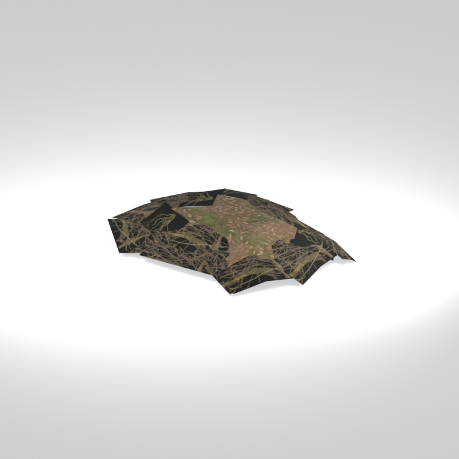
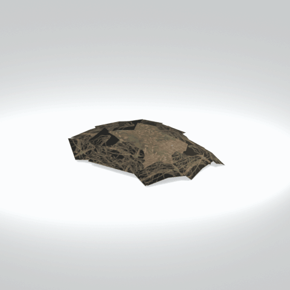

# mgom clod001

Textured static native model reference; assembly and interactivity are not inferred.

[Discovered static models table](../tables/discovered-static-models-4b29110f-batch-1.md) | [Library](../README.md) | [Credits](../sources-and-credits.md) | [Batch source data](../batch-provenance.json)

## Still reference

## 360-degree reference

Static model; 48 camera views, 100ms/frame,4.8-second loop. This is a reference-camera orbit, not native animation. Actual captured base textures/UVs use approximate studio lighting. FOX shader, collision, interactions and complete assembly are untested.

## Identity and source

| Field | Value |
|---|---|
| Category | Discovered static models > Installed-source static components |
| Tags | static model, native model, mgom_clod001 |
| Native model | `/Assets/mgo/environ/object/mgo_mafr/clod/mgom_clod001/scenes/mgom_clod001.fmdl` |
| Native SHA256 | `c4952431d51e69f903605033b937038522ecace043ed877b61d5f7c0bb885cf9` |
| Captured source container | `/Assets/mgo/pack/location/afc0/pack_common/afc0_common.fpk` |
| Captured source container SHA256 | `20a950cab0d6912ac3a270b90dc6dc673f2d13859eb636819bfa3955fca6e320` |
| Location evidence | Selected native member/content and captured installed-source chain; full archive SHA/runtime priority unresolved |
| Current installed DAT / priority | Captured as-installed chain; full archive SHA and effective runtime priority unresolved |
| Upstream preparation | Selective installed-archive staging by the credited GzsTool Core bridge; actual complete FTEX-family conversion by FtexTool; automatic native inspection and reference rendering. |

Source namespace is a path identity, not exclusive original use. Lowercased lookup keys are separate from the exact retained member spelling.

## Quality and native LOD inventory

Texture pixels/mips, geometric detail and approximate studio shader fidelity are separate. Only LOD0 was rendered for this imported batch. Other levels are inventoried, not newly previewed; identical decoded index sets map to their recorded counterpart. The decoded-indices hash uses UTF-8 canonical JSON of triangle-index lists grouped by mesh, not the original packed index-buffer bytes. No upscaling or invented geometry.

| Native LOD | Triangles | Decoded indices SHA256 | Duplicate mapping | Preview status |
|---|---:|---|---|---|
| 0 | 228 | `260e713a4940b5d5420cdae5bac20f115755d11ff31bdc9bdce36b59508a95aa` | Distinct within retained model | Rendered above |
| 1 | 228 | `260e713a4940b5d5420cdae5bac20f115755d11ff31bdc9bdce36b59508a95aa` | LOD0 | Same index set as LOD0; no separate preview |
| 2 | 228 | `260e713a4940b5d5420cdae5bac20f115755d11ff31bdc9bdce36b59508a95aa` | LOD0 | Same index set as LOD0; no separate preview |
| 3 | 228 | `260e713a4940b5d5420cdae5bac20f115755d11ff31bdc9bdce36b59508a95aa` | LOD0 | Same index set as LOD0; no separate preview |

## Base textures

| Material | Native sampler / path hash | Pixels | Mip levels | Retained DDS SHA256 |
|---|---|---|---|---|
| 0 | Base_Tex_SRGB / `1542794321849355601` | 1024 x 1024 | 9 native/header verified | `02d9cbef173c33bbbb9e70b82f6042277d0c508e34e590519589f59f85840b39` |
| 1 | Base_Tex_SRGB / `1542903833258400975` | 512 x 512 | 8 native/header verified | `adaf84459f0a2847f9c37839b8805e1e6f8c8164ff7a8bd761689204b60585ca` |

Texture virtual filenames are unknown where only native hashes are available. Larger native textures elsewhere in the game were not searched. Only actual base-color maps are applied; normal/specular/packed shader channels are not recreated.

## Attribution and limits

Game models/textures: Konami. Project owner: arsenal-pt. Authored importer/metadata/reference work: OpenAI Codex (AI/LLM). [Community tools and detailed credits](../sources-and-credits.md). No endorsement is implied. Game artwork is outside the original-code license.

Only rendered references and descriptive metadata are distributed. Raw assets, native files, textures, decoded geometry, Blender scenes, private source paths and clean frame caches remain private. [Catalogue](../catalogue.json) and [batch provenance](../batch-provenance.json) preserve identity and media hashes.

## Captured base-texture locations

| Material | Actual native texture path | Complete family identity |
|---|---|---|
| 0 | `Unknown; native binding retained` | `777f52974004e22017748db23fee2e9e65defaece37e060822eb3341e433cf13` |
| 1 | `Unknown; native binding retained` | `bc3e25c2ff2ae48514a8cea71cf647dae9cb16ea5b69df2e85ec8cebd93b710a` |
