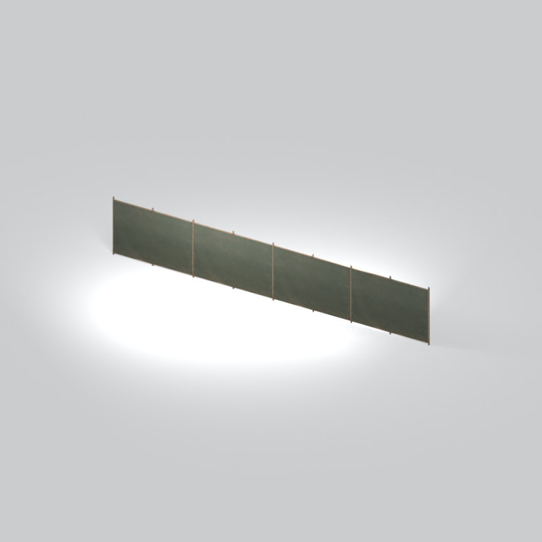
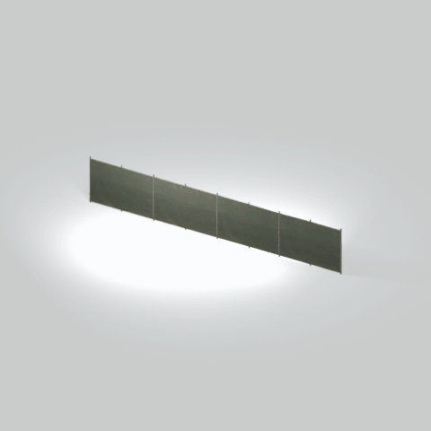

# Panel fence section

A straight row of flat fence panels with narrow upright posts, retained as its own native variant.

[Library](../README.md) | [Category](../tables/fences-and-barriers-1.md) | [Source / advanced data](../catalogue.json) | [Credits](../sources-and-credits.md)

**Game filename:** mgom_fenc004_vrtn002.fmdl  
**Category:** Architecture &gt; Fences and barriers  
**Variant:** vrtn002; **LOD:** 0  
**Tags:** panel fence, barrier, posts

## Still reference



## 360-degree reference



The camera circles a static model. This is not a native animation. Source base textures and UVs use approximate studio shading; interaction, collision, complete assembly and FOX shader equivalence are not established.

## Identity and naming

| Field | Value |
|---|---|
| Library ID | mgsv-tpp-mgom_fenc004_vrtn002-174a403c8d528bff |
| Naming status | reviewed |
| Naming confidence | medium |
| Naming evidence | {"kind": "reviewed-preview", "note": "Root reviewed the existing thirteen-still contact; this entry is in the twelve-reference hard-surface selection. Native filename/variant remain independent; no interaction or assembly guarantee.", "source": "media/asset-previews/2026-10-17-completed-references/mgsv-tpp-mgom_fenc004_vrtn002-174a403c8d528bff.png"} |
| Native model | /Assets/mgo/environ/object/mgo_mafr/fence/mgom_fenc004/scenes/mgom_fenc004_vrtn002.fmdl |
| Model SHA256 | 4f946bb45d13e17a947c2693b30f9d0bf2a393fae37b8757a821b3faac32b654 |
| Container | /Assets/mgo/pack/location/afc0/pack_common/afc0_common.fpk |
| Container SHA256 | 20a950cab0d6912ac3a270b90dc6dc673f2d13859eb636819bfa3955fca6e320 |
| Captured source / location scope | Selected native member/content and captured installed-source chain; full archive SHA/runtime priority unresolved |
| Raw record SHA256 | bb61530e66a749e6cf26f02a49d6745b1c65b1d0796cb71b9e839aefc9852494 |

Naming review is descriptive metadata only. It does not change model completion or identify a working game interaction.

## Native LOD inventory

| Native LOD | Triangles | Preview status | Decoded indices SHA256 |
|---|---:|---|---|
| 0 | 748 | rendered | 3f818f79ac9aabc100e31dae2ae62802b4bbb7cc579ad3bfb41684ba8833d6cc |
| 1 | 588 | not separately rendered | c51033d17b40b746761d7f0d0569d1734cfe804d3d8ddeb464752bfffb8c6f7c |
| 2 | 495 | not separately rendered | 7c1734762ba9c0c64a1561a1bb98f26b61788c9391bae576bb5985be157172c8 |
| 3 | 440 | not separately rendered | 92623748bcb06947c8c2531fc71b0abf1c2af3aceb75e9eca830f308aad2a300 |

Mesh detail and texture pixels/mips are separate. Index hashes describe decoded triangle arrays, not packed index-buffer bytes. Only source-recorded native levels are listed.

<details>
<summary>Texture, source and naming technical metadata</summary>

```json
{
  "source": {
    "nativePath": "/Assets/mgo/environ/object/mgo_mafr/fence/mgom_fenc004/scenes/mgom_fenc004_vrtn002.fmdl",
    "nativeSha256": "4f946bb45d13e17a947c2693b30f9d0bf2a393fae37b8757a821b3faac32b654",
    "stableIdentity": "/assets/mgo/environ/object/mgo_mafr/fence/mgom_fenc004/scenes/mgom_fenc004_vrtn002.fmdl#4f946bb45d13e17a947c2693b30f9d0bf2a393fae37b8757a821b3faac32b654#709ccd6672fd4f17e1ad1c0159f2489fa063589e388826571fa3d3e67e4db067",
    "container": {
      "nativePath": "/Assets/mgo/pack/location/afc0/pack_common/afc0_common.fpk",
      "sha256": "20a950cab0d6912ac3a270b90dc6dc673f2d13859eb636819bfa3955fca6e320",
      "status": "Selected installed-source container/member chain captured by community reader"
    },
    "historicalDatOrigin": null,
    "sourceArchiveAtCapture": "master/0/00.dat",
    "locationStatus": "Selected native member/content and captured installed-source chain; full archive SHA/runtime priority unresolved",
    "currentInstalledDatVerified": false,
    "selectedInstalledMemberVerified": true,
    "evidence": {
      "archive_helper_executable_sha256": "6f8e39a436af3b024bbd0504966ab3d5d9d0cb05d86689bf3e83d15e68df613f",
      "archive_helper_source_sha256": "f662d3b63e066a0afc77ffe22ea0e564222d14469648300dba2c4f8e9b43446b",
      "archive_index_recipe": "54acff767f08d76ad6056c5387328759bc883df507788f398de6c2c04fac12db",
      "archive_reader": "Atvaark GzsTool.Core 0.5.3",
      "archive_reader_core_sha256": "9da447ae3c375cce2e46744eeff6af50f1591062afdf479d1a0b49edb47daaa3",
      "archive_tool_and_dictionary_sha256": {
        "CityHash.dll": "def6c4506d461b65e4059b2936b2cbd5f852ba5d1d8a1a527f1c0e6dc7008c8f",
        "GzsTool.Core.dll": "9da447ae3c375cce2e46744eeff6af50f1591062afdf479d1a0b49edb47daaa3",
        "GzsTool.exe": "1a9c5b11e2355383ff485aee7e86abc026f5c1fad729daf8c0fd15ee0aae1c10",
        "Zlib.Portable.dll": "fe84781ba35ca9cc5ff5f73fd08d2a66c59e5257b4573f5fe59743f30bf78e42",
        "fpk_dictionary.txt": "b82f9a8d6c10a68ba9471eca9d815c21355a53b5e68753d8ad7db7fd01bf401d",
        "qar_dictionary.txt": "1558c248ed0a4bb827888261563fbb91a2df4f03999682f85d637ff70d9d5fb2"
      },
      "bytes": 34048,
      "container_chain": [
        {
          "content_sha256": null,
          "depth": 0,
          "id": "3f19555d27c2ebecdfbad26aadd88b9f62e9fb6092c04c712963ef73c67ccb42",
          "index_sha256": "9acd3675d6e1500e0e18430cba0fdc70a5718ad7d6b62f13905891a35d59f18a",
          "kind": "qar",
          "name": "master/0/00.dat",
          "parent_occurrence": null
        },
        {
          "content_sha256": "20a950cab0d6912ac3a270b90dc6dc673f2d13859eb636819bfa3955fca6e320",
          "depth": 1,
          "id": "f1334a28f5fb887d989a9c548d11dccada12186358e0a4b4e7fc9831f6f42881",
          "index_sha256": "e15578c97612208569f283c28408f389fb560576e3976adf9d7aa8ed9c9aaf87",
          "kind": "fpk",
          "name": "/Assets/mgo/pack/location/afc0/pack_common/afc0_common.fpk",
          "parent_occurrence": "348190d8da3d429c2cdae58af0494f023c46b80f66da14d484dc54a7e17a97df"
        }
      ],
      "contentSha256": "4f946bb45d13e17a947c2693b30f9d0bf2a393fae37b8757a821b3faac32b654",
      "member": {
        "actual_size": 34048,
        "compressed_size": null,
        "content_sha256": "4f946bb45d13e17a947c2693b30f9d0bf2a393fae37b8757a821b3faac32b654",
        "declared_size": 34048,
        "extension": "fmdl",
        "hash_hex": null,
        "name": "/Assets/mgo/environ/object/mgo_mafr/fence/mgom_fenc004/scenes/mgom_fenc004_vrtn002.fmdl",
        "name_origin": "embedded",
        "offset": 4069104,
        "ordinal": 115,
        "path_hash": null,
        "resolved": 1
      },
      "occurrenceId": "1a669a1ec106f5eea0eabe2e3481af4066df241a670cad715483719a0f610f42",
      "occurrence_id": "1a669a1ec106f5eea0eabe2e3481af4066df241a670cad715483719a0f610f42",
      "primary_source_revision": "fc4a8196555638c6cf8aa1b7c8dc34ccd5c69cb5",
      "source_adapter": "community_core_selective_export",
      "source_id": "7f6bb743fb4c487f0e9522f9c7fac280c46cf6b1051e0fc75a93602c8eb451f0",
      "source_path": "master/0/00.dat",
      "source_snapshot": "{\"bytes\":768788480,\"device\":621747392682911458,\"file_id\":844424931596481,\"header_sha256\":\"ead50f0a9a37e4285323b9c6fa0ec75fe75e518c63147e63158eeb2892c6589e\",\"mtime_ns\":1791852224238580700}",
      "virtualPath": "/Assets/mgo/environ/object/mgo_mafr/fence/mgom_fenc004/scenes/mgom_fenc004_vrtn002.fmdl"
    }
  },
  "materials": [
    {
      "sampler": "Base_Tex_SRGB",
      "materialIndex": 0,
      "nativePathHash": "1543183701178009741",
      "nativeVirtualPath": null,
      "nativeBinding": {
        "familyId": "322d271e25441ebc421cc8aadfae88a720a24e0fc8a799aa0ab8771579a1a979",
        "height": 1024,
        "materialIndex": 0,
        "mipCount": 9,
        "nativeMipCountVerified": true,
        "nativePath": null,
        "nativePathHash": "1543183701178009741",
        "nativeTexture": {
          "additionalFtexsFileCount": 2,
          "depth": 1,
          "ftexsFileCount": 3,
          "height": 1024,
          "metadataBytes": 208,
          "mipCount": 9,
          "mips": [
            {
              "chunks": 32,
              "decodedBytes": 524288,
              "mip": 0,
              "offset": 0,
              "storedBytes": 348400,
              "streamNumber": 3
            },
            {
              "chunks": 8,
              "decodedBytes": 131072,
              "mip": 1,
              "offset": 0,
              "storedBytes": 89088,
              "streamNumber": 2
            },
            {
              "chunks": 2,
              "decodedBytes": 32768,
              "mip": 2,
              "offset": 7968,
              "storedBytes": 22416,
              "streamNumber": 1
            },
            {
              "chunks": 1,
              "decodedBytes": 8192,
              "mip": 3,
              "offset": 2232,
              "storedBytes": 5728,
              "streamNumber": 1
            },
            {
              "chunks": 1,
              "decodedBytes": 2048,
              "mip": 4,
              "offset": 688,
              "storedBytes": 1536,
              "streamNumber": 1
            },
            {
              "chunks": 1,
              "decodedBytes": 512,
              "mip": 5,
              "offset": 232,
              "storedBytes": 448,
              "streamNumber": 1
            },
            {
              "chunks": 1,
              "decodedBytes": 128,
              "mip": 6,
              "offset": 80,
              "storedBytes": 144,
              "streamNumber": 1
            },
            {
              "chunks": 1,
              "decodedBytes": 32,
              "mip": 7,
              "offset": 24,
              "storedBytes": 48,
              "streamNumber": 1
            },
            {
              "chunks": 1,
              "decodedBytes": 8,
              "mip": 8,
              "offset": 0,
              "storedBytes": 16,
              "streamNumber": 1
            }
          ],
          "nativeHeaderHash": "e61cb4eca173d8e8ce942519c53a093b",
          "nrtFlag": 2,
          "pixelFormat": 2,
          "requiredStreamNumbers": [
            1,
            2,
            3
          ],
          "textureType": 16777219,
          "unknownFlags": 273,
          "width": 1024
        },
        "samplerName": "Base_Tex_SRGB",
        "samplerNameHash": "72475356961633",
        "sha256": "8348080ae7d2366f56867595eac343c46c11865cd13d8e808099155a6f5f5f4c",
        "sourceOccurrences": [
          {
            "archive_helper_executable_sha256": "6f8e39a436af3b024bbd0504966ab3d5d9d0cb05d86689bf3e83d15e68df613f",
            "archive_helper_source_sha256": "f662d3b63e066a0afc77ffe22ea0e564222d14469648300dba2c4f8e9b43446b",
            "archive_index_recipe": "54acff767f08d76ad6056c5387328759bc883df507788f398de6c2c04fac12db",
            "archive_reader": "Atvaark GzsTool.Core 0.5.3",
            "archive_reader_core_sha256": "9da447ae3c375cce2e46744eeff6af50f1591062afdf479d1a0b49edb47daaa3",
            "archive_tool_and_dictionary_sha256": {
              "CityHash.dll": "def6c4506d461b65e4059b2936b2cbd5f852ba5d1d8a1a527f1c0e6dc7008c8f",
              "GzsTool.Core.dll": "9da447ae3c375cce2e46744eeff6af50f1591062afdf479d1a0b49edb47daaa3",
              "GzsTool.exe": "1a9c5b11e2355383ff485aee7e86abc026f5c1fad729daf8c0fd15ee0aae1c10",
              "Zlib.Portable.dll": "fe84781ba35ca9cc5ff5f73fd08d2a66c59e5257b4573f5fe59743f30bf78e42",
              "fpk_dictionary.txt": "b82f9a8d6c10a68ba9471eca9d815c21355a53b5e68753d8ad7db7fd01bf401d",
              "qar_dictionary.txt": "1558c248ed0a4bb827888261563fbb91a2df4f03999682f85d637ff70d9d5fb2"
            },
            "bytes": 208,
            "container_chain": [
              {
                "content_sha256": null,
                "depth": 0,
                "id": "436c8cfb4f382de93365b167a61aa81383299b7bad18205d60f1d0beeb3919e3",
                "index_sha256": "2d7b45c6ca65418839618e978562cac336091c06eb56dfe99f762b07a4016960",
                "kind": "qar",
                "name": "master/texture4.dat",
                "parent_occurrence": null
              }
            ],
            "contentSha256": "77a1e80f17701ae1c013ac27c96990a2a0232bd98e81cdd6cce3a834701c5d67",
            "member": {
              "actual_size": 208,
              "compressed_size": 208,
              "content_sha256": "77a1e80f17701ae1c013ac27c96990a2a0232bd98e81cdd6cce3a834701c5d67",
              "declared_size": 208,
              "extension": "ftex",
              "hash_hex": "156a7d666be3488d",
              "name": "/Assets/tpp/common_source/environ/middle_africa/cm_mafr_fenc001/sourceimages/cm_mafr_fenc001_bsm.ftex",
              "name_origin": "dictionary",
              "offset": 414895136,
              "ordinal": 2215,
              "path_hash": "27d666be3488d",
              "resolved": 1
            },
            "occurrenceId": "442e2e70646614a3cf1544e8e0b88b3f55c6a501c5f6118b35cf8b808b4d424a",
            "occurrence_id": "442e2e70646614a3cf1544e8e0b88b3f55c6a501c5f6118b35cf8b808b4d424a",
            "primary_source_revision": "fc4a8196555638c6cf8aa1b7c8dc34ccd5c69cb5",
            "source_adapter": "community_core_selective_export",
            "source_id": "6c31b98b4db9b88eb76cfcb538f5f34b4729531266a9459584126720a4fc14aa",
            "source_path": "master/texture4.dat",
            "source_snapshot": "{\"bytes\":2031604736,\"device\":621747392682911458,\"file_id\":562949953639628,\"header_sha256\":\"40ee2c6917b338f7f68c49847c97fe92b978506a1ba847fcc94d28c931c8711a\",\"mtime_ns\":1791224675561235200}",
            "virtualPath": "/Assets/tpp/common_source/environ/middle_africa/cm_mafr_fenc001/sourceimages/cm_mafr_fenc001_bsm.ftex"
          },
          {
            "archive_helper_executable_sha256": "6f8e39a436af3b024bbd0504966ab3d5d9d0cb05d86689bf3e83d15e68df613f",
            "archive_helper_source_sha256": "f662d3b63e066a0afc77ffe22ea0e564222d14469648300dba2c4f8e9b43446b",
            "archive_index_recipe": "54acff767f08d76ad6056c5387328759bc883df507788f398de6c2c04fac12db",
            "archive_reader": "Atvaark GzsTool.Core 0.5.3",
            "archive_reader_core_sha256": "9da447ae3c375cce2e46744eeff6af50f1591062afdf479d1a0b49edb47daaa3",
            "archive_tool_and_dictionary_sha256": {
              "CityHash.dll": "def6c4506d461b65e4059b2936b2cbd5f852ba5d1d8a1a527f1c0e6dc7008c8f",
              "GzsTool.Core.dll": "9da447ae3c375cce2e46744eeff6af50f1591062afdf479d1a0b49edb47daaa3",
              "GzsTool.exe": "1a9c5b11e2355383ff485aee7e86abc026f5c1fad729daf8c0fd15ee0aae1c10",
              "Zlib.Portable.dll": "fe84781ba35ca9cc5ff5f73fd08d2a66c59e5257b4573f5fe59743f30bf78e42",
              "fpk_dictionary.txt": "b82f9a8d6c10a68ba9471eca9d815c21355a53b5e68753d8ad7db7fd01bf401d",
              "qar_dictionary.txt": "1558c248ed0a4bb827888261563fbb91a2df4f03999682f85d637ff70d9d5fb2"
            },
            "bytes": 30400,
            "container_chain": [
              {
                "content_sha256": null,
                "depth": 0,
                "id": "436c8cfb4f382de93365b167a61aa81383299b7bad18205d60f1d0beeb3919e3",
                "index_sha256": "2d7b45c6ca65418839618e978562cac336091c06eb56dfe99f762b07a4016960",
                "kind": "qar",
                "name": "master/texture4.dat",
                "parent_occurrence": null
              }
            ],
            "contentSha256": "6f29521e58cb50b6f996f7cf10d947fa16aed6e13661361537eda39dd4bac953",
            "member": {
              "actual_size": 30400,
              "compressed_size": 30400,
              "content_sha256": "6f29521e58cb50b6f996f7cf10d947fa16aed6e13661361537eda39dd4bac953",
              "declared_size": 30400,
              "extension": "1.ftexs",
              "hash_hex": "b2c27d666be3488d",
              "name": "/Assets/tpp/common_source/environ/middle_africa/cm_mafr_fenc001/sourceimages/cm_mafr_fenc001_bsm.1.ftexs",
              "name_origin": "dictionary",
              "offset": 414425120,
              "ordinal": 2212,
              "path_hash": "27d666be3488d",
              "resolved": 1
            },
            "occurrenceId": "28ea2287706b49e64f4a5e136ab0d07aabe9fba14ce6529876a5ae8dd15ee120",
            "occurrence_id": "28ea2287706b49e64f4a5e136ab0d07aabe9fba14ce6529876a5ae8dd15ee120",
            "primary_source_revision": "fc4a8196555638c6cf8aa1b7c8dc34ccd5c69cb5",
            "source_adapter": "community_core_selective_export",
            "source_id": "6c31b98b4db9b88eb76cfcb538f5f34b4729531266a9459584126720a4fc14aa",
            "source_path": "master/texture4.dat",
            "source_snapshot": "{\"bytes\":2031604736,\"device\":621747392682911458,\"file_id\":562949953639628,\"header_sha256\":\"40ee2c6917b338f7f68c49847c97fe92b978506a1ba847fcc94d28c931c8711a\",\"mtime_ns\":1791224675561235200}",
            "virtualPath": "/Assets/tpp/common_source/environ/middle_africa/cm_mafr_fenc001/sourceimages/cm_mafr_fenc001_bsm.1.ftexs"
          },
          {
            "archive_helper_executable_sha256": "6f8e39a436af3b024bbd0504966ab3d5d9d0cb05d86689bf3e83d15e68df613f",
            "archive_helper_source_sha256": "f662d3b63e066a0afc77ffe22ea0e564222d14469648300dba2c4f8e9b43446b",
            "archive_index_recipe": "54acff767f08d76ad6056c5387328759bc883df507788f398de6c2c04fac12db",
            "archive_reader": "Atvaark GzsTool.Core 0.5.3",
            "archive_reader_core_sha256": "9da447ae3c375cce2e46744eeff6af50f1591062afdf479d1a0b49edb47daaa3",
            "archive_tool_and_dictionary_sha256": {
              "CityHash.dll": "def6c4506d461b65e4059b2936b2cbd5f852ba5d1d8a1a527f1c0e6dc7008c8f",
              "GzsTool.Core.dll": "9da447ae3c375cce2e46744eeff6af50f1591062afdf479d1a0b49edb47daaa3",
              "GzsTool.exe": "1a9c5b11e2355383ff485aee7e86abc026f5c1fad729daf8c0fd15ee0aae1c10",
              "Zlib.Portable.dll": "fe84781ba35ca9cc5ff5f73fd08d2a66c59e5257b4573f5fe59743f30bf78e42",
              "fpk_dictionary.txt": "b82f9a8d6c10a68ba9471eca9d815c21355a53b5e68753d8ad7db7fd01bf401d",
              "qar_dictionary.txt": "1558c248ed0a4bb827888261563fbb91a2df4f03999682f85d637ff70d9d5fb2"
            },
            "bytes": 89152,
            "container_chain": [
              {
                "content_sha256": null,
                "depth": 0,
                "id": "1cc220d9409d7163b6aca295ed89fd8c7befca6a8f849a8d5d09a2499724c863",
                "index_sha256": "5a818609a652a10d90fb90015661d0cb80898096bbb3aac36382172988d8736d",
                "kind": "qar",
                "name": "master/texture5_mgo0.dat",
                "parent_occurrence": null
              }
            ],
            "contentSha256": "b968d089e9516adfcb540a2dcd5638a65835c95bfdebcc7e38001193e3e23722",
            "member": {
              "actual_size": 89152,
              "compressed_size": 89152,
              "content_sha256": "b968d089e9516adfcb540a2dcd5638a65835c95bfdebcc7e38001193e3e23722",
              "declared_size": 89152,
              "extension": "2.ftexs",
              "hash_hex": "b5727d666be3488d",
              "name": "/Assets/tpp/common_source/environ/middle_africa/cm_mafr_fenc001/sourceimages/cm_mafr_fenc001_bsm.2.ftexs",
              "name_origin": "dictionary",
              "offset": 2429840416,
              "ordinal": 8854,
              "path_hash": "27d666be3488d",
              "resolved": 1
            },
            "occurrenceId": "1fdf589218f0fe7469df8453b35fa2be84a311a96260eaf3ed1aa85a6793ae98",
            "occurrence_id": "1fdf589218f0fe7469df8453b35fa2be84a311a96260eaf3ed1aa85a6793ae98",
            "primary_source_revision": "fc4a8196555638c6cf8aa1b7c8dc34ccd5c69cb5",
            "source_adapter": "community_core_selective_export",
            "source_id": "24f8989ccaae47940dc20e54ba67442ad562ac0032ab6e3d475e927c81444b56",
            "source_path": "master/texture5_mgo0.dat",
            "source_snapshot": "{\"bytes\":4492370944,\"device\":621747392682911458,\"file_id\":13510798883237422,\"header_sha256\":\"6108fbacb65c84d041742c39e5ca630745240453b336f1059a13b91943f0b011\",\"mtime_ns\":1791224675562234400}",
            "virtualPath": "/Assets/tpp/common_source/environ/middle_africa/cm_mafr_fenc001/sourceimages/cm_mafr_fenc001_bsm.2.ftexs"
          },
          {
            "archive_helper_executable_sha256": "6f8e39a436af3b024bbd0504966ab3d5d9d0cb05d86689bf3e83d15e68df613f",
            "archive_helper_source_sha256": "f662d3b63e066a0afc77ffe22ea0e564222d14469648300dba2c4f8e9b43446b",
            "archive_index_recipe": "54acff767f08d76ad6056c5387328759bc883df507788f398de6c2c04fac12db",
            "archive_reader": "Atvaark GzsTool.Core 0.5.3",
            "archive_reader_core_sha256": "9da447ae3c375cce2e46744eeff6af50f1591062afdf479d1a0b49edb47daaa3",
            "archive_tool_and_dictionary_sha256": {
              "CityHash.dll": "def6c4506d461b65e4059b2936b2cbd5f852ba5d1d8a1a527f1c0e6dc7008c8f",
              "GzsTool.Core.dll": "9da447ae3c375cce2e46744eeff6af50f1591062afdf479d1a0b49edb47daaa3",
              "GzsTool.exe": "1a9c5b11e2355383ff485aee7e86abc026f5c1fad729daf8c0fd15ee0aae1c10",
              "Zlib.Portable.dll": "fe84781ba35ca9cc5ff5f73fd08d2a66c59e5257b4573f5fe59743f30bf78e42",
              "fpk_dictionary.txt": "b82f9a8d6c10a68ba9471eca9d815c21355a53b5e68753d8ad7db7fd01bf401d",
              "qar_dictionary.txt": "1558c248ed0a4bb827888261563fbb91a2df4f03999682f85d637ff70d9d5fb2"
            },
            "bytes": 348656,
            "container_chain": [
              {
                "content_sha256": null,
                "depth": 0,
                "id": "e73d96973ade76f7a00afdbea486dd110896ace97da0791f56899647de46f210",
                "index_sha256": "5a818609a652a10d90fb90015661d0cb80898096bbb3aac36382172988d8736d",
                "kind": "qar",
                "name": "mgo/texture0.dat",
                "parent_occurrence": null
              }
            ],
            "contentSha256": "daf9fa7d4d9bdead7830032ad4d3971f3fa2a379e0d9a5292431e462ad7739a4",
            "member": {
              "actual_size": 348656,
              "compressed_size": 348656,
              "content_sha256": "daf9fa7d4d9bdead7830032ad4d3971f3fa2a379e0d9a5292431e462ad7739a4",
              "declared_size": 348656,
              "extension": "3.ftexs",
              "hash_hex": "571a7d666be3488d",
              "name": "/Assets/tpp/common_source/environ/middle_africa/cm_mafr_fenc001/sourceimages/cm_mafr_fenc001_bsm.3.ftexs",
              "name_origin": "dictionary",
              "offset": 2429930528,
              "ordinal": 8855,
              "path_hash": "27d666be3488d",
              "resolved": 1
            },
            "occurrenceId": "9d1fa87829b5ce0c37b2b57dfa8fcbc5f06047ddae5ba49a201ac3baf67bf575",
            "occurrence_id": "9d1fa87829b5ce0c37b2b57dfa8fcbc5f06047ddae5ba49a201ac3baf67bf575",
            "primary_source_revision": "fc4a8196555638c6cf8aa1b7c8dc34ccd5c69cb5",
            "source_adapter": "community_core_selective_export",
            "source_id": "03f5942f0e1af8040ae05b95c43716d75f5933971d78324bf7cfea291297f3f4",
            "source_path": "mgo/texture0.dat",
            "source_snapshot": "{\"bytes\":4492370944,\"device\":621747392682911458,\"file_id\":562949953639631,\"header_sha256\":\"6108fbacb65c84d041742c39e5ca630745240453b336f1059a13b91943f0b011\",\"mtime_ns\":1791224675562234400}",
            "virtualPath": "/Assets/tpp/common_source/environ/middle_africa/cm_mafr_fenc001/sourceimages/cm_mafr_fenc001_bsm.3.ftexs"
          }
        ],
        "width": 1024
      },
      "ddsSha256": "8348080ae7d2366f56867595eac343c46c11865cd13d8e808099155a6f5f5f4c",
      "dimensions": [
        1024,
        1024
      ],
      "mipCount": 9,
      "nativeMipCountVerified": true,
      "connectedInPreview": true
    }
  ],
  "quality": {
    "decodedIndicesHashDerivation": "SHA256 of canonical UTF-8 JSON decoded triangle indices grouped by mesh; not packed buffer bytes",
    "highestRetainedGeometricLod": 0,
    "distinctNativeLods": 4,
    "baseTextureDimensions": [
      1024,
      1024
    ],
    "baseTextureNativeMipCount": 9,
    "largerRetainedBaseTextureFound": null,
    "nativeLods": [
      {
        "indicesSha256": "3f818f79ac9aabc100e31dae2ae62802b4bbb7cc579ad3bfb41684ba8833d6cc",
        "nativeLod": 0,
        "triangles": 748
      },
      {
        "indicesSha256": "c51033d17b40b746761d7f0d0569d1734cfe804d3d8ddeb464752bfffb8c6f7c",
        "nativeLod": 1,
        "triangles": 588
      },
      {
        "indicesSha256": "7c1734762ba9c0c64a1561a1bb98f26b61788c9391bae576bb5985be157172c8",
        "nativeLod": 2,
        "triangles": 495
      },
      {
        "indicesSha256": "92623748bcb06947c8c2531fc71b0abf1c2af3aceb75e9eca830f308aad2a300",
        "nativeLod": 3,
        "triangles": 440
      }
    ],
    "renderedNativeLods": [
      0
    ],
    "baseTextureSummary": "1024 x 1024; 9 native/DDS mips",
    "highestDetailScope": "Triangle-count comparison within captured FMDL only"
  }
}
```

</details>

[Original source / advanced record](../catalogue.json)
