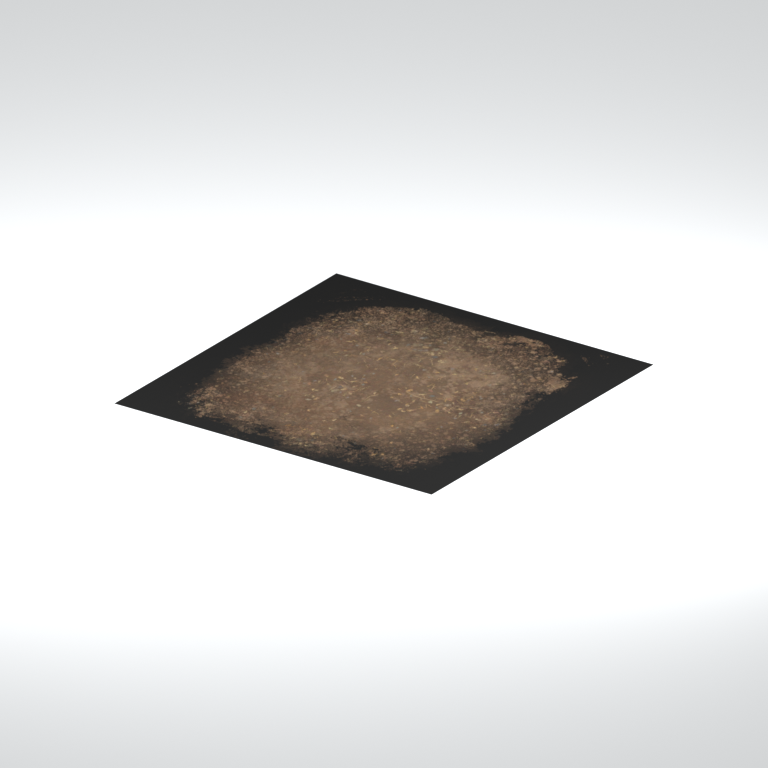
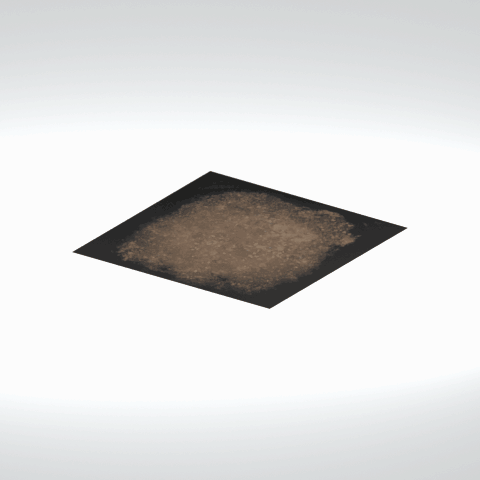

# Gravel ground patch

A flat square ground patch with a mottled gravel-like surface and a dark outer edge.

[Library](../README.md) | [Category](../tables/ground-patches-1.md) | [Source / advanced data](../catalogue.json) | [Credits](../sources-and-credits.md)

**Game filename:** mgom_fndt001_grvl002.fmdl  
**Category:** Terrain &gt; Ground patches  
**Variant:** No explicit variant token; **LOD:** 0  
**Tags:** gravel, ground, terrain patch

## Still reference



## 360-degree reference



The camera circles a static model. This is not a native animation. Source base textures and UVs use approximate studio shading; interaction, collision, complete assembly and FOX shader equivalence are not established.

## Identity and naming

| Field | Value |
|---|---|
| Library ID | mgsv-tpp-mgom_fndt001_grvl002-cc8fb28e005dfc1b |
| Naming status | reviewed |
| Naming confidence | high |
| Naming evidence | {"kind": "reviewed-preview", "note": "Root reviewed the existing thirteen-still contact; this entry is in the twelve-reference hard-surface selection. Native filename/variant remain independent; no interaction or assembly guarantee.", "source": "media/asset-previews/2026-10-17-completed-references/mgsv-tpp-mgom_fndt001_grvl002-cc8fb28e005dfc1b.png"} |
| Native model | /Assets/mgo/environ/object/mgo_mafr/foundation/mgom_fndt001/scenes/mgom_fndt001_grvl002.fmdl |
| Model SHA256 | 937e4247830d1bd614da02be4415abcdf49b91f915e54c36539264d962af32ad |
| Container | /Assets/mgo/pack/location/afc0/pack_common/afc0_common.fpk |
| Container SHA256 | 20a950cab0d6912ac3a270b90dc6dc673f2d13859eb636819bfa3955fca6e320 |
| Captured source / location scope | Selected native member/content and captured installed-source chain; full archive SHA/runtime priority unresolved |
| Raw record SHA256 | 5f86b8d87a58be40cacd96d78cf2c28fcc676230192e3171d53434bb2070c684 |

Naming review is descriptive metadata only. It does not change model completion or identify a working game interaction.

## Native LOD inventory

| Native LOD | Triangles | Preview status | Decoded indices SHA256 |
|---|---:|---|---|
| 0 | 2 | rendered | 6e8424247aea3e20f2c18eb6253a587a5e0647a3e218bd42725ba78248f1c44e |
| 1 | 1 | not separately rendered | 67d4eb32f60662f16e917397151ebdc8e300a013d185ab85e55c2ec57419904e |
| 2 | 1 | not separately rendered | 67d4eb32f60662f16e917397151ebdc8e300a013d185ab85e55c2ec57419904e |
| 3 | 1 | not separately rendered | 67d4eb32f60662f16e917397151ebdc8e300a013d185ab85e55c2ec57419904e |

Mesh detail and texture pixels/mips are separate. Index hashes describe decoded triangle arrays, not packed index-buffer bytes. Only source-recorded native levels are listed.

<details>
<summary>Texture, source and naming technical metadata</summary>

```json
{
  "source": {
    "nativePath": "/Assets/mgo/environ/object/mgo_mafr/foundation/mgom_fndt001/scenes/mgom_fndt001_grvl002.fmdl",
    "nativeSha256": "937e4247830d1bd614da02be4415abcdf49b91f915e54c36539264d962af32ad",
    "stableIdentity": "/assets/mgo/environ/object/mgo_mafr/foundation/mgom_fndt001/scenes/mgom_fndt001_grvl002.fmdl#937e4247830d1bd614da02be4415abcdf49b91f915e54c36539264d962af32ad#a8dbcdf88eaa395cab5cffb22124ebb70eeb24536d591fda966003c964e4858d",
    "container": {
      "nativePath": "/Assets/mgo/pack/location/afc0/pack_common/afc0_common.fpk",
      "sha256": "20a950cab0d6912ac3a270b90dc6dc673f2d13859eb636819bfa3955fca6e320",
      "status": "Selected installed-source container/member chain captured by community reader"
    },
    "historicalDatOrigin": null,
    "sourceArchiveAtCapture": "master/0/00.dat",
    "locationStatus": "Selected native member/content and captured installed-source chain; full archive SHA/runtime priority unresolved",
    "currentInstalledDatVerified": false,
    "selectedInstalledMemberVerified": true,
    "evidence": {
      "archive_helper_executable_sha256": "6f8e39a436af3b024bbd0504966ab3d5d9d0cb05d86689bf3e83d15e68df613f",
      "archive_helper_source_sha256": "f662d3b63e066a0afc77ffe22ea0e564222d14469648300dba2c4f8e9b43446b",
      "archive_index_recipe": "54acff767f08d76ad6056c5387328759bc883df507788f398de6c2c04fac12db",
      "archive_reader": "Atvaark GzsTool.Core 0.5.3",
      "archive_reader_core_sha256": "9da447ae3c375cce2e46744eeff6af50f1591062afdf479d1a0b49edb47daaa3",
      "archive_tool_and_dictionary_sha256": {
        "CityHash.dll": "def6c4506d461b65e4059b2936b2cbd5f852ba5d1d8a1a527f1c0e6dc7008c8f",
        "GzsTool.Core.dll": "9da447ae3c375cce2e46744eeff6af50f1591062afdf479d1a0b49edb47daaa3",
        "GzsTool.exe": "1a9c5b11e2355383ff485aee7e86abc026f5c1fad729daf8c0fd15ee0aae1c10",
        "Zlib.Portable.dll": "fe84781ba35ca9cc5ff5f73fd08d2a66c59e5257b4573f5fe59743f30bf78e42",
        "fpk_dictionary.txt": "b82f9a8d6c10a68ba9471eca9d815c21355a53b5e68753d8ad7db7fd01bf401d",
        "qar_dictionary.txt": "1558c248ed0a4bb827888261563fbb91a2df4f03999682f85d637ff70d9d5fb2"
      },
      "bytes": 992,
      "container_chain": [
        {
          "content_sha256": null,
          "depth": 0,
          "id": "3f19555d27c2ebecdfbad26aadd88b9f62e9fb6092c04c712963ef73c67ccb42",
          "index_sha256": "9acd3675d6e1500e0e18430cba0fdc70a5718ad7d6b62f13905891a35d59f18a",
          "kind": "qar",
          "name": "master/0/00.dat",
          "parent_occurrence": null
        },
        {
          "content_sha256": "20a950cab0d6912ac3a270b90dc6dc673f2d13859eb636819bfa3955fca6e320",
          "depth": 1,
          "id": "f1334a28f5fb887d989a9c548d11dccada12186358e0a4b4e7fc9831f6f42881",
          "index_sha256": "e15578c97612208569f283c28408f389fb560576e3976adf9d7aa8ed9c9aaf87",
          "kind": "fpk",
          "name": "/Assets/mgo/pack/location/afc0/pack_common/afc0_common.fpk",
          "parent_occurrence": "348190d8da3d429c2cdae58af0494f023c46b80f66da14d484dc54a7e17a97df"
        }
      ],
      "contentSha256": "937e4247830d1bd614da02be4415abcdf49b91f915e54c36539264d962af32ad",
      "member": {
        "actual_size": 992,
        "compressed_size": null,
        "content_sha256": "937e4247830d1bd614da02be4415abcdf49b91f915e54c36539264d962af32ad",
        "declared_size": 992,
        "extension": "fmdl",
        "hash_hex": null,
        "name": "/Assets/mgo/environ/object/mgo_mafr/foundation/mgom_fndt001/scenes/mgom_fndt001_grvl002.fmdl",
        "name_origin": "embedded",
        "offset": 4139152,
        "ordinal": 119,
        "path_hash": null,
        "resolved": 1
      },
      "occurrenceId": "283f1542560c560fe99fcfcc4c5226889b9aec4293595baed11f92a362685283",
      "occurrence_id": "283f1542560c560fe99fcfcc4c5226889b9aec4293595baed11f92a362685283",
      "primary_source_revision": "fc4a8196555638c6cf8aa1b7c8dc34ccd5c69cb5",
      "source_adapter": "community_core_selective_export",
      "source_id": "7f6bb743fb4c487f0e9522f9c7fac280c46cf6b1051e0fc75a93602c8eb451f0",
      "source_path": "master/0/00.dat",
      "source_snapshot": "{\"bytes\":768788480,\"device\":621747392682911458,\"file_id\":844424931596481,\"header_sha256\":\"ead50f0a9a37e4285323b9c6fa0ec75fe75e518c63147e63158eeb2892c6589e\",\"mtime_ns\":1791852224238580700}",
      "virtualPath": "/Assets/mgo/environ/object/mgo_mafr/foundation/mgom_fndt001/scenes/mgom_fndt001_grvl002.fmdl"
    }
  },
  "materials": [
    {
      "sampler": "Base_Tex_SRGB",
      "materialIndex": 0,
      "nativePathHash": "1543210199885695213",
      "nativeVirtualPath": null,
      "nativeBinding": {
        "familyId": "8a87bb3425519afcfb97795e6415580eb43c0ba2f387b27323e8c9cb70fb4b8d",
        "height": 1024,
        "materialIndex": 0,
        "mipCount": 9,
        "nativeMipCountVerified": true,
        "nativePath": null,
        "nativePathHash": "1543210199885695213",
        "nativeTexture": {
          "additionalFtexsFileCount": 2,
          "depth": 1,
          "ftexsFileCount": 3,
          "height": 1024,
          "metadataBytes": 208,
          "mipCount": 9,
          "mips": [
            {
              "chunks": 64,
              "decodedBytes": 1048576,
              "mip": 0,
              "offset": 0,
              "storedBytes": 806720,
              "streamNumber": 3
            },
            {
              "chunks": 16,
              "decodedBytes": 262144,
              "mip": 1,
              "offset": 0,
              "storedBytes": 209856,
              "streamNumber": 2
            },
            {
              "chunks": 4,
              "decodedBytes": 65536,
              "mip": 2,
              "offset": 18368,
              "storedBytes": 53456,
              "streamNumber": 1
            },
            {
              "chunks": 1,
              "decodedBytes": 16384,
              "mip": 3,
              "offset": 4904,
              "storedBytes": 13456,
              "streamNumber": 1
            },
            {
              "chunks": 1,
              "decodedBytes": 4096,
              "mip": 4,
              "offset": 1392,
              "storedBytes": 3504,
              "streamNumber": 1
            },
            {
              "chunks": 1,
              "decodedBytes": 1024,
              "mip": 5,
              "offset": 408,
              "storedBytes": 976,
              "streamNumber": 1
            },
            {
              "chunks": 1,
              "decodedBytes": 256,
              "mip": 6,
              "offset": 128,
              "storedBytes": 272,
              "streamNumber": 1
            },
            {
              "chunks": 1,
              "decodedBytes": 64,
              "mip": 7,
              "offset": 40,
              "storedBytes": 80,
              "streamNumber": 1
            },
            {
              "chunks": 1,
              "decodedBytes": 16,
              "mip": 8,
              "offset": 0,
              "storedBytes": 32,
              "streamNumber": 1
            }
          ],
          "nativeHeaderHash": "d000ed28b24300abb2afff707028079c",
          "nrtFlag": 2,
          "pixelFormat": 4,
          "requiredStreamNumbers": [
            1,
            2,
            3
          ],
          "textureType": 16777219,
          "unknownFlags": 273,
          "width": 1024
        },
        "samplerName": "Base_Tex_SRGB",
        "samplerNameHash": "72475356961633",
        "sha256": "c984d8f9052bc5f17e55e79fcea99bf0369f4c5053f40c7df677469878f49545",
        "sourceOccurrences": [
          {
            "archive_helper_executable_sha256": "6f8e39a436af3b024bbd0504966ab3d5d9d0cb05d86689bf3e83d15e68df613f",
            "archive_helper_source_sha256": "f662d3b63e066a0afc77ffe22ea0e564222d14469648300dba2c4f8e9b43446b",
            "archive_index_recipe": "54acff767f08d76ad6056c5387328759bc883df507788f398de6c2c04fac12db",
            "archive_reader": "Atvaark GzsTool.Core 0.5.3",
            "archive_reader_core_sha256": "9da447ae3c375cce2e46744eeff6af50f1591062afdf479d1a0b49edb47daaa3",
            "archive_tool_and_dictionary_sha256": {
              "CityHash.dll": "def6c4506d461b65e4059b2936b2cbd5f852ba5d1d8a1a527f1c0e6dc7008c8f",
              "GzsTool.Core.dll": "9da447ae3c375cce2e46744eeff6af50f1591062afdf479d1a0b49edb47daaa3",
              "GzsTool.exe": "1a9c5b11e2355383ff485aee7e86abc026f5c1fad729daf8c0fd15ee0aae1c10",
              "Zlib.Portable.dll": "fe84781ba35ca9cc5ff5f73fd08d2a66c59e5257b4573f5fe59743f30bf78e42",
              "fpk_dictionary.txt": "b82f9a8d6c10a68ba9471eca9d815c21355a53b5e68753d8ad7db7fd01bf401d",
              "qar_dictionary.txt": "1558c248ed0a4bb827888261563fbb91a2df4f03999682f85d637ff70d9d5fb2"
            },
            "bytes": 208,
            "container_chain": [
              {
                "content_sha256": null,
                "depth": 0,
                "id": "3f19555d27c2ebecdfbad26aadd88b9f62e9fb6092c04c712963ef73c67ccb42",
                "index_sha256": "9acd3675d6e1500e0e18430cba0fdc70a5718ad7d6b62f13905891a35d59f18a",
                "kind": "qar",
                "name": "master/0/00.dat",
                "parent_occurrence": null
              },
              {
                "content_sha256": "c371a18745c941878107bdaf7aef71c13b09b8b3a574360f6e38e0a7172b74e6",
                "depth": 1,
                "id": "13570131ff9ebc75c266205cbdf3461ff4dc51e8a0cb4f7407b0a08fe357052a",
                "index_sha256": "5b8e60a5e6b705cb87973f15c3215fb3733b7a49171030a4c7640da4622a5ca2",
                "kind": "pftxs",
                "name": "/Assets/mgo/pack/location/afc0/pack_common/afc0_common.pftxs",
                "parent_occurrence": "abc314b7f418d61ea6a3e5525bf8f85d22b454b81d3407e6645bfc43339658ac"
              }
            ],
            "contentSha256": "2fc270f9168c65bf5e63d6fe7a1920ef20c6a3ee3cc19b53ef83bcb002677b91",
            "member": {
              "actual_size": 208,
              "compressed_size": null,
              "content_sha256": "2fc270f9168c65bf5e63d6fe7a1920ef20c6a3ee3cc19b53ef83bcb002677b91",
              "declared_size": 208,
              "extension": "ftex",
              "hash_hex": "156a958021f248ed",
              "name": "156a958021f248ed.ftex",
              "name_origin": "hash_fallback",
              "offset": 5080288,
              "ordinal": 290,
              "path_hash": null,
              "resolved": 0
            },
            "occurrenceId": "d59754d29eba0db338acc08950c061a17f2e594dbffe6b0731cbfdce35298ab6",
            "occurrence_id": "d59754d29eba0db338acc08950c061a17f2e594dbffe6b0731cbfdce35298ab6",
            "primary_source_revision": "fc4a8196555638c6cf8aa1b7c8dc34ccd5c69cb5",
            "source_adapter": "community_core_selective_export",
            "source_id": "7f6bb743fb4c487f0e9522f9c7fac280c46cf6b1051e0fc75a93602c8eb451f0",
            "source_path": "master/0/00.dat",
            "source_snapshot": "{\"bytes\":768788480,\"device\":621747392682911458,\"file_id\":844424931596481,\"header_sha256\":\"ead50f0a9a37e4285323b9c6fa0ec75fe75e518c63147e63158eeb2892c6589e\",\"mtime_ns\":1791852224238580700}",
            "virtualPath": "156a958021f248ed.ftex"
          },
          {
            "archive_helper_executable_sha256": "6f8e39a436af3b024bbd0504966ab3d5d9d0cb05d86689bf3e83d15e68df613f",
            "archive_helper_source_sha256": "f662d3b63e066a0afc77ffe22ea0e564222d14469648300dba2c4f8e9b43446b",
            "archive_index_recipe": "54acff767f08d76ad6056c5387328759bc883df507788f398de6c2c04fac12db",
            "archive_reader": "Atvaark GzsTool.Core 0.5.3",
            "archive_reader_core_sha256": "9da447ae3c375cce2e46744eeff6af50f1591062afdf479d1a0b49edb47daaa3",
            "archive_tool_and_dictionary_sha256": {
              "CityHash.dll": "def6c4506d461b65e4059b2936b2cbd5f852ba5d1d8a1a527f1c0e6dc7008c8f",
              "GzsTool.Core.dll": "9da447ae3c375cce2e46744eeff6af50f1591062afdf479d1a0b49edb47daaa3",
              "GzsTool.exe": "1a9c5b11e2355383ff485aee7e86abc026f5c1fad729daf8c0fd15ee0aae1c10",
              "Zlib.Portable.dll": "fe84781ba35ca9cc5ff5f73fd08d2a66c59e5257b4573f5fe59743f30bf78e42",
              "fpk_dictionary.txt": "b82f9a8d6c10a68ba9471eca9d815c21355a53b5e68753d8ad7db7fd01bf401d",
              "qar_dictionary.txt": "1558c248ed0a4bb827888261563fbb91a2df4f03999682f85d637ff70d9d5fb2"
            },
            "bytes": 71856,
            "container_chain": [
              {
                "content_sha256": null,
                "depth": 0,
                "id": "3f19555d27c2ebecdfbad26aadd88b9f62e9fb6092c04c712963ef73c67ccb42",
                "index_sha256": "9acd3675d6e1500e0e18430cba0fdc70a5718ad7d6b62f13905891a35d59f18a",
                "kind": "qar",
                "name": "master/0/00.dat",
                "parent_occurrence": null
              },
              {
                "content_sha256": "c371a18745c941878107bdaf7aef71c13b09b8b3a574360f6e38e0a7172b74e6",
                "depth": 1,
                "id": "13570131ff9ebc75c266205cbdf3461ff4dc51e8a0cb4f7407b0a08fe357052a",
                "index_sha256": "5b8e60a5e6b705cb87973f15c3215fb3733b7a49171030a4c7640da4622a5ca2",
                "kind": "pftxs",
                "name": "/Assets/mgo/pack/location/afc0/pack_common/afc0_common.pftxs",
                "parent_occurrence": "abc314b7f418d61ea6a3e5525bf8f85d22b454b81d3407e6645bfc43339658ac"
              }
            ],
            "contentSha256": "2cc822177cd42352d6afea2704ed0a242d6395fe6a9c669a5a5dde7bab1dcd54",
            "member": {
              "actual_size": 71856,
              "compressed_size": null,
              "content_sha256": "2cc822177cd42352d6afea2704ed0a242d6395fe6a9c669a5a5dde7bab1dcd54",
              "declared_size": 71856,
              "extension": "1.ftexs",
              "hash_hex": "b2c2958021f248ed",
              "name": "b2c2958021f248ed.1.ftexs",
              "name_origin": "hash_fallback",
              "offset": 5080496,
              "ordinal": 291,
              "path_hash": null,
              "resolved": 0
            },
            "occurrenceId": "e1f581449b3d73b681653f97c68283e0aefe171e02edc53c5529f3affef48ca3",
            "occurrence_id": "e1f581449b3d73b681653f97c68283e0aefe171e02edc53c5529f3affef48ca3",
            "primary_source_revision": "fc4a8196555638c6cf8aa1b7c8dc34ccd5c69cb5",
            "source_adapter": "community_core_selective_export",
            "source_id": "7f6bb743fb4c487f0e9522f9c7fac280c46cf6b1051e0fc75a93602c8eb451f0",
            "source_path": "master/0/00.dat",
            "source_snapshot": "{\"bytes\":768788480,\"device\":621747392682911458,\"file_id\":844424931596481,\"header_sha256\":\"ead50f0a9a37e4285323b9c6fa0ec75fe75e518c63147e63158eeb2892c6589e\",\"mtime_ns\":1791852224238580700}",
            "virtualPath": "b2c2958021f248ed.1.ftexs"
          },
          {
            "archive_helper_executable_sha256": "6f8e39a436af3b024bbd0504966ab3d5d9d0cb05d86689bf3e83d15e68df613f",
            "archive_helper_source_sha256": "f662d3b63e066a0afc77ffe22ea0e564222d14469648300dba2c4f8e9b43446b",
            "archive_index_recipe": "54acff767f08d76ad6056c5387328759bc883df507788f398de6c2c04fac12db",
            "archive_reader": "Atvaark GzsTool.Core 0.5.3",
            "archive_reader_core_sha256": "9da447ae3c375cce2e46744eeff6af50f1591062afdf479d1a0b49edb47daaa3",
            "archive_tool_and_dictionary_sha256": {
              "CityHash.dll": "def6c4506d461b65e4059b2936b2cbd5f852ba5d1d8a1a527f1c0e6dc7008c8f",
              "GzsTool.Core.dll": "9da447ae3c375cce2e46744eeff6af50f1591062afdf479d1a0b49edb47daaa3",
              "GzsTool.exe": "1a9c5b11e2355383ff485aee7e86abc026f5c1fad729daf8c0fd15ee0aae1c10",
              "Zlib.Portable.dll": "fe84781ba35ca9cc5ff5f73fd08d2a66c59e5257b4573f5fe59743f30bf78e42",
              "fpk_dictionary.txt": "b82f9a8d6c10a68ba9471eca9d815c21355a53b5e68753d8ad7db7fd01bf401d",
              "qar_dictionary.txt": "1558c248ed0a4bb827888261563fbb91a2df4f03999682f85d637ff70d9d5fb2"
            },
            "bytes": 209984,
            "container_chain": [
              {
                "content_sha256": null,
                "depth": 0,
                "id": "1cc220d9409d7163b6aca295ed89fd8c7befca6a8f849a8d5d09a2499724c863",
                "index_sha256": "5a818609a652a10d90fb90015661d0cb80898096bbb3aac36382172988d8736d",
                "kind": "qar",
                "name": "master/texture5_mgo0.dat",
                "parent_occurrence": null
              }
            ],
            "contentSha256": "b4058617378a157515561310dd6aa9a86c270cbc68b6b2a9006fb47e8304a312",
            "member": {
              "actual_size": 209984,
              "compressed_size": 209984,
              "content_sha256": "b4058617378a157515561310dd6aa9a86c270cbc68b6b2a9006fb47e8304a312",
              "declared_size": 209984,
              "extension": "2.ftexs",
              "hash_hex": "b572958021f248ed",
              "name": "2958021f248ed.2.ftexs",
              "name_origin": "hash_fallback",
              "offset": 1109144608,
              "ordinal": 2354,
              "path_hash": "2958021f248ed",
              "resolved": 0
            },
            "occurrenceId": "bab080a40a790c6a63bbf1abeb9b2cd387cf42dc528393fce89882a684ea2d6f",
            "occurrence_id": "bab080a40a790c6a63bbf1abeb9b2cd387cf42dc528393fce89882a684ea2d6f",
            "primary_source_revision": "fc4a8196555638c6cf8aa1b7c8dc34ccd5c69cb5",
            "source_adapter": "community_core_selective_export",
            "source_id": "24f8989ccaae47940dc20e54ba67442ad562ac0032ab6e3d475e927c81444b56",
            "source_path": "master/texture5_mgo0.dat",
            "source_snapshot": "{\"bytes\":4492370944,\"device\":621747392682911458,\"file_id\":13510798883237422,\"header_sha256\":\"6108fbacb65c84d041742c39e5ca630745240453b336f1059a13b91943f0b011\",\"mtime_ns\":1791224675562234400}",
            "virtualPath": "2958021f248ed.2.ftexs"
          },
          {
            "archive_helper_executable_sha256": "6f8e39a436af3b024bbd0504966ab3d5d9d0cb05d86689bf3e83d15e68df613f",
            "archive_helper_source_sha256": "f662d3b63e066a0afc77ffe22ea0e564222d14469648300dba2c4f8e9b43446b",
            "archive_index_recipe": "54acff767f08d76ad6056c5387328759bc883df507788f398de6c2c04fac12db",
            "archive_reader": "Atvaark GzsTool.Core 0.5.3",
            "archive_reader_core_sha256": "9da447ae3c375cce2e46744eeff6af50f1591062afdf479d1a0b49edb47daaa3",
            "archive_tool_and_dictionary_sha256": {
              "CityHash.dll": "def6c4506d461b65e4059b2936b2cbd5f852ba5d1d8a1a527f1c0e6dc7008c8f",
              "GzsTool.Core.dll": "9da447ae3c375cce2e46744eeff6af50f1591062afdf479d1a0b49edb47daaa3",
              "GzsTool.exe": "1a9c5b11e2355383ff485aee7e86abc026f5c1fad729daf8c0fd15ee0aae1c10",
              "Zlib.Portable.dll": "fe84781ba35ca9cc5ff5f73fd08d2a66c59e5257b4573f5fe59743f30bf78e42",
              "fpk_dictionary.txt": "b82f9a8d6c10a68ba9471eca9d815c21355a53b5e68753d8ad7db7fd01bf401d",
              "qar_dictionary.txt": "1558c248ed0a4bb827888261563fbb91a2df4f03999682f85d637ff70d9d5fb2"
            },
            "bytes": 807232,
            "container_chain": [
              {
                "content_sha256": null,
                "depth": 0,
                "id": "1cc220d9409d7163b6aca295ed89fd8c7befca6a8f849a8d5d09a2499724c863",
                "index_sha256": "5a818609a652a10d90fb90015661d0cb80898096bbb3aac36382172988d8736d",
                "kind": "qar",
                "name": "master/texture5_mgo0.dat",
                "parent_occurrence": null
              }
            ],
            "contentSha256": "0f280f4feb537bd8a0c09e7581a9c5208414b7b2b2e11d090a2bd1f818424c76",
            "member": {
              "actual_size": 807232,
              "compressed_size": 807232,
              "content_sha256": "0f280f4feb537bd8a0c09e7581a9c5208414b7b2b2e11d090a2bd1f818424c76",
              "declared_size": 807232,
              "extension": "3.ftexs",
              "hash_hex": "571a958021f248ed",
              "name": "2958021f248ed.3.ftexs",
              "name_origin": "hash_fallback",
              "offset": 1109355552,
              "ordinal": 2355,
              "path_hash": "2958021f248ed",
              "resolved": 0
            },
            "occurrenceId": "0c639e20611f3882b4440a1fe204f0aa5d57ff9681b20a069b91c756d7656023",
            "occurrence_id": "0c639e20611f3882b4440a1fe204f0aa5d57ff9681b20a069b91c756d7656023",
            "primary_source_revision": "fc4a8196555638c6cf8aa1b7c8dc34ccd5c69cb5",
            "source_adapter": "community_core_selective_export",
            "source_id": "24f8989ccaae47940dc20e54ba67442ad562ac0032ab6e3d475e927c81444b56",
            "source_path": "master/texture5_mgo0.dat",
            "source_snapshot": "{\"bytes\":4492370944,\"device\":621747392682911458,\"file_id\":13510798883237422,\"header_sha256\":\"6108fbacb65c84d041742c39e5ca630745240453b336f1059a13b91943f0b011\",\"mtime_ns\":1791224675562234400}",
            "virtualPath": "2958021f248ed.3.ftexs"
          }
        ],
        "width": 1024
      },
      "ddsSha256": "c984d8f9052bc5f17e55e79fcea99bf0369f4c5053f40c7df677469878f49545",
      "dimensions": [
        1024,
        1024
      ],
      "mipCount": 9,
      "nativeMipCountVerified": true,
      "connectedInPreview": true
    }
  ],
  "quality": {
    "decodedIndicesHashDerivation": "SHA256 of canonical UTF-8 JSON decoded triangle indices grouped by mesh; not packed buffer bytes",
    "highestRetainedGeometricLod": 0,
    "distinctNativeLods": 2,
    "baseTextureDimensions": [
      1024,
      1024
    ],
    "baseTextureNativeMipCount": 9,
    "largerRetainedBaseTextureFound": null,
    "nativeLods": [
      {
        "indicesSha256": "6e8424247aea3e20f2c18eb6253a587a5e0647a3e218bd42725ba78248f1c44e",
        "nativeLod": 0,
        "triangles": 2
      },
      {
        "indicesSha256": "67d4eb32f60662f16e917397151ebdc8e300a013d185ab85e55c2ec57419904e",
        "nativeLod": 1,
        "triangles": 1
      },
      {
        "duplicateOf": 1,
        "indicesSha256": "67d4eb32f60662f16e917397151ebdc8e300a013d185ab85e55c2ec57419904e",
        "nativeLod": 2,
        "triangles": 1
      },
      {
        "duplicateOf": 1,
        "indicesSha256": "67d4eb32f60662f16e917397151ebdc8e300a013d185ab85e55c2ec57419904e",
        "nativeLod": 3,
        "triangles": 1
      }
    ],
    "renderedNativeLods": [
      0
    ],
    "baseTextureSummary": "1024 x 1024; 9 native/DDS mips",
    "highestDetailScope": "Triangle-count comparison within captured FMDL only"
  }
}
```

</details>

[Original source / advanced record](../catalogue.json)
