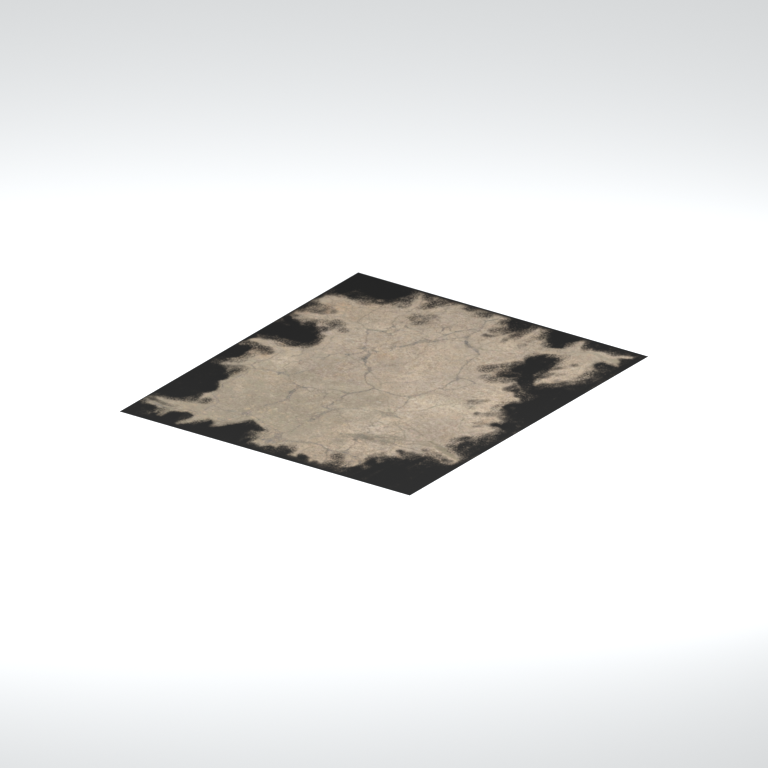
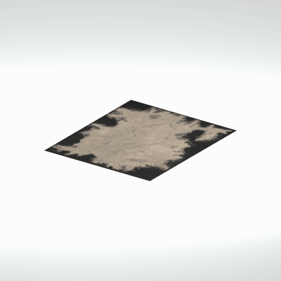

# Unidentified model (mgom_fndt001_mrkn003)

Native model reference; a readable object identification has not been reviewed.

[Library](../README.md) | [Category](../tables/unclassified-components-1.md) | [Source / advanced data](../catalogue.json) | [Credits](../sources-and-credits.md)

**Game filename:** mgom_fndt001_mrkn003.fmdl  
**Category:** Unclassified &gt; Unclassified components  
**Variant:** No explicit variant token; **LOD:** 0  
**Tags:** 

## Still reference



## 360-degree reference



The camera circles a static model. This is not a native animation. Source base textures and UVs use approximate studio shading; interaction, collision, complete assembly and FOX shader equivalence are not established.

## Identity and naming

| Field | Value |
|---|---|
| Library ID | mgsv-tpp-mgom_fndt001_mrkn003-5c0ab1387f541eb2 |
| Naming status | unidentified |
| Naming confidence | unknown |
| Naming evidence | {} |
| Native model | /Assets/mgo/environ/object/mgo_mafr/foundation/mgom_fndt001/scenes/mgom_fndt001_mrkn003.fmdl |
| Model SHA256 | c57048c34730091f19a9fd6521596778a58a65ea9ee8f55bb870e73f2c7e2b54 |
| Container | /Assets/mgo/pack/location/afc1/pack_common/afc1_common.fpk |
| Container SHA256 | cf9aff37b860d362b6723fe700775983cc61ae7d7f23b6de70df9ba489a966da |
| Captured source / location scope | Selected native member/content and captured installed-source chain; full archive SHA/runtime priority unresolved |
| Raw record SHA256 | 5ba8a19856a1df8e6289e0b36573b1b784fd5869a3820fbef11c9f41a1c91c2d |

Naming review is descriptive metadata only. It does not change model completion or identify a working game interaction.

## Native LOD inventory

| Native LOD | Triangles | Preview status | Decoded indices SHA256 |
|---|---:|---|---|
| 0 | 2 | rendered | 6e8424247aea3e20f2c18eb6253a587a5e0647a3e218bd42725ba78248f1c44e |
| 1 | 1 | not separately rendered | f5714971ace125e49f4cfde78a2e94c95905bbae4480c3c39ac2a4a15d4323ad |
| 2 | 1 | not separately rendered | f5714971ace125e49f4cfde78a2e94c95905bbae4480c3c39ac2a4a15d4323ad |
| 3 | 1 | not separately rendered | f5714971ace125e49f4cfde78a2e94c95905bbae4480c3c39ac2a4a15d4323ad |

Mesh detail and texture pixels/mips are separate. Index hashes describe decoded triangle arrays, not packed index-buffer bytes. Only source-recorded native levels are listed.

<details>
<summary>Texture, source and naming technical metadata</summary>

```json
{
  "source": {
    "nativePath": "/Assets/mgo/environ/object/mgo_mafr/foundation/mgom_fndt001/scenes/mgom_fndt001_mrkn003.fmdl",
    "nativeSha256": "c57048c34730091f19a9fd6521596778a58a65ea9ee8f55bb870e73f2c7e2b54",
    "stableIdentity": "/assets/mgo/environ/object/mgo_mafr/foundation/mgom_fndt001/scenes/mgom_fndt001_mrkn003.fmdl#c57048c34730091f19a9fd6521596778a58a65ea9ee8f55bb870e73f2c7e2b54#98ddc99d342526fea244f7f62b4629b55988226e97c87428ba8c09880958615c",
    "container": {
      "nativePath": "/Assets/mgo/pack/location/afc1/pack_common/afc1_common.fpk",
      "sha256": "cf9aff37b860d362b6723fe700775983cc61ae7d7f23b6de70df9ba489a966da",
      "status": "Selected installed-source container/member chain captured by community reader"
    },
    "historicalDatOrigin": null,
    "sourceArchiveAtCapture": "master/0/00.dat",
    "locationStatus": "Selected native member/content and captured installed-source chain; full archive SHA/runtime priority unresolved",
    "currentInstalledDatVerified": false,
    "selectedInstalledMemberVerified": true,
    "evidence": {
      "archive_helper_executable_sha256": "6f8e39a436af3b024bbd0504966ab3d5d9d0cb05d86689bf3e83d15e68df613f",
      "archive_helper_source_sha256": "f662d3b63e066a0afc77ffe22ea0e564222d14469648300dba2c4f8e9b43446b",
      "archive_index_recipe": "54acff767f08d76ad6056c5387328759bc883df507788f398de6c2c04fac12db",
      "archive_reader": "Atvaark GzsTool.Core 0.5.3",
      "archive_reader_core_sha256": "9da447ae3c375cce2e46744eeff6af50f1591062afdf479d1a0b49edb47daaa3",
      "archive_tool_and_dictionary_sha256": {
        "CityHash.dll": "def6c4506d461b65e4059b2936b2cbd5f852ba5d1d8a1a527f1c0e6dc7008c8f",
        "GzsTool.Core.dll": "9da447ae3c375cce2e46744eeff6af50f1591062afdf479d1a0b49edb47daaa3",
        "GzsTool.exe": "1a9c5b11e2355383ff485aee7e86abc026f5c1fad729daf8c0fd15ee0aae1c10",
        "Zlib.Portable.dll": "fe84781ba35ca9cc5ff5f73fd08d2a66c59e5257b4573f5fe59743f30bf78e42",
        "fpk_dictionary.txt": "b82f9a8d6c10a68ba9471eca9d815c21355a53b5e68753d8ad7db7fd01bf401d",
        "qar_dictionary.txt": "1558c248ed0a4bb827888261563fbb91a2df4f03999682f85d637ff70d9d5fb2"
      },
      "bytes": 992,
      "container_chain": [
        {
          "content_sha256": null,
          "depth": 0,
          "id": "3f19555d27c2ebecdfbad26aadd88b9f62e9fb6092c04c712963ef73c67ccb42",
          "index_sha256": "9acd3675d6e1500e0e18430cba0fdc70a5718ad7d6b62f13905891a35d59f18a",
          "kind": "qar",
          "name": "master/0/00.dat",
          "parent_occurrence": null
        },
        {
          "content_sha256": "cf9aff37b860d362b6723fe700775983cc61ae7d7f23b6de70df9ba489a966da",
          "depth": 1,
          "id": "6f51e2cefeb81d4be84fd97795833addfdc97724952faa48b68b04b91276c2d6",
          "index_sha256": "093dbba03abdf3c5222bb14076d11b2f349a959ae6521fed333d73e2731c6090",
          "kind": "fpk",
          "name": "/Assets/mgo/pack/location/afc1/pack_common/afc1_common.fpk",
          "parent_occurrence": "dc78337c139fb86a3d388f65ba968ecf0c752819c6074e53d3482c1ed223b489"
        }
      ],
      "contentSha256": "c57048c34730091f19a9fd6521596778a58a65ea9ee8f55bb870e73f2c7e2b54",
      "member": {
        "actual_size": 992,
        "compressed_size": null,
        "content_sha256": "c57048c34730091f19a9fd6521596778a58a65ea9ee8f55bb870e73f2c7e2b54",
        "declared_size": 992,
        "extension": "fmdl",
        "hash_hex": null,
        "name": "/Assets/mgo/environ/object/mgo_mafr/foundation/mgom_fndt001/scenes/mgom_fndt001_mrkn003.fmdl",
        "name_origin": "embedded",
        "offset": 4522848,
        "ordinal": 126,
        "path_hash": null,
        "resolved": 1
      },
      "occurrenceId": "6e4d2ab2d011794009c4d7d8ecb2f4e6fff77c37b2102535b4536f1fc93889ef",
      "occurrence_id": "6e4d2ab2d011794009c4d7d8ecb2f4e6fff77c37b2102535b4536f1fc93889ef",
      "primary_source_revision": "fc4a8196555638c6cf8aa1b7c8dc34ccd5c69cb5",
      "source_adapter": "community_core_selective_export",
      "source_id": "7f6bb743fb4c487f0e9522f9c7fac280c46cf6b1051e0fc75a93602c8eb451f0",
      "source_path": "master/0/00.dat",
      "source_snapshot": "{\"bytes\":768788480,\"device\":621747392682911458,\"file_id\":844424931596481,\"header_sha256\":\"ead50f0a9a37e4285323b9c6fa0ec75fe75e518c63147e63158eeb2892c6589e\",\"mtime_ns\":1791852224238580700}",
      "virtualPath": "/Assets/mgo/environ/object/mgo_mafr/foundation/mgom_fndt001/scenes/mgom_fndt001_mrkn003.fmdl"
    }
  },
  "materials": [
    {
      "sampler": "Base_Tex_SRGB",
      "materialIndex": 0,
      "nativePathHash": "1542716265078706927",
      "nativeVirtualPath": null,
      "nativeBinding": {
        "familyId": "29ccb26b7ea379b6bec0f480ae86e932f6f1b31e41d3fbb1f8cbfbc4187b037e",
        "height": 1024,
        "materialIndex": 0,
        "mipCount": 9,
        "nativeMipCountVerified": true,
        "nativePath": null,
        "nativePathHash": "1542716265078706927",
        "nativeTexture": {
          "additionalFtexsFileCount": 2,
          "depth": 1,
          "ftexsFileCount": 3,
          "height": 1024,
          "metadataBytes": 208,
          "mipCount": 9,
          "mips": [
            {
              "chunks": 64,
              "decodedBytes": 1048576,
              "mip": 0,
              "offset": 0,
              "storedBytes": 738096,
              "streamNumber": 3
            },
            {
              "chunks": 16,
              "decodedBytes": 262144,
              "mip": 1,
              "offset": 0,
              "storedBytes": 188960,
              "streamNumber": 2
            },
            {
              "chunks": 4,
              "decodedBytes": 65536,
              "mip": 2,
              "offset": 16736,
              "storedBytes": 47760,
              "streamNumber": 1
            },
            {
              "chunks": 1,
              "decodedBytes": 16384,
              "mip": 3,
              "offset": 4648,
              "storedBytes": 12080,
              "streamNumber": 1
            },
            {
              "chunks": 1,
              "decodedBytes": 4096,
              "mip": 4,
              "offset": 1376,
              "storedBytes": 3264,
              "streamNumber": 1
            },
            {
              "chunks": 1,
              "decodedBytes": 1024,
              "mip": 5,
              "offset": 408,
              "storedBytes": 960,
              "streamNumber": 1
            },
            {
              "chunks": 1,
              "decodedBytes": 256,
              "mip": 6,
              "offset": 128,
              "storedBytes": 272,
              "streamNumber": 1
            },
            {
              "chunks": 1,
              "decodedBytes": 64,
              "mip": 7,
              "offset": 40,
              "storedBytes": 80,
              "streamNumber": 1
            },
            {
              "chunks": 1,
              "decodedBytes": 16,
              "mip": 8,
              "offset": 0,
              "storedBytes": 32,
              "streamNumber": 1
            }
          ],
          "nativeHeaderHash": "1f69eddae3fdca67ee880a8e4ae005ab",
          "nrtFlag": 2,
          "pixelFormat": 4,
          "requiredStreamNumbers": [
            1,
            2,
            3
          ],
          "textureType": 16777219,
          "unknownFlags": 273,
          "width": 1024
        },
        "samplerName": "Base_Tex_SRGB",
        "samplerNameHash": "72475356961633",
        "sha256": "4c1264e3723f7dccfe762bb36d1b73547749234679a10463be14a2f947bc6cdf",
        "sourceOccurrences": [
          {
            "archive_helper_executable_sha256": "6f8e39a436af3b024bbd0504966ab3d5d9d0cb05d86689bf3e83d15e68df613f",
            "archive_helper_source_sha256": "f662d3b63e066a0afc77ffe22ea0e564222d14469648300dba2c4f8e9b43446b",
            "archive_index_recipe": "54acff767f08d76ad6056c5387328759bc883df507788f398de6c2c04fac12db",
            "archive_reader": "Atvaark GzsTool.Core 0.5.3",
            "archive_reader_core_sha256": "9da447ae3c375cce2e46744eeff6af50f1591062afdf479d1a0b49edb47daaa3",
            "archive_tool_and_dictionary_sha256": {
              "CityHash.dll": "def6c4506d461b65e4059b2936b2cbd5f852ba5d1d8a1a527f1c0e6dc7008c8f",
              "GzsTool.Core.dll": "9da447ae3c375cce2e46744eeff6af50f1591062afdf479d1a0b49edb47daaa3",
              "GzsTool.exe": "1a9c5b11e2355383ff485aee7e86abc026f5c1fad729daf8c0fd15ee0aae1c10",
              "Zlib.Portable.dll": "fe84781ba35ca9cc5ff5f73fd08d2a66c59e5257b4573f5fe59743f30bf78e42",
              "fpk_dictionary.txt": "b82f9a8d6c10a68ba9471eca9d815c21355a53b5e68753d8ad7db7fd01bf401d",
              "qar_dictionary.txt": "1558c248ed0a4bb827888261563fbb91a2df4f03999682f85d637ff70d9d5fb2"
            },
            "bytes": 208,
            "container_chain": [
              {
                "content_sha256": null,
                "depth": 0,
                "id": "3f19555d27c2ebecdfbad26aadd88b9f62e9fb6092c04c712963ef73c67ccb42",
                "index_sha256": "9acd3675d6e1500e0e18430cba0fdc70a5718ad7d6b62f13905891a35d59f18a",
                "kind": "qar",
                "name": "master/0/00.dat",
                "parent_occurrence": null
              },
              {
                "content_sha256": "fd97657e1effdfa66faedfaa8aceab8699d5928812f2b7a948d492958f56217f",
                "depth": 1,
                "id": "041de25569b3afa35eafa037a79dbb221550af7c25638c26c5f796237b698a20",
                "index_sha256": "f3d8d59afb06b4309a625ba0dd5dc2f42dabc3d59150229746a05c61ee570d06",
                "kind": "pftxs",
                "name": "/Assets/mgo/pack/location/afc1/pack_common/afc1_common.pftxs",
                "parent_occurrence": "9bb9ddd185492a361b81e97ef73bd7f96ca26f3e99f82de31fecc98df2c24293"
              }
            ],
            "contentSha256": "9baf9d09b6ee74d85fc35f4f9144a7292c03552ae86490439b6aee73565967fc",
            "member": {
              "actual_size": 208,
              "compressed_size": null,
              "content_sha256": "9baf9d09b6ee74d85fc35f4f9144a7292c03552ae86490439b6aee73565967fc",
              "declared_size": 208,
              "extension": "ftex",
              "hash_hex": "1568d444f93bd2ef",
              "name": "1568d444f93bd2ef.ftex",
              "name_origin": "hash_fallback",
              "offset": 6865984,
              "ordinal": 672,
              "path_hash": null,
              "resolved": 0
            },
            "occurrenceId": "19eade9e6c393858bfcb60da447484cd44d24d89712ba91653c239243d19102e",
            "occurrence_id": "19eade9e6c393858bfcb60da447484cd44d24d89712ba91653c239243d19102e",
            "primary_source_revision": "fc4a8196555638c6cf8aa1b7c8dc34ccd5c69cb5",
            "source_adapter": "community_core_selective_export",
            "source_id": "7f6bb743fb4c487f0e9522f9c7fac280c46cf6b1051e0fc75a93602c8eb451f0",
            "source_path": "master/0/00.dat",
            "source_snapshot": "{\"bytes\":768788480,\"device\":621747392682911458,\"file_id\":844424931596481,\"header_sha256\":\"ead50f0a9a37e4285323b9c6fa0ec75fe75e518c63147e63158eeb2892c6589e\",\"mtime_ns\":1791852224238580700}",
            "virtualPath": "1568d444f93bd2ef.ftex"
          },
          {
            "archive_helper_executable_sha256": "6f8e39a436af3b024bbd0504966ab3d5d9d0cb05d86689bf3e83d15e68df613f",
            "archive_helper_source_sha256": "f662d3b63e066a0afc77ffe22ea0e564222d14469648300dba2c4f8e9b43446b",
            "archive_index_recipe": "54acff767f08d76ad6056c5387328759bc883df507788f398de6c2c04fac12db",
            "archive_reader": "Atvaark GzsTool.Core 0.5.3",
            "archive_reader_core_sha256": "9da447ae3c375cce2e46744eeff6af50f1591062afdf479d1a0b49edb47daaa3",
            "archive_tool_and_dictionary_sha256": {
              "CityHash.dll": "def6c4506d461b65e4059b2936b2cbd5f852ba5d1d8a1a527f1c0e6dc7008c8f",
              "GzsTool.Core.dll": "9da447ae3c375cce2e46744eeff6af50f1591062afdf479d1a0b49edb47daaa3",
              "GzsTool.exe": "1a9c5b11e2355383ff485aee7e86abc026f5c1fad729daf8c0fd15ee0aae1c10",
              "Zlib.Portable.dll": "fe84781ba35ca9cc5ff5f73fd08d2a66c59e5257b4573f5fe59743f30bf78e42",
              "fpk_dictionary.txt": "b82f9a8d6c10a68ba9471eca9d815c21355a53b5e68753d8ad7db7fd01bf401d",
              "qar_dictionary.txt": "1558c248ed0a4bb827888261563fbb91a2df4f03999682f85d637ff70d9d5fb2"
            },
            "bytes": 64528,
            "container_chain": [
              {
                "content_sha256": null,
                "depth": 0,
                "id": "3f19555d27c2ebecdfbad26aadd88b9f62e9fb6092c04c712963ef73c67ccb42",
                "index_sha256": "9acd3675d6e1500e0e18430cba0fdc70a5718ad7d6b62f13905891a35d59f18a",
                "kind": "qar",
                "name": "master/0/00.dat",
                "parent_occurrence": null
              },
              {
                "content_sha256": "2d231e65dd0e258bee24869e50bdc46f93eeb650bb81d42404c08a5376b9a1c2",
                "depth": 1,
                "id": "781fdb390fcb62560fac23f19318bc6caca329344eeb7291ba0508686536e328",
                "index_sha256": "dc5f40a4ac0c7a4290c3cccdaa7abd0c87f4b773f96508f9646721d00343f589",
                "kind": "pftxs",
                "name": "/Assets/mgo/pack/location/afn0/pack_common/afn0_common.pftxs",
                "parent_occurrence": "2c020de573d8fb7e811508359bef43a77a42e08aaa94446a176f01bec1414905"
              }
            ],
            "contentSha256": "a7cfa53ec6910af76aaac59ab96b6be90162fe32647c48a7a1372a10f1384d66",
            "member": {
              "actual_size": 64528,
              "compressed_size": null,
              "content_sha256": "a7cfa53ec6910af76aaac59ab96b6be90162fe32647c48a7a1372a10f1384d66",
              "declared_size": 64528,
              "extension": "1.ftexs",
              "hash_hex": "b2c0d444f93bd2ef",
              "name": "b2c0d444f93bd2ef.1.ftexs",
              "name_origin": "hash_fallback",
              "offset": 12595728,
              "ordinal": 883,
              "path_hash": null,
              "resolved": 0
            },
            "occurrenceId": "1d3ea21e6444b8ab095a1e02d332da10a2b95fab71b831cfdc2df0ae6b59b081",
            "occurrence_id": "1d3ea21e6444b8ab095a1e02d332da10a2b95fab71b831cfdc2df0ae6b59b081",
            "primary_source_revision": "fc4a8196555638c6cf8aa1b7c8dc34ccd5c69cb5",
            "source_adapter": "community_core_selective_export",
            "source_id": "7f6bb743fb4c487f0e9522f9c7fac280c46cf6b1051e0fc75a93602c8eb451f0",
            "source_path": "master/0/00.dat",
            "source_snapshot": "{\"bytes\":768788480,\"device\":621747392682911458,\"file_id\":844424931596481,\"header_sha256\":\"ead50f0a9a37e4285323b9c6fa0ec75fe75e518c63147e63158eeb2892c6589e\",\"mtime_ns\":1791852224238580700}",
            "virtualPath": "b2c0d444f93bd2ef.1.ftexs"
          },
          {
            "archive_helper_executable_sha256": "6f8e39a436af3b024bbd0504966ab3d5d9d0cb05d86689bf3e83d15e68df613f",
            "archive_helper_source_sha256": "f662d3b63e066a0afc77ffe22ea0e564222d14469648300dba2c4f8e9b43446b",
            "archive_index_recipe": "54acff767f08d76ad6056c5387328759bc883df507788f398de6c2c04fac12db",
            "archive_reader": "Atvaark GzsTool.Core 0.5.3",
            "archive_reader_core_sha256": "9da447ae3c375cce2e46744eeff6af50f1591062afdf479d1a0b49edb47daaa3",
            "archive_tool_and_dictionary_sha256": {
              "CityHash.dll": "def6c4506d461b65e4059b2936b2cbd5f852ba5d1d8a1a527f1c0e6dc7008c8f",
              "GzsTool.Core.dll": "9da447ae3c375cce2e46744eeff6af50f1591062afdf479d1a0b49edb47daaa3",
              "GzsTool.exe": "1a9c5b11e2355383ff485aee7e86abc026f5c1fad729daf8c0fd15ee0aae1c10",
              "Zlib.Portable.dll": "fe84781ba35ca9cc5ff5f73fd08d2a66c59e5257b4573f5fe59743f30bf78e42",
              "fpk_dictionary.txt": "b82f9a8d6c10a68ba9471eca9d815c21355a53b5e68753d8ad7db7fd01bf401d",
              "qar_dictionary.txt": "1558c248ed0a4bb827888261563fbb91a2df4f03999682f85d637ff70d9d5fb2"
            },
            "bytes": 189088,
            "container_chain": [
              {
                "content_sha256": null,
                "depth": 0,
                "id": "e73d96973ade76f7a00afdbea486dd110896ace97da0791f56899647de46f210",
                "index_sha256": "5a818609a652a10d90fb90015661d0cb80898096bbb3aac36382172988d8736d",
                "kind": "qar",
                "name": "mgo/texture0.dat",
                "parent_occurrence": null
              }
            ],
            "contentSha256": "b74d76af06d74a87515ec19fee57bb36f644046f7ed53959c43759d0ce21adb3",
            "member": {
              "actual_size": 189088,
              "compressed_size": 189088,
              "content_sha256": "b74d76af06d74a87515ec19fee57bb36f644046f7ed53959c43759d0ce21adb3",
              "declared_size": 189088,
              "extension": "2.ftexs",
              "hash_hex": "b570d444f93bd2ef",
              "name": "d444f93bd2ef.2.ftexs",
              "name_origin": "hash_fallback",
              "offset": 2418177056,
              "ordinal": 8786,
              "path_hash": "d444f93bd2ef",
              "resolved": 0
            },
            "occurrenceId": "0cde1735edc6188b6fc13486dcce24a550906410c3c79d0534d4b60f890cd12c",
            "occurrence_id": "0cde1735edc6188b6fc13486dcce24a550906410c3c79d0534d4b60f890cd12c",
            "primary_source_revision": "fc4a8196555638c6cf8aa1b7c8dc34ccd5c69cb5",
            "source_adapter": "community_core_selective_export",
            "source_id": "03f5942f0e1af8040ae05b95c43716d75f5933971d78324bf7cfea291297f3f4",
            "source_path": "mgo/texture0.dat",
            "source_snapshot": "{\"bytes\":4492370944,\"device\":621747392682911458,\"file_id\":562949953639631,\"header_sha256\":\"6108fbacb65c84d041742c39e5ca630745240453b336f1059a13b91943f0b011\",\"mtime_ns\":1791224675562234400}",
            "virtualPath": "d444f93bd2ef.2.ftexs"
          },
          {
            "archive_helper_executable_sha256": "6f8e39a436af3b024bbd0504966ab3d5d9d0cb05d86689bf3e83d15e68df613f",
            "archive_helper_source_sha256": "f662d3b63e066a0afc77ffe22ea0e564222d14469648300dba2c4f8e9b43446b",
            "archive_index_recipe": "54acff767f08d76ad6056c5387328759bc883df507788f398de6c2c04fac12db",
            "archive_reader": "Atvaark GzsTool.Core 0.5.3",
            "archive_reader_core_sha256": "9da447ae3c375cce2e46744eeff6af50f1591062afdf479d1a0b49edb47daaa3",
            "archive_tool_and_dictionary_sha256": {
              "CityHash.dll": "def6c4506d461b65e4059b2936b2cbd5f852ba5d1d8a1a527f1c0e6dc7008c8f",
              "GzsTool.Core.dll": "9da447ae3c375cce2e46744eeff6af50f1591062afdf479d1a0b49edb47daaa3",
              "GzsTool.exe": "1a9c5b11e2355383ff485aee7e86abc026f5c1fad729daf8c0fd15ee0aae1c10",
              "Zlib.Portable.dll": "fe84781ba35ca9cc5ff5f73fd08d2a66c59e5257b4573f5fe59743f30bf78e42",
              "fpk_dictionary.txt": "b82f9a8d6c10a68ba9471eca9d815c21355a53b5e68753d8ad7db7fd01bf401d",
              "qar_dictionary.txt": "1558c248ed0a4bb827888261563fbb91a2df4f03999682f85d637ff70d9d5fb2"
            },
            "bytes": 738608,
            "container_chain": [
              {
                "content_sha256": null,
                "depth": 0,
                "id": "1cc220d9409d7163b6aca295ed89fd8c7befca6a8f849a8d5d09a2499724c863",
                "index_sha256": "5a818609a652a10d90fb90015661d0cb80898096bbb3aac36382172988d8736d",
                "kind": "qar",
                "name": "master/texture5_mgo0.dat",
                "parent_occurrence": null
              }
            ],
            "contentSha256": "648a4b26ca7ad1a2f7d5346e6b6eba5a5bbeacee532a485ef3ea04362fbc7c63",
            "member": {
              "actual_size": 738608,
              "compressed_size": 738608,
              "content_sha256": "648a4b26ca7ad1a2f7d5346e6b6eba5a5bbeacee532a485ef3ea04362fbc7c63",
              "declared_size": 738608,
              "extension": "3.ftexs",
              "hash_hex": "5718d444f93bd2ef",
              "name": "d444f93bd2ef.3.ftexs",
              "name_origin": "hash_fallback",
              "offset": 2418366496,
              "ordinal": 8787,
              "path_hash": "d444f93bd2ef",
              "resolved": 0
            },
            "occurrenceId": "ecf384e703b6a9061083dc21b6c0863c752bd73b2fd2259570dad6c9b9a9ec32",
            "occurrence_id": "ecf384e703b6a9061083dc21b6c0863c752bd73b2fd2259570dad6c9b9a9ec32",
            "primary_source_revision": "fc4a8196555638c6cf8aa1b7c8dc34ccd5c69cb5",
            "source_adapter": "community_core_selective_export",
            "source_id": "24f8989ccaae47940dc20e54ba67442ad562ac0032ab6e3d475e927c81444b56",
            "source_path": "master/texture5_mgo0.dat",
            "source_snapshot": "{\"bytes\":4492370944,\"device\":621747392682911458,\"file_id\":13510798883237422,\"header_sha256\":\"6108fbacb65c84d041742c39e5ca630745240453b336f1059a13b91943f0b011\",\"mtime_ns\":1791224675562234400}",
            "virtualPath": "d444f93bd2ef.3.ftexs"
          }
        ],
        "width": 1024
      },
      "ddsSha256": "4c1264e3723f7dccfe762bb36d1b73547749234679a10463be14a2f947bc6cdf",
      "dimensions": [
        1024,
        1024
      ],
      "mipCount": 9,
      "nativeMipCountVerified": true,
      "connectedInPreview": true
    }
  ],
  "quality": {
    "decodedIndicesHashDerivation": "SHA256 of canonical UTF-8 JSON decoded triangle indices grouped by mesh; not packed buffer bytes",
    "highestRetainedGeometricLod": 0,
    "distinctNativeLods": 2,
    "baseTextureDimensions": [
      1024,
      1024
    ],
    "baseTextureNativeMipCount": 9,
    "largerRetainedBaseTextureFound": null,
    "nativeLods": [
      {
        "indicesSha256": "6e8424247aea3e20f2c18eb6253a587a5e0647a3e218bd42725ba78248f1c44e",
        "nativeLod": 0,
        "triangles": 2
      },
      {
        "indicesSha256": "f5714971ace125e49f4cfde78a2e94c95905bbae4480c3c39ac2a4a15d4323ad",
        "nativeLod": 1,
        "triangles": 1
      },
      {
        "duplicateOf": 1,
        "indicesSha256": "f5714971ace125e49f4cfde78a2e94c95905bbae4480c3c39ac2a4a15d4323ad",
        "nativeLod": 2,
        "triangles": 1
      },
      {
        "duplicateOf": 1,
        "indicesSha256": "f5714971ace125e49f4cfde78a2e94c95905bbae4480c3c39ac2a4a15d4323ad",
        "nativeLod": 3,
        "triangles": 1
      }
    ],
    "renderedNativeLods": [
      0
    ],
    "baseTextureSummary": "1024 x 1024; 9 native/DDS mips",
    "highestDetailScope": "Triangle-count comparison within captured FMDL only"
  }
}
```

</details>

[Original source / advanced record](../catalogue.json)
