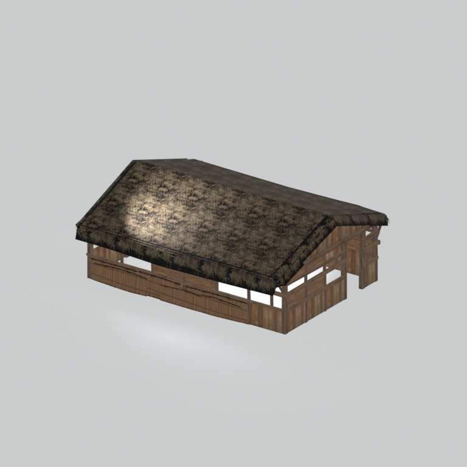

# Thatched shelter with partial walls

A thatched roof over wooden supports and partial low walls. This reference does not establish a complete enclosed house.

[Library](../README.md) | [Category](../tables/shelters-1.md) | [Source / advanced data](../catalogue.json) | [Credits](../sources-and-credits.md)

**Game filename:** mgom_hous004_vrtn001.fmdl  
**Category:** Architecture &gt; Shelters  
**Variant:** vrtn001; **LOD:** 0  
**Tags:** thatched roof, shelter, partial walls

## Still reference



## 360-degree reference


The camera circles a static model. This is not a native animation. Source base textures and UVs use approximate studio shading; interaction, collision, complete assembly and FOX shader equivalence are not established.

## Identity and naming

| Field | Value |
|---|---|
| Library ID | mgsv-tpp-mgom_hous004_vrtn001-a91d44227f3b916e |
| Naming status | reviewed |
| Naming confidence | high |
| Naming evidence | {"kind": "reviewed-preview", "note": "Root reviewed the existing thirteen-still contact; this entry is in the twelve-reference hard-surface selection. Native filename/variant remain independent; no interaction or assembly guarantee.", "source": "media/asset-previews/2026-10-17-completed-references/mgsv-tpp-mgom_hous004_vrtn001-a91d44227f3b916e.png"} |
| Native model | /Assets/mgo/environ/object/mgo_mafr/house/mgom_hous004/scenes/mgom_hous004_vrtn001.fmdl |
| Model SHA256 | 4b462f60af3761e3d05f3d0112a0204e93ef7e24e37a32ffb25e0568703a8459 |
| Container | /Assets/mgo/pack/location/afc0/pack_common/afc0_common.fpk |
| Container SHA256 | 20a950cab0d6912ac3a270b90dc6dc673f2d13859eb636819bfa3955fca6e320 |
| Captured source / location scope | Selected native member/content and captured installed-source chain; full archive SHA/runtime priority unresolved |
| Raw record SHA256 | a6ab712b2a12212025db6a574074b1144cb9a89a6736874c4e78aeeebef45c1f |

Naming review is descriptive metadata only. It does not change model completion or identify a working game interaction.

## Native LOD inventory

| Native LOD | Triangles | Preview status | Decoded indices SHA256 |
|---|---:|---|---|
| 0 | 1562 | rendered | 89dafba001a0fd27d2010e0781d4ade4b457edd29e790cea7d15be15e95c8f48 |
| 1 | 1280 | not separately rendered | 7709bbf8c9d9bb16290b3246c25383e1d87cd1aee85a705ca3d5ac230512ec6a |
| 2 | 1125 | not separately rendered | ce439053a84a1d061c39db493d0867a0b73066a79a9dfbe6fefabd1b4310eca9 |
| 3 | 1048 | not separately rendered | a9a085c43fc8606467bf17bd194cd59ce082afe35f6a1296447992574d3ee08a |

Mesh detail and texture pixels/mips are separate. Index hashes describe decoded triangle arrays, not packed index-buffer bytes. Only source-recorded native levels are listed.

<details>
<summary>Texture, source and naming technical metadata</summary>

```json
{
  "source": {
    "nativePath": "/Assets/mgo/environ/object/mgo_mafr/house/mgom_hous004/scenes/mgom_hous004_vrtn001.fmdl",
    "nativeSha256": "4b462f60af3761e3d05f3d0112a0204e93ef7e24e37a32ffb25e0568703a8459",
    "stableIdentity": "/assets/mgo/environ/object/mgo_mafr/house/mgom_hous004/scenes/mgom_hous004_vrtn001.fmdl#4b462f60af3761e3d05f3d0112a0204e93ef7e24e37a32ffb25e0568703a8459#5380b2c27d4d9ed0d463840e6505d6252f46cf5c19cb8f038ff85730d53ad7ca",
    "container": {
      "nativePath": "/Assets/mgo/pack/location/afc0/pack_common/afc0_common.fpk",
      "sha256": "20a950cab0d6912ac3a270b90dc6dc673f2d13859eb636819bfa3955fca6e320",
      "status": "Selected installed-source container/member chain captured by community reader"
    },
    "historicalDatOrigin": null,
    "sourceArchiveAtCapture": "master/0/00.dat",
    "locationStatus": "Selected native member/content and captured installed-source chain; full archive SHA/runtime priority unresolved",
    "currentInstalledDatVerified": false,
    "selectedInstalledMemberVerified": true,
    "evidence": {
      "archive_helper_executable_sha256": "6f8e39a436af3b024bbd0504966ab3d5d9d0cb05d86689bf3e83d15e68df613f",
      "archive_helper_source_sha256": "f662d3b63e066a0afc77ffe22ea0e564222d14469648300dba2c4f8e9b43446b",
      "archive_index_recipe": "54acff767f08d76ad6056c5387328759bc883df507788f398de6c2c04fac12db",
      "archive_reader": "Atvaark GzsTool.Core 0.5.3",
      "archive_reader_core_sha256": "9da447ae3c375cce2e46744eeff6af50f1591062afdf479d1a0b49edb47daaa3",
      "archive_tool_and_dictionary_sha256": {
        "CityHash.dll": "def6c4506d461b65e4059b2936b2cbd5f852ba5d1d8a1a527f1c0e6dc7008c8f",
        "GzsTool.Core.dll": "9da447ae3c375cce2e46744eeff6af50f1591062afdf479d1a0b49edb47daaa3",
        "GzsTool.exe": "1a9c5b11e2355383ff485aee7e86abc026f5c1fad729daf8c0fd15ee0aae1c10",
        "Zlib.Portable.dll": "fe84781ba35ca9cc5ff5f73fd08d2a66c59e5257b4573f5fe59743f30bf78e42",
        "fpk_dictionary.txt": "b82f9a8d6c10a68ba9471eca9d815c21355a53b5e68753d8ad7db7fd01bf401d",
        "qar_dictionary.txt": "1558c248ed0a4bb827888261563fbb91a2df4f03999682f85d637ff70d9d5fb2"
      },
      "bytes": 98576,
      "container_chain": [
        {
          "content_sha256": null,
          "depth": 0,
          "id": "3f19555d27c2ebecdfbad26aadd88b9f62e9fb6092c04c712963ef73c67ccb42",
          "index_sha256": "9acd3675d6e1500e0e18430cba0fdc70a5718ad7d6b62f13905891a35d59f18a",
          "kind": "qar",
          "name": "master/0/00.dat",
          "parent_occurrence": null
        },
        {
          "content_sha256": "20a950cab0d6912ac3a270b90dc6dc673f2d13859eb636819bfa3955fca6e320",
          "depth": 1,
          "id": "f1334a28f5fb887d989a9c548d11dccada12186358e0a4b4e7fc9831f6f42881",
          "index_sha256": "e15578c97612208569f283c28408f389fb560576e3976adf9d7aa8ed9c9aaf87",
          "kind": "fpk",
          "name": "/Assets/mgo/pack/location/afc0/pack_common/afc0_common.fpk",
          "parent_occurrence": "348190d8da3d429c2cdae58af0494f023c46b80f66da14d484dc54a7e17a97df"
        }
      ],
      "contentSha256": "4b462f60af3761e3d05f3d0112a0204e93ef7e24e37a32ffb25e0568703a8459",
      "member": {
        "actual_size": 98576,
        "compressed_size": null,
        "content_sha256": "4b462f60af3761e3d05f3d0112a0204e93ef7e24e37a32ffb25e0568703a8459",
        "declared_size": 98576,
        "extension": "fmdl",
        "hash_hex": null,
        "name": "/Assets/mgo/environ/object/mgo_mafr/house/mgom_hous004/scenes/mgom_hous004_vrtn001.fmdl",
        "name_origin": "embedded",
        "offset": 4362512,
        "ordinal": 124,
        "path_hash": null,
        "resolved": 1
      },
      "occurrenceId": "1a93a9815066f0d6a75150899e65059b883510ff516e5431b1788b2455d4d9eb",
      "occurrence_id": "1a93a9815066f0d6a75150899e65059b883510ff516e5431b1788b2455d4d9eb",
      "primary_source_revision": "fc4a8196555638c6cf8aa1b7c8dc34ccd5c69cb5",
      "source_adapter": "community_core_selective_export",
      "source_id": "7f6bb743fb4c487f0e9522f9c7fac280c46cf6b1051e0fc75a93602c8eb451f0",
      "source_path": "master/0/00.dat",
      "source_snapshot": "{\"bytes\":768788480,\"device\":621747392682911458,\"file_id\":844424931596481,\"header_sha256\":\"ead50f0a9a37e4285323b9c6fa0ec75fe75e518c63147e63158eeb2892c6589e\",\"mtime_ns\":1791852224238580700}",
      "virtualPath": "/Assets/mgo/environ/object/mgo_mafr/house/mgom_hous004/scenes/mgom_hous004_vrtn001.fmdl"
    }
  },
  "materials": [
    {
      "sampler": "Base_Tex_SRGB",
      "materialIndex": 0,
      "nativePathHash": "1543014147917378875",
      "nativeVirtualPath": null,
      "nativeBinding": {
        "familyId": "aa0d6335c43cebfa9f6877c3cc224405eb00e7f5a0f12dd7b4b6dec90ecc0727",
        "height": 1024,
        "materialIndex": 0,
        "mipCount": 9,
        "nativeMipCountVerified": true,
        "nativePath": null,
        "nativePathHash": "1543014147917378875",
        "nativeTexture": {
          "additionalFtexsFileCount": 2,
          "depth": 1,
          "ftexsFileCount": 3,
          "height": 1024,
          "metadataBytes": 208,
          "mipCount": 9,
          "mips": [
            {
              "chunks": 32,
              "decodedBytes": 524288,
              "mip": 0,
              "offset": 0,
              "storedBytes": 356912,
              "streamNumber": 3
            },
            {
              "chunks": 8,
              "decodedBytes": 131072,
              "mip": 1,
              "offset": 0,
              "storedBytes": 95136,
              "streamNumber": 2
            },
            {
              "chunks": 2,
              "decodedBytes": 32768,
              "mip": 2,
              "offset": 8672,
              "storedBytes": 24112,
              "streamNumber": 1
            },
            {
              "chunks": 1,
              "decodedBytes": 8192,
              "mip": 3,
              "offset": 2424,
              "storedBytes": 6240,
              "streamNumber": 1
            },
            {
              "chunks": 1,
              "decodedBytes": 2048,
              "mip": 4,
              "offset": 736,
              "storedBytes": 1680,
              "streamNumber": 1
            },
            {
              "chunks": 1,
              "decodedBytes": 512,
              "mip": 5,
              "offset": 232,
              "storedBytes": 496,
              "streamNumber": 1
            },
            {
              "chunks": 1,
              "decodedBytes": 128,
              "mip": 6,
              "offset": 80,
              "storedBytes": 144,
              "streamNumber": 1
            },
            {
              "chunks": 1,
              "decodedBytes": 32,
              "mip": 7,
              "offset": 24,
              "storedBytes": 48,
              "streamNumber": 1
            },
            {
              "chunks": 1,
              "decodedBytes": 8,
              "mip": 8,
              "offset": 0,
              "storedBytes": 16,
              "streamNumber": 1
            }
          ],
          "nativeHeaderHash": "a3e632f4e5fa26c830a9a36f62887d27",
          "nrtFlag": 2,
          "pixelFormat": 2,
          "requiredStreamNumbers": [
            1,
            2,
            3
          ],
          "textureType": 16777219,
          "unknownFlags": 273,
          "width": 1024
        },
        "samplerName": "Base_Tex_SRGB",
        "samplerNameHash": "72475356961633",
        "sha256": "eab3b4caf2b7b856800c72ecbde408327b0c7639eb51f9d168eabc948f87dbcc",
        "sourceOccurrences": [
          {
            "archive_helper_executable_sha256": "6f8e39a436af3b024bbd0504966ab3d5d9d0cb05d86689bf3e83d15e68df613f",
            "archive_helper_source_sha256": "f662d3b63e066a0afc77ffe22ea0e564222d14469648300dba2c4f8e9b43446b",
            "archive_index_recipe": "54acff767f08d76ad6056c5387328759bc883df507788f398de6c2c04fac12db",
            "archive_reader": "Atvaark GzsTool.Core 0.5.3",
            "archive_reader_core_sha256": "9da447ae3c375cce2e46744eeff6af50f1591062afdf479d1a0b49edb47daaa3",
            "archive_tool_and_dictionary_sha256": {
              "CityHash.dll": "def6c4506d461b65e4059b2936b2cbd5f852ba5d1d8a1a527f1c0e6dc7008c8f",
              "GzsTool.Core.dll": "9da447ae3c375cce2e46744eeff6af50f1591062afdf479d1a0b49edb47daaa3",
              "GzsTool.exe": "1a9c5b11e2355383ff485aee7e86abc026f5c1fad729daf8c0fd15ee0aae1c10",
              "Zlib.Portable.dll": "fe84781ba35ca9cc5ff5f73fd08d2a66c59e5257b4573f5fe59743f30bf78e42",
              "fpk_dictionary.txt": "b82f9a8d6c10a68ba9471eca9d815c21355a53b5e68753d8ad7db7fd01bf401d",
              "qar_dictionary.txt": "1558c248ed0a4bb827888261563fbb91a2df4f03999682f85d637ff70d9d5fb2"
            },
            "bytes": 208,
            "container_chain": [
              {
                "content_sha256": null,
                "depth": 0,
                "id": "3f19555d27c2ebecdfbad26aadd88b9f62e9fb6092c04c712963ef73c67ccb42",
                "index_sha256": "9acd3675d6e1500e0e18430cba0fdc70a5718ad7d6b62f13905891a35d59f18a",
                "kind": "qar",
                "name": "master/0/00.dat",
                "parent_occurrence": null
              },
              {
                "content_sha256": "c371a18745c941878107bdaf7aef71c13b09b8b3a574360f6e38e0a7172b74e6",
                "depth": 1,
                "id": "13570131ff9ebc75c266205cbdf3461ff4dc51e8a0cb4f7407b0a08fe357052a",
                "index_sha256": "5b8e60a5e6b705cb87973f15c3215fb3733b7a49171030a4c7640da4622a5ca2",
                "kind": "pftxs",
                "name": "/Assets/mgo/pack/location/afc0/pack_common/afc0_common.pftxs",
                "parent_occurrence": "abc314b7f418d61ea6a3e5525bf8f85d22b454b81d3407e6645bfc43339658ac"
              }
            ],
            "contentSha256": "9e9865ab7cddbccc0712e495036069cdde89b5f24e0a3257146d480f6a408c36",
            "member": {
              "actual_size": 208,
              "compressed_size": null,
              "content_sha256": "9e9865ab7cddbccc0712e495036069cdde89b5f24e0a3257146d480f6a408c36",
              "declared_size": 208,
              "extension": "ftex",
              "hash_hex": "1569e3313a04753b",
              "name": "1569e3313a04753b.ftex",
              "name_origin": "hash_fallback",
              "offset": 6521536,
              "ordinal": 388,
              "path_hash": null,
              "resolved": 0
            },
            "occurrenceId": "54b79fecddf04abff38ba766d429c83aa20b727db2a86900bd393527f670f91b",
            "occurrence_id": "54b79fecddf04abff38ba766d429c83aa20b727db2a86900bd393527f670f91b",
            "primary_source_revision": "fc4a8196555638c6cf8aa1b7c8dc34ccd5c69cb5",
            "source_adapter": "community_core_selective_export",
            "source_id": "7f6bb743fb4c487f0e9522f9c7fac280c46cf6b1051e0fc75a93602c8eb451f0",
            "source_path": "master/0/00.dat",
            "source_snapshot": "{\"bytes\":768788480,\"device\":621747392682911458,\"file_id\":844424931596481,\"header_sha256\":\"ead50f0a9a37e4285323b9c6fa0ec75fe75e518c63147e63158eeb2892c6589e\",\"mtime_ns\":1791852224238580700}",
            "virtualPath": "1569e3313a04753b.ftex"
          },
          {
            "archive_helper_executable_sha256": "6f8e39a436af3b024bbd0504966ab3d5d9d0cb05d86689bf3e83d15e68df613f",
            "archive_helper_source_sha256": "f662d3b63e066a0afc77ffe22ea0e564222d14469648300dba2c4f8e9b43446b",
            "archive_index_recipe": "54acff767f08d76ad6056c5387328759bc883df507788f398de6c2c04fac12db",
            "archive_reader": "Atvaark GzsTool.Core 0.5.3",
            "archive_reader_core_sha256": "9da447ae3c375cce2e46744eeff6af50f1591062afdf479d1a0b49edb47daaa3",
            "archive_tool_and_dictionary_sha256": {
              "CityHash.dll": "def6c4506d461b65e4059b2936b2cbd5f852ba5d1d8a1a527f1c0e6dc7008c8f",
              "GzsTool.Core.dll": "9da447ae3c375cce2e46744eeff6af50f1591062afdf479d1a0b49edb47daaa3",
              "GzsTool.exe": "1a9c5b11e2355383ff485aee7e86abc026f5c1fad729daf8c0fd15ee0aae1c10",
              "Zlib.Portable.dll": "fe84781ba35ca9cc5ff5f73fd08d2a66c59e5257b4573f5fe59743f30bf78e42",
              "fpk_dictionary.txt": "b82f9a8d6c10a68ba9471eca9d815c21355a53b5e68753d8ad7db7fd01bf401d",
              "qar_dictionary.txt": "1558c248ed0a4bb827888261563fbb91a2df4f03999682f85d637ff70d9d5fb2"
            },
            "bytes": 32800,
            "container_chain": [
              {
                "content_sha256": null,
                "depth": 0,
                "id": "436c8cfb4f382de93365b167a61aa81383299b7bad18205d60f1d0beeb3919e3",
                "index_sha256": "2d7b45c6ca65418839618e978562cac336091c06eb56dfe99f762b07a4016960",
                "kind": "qar",
                "name": "master/texture4.dat",
                "parent_occurrence": null
              }
            ],
            "contentSha256": "64adc1d8c762c2868be3fc5ed2b8106d118cfaf0c01d327a74810727156b094a",
            "member": {
              "actual_size": 32800,
              "compressed_size": 32800,
              "content_sha256": "64adc1d8c762c2868be3fc5ed2b8106d118cfaf0c01d327a74810727156b094a",
              "declared_size": 32800,
              "extension": "1.ftexs",
              "hash_hex": "b2c1e3313a04753b",
              "name": "1e3313a04753b.1.ftexs",
              "name_origin": "hash_fallback",
              "offset": 1296004128,
              "ordinal": 9646,
              "path_hash": "1e3313a04753b",
              "resolved": 0
            },
            "occurrenceId": "3133b41dd791d4633d6b847402e3aa46da43acb05341a6576d5f2200b7b77ba7",
            "occurrence_id": "3133b41dd791d4633d6b847402e3aa46da43acb05341a6576d5f2200b7b77ba7",
            "primary_source_revision": "fc4a8196555638c6cf8aa1b7c8dc34ccd5c69cb5",
            "source_adapter": "community_core_selective_export",
            "source_id": "6c31b98b4db9b88eb76cfcb538f5f34b4729531266a9459584126720a4fc14aa",
            "source_path": "master/texture4.dat",
            "source_snapshot": "{\"bytes\":2031604736,\"device\":621747392682911458,\"file_id\":562949953639628,\"header_sha256\":\"40ee2c6917b338f7f68c49847c97fe92b978506a1ba847fcc94d28c931c8711a\",\"mtime_ns\":1791224675561235200}",
            "virtualPath": "1e3313a04753b.1.ftexs"
          },
          {
            "archive_helper_executable_sha256": "6f8e39a436af3b024bbd0504966ab3d5d9d0cb05d86689bf3e83d15e68df613f",
            "archive_helper_source_sha256": "f662d3b63e066a0afc77ffe22ea0e564222d14469648300dba2c4f8e9b43446b",
            "archive_index_recipe": "54acff767f08d76ad6056c5387328759bc883df507788f398de6c2c04fac12db",
            "archive_reader": "Atvaark GzsTool.Core 0.5.3",
            "archive_reader_core_sha256": "9da447ae3c375cce2e46744eeff6af50f1591062afdf479d1a0b49edb47daaa3",
            "archive_tool_and_dictionary_sha256": {
              "CityHash.dll": "def6c4506d461b65e4059b2936b2cbd5f852ba5d1d8a1a527f1c0e6dc7008c8f",
              "GzsTool.Core.dll": "9da447ae3c375cce2e46744eeff6af50f1591062afdf479d1a0b49edb47daaa3",
              "GzsTool.exe": "1a9c5b11e2355383ff485aee7e86abc026f5c1fad729daf8c0fd15ee0aae1c10",
              "Zlib.Portable.dll": "fe84781ba35ca9cc5ff5f73fd08d2a66c59e5257b4573f5fe59743f30bf78e42",
              "fpk_dictionary.txt": "b82f9a8d6c10a68ba9471eca9d815c21355a53b5e68753d8ad7db7fd01bf401d",
              "qar_dictionary.txt": "1558c248ed0a4bb827888261563fbb91a2df4f03999682f85d637ff70d9d5fb2"
            },
            "bytes": 95200,
            "container_chain": [
              {
                "content_sha256": null,
                "depth": 0,
                "id": "436c8cfb4f382de93365b167a61aa81383299b7bad18205d60f1d0beeb3919e3",
                "index_sha256": "2d7b45c6ca65418839618e978562cac336091c06eb56dfe99f762b07a4016960",
                "kind": "qar",
                "name": "master/texture4.dat",
                "parent_occurrence": null
              }
            ],
            "contentSha256": "06c3d09624f7d63bef2aa6efcf85c471230c4457ec37d30c1fe44de5689cf009",
            "member": {
              "actual_size": 95200,
              "compressed_size": 95200,
              "content_sha256": "06c3d09624f7d63bef2aa6efcf85c471230c4457ec37d30c1fe44de5689cf009",
              "declared_size": 95200,
              "extension": "2.ftexs",
              "hash_hex": "b571e3313a04753b",
              "name": "1e3313a04753b.2.ftexs",
              "name_origin": "hash_fallback",
              "offset": 1296037920,
              "ordinal": 9647,
              "path_hash": "1e3313a04753b",
              "resolved": 0
            },
            "occurrenceId": "7edee3a55623fcfd966a18786fe449e6cc5c619ce86ed59a5e037f4b40d2a327",
            "occurrence_id": "7edee3a55623fcfd966a18786fe449e6cc5c619ce86ed59a5e037f4b40d2a327",
            "primary_source_revision": "fc4a8196555638c6cf8aa1b7c8dc34ccd5c69cb5",
            "source_adapter": "community_core_selective_export",
            "source_id": "6c31b98b4db9b88eb76cfcb538f5f34b4729531266a9459584126720a4fc14aa",
            "source_path": "master/texture4.dat",
            "source_snapshot": "{\"bytes\":2031604736,\"device\":621747392682911458,\"file_id\":562949953639628,\"header_sha256\":\"40ee2c6917b338f7f68c49847c97fe92b978506a1ba847fcc94d28c931c8711a\",\"mtime_ns\":1791224675561235200}",
            "virtualPath": "1e3313a04753b.2.ftexs"
          },
          {
            "archive_helper_executable_sha256": "6f8e39a436af3b024bbd0504966ab3d5d9d0cb05d86689bf3e83d15e68df613f",
            "archive_helper_source_sha256": "f662d3b63e066a0afc77ffe22ea0e564222d14469648300dba2c4f8e9b43446b",
            "archive_index_recipe": "54acff767f08d76ad6056c5387328759bc883df507788f398de6c2c04fac12db",
            "archive_reader": "Atvaark GzsTool.Core 0.5.3",
            "archive_reader_core_sha256": "9da447ae3c375cce2e46744eeff6af50f1591062afdf479d1a0b49edb47daaa3",
            "archive_tool_and_dictionary_sha256": {
              "CityHash.dll": "def6c4506d461b65e4059b2936b2cbd5f852ba5d1d8a1a527f1c0e6dc7008c8f",
              "GzsTool.Core.dll": "9da447ae3c375cce2e46744eeff6af50f1591062afdf479d1a0b49edb47daaa3",
              "GzsTool.exe": "1a9c5b11e2355383ff485aee7e86abc026f5c1fad729daf8c0fd15ee0aae1c10",
              "Zlib.Portable.dll": "fe84781ba35ca9cc5ff5f73fd08d2a66c59e5257b4573f5fe59743f30bf78e42",
              "fpk_dictionary.txt": "b82f9a8d6c10a68ba9471eca9d815c21355a53b5e68753d8ad7db7fd01bf401d",
              "qar_dictionary.txt": "1558c248ed0a4bb827888261563fbb91a2df4f03999682f85d637ff70d9d5fb2"
            },
            "bytes": 357168,
            "container_chain": [
              {
                "content_sha256": null,
                "depth": 0,
                "id": "436c8cfb4f382de93365b167a61aa81383299b7bad18205d60f1d0beeb3919e3",
                "index_sha256": "2d7b45c6ca65418839618e978562cac336091c06eb56dfe99f762b07a4016960",
                "kind": "qar",
                "name": "master/texture4.dat",
                "parent_occurrence": null
              }
            ],
            "contentSha256": "bba91d60803083debe4e3bd1e9f6d80923f75691b3ec6235e6b78371ef0b1260",
            "member": {
              "actual_size": 357168,
              "compressed_size": 357168,
              "content_sha256": "bba91d60803083debe4e3bd1e9f6d80923f75691b3ec6235e6b78371ef0b1260",
              "declared_size": 357168,
              "extension": "3.ftexs",
              "hash_hex": "5719e3313a04753b",
              "name": "1e3313a04753b.3.ftexs",
              "name_origin": "hash_fallback",
              "offset": 1296133152,
              "ordinal": 9648,
              "path_hash": "1e3313a04753b",
              "resolved": 0
            },
            "occurrenceId": "1ff5e294e7d440cf6d721d7bf5f14a4ceb46fb5c0fbeb36e2e26f32395889fc9",
            "occurrence_id": "1ff5e294e7d440cf6d721d7bf5f14a4ceb46fb5c0fbeb36e2e26f32395889fc9",
            "primary_source_revision": "fc4a8196555638c6cf8aa1b7c8dc34ccd5c69cb5",
            "source_adapter": "community_core_selective_export",
            "source_id": "6c31b98b4db9b88eb76cfcb538f5f34b4729531266a9459584126720a4fc14aa",
            "source_path": "master/texture4.dat",
            "source_snapshot": "{\"bytes\":2031604736,\"device\":621747392682911458,\"file_id\":562949953639628,\"header_sha256\":\"40ee2c6917b338f7f68c49847c97fe92b978506a1ba847fcc94d28c931c8711a\",\"mtime_ns\":1791224675561235200}",
            "virtualPath": "1e3313a04753b.3.ftexs"
          }
        ],
        "width": 1024
      },
      "ddsSha256": "eab3b4caf2b7b856800c72ecbde408327b0c7639eb51f9d168eabc948f87dbcc",
      "dimensions": [
        1024,
        1024
      ],
      "mipCount": 9,
      "nativeMipCountVerified": true,
      "connectedInPreview": true
    },
    {
      "sampler": "Base_Tex_SRGB",
      "materialIndex": 1,
      "nativePathHash": "1542487233358318370",
      "nativeVirtualPath": null,
      "nativeBinding": {
        "familyId": "fb9019fcfb7ccc2db075f3bbe375364796dbc86d85bd279437d7003f05c5d0a5",
        "height": 512,
        "materialIndex": 1,
        "mipCount": 8,
        "nativeMipCountVerified": true,
        "nativePath": null,
        "nativePathHash": "1542487233358318370",
        "nativeTexture": {
          "additionalFtexsFileCount": 2,
          "depth": 1,
          "ftexsFileCount": 3,
          "height": 512,
          "metadataBytes": 192,
          "mipCount": 8,
          "mips": [
            {
              "chunks": 8,
              "decodedBytes": 131072,
              "mip": 0,
              "offset": 0,
              "storedBytes": 82272,
              "streamNumber": 3
            },
            {
              "chunks": 2,
              "decodedBytes": 32768,
              "mip": 1,
              "offset": 0,
              "storedBytes": 21856,
              "streamNumber": 2
            },
            {
              "chunks": 1,
              "decodedBytes": 8192,
              "mip": 2,
              "offset": 2280,
              "storedBytes": 5696,
              "streamNumber": 1
            },
            {
              "chunks": 1,
              "decodedBytes": 2048,
              "mip": 3,
              "offset": 688,
              "storedBytes": 1584,
              "streamNumber": 1
            },
            {
              "chunks": 1,
              "decodedBytes": 512,
              "mip": 4,
              "offset": 232,
              "storedBytes": 448,
              "streamNumber": 1
            },
            {
              "chunks": 1,
              "decodedBytes": 128,
              "mip": 5,
              "offset": 80,
              "storedBytes": 144,
              "streamNumber": 1
            },
            {
              "chunks": 1,
              "decodedBytes": 32,
              "mip": 6,
              "offset": 24,
              "storedBytes": 48,
              "streamNumber": 1
            },
            {
              "chunks": 1,
              "decodedBytes": 8,
              "mip": 7,
              "offset": 0,
              "storedBytes": 16,
              "streamNumber": 1
            }
          ],
          "nativeHeaderHash": "a835397eb84edfd69c52c62539b0e599",
          "nrtFlag": 2,
          "pixelFormat": 2,
          "requiredStreamNumbers": [
            1,
            2,
            3
          ],
          "textureType": 16777219,
          "unknownFlags": 273,
          "width": 512
        },
        "samplerName": "Base_Tex_SRGB",
        "samplerNameHash": "72475356961633",
        "sha256": "b06aac0c91bb574575013f4d94c17c19a46a9da54e1cf81682b3df16381072fe",
        "sourceOccurrences": [
          {
            "archive_helper_executable_sha256": "6f8e39a436af3b024bbd0504966ab3d5d9d0cb05d86689bf3e83d15e68df613f",
            "archive_helper_source_sha256": "f662d3b63e066a0afc77ffe22ea0e564222d14469648300dba2c4f8e9b43446b",
            "archive_index_recipe": "54acff767f08d76ad6056c5387328759bc883df507788f398de6c2c04fac12db",
            "archive_reader": "Atvaark GzsTool.Core 0.5.3",
            "archive_reader_core_sha256": "9da447ae3c375cce2e46744eeff6af50f1591062afdf479d1a0b49edb47daaa3",
            "archive_tool_and_dictionary_sha256": {
              "CityHash.dll": "def6c4506d461b65e4059b2936b2cbd5f852ba5d1d8a1a527f1c0e6dc7008c8f",
              "GzsTool.Core.dll": "9da447ae3c375cce2e46744eeff6af50f1591062afdf479d1a0b49edb47daaa3",
              "GzsTool.exe": "1a9c5b11e2355383ff485aee7e86abc026f5c1fad729daf8c0fd15ee0aae1c10",
              "Zlib.Portable.dll": "fe84781ba35ca9cc5ff5f73fd08d2a66c59e5257b4573f5fe59743f30bf78e42",
              "fpk_dictionary.txt": "b82f9a8d6c10a68ba9471eca9d815c21355a53b5e68753d8ad7db7fd01bf401d",
              "qar_dictionary.txt": "1558c248ed0a4bb827888261563fbb91a2df4f03999682f85d637ff70d9d5fb2"
            },
            "bytes": 192,
            "container_chain": [
              {
                "content_sha256": null,
                "depth": 0,
                "id": "436c8cfb4f382de93365b167a61aa81383299b7bad18205d60f1d0beeb3919e3",
                "index_sha256": "2d7b45c6ca65418839618e978562cac336091c06eb56dfe99f762b07a4016960",
                "kind": "qar",
                "name": "master/texture4.dat",
                "parent_occurrence": null
              }
            ],
            "contentSha256": "480f5f195bc932b59ea823c4a990f4fa59787d60e3e71dce7ea65ce766ab7919",
            "member": {
              "actual_size": 192,
              "compressed_size": 192,
              "content_sha256": "480f5f195bc932b59ea823c4a990f4fa59787d60e3e71dce7ea65ce766ab7919",
              "declared_size": 192,
              "extension": "ftex",
              "hash_hex": "156803f75ee5cb22",
              "name": "3f75ee5cb22.ftex",
              "name_origin": "hash_fallback",
              "offset": 1295639584,
              "ordinal": 9637,
              "path_hash": "3f75ee5cb22",
              "resolved": 0
            },
            "occurrenceId": "1ae8205045f603baa235bce2f2fd4cc7b71253ee6d25dc6ea553358cdd7e618a",
            "occurrence_id": "1ae8205045f603baa235bce2f2fd4cc7b71253ee6d25dc6ea553358cdd7e618a",
            "primary_source_revision": "fc4a8196555638c6cf8aa1b7c8dc34ccd5c69cb5",
            "source_adapter": "community_core_selective_export",
            "source_id": "6c31b98b4db9b88eb76cfcb538f5f34b4729531266a9459584126720a4fc14aa",
            "source_path": "master/texture4.dat",
            "source_snapshot": "{\"bytes\":2031604736,\"device\":621747392682911458,\"file_id\":562949953639628,\"header_sha256\":\"40ee2c6917b338f7f68c49847c97fe92b978506a1ba847fcc94d28c931c8711a\",\"mtime_ns\":1791224675561235200}",
            "virtualPath": "3f75ee5cb22.ftex"
          },
          {
            "archive_helper_executable_sha256": "6f8e39a436af3b024bbd0504966ab3d5d9d0cb05d86689bf3e83d15e68df613f",
            "archive_helper_source_sha256": "f662d3b63e066a0afc77ffe22ea0e564222d14469648300dba2c4f8e9b43446b",
            "archive_index_recipe": "54acff767f08d76ad6056c5387328759bc883df507788f398de6c2c04fac12db",
            "archive_reader": "Atvaark GzsTool.Core 0.5.3",
            "archive_reader_core_sha256": "9da447ae3c375cce2e46744eeff6af50f1591062afdf479d1a0b49edb47daaa3",
            "archive_tool_and_dictionary_sha256": {
              "CityHash.dll": "def6c4506d461b65e4059b2936b2cbd5f852ba5d1d8a1a527f1c0e6dc7008c8f",
              "GzsTool.Core.dll": "9da447ae3c375cce2e46744eeff6af50f1591062afdf479d1a0b49edb47daaa3",
              "GzsTool.exe": "1a9c5b11e2355383ff485aee7e86abc026f5c1fad729daf8c0fd15ee0aae1c10",
              "Zlib.Portable.dll": "fe84781ba35ca9cc5ff5f73fd08d2a66c59e5257b4573f5fe59743f30bf78e42",
              "fpk_dictionary.txt": "b82f9a8d6c10a68ba9471eca9d815c21355a53b5e68753d8ad7db7fd01bf401d",
              "qar_dictionary.txt": "1558c248ed0a4bb827888261563fbb91a2df4f03999682f85d637ff70d9d5fb2"
            },
            "bytes": 7984,
            "container_chain": [
              {
                "content_sha256": null,
                "depth": 0,
                "id": "3f19555d27c2ebecdfbad26aadd88b9f62e9fb6092c04c712963ef73c67ccb42",
                "index_sha256": "9acd3675d6e1500e0e18430cba0fdc70a5718ad7d6b62f13905891a35d59f18a",
                "kind": "qar",
                "name": "master/0/00.dat",
                "parent_occurrence": null
              },
              {
                "content_sha256": "c371a18745c941878107bdaf7aef71c13b09b8b3a574360f6e38e0a7172b74e6",
                "depth": 1,
                "id": "13570131ff9ebc75c266205cbdf3461ff4dc51e8a0cb4f7407b0a08fe357052a",
                "index_sha256": "5b8e60a5e6b705cb87973f15c3215fb3733b7a49171030a4c7640da4622a5ca2",
                "kind": "pftxs",
                "name": "/Assets/mgo/pack/location/afc0/pack_common/afc0_common.pftxs",
                "parent_occurrence": "abc314b7f418d61ea6a3e5525bf8f85d22b454b81d3407e6645bfc43339658ac"
              }
            ],
            "contentSha256": "1d45508cf8e5f7bfe6121678f7d48b28baef9d4d3746302b97a8d0c7f5d5e742",
            "member": {
              "actual_size": 7984,
              "compressed_size": null,
              "content_sha256": "1d45508cf8e5f7bfe6121678f7d48b28baef9d4d3746302b97a8d0c7f5d5e742",
              "declared_size": 7984,
              "extension": "1.ftexs",
              "hash_hex": "b2c003f75ee5cb22",
              "name": "b2c003f75ee5cb22.1.ftexs",
              "name_origin": "hash_fallback",
              "offset": 6666560,
              "ordinal": 399,
              "path_hash": null,
              "resolved": 0
            },
            "occurrenceId": "d1ee4599fdddc983fe70a3d4c441f5d7937d53b44325d855eef17841ab710a12",
            "occurrence_id": "d1ee4599fdddc983fe70a3d4c441f5d7937d53b44325d855eef17841ab710a12",
            "primary_source_revision": "fc4a8196555638c6cf8aa1b7c8dc34ccd5c69cb5",
            "source_adapter": "community_core_selective_export",
            "source_id": "7f6bb743fb4c487f0e9522f9c7fac280c46cf6b1051e0fc75a93602c8eb451f0",
            "source_path": "master/0/00.dat",
            "source_snapshot": "{\"bytes\":768788480,\"device\":621747392682911458,\"file_id\":844424931596481,\"header_sha256\":\"ead50f0a9a37e4285323b9c6fa0ec75fe75e518c63147e63158eeb2892c6589e\",\"mtime_ns\":1791852224238580700}",
            "virtualPath": "b2c003f75ee5cb22.1.ftexs"
          },
          {
            "archive_helper_executable_sha256": "6f8e39a436af3b024bbd0504966ab3d5d9d0cb05d86689bf3e83d15e68df613f",
            "archive_helper_source_sha256": "f662d3b63e066a0afc77ffe22ea0e564222d14469648300dba2c4f8e9b43446b",
            "archive_index_recipe": "54acff767f08d76ad6056c5387328759bc883df507788f398de6c2c04fac12db",
            "archive_reader": "Atvaark GzsTool.Core 0.5.3",
            "archive_reader_core_sha256": "9da447ae3c375cce2e46744eeff6af50f1591062afdf479d1a0b49edb47daaa3",
            "archive_tool_and_dictionary_sha256": {
              "CityHash.dll": "def6c4506d461b65e4059b2936b2cbd5f852ba5d1d8a1a527f1c0e6dc7008c8f",
              "GzsTool.Core.dll": "9da447ae3c375cce2e46744eeff6af50f1591062afdf479d1a0b49edb47daaa3",
              "GzsTool.exe": "1a9c5b11e2355383ff485aee7e86abc026f5c1fad729daf8c0fd15ee0aae1c10",
              "Zlib.Portable.dll": "fe84781ba35ca9cc5ff5f73fd08d2a66c59e5257b4573f5fe59743f30bf78e42",
              "fpk_dictionary.txt": "b82f9a8d6c10a68ba9471eca9d815c21355a53b5e68753d8ad7db7fd01bf401d",
              "qar_dictionary.txt": "1558c248ed0a4bb827888261563fbb91a2df4f03999682f85d637ff70d9d5fb2"
            },
            "bytes": 21872,
            "container_chain": [
              {
                "content_sha256": null,
                "depth": 0,
                "id": "436c8cfb4f382de93365b167a61aa81383299b7bad18205d60f1d0beeb3919e3",
                "index_sha256": "2d7b45c6ca65418839618e978562cac336091c06eb56dfe99f762b07a4016960",
                "kind": "qar",
                "name": "master/texture4.dat",
                "parent_occurrence": null
              }
            ],
            "contentSha256": "5f0ddd6ab7d00fe30044d045cdb8dacf7eb4c8597e8f3597afbe041a5a8d329f",
            "member": {
              "actual_size": 21872,
              "compressed_size": 21872,
              "content_sha256": "5f0ddd6ab7d00fe30044d045cdb8dacf7eb4c8597e8f3597afbe041a5a8d329f",
              "declared_size": 21872,
              "extension": "2.ftexs",
              "hash_hex": "b57003f75ee5cb22",
              "name": "3f75ee5cb22.2.ftexs",
              "name_origin": "hash_fallback",
              "offset": 1295534112,
              "ordinal": 9635,
              "path_hash": "3f75ee5cb22",
              "resolved": 0
            },
            "occurrenceId": "30fbaf986f01705b8c52d20402151625fd8d7e1d70c814ae1296ca7f9b082ced",
            "occurrence_id": "30fbaf986f01705b8c52d20402151625fd8d7e1d70c814ae1296ca7f9b082ced",
            "primary_source_revision": "fc4a8196555638c6cf8aa1b7c8dc34ccd5c69cb5",
            "source_adapter": "community_core_selective_export",
            "source_id": "6c31b98b4db9b88eb76cfcb538f5f34b4729531266a9459584126720a4fc14aa",
            "source_path": "master/texture4.dat",
            "source_snapshot": "{\"bytes\":2031604736,\"device\":621747392682911458,\"file_id\":562949953639628,\"header_sha256\":\"40ee2c6917b338f7f68c49847c97fe92b978506a1ba847fcc94d28c931c8711a\",\"mtime_ns\":1791224675561235200}",
            "virtualPath": "3f75ee5cb22.2.ftexs"
          },
          {
            "archive_helper_executable_sha256": "6f8e39a436af3b024bbd0504966ab3d5d9d0cb05d86689bf3e83d15e68df613f",
            "archive_helper_source_sha256": "f662d3b63e066a0afc77ffe22ea0e564222d14469648300dba2c4f8e9b43446b",
            "archive_index_recipe": "54acff767f08d76ad6056c5387328759bc883df507788f398de6c2c04fac12db",
            "archive_reader": "Atvaark GzsTool.Core 0.5.3",
            "archive_reader_core_sha256": "9da447ae3c375cce2e46744eeff6af50f1591062afdf479d1a0b49edb47daaa3",
            "archive_tool_and_dictionary_sha256": {
              "CityHash.dll": "def6c4506d461b65e4059b2936b2cbd5f852ba5d1d8a1a527f1c0e6dc7008c8f",
              "GzsTool.Core.dll": "9da447ae3c375cce2e46744eeff6af50f1591062afdf479d1a0b49edb47daaa3",
              "GzsTool.exe": "1a9c5b11e2355383ff485aee7e86abc026f5c1fad729daf8c0fd15ee0aae1c10",
              "Zlib.Portable.dll": "fe84781ba35ca9cc5ff5f73fd08d2a66c59e5257b4573f5fe59743f30bf78e42",
              "fpk_dictionary.txt": "b82f9a8d6c10a68ba9471eca9d815c21355a53b5e68753d8ad7db7fd01bf401d",
              "qar_dictionary.txt": "1558c248ed0a4bb827888261563fbb91a2df4f03999682f85d637ff70d9d5fb2"
            },
            "bytes": 82336,
            "container_chain": [
              {
                "content_sha256": null,
                "depth": 0,
                "id": "e73d96973ade76f7a00afdbea486dd110896ace97da0791f56899647de46f210",
                "index_sha256": "5a818609a652a10d90fb90015661d0cb80898096bbb3aac36382172988d8736d",
                "kind": "qar",
                "name": "mgo/texture0.dat",
                "parent_occurrence": null
              }
            ],
            "contentSha256": "e54611be14fb8adc394e1e7fbe7c2b3e1cd20c3af0db49b1f496379401c27320",
            "member": {
              "actual_size": 82336,
              "compressed_size": 82336,
              "content_sha256": "e54611be14fb8adc394e1e7fbe7c2b3e1cd20c3af0db49b1f496379401c27320",
              "declared_size": 82336,
              "extension": "3.ftexs",
              "hash_hex": "571803f75ee5cb22",
              "name": "3f75ee5cb22.3.ftexs",
              "name_origin": "hash_fallback",
              "offset": 3855707168,
              "ordinal": 15716,
              "path_hash": "3f75ee5cb22",
              "resolved": 0
            },
            "occurrenceId": "09c18a5b9dbf5eb741e4039104f49e3da571b50f882146441d45af6ee273353b",
            "occurrence_id": "09c18a5b9dbf5eb741e4039104f49e3da571b50f882146441d45af6ee273353b",
            "primary_source_revision": "fc4a8196555638c6cf8aa1b7c8dc34ccd5c69cb5",
            "source_adapter": "community_core_selective_export",
            "source_id": "03f5942f0e1af8040ae05b95c43716d75f5933971d78324bf7cfea291297f3f4",
            "source_path": "mgo/texture0.dat",
            "source_snapshot": "{\"bytes\":4492370944,\"device\":621747392682911458,\"file_id\":562949953639631,\"header_sha256\":\"6108fbacb65c84d041742c39e5ca630745240453b336f1059a13b91943f0b011\",\"mtime_ns\":1791224675562234400}",
            "virtualPath": "3f75ee5cb22.3.ftexs"
          }
        ],
        "width": 512
      },
      "ddsSha256": "b06aac0c91bb574575013f4d94c17c19a46a9da54e1cf81682b3df16381072fe",
      "dimensions": [
        512,
        512
      ],
      "mipCount": 8,
      "nativeMipCountVerified": true,
      "connectedInPreview": true
    },
    {
      "sampler": "Base_Tex_SRGB",
      "materialIndex": 2,
      "nativePathHash": "1542542948595552806",
      "nativeVirtualPath": null,
      "nativeBinding": {
        "familyId": "64eca20c96a5ec71f7a88b4607e812eaac9f028f10771d91828d29ff6702c6ee",
        "height": 1024,
        "materialIndex": 2,
        "mipCount": 9,
        "nativeMipCountVerified": true,
        "nativePath": null,
        "nativePathHash": "1542542948595552806",
        "nativeTexture": {
          "additionalFtexsFileCount": 2,
          "depth": 1,
          "ftexsFileCount": 3,
          "height": 1024,
          "metadataBytes": 208,
          "mipCount": 9,
          "mips": [
            {
              "chunks": 64,
              "decodedBytes": 1048576,
              "mip": 0,
              "offset": 0,
              "storedBytes": 658592,
              "streamNumber": 3
            },
            {
              "chunks": 16,
              "decodedBytes": 262144,
              "mip": 1,
              "offset": 0,
              "storedBytes": 196864,
              "streamNumber": 2
            },
            {
              "chunks": 4,
              "decodedBytes": 65536,
              "mip": 2,
              "offset": 19504,
              "storedBytes": 54624,
              "streamNumber": 1
            },
            {
              "chunks": 1,
              "decodedBytes": 16384,
              "mip": 3,
              "offset": 5128,
              "storedBytes": 14368,
              "streamNumber": 1
            },
            {
              "chunks": 1,
              "decodedBytes": 4096,
              "mip": 4,
              "offset": 1408,
              "storedBytes": 3712,
              "streamNumber": 1
            },
            {
              "chunks": 1,
              "decodedBytes": 1024,
              "mip": 5,
              "offset": 408,
              "storedBytes": 992,
              "streamNumber": 1
            },
            {
              "chunks": 1,
              "decodedBytes": 256,
              "mip": 6,
              "offset": 128,
              "storedBytes": 272,
              "streamNumber": 1
            },
            {
              "chunks": 1,
              "decodedBytes": 64,
              "mip": 7,
              "offset": 40,
              "storedBytes": 80,
              "streamNumber": 1
            },
            {
              "chunks": 1,
              "decodedBytes": 16,
              "mip": 8,
              "offset": 0,
              "storedBytes": 32,
              "streamNumber": 1
            }
          ],
          "nativeHeaderHash": "3cf93d34fdcd89411682bc41b3991568",
          "nrtFlag": 2,
          "pixelFormat": 4,
          "requiredStreamNumbers": [
            1,
            2,
            3
          ],
          "textureType": 16777219,
          "unknownFlags": 273,
          "width": 1024
        },
        "samplerName": "Base_Tex_SRGB",
        "samplerNameHash": "72475356961633",
        "sha256": "371b7d039509d9e3346749d39b3005e591dc0409c8bff7a7d27280bc39c09f71",
        "sourceOccurrences": [
          {
            "archive_helper_executable_sha256": "6f8e39a436af3b024bbd0504966ab3d5d9d0cb05d86689bf3e83d15e68df613f",
            "archive_helper_source_sha256": "f662d3b63e066a0afc77ffe22ea0e564222d14469648300dba2c4f8e9b43446b",
            "archive_index_recipe": "54acff767f08d76ad6056c5387328759bc883df507788f398de6c2c04fac12db",
            "archive_reader": "Atvaark GzsTool.Core 0.5.3",
            "archive_reader_core_sha256": "9da447ae3c375cce2e46744eeff6af50f1591062afdf479d1a0b49edb47daaa3",
            "archive_tool_and_dictionary_sha256": {
              "CityHash.dll": "def6c4506d461b65e4059b2936b2cbd5f852ba5d1d8a1a527f1c0e6dc7008c8f",
              "GzsTool.Core.dll": "9da447ae3c375cce2e46744eeff6af50f1591062afdf479d1a0b49edb47daaa3",
              "GzsTool.exe": "1a9c5b11e2355383ff485aee7e86abc026f5c1fad729daf8c0fd15ee0aae1c10",
              "Zlib.Portable.dll": "fe84781ba35ca9cc5ff5f73fd08d2a66c59e5257b4573f5fe59743f30bf78e42",
              "fpk_dictionary.txt": "b82f9a8d6c10a68ba9471eca9d815c21355a53b5e68753d8ad7db7fd01bf401d",
              "qar_dictionary.txt": "1558c248ed0a4bb827888261563fbb91a2df4f03999682f85d637ff70d9d5fb2"
            },
            "bytes": 208,
            "container_chain": [
              {
                "content_sha256": null,
                "depth": 0,
                "id": "3f19555d27c2ebecdfbad26aadd88b9f62e9fb6092c04c712963ef73c67ccb42",
                "index_sha256": "9acd3675d6e1500e0e18430cba0fdc70a5718ad7d6b62f13905891a35d59f18a",
                "kind": "qar",
                "name": "master/0/00.dat",
                "parent_occurrence": null
              },
              {
                "content_sha256": "c371a18745c941878107bdaf7aef71c13b09b8b3a574360f6e38e0a7172b74e6",
                "depth": 1,
                "id": "13570131ff9ebc75c266205cbdf3461ff4dc51e8a0cb4f7407b0a08fe357052a",
                "index_sha256": "5b8e60a5e6b705cb87973f15c3215fb3733b7a49171030a4c7640da4622a5ca2",
                "kind": "pftxs",
                "name": "/Assets/mgo/pack/location/afc0/pack_common/afc0_common.pftxs",
                "parent_occurrence": "abc314b7f418d61ea6a3e5525bf8f85d22b454b81d3407e6645bfc43339658ac"
              }
            ],
            "contentSha256": "ae8dd6c993fcbf6619c0ddffc672a07b936e5e9a84c1632feb9257eec1fa4244",
            "member": {
              "actual_size": 208,
              "compressed_size": null,
              "content_sha256": "ae8dd6c993fcbf6619c0ddffc672a07b936e5e9a84c1632feb9257eec1fa4244",
              "declared_size": 208,
              "extension": "ftex",
              "hash_hex": "156836a395d25226",
              "name": "156836a395d25226.ftex",
              "name_origin": "hash_fallback",
              "offset": 2302720,
              "ordinal": 132,
              "path_hash": null,
              "resolved": 0
            },
            "occurrenceId": "b64676644eaca9b24442ca45a2a1670cb25b52c6634a35ace501a419d055e9c2",
            "occurrence_id": "b64676644eaca9b24442ca45a2a1670cb25b52c6634a35ace501a419d055e9c2",
            "primary_source_revision": "fc4a8196555638c6cf8aa1b7c8dc34ccd5c69cb5",
            "source_adapter": "community_core_selective_export",
            "source_id": "7f6bb743fb4c487f0e9522f9c7fac280c46cf6b1051e0fc75a93602c8eb451f0",
            "source_path": "master/0/00.dat",
            "source_snapshot": "{\"bytes\":768788480,\"device\":621747392682911458,\"file_id\":844424931596481,\"header_sha256\":\"ead50f0a9a37e4285323b9c6fa0ec75fe75e518c63147e63158eeb2892c6589e\",\"mtime_ns\":1791852224238580700}",
            "virtualPath": "156836a395d25226.ftex"
          },
          {
            "archive_helper_executable_sha256": "6f8e39a436af3b024bbd0504966ab3d5d9d0cb05d86689bf3e83d15e68df613f",
            "archive_helper_source_sha256": "f662d3b63e066a0afc77ffe22ea0e564222d14469648300dba2c4f8e9b43446b",
            "archive_index_recipe": "54acff767f08d76ad6056c5387328759bc883df507788f398de6c2c04fac12db",
            "archive_reader": "Atvaark GzsTool.Core 0.5.3",
            "archive_reader_core_sha256": "9da447ae3c375cce2e46744eeff6af50f1591062afdf479d1a0b49edb47daaa3",
            "archive_tool_and_dictionary_sha256": {
              "CityHash.dll": "def6c4506d461b65e4059b2936b2cbd5f852ba5d1d8a1a527f1c0e6dc7008c8f",
              "GzsTool.Core.dll": "9da447ae3c375cce2e46744eeff6af50f1591062afdf479d1a0b49edb47daaa3",
              "GzsTool.exe": "1a9c5b11e2355383ff485aee7e86abc026f5c1fad729daf8c0fd15ee0aae1c10",
              "Zlib.Portable.dll": "fe84781ba35ca9cc5ff5f73fd08d2a66c59e5257b4573f5fe59743f30bf78e42",
              "fpk_dictionary.txt": "b82f9a8d6c10a68ba9471eca9d815c21355a53b5e68753d8ad7db7fd01bf401d",
              "qar_dictionary.txt": "1558c248ed0a4bb827888261563fbb91a2df4f03999682f85d637ff70d9d5fb2"
            },
            "bytes": 74160,
            "container_chain": [
              {
                "content_sha256": null,
                "depth": 0,
                "id": "3f19555d27c2ebecdfbad26aadd88b9f62e9fb6092c04c712963ef73c67ccb42",
                "index_sha256": "9acd3675d6e1500e0e18430cba0fdc70a5718ad7d6b62f13905891a35d59f18a",
                "kind": "qar",
                "name": "master/0/00.dat",
                "parent_occurrence": null
              },
              {
                "content_sha256": "c371a18745c941878107bdaf7aef71c13b09b8b3a574360f6e38e0a7172b74e6",
                "depth": 1,
                "id": "13570131ff9ebc75c266205cbdf3461ff4dc51e8a0cb4f7407b0a08fe357052a",
                "index_sha256": "5b8e60a5e6b705cb87973f15c3215fb3733b7a49171030a4c7640da4622a5ca2",
                "kind": "pftxs",
                "name": "/Assets/mgo/pack/location/afc0/pack_common/afc0_common.pftxs",
                "parent_occurrence": "abc314b7f418d61ea6a3e5525bf8f85d22b454b81d3407e6645bfc43339658ac"
              }
            ],
            "contentSha256": "4dbdfc4ca1d5322f92eef181000fc8378d10d16ab69c1a8a61d020147e083b55",
            "member": {
              "actual_size": 74160,
              "compressed_size": null,
              "content_sha256": "4dbdfc4ca1d5322f92eef181000fc8378d10d16ab69c1a8a61d020147e083b55",
              "declared_size": 74160,
              "extension": "1.ftexs",
              "hash_hex": "b2c036a395d25226",
              "name": "b2c036a395d25226.1.ftexs",
              "name_origin": "hash_fallback",
              "offset": 2302928,
              "ordinal": 133,
              "path_hash": null,
              "resolved": 0
            },
            "occurrenceId": "d4a40799e540a1cdb0cc0d62f64f6c0f4b6f25588c45e9e4cb2ff432e20b8ff4",
            "occurrence_id": "d4a40799e540a1cdb0cc0d62f64f6c0f4b6f25588c45e9e4cb2ff432e20b8ff4",
            "primary_source_revision": "fc4a8196555638c6cf8aa1b7c8dc34ccd5c69cb5",
            "source_adapter": "community_core_selective_export",
            "source_id": "7f6bb743fb4c487f0e9522f9c7fac280c46cf6b1051e0fc75a93602c8eb451f0",
            "source_path": "master/0/00.dat",
            "source_snapshot": "{\"bytes\":768788480,\"device\":621747392682911458,\"file_id\":844424931596481,\"header_sha256\":\"ead50f0a9a37e4285323b9c6fa0ec75fe75e518c63147e63158eeb2892c6589e\",\"mtime_ns\":1791852224238580700}",
            "virtualPath": "b2c036a395d25226.1.ftexs"
          },
          {
            "archive_helper_executable_sha256": "6f8e39a436af3b024bbd0504966ab3d5d9d0cb05d86689bf3e83d15e68df613f",
            "archive_helper_source_sha256": "f662d3b63e066a0afc77ffe22ea0e564222d14469648300dba2c4f8e9b43446b",
            "archive_index_recipe": "54acff767f08d76ad6056c5387328759bc883df507788f398de6c2c04fac12db",
            "archive_reader": "Atvaark GzsTool.Core 0.5.3",
            "archive_reader_core_sha256": "9da447ae3c375cce2e46744eeff6af50f1591062afdf479d1a0b49edb47daaa3",
            "archive_tool_and_dictionary_sha256": {
              "CityHash.dll": "def6c4506d461b65e4059b2936b2cbd5f852ba5d1d8a1a527f1c0e6dc7008c8f",
              "GzsTool.Core.dll": "9da447ae3c375cce2e46744eeff6af50f1591062afdf479d1a0b49edb47daaa3",
              "GzsTool.exe": "1a9c5b11e2355383ff485aee7e86abc026f5c1fad729daf8c0fd15ee0aae1c10",
              "Zlib.Portable.dll": "fe84781ba35ca9cc5ff5f73fd08d2a66c59e5257b4573f5fe59743f30bf78e42",
              "fpk_dictionary.txt": "b82f9a8d6c10a68ba9471eca9d815c21355a53b5e68753d8ad7db7fd01bf401d",
              "qar_dictionary.txt": "1558c248ed0a4bb827888261563fbb91a2df4f03999682f85d637ff70d9d5fb2"
            },
            "bytes": 196992,
            "container_chain": [
              {
                "content_sha256": null,
                "depth": 0,
                "id": "436c8cfb4f382de93365b167a61aa81383299b7bad18205d60f1d0beeb3919e3",
                "index_sha256": "2d7b45c6ca65418839618e978562cac336091c06eb56dfe99f762b07a4016960",
                "kind": "qar",
                "name": "master/texture4.dat",
                "parent_occurrence": null
              }
            ],
            "contentSha256": "43ef0c52916428d44bdc41449ef0db9ff3f15fe11cd665dcb19a32efceffbe92",
            "member": {
              "actual_size": 196992,
              "compressed_size": 196992,
              "content_sha256": "43ef0c52916428d44bdc41449ef0db9ff3f15fe11cd665dcb19a32efceffbe92",
              "declared_size": 196992,
              "extension": "2.ftexs",
              "hash_hex": "b57036a395d25226",
              "name": "36a395d25226.2.ftexs",
              "name_origin": "hash_fallback",
              "offset": 497840160,
              "ordinal": 2925,
              "path_hash": "36a395d25226",
              "resolved": 0
            },
            "occurrenceId": "5bb0d56d1b91db4cda3455366c79fd6d63f6be5957117b04d060459e6c3bd076",
            "occurrence_id": "5bb0d56d1b91db4cda3455366c79fd6d63f6be5957117b04d060459e6c3bd076",
            "primary_source_revision": "fc4a8196555638c6cf8aa1b7c8dc34ccd5c69cb5",
            "source_adapter": "community_core_selective_export",
            "source_id": "6c31b98b4db9b88eb76cfcb538f5f34b4729531266a9459584126720a4fc14aa",
            "source_path": "master/texture4.dat",
            "source_snapshot": "{\"bytes\":2031604736,\"device\":621747392682911458,\"file_id\":562949953639628,\"header_sha256\":\"40ee2c6917b338f7f68c49847c97fe92b978506a1ba847fcc94d28c931c8711a\",\"mtime_ns\":1791224675561235200}",
            "virtualPath": "36a395d25226.2.ftexs"
          },
          {
            "archive_helper_executable_sha256": "6f8e39a436af3b024bbd0504966ab3d5d9d0cb05d86689bf3e83d15e68df613f",
            "archive_helper_source_sha256": "f662d3b63e066a0afc77ffe22ea0e564222d14469648300dba2c4f8e9b43446b",
            "archive_index_recipe": "54acff767f08d76ad6056c5387328759bc883df507788f398de6c2c04fac12db",
            "archive_reader": "Atvaark GzsTool.Core 0.5.3",
            "archive_reader_core_sha256": "9da447ae3c375cce2e46744eeff6af50f1591062afdf479d1a0b49edb47daaa3",
            "archive_tool_and_dictionary_sha256": {
              "CityHash.dll": "def6c4506d461b65e4059b2936b2cbd5f852ba5d1d8a1a527f1c0e6dc7008c8f",
              "GzsTool.Core.dll": "9da447ae3c375cce2e46744eeff6af50f1591062afdf479d1a0b49edb47daaa3",
              "GzsTool.exe": "1a9c5b11e2355383ff485aee7e86abc026f5c1fad729daf8c0fd15ee0aae1c10",
              "Zlib.Portable.dll": "fe84781ba35ca9cc5ff5f73fd08d2a66c59e5257b4573f5fe59743f30bf78e42",
              "fpk_dictionary.txt": "b82f9a8d6c10a68ba9471eca9d815c21355a53b5e68753d8ad7db7fd01bf401d",
              "qar_dictionary.txt": "1558c248ed0a4bb827888261563fbb91a2df4f03999682f85d637ff70d9d5fb2"
            },
            "bytes": 659104,
            "container_chain": [
              {
                "content_sha256": null,
                "depth": 0,
                "id": "e73d96973ade76f7a00afdbea486dd110896ace97da0791f56899647de46f210",
                "index_sha256": "5a818609a652a10d90fb90015661d0cb80898096bbb3aac36382172988d8736d",
                "kind": "qar",
                "name": "mgo/texture0.dat",
                "parent_occurrence": null
              }
            ],
            "contentSha256": "265071a5346991b3c345cb559aa633f719f05a3b18b36f76efd0f5d78340ba8b",
            "member": {
              "actual_size": 659104,
              "compressed_size": 659104,
              "content_sha256": "265071a5346991b3c345cb559aa633f719f05a3b18b36f76efd0f5d78340ba8b",
              "declared_size": 659104,
              "extension": "3.ftexs",
              "hash_hex": "571836a395d25226",
              "name": "36a395d25226.3.ftexs",
              "name_origin": "hash_fallback",
              "offset": 2492063776,
              "ordinal": 9104,
              "path_hash": "36a395d25226",
              "resolved": 0
            },
            "occurrenceId": "2920985ded51ded961924cc8abe03b31149f80d70c5662ecc4ac46c7b4f94a52",
            "occurrence_id": "2920985ded51ded961924cc8abe03b31149f80d70c5662ecc4ac46c7b4f94a52",
            "primary_source_revision": "fc4a8196555638c6cf8aa1b7c8dc34ccd5c69cb5",
            "source_adapter": "community_core_selective_export",
            "source_id": "03f5942f0e1af8040ae05b95c43716d75f5933971d78324bf7cfea291297f3f4",
            "source_path": "mgo/texture0.dat",
            "source_snapshot": "{\"bytes\":4492370944,\"device\":621747392682911458,\"file_id\":562949953639631,\"header_sha256\":\"6108fbacb65c84d041742c39e5ca630745240453b336f1059a13b91943f0b011\",\"mtime_ns\":1791224675562234400}",
            "virtualPath": "36a395d25226.3.ftexs"
          }
        ],
        "width": 1024
      },
      "ddsSha256": "371b7d039509d9e3346749d39b3005e591dc0409c8bff7a7d27280bc39c09f71",
      "dimensions": [
        1024,
        1024
      ],
      "mipCount": 9,
      "nativeMipCountVerified": true,
      "connectedInPreview": true
    },
    {
      "sampler": "Base_Tex_SRGB",
      "materialIndex": 3,
      "nativePathHash": "1543002547885090453",
      "nativeVirtualPath": null,
      "nativeBinding": {
        "familyId": "7020caf1f8cd9100465f486d42a4a25a4cb4d6d3555e7a57a6d23ffa15679caf",
        "height": 512,
        "materialIndex": 3,
        "mipCount": 8,
        "nativeMipCountVerified": true,
        "nativePath": null,
        "nativePathHash": "1543002547885090453",
        "nativeTexture": {
          "additionalFtexsFileCount": 2,
          "depth": 1,
          "ftexsFileCount": 3,
          "height": 512,
          "metadataBytes": 192,
          "mipCount": 8,
          "mips": [
            {
              "chunks": 16,
              "decodedBytes": 262144,
              "mip": 0,
              "offset": 0,
              "storedBytes": 108976,
              "streamNumber": 3
            },
            {
              "chunks": 4,
              "decodedBytes": 65536,
              "mip": 1,
              "offset": 0,
              "storedBytes": 28976,
              "streamNumber": 2
            },
            {
              "chunks": 1,
              "decodedBytes": 16384,
              "mip": 2,
              "offset": 3384,
              "storedBytes": 7744,
              "streamNumber": 1
            },
            {
              "chunks": 1,
              "decodedBytes": 4096,
              "mip": 3,
              "offset": 1120,
              "storedBytes": 2256,
              "streamNumber": 1
            },
            {
              "chunks": 1,
              "decodedBytes": 1024,
              "mip": 4,
              "offset": 392,
              "storedBytes": 720,
              "streamNumber": 1
            },
            {
              "chunks": 1,
              "decodedBytes": 256,
              "mip": 5,
              "offset": 128,
              "storedBytes": 256,
              "streamNumber": 1
            },
            {
              "chunks": 1,
              "decodedBytes": 64,
              "mip": 6,
              "offset": 40,
              "storedBytes": 80,
              "streamNumber": 1
            },
            {
              "chunks": 1,
              "decodedBytes": 16,
              "mip": 7,
              "offset": 0,
              "storedBytes": 32,
              "streamNumber": 1
            }
          ],
          "nativeHeaderHash": "3d25b6f526504d7f6cf244e9efaca48a",
          "nrtFlag": 2,
          "pixelFormat": 4,
          "requiredStreamNumbers": [
            1,
            2,
            3
          ],
          "textureType": 16777219,
          "unknownFlags": 273,
          "width": 512
        },
        "samplerName": "Base_Tex_SRGB",
        "samplerNameHash": "72475356961633",
        "sha256": "d17ef53766f69882da64628d0bafd9086709e40d8cc6d3756942dfa3d0dc5069",
        "sourceOccurrences": [
          {
            "archive_helper_executable_sha256": "6f8e39a436af3b024bbd0504966ab3d5d9d0cb05d86689bf3e83d15e68df613f",
            "archive_helper_source_sha256": "f662d3b63e066a0afc77ffe22ea0e564222d14469648300dba2c4f8e9b43446b",
            "archive_index_recipe": "54acff767f08d76ad6056c5387328759bc883df507788f398de6c2c04fac12db",
            "archive_reader": "Atvaark GzsTool.Core 0.5.3",
            "archive_reader_core_sha256": "9da447ae3c375cce2e46744eeff6af50f1591062afdf479d1a0b49edb47daaa3",
            "archive_tool_and_dictionary_sha256": {
              "CityHash.dll": "def6c4506d461b65e4059b2936b2cbd5f852ba5d1d8a1a527f1c0e6dc7008c8f",
              "GzsTool.Core.dll": "9da447ae3c375cce2e46744eeff6af50f1591062afdf479d1a0b49edb47daaa3",
              "GzsTool.exe": "1a9c5b11e2355383ff485aee7e86abc026f5c1fad729daf8c0fd15ee0aae1c10",
              "Zlib.Portable.dll": "fe84781ba35ca9cc5ff5f73fd08d2a66c59e5257b4573f5fe59743f30bf78e42",
              "fpk_dictionary.txt": "b82f9a8d6c10a68ba9471eca9d815c21355a53b5e68753d8ad7db7fd01bf401d",
              "qar_dictionary.txt": "1558c248ed0a4bb827888261563fbb91a2df4f03999682f85d637ff70d9d5fb2"
            },
            "bytes": 192,
            "container_chain": [
              {
                "content_sha256": null,
                "depth": 0,
                "id": "3f19555d27c2ebecdfbad26aadd88b9f62e9fb6092c04c712963ef73c67ccb42",
                "index_sha256": "9acd3675d6e1500e0e18430cba0fdc70a5718ad7d6b62f13905891a35d59f18a",
                "kind": "qar",
                "name": "master/0/00.dat",
                "parent_occurrence": null
              },
              {
                "content_sha256": "c371a18745c941878107bdaf7aef71c13b09b8b3a574360f6e38e0a7172b74e6",
                "depth": 1,
                "id": "13570131ff9ebc75c266205cbdf3461ff4dc51e8a0cb4f7407b0a08fe357052a",
                "index_sha256": "5b8e60a5e6b705cb87973f15c3215fb3733b7a49171030a4c7640da4622a5ca2",
                "kind": "pftxs",
                "name": "/Assets/mgo/pack/location/afc0/pack_common/afc0_common.pftxs",
                "parent_occurrence": "abc314b7f418d61ea6a3e5525bf8f85d22b454b81d3407e6645bfc43339658ac"
              }
            ],
            "contentSha256": "43472d1e53380eec10a0ac78de43d6d17b72a119e36ddee5da8e37b543d01fdb",
            "member": {
              "actual_size": 192,
              "compressed_size": null,
              "content_sha256": "43472d1e53380eec10a0ac78de43d6d17b72a119e36ddee5da8e37b543d01fdb",
              "declared_size": 192,
              "extension": "ftex",
              "hash_hex": "1569d8a46236a695",
              "name": "1569d8a46236a695.ftex",
              "name_origin": "hash_fallback",
              "offset": 6698560,
              "ordinal": 404,
              "path_hash": null,
              "resolved": 0
            },
            "occurrenceId": "0bcef2dfdd639c8fe70311b6f7a50ac5ce1bd2aaf63d024eabcdb876b7549ded",
            "occurrence_id": "0bcef2dfdd639c8fe70311b6f7a50ac5ce1bd2aaf63d024eabcdb876b7549ded",
            "primary_source_revision": "fc4a8196555638c6cf8aa1b7c8dc34ccd5c69cb5",
            "source_adapter": "community_core_selective_export",
            "source_id": "7f6bb743fb4c487f0e9522f9c7fac280c46cf6b1051e0fc75a93602c8eb451f0",
            "source_path": "master/0/00.dat",
            "source_snapshot": "{\"bytes\":768788480,\"device\":621747392682911458,\"file_id\":844424931596481,\"header_sha256\":\"ead50f0a9a37e4285323b9c6fa0ec75fe75e518c63147e63158eeb2892c6589e\",\"mtime_ns\":1791852224238580700}",
            "virtualPath": "1569d8a46236a695.ftex"
          },
          {
            "archive_helper_executable_sha256": "6f8e39a436af3b024bbd0504966ab3d5d9d0cb05d86689bf3e83d15e68df613f",
            "archive_helper_source_sha256": "f662d3b63e066a0afc77ffe22ea0e564222d14469648300dba2c4f8e9b43446b",
            "archive_index_recipe": "54acff767f08d76ad6056c5387328759bc883df507788f398de6c2c04fac12db",
            "archive_reader": "Atvaark GzsTool.Core 0.5.3",
            "archive_reader_core_sha256": "9da447ae3c375cce2e46744eeff6af50f1591062afdf479d1a0b49edb47daaa3",
            "archive_tool_and_dictionary_sha256": {
              "CityHash.dll": "def6c4506d461b65e4059b2936b2cbd5f852ba5d1d8a1a527f1c0e6dc7008c8f",
              "GzsTool.Core.dll": "9da447ae3c375cce2e46744eeff6af50f1591062afdf479d1a0b49edb47daaa3",
              "GzsTool.exe": "1a9c5b11e2355383ff485aee7e86abc026f5c1fad729daf8c0fd15ee0aae1c10",
              "Zlib.Portable.dll": "fe84781ba35ca9cc5ff5f73fd08d2a66c59e5257b4573f5fe59743f30bf78e42",
              "fpk_dictionary.txt": "b82f9a8d6c10a68ba9471eca9d815c21355a53b5e68753d8ad7db7fd01bf401d",
              "qar_dictionary.txt": "1558c248ed0a4bb827888261563fbb91a2df4f03999682f85d637ff70d9d5fb2"
            },
            "bytes": 11136,
            "container_chain": [
              {
                "content_sha256": null,
                "depth": 0,
                "id": "3f19555d27c2ebecdfbad26aadd88b9f62e9fb6092c04c712963ef73c67ccb42",
                "index_sha256": "9acd3675d6e1500e0e18430cba0fdc70a5718ad7d6b62f13905891a35d59f18a",
                "kind": "qar",
                "name": "master/0/00.dat",
                "parent_occurrence": null
              },
              {
                "content_sha256": "c371a18745c941878107bdaf7aef71c13b09b8b3a574360f6e38e0a7172b74e6",
                "depth": 1,
                "id": "13570131ff9ebc75c266205cbdf3461ff4dc51e8a0cb4f7407b0a08fe357052a",
                "index_sha256": "5b8e60a5e6b705cb87973f15c3215fb3733b7a49171030a4c7640da4622a5ca2",
                "kind": "pftxs",
                "name": "/Assets/mgo/pack/location/afc0/pack_common/afc0_common.pftxs",
                "parent_occurrence": "abc314b7f418d61ea6a3e5525bf8f85d22b454b81d3407e6645bfc43339658ac"
              }
            ],
            "contentSha256": "83e63156626611eb20319d81ef4cecba661c82e1e4b7b625af7936fb440a28ad",
            "member": {
              "actual_size": 11136,
              "compressed_size": null,
              "content_sha256": "83e63156626611eb20319d81ef4cecba661c82e1e4b7b625af7936fb440a28ad",
              "declared_size": 11136,
              "extension": "1.ftexs",
              "hash_hex": "b2c1d8a46236a695",
              "name": "b2c1d8a46236a695.1.ftexs",
              "name_origin": "hash_fallback",
              "offset": 6698752,
              "ordinal": 405,
              "path_hash": null,
              "resolved": 0
            },
            "occurrenceId": "52796d010d8055d17f5946448bfbb8d980e53867912c4abd24cb417d12da3947",
            "occurrence_id": "52796d010d8055d17f5946448bfbb8d980e53867912c4abd24cb417d12da3947",
            "primary_source_revision": "fc4a8196555638c6cf8aa1b7c8dc34ccd5c69cb5",
            "source_adapter": "community_core_selective_export",
            "source_id": "7f6bb743fb4c487f0e9522f9c7fac280c46cf6b1051e0fc75a93602c8eb451f0",
            "source_path": "master/0/00.dat",
            "source_snapshot": "{\"bytes\":768788480,\"device\":621747392682911458,\"file_id\":844424931596481,\"header_sha256\":\"ead50f0a9a37e4285323b9c6fa0ec75fe75e518c63147e63158eeb2892c6589e\",\"mtime_ns\":1791852224238580700}",
            "virtualPath": "b2c1d8a46236a695.1.ftexs"
          },
          {
            "archive_helper_executable_sha256": "6f8e39a436af3b024bbd0504966ab3d5d9d0cb05d86689bf3e83d15e68df613f",
            "archive_helper_source_sha256": "f662d3b63e066a0afc77ffe22ea0e564222d14469648300dba2c4f8e9b43446b",
            "archive_index_recipe": "54acff767f08d76ad6056c5387328759bc883df507788f398de6c2c04fac12db",
            "archive_reader": "Atvaark GzsTool.Core 0.5.3",
            "archive_reader_core_sha256": "9da447ae3c375cce2e46744eeff6af50f1591062afdf479d1a0b49edb47daaa3",
            "archive_tool_and_dictionary_sha256": {
              "CityHash.dll": "def6c4506d461b65e4059b2936b2cbd5f852ba5d1d8a1a527f1c0e6dc7008c8f",
              "GzsTool.Core.dll": "9da447ae3c375cce2e46744eeff6af50f1591062afdf479d1a0b49edb47daaa3",
              "GzsTool.exe": "1a9c5b11e2355383ff485aee7e86abc026f5c1fad729daf8c0fd15ee0aae1c10",
              "Zlib.Portable.dll": "fe84781ba35ca9cc5ff5f73fd08d2a66c59e5257b4573f5fe59743f30bf78e42",
              "fpk_dictionary.txt": "b82f9a8d6c10a68ba9471eca9d815c21355a53b5e68753d8ad7db7fd01bf401d",
              "qar_dictionary.txt": "1558c248ed0a4bb827888261563fbb91a2df4f03999682f85d637ff70d9d5fb2"
            },
            "bytes": 29008,
            "container_chain": [
              {
                "content_sha256": null,
                "depth": 0,
                "id": "436c8cfb4f382de93365b167a61aa81383299b7bad18205d60f1d0beeb3919e3",
                "index_sha256": "2d7b45c6ca65418839618e978562cac336091c06eb56dfe99f762b07a4016960",
                "kind": "qar",
                "name": "master/texture4.dat",
                "parent_occurrence": null
              }
            ],
            "contentSha256": "fdb3c4076b598eba062e983e7056ebd514297299030682c8bd6a9beba434a6a1",
            "member": {
              "actual_size": 29008,
              "compressed_size": 29008,
              "content_sha256": "fdb3c4076b598eba062e983e7056ebd514297299030682c8bd6a9beba434a6a1",
              "declared_size": 29008,
              "extension": "2.ftexs",
              "hash_hex": "b571d8a46236a695",
              "name": "1d8a46236a695.2.ftexs",
              "name_origin": "hash_fallback",
              "offset": 1294936096,
              "ordinal": 9616,
              "path_hash": "1d8a46236a695",
              "resolved": 0
            },
            "occurrenceId": "4baace93c91770f1fe072820f56406e94dff88dd2c87010984221682ea2b37bf",
            "occurrence_id": "4baace93c91770f1fe072820f56406e94dff88dd2c87010984221682ea2b37bf",
            "primary_source_revision": "fc4a8196555638c6cf8aa1b7c8dc34ccd5c69cb5",
            "source_adapter": "community_core_selective_export",
            "source_id": "6c31b98b4db9b88eb76cfcb538f5f34b4729531266a9459584126720a4fc14aa",
            "source_path": "master/texture4.dat",
            "source_snapshot": "{\"bytes\":2031604736,\"device\":621747392682911458,\"file_id\":562949953639628,\"header_sha256\":\"40ee2c6917b338f7f68c49847c97fe92b978506a1ba847fcc94d28c931c8711a\",\"mtime_ns\":1791224675561235200}",
            "virtualPath": "1d8a46236a695.2.ftexs"
          },
          {
            "archive_helper_executable_sha256": "6f8e39a436af3b024bbd0504966ab3d5d9d0cb05d86689bf3e83d15e68df613f",
            "archive_helper_source_sha256": "f662d3b63e066a0afc77ffe22ea0e564222d14469648300dba2c4f8e9b43446b",
            "archive_index_recipe": "54acff767f08d76ad6056c5387328759bc883df507788f398de6c2c04fac12db",
            "archive_reader": "Atvaark GzsTool.Core 0.5.3",
            "archive_reader_core_sha256": "9da447ae3c375cce2e46744eeff6af50f1591062afdf479d1a0b49edb47daaa3",
            "archive_tool_and_dictionary_sha256": {
              "CityHash.dll": "def6c4506d461b65e4059b2936b2cbd5f852ba5d1d8a1a527f1c0e6dc7008c8f",
              "GzsTool.Core.dll": "9da447ae3c375cce2e46744eeff6af50f1591062afdf479d1a0b49edb47daaa3",
              "GzsTool.exe": "1a9c5b11e2355383ff485aee7e86abc026f5c1fad729daf8c0fd15ee0aae1c10",
              "Zlib.Portable.dll": "fe84781ba35ca9cc5ff5f73fd08d2a66c59e5257b4573f5fe59743f30bf78e42",
              "fpk_dictionary.txt": "b82f9a8d6c10a68ba9471eca9d815c21355a53b5e68753d8ad7db7fd01bf401d",
              "qar_dictionary.txt": "1558c248ed0a4bb827888261563fbb91a2df4f03999682f85d637ff70d9d5fb2"
            },
            "bytes": 109104,
            "container_chain": [
              {
                "content_sha256": null,
                "depth": 0,
                "id": "1cc220d9409d7163b6aca295ed89fd8c7befca6a8f849a8d5d09a2499724c863",
                "index_sha256": "5a818609a652a10d90fb90015661d0cb80898096bbb3aac36382172988d8736d",
                "kind": "qar",
                "name": "master/texture5_mgo0.dat",
                "parent_occurrence": null
              }
            ],
            "contentSha256": "39ce67812a722617713d50c2b55dd040bc5fab7a90d588c29919ef0f3eb74253",
            "member": {
              "actual_size": 109104,
              "compressed_size": 109104,
              "content_sha256": "39ce67812a722617713d50c2b55dd040bc5fab7a90d588c29919ef0f3eb74253",
              "declared_size": 109104,
              "extension": "3.ftexs",
              "hash_hex": "5719d8a46236a695",
              "name": "1d8a46236a695.3.ftexs",
              "name_origin": "hash_fallback",
              "offset": 3855169568,
              "ordinal": 15707,
              "path_hash": "1d8a46236a695",
              "resolved": 0
            },
            "occurrenceId": "268a2fc502598fa90f6b3b15f85a9554e3cb4d60d4d915c5fb2133a83e615575",
            "occurrence_id": "268a2fc502598fa90f6b3b15f85a9554e3cb4d60d4d915c5fb2133a83e615575",
            "primary_source_revision": "fc4a8196555638c6cf8aa1b7c8dc34ccd5c69cb5",
            "source_adapter": "community_core_selective_export",
            "source_id": "24f8989ccaae47940dc20e54ba67442ad562ac0032ab6e3d475e927c81444b56",
            "source_path": "master/texture5_mgo0.dat",
            "source_snapshot": "{\"bytes\":4492370944,\"device\":621747392682911458,\"file_id\":13510798883237422,\"header_sha256\":\"6108fbacb65c84d041742c39e5ca630745240453b336f1059a13b91943f0b011\",\"mtime_ns\":1791224675562234400}",
            "virtualPath": "1d8a46236a695.3.ftexs"
          }
        ],
        "width": 512
      },
      "ddsSha256": "d17ef53766f69882da64628d0bafd9086709e40d8cc6d3756942dfa3d0dc5069",
      "dimensions": [
        512,
        512
      ],
      "mipCount": 8,
      "nativeMipCountVerified": true,
      "connectedInPreview": true
    },
    {
      "sampler": "Base_Tex_SRGB",
      "materialIndex": 4,
      "nativePathHash": "1542734963505915247",
      "nativeVirtualPath": null,
      "nativeBinding": {
        "familyId": "9a52295d705e45fa17431f5e65df55697ca45040ee8afa10a60ded56d6694b27",
        "height": 1024,
        "materialIndex": 4,
        "mipCount": 9,
        "nativeMipCountVerified": true,
        "nativePath": null,
        "nativePathHash": "1542734963505915247",
        "nativeTexture": {
          "additionalFtexsFileCount": 2,
          "depth": 1,
          "ftexsFileCount": 3,
          "height": 1024,
          "metadataBytes": 208,
          "mipCount": 9,
          "mips": [
            {
              "chunks": 64,
              "decodedBytes": 1048576,
              "mip": 0,
              "offset": 0,
              "storedBytes": 575808,
              "streamNumber": 3
            },
            {
              "chunks": 16,
              "decodedBytes": 262144,
              "mip": 1,
              "offset": 0,
              "storedBytes": 169792,
              "streamNumber": 2
            },
            {
              "chunks": 4,
              "decodedBytes": 65536,
              "mip": 2,
              "offset": 17712,
              "storedBytes": 47312,
              "streamNumber": 1
            },
            {
              "chunks": 1,
              "decodedBytes": 16384,
              "mip": 3,
              "offset": 4968,
              "storedBytes": 12736,
              "streamNumber": 1
            },
            {
              "chunks": 1,
              "decodedBytes": 4096,
              "mip": 4,
              "offset": 1424,
              "storedBytes": 3536,
              "streamNumber": 1
            },
            {
              "chunks": 1,
              "decodedBytes": 1024,
              "mip": 5,
              "offset": 408,
              "storedBytes": 1008,
              "streamNumber": 1
            },
            {
              "chunks": 1,
              "decodedBytes": 256,
              "mip": 6,
              "offset": 128,
              "storedBytes": 272,
              "streamNumber": 1
            },
            {
              "chunks": 1,
              "decodedBytes": 64,
              "mip": 7,
              "offset": 40,
              "storedBytes": 80,
              "streamNumber": 1
            },
            {
              "chunks": 1,
              "decodedBytes": 16,
              "mip": 8,
              "offset": 0,
              "storedBytes": 32,
              "streamNumber": 1
            }
          ],
          "nativeHeaderHash": "a721cff7a15bc0539d64ebcd44999efe",
          "nrtFlag": 2,
          "pixelFormat": 4,
          "requiredStreamNumbers": [
            1,
            2,
            3
          ],
          "textureType": 16777219,
          "unknownFlags": 273,
          "width": 1024
        },
        "samplerName": "Base_Tex_SRGB",
        "samplerNameHash": "72475356961633",
        "sha256": "00410bb3fa52ebb3c80d1a8554d92ade28a9bd97aba3aa70d36fbe6cca1464cd",
        "sourceOccurrences": [
          {
            "archive_helper_executable_sha256": "6f8e39a436af3b024bbd0504966ab3d5d9d0cb05d86689bf3e83d15e68df613f",
            "archive_helper_source_sha256": "f662d3b63e066a0afc77ffe22ea0e564222d14469648300dba2c4f8e9b43446b",
            "archive_index_recipe": "54acff767f08d76ad6056c5387328759bc883df507788f398de6c2c04fac12db",
            "archive_reader": "Atvaark GzsTool.Core 0.5.3",
            "archive_reader_core_sha256": "9da447ae3c375cce2e46744eeff6af50f1591062afdf479d1a0b49edb47daaa3",
            "archive_tool_and_dictionary_sha256": {
              "CityHash.dll": "def6c4506d461b65e4059b2936b2cbd5f852ba5d1d8a1a527f1c0e6dc7008c8f",
              "GzsTool.Core.dll": "9da447ae3c375cce2e46744eeff6af50f1591062afdf479d1a0b49edb47daaa3",
              "GzsTool.exe": "1a9c5b11e2355383ff485aee7e86abc026f5c1fad729daf8c0fd15ee0aae1c10",
              "Zlib.Portable.dll": "fe84781ba35ca9cc5ff5f73fd08d2a66c59e5257b4573f5fe59743f30bf78e42",
              "fpk_dictionary.txt": "b82f9a8d6c10a68ba9471eca9d815c21355a53b5e68753d8ad7db7fd01bf401d",
              "qar_dictionary.txt": "1558c248ed0a4bb827888261563fbb91a2df4f03999682f85d637ff70d9d5fb2"
            },
            "bytes": 208,
            "container_chain": [
              {
                "content_sha256": null,
                "depth": 0,
                "id": "0b473016351235050c2f6af21454bd979a0ad4602a9860137c807c894c5eba4d",
                "index_sha256": "ac9b4dae0dd0166db3a6ec8da18524dffebcbaf9004569af631de82913bf49a3",
                "kind": "qar",
                "name": "master/texture2.dat",
                "parent_occurrence": null
              }
            ],
            "contentSha256": "fff4df9e8fb70d858cec06d84af951998caa799fab34789ee877d3554907da0d",
            "member": {
              "actual_size": 208,
              "compressed_size": 208,
              "content_sha256": "fff4df9e8fb70d858cec06d84af951998caa799fab34789ee877d3554907da0d",
              "declared_size": 208,
              "extension": "ftex",
              "hash_hex": "1568e5468a58656f",
              "name": "/Assets/tpp/common_source/environ/middle_africa/cm_mafr_strw002/sourceimages/cm_mafr_strw002_bsm_alp.ftex",
              "name_origin": "dictionary",
              "offset": 1057904672,
              "ordinal": 5120,
              "path_hash": "e5468a58656f",
              "resolved": 1
            },
            "occurrenceId": "6633e802e496aca476b79d6defa2b938217cb5c6a556a70caa066f457c76a840",
            "occurrence_id": "6633e802e496aca476b79d6defa2b938217cb5c6a556a70caa066f457c76a840",
            "primary_source_revision": "fc4a8196555638c6cf8aa1b7c8dc34ccd5c69cb5",
            "source_adapter": "community_core_selective_export",
            "source_id": "85e8296057664cbc6ebaf6bd43d1c6d18528bbd8a6fae920bdf4d5eb69f6a93d",
            "source_path": "master/texture2.dat",
            "source_snapshot": "{\"bytes\":2920239104,\"device\":621747392682911458,\"file_id\":562949953639626,\"header_sha256\":\"72bfee707623afb5f3abd8382035d3d4258b4941ac583a56f5a447f47123dcab\",\"mtime_ns\":1791224675561235200}",
            "virtualPath": "/Assets/tpp/common_source/environ/middle_africa/cm_mafr_strw002/sourceimages/cm_mafr_strw002_bsm_alp.ftex"
          },
          {
            "archive_helper_executable_sha256": "6f8e39a436af3b024bbd0504966ab3d5d9d0cb05d86689bf3e83d15e68df613f",
            "archive_helper_source_sha256": "f662d3b63e066a0afc77ffe22ea0e564222d14469648300dba2c4f8e9b43446b",
            "archive_index_recipe": "54acff767f08d76ad6056c5387328759bc883df507788f398de6c2c04fac12db",
            "archive_reader": "Atvaark GzsTool.Core 0.5.3",
            "archive_reader_core_sha256": "9da447ae3c375cce2e46744eeff6af50f1591062afdf479d1a0b49edb47daaa3",
            "archive_tool_and_dictionary_sha256": {
              "CityHash.dll": "def6c4506d461b65e4059b2936b2cbd5f852ba5d1d8a1a527f1c0e6dc7008c8f",
              "GzsTool.Core.dll": "9da447ae3c375cce2e46744eeff6af50f1591062afdf479d1a0b49edb47daaa3",
              "GzsTool.exe": "1a9c5b11e2355383ff485aee7e86abc026f5c1fad729daf8c0fd15ee0aae1c10",
              "Zlib.Portable.dll": "fe84781ba35ca9cc5ff5f73fd08d2a66c59e5257b4573f5fe59743f30bf78e42",
              "fpk_dictionary.txt": "b82f9a8d6c10a68ba9471eca9d815c21355a53b5e68753d8ad7db7fd01bf401d",
              "qar_dictionary.txt": "1558c248ed0a4bb827888261563fbb91a2df4f03999682f85d637ff70d9d5fb2"
            },
            "bytes": 65056,
            "container_chain": [
              {
                "content_sha256": null,
                "depth": 0,
                "id": "3f19555d27c2ebecdfbad26aadd88b9f62e9fb6092c04c712963ef73c67ccb42",
                "index_sha256": "9acd3675d6e1500e0e18430cba0fdc70a5718ad7d6b62f13905891a35d59f18a",
                "kind": "qar",
                "name": "master/0/00.dat",
                "parent_occurrence": null
              },
              {
                "content_sha256": "c371a18745c941878107bdaf7aef71c13b09b8b3a574360f6e38e0a7172b74e6",
                "depth": 1,
                "id": "13570131ff9ebc75c266205cbdf3461ff4dc51e8a0cb4f7407b0a08fe357052a",
                "index_sha256": "5b8e60a5e6b705cb87973f15c3215fb3733b7a49171030a4c7640da4622a5ca2",
                "kind": "pftxs",
                "name": "/Assets/mgo/pack/location/afc0/pack_common/afc0_common.pftxs",
                "parent_occurrence": "abc314b7f418d61ea6a3e5525bf8f85d22b454b81d3407e6645bfc43339658ac"
              }
            ],
            "contentSha256": "b2c791db8c025e2aa48413f17271abb992ea14d5e74463157a80583122d79d9e",
            "member": {
              "actual_size": 65056,
              "compressed_size": null,
              "content_sha256": "b2c791db8c025e2aa48413f17271abb992ea14d5e74463157a80583122d79d9e",
              "declared_size": 65056,
              "extension": "1.ftexs",
              "hash_hex": "b2c0e5468a58656f",
              "name": "b2c0e5468a58656f.1.ftexs",
              "name_origin": "hash_fallback",
              "offset": 2553376,
              "ordinal": 145,
              "path_hash": null,
              "resolved": 0
            },
            "occurrenceId": "19206c8491105f5dc6c0e505b222ba69dc99b23f819dae1143edbfeb0e22edcb",
            "occurrence_id": "19206c8491105f5dc6c0e505b222ba69dc99b23f819dae1143edbfeb0e22edcb",
            "primary_source_revision": "fc4a8196555638c6cf8aa1b7c8dc34ccd5c69cb5",
            "source_adapter": "community_core_selective_export",
            "source_id": "7f6bb743fb4c487f0e9522f9c7fac280c46cf6b1051e0fc75a93602c8eb451f0",
            "source_path": "master/0/00.dat",
            "source_snapshot": "{\"bytes\":768788480,\"device\":621747392682911458,\"file_id\":844424931596481,\"header_sha256\":\"ead50f0a9a37e4285323b9c6fa0ec75fe75e518c63147e63158eeb2892c6589e\",\"mtime_ns\":1791852224238580700}",
            "virtualPath": "b2c0e5468a58656f.1.ftexs"
          },
          {
            "archive_helper_executable_sha256": "6f8e39a436af3b024bbd0504966ab3d5d9d0cb05d86689bf3e83d15e68df613f",
            "archive_helper_source_sha256": "f662d3b63e066a0afc77ffe22ea0e564222d14469648300dba2c4f8e9b43446b",
            "archive_index_recipe": "54acff767f08d76ad6056c5387328759bc883df507788f398de6c2c04fac12db",
            "archive_reader": "Atvaark GzsTool.Core 0.5.3",
            "archive_reader_core_sha256": "9da447ae3c375cce2e46744eeff6af50f1591062afdf479d1a0b49edb47daaa3",
            "archive_tool_and_dictionary_sha256": {
              "CityHash.dll": "def6c4506d461b65e4059b2936b2cbd5f852ba5d1d8a1a527f1c0e6dc7008c8f",
              "GzsTool.Core.dll": "9da447ae3c375cce2e46744eeff6af50f1591062afdf479d1a0b49edb47daaa3",
              "GzsTool.exe": "1a9c5b11e2355383ff485aee7e86abc026f5c1fad729daf8c0fd15ee0aae1c10",
              "Zlib.Portable.dll": "fe84781ba35ca9cc5ff5f73fd08d2a66c59e5257b4573f5fe59743f30bf78e42",
              "fpk_dictionary.txt": "b82f9a8d6c10a68ba9471eca9d815c21355a53b5e68753d8ad7db7fd01bf401d",
              "qar_dictionary.txt": "1558c248ed0a4bb827888261563fbb91a2df4f03999682f85d637ff70d9d5fb2"
            },
            "bytes": 169920,
            "container_chain": [
              {
                "content_sha256": null,
                "depth": 0,
                "id": "e73d96973ade76f7a00afdbea486dd110896ace97da0791f56899647de46f210",
                "index_sha256": "5a818609a652a10d90fb90015661d0cb80898096bbb3aac36382172988d8736d",
                "kind": "qar",
                "name": "mgo/texture0.dat",
                "parent_occurrence": null
              }
            ],
            "contentSha256": "274c47debeeb8e54dca384d4adb69247e6ff13925d7c5d99e1a9977d2bb10b60",
            "member": {
              "actual_size": 169920,
              "compressed_size": 169920,
              "content_sha256": "274c47debeeb8e54dca384d4adb69247e6ff13925d7c5d99e1a9977d2bb10b60",
              "declared_size": 169920,
              "extension": "2.ftexs",
              "hash_hex": "b570e5468a58656f",
              "name": "/Assets/tpp/common_source/environ/middle_africa/cm_mafr_strw002/sourceimages/cm_mafr_strw002_bsm_alp.2.ftexs",
              "name_origin": "dictionary",
              "offset": 2494507040,
              "ordinal": 9109,
              "path_hash": "e5468a58656f",
              "resolved": 1
            },
            "occurrenceId": "17e7c6baa85eb2a298f8b7b1199a9957a4ddb29332b48db1ed2925d090bba295",
            "occurrence_id": "17e7c6baa85eb2a298f8b7b1199a9957a4ddb29332b48db1ed2925d090bba295",
            "primary_source_revision": "fc4a8196555638c6cf8aa1b7c8dc34ccd5c69cb5",
            "source_adapter": "community_core_selective_export",
            "source_id": "03f5942f0e1af8040ae05b95c43716d75f5933971d78324bf7cfea291297f3f4",
            "source_path": "mgo/texture0.dat",
            "source_snapshot": "{\"bytes\":4492370944,\"device\":621747392682911458,\"file_id\":562949953639631,\"header_sha256\":\"6108fbacb65c84d041742c39e5ca630745240453b336f1059a13b91943f0b011\",\"mtime_ns\":1791224675562234400}",
            "virtualPath": "/Assets/tpp/common_source/environ/middle_africa/cm_mafr_strw002/sourceimages/cm_mafr_strw002_bsm_alp.2.ftexs"
          },
          {
            "archive_helper_executable_sha256": "6f8e39a436af3b024bbd0504966ab3d5d9d0cb05d86689bf3e83d15e68df613f",
            "archive_helper_source_sha256": "f662d3b63e066a0afc77ffe22ea0e564222d14469648300dba2c4f8e9b43446b",
            "archive_index_recipe": "54acff767f08d76ad6056c5387328759bc883df507788f398de6c2c04fac12db",
            "archive_reader": "Atvaark GzsTool.Core 0.5.3",
            "archive_reader_core_sha256": "9da447ae3c375cce2e46744eeff6af50f1591062afdf479d1a0b49edb47daaa3",
            "archive_tool_and_dictionary_sha256": {
              "CityHash.dll": "def6c4506d461b65e4059b2936b2cbd5f852ba5d1d8a1a527f1c0e6dc7008c8f",
              "GzsTool.Core.dll": "9da447ae3c375cce2e46744eeff6af50f1591062afdf479d1a0b49edb47daaa3",
              "GzsTool.exe": "1a9c5b11e2355383ff485aee7e86abc026f5c1fad729daf8c0fd15ee0aae1c10",
              "Zlib.Portable.dll": "fe84781ba35ca9cc5ff5f73fd08d2a66c59e5257b4573f5fe59743f30bf78e42",
              "fpk_dictionary.txt": "b82f9a8d6c10a68ba9471eca9d815c21355a53b5e68753d8ad7db7fd01bf401d",
              "qar_dictionary.txt": "1558c248ed0a4bb827888261563fbb91a2df4f03999682f85d637ff70d9d5fb2"
            },
            "bytes": 576320,
            "container_chain": [
              {
                "content_sha256": null,
                "depth": 0,
                "id": "e73d96973ade76f7a00afdbea486dd110896ace97da0791f56899647de46f210",
                "index_sha256": "5a818609a652a10d90fb90015661d0cb80898096bbb3aac36382172988d8736d",
                "kind": "qar",
                "name": "mgo/texture0.dat",
                "parent_occurrence": null
              }
            ],
            "contentSha256": "e717266b311d795444189506a3c39050a4a51d992e692567517774ed2f028fa2",
            "member": {
              "actual_size": 576320,
              "compressed_size": 576320,
              "content_sha256": "e717266b311d795444189506a3c39050a4a51d992e692567517774ed2f028fa2",
              "declared_size": 576320,
              "extension": "3.ftexs",
              "hash_hex": "5718e5468a58656f",
              "name": "/Assets/tpp/common_source/environ/middle_africa/cm_mafr_strw002/sourceimages/cm_mafr_strw002_bsm_alp.3.ftexs",
              "name_origin": "dictionary",
              "offset": 2494677024,
              "ordinal": 9110,
              "path_hash": "e5468a58656f",
              "resolved": 1
            },
            "occurrenceId": "0e050c599f2a2c85ef16b1be67a6d5f4a0ce3ccee43ca89dfa6f90bfafc821d6",
            "occurrence_id": "0e050c599f2a2c85ef16b1be67a6d5f4a0ce3ccee43ca89dfa6f90bfafc821d6",
            "primary_source_revision": "fc4a8196555638c6cf8aa1b7c8dc34ccd5c69cb5",
            "source_adapter": "community_core_selective_export",
            "source_id": "03f5942f0e1af8040ae05b95c43716d75f5933971d78324bf7cfea291297f3f4",
            "source_path": "mgo/texture0.dat",
            "source_snapshot": "{\"bytes\":4492370944,\"device\":621747392682911458,\"file_id\":562949953639631,\"header_sha256\":\"6108fbacb65c84d041742c39e5ca630745240453b336f1059a13b91943f0b011\",\"mtime_ns\":1791224675562234400}",
            "virtualPath": "/Assets/tpp/common_source/environ/middle_africa/cm_mafr_strw002/sourceimages/cm_mafr_strw002_bsm_alp.3.ftexs"
          }
        ],
        "width": 1024
      },
      "ddsSha256": "00410bb3fa52ebb3c80d1a8554d92ade28a9bd97aba3aa70d36fbe6cca1464cd",
      "dimensions": [
        1024,
        1024
      ],
      "mipCount": 9,
      "nativeMipCountVerified": true,
      "connectedInPreview": true
    }
  ],
  "quality": {
    "decodedIndicesHashDerivation": "SHA256 of canonical UTF-8 JSON decoded triangle indices grouped by mesh; not packed buffer bytes",
    "highestRetainedGeometricLod": 0,
    "distinctNativeLods": 4,
    "baseTextureDimensions": [
      1024,
      1024
    ],
    "baseTextureNativeMipCount": 9,
    "largerRetainedBaseTextureFound": null,
    "nativeLods": [
      {
        "indicesSha256": "89dafba001a0fd27d2010e0781d4ade4b457edd29e790cea7d15be15e95c8f48",
        "nativeLod": 0,
        "triangles": 1562
      },
      {
        "indicesSha256": "7709bbf8c9d9bb16290b3246c25383e1d87cd1aee85a705ca3d5ac230512ec6a",
        "nativeLod": 1,
        "triangles": 1280
      },
      {
        "indicesSha256": "ce439053a84a1d061c39db493d0867a0b73066a79a9dfbe6fefabd1b4310eca9",
        "nativeLod": 2,
        "triangles": 1125
      },
      {
        "indicesSha256": "a9a085c43fc8606467bf17bd194cd59ce082afe35f6a1296447992574d3ee08a",
        "nativeLod": 3,
        "triangles": 1048
      }
    ],
    "renderedNativeLods": [
      0
    ],
    "baseTextureSummary": "1024 x 1024; 9 native/DDS mips; 512 x 512; 8 native/DDS mips; 1024 x 1024; 9 native/DDS mips; 512 x 512; 8 native/DDS mips; 1024 x 1024; 9 native/DDS mips",
    "highestDetailScope": "Triangle-count comparison within captured FMDL only"
  }
}
```

</details>

[Original source / advanced record](../catalogue.json)
