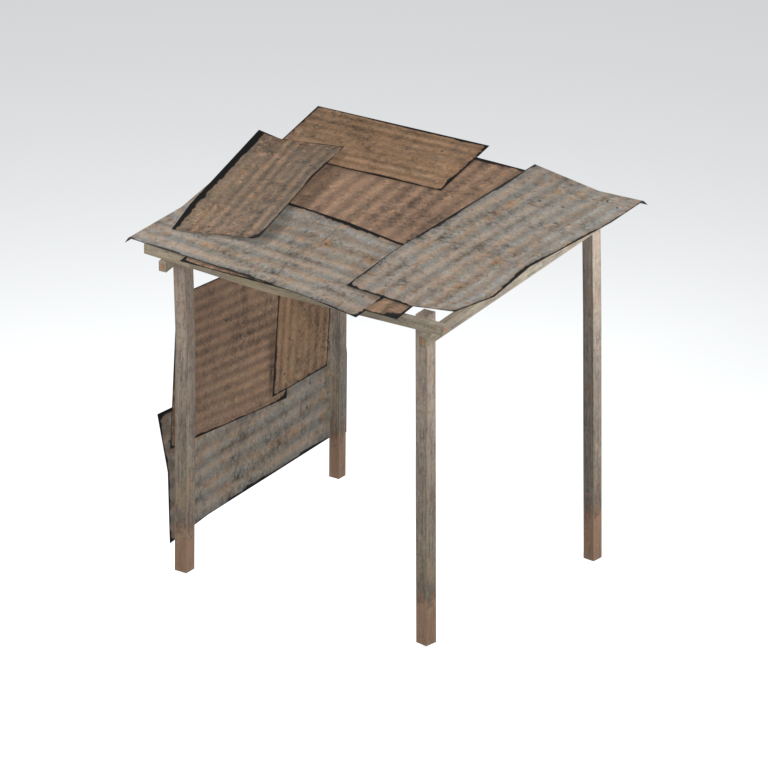

# Unidentified model (mgom_hutt003_vrtn001)

Native model reference; a readable object identification has not been reviewed.

[Library](../README.md) | [Category](../tables/unclassified-components-1.md) | [Source / advanced data](../catalogue.json) | [Credits](../sources-and-credits.md)

**Game filename:** mgom_hutt003_vrtn001.fmdl  
**Category:** Unclassified &gt; Unclassified components  
**Variant:** vrtn001; **LOD:** 0  
**Tags:** 

## Still reference



## 360-degree reference


The camera circles a static model. This is not a native animation. Source base textures and UVs use approximate studio shading; interaction, collision, complete assembly and FOX shader equivalence are not established.

## Identity and naming

| Field | Value |
|---|---|
| Library ID | mgsv-tpp-mgom_hutt003_vrtn001-2a1ffc6882b7ee80 |
| Naming status | unidentified |
| Naming confidence | unknown |
| Naming evidence | {} |
| Native model | /Assets/mgo/environ/object/mgo_mafr/hut/mgom_hutt003/scenes/mgom_hutt003_vrtn001.fmdl |
| Model SHA256 | c2ef7231155024f1901bf094c8210385314134d1d6db1899333f8b414225ca4e |
| Container | /Assets/mgo/pack/location/afc0/pack_common/afc0_common.fpk |
| Container SHA256 | 20a950cab0d6912ac3a270b90dc6dc673f2d13859eb636819bfa3955fca6e320 |
| Captured source / location scope | Selected native member/content and captured installed-source chain; full archive SHA/runtime priority unresolved |
| Raw record SHA256 | e083d9267ea0dfe6d11bb4c125b8a7a2b530f4fdf0a2633d099a437d7c959fa7 |

Naming review is descriptive metadata only. It does not change model completion or identify a working game interaction.

## Native LOD inventory

| Native LOD | Triangles | Preview status | Decoded indices SHA256 |
|---|---:|---|---|
| 0 | 194 | rendered | a017b3dcd82c4759a4940f88e3ab1946c056641b0b92a3fe385ab4eedba3e11f |
| 1 | 167 | not separately rendered | aea7d0416339f4a91cae3e3c4ff6fbaaa686420ad03e38d4d0466a52a8f46412 |
| 2 | 142 | not separately rendered | 3aacc942390ac40e3ac67cc5dbfd923751ab48bada09f2e155278c29d73e735e |
| 3 | 133 | not separately rendered | b680055f748db0b47bc24cf9427972ea0b9cf908001f6a464c108560267434e5 |

Mesh detail and texture pixels/mips are separate. Index hashes describe decoded triangle arrays, not packed index-buffer bytes. Only source-recorded native levels are listed.

<details>
<summary>Texture, source and naming technical metadata</summary>

```json
{
  "source": {
    "nativePath": "/Assets/mgo/environ/object/mgo_mafr/hut/mgom_hutt003/scenes/mgom_hutt003_vrtn001.fmdl",
    "nativeSha256": "c2ef7231155024f1901bf094c8210385314134d1d6db1899333f8b414225ca4e",
    "stableIdentity": "/assets/mgo/environ/object/mgo_mafr/hut/mgom_hutt003/scenes/mgom_hutt003_vrtn001.fmdl#c2ef7231155024f1901bf094c8210385314134d1d6db1899333f8b414225ca4e#ef177aecd1e22c0515389a5056c4c65f1f65d9d3b28ae81bb7254e1136e8a035",
    "container": {
      "nativePath": "/Assets/mgo/pack/location/afc0/pack_common/afc0_common.fpk",
      "sha256": "20a950cab0d6912ac3a270b90dc6dc673f2d13859eb636819bfa3955fca6e320",
      "status": "Selected installed-source container/member chain captured by community reader"
    },
    "historicalDatOrigin": null,
    "sourceArchiveAtCapture": "master/0/00.dat",
    "locationStatus": "Selected native member/content and captured installed-source chain; full archive SHA/runtime priority unresolved",
    "currentInstalledDatVerified": false,
    "selectedInstalledMemberVerified": true,
    "evidence": {
      "archive_helper_executable_sha256": "6f8e39a436af3b024bbd0504966ab3d5d9d0cb05d86689bf3e83d15e68df613f",
      "archive_helper_source_sha256": "f662d3b63e066a0afc77ffe22ea0e564222d14469648300dba2c4f8e9b43446b",
      "archive_index_recipe": "54acff767f08d76ad6056c5387328759bc883df507788f398de6c2c04fac12db",
      "archive_reader": "Atvaark GzsTool.Core 0.5.3",
      "archive_reader_core_sha256": "9da447ae3c375cce2e46744eeff6af50f1591062afdf479d1a0b49edb47daaa3",
      "archive_tool_and_dictionary_sha256": {
        "CityHash.dll": "def6c4506d461b65e4059b2936b2cbd5f852ba5d1d8a1a527f1c0e6dc7008c8f",
        "GzsTool.Core.dll": "9da447ae3c375cce2e46744eeff6af50f1591062afdf479d1a0b49edb47daaa3",
        "GzsTool.exe": "1a9c5b11e2355383ff485aee7e86abc026f5c1fad729daf8c0fd15ee0aae1c10",
        "Zlib.Portable.dll": "fe84781ba35ca9cc5ff5f73fd08d2a66c59e5257b4573f5fe59743f30bf78e42",
        "fpk_dictionary.txt": "b82f9a8d6c10a68ba9471eca9d815c21355a53b5e68753d8ad7db7fd01bf401d",
        "qar_dictionary.txt": "1558c248ed0a4bb827888261563fbb91a2df4f03999682f85d637ff70d9d5fb2"
      },
      "bytes": 13568,
      "container_chain": [
        {
          "content_sha256": null,
          "depth": 0,
          "id": "3f19555d27c2ebecdfbad26aadd88b9f62e9fb6092c04c712963ef73c67ccb42",
          "index_sha256": "9acd3675d6e1500e0e18430cba0fdc70a5718ad7d6b62f13905891a35d59f18a",
          "kind": "qar",
          "name": "master/0/00.dat",
          "parent_occurrence": null
        },
        {
          "content_sha256": "20a950cab0d6912ac3a270b90dc6dc673f2d13859eb636819bfa3955fca6e320",
          "depth": 1,
          "id": "f1334a28f5fb887d989a9c548d11dccada12186358e0a4b4e7fc9831f6f42881",
          "index_sha256": "e15578c97612208569f283c28408f389fb560576e3976adf9d7aa8ed9c9aaf87",
          "kind": "fpk",
          "name": "/Assets/mgo/pack/location/afc0/pack_common/afc0_common.fpk",
          "parent_occurrence": "348190d8da3d429c2cdae58af0494f023c46b80f66da14d484dc54a7e17a97df"
        }
      ],
      "contentSha256": "c2ef7231155024f1901bf094c8210385314134d1d6db1899333f8b414225ca4e",
      "member": {
        "actual_size": 13568,
        "compressed_size": null,
        "content_sha256": "c2ef7231155024f1901bf094c8210385314134d1d6db1899333f8b414225ca4e",
        "declared_size": 13568,
        "extension": "fmdl",
        "hash_hex": null,
        "name": "/Assets/mgo/environ/object/mgo_mafr/hut/mgom_hutt003/scenes/mgom_hutt003_vrtn001.fmdl",
        "name_origin": "embedded",
        "offset": 4876640,
        "ordinal": 134,
        "path_hash": null,
        "resolved": 1
      },
      "occurrenceId": "439c22407437f9748aba2c7995a8b1d523ec7a5beaae815262ee4dc066e3dcb4",
      "occurrence_id": "439c22407437f9748aba2c7995a8b1d523ec7a5beaae815262ee4dc066e3dcb4",
      "primary_source_revision": "fc4a8196555638c6cf8aa1b7c8dc34ccd5c69cb5",
      "source_adapter": "community_core_selective_export",
      "source_id": "7f6bb743fb4c487f0e9522f9c7fac280c46cf6b1051e0fc75a93602c8eb451f0",
      "source_path": "master/0/00.dat",
      "source_snapshot": "{\"bytes\":768788480,\"device\":621747392682911458,\"file_id\":844424931596481,\"header_sha256\":\"ead50f0a9a37e4285323b9c6fa0ec75fe75e518c63147e63158eeb2892c6589e\",\"mtime_ns\":1791852224238580700}",
      "virtualPath": "/Assets/mgo/environ/object/mgo_mafr/hut/mgom_hutt003/scenes/mgom_hutt003_vrtn001.fmdl"
    }
  },
  "materials": [
    {
      "sampler": "Base_Tex_SRGB",
      "materialIndex": 0,
      "nativePathHash": "1542557613862879233",
      "nativeVirtualPath": null,
      "nativeBinding": {
        "familyId": "37f6275e09d3bb3e9b6f4de0ba6bcb4feddeb9910b53e1a6c610a8bf8cb6f452",
        "height": 512,
        "materialIndex": 0,
        "mipCount": 8,
        "nativeMipCountVerified": true,
        "nativePath": null,
        "nativePathHash": "1542557613862879233",
        "nativeTexture": {
          "additionalFtexsFileCount": 2,
          "depth": 1,
          "ftexsFileCount": 3,
          "height": 512,
          "metadataBytes": 192,
          "mipCount": 8,
          "mips": [
            {
              "chunks": 4,
              "decodedBytes": 65536,
              "mip": 0,
              "offset": 0,
              "storedBytes": 51264,
              "streamNumber": 3
            },
            {
              "chunks": 1,
              "decodedBytes": 16384,
              "mip": 1,
              "offset": 0,
              "storedBytes": 13088,
              "streamNumber": 2
            },
            {
              "chunks": 1,
              "decodedBytes": 4096,
              "mip": 2,
              "offset": 1384,
              "storedBytes": 3360,
              "streamNumber": 1
            },
            {
              "chunks": 1,
              "decodedBytes": 1024,
              "mip": 3,
              "offset": 432,
              "storedBytes": 944,
              "streamNumber": 1
            },
            {
              "chunks": 1,
              "decodedBytes": 256,
              "mip": 4,
              "offset": 152,
              "storedBytes": 272,
              "streamNumber": 1
            },
            {
              "chunks": 1,
              "decodedBytes": 64,
              "mip": 5,
              "offset": 64,
              "storedBytes": 80,
              "streamNumber": 1
            },
            {
              "chunks": 1,
              "decodedBytes": 16,
              "mip": 6,
              "offset": 24,
              "storedBytes": 32,
              "streamNumber": 1
            },
            {
              "chunks": 1,
              "decodedBytes": 8,
              "mip": 7,
              "offset": 0,
              "storedBytes": 16,
              "streamNumber": 1
            }
          ],
          "nativeHeaderHash": "98f4e5ae5b2be5bee732a79883e25f1e",
          "nrtFlag": 2,
          "pixelFormat": 2,
          "requiredStreamNumbers": [
            1,
            2,
            3
          ],
          "textureType": 16777219,
          "unknownFlags": 273,
          "width": 256
        },
        "samplerName": "Base_Tex_SRGB",
        "samplerNameHash": "72475356961633",
        "sha256": "9dc12bcfbd6b5ee2c16f2c187e38748fa7c8cadbec781c56e4bb2a14566af11b",
        "sourceOccurrences": [
          {
            "archive_helper_executable_sha256": "6f8e39a436af3b024bbd0504966ab3d5d9d0cb05d86689bf3e83d15e68df613f",
            "archive_helper_source_sha256": "f662d3b63e066a0afc77ffe22ea0e564222d14469648300dba2c4f8e9b43446b",
            "archive_index_recipe": "54acff767f08d76ad6056c5387328759bc883df507788f398de6c2c04fac12db",
            "archive_reader": "Atvaark GzsTool.Core 0.5.3",
            "archive_reader_core_sha256": "9da447ae3c375cce2e46744eeff6af50f1591062afdf479d1a0b49edb47daaa3",
            "archive_tool_and_dictionary_sha256": {
              "CityHash.dll": "def6c4506d461b65e4059b2936b2cbd5f852ba5d1d8a1a527f1c0e6dc7008c8f",
              "GzsTool.Core.dll": "9da447ae3c375cce2e46744eeff6af50f1591062afdf479d1a0b49edb47daaa3",
              "GzsTool.exe": "1a9c5b11e2355383ff485aee7e86abc026f5c1fad729daf8c0fd15ee0aae1c10",
              "Zlib.Portable.dll": "fe84781ba35ca9cc5ff5f73fd08d2a66c59e5257b4573f5fe59743f30bf78e42",
              "fpk_dictionary.txt": "b82f9a8d6c10a68ba9471eca9d815c21355a53b5e68753d8ad7db7fd01bf401d",
              "qar_dictionary.txt": "1558c248ed0a4bb827888261563fbb91a2df4f03999682f85d637ff70d9d5fb2"
            },
            "bytes": 192,
            "container_chain": [
              {
                "content_sha256": null,
                "depth": 0,
                "id": "436c8cfb4f382de93365b167a61aa81383299b7bad18205d60f1d0beeb3919e3",
                "index_sha256": "2d7b45c6ca65418839618e978562cac336091c06eb56dfe99f762b07a4016960",
                "kind": "qar",
                "name": "master/texture4.dat",
                "parent_occurrence": null
              }
            ],
            "contentSha256": "cb10d3212c98a52f18e4c4e17b1bdccc145f8d95210de590a6a81d53a669fa16",
            "member": {
              "actual_size": 192,
              "compressed_size": 192,
              "content_sha256": "cb10d3212c98a52f18e4c4e17b1bdccc145f8d95210de590a6a81d53a669fa16",
              "declared_size": 192,
              "extension": "ftex",
              "hash_hex": "156843fa1bdf0001",
              "name": "/Assets/tpp/environ/object/middle_africa/hut/mafr_hutt005/sourceimages/mafr_hutt005_wd_bsm.ftex",
              "name_origin": "dictionary",
              "offset": 1380867104,
              "ordinal": 10437,
              "path_hash": "43fa1bdf0001",
              "resolved": 1
            },
            "occurrenceId": "23250c4c26f839596722cdcdc5a13308218ea1cdb9caaeddda5f6686b48f9d89",
            "occurrence_id": "23250c4c26f839596722cdcdc5a13308218ea1cdb9caaeddda5f6686b48f9d89",
            "primary_source_revision": "fc4a8196555638c6cf8aa1b7c8dc34ccd5c69cb5",
            "source_adapter": "community_core_selective_export",
            "source_id": "6c31b98b4db9b88eb76cfcb538f5f34b4729531266a9459584126720a4fc14aa",
            "source_path": "master/texture4.dat",
            "source_snapshot": "{\"bytes\":2031604736,\"device\":621747392682911458,\"file_id\":562949953639628,\"header_sha256\":\"40ee2c6917b338f7f68c49847c97fe92b978506a1ba847fcc94d28c931c8711a\",\"mtime_ns\":1791224675561235200}",
            "virtualPath": "/Assets/tpp/environ/object/middle_africa/hut/mafr_hutt005/sourceimages/mafr_hutt005_wd_bsm.ftex"
          },
          {
            "archive_helper_executable_sha256": "6f8e39a436af3b024bbd0504966ab3d5d9d0cb05d86689bf3e83d15e68df613f",
            "archive_helper_source_sha256": "f662d3b63e066a0afc77ffe22ea0e564222d14469648300dba2c4f8e9b43446b",
            "archive_index_recipe": "54acff767f08d76ad6056c5387328759bc883df507788f398de6c2c04fac12db",
            "archive_reader": "Atvaark GzsTool.Core 0.5.3",
            "archive_reader_core_sha256": "9da447ae3c375cce2e46744eeff6af50f1591062afdf479d1a0b49edb47daaa3",
            "archive_tool_and_dictionary_sha256": {
              "CityHash.dll": "def6c4506d461b65e4059b2936b2cbd5f852ba5d1d8a1a527f1c0e6dc7008c8f",
              "GzsTool.Core.dll": "9da447ae3c375cce2e46744eeff6af50f1591062afdf479d1a0b49edb47daaa3",
              "GzsTool.exe": "1a9c5b11e2355383ff485aee7e86abc026f5c1fad729daf8c0fd15ee0aae1c10",
              "Zlib.Portable.dll": "fe84781ba35ca9cc5ff5f73fd08d2a66c59e5257b4573f5fe59743f30bf78e42",
              "fpk_dictionary.txt": "b82f9a8d6c10a68ba9471eca9d815c21355a53b5e68753d8ad7db7fd01bf401d",
              "qar_dictionary.txt": "1558c248ed0a4bb827888261563fbb91a2df4f03999682f85d637ff70d9d5fb2"
            },
            "bytes": 4752,
            "container_chain": [
              {
                "content_sha256": null,
                "depth": 0,
                "id": "436c8cfb4f382de93365b167a61aa81383299b7bad18205d60f1d0beeb3919e3",
                "index_sha256": "2d7b45c6ca65418839618e978562cac336091c06eb56dfe99f762b07a4016960",
                "kind": "qar",
                "name": "master/texture4.dat",
                "parent_occurrence": null
              }
            ],
            "contentSha256": "e63d076bdeece31d7ad3fe616a05ff2cce7a9c9fe64e25d3209632463e2c6cce",
            "member": {
              "actual_size": 4752,
              "compressed_size": 4752,
              "content_sha256": "e63d076bdeece31d7ad3fe616a05ff2cce7a9c9fe64e25d3209632463e2c6cce",
              "declared_size": 4752,
              "extension": "1.ftexs",
              "hash_hex": "b2c043fa1bdf0001",
              "name": "/Assets/tpp/environ/object/middle_africa/hut/mafr_hutt005/sourceimages/mafr_hutt005_wd_bsm.1.ftexs",
              "name_origin": "dictionary",
              "offset": 1380796448,
              "ordinal": 10434,
              "path_hash": "43fa1bdf0001",
              "resolved": 1
            },
            "occurrenceId": "2c4e63e05117f343ec4cb46fc0b584cd9beb044b9176fd7b9be7ca1ee6487c31",
            "occurrence_id": "2c4e63e05117f343ec4cb46fc0b584cd9beb044b9176fd7b9be7ca1ee6487c31",
            "primary_source_revision": "fc4a8196555638c6cf8aa1b7c8dc34ccd5c69cb5",
            "source_adapter": "community_core_selective_export",
            "source_id": "6c31b98b4db9b88eb76cfcb538f5f34b4729531266a9459584126720a4fc14aa",
            "source_path": "master/texture4.dat",
            "source_snapshot": "{\"bytes\":2031604736,\"device\":621747392682911458,\"file_id\":562949953639628,\"header_sha256\":\"40ee2c6917b338f7f68c49847c97fe92b978506a1ba847fcc94d28c931c8711a\",\"mtime_ns\":1791224675561235200}",
            "virtualPath": "/Assets/tpp/environ/object/middle_africa/hut/mafr_hutt005/sourceimages/mafr_hutt005_wd_bsm.1.ftexs"
          },
          {
            "archive_helper_executable_sha256": "6f8e39a436af3b024bbd0504966ab3d5d9d0cb05d86689bf3e83d15e68df613f",
            "archive_helper_source_sha256": "f662d3b63e066a0afc77ffe22ea0e564222d14469648300dba2c4f8e9b43446b",
            "archive_index_recipe": "54acff767f08d76ad6056c5387328759bc883df507788f398de6c2c04fac12db",
            "archive_reader": "Atvaark GzsTool.Core 0.5.3",
            "archive_reader_core_sha256": "9da447ae3c375cce2e46744eeff6af50f1591062afdf479d1a0b49edb47daaa3",
            "archive_tool_and_dictionary_sha256": {
              "CityHash.dll": "def6c4506d461b65e4059b2936b2cbd5f852ba5d1d8a1a527f1c0e6dc7008c8f",
              "GzsTool.Core.dll": "9da447ae3c375cce2e46744eeff6af50f1591062afdf479d1a0b49edb47daaa3",
              "GzsTool.exe": "1a9c5b11e2355383ff485aee7e86abc026f5c1fad729daf8c0fd15ee0aae1c10",
              "Zlib.Portable.dll": "fe84781ba35ca9cc5ff5f73fd08d2a66c59e5257b4573f5fe59743f30bf78e42",
              "fpk_dictionary.txt": "b82f9a8d6c10a68ba9471eca9d815c21355a53b5e68753d8ad7db7fd01bf401d",
              "qar_dictionary.txt": "1558c248ed0a4bb827888261563fbb91a2df4f03999682f85d637ff70d9d5fb2"
            },
            "bytes": 13096,
            "container_chain": [
              {
                "content_sha256": null,
                "depth": 0,
                "id": "436c8cfb4f382de93365b167a61aa81383299b7bad18205d60f1d0beeb3919e3",
                "index_sha256": "2d7b45c6ca65418839618e978562cac336091c06eb56dfe99f762b07a4016960",
                "kind": "qar",
                "name": "master/texture4.dat",
                "parent_occurrence": null
              }
            ],
            "contentSha256": "99b1928b0d8bf7ca657b52e2394cf19a1f50444cff4d7f4fb79cfa05e3900730",
            "member": {
              "actual_size": 13096,
              "compressed_size": 13096,
              "content_sha256": "99b1928b0d8bf7ca657b52e2394cf19a1f50444cff4d7f4fb79cfa05e3900730",
              "declared_size": 13096,
              "extension": "2.ftexs",
              "hash_hex": "b57043fa1bdf0001",
              "name": "/Assets/tpp/environ/object/middle_africa/hut/mafr_hutt005/sourceimages/mafr_hutt005_wd_bsm.2.ftexs",
              "name_origin": "dictionary",
              "offset": 1380801568,
              "ordinal": 10435,
              "path_hash": "43fa1bdf0001",
              "resolved": 1
            },
            "occurrenceId": "7f9cc5a76cb3cff1cac939d26fd3f795bab80d2b38511e802b83571535b2d8cf",
            "occurrence_id": "7f9cc5a76cb3cff1cac939d26fd3f795bab80d2b38511e802b83571535b2d8cf",
            "primary_source_revision": "fc4a8196555638c6cf8aa1b7c8dc34ccd5c69cb5",
            "source_adapter": "community_core_selective_export",
            "source_id": "6c31b98b4db9b88eb76cfcb538f5f34b4729531266a9459584126720a4fc14aa",
            "source_path": "master/texture4.dat",
            "source_snapshot": "{\"bytes\":2031604736,\"device\":621747392682911458,\"file_id\":562949953639628,\"header_sha256\":\"40ee2c6917b338f7f68c49847c97fe92b978506a1ba847fcc94d28c931c8711a\",\"mtime_ns\":1791224675561235200}",
            "virtualPath": "/Assets/tpp/environ/object/middle_africa/hut/mafr_hutt005/sourceimages/mafr_hutt005_wd_bsm.2.ftexs"
          },
          {
            "archive_helper_executable_sha256": "6f8e39a436af3b024bbd0504966ab3d5d9d0cb05d86689bf3e83d15e68df613f",
            "archive_helper_source_sha256": "f662d3b63e066a0afc77ffe22ea0e564222d14469648300dba2c4f8e9b43446b",
            "archive_index_recipe": "54acff767f08d76ad6056c5387328759bc883df507788f398de6c2c04fac12db",
            "archive_reader": "Atvaark GzsTool.Core 0.5.3",
            "archive_reader_core_sha256": "9da447ae3c375cce2e46744eeff6af50f1591062afdf479d1a0b49edb47daaa3",
            "archive_tool_and_dictionary_sha256": {
              "CityHash.dll": "def6c4506d461b65e4059b2936b2cbd5f852ba5d1d8a1a527f1c0e6dc7008c8f",
              "GzsTool.Core.dll": "9da447ae3c375cce2e46744eeff6af50f1591062afdf479d1a0b49edb47daaa3",
              "GzsTool.exe": "1a9c5b11e2355383ff485aee7e86abc026f5c1fad729daf8c0fd15ee0aae1c10",
              "Zlib.Portable.dll": "fe84781ba35ca9cc5ff5f73fd08d2a66c59e5257b4573f5fe59743f30bf78e42",
              "fpk_dictionary.txt": "b82f9a8d6c10a68ba9471eca9d815c21355a53b5e68753d8ad7db7fd01bf401d",
              "qar_dictionary.txt": "1558c248ed0a4bb827888261563fbb91a2df4f03999682f85d637ff70d9d5fb2"
            },
            "bytes": 51296,
            "container_chain": [
              {
                "content_sha256": null,
                "depth": 0,
                "id": "1cc220d9409d7163b6aca295ed89fd8c7befca6a8f849a8d5d09a2499724c863",
                "index_sha256": "5a818609a652a10d90fb90015661d0cb80898096bbb3aac36382172988d8736d",
                "kind": "qar",
                "name": "master/texture5_mgo0.dat",
                "parent_occurrence": null
              }
            ],
            "contentSha256": "df35ca6caa6165517d974c5fa5b292411dfb1bac0547d7b8d9ba0c19349b45bf",
            "member": {
              "actual_size": 51296,
              "compressed_size": 51296,
              "content_sha256": "df35ca6caa6165517d974c5fa5b292411dfb1bac0547d7b8d9ba0c19349b45bf",
              "declared_size": 51296,
              "extension": "3.ftexs",
              "hash_hex": "571843fa1bdf0001",
              "name": "/Assets/tpp/environ/object/middle_africa/hut/mafr_hutt005/sourceimages/mafr_hutt005_wd_bsm.3.ftexs",
              "name_origin": "dictionary",
              "offset": 3900106784,
              "ordinal": 15961,
              "path_hash": "43fa1bdf0001",
              "resolved": 1
            },
            "occurrenceId": "baf23d47fd3cdca4060a9c89f71f266d74ac8754d7bc272fad8e65602c1b56c5",
            "occurrence_id": "baf23d47fd3cdca4060a9c89f71f266d74ac8754d7bc272fad8e65602c1b56c5",
            "primary_source_revision": "fc4a8196555638c6cf8aa1b7c8dc34ccd5c69cb5",
            "source_adapter": "community_core_selective_export",
            "source_id": "24f8989ccaae47940dc20e54ba67442ad562ac0032ab6e3d475e927c81444b56",
            "source_path": "master/texture5_mgo0.dat",
            "source_snapshot": "{\"bytes\":4492370944,\"device\":621747392682911458,\"file_id\":13510798883237422,\"header_sha256\":\"6108fbacb65c84d041742c39e5ca630745240453b336f1059a13b91943f0b011\",\"mtime_ns\":1791224675562234400}",
            "virtualPath": "/Assets/tpp/environ/object/middle_africa/hut/mafr_hutt005/sourceimages/mafr_hutt005_wd_bsm.3.ftexs"
          }
        ],
        "width": 256
      },
      "ddsSha256": "9dc12bcfbd6b5ee2c16f2c187e38748fa7c8cadbec781c56e4bb2a14566af11b",
      "dimensions": [
        256,
        512
      ],
      "mipCount": 8,
      "nativeMipCountVerified": true,
      "connectedInPreview": true
    },
    {
      "sampler": "Base_Tex_SRGB",
      "materialIndex": 1,
      "nativePathHash": "1543108164481422768",
      "nativeVirtualPath": null,
      "nativeBinding": {
        "familyId": "e810242aef1cb1b4af615d85d761fac605e82cb4b53a140f10f88983e48f030f",
        "height": 1024,
        "materialIndex": 1,
        "mipCount": 9,
        "nativeMipCountVerified": true,
        "nativePath": null,
        "nativePathHash": "1543108164481422768",
        "nativeTexture": {
          "additionalFtexsFileCount": 2,
          "depth": 1,
          "ftexsFileCount": 3,
          "height": 1024,
          "metadataBytes": 208,
          "mipCount": 9,
          "mips": [
            {
              "chunks": 64,
              "decodedBytes": 1048576,
              "mip": 0,
              "offset": 0,
              "storedBytes": 509728,
              "streamNumber": 3
            },
            {
              "chunks": 16,
              "decodedBytes": 262144,
              "mip": 1,
              "offset": 0,
              "storedBytes": 137664,
              "streamNumber": 2
            },
            {
              "chunks": 4,
              "decodedBytes": 65536,
              "mip": 2,
              "offset": 14640,
              "storedBytes": 37216,
              "streamNumber": 1
            },
            {
              "chunks": 1,
              "decodedBytes": 16384,
              "mip": 3,
              "offset": 4360,
              "storedBytes": 10272,
              "streamNumber": 1
            },
            {
              "chunks": 1,
              "decodedBytes": 4096,
              "mip": 4,
              "offset": 1328,
              "storedBytes": 3024,
              "streamNumber": 1
            },
            {
              "chunks": 1,
              "decodedBytes": 1024,
              "mip": 5,
              "offset": 408,
              "storedBytes": 912,
              "streamNumber": 1
            },
            {
              "chunks": 1,
              "decodedBytes": 256,
              "mip": 6,
              "offset": 128,
              "storedBytes": 272,
              "streamNumber": 1
            },
            {
              "chunks": 1,
              "decodedBytes": 64,
              "mip": 7,
              "offset": 40,
              "storedBytes": 80,
              "streamNumber": 1
            },
            {
              "chunks": 1,
              "decodedBytes": 16,
              "mip": 8,
              "offset": 0,
              "storedBytes": 32,
              "streamNumber": 1
            }
          ],
          "nativeHeaderHash": "eee44c2abf8d41e6883b45727ac583bb",
          "nrtFlag": 2,
          "pixelFormat": 4,
          "requiredStreamNumbers": [
            1,
            2,
            3
          ],
          "textureType": 16777219,
          "unknownFlags": 273,
          "width": 1024
        },
        "samplerName": "Base_Tex_SRGB",
        "samplerNameHash": "72475356961633",
        "sha256": "eebc3973d974d4935b375cc7153e350d187367d40bfc94381fb331fa260cb514",
        "sourceOccurrences": [
          {
            "archive_helper_executable_sha256": "6f8e39a436af3b024bbd0504966ab3d5d9d0cb05d86689bf3e83d15e68df613f",
            "archive_helper_source_sha256": "f662d3b63e066a0afc77ffe22ea0e564222d14469648300dba2c4f8e9b43446b",
            "archive_index_recipe": "54acff767f08d76ad6056c5387328759bc883df507788f398de6c2c04fac12db",
            "archive_reader": "Atvaark GzsTool.Core 0.5.3",
            "archive_reader_core_sha256": "9da447ae3c375cce2e46744eeff6af50f1591062afdf479d1a0b49edb47daaa3",
            "archive_tool_and_dictionary_sha256": {
              "CityHash.dll": "def6c4506d461b65e4059b2936b2cbd5f852ba5d1d8a1a527f1c0e6dc7008c8f",
              "GzsTool.Core.dll": "9da447ae3c375cce2e46744eeff6af50f1591062afdf479d1a0b49edb47daaa3",
              "GzsTool.exe": "1a9c5b11e2355383ff485aee7e86abc026f5c1fad729daf8c0fd15ee0aae1c10",
              "Zlib.Portable.dll": "fe84781ba35ca9cc5ff5f73fd08d2a66c59e5257b4573f5fe59743f30bf78e42",
              "fpk_dictionary.txt": "b82f9a8d6c10a68ba9471eca9d815c21355a53b5e68753d8ad7db7fd01bf401d",
              "qar_dictionary.txt": "1558c248ed0a4bb827888261563fbb91a2df4f03999682f85d637ff70d9d5fb2"
            },
            "bytes": 208,
            "container_chain": [
              {
                "content_sha256": null,
                "depth": 0,
                "id": "3f19555d27c2ebecdfbad26aadd88b9f62e9fb6092c04c712963ef73c67ccb42",
                "index_sha256": "9acd3675d6e1500e0e18430cba0fdc70a5718ad7d6b62f13905891a35d59f18a",
                "kind": "qar",
                "name": "master/0/00.dat",
                "parent_occurrence": null
              },
              {
                "content_sha256": "c371a18745c941878107bdaf7aef71c13b09b8b3a574360f6e38e0a7172b74e6",
                "depth": 1,
                "id": "13570131ff9ebc75c266205cbdf3461ff4dc51e8a0cb4f7407b0a08fe357052a",
                "index_sha256": "5b8e60a5e6b705cb87973f15c3215fb3733b7a49171030a4c7640da4622a5ca2",
                "kind": "pftxs",
                "name": "/Assets/mgo/pack/location/afc0/pack_common/afc0_common.pftxs",
                "parent_occurrence": "abc314b7f418d61ea6a3e5525bf8f85d22b454b81d3407e6645bfc43339658ac"
              }
            ],
            "contentSha256": "c46915c7a92f717dd3ed5b0a7667896efe22e2c825eb145a41c83cb10e894a60",
            "member": {
              "actual_size": 208,
              "compressed_size": null,
              "content_sha256": "c46915c7a92f717dd3ed5b0a7667896efe22e2c825eb145a41c83cb10e894a60",
              "declared_size": 208,
              "extension": "ftex",
              "hash_hex": "156a38b329eb95b0",
              "name": "156a38b329eb95b0.ftex",
              "name_origin": "hash_fallback",
              "offset": 7427184,
              "ordinal": 445,
              "path_hash": null,
              "resolved": 0
            },
            "occurrenceId": "1cd144c7b6eb1174a0b70c97a71bc63933c10e8b574c2d786173a52e1317205b",
            "occurrence_id": "1cd144c7b6eb1174a0b70c97a71bc63933c10e8b574c2d786173a52e1317205b",
            "primary_source_revision": "fc4a8196555638c6cf8aa1b7c8dc34ccd5c69cb5",
            "source_adapter": "community_core_selective_export",
            "source_id": "7f6bb743fb4c487f0e9522f9c7fac280c46cf6b1051e0fc75a93602c8eb451f0",
            "source_path": "master/0/00.dat",
            "source_snapshot": "{\"bytes\":768788480,\"device\":621747392682911458,\"file_id\":844424931596481,\"header_sha256\":\"ead50f0a9a37e4285323b9c6fa0ec75fe75e518c63147e63158eeb2892c6589e\",\"mtime_ns\":1791852224238580700}",
            "virtualPath": "156a38b329eb95b0.ftex"
          },
          {
            "archive_helper_executable_sha256": "6f8e39a436af3b024bbd0504966ab3d5d9d0cb05d86689bf3e83d15e68df613f",
            "archive_helper_source_sha256": "f662d3b63e066a0afc77ffe22ea0e564222d14469648300dba2c4f8e9b43446b",
            "archive_index_recipe": "54acff767f08d76ad6056c5387328759bc883df507788f398de6c2c04fac12db",
            "archive_reader": "Atvaark GzsTool.Core 0.5.3",
            "archive_reader_core_sha256": "9da447ae3c375cce2e46744eeff6af50f1591062afdf479d1a0b49edb47daaa3",
            "archive_tool_and_dictionary_sha256": {
              "CityHash.dll": "def6c4506d461b65e4059b2936b2cbd5f852ba5d1d8a1a527f1c0e6dc7008c8f",
              "GzsTool.Core.dll": "9da447ae3c375cce2e46744eeff6af50f1591062afdf479d1a0b49edb47daaa3",
              "GzsTool.exe": "1a9c5b11e2355383ff485aee7e86abc026f5c1fad729daf8c0fd15ee0aae1c10",
              "Zlib.Portable.dll": "fe84781ba35ca9cc5ff5f73fd08d2a66c59e5257b4573f5fe59743f30bf78e42",
              "fpk_dictionary.txt": "b82f9a8d6c10a68ba9471eca9d815c21355a53b5e68753d8ad7db7fd01bf401d",
              "qar_dictionary.txt": "1558c248ed0a4bb827888261563fbb91a2df4f03999682f85d637ff70d9d5fb2"
            },
            "bytes": 51888,
            "container_chain": [
              {
                "content_sha256": null,
                "depth": 0,
                "id": "436c8cfb4f382de93365b167a61aa81383299b7bad18205d60f1d0beeb3919e3",
                "index_sha256": "2d7b45c6ca65418839618e978562cac336091c06eb56dfe99f762b07a4016960",
                "kind": "qar",
                "name": "master/texture4.dat",
                "parent_occurrence": null
              }
            ],
            "contentSha256": "36585ac4437e4efa10b801fc116ff176e6f0613a39d059b0dc594ca585101b46",
            "member": {
              "actual_size": 51888,
              "compressed_size": 51888,
              "content_sha256": "36585ac4437e4efa10b801fc116ff176e6f0613a39d059b0dc594ca585101b46",
              "declared_size": 51888,
              "extension": "1.ftexs",
              "hash_hex": "b2c238b329eb95b0",
              "name": "238b329eb95b0.1.ftexs",
              "name_origin": "hash_fallback",
              "offset": 516791328,
              "ordinal": 3081,
              "path_hash": "238b329eb95b0",
              "resolved": 0
            },
            "occurrenceId": "3c4d15dad1efd5d72f86efb44061ad7cdc768da3d9ca25f45bc14ecc9a4fced5",
            "occurrence_id": "3c4d15dad1efd5d72f86efb44061ad7cdc768da3d9ca25f45bc14ecc9a4fced5",
            "primary_source_revision": "fc4a8196555638c6cf8aa1b7c8dc34ccd5c69cb5",
            "source_adapter": "community_core_selective_export",
            "source_id": "6c31b98b4db9b88eb76cfcb538f5f34b4729531266a9459584126720a4fc14aa",
            "source_path": "master/texture4.dat",
            "source_snapshot": "{\"bytes\":2031604736,\"device\":621747392682911458,\"file_id\":562949953639628,\"header_sha256\":\"40ee2c6917b338f7f68c49847c97fe92b978506a1ba847fcc94d28c931c8711a\",\"mtime_ns\":1791224675561235200}",
            "virtualPath": "238b329eb95b0.1.ftexs"
          },
          {
            "archive_helper_executable_sha256": "6f8e39a436af3b024bbd0504966ab3d5d9d0cb05d86689bf3e83d15e68df613f",
            "archive_helper_source_sha256": "f662d3b63e066a0afc77ffe22ea0e564222d14469648300dba2c4f8e9b43446b",
            "archive_index_recipe": "54acff767f08d76ad6056c5387328759bc883df507788f398de6c2c04fac12db",
            "archive_reader": "Atvaark GzsTool.Core 0.5.3",
            "archive_reader_core_sha256": "9da447ae3c375cce2e46744eeff6af50f1591062afdf479d1a0b49edb47daaa3",
            "archive_tool_and_dictionary_sha256": {
              "CityHash.dll": "def6c4506d461b65e4059b2936b2cbd5f852ba5d1d8a1a527f1c0e6dc7008c8f",
              "GzsTool.Core.dll": "9da447ae3c375cce2e46744eeff6af50f1591062afdf479d1a0b49edb47daaa3",
              "GzsTool.exe": "1a9c5b11e2355383ff485aee7e86abc026f5c1fad729daf8c0fd15ee0aae1c10",
              "Zlib.Portable.dll": "fe84781ba35ca9cc5ff5f73fd08d2a66c59e5257b4573f5fe59743f30bf78e42",
              "fpk_dictionary.txt": "b82f9a8d6c10a68ba9471eca9d815c21355a53b5e68753d8ad7db7fd01bf401d",
              "qar_dictionary.txt": "1558c248ed0a4bb827888261563fbb91a2df4f03999682f85d637ff70d9d5fb2"
            },
            "bytes": 137792,
            "container_chain": [
              {
                "content_sha256": null,
                "depth": 0,
                "id": "436c8cfb4f382de93365b167a61aa81383299b7bad18205d60f1d0beeb3919e3",
                "index_sha256": "2d7b45c6ca65418839618e978562cac336091c06eb56dfe99f762b07a4016960",
                "kind": "qar",
                "name": "master/texture4.dat",
                "parent_occurrence": null
              }
            ],
            "contentSha256": "a84ea73ef1e4084f0c902b057e51d65382bafd00c3df731fe98ce3bc36f280d1",
            "member": {
              "actual_size": 137792,
              "compressed_size": 137792,
              "content_sha256": "a84ea73ef1e4084f0c902b057e51d65382bafd00c3df731fe98ce3bc36f280d1",
              "declared_size": 137792,
              "extension": "2.ftexs",
              "hash_hex": "b57238b329eb95b0",
              "name": "238b329eb95b0.2.ftexs",
              "name_origin": "hash_fallback",
              "offset": 516843552,
              "ordinal": 3082,
              "path_hash": "238b329eb95b0",
              "resolved": 0
            },
            "occurrenceId": "d369ce3b0887d5b7800938e1b55637b0343d56489287de252b765c37784a7334",
            "occurrence_id": "d369ce3b0887d5b7800938e1b55637b0343d56489287de252b765c37784a7334",
            "primary_source_revision": "fc4a8196555638c6cf8aa1b7c8dc34ccd5c69cb5",
            "source_adapter": "community_core_selective_export",
            "source_id": "6c31b98b4db9b88eb76cfcb538f5f34b4729531266a9459584126720a4fc14aa",
            "source_path": "master/texture4.dat",
            "source_snapshot": "{\"bytes\":2031604736,\"device\":621747392682911458,\"file_id\":562949953639628,\"header_sha256\":\"40ee2c6917b338f7f68c49847c97fe92b978506a1ba847fcc94d28c931c8711a\",\"mtime_ns\":1791224675561235200}",
            "virtualPath": "238b329eb95b0.2.ftexs"
          },
          {
            "archive_helper_executable_sha256": "6f8e39a436af3b024bbd0504966ab3d5d9d0cb05d86689bf3e83d15e68df613f",
            "archive_helper_source_sha256": "f662d3b63e066a0afc77ffe22ea0e564222d14469648300dba2c4f8e9b43446b",
            "archive_index_recipe": "54acff767f08d76ad6056c5387328759bc883df507788f398de6c2c04fac12db",
            "archive_reader": "Atvaark GzsTool.Core 0.5.3",
            "archive_reader_core_sha256": "9da447ae3c375cce2e46744eeff6af50f1591062afdf479d1a0b49edb47daaa3",
            "archive_tool_and_dictionary_sha256": {
              "CityHash.dll": "def6c4506d461b65e4059b2936b2cbd5f852ba5d1d8a1a527f1c0e6dc7008c8f",
              "GzsTool.Core.dll": "9da447ae3c375cce2e46744eeff6af50f1591062afdf479d1a0b49edb47daaa3",
              "GzsTool.exe": "1a9c5b11e2355383ff485aee7e86abc026f5c1fad729daf8c0fd15ee0aae1c10",
              "Zlib.Portable.dll": "fe84781ba35ca9cc5ff5f73fd08d2a66c59e5257b4573f5fe59743f30bf78e42",
              "fpk_dictionary.txt": "b82f9a8d6c10a68ba9471eca9d815c21355a53b5e68753d8ad7db7fd01bf401d",
              "qar_dictionary.txt": "1558c248ed0a4bb827888261563fbb91a2df4f03999682f85d637ff70d9d5fb2"
            },
            "bytes": 510240,
            "container_chain": [
              {
                "content_sha256": null,
                "depth": 0,
                "id": "436c8cfb4f382de93365b167a61aa81383299b7bad18205d60f1d0beeb3919e3",
                "index_sha256": "2d7b45c6ca65418839618e978562cac336091c06eb56dfe99f762b07a4016960",
                "kind": "qar",
                "name": "master/texture4.dat",
                "parent_occurrence": null
              }
            ],
            "contentSha256": "a31a5ee55f9d35de3a60395af284b5b490985b47eeda865264953536859044d2",
            "member": {
              "actual_size": 510240,
              "compressed_size": 510240,
              "content_sha256": "a31a5ee55f9d35de3a60395af284b5b490985b47eeda865264953536859044d2",
              "declared_size": 510240,
              "extension": "3.ftexs",
              "hash_hex": "571a38b329eb95b0",
              "name": "238b329eb95b0.3.ftexs",
              "name_origin": "hash_fallback",
              "offset": 516981792,
              "ordinal": 3083,
              "path_hash": "238b329eb95b0",
              "resolved": 0
            },
            "occurrenceId": "4522e893247ba2448ee4c81b75a03fc8596b32abdec246eeb876fbaba15626d4",
            "occurrence_id": "4522e893247ba2448ee4c81b75a03fc8596b32abdec246eeb876fbaba15626d4",
            "primary_source_revision": "fc4a8196555638c6cf8aa1b7c8dc34ccd5c69cb5",
            "source_adapter": "community_core_selective_export",
            "source_id": "6c31b98b4db9b88eb76cfcb538f5f34b4729531266a9459584126720a4fc14aa",
            "source_path": "master/texture4.dat",
            "source_snapshot": "{\"bytes\":2031604736,\"device\":621747392682911458,\"file_id\":562949953639628,\"header_sha256\":\"40ee2c6917b338f7f68c49847c97fe92b978506a1ba847fcc94d28c931c8711a\",\"mtime_ns\":1791224675561235200}",
            "virtualPath": "238b329eb95b0.3.ftexs"
          }
        ],
        "width": 1024
      },
      "ddsSha256": "eebc3973d974d4935b375cc7153e350d187367d40bfc94381fb331fa260cb514",
      "dimensions": [
        1024,
        1024
      ],
      "mipCount": 9,
      "nativeMipCountVerified": true,
      "connectedInPreview": true
    }
  ],
  "quality": {
    "decodedIndicesHashDerivation": "SHA256 of canonical UTF-8 JSON decoded triangle indices grouped by mesh; not packed buffer bytes",
    "highestRetainedGeometricLod": 0,
    "distinctNativeLods": 4,
    "baseTextureDimensions": [
      256,
      512
    ],
    "baseTextureNativeMipCount": 8,
    "largerRetainedBaseTextureFound": null,
    "nativeLods": [
      {
        "indicesSha256": "a017b3dcd82c4759a4940f88e3ab1946c056641b0b92a3fe385ab4eedba3e11f",
        "nativeLod": 0,
        "triangles": 194
      },
      {
        "indicesSha256": "aea7d0416339f4a91cae3e3c4ff6fbaaa686420ad03e38d4d0466a52a8f46412",
        "nativeLod": 1,
        "triangles": 167
      },
      {
        "indicesSha256": "3aacc942390ac40e3ac67cc5dbfd923751ab48bada09f2e155278c29d73e735e",
        "nativeLod": 2,
        "triangles": 142
      },
      {
        "indicesSha256": "b680055f748db0b47bc24cf9427972ea0b9cf908001f6a464c108560267434e5",
        "nativeLod": 3,
        "triangles": 133
      }
    ],
    "renderedNativeLods": [
      0
    ],
    "baseTextureSummary": "256 x 512; 8 native/DDS mips; 1024 x 1024; 9 native/DDS mips",
    "highestDetailScope": "Triangle-count comparison within captured FMDL only"
  }
}
```

</details>

[Original source / advanced record](../catalogue.json)
