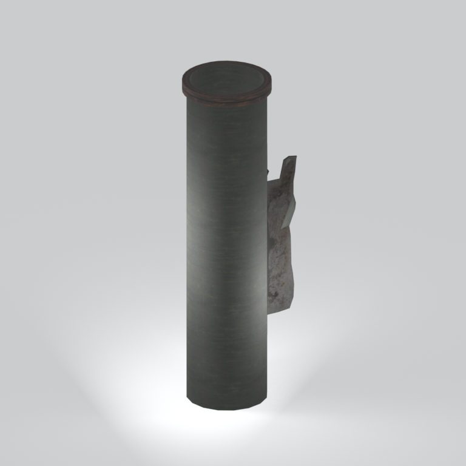
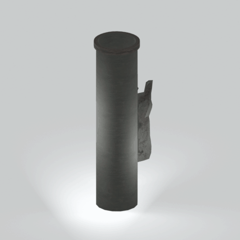

# Unidentified model (mgom_pipe001_vrtn002)

Native model reference; a readable object identification has not been reviewed.

[Library](../README.md) | [Category](../tables/unclassified-components-1.md) | [Source / advanced data](../catalogue.json) | [Credits](../sources-and-credits.md)

**Game filename:** mgom_pipe001_vrtn002.fmdl  
**Category:** Unclassified &gt; Unclassified components  
**Variant:** vrtn002; **LOD:** 0  
**Tags:** 

## Still reference



## 360-degree reference



The camera circles a static model. This is not a native animation. Source base textures and UVs use approximate studio shading; interaction, collision, complete assembly and FOX shader equivalence are not established.

## Identity and naming

| Field | Value |
|---|---|
| Library ID | mgsv-tpp-mgom_pipe001_vrtn002-0f668f09df37c592 |
| Naming status | unidentified |
| Naming confidence | unknown |
| Naming evidence | {} |
| Native model | /Assets/mgo/environ/object/mgo_mafr/pipe/mgom_pipe001/scenes/mgom_pipe001_vrtn002.fmdl |
| Model SHA256 | a136a1b68929e7de54de43bf3f8bf931a774b17581307c5a437f3d13ef3d8ff5 |
| Container | /Assets/mgo/pack/location/afc1/pack_common/afc1_common.fpk |
| Container SHA256 | cf9aff37b860d362b6723fe700775983cc61ae7d7f23b6de70df9ba489a966da |
| Captured source / location scope | Selected native member/content and captured installed-source chain; full archive SHA/runtime priority unresolved |
| Raw record SHA256 | c78b980c07533ba516d2eb151ee841200783959d3a13f0bdeaadb2210d691413 |

Naming review is descriptive metadata only. It does not change model completion or identify a working game interaction.

## Native LOD inventory

| Native LOD | Triangles | Preview status | Decoded indices SHA256 |
|---|---:|---|---|
| 0 | 940 | rendered | d761699cf8a065aac402c0c3c6e17f99af0525031aca6d5cd91ce610caad1b63 |
| 1 | 815 | not separately rendered | 5e8263f766c67e6a8eed240ed9d875e23b24e349c10fa2080f308de96ed58f8b |
| 2 | 747 | not separately rendered | f0678cde59bb257cc085d786b3d64ee1872bc2ba3eaf1f0d43eab457d728fada |
| 3 | 704 | not separately rendered | a8089e1bedaeebdac8d01fea6b219864759eb63bdb1d7399237efc1747c7516e |

Mesh detail and texture pixels/mips are separate. Index hashes describe decoded triangle arrays, not packed index-buffer bytes. Only source-recorded native levels are listed.

<details>
<summary>Texture, source and naming technical metadata</summary>

```json
{
  "source": {
    "nativePath": "/Assets/mgo/environ/object/mgo_mafr/pipe/mgom_pipe001/scenes/mgom_pipe001_vrtn002.fmdl",
    "nativeSha256": "a136a1b68929e7de54de43bf3f8bf931a774b17581307c5a437f3d13ef3d8ff5",
    "stableIdentity": "/assets/mgo/environ/object/mgo_mafr/pipe/mgom_pipe001/scenes/mgom_pipe001_vrtn002.fmdl#a136a1b68929e7de54de43bf3f8bf931a774b17581307c5a437f3d13ef3d8ff5#22235c92981c3d770fbdaaf10624487aa28d86777653b23e245ed9ea4ad6c812",
    "container": {
      "nativePath": "/Assets/mgo/pack/location/afc1/pack_common/afc1_common.fpk",
      "sha256": "cf9aff37b860d362b6723fe700775983cc61ae7d7f23b6de70df9ba489a966da",
      "status": "Selected installed-source container/member chain captured by community reader"
    },
    "historicalDatOrigin": null,
    "sourceArchiveAtCapture": "master/0/00.dat",
    "locationStatus": "Selected native member/content and captured installed-source chain; full archive SHA/runtime priority unresolved",
    "currentInstalledDatVerified": false,
    "selectedInstalledMemberVerified": true,
    "evidence": {
      "archive_helper_executable_sha256": "6f8e39a436af3b024bbd0504966ab3d5d9d0cb05d86689bf3e83d15e68df613f",
      "archive_helper_source_sha256": "f662d3b63e066a0afc77ffe22ea0e564222d14469648300dba2c4f8e9b43446b",
      "archive_index_recipe": "54acff767f08d76ad6056c5387328759bc883df507788f398de6c2c04fac12db",
      "archive_reader": "Atvaark GzsTool.Core 0.5.3",
      "archive_reader_core_sha256": "9da447ae3c375cce2e46744eeff6af50f1591062afdf479d1a0b49edb47daaa3",
      "archive_tool_and_dictionary_sha256": {
        "CityHash.dll": "def6c4506d461b65e4059b2936b2cbd5f852ba5d1d8a1a527f1c0e6dc7008c8f",
        "GzsTool.Core.dll": "9da447ae3c375cce2e46744eeff6af50f1591062afdf479d1a0b49edb47daaa3",
        "GzsTool.exe": "1a9c5b11e2355383ff485aee7e86abc026f5c1fad729daf8c0fd15ee0aae1c10",
        "Zlib.Portable.dll": "fe84781ba35ca9cc5ff5f73fd08d2a66c59e5257b4573f5fe59743f30bf78e42",
        "fpk_dictionary.txt": "b82f9a8d6c10a68ba9471eca9d815c21355a53b5e68753d8ad7db7fd01bf401d",
        "qar_dictionary.txt": "1558c248ed0a4bb827888261563fbb91a2df4f03999682f85d637ff70d9d5fb2"
      },
      "bytes": 50448,
      "container_chain": [
        {
          "content_sha256": null,
          "depth": 0,
          "id": "3f19555d27c2ebecdfbad26aadd88b9f62e9fb6092c04c712963ef73c67ccb42",
          "index_sha256": "9acd3675d6e1500e0e18430cba0fdc70a5718ad7d6b62f13905891a35d59f18a",
          "kind": "qar",
          "name": "master/0/00.dat",
          "parent_occurrence": null
        },
        {
          "content_sha256": "cf9aff37b860d362b6723fe700775983cc61ae7d7f23b6de70df9ba489a966da",
          "depth": 1,
          "id": "6f51e2cefeb81d4be84fd97795833addfdc97724952faa48b68b04b91276c2d6",
          "index_sha256": "093dbba03abdf3c5222bb14076d11b2f349a959ae6521fed333d73e2731c6090",
          "kind": "fpk",
          "name": "/Assets/mgo/pack/location/afc1/pack_common/afc1_common.fpk",
          "parent_occurrence": "dc78337c139fb86a3d388f65ba968ecf0c752819c6074e53d3482c1ed223b489"
        }
      ],
      "contentSha256": "a136a1b68929e7de54de43bf3f8bf931a774b17581307c5a437f3d13ef3d8ff5",
      "member": {
        "actual_size": 50448,
        "compressed_size": null,
        "content_sha256": "a136a1b68929e7de54de43bf3f8bf931a774b17581307c5a437f3d13ef3d8ff5",
        "declared_size": 50448,
        "extension": "fmdl",
        "hash_hex": null,
        "name": "/Assets/mgo/environ/object/mgo_mafr/pipe/mgom_pipe001/scenes/mgom_pipe001_vrtn002.fmdl",
        "name_origin": "embedded",
        "offset": 5164112,
        "ordinal": 141,
        "path_hash": null,
        "resolved": 1
      },
      "occurrenceId": "393f7151d5a7244acd52dfce04876e502b56a5299d6edbccd221a08277dd4bb4",
      "occurrence_id": "393f7151d5a7244acd52dfce04876e502b56a5299d6edbccd221a08277dd4bb4",
      "primary_source_revision": "fc4a8196555638c6cf8aa1b7c8dc34ccd5c69cb5",
      "source_adapter": "community_core_selective_export",
      "source_id": "7f6bb743fb4c487f0e9522f9c7fac280c46cf6b1051e0fc75a93602c8eb451f0",
      "source_path": "master/0/00.dat",
      "source_snapshot": "{\"bytes\":768788480,\"device\":621747392682911458,\"file_id\":844424931596481,\"header_sha256\":\"ead50f0a9a37e4285323b9c6fa0ec75fe75e518c63147e63158eeb2892c6589e\",\"mtime_ns\":1791852224238580700}",
      "virtualPath": "/Assets/mgo/environ/object/mgo_mafr/pipe/mgom_pipe001/scenes/mgom_pipe001_vrtn002.fmdl"
    }
  },
  "materials": [
    {
      "sampler": "Base_Tex_SRGB",
      "materialIndex": 0,
      "nativePathHash": "1543163275823915715",
      "nativeVirtualPath": null,
      "nativeBinding": {
        "familyId": "3d2b37221d9ff69080cfb1b9751c7c74f1965e1a2bdad96a826a47e104c74a71",
        "height": 1024,
        "materialIndex": 0,
        "mipCount": 9,
        "nativeMipCountVerified": true,
        "nativePath": null,
        "nativePathHash": "1543163275823915715",
        "nativeTexture": {
          "additionalFtexsFileCount": 2,
          "depth": 1,
          "ftexsFileCount": 3,
          "height": 1024,
          "metadataBytes": 208,
          "mipCount": 9,
          "mips": [
            {
              "chunks": 64,
              "decodedBytes": 1048576,
              "mip": 0,
              "offset": 0,
              "storedBytes": 768432,
              "streamNumber": 3
            },
            {
              "chunks": 16,
              "decodedBytes": 262144,
              "mip": 1,
              "offset": 0,
              "storedBytes": 201728,
              "streamNumber": 2
            },
            {
              "chunks": 4,
              "decodedBytes": 65536,
              "mip": 2,
              "offset": 18352,
              "storedBytes": 52352,
              "streamNumber": 1
            },
            {
              "chunks": 1,
              "decodedBytes": 16384,
              "mip": 3,
              "offset": 4952,
              "storedBytes": 13392,
              "streamNumber": 1
            },
            {
              "chunks": 1,
              "decodedBytes": 4096,
              "mip": 4,
              "offset": 1408,
              "storedBytes": 3536,
              "streamNumber": 1
            },
            {
              "chunks": 1,
              "decodedBytes": 1024,
              "mip": 5,
              "offset": 408,
              "storedBytes": 992,
              "streamNumber": 1
            },
            {
              "chunks": 1,
              "decodedBytes": 256,
              "mip": 6,
              "offset": 128,
              "storedBytes": 272,
              "streamNumber": 1
            },
            {
              "chunks": 1,
              "decodedBytes": 64,
              "mip": 7,
              "offset": 40,
              "storedBytes": 80,
              "streamNumber": 1
            },
            {
              "chunks": 1,
              "decodedBytes": 16,
              "mip": 8,
              "offset": 0,
              "storedBytes": 32,
              "streamNumber": 1
            }
          ],
          "nativeHeaderHash": "81f16a76caef9af5747fdc436a5338e9",
          "nrtFlag": 2,
          "pixelFormat": 4,
          "requiredStreamNumbers": [
            1,
            2,
            3
          ],
          "textureType": 16777219,
          "unknownFlags": 273,
          "width": 1024
        },
        "samplerName": "Base_Tex_SRGB",
        "samplerNameHash": "72475356961633",
        "sha256": "faed3686a36ac096f420633ea87aacecf6d1914c5ef18956726585a581749784",
        "sourceOccurrences": [
          {
            "archive_helper_executable_sha256": "6f8e39a436af3b024bbd0504966ab3d5d9d0cb05d86689bf3e83d15e68df613f",
            "archive_helper_source_sha256": "f662d3b63e066a0afc77ffe22ea0e564222d14469648300dba2c4f8e9b43446b",
            "archive_index_recipe": "54acff767f08d76ad6056c5387328759bc883df507788f398de6c2c04fac12db",
            "archive_reader": "Atvaark GzsTool.Core 0.5.3",
            "archive_reader_core_sha256": "9da447ae3c375cce2e46744eeff6af50f1591062afdf479d1a0b49edb47daaa3",
            "archive_tool_and_dictionary_sha256": {
              "CityHash.dll": "def6c4506d461b65e4059b2936b2cbd5f852ba5d1d8a1a527f1c0e6dc7008c8f",
              "GzsTool.Core.dll": "9da447ae3c375cce2e46744eeff6af50f1591062afdf479d1a0b49edb47daaa3",
              "GzsTool.exe": "1a9c5b11e2355383ff485aee7e86abc026f5c1fad729daf8c0fd15ee0aae1c10",
              "Zlib.Portable.dll": "fe84781ba35ca9cc5ff5f73fd08d2a66c59e5257b4573f5fe59743f30bf78e42",
              "fpk_dictionary.txt": "b82f9a8d6c10a68ba9471eca9d815c21355a53b5e68753d8ad7db7fd01bf401d",
              "qar_dictionary.txt": "1558c248ed0a4bb827888261563fbb91a2df4f03999682f85d637ff70d9d5fb2"
            },
            "bytes": 208,
            "container_chain": [
              {
                "content_sha256": null,
                "depth": 0,
                "id": "3f19555d27c2ebecdfbad26aadd88b9f62e9fb6092c04c712963ef73c67ccb42",
                "index_sha256": "9acd3675d6e1500e0e18430cba0fdc70a5718ad7d6b62f13905891a35d59f18a",
                "kind": "qar",
                "name": "master/0/00.dat",
                "parent_occurrence": null
              },
              {
                "content_sha256": "fd97657e1effdfa66faedfaa8aceab8699d5928812f2b7a948d492958f56217f",
                "depth": 1,
                "id": "041de25569b3afa35eafa037a79dbb221550af7c25638c26c5f796237b698a20",
                "index_sha256": "f3d8d59afb06b4309a625ba0dd5dc2f42dabc3d59150229746a05c61ee570d06",
                "kind": "pftxs",
                "name": "/Assets/mgo/pack/location/afc1/pack_common/afc1_common.pftxs",
                "parent_occurrence": "9bb9ddd185492a361b81e97ef73bd7f96ca26f3e99f82de31fecc98df2c24293"
              }
            ],
            "contentSha256": "d97f661f285be3288088b952df503adbed7eb87a4f94bcaab67eecc70f43d61f",
            "member": {
              "actual_size": 208,
              "compressed_size": null,
              "content_sha256": "d97f661f285be3288088b952df503adbed7eb87a4f94bcaab67eecc70f43d61f",
              "declared_size": 208,
              "extension": "ftex",
              "hash_hex": "156a6ad2c5e9a2c3",
              "name": "156a6ad2c5e9a2c3.ftex",
              "name_origin": "hash_fallback",
              "offset": 8722400,
              "ordinal": 804,
              "path_hash": null,
              "resolved": 0
            },
            "occurrenceId": "f2c276a17f91e5d19e5b3e01af00c73bd55b5b0f145f3cfbee0ac450661981b8",
            "occurrence_id": "f2c276a17f91e5d19e5b3e01af00c73bd55b5b0f145f3cfbee0ac450661981b8",
            "primary_source_revision": "fc4a8196555638c6cf8aa1b7c8dc34ccd5c69cb5",
            "source_adapter": "community_core_selective_export",
            "source_id": "7f6bb743fb4c487f0e9522f9c7fac280c46cf6b1051e0fc75a93602c8eb451f0",
            "source_path": "master/0/00.dat",
            "source_snapshot": "{\"bytes\":768788480,\"device\":621747392682911458,\"file_id\":844424931596481,\"header_sha256\":\"ead50f0a9a37e4285323b9c6fa0ec75fe75e518c63147e63158eeb2892c6589e\",\"mtime_ns\":1791852224238580700}",
            "virtualPath": "156a6ad2c5e9a2c3.ftex"
          },
          {
            "archive_helper_executable_sha256": "6f8e39a436af3b024bbd0504966ab3d5d9d0cb05d86689bf3e83d15e68df613f",
            "archive_helper_source_sha256": "f662d3b63e066a0afc77ffe22ea0e564222d14469648300dba2c4f8e9b43446b",
            "archive_index_recipe": "54acff767f08d76ad6056c5387328759bc883df507788f398de6c2c04fac12db",
            "archive_reader": "Atvaark GzsTool.Core 0.5.3",
            "archive_reader_core_sha256": "9da447ae3c375cce2e46744eeff6af50f1591062afdf479d1a0b49edb47daaa3",
            "archive_tool_and_dictionary_sha256": {
              "CityHash.dll": "def6c4506d461b65e4059b2936b2cbd5f852ba5d1d8a1a527f1c0e6dc7008c8f",
              "GzsTool.Core.dll": "9da447ae3c375cce2e46744eeff6af50f1591062afdf479d1a0b49edb47daaa3",
              "GzsTool.exe": "1a9c5b11e2355383ff485aee7e86abc026f5c1fad729daf8c0fd15ee0aae1c10",
              "Zlib.Portable.dll": "fe84781ba35ca9cc5ff5f73fd08d2a66c59e5257b4573f5fe59743f30bf78e42",
              "fpk_dictionary.txt": "b82f9a8d6c10a68ba9471eca9d815c21355a53b5e68753d8ad7db7fd01bf401d",
              "qar_dictionary.txt": "1558c248ed0a4bb827888261563fbb91a2df4f03999682f85d637ff70d9d5fb2"
            },
            "bytes": 70736,
            "container_chain": [
              {
                "content_sha256": null,
                "depth": 0,
                "id": "3f19555d27c2ebecdfbad26aadd88b9f62e9fb6092c04c712963ef73c67ccb42",
                "index_sha256": "9acd3675d6e1500e0e18430cba0fdc70a5718ad7d6b62f13905891a35d59f18a",
                "kind": "qar",
                "name": "master/0/00.dat",
                "parent_occurrence": null
              },
              {
                "content_sha256": "fd97657e1effdfa66faedfaa8aceab8699d5928812f2b7a948d492958f56217f",
                "depth": 1,
                "id": "041de25569b3afa35eafa037a79dbb221550af7c25638c26c5f796237b698a20",
                "index_sha256": "f3d8d59afb06b4309a625ba0dd5dc2f42dabc3d59150229746a05c61ee570d06",
                "kind": "pftxs",
                "name": "/Assets/mgo/pack/location/afc1/pack_common/afc1_common.pftxs",
                "parent_occurrence": "9bb9ddd185492a361b81e97ef73bd7f96ca26f3e99f82de31fecc98df2c24293"
              }
            ],
            "contentSha256": "40c8374942476381edc1dd8230a55264730d0847b7d18b8e5ebc1831afe620fe",
            "member": {
              "actual_size": 70736,
              "compressed_size": null,
              "content_sha256": "40c8374942476381edc1dd8230a55264730d0847b7d18b8e5ebc1831afe620fe",
              "declared_size": 70736,
              "extension": "1.ftexs",
              "hash_hex": "b2c26ad2c5e9a2c3",
              "name": "b2c26ad2c5e9a2c3.1.ftexs",
              "name_origin": "hash_fallback",
              "offset": 8722608,
              "ordinal": 805,
              "path_hash": null,
              "resolved": 0
            },
            "occurrenceId": "c27271a32b5575156d7a6b1c3e793a8b676420218cda7f691b4378da956f73a9",
            "occurrence_id": "c27271a32b5575156d7a6b1c3e793a8b676420218cda7f691b4378da956f73a9",
            "primary_source_revision": "fc4a8196555638c6cf8aa1b7c8dc34ccd5c69cb5",
            "source_adapter": "community_core_selective_export",
            "source_id": "7f6bb743fb4c487f0e9522f9c7fac280c46cf6b1051e0fc75a93602c8eb451f0",
            "source_path": "master/0/00.dat",
            "source_snapshot": "{\"bytes\":768788480,\"device\":621747392682911458,\"file_id\":844424931596481,\"header_sha256\":\"ead50f0a9a37e4285323b9c6fa0ec75fe75e518c63147e63158eeb2892c6589e\",\"mtime_ns\":1791852224238580700}",
            "virtualPath": "b2c26ad2c5e9a2c3.1.ftexs"
          },
          {
            "archive_helper_executable_sha256": "6f8e39a436af3b024bbd0504966ab3d5d9d0cb05d86689bf3e83d15e68df613f",
            "archive_helper_source_sha256": "f662d3b63e066a0afc77ffe22ea0e564222d14469648300dba2c4f8e9b43446b",
            "archive_index_recipe": "54acff767f08d76ad6056c5387328759bc883df507788f398de6c2c04fac12db",
            "archive_reader": "Atvaark GzsTool.Core 0.5.3",
            "archive_reader_core_sha256": "9da447ae3c375cce2e46744eeff6af50f1591062afdf479d1a0b49edb47daaa3",
            "archive_tool_and_dictionary_sha256": {
              "CityHash.dll": "def6c4506d461b65e4059b2936b2cbd5f852ba5d1d8a1a527f1c0e6dc7008c8f",
              "GzsTool.Core.dll": "9da447ae3c375cce2e46744eeff6af50f1591062afdf479d1a0b49edb47daaa3",
              "GzsTool.exe": "1a9c5b11e2355383ff485aee7e86abc026f5c1fad729daf8c0fd15ee0aae1c10",
              "Zlib.Portable.dll": "fe84781ba35ca9cc5ff5f73fd08d2a66c59e5257b4573f5fe59743f30bf78e42",
              "fpk_dictionary.txt": "b82f9a8d6c10a68ba9471eca9d815c21355a53b5e68753d8ad7db7fd01bf401d",
              "qar_dictionary.txt": "1558c248ed0a4bb827888261563fbb91a2df4f03999682f85d637ff70d9d5fb2"
            },
            "bytes": 201856,
            "container_chain": [
              {
                "content_sha256": null,
                "depth": 0,
                "id": "e73d96973ade76f7a00afdbea486dd110896ace97da0791f56899647de46f210",
                "index_sha256": "5a818609a652a10d90fb90015661d0cb80898096bbb3aac36382172988d8736d",
                "kind": "qar",
                "name": "mgo/texture0.dat",
                "parent_occurrence": null
              }
            ],
            "contentSha256": "412834a03a2decc5bfcc0c609dd30f40c0393a7afb9427de842551421a589974",
            "member": {
              "actual_size": 201856,
              "compressed_size": 201856,
              "content_sha256": "412834a03a2decc5bfcc0c609dd30f40c0393a7afb9427de842551421a589974",
              "declared_size": 201856,
              "extension": "2.ftexs",
              "hash_hex": "b5726ad2c5e9a2c3",
              "name": "26ad2c5e9a2c3.2.ftexs",
              "name_origin": "hash_fallback",
              "offset": 3944554528,
              "ordinal": 16117,
              "path_hash": "26ad2c5e9a2c3",
              "resolved": 0
            },
            "occurrenceId": "af9c4ecf57606f07553de4681ad87adfeb8fe51179880a26dd21eb06d631e6c2",
            "occurrence_id": "af9c4ecf57606f07553de4681ad87adfeb8fe51179880a26dd21eb06d631e6c2",
            "primary_source_revision": "fc4a8196555638c6cf8aa1b7c8dc34ccd5c69cb5",
            "source_adapter": "community_core_selective_export",
            "source_id": "03f5942f0e1af8040ae05b95c43716d75f5933971d78324bf7cfea291297f3f4",
            "source_path": "mgo/texture0.dat",
            "source_snapshot": "{\"bytes\":4492370944,\"device\":621747392682911458,\"file_id\":562949953639631,\"header_sha256\":\"6108fbacb65c84d041742c39e5ca630745240453b336f1059a13b91943f0b011\",\"mtime_ns\":1791224675562234400}",
            "virtualPath": "26ad2c5e9a2c3.2.ftexs"
          },
          {
            "archive_helper_executable_sha256": "6f8e39a436af3b024bbd0504966ab3d5d9d0cb05d86689bf3e83d15e68df613f",
            "archive_helper_source_sha256": "f662d3b63e066a0afc77ffe22ea0e564222d14469648300dba2c4f8e9b43446b",
            "archive_index_recipe": "54acff767f08d76ad6056c5387328759bc883df507788f398de6c2c04fac12db",
            "archive_reader": "Atvaark GzsTool.Core 0.5.3",
            "archive_reader_core_sha256": "9da447ae3c375cce2e46744eeff6af50f1591062afdf479d1a0b49edb47daaa3",
            "archive_tool_and_dictionary_sha256": {
              "CityHash.dll": "def6c4506d461b65e4059b2936b2cbd5f852ba5d1d8a1a527f1c0e6dc7008c8f",
              "GzsTool.Core.dll": "9da447ae3c375cce2e46744eeff6af50f1591062afdf479d1a0b49edb47daaa3",
              "GzsTool.exe": "1a9c5b11e2355383ff485aee7e86abc026f5c1fad729daf8c0fd15ee0aae1c10",
              "Zlib.Portable.dll": "fe84781ba35ca9cc5ff5f73fd08d2a66c59e5257b4573f5fe59743f30bf78e42",
              "fpk_dictionary.txt": "b82f9a8d6c10a68ba9471eca9d815c21355a53b5e68753d8ad7db7fd01bf401d",
              "qar_dictionary.txt": "1558c248ed0a4bb827888261563fbb91a2df4f03999682f85d637ff70d9d5fb2"
            },
            "bytes": 768944,
            "container_chain": [
              {
                "content_sha256": null,
                "depth": 0,
                "id": "1cc220d9409d7163b6aca295ed89fd8c7befca6a8f849a8d5d09a2499724c863",
                "index_sha256": "5a818609a652a10d90fb90015661d0cb80898096bbb3aac36382172988d8736d",
                "kind": "qar",
                "name": "master/texture5_mgo0.dat",
                "parent_occurrence": null
              }
            ],
            "contentSha256": "1959d9699b405b93fd7c2425a3c9f9583e93e084620f4907fdb24fcfab926b9a",
            "member": {
              "actual_size": 768944,
              "compressed_size": 768944,
              "content_sha256": "1959d9699b405b93fd7c2425a3c9f9583e93e084620f4907fdb24fcfab926b9a",
              "declared_size": 768944,
              "extension": "3.ftexs",
              "hash_hex": "571a6ad2c5e9a2c3",
              "name": "26ad2c5e9a2c3.3.ftexs",
              "name_origin": "hash_fallback",
              "offset": 3944757280,
              "ordinal": 16118,
              "path_hash": "26ad2c5e9a2c3",
              "resolved": 0
            },
            "occurrenceId": "b517a0e0dfd605746a4c3a5d611b9da211eb4d22974e44dcc8b3160713005e91",
            "occurrence_id": "b517a0e0dfd605746a4c3a5d611b9da211eb4d22974e44dcc8b3160713005e91",
            "primary_source_revision": "fc4a8196555638c6cf8aa1b7c8dc34ccd5c69cb5",
            "source_adapter": "community_core_selective_export",
            "source_id": "24f8989ccaae47940dc20e54ba67442ad562ac0032ab6e3d475e927c81444b56",
            "source_path": "master/texture5_mgo0.dat",
            "source_snapshot": "{\"bytes\":4492370944,\"device\":621747392682911458,\"file_id\":13510798883237422,\"header_sha256\":\"6108fbacb65c84d041742c39e5ca630745240453b336f1059a13b91943f0b011\",\"mtime_ns\":1791224675562234400}",
            "virtualPath": "26ad2c5e9a2c3.3.ftexs"
          }
        ],
        "width": 1024
      },
      "ddsSha256": "faed3686a36ac096f420633ea87aacecf6d1914c5ef18956726585a581749784",
      "dimensions": [
        1024,
        1024
      ],
      "mipCount": 9,
      "nativeMipCountVerified": true,
      "connectedInPreview": true
    },
    {
      "sampler": "Base_Tex_SRGB",
      "materialIndex": 1,
      "nativePathHash": "1543373117161072712",
      "nativeVirtualPath": null,
      "nativeBinding": {
        "familyId": "0c6088624cffb037750dce71d6b76dce6f0cb7c80675b4c2d70cda358ccecff1",
        "height": 1024,
        "materialIndex": 1,
        "mipCount": 9,
        "nativeMipCountVerified": true,
        "nativePath": null,
        "nativePathHash": "1543373117161072712",
        "nativeTexture": {
          "additionalFtexsFileCount": 2,
          "depth": 1,
          "ftexsFileCount": 3,
          "height": 1024,
          "metadataBytes": 208,
          "mipCount": 9,
          "mips": [
            {
              "chunks": 32,
              "decodedBytes": 524288,
              "mip": 0,
              "offset": 0,
              "storedBytes": 284720,
              "streamNumber": 3
            },
            {
              "chunks": 8,
              "decodedBytes": 131072,
              "mip": 1,
              "offset": 0,
              "storedBytes": 77360,
              "streamNumber": 2
            },
            {
              "chunks": 2,
              "decodedBytes": 32768,
              "mip": 2,
              "offset": 7056,
              "storedBytes": 19824,
              "streamNumber": 1
            },
            {
              "chunks": 1,
              "decodedBytes": 8192,
              "mip": 3,
              "offset": 2056,
              "storedBytes": 4992,
              "streamNumber": 1
            },
            {
              "chunks": 1,
              "decodedBytes": 2048,
              "mip": 4,
              "offset": 672,
              "storedBytes": 1376,
              "streamNumber": 1
            },
            {
              "chunks": 1,
              "decodedBytes": 512,
              "mip": 5,
              "offset": 232,
              "storedBytes": 432,
              "streamNumber": 1
            },
            {
              "chunks": 1,
              "decodedBytes": 128,
              "mip": 6,
              "offset": 80,
              "storedBytes": 144,
              "streamNumber": 1
            },
            {
              "chunks": 1,
              "decodedBytes": 32,
              "mip": 7,
              "offset": 24,
              "storedBytes": 48,
              "streamNumber": 1
            },
            {
              "chunks": 1,
              "decodedBytes": 8,
              "mip": 8,
              "offset": 0,
              "storedBytes": 16,
              "streamNumber": 1
            }
          ],
          "nativeHeaderHash": "e3d23d1082e11a7040b7f6b83e93c370",
          "nrtFlag": 2,
          "pixelFormat": 2,
          "requiredStreamNumbers": [
            1,
            2,
            3
          ],
          "textureType": 16777219,
          "unknownFlags": 273,
          "width": 1024
        },
        "samplerName": "Base_Tex_SRGB",
        "samplerNameHash": "72475356961633",
        "sha256": "2529a93c65a469c24b38a753cba35029c48a735b4a1aa3468cd7784660573515",
        "sourceOccurrences": [
          {
            "archive_helper_executable_sha256": "6f8e39a436af3b024bbd0504966ab3d5d9d0cb05d86689bf3e83d15e68df613f",
            "archive_helper_source_sha256": "f662d3b63e066a0afc77ffe22ea0e564222d14469648300dba2c4f8e9b43446b",
            "archive_index_recipe": "54acff767f08d76ad6056c5387328759bc883df507788f398de6c2c04fac12db",
            "archive_reader": "Atvaark GzsTool.Core 0.5.3",
            "archive_reader_core_sha256": "9da447ae3c375cce2e46744eeff6af50f1591062afdf479d1a0b49edb47daaa3",
            "archive_tool_and_dictionary_sha256": {
              "CityHash.dll": "def6c4506d461b65e4059b2936b2cbd5f852ba5d1d8a1a527f1c0e6dc7008c8f",
              "GzsTool.Core.dll": "9da447ae3c375cce2e46744eeff6af50f1591062afdf479d1a0b49edb47daaa3",
              "GzsTool.exe": "1a9c5b11e2355383ff485aee7e86abc026f5c1fad729daf8c0fd15ee0aae1c10",
              "Zlib.Portable.dll": "fe84781ba35ca9cc5ff5f73fd08d2a66c59e5257b4573f5fe59743f30bf78e42",
              "fpk_dictionary.txt": "b82f9a8d6c10a68ba9471eca9d815c21355a53b5e68753d8ad7db7fd01bf401d",
              "qar_dictionary.txt": "1558c248ed0a4bb827888261563fbb91a2df4f03999682f85d637ff70d9d5fb2"
            },
            "bytes": 208,
            "container_chain": [
              {
                "content_sha256": null,
                "depth": 0,
                "id": "3f19555d27c2ebecdfbad26aadd88b9f62e9fb6092c04c712963ef73c67ccb42",
                "index_sha256": "9acd3675d6e1500e0e18430cba0fdc70a5718ad7d6b62f13905891a35d59f18a",
                "kind": "qar",
                "name": "master/0/00.dat",
                "parent_occurrence": null
              },
              {
                "content_sha256": "fd97657e1effdfa66faedfaa8aceab8699d5928812f2b7a948d492958f56217f",
                "depth": 1,
                "id": "041de25569b3afa35eafa037a79dbb221550af7c25638c26c5f796237b698a20",
                "index_sha256": "f3d8d59afb06b4309a625ba0dd5dc2f42dabc3d59150229746a05c61ee570d06",
                "kind": "pftxs",
                "name": "/Assets/mgo/pack/location/afc1/pack_common/afc1_common.pftxs",
                "parent_occurrence": "9bb9ddd185492a361b81e97ef73bd7f96ca26f3e99f82de31fecc98df2c24293"
              }
            ],
            "contentSha256": "9e833afcf8eac7bb2693644d2402e723975d41006852cc7910e9b4cf15470bea",
            "member": {
              "actual_size": 208,
              "compressed_size": null,
              "content_sha256": "9e833afcf8eac7bb2693644d2402e723975d41006852cc7910e9b4cf15470bea",
              "declared_size": 208,
              "extension": "ftex",
              "hash_hex": "156b29ac4445e848",
              "name": "156b29ac4445e848.ftex",
              "name_origin": "hash_fallback",
              "offset": 8524576,
              "ordinal": 794,
              "path_hash": null,
              "resolved": 0
            },
            "occurrenceId": "eedb21ac71f1124e1b2195cb463e0b204794e16c77d8ef5b6e5c187adbf40a47",
            "occurrence_id": "eedb21ac71f1124e1b2195cb463e0b204794e16c77d8ef5b6e5c187adbf40a47",
            "primary_source_revision": "fc4a8196555638c6cf8aa1b7c8dc34ccd5c69cb5",
            "source_adapter": "community_core_selective_export",
            "source_id": "7f6bb743fb4c487f0e9522f9c7fac280c46cf6b1051e0fc75a93602c8eb451f0",
            "source_path": "master/0/00.dat",
            "source_snapshot": "{\"bytes\":768788480,\"device\":621747392682911458,\"file_id\":844424931596481,\"header_sha256\":\"ead50f0a9a37e4285323b9c6fa0ec75fe75e518c63147e63158eeb2892c6589e\",\"mtime_ns\":1791852224238580700}",
            "virtualPath": "156b29ac4445e848.ftex"
          },
          {
            "archive_helper_executable_sha256": "6f8e39a436af3b024bbd0504966ab3d5d9d0cb05d86689bf3e83d15e68df613f",
            "archive_helper_source_sha256": "f662d3b63e066a0afc77ffe22ea0e564222d14469648300dba2c4f8e9b43446b",
            "archive_index_recipe": "54acff767f08d76ad6056c5387328759bc883df507788f398de6c2c04fac12db",
            "archive_reader": "Atvaark GzsTool.Core 0.5.3",
            "archive_reader_core_sha256": "9da447ae3c375cce2e46744eeff6af50f1591062afdf479d1a0b49edb47daaa3",
            "archive_tool_and_dictionary_sha256": {
              "CityHash.dll": "def6c4506d461b65e4059b2936b2cbd5f852ba5d1d8a1a527f1c0e6dc7008c8f",
              "GzsTool.Core.dll": "9da447ae3c375cce2e46744eeff6af50f1591062afdf479d1a0b49edb47daaa3",
              "GzsTool.exe": "1a9c5b11e2355383ff485aee7e86abc026f5c1fad729daf8c0fd15ee0aae1c10",
              "Zlib.Portable.dll": "fe84781ba35ca9cc5ff5f73fd08d2a66c59e5257b4573f5fe59743f30bf78e42",
              "fpk_dictionary.txt": "b82f9a8d6c10a68ba9471eca9d815c21355a53b5e68753d8ad7db7fd01bf401d",
              "qar_dictionary.txt": "1558c248ed0a4bb827888261563fbb91a2df4f03999682f85d637ff70d9d5fb2"
            },
            "bytes": 26896,
            "container_chain": [
              {
                "content_sha256": null,
                "depth": 0,
                "id": "3f19555d27c2ebecdfbad26aadd88b9f62e9fb6092c04c712963ef73c67ccb42",
                "index_sha256": "9acd3675d6e1500e0e18430cba0fdc70a5718ad7d6b62f13905891a35d59f18a",
                "kind": "qar",
                "name": "master/0/00.dat",
                "parent_occurrence": null
              },
              {
                "content_sha256": "fd97657e1effdfa66faedfaa8aceab8699d5928812f2b7a948d492958f56217f",
                "depth": 1,
                "id": "041de25569b3afa35eafa037a79dbb221550af7c25638c26c5f796237b698a20",
                "index_sha256": "f3d8d59afb06b4309a625ba0dd5dc2f42dabc3d59150229746a05c61ee570d06",
                "kind": "pftxs",
                "name": "/Assets/mgo/pack/location/afc1/pack_common/afc1_common.pftxs",
                "parent_occurrence": "9bb9ddd185492a361b81e97ef73bd7f96ca26f3e99f82de31fecc98df2c24293"
              }
            ],
            "contentSha256": "8ff3d6e23df81e67cde64bbfd670b2e41735904200c23d5bc9ef80c88e849f84",
            "member": {
              "actual_size": 26896,
              "compressed_size": null,
              "content_sha256": "8ff3d6e23df81e67cde64bbfd670b2e41735904200c23d5bc9ef80c88e849f84",
              "declared_size": 26896,
              "extension": "1.ftexs",
              "hash_hex": "b2c329ac4445e848",
              "name": "b2c329ac4445e848.1.ftexs",
              "name_origin": "hash_fallback",
              "offset": 8524784,
              "ordinal": 795,
              "path_hash": null,
              "resolved": 0
            },
            "occurrenceId": "3bf531dd6f3a2922a967619efc500d99ba68f6f223ed8c1ae92388581c9a11b3",
            "occurrence_id": "3bf531dd6f3a2922a967619efc500d99ba68f6f223ed8c1ae92388581c9a11b3",
            "primary_source_revision": "fc4a8196555638c6cf8aa1b7c8dc34ccd5c69cb5",
            "source_adapter": "community_core_selective_export",
            "source_id": "7f6bb743fb4c487f0e9522f9c7fac280c46cf6b1051e0fc75a93602c8eb451f0",
            "source_path": "master/0/00.dat",
            "source_snapshot": "{\"bytes\":768788480,\"device\":621747392682911458,\"file_id\":844424931596481,\"header_sha256\":\"ead50f0a9a37e4285323b9c6fa0ec75fe75e518c63147e63158eeb2892c6589e\",\"mtime_ns\":1791852224238580700}",
            "virtualPath": "b2c329ac4445e848.1.ftexs"
          },
          {
            "archive_helper_executable_sha256": "6f8e39a436af3b024bbd0504966ab3d5d9d0cb05d86689bf3e83d15e68df613f",
            "archive_helper_source_sha256": "f662d3b63e066a0afc77ffe22ea0e564222d14469648300dba2c4f8e9b43446b",
            "archive_index_recipe": "54acff767f08d76ad6056c5387328759bc883df507788f398de6c2c04fac12db",
            "archive_reader": "Atvaark GzsTool.Core 0.5.3",
            "archive_reader_core_sha256": "9da447ae3c375cce2e46744eeff6af50f1591062afdf479d1a0b49edb47daaa3",
            "archive_tool_and_dictionary_sha256": {
              "CityHash.dll": "def6c4506d461b65e4059b2936b2cbd5f852ba5d1d8a1a527f1c0e6dc7008c8f",
              "GzsTool.Core.dll": "9da447ae3c375cce2e46744eeff6af50f1591062afdf479d1a0b49edb47daaa3",
              "GzsTool.exe": "1a9c5b11e2355383ff485aee7e86abc026f5c1fad729daf8c0fd15ee0aae1c10",
              "Zlib.Portable.dll": "fe84781ba35ca9cc5ff5f73fd08d2a66c59e5257b4573f5fe59743f30bf78e42",
              "fpk_dictionary.txt": "b82f9a8d6c10a68ba9471eca9d815c21355a53b5e68753d8ad7db7fd01bf401d",
              "qar_dictionary.txt": "1558c248ed0a4bb827888261563fbb91a2df4f03999682f85d637ff70d9d5fb2"
            },
            "bytes": 77424,
            "container_chain": [
              {
                "content_sha256": null,
                "depth": 0,
                "id": "1cc220d9409d7163b6aca295ed89fd8c7befca6a8f849a8d5d09a2499724c863",
                "index_sha256": "5a818609a652a10d90fb90015661d0cb80898096bbb3aac36382172988d8736d",
                "kind": "qar",
                "name": "master/texture5_mgo0.dat",
                "parent_occurrence": null
              }
            ],
            "contentSha256": "d50c28ae054d62a7df534a20ece0b5fb509db7c770974f62eb6b3df7fb1e772e",
            "member": {
              "actual_size": 77424,
              "compressed_size": 77424,
              "content_sha256": "d50c28ae054d62a7df534a20ece0b5fb509db7c770974f62eb6b3df7fb1e772e",
              "declared_size": 77424,
              "extension": "2.ftexs",
              "hash_hex": "b57329ac4445e848",
              "name": "329ac4445e848.2.ftexs",
              "name_origin": "hash_fallback",
              "offset": 1120118816,
              "ordinal": 2392,
              "path_hash": "329ac4445e848",
              "resolved": 0
            },
            "occurrenceId": "9f5e2e4e2715f3f17131033f85144fa07cd571371f006fe1efcc6820095dda73",
            "occurrence_id": "9f5e2e4e2715f3f17131033f85144fa07cd571371f006fe1efcc6820095dda73",
            "primary_source_revision": "fc4a8196555638c6cf8aa1b7c8dc34ccd5c69cb5",
            "source_adapter": "community_core_selective_export",
            "source_id": "24f8989ccaae47940dc20e54ba67442ad562ac0032ab6e3d475e927c81444b56",
            "source_path": "master/texture5_mgo0.dat",
            "source_snapshot": "{\"bytes\":4492370944,\"device\":621747392682911458,\"file_id\":13510798883237422,\"header_sha256\":\"6108fbacb65c84d041742c39e5ca630745240453b336f1059a13b91943f0b011\",\"mtime_ns\":1791224675562234400}",
            "virtualPath": "329ac4445e848.2.ftexs"
          },
          {
            "archive_helper_executable_sha256": "6f8e39a436af3b024bbd0504966ab3d5d9d0cb05d86689bf3e83d15e68df613f",
            "archive_helper_source_sha256": "f662d3b63e066a0afc77ffe22ea0e564222d14469648300dba2c4f8e9b43446b",
            "archive_index_recipe": "54acff767f08d76ad6056c5387328759bc883df507788f398de6c2c04fac12db",
            "archive_reader": "Atvaark GzsTool.Core 0.5.3",
            "archive_reader_core_sha256": "9da447ae3c375cce2e46744eeff6af50f1591062afdf479d1a0b49edb47daaa3",
            "archive_tool_and_dictionary_sha256": {
              "CityHash.dll": "def6c4506d461b65e4059b2936b2cbd5f852ba5d1d8a1a527f1c0e6dc7008c8f",
              "GzsTool.Core.dll": "9da447ae3c375cce2e46744eeff6af50f1591062afdf479d1a0b49edb47daaa3",
              "GzsTool.exe": "1a9c5b11e2355383ff485aee7e86abc026f5c1fad729daf8c0fd15ee0aae1c10",
              "Zlib.Portable.dll": "fe84781ba35ca9cc5ff5f73fd08d2a66c59e5257b4573f5fe59743f30bf78e42",
              "fpk_dictionary.txt": "b82f9a8d6c10a68ba9471eca9d815c21355a53b5e68753d8ad7db7fd01bf401d",
              "qar_dictionary.txt": "1558c248ed0a4bb827888261563fbb91a2df4f03999682f85d637ff70d9d5fb2"
            },
            "bytes": 284976,
            "container_chain": [
              {
                "content_sha256": null,
                "depth": 0,
                "id": "e73d96973ade76f7a00afdbea486dd110896ace97da0791f56899647de46f210",
                "index_sha256": "5a818609a652a10d90fb90015661d0cb80898096bbb3aac36382172988d8736d",
                "kind": "qar",
                "name": "mgo/texture0.dat",
                "parent_occurrence": null
              }
            ],
            "contentSha256": "83f5551f7d023d332ff40231e0fb4444f7b6ce80e5b6c3b98075a3a62e264d18",
            "member": {
              "actual_size": 284976,
              "compressed_size": 284976,
              "content_sha256": "83f5551f7d023d332ff40231e0fb4444f7b6ce80e5b6c3b98075a3a62e264d18",
              "declared_size": 284976,
              "extension": "3.ftexs",
              "hash_hex": "571b29ac4445e848",
              "name": "329ac4445e848.3.ftexs",
              "name_origin": "hash_fallback",
              "offset": 1120196640,
              "ordinal": 2393,
              "path_hash": "329ac4445e848",
              "resolved": 0
            },
            "occurrenceId": "5eb8ea0ba6af0d97f5e769195495265795fef9ea365319508f3bfd438f50aca3",
            "occurrence_id": "5eb8ea0ba6af0d97f5e769195495265795fef9ea365319508f3bfd438f50aca3",
            "primary_source_revision": "fc4a8196555638c6cf8aa1b7c8dc34ccd5c69cb5",
            "source_adapter": "community_core_selective_export",
            "source_id": "03f5942f0e1af8040ae05b95c43716d75f5933971d78324bf7cfea291297f3f4",
            "source_path": "mgo/texture0.dat",
            "source_snapshot": "{\"bytes\":4492370944,\"device\":621747392682911458,\"file_id\":562949953639631,\"header_sha256\":\"6108fbacb65c84d041742c39e5ca630745240453b336f1059a13b91943f0b011\",\"mtime_ns\":1791224675562234400}",
            "virtualPath": "329ac4445e848.3.ftexs"
          }
        ],
        "width": 1024
      },
      "ddsSha256": "2529a93c65a469c24b38a753cba35029c48a735b4a1aa3468cd7784660573515",
      "dimensions": [
        1024,
        1024
      ],
      "mipCount": 9,
      "nativeMipCountVerified": true,
      "connectedInPreview": true
    }
  ],
  "quality": {
    "decodedIndicesHashDerivation": "SHA256 of canonical UTF-8 JSON decoded triangle indices grouped by mesh; not packed buffer bytes",
    "highestRetainedGeometricLod": 0,
    "distinctNativeLods": 4,
    "baseTextureDimensions": [
      1024,
      1024
    ],
    "baseTextureNativeMipCount": 9,
    "largerRetainedBaseTextureFound": null,
    "nativeLods": [
      {
        "indicesSha256": "d761699cf8a065aac402c0c3c6e17f99af0525031aca6d5cd91ce610caad1b63",
        "nativeLod": 0,
        "triangles": 940
      },
      {
        "indicesSha256": "5e8263f766c67e6a8eed240ed9d875e23b24e349c10fa2080f308de96ed58f8b",
        "nativeLod": 1,
        "triangles": 815
      },
      {
        "indicesSha256": "f0678cde59bb257cc085d786b3d64ee1872bc2ba3eaf1f0d43eab457d728fada",
        "nativeLod": 2,
        "triangles": 747
      },
      {
        "indicesSha256": "a8089e1bedaeebdac8d01fea6b219864759eb63bdb1d7399237efc1747c7516e",
        "nativeLod": 3,
        "triangles": 704
      }
    ],
    "renderedNativeLods": [
      0
    ],
    "baseTextureSummary": "1024 x 1024; 9 native/DDS mips; 1024 x 1024; 9 native/DDS mips",
    "highestDetailScope": "Triangle-count comparison within captured FMDL only"
  }
}
```

</details>

[Original source / advanced record](../catalogue.json)
