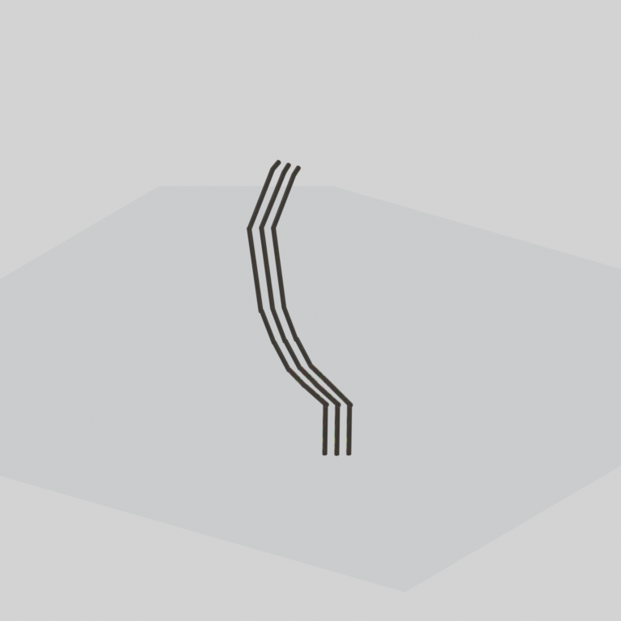
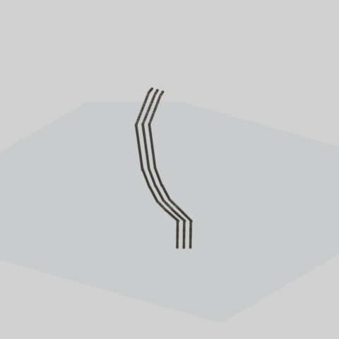

# Unidentified model (mgom_pipe001_vrtn009)

Native model reference; a readable object identification has not been reviewed.

[Library](../README.md) | [Category](../tables/unclassified-components-1.md) | [Source / advanced data](../catalogue.json) | [Credits](../sources-and-credits.md)

**Game filename:** mgom_pipe001_vrtn009.fmdl  
**Category:** Unclassified &gt; Unclassified components  
**Variant:** vrtn009; **LOD:** 0  
**Tags:** 

## Still reference



## 360-degree reference



The camera circles a static model. This is not a native animation. Source base textures and UVs use approximate studio shading; interaction, collision, complete assembly and FOX shader equivalence are not established.

## Identity and naming

| Field | Value |
|---|---|
| Library ID | mgsv-tpp-mgom_pipe001_vrtn009-b94f2eafc649e496 |
| Naming status | unidentified |
| Naming confidence | unknown |
| Naming evidence | {} |
| Native model | /Assets/mgo/environ/object/mgo_mafr/pipe/mgom_pipe001/scenes/mgom_pipe001_vrtn009.fmdl |
| Model SHA256 | 73b919d7f2e23d3c5e981e59e27cee91155bb4c017ac5946dae7bbbcdb6ead67 |
| Container | /Assets/mgo/pack/location/afc1/pack_common/afc1_common.fpk |
| Container SHA256 | cf9aff37b860d362b6723fe700775983cc61ae7d7f23b6de70df9ba489a966da |
| Captured source / location scope | Selected native member/content and captured installed-source chain; full archive SHA/runtime priority unresolved |
| Raw record SHA256 | c13b14626c1849a28146a41cfe8659401bed1d608d00bbd96a7f62c1d8a6eb3c |

Naming review is descriptive metadata only. It does not change model completion or identify a working game interaction.

## Native LOD inventory

| Native LOD | Triangles | Preview status | Decoded indices SHA256 |
|---|---:|---|---|
| 0 | 384 | rendered | 39b5d7bf5d7e51d63779c88f9de1c9013d64bdf96718516655f49be2e8549c70 |
| 1 | 384 | not separately rendered | 39b5d7bf5d7e51d63779c88f9de1c9013d64bdf96718516655f49be2e8549c70 |
| 2 | 384 | not separately rendered | 39b5d7bf5d7e51d63779c88f9de1c9013d64bdf96718516655f49be2e8549c70 |
| 3 | 384 | not separately rendered | 39b5d7bf5d7e51d63779c88f9de1c9013d64bdf96718516655f49be2e8549c70 |

Mesh detail and texture pixels/mips are separate. Index hashes describe decoded triangle arrays, not packed index-buffer bytes. Only source-recorded native levels are listed.

<details>
<summary>Texture, source and naming technical metadata</summary>

```json
{
  "source": {
    "nativePath": "/Assets/mgo/environ/object/mgo_mafr/pipe/mgom_pipe001/scenes/mgom_pipe001_vrtn009.fmdl",
    "nativeSha256": "73b919d7f2e23d3c5e981e59e27cee91155bb4c017ac5946dae7bbbcdb6ead67",
    "stableIdentity": "/assets/mgo/environ/object/mgo_mafr/pipe/mgom_pipe001/scenes/mgom_pipe001_vrtn009.fmdl#73b919d7f2e23d3c5e981e59e27cee91155bb4c017ac5946dae7bbbcdb6ead67#bdb782686e9bfb1e8db7f48d436160aec3fb0a688349992490f139c01428b715",
    "container": {
      "nativePath": "/Assets/mgo/pack/location/afc1/pack_common/afc1_common.fpk",
      "sha256": "cf9aff37b860d362b6723fe700775983cc61ae7d7f23b6de70df9ba489a966da",
      "status": "Selected installed-source container/member chain captured by community reader"
    },
    "historicalDatOrigin": null,
    "sourceArchiveAtCapture": "master/0/00.dat",
    "locationStatus": "Selected native member/content and captured installed-source chain; full archive SHA/runtime priority unresolved",
    "currentInstalledDatVerified": false,
    "selectedInstalledMemberVerified": true,
    "evidence": {
      "archive_helper_executable_sha256": "6f8e39a436af3b024bbd0504966ab3d5d9d0cb05d86689bf3e83d15e68df613f",
      "archive_helper_source_sha256": "f662d3b63e066a0afc77ffe22ea0e564222d14469648300dba2c4f8e9b43446b",
      "archive_index_recipe": "54acff767f08d76ad6056c5387328759bc883df507788f398de6c2c04fac12db",
      "archive_reader": "Atvaark GzsTool.Core 0.5.3",
      "archive_reader_core_sha256": "9da447ae3c375cce2e46744eeff6af50f1591062afdf479d1a0b49edb47daaa3",
      "archive_tool_and_dictionary_sha256": {
        "CityHash.dll": "def6c4506d461b65e4059b2936b2cbd5f852ba5d1d8a1a527f1c0e6dc7008c8f",
        "GzsTool.Core.dll": "9da447ae3c375cce2e46744eeff6af50f1591062afdf479d1a0b49edb47daaa3",
        "GzsTool.exe": "1a9c5b11e2355383ff485aee7e86abc026f5c1fad729daf8c0fd15ee0aae1c10",
        "Zlib.Portable.dll": "fe84781ba35ca9cc5ff5f73fd08d2a66c59e5257b4573f5fe59743f30bf78e42",
        "fpk_dictionary.txt": "b82f9a8d6c10a68ba9471eca9d815c21355a53b5e68753d8ad7db7fd01bf401d",
        "qar_dictionary.txt": "1558c248ed0a4bb827888261563fbb91a2df4f03999682f85d637ff70d9d5fb2"
      },
      "bytes": 19344,
      "container_chain": [
        {
          "content_sha256": null,
          "depth": 0,
          "id": "3f19555d27c2ebecdfbad26aadd88b9f62e9fb6092c04c712963ef73c67ccb42",
          "index_sha256": "9acd3675d6e1500e0e18430cba0fdc70a5718ad7d6b62f13905891a35d59f18a",
          "kind": "qar",
          "name": "master/0/00.dat",
          "parent_occurrence": null
        },
        {
          "content_sha256": "cf9aff37b860d362b6723fe700775983cc61ae7d7f23b6de70df9ba489a966da",
          "depth": 1,
          "id": "6f51e2cefeb81d4be84fd97795833addfdc97724952faa48b68b04b91276c2d6",
          "index_sha256": "093dbba03abdf3c5222bb14076d11b2f349a959ae6521fed333d73e2731c6090",
          "kind": "fpk",
          "name": "/Assets/mgo/pack/location/afc1/pack_common/afc1_common.fpk",
          "parent_occurrence": "dc78337c139fb86a3d388f65ba968ecf0c752819c6074e53d3482c1ed223b489"
        }
      ],
      "contentSha256": "73b919d7f2e23d3c5e981e59e27cee91155bb4c017ac5946dae7bbbcdb6ead67",
      "member": {
        "actual_size": 19344,
        "compressed_size": null,
        "content_sha256": "73b919d7f2e23d3c5e981e59e27cee91155bb4c017ac5946dae7bbbcdb6ead67",
        "declared_size": 19344,
        "extension": "fmdl",
        "hash_hex": null,
        "name": "/Assets/mgo/environ/object/mgo_mafr/pipe/mgom_pipe001/scenes/mgom_pipe001_vrtn009.fmdl",
        "name_origin": "embedded",
        "offset": 5688240,
        "ordinal": 147,
        "path_hash": null,
        "resolved": 1
      },
      "occurrenceId": "00735336b30e7723f219dc043f6fb2d2c8b7b857ca329eb809915bb8a525d07f",
      "occurrence_id": "00735336b30e7723f219dc043f6fb2d2c8b7b857ca329eb809915bb8a525d07f",
      "primary_source_revision": "fc4a8196555638c6cf8aa1b7c8dc34ccd5c69cb5",
      "source_adapter": "community_core_selective_export",
      "source_id": "7f6bb743fb4c487f0e9522f9c7fac280c46cf6b1051e0fc75a93602c8eb451f0",
      "source_path": "master/0/00.dat",
      "source_snapshot": "{\"bytes\":768788480,\"device\":621747392682911458,\"file_id\":844424931596481,\"header_sha256\":\"ead50f0a9a37e4285323b9c6fa0ec75fe75e518c63147e63158eeb2892c6589e\",\"mtime_ns\":1791852224238580700}",
      "virtualPath": "/Assets/mgo/environ/object/mgo_mafr/pipe/mgom_pipe001/scenes/mgom_pipe001_vrtn009.fmdl"
    }
  },
  "materials": [
    {
      "sampler": "Base_Tex_SRGB",
      "materialIndex": 0,
      "nativePathHash": "1543506312652190443",
      "nativeVirtualPath": null,
      "nativeBinding": {
        "familyId": "f020dd80c5eef35624644e857834af2cf3ade0aa87fc6453460edf73af029937",
        "height": 1024,
        "materialIndex": 0,
        "mipCount": 9,
        "nativeMipCountVerified": true,
        "nativePath": null,
        "nativePathHash": "1543506312652190443",
        "nativeTexture": {
          "additionalFtexsFileCount": 2,
          "depth": 1,
          "ftexsFileCount": 3,
          "height": 1024,
          "metadataBytes": 208,
          "mipCount": 9,
          "mips": [
            {
              "chunks": 32,
              "decodedBytes": 524288,
              "mip": 0,
              "offset": 0,
              "storedBytes": 385296,
              "streamNumber": 3
            },
            {
              "chunks": 8,
              "decodedBytes": 131072,
              "mip": 1,
              "offset": 0,
              "storedBytes": 101360,
              "streamNumber": 2
            },
            {
              "chunks": 2,
              "decodedBytes": 32768,
              "mip": 2,
              "offset": 9088,
              "storedBytes": 25696,
              "streamNumber": 1
            },
            {
              "chunks": 1,
              "decodedBytes": 8192,
              "mip": 3,
              "offset": 2520,
              "storedBytes": 6560,
              "streamNumber": 1
            },
            {
              "chunks": 1,
              "decodedBytes": 2048,
              "mip": 4,
              "offset": 752,
              "storedBytes": 1760,
              "streamNumber": 1
            },
            {
              "chunks": 1,
              "decodedBytes": 512,
              "mip": 5,
              "offset": 232,
              "storedBytes": 512,
              "streamNumber": 1
            },
            {
              "chunks": 1,
              "decodedBytes": 128,
              "mip": 6,
              "offset": 80,
              "storedBytes": 144,
              "streamNumber": 1
            },
            {
              "chunks": 1,
              "decodedBytes": 32,
              "mip": 7,
              "offset": 24,
              "storedBytes": 48,
              "streamNumber": 1
            },
            {
              "chunks": 1,
              "decodedBytes": 8,
              "mip": 8,
              "offset": 0,
              "storedBytes": 16,
              "streamNumber": 1
            }
          ],
          "nativeHeaderHash": "80f85e65ab47e1989babd51907417602",
          "nrtFlag": 2,
          "pixelFormat": 2,
          "requiredStreamNumbers": [
            1,
            2,
            3
          ],
          "textureType": 16777219,
          "unknownFlags": 273,
          "width": 1024
        },
        "samplerName": "Base_Tex_SRGB",
        "samplerNameHash": "72475356961633",
        "sha256": "5ddd7c29786a9dfa8e6b50ccd3f84876d3c6a0601543e37eaccc19f4edf364f8",
        "sourceOccurrences": [
          {
            "archive_helper_executable_sha256": "6f8e39a436af3b024bbd0504966ab3d5d9d0cb05d86689bf3e83d15e68df613f",
            "archive_helper_source_sha256": "f662d3b63e066a0afc77ffe22ea0e564222d14469648300dba2c4f8e9b43446b",
            "archive_index_recipe": "54acff767f08d76ad6056c5387328759bc883df507788f398de6c2c04fac12db",
            "archive_reader": "Atvaark GzsTool.Core 0.5.3",
            "archive_reader_core_sha256": "9da447ae3c375cce2e46744eeff6af50f1591062afdf479d1a0b49edb47daaa3",
            "archive_tool_and_dictionary_sha256": {
              "CityHash.dll": "def6c4506d461b65e4059b2936b2cbd5f852ba5d1d8a1a527f1c0e6dc7008c8f",
              "GzsTool.Core.dll": "9da447ae3c375cce2e46744eeff6af50f1591062afdf479d1a0b49edb47daaa3",
              "GzsTool.exe": "1a9c5b11e2355383ff485aee7e86abc026f5c1fad729daf8c0fd15ee0aae1c10",
              "Zlib.Portable.dll": "fe84781ba35ca9cc5ff5f73fd08d2a66c59e5257b4573f5fe59743f30bf78e42",
              "fpk_dictionary.txt": "b82f9a8d6c10a68ba9471eca9d815c21355a53b5e68753d8ad7db7fd01bf401d",
              "qar_dictionary.txt": "1558c248ed0a4bb827888261563fbb91a2df4f03999682f85d637ff70d9d5fb2"
            },
            "bytes": 208,
            "container_chain": [
              {
                "content_sha256": null,
                "depth": 0,
                "id": "3f19555d27c2ebecdfbad26aadd88b9f62e9fb6092c04c712963ef73c67ccb42",
                "index_sha256": "9acd3675d6e1500e0e18430cba0fdc70a5718ad7d6b62f13905891a35d59f18a",
                "kind": "qar",
                "name": "master/0/00.dat",
                "parent_occurrence": null
              },
              {
                "content_sha256": "fd97657e1effdfa66faedfaa8aceab8699d5928812f2b7a948d492958f56217f",
                "depth": 1,
                "id": "041de25569b3afa35eafa037a79dbb221550af7c25638c26c5f796237b698a20",
                "index_sha256": "f3d8d59afb06b4309a625ba0dd5dc2f42dabc3d59150229746a05c61ee570d06",
                "kind": "pftxs",
                "name": "/Assets/mgo/pack/location/afc1/pack_common/afc1_common.pftxs",
                "parent_occurrence": "9bb9ddd185492a361b81e97ef73bd7f96ca26f3e99f82de31fecc98df2c24293"
              }
            ],
            "contentSha256": "1db5ec2d9b6353c636ee50ccece769a53d6caabd3e7189f6fac95785c0d046da",
            "member": {
              "actual_size": 208,
              "compressed_size": null,
              "content_sha256": "1db5ec2d9b6353c636ee50ccece769a53d6caabd3e7189f6fac95785c0d046da",
              "declared_size": 208,
              "extension": "ftex",
              "hash_hex": "156ba2d04234f2eb",
              "name": "156ba2d04234f2eb.ftex",
              "name_origin": "hash_fallback",
              "offset": 9003344,
              "ordinal": 816,
              "path_hash": null,
              "resolved": 0
            },
            "occurrenceId": "318e609b9006122a92f8c20dacbafddff96ab74885b1ab4183e8759714b87ee2",
            "occurrence_id": "318e609b9006122a92f8c20dacbafddff96ab74885b1ab4183e8759714b87ee2",
            "primary_source_revision": "fc4a8196555638c6cf8aa1b7c8dc34ccd5c69cb5",
            "source_adapter": "community_core_selective_export",
            "source_id": "7f6bb743fb4c487f0e9522f9c7fac280c46cf6b1051e0fc75a93602c8eb451f0",
            "source_path": "master/0/00.dat",
            "source_snapshot": "{\"bytes\":768788480,\"device\":621747392682911458,\"file_id\":844424931596481,\"header_sha256\":\"ead50f0a9a37e4285323b9c6fa0ec75fe75e518c63147e63158eeb2892c6589e\",\"mtime_ns\":1791852224238580700}",
            "virtualPath": "156ba2d04234f2eb.ftex"
          },
          {
            "archive_helper_executable_sha256": "6f8e39a436af3b024bbd0504966ab3d5d9d0cb05d86689bf3e83d15e68df613f",
            "archive_helper_source_sha256": "f662d3b63e066a0afc77ffe22ea0e564222d14469648300dba2c4f8e9b43446b",
            "archive_index_recipe": "54acff767f08d76ad6056c5387328759bc883df507788f398de6c2c04fac12db",
            "archive_reader": "Atvaark GzsTool.Core 0.5.3",
            "archive_reader_core_sha256": "9da447ae3c375cce2e46744eeff6af50f1591062afdf479d1a0b49edb47daaa3",
            "archive_tool_and_dictionary_sha256": {
              "CityHash.dll": "def6c4506d461b65e4059b2936b2cbd5f852ba5d1d8a1a527f1c0e6dc7008c8f",
              "GzsTool.Core.dll": "9da447ae3c375cce2e46744eeff6af50f1591062afdf479d1a0b49edb47daaa3",
              "GzsTool.exe": "1a9c5b11e2355383ff485aee7e86abc026f5c1fad729daf8c0fd15ee0aae1c10",
              "Zlib.Portable.dll": "fe84781ba35ca9cc5ff5f73fd08d2a66c59e5257b4573f5fe59743f30bf78e42",
              "fpk_dictionary.txt": "b82f9a8d6c10a68ba9471eca9d815c21355a53b5e68753d8ad7db7fd01bf401d",
              "qar_dictionary.txt": "1558c248ed0a4bb827888261563fbb91a2df4f03999682f85d637ff70d9d5fb2"
            },
            "bytes": 34800,
            "container_chain": [
              {
                "content_sha256": null,
                "depth": 0,
                "id": "3f19555d27c2ebecdfbad26aadd88b9f62e9fb6092c04c712963ef73c67ccb42",
                "index_sha256": "9acd3675d6e1500e0e18430cba0fdc70a5718ad7d6b62f13905891a35d59f18a",
                "kind": "qar",
                "name": "master/0/00.dat",
                "parent_occurrence": null
              },
              {
                "content_sha256": "fd97657e1effdfa66faedfaa8aceab8699d5928812f2b7a948d492958f56217f",
                "depth": 1,
                "id": "041de25569b3afa35eafa037a79dbb221550af7c25638c26c5f796237b698a20",
                "index_sha256": "f3d8d59afb06b4309a625ba0dd5dc2f42dabc3d59150229746a05c61ee570d06",
                "kind": "pftxs",
                "name": "/Assets/mgo/pack/location/afc1/pack_common/afc1_common.pftxs",
                "parent_occurrence": "9bb9ddd185492a361b81e97ef73bd7f96ca26f3e99f82de31fecc98df2c24293"
              }
            ],
            "contentSha256": "2669e78a7ed8d03c0c21c40af19e8debca9daa9317ec7eea71d1c924f88d18b3",
            "member": {
              "actual_size": 34800,
              "compressed_size": null,
              "content_sha256": "2669e78a7ed8d03c0c21c40af19e8debca9daa9317ec7eea71d1c924f88d18b3",
              "declared_size": 34800,
              "extension": "1.ftexs",
              "hash_hex": "b2c3a2d04234f2eb",
              "name": "b2c3a2d04234f2eb.1.ftexs",
              "name_origin": "hash_fallback",
              "offset": 9003552,
              "ordinal": 817,
              "path_hash": null,
              "resolved": 0
            },
            "occurrenceId": "9de258115b582f1660148b40d62af37c4958ed253519f99006256eeb502e0e66",
            "occurrence_id": "9de258115b582f1660148b40d62af37c4958ed253519f99006256eeb502e0e66",
            "primary_source_revision": "fc4a8196555638c6cf8aa1b7c8dc34ccd5c69cb5",
            "source_adapter": "community_core_selective_export",
            "source_id": "7f6bb743fb4c487f0e9522f9c7fac280c46cf6b1051e0fc75a93602c8eb451f0",
            "source_path": "master/0/00.dat",
            "source_snapshot": "{\"bytes\":768788480,\"device\":621747392682911458,\"file_id\":844424931596481,\"header_sha256\":\"ead50f0a9a37e4285323b9c6fa0ec75fe75e518c63147e63158eeb2892c6589e\",\"mtime_ns\":1791852224238580700}",
            "virtualPath": "b2c3a2d04234f2eb.1.ftexs"
          },
          {
            "archive_helper_executable_sha256": "6f8e39a436af3b024bbd0504966ab3d5d9d0cb05d86689bf3e83d15e68df613f",
            "archive_helper_source_sha256": "f662d3b63e066a0afc77ffe22ea0e564222d14469648300dba2c4f8e9b43446b",
            "archive_index_recipe": "54acff767f08d76ad6056c5387328759bc883df507788f398de6c2c04fac12db",
            "archive_reader": "Atvaark GzsTool.Core 0.5.3",
            "archive_reader_core_sha256": "9da447ae3c375cce2e46744eeff6af50f1591062afdf479d1a0b49edb47daaa3",
            "archive_tool_and_dictionary_sha256": {
              "CityHash.dll": "def6c4506d461b65e4059b2936b2cbd5f852ba5d1d8a1a527f1c0e6dc7008c8f",
              "GzsTool.Core.dll": "9da447ae3c375cce2e46744eeff6af50f1591062afdf479d1a0b49edb47daaa3",
              "GzsTool.exe": "1a9c5b11e2355383ff485aee7e86abc026f5c1fad729daf8c0fd15ee0aae1c10",
              "Zlib.Portable.dll": "fe84781ba35ca9cc5ff5f73fd08d2a66c59e5257b4573f5fe59743f30bf78e42",
              "fpk_dictionary.txt": "b82f9a8d6c10a68ba9471eca9d815c21355a53b5e68753d8ad7db7fd01bf401d",
              "qar_dictionary.txt": "1558c248ed0a4bb827888261563fbb91a2df4f03999682f85d637ff70d9d5fb2"
            },
            "bytes": 101424,
            "container_chain": [
              {
                "content_sha256": null,
                "depth": 0,
                "id": "e73d96973ade76f7a00afdbea486dd110896ace97da0791f56899647de46f210",
                "index_sha256": "5a818609a652a10d90fb90015661d0cb80898096bbb3aac36382172988d8736d",
                "kind": "qar",
                "name": "mgo/texture0.dat",
                "parent_occurrence": null
              }
            ],
            "contentSha256": "7c3fa40e8ab4d402faa32e9862c777a3f210a35bea977e5fcef7e80e9698e32a",
            "member": {
              "actual_size": 101424,
              "compressed_size": 101424,
              "content_sha256": "7c3fa40e8ab4d402faa32e9862c777a3f210a35bea977e5fcef7e80e9698e32a",
              "declared_size": 101424,
              "extension": "2.ftexs",
              "hash_hex": "b573a2d04234f2eb",
              "name": "3a2d04234f2eb.2.ftexs",
              "name_origin": "hash_fallback",
              "offset": 1117893664,
              "ordinal": 2384,
              "path_hash": "3a2d04234f2eb",
              "resolved": 0
            },
            "occurrenceId": "bd9bbdb858ea02d9108be587df774316b29c6e126c76583362967ee0914c4645",
            "occurrence_id": "bd9bbdb858ea02d9108be587df774316b29c6e126c76583362967ee0914c4645",
            "primary_source_revision": "fc4a8196555638c6cf8aa1b7c8dc34ccd5c69cb5",
            "source_adapter": "community_core_selective_export",
            "source_id": "03f5942f0e1af8040ae05b95c43716d75f5933971d78324bf7cfea291297f3f4",
            "source_path": "mgo/texture0.dat",
            "source_snapshot": "{\"bytes\":4492370944,\"device\":621747392682911458,\"file_id\":562949953639631,\"header_sha256\":\"6108fbacb65c84d041742c39e5ca630745240453b336f1059a13b91943f0b011\",\"mtime_ns\":1791224675562234400}",
            "virtualPath": "3a2d04234f2eb.2.ftexs"
          },
          {
            "archive_helper_executable_sha256": "6f8e39a436af3b024bbd0504966ab3d5d9d0cb05d86689bf3e83d15e68df613f",
            "archive_helper_source_sha256": "f662d3b63e066a0afc77ffe22ea0e564222d14469648300dba2c4f8e9b43446b",
            "archive_index_recipe": "54acff767f08d76ad6056c5387328759bc883df507788f398de6c2c04fac12db",
            "archive_reader": "Atvaark GzsTool.Core 0.5.3",
            "archive_reader_core_sha256": "9da447ae3c375cce2e46744eeff6af50f1591062afdf479d1a0b49edb47daaa3",
            "archive_tool_and_dictionary_sha256": {
              "CityHash.dll": "def6c4506d461b65e4059b2936b2cbd5f852ba5d1d8a1a527f1c0e6dc7008c8f",
              "GzsTool.Core.dll": "9da447ae3c375cce2e46744eeff6af50f1591062afdf479d1a0b49edb47daaa3",
              "GzsTool.exe": "1a9c5b11e2355383ff485aee7e86abc026f5c1fad729daf8c0fd15ee0aae1c10",
              "Zlib.Portable.dll": "fe84781ba35ca9cc5ff5f73fd08d2a66c59e5257b4573f5fe59743f30bf78e42",
              "fpk_dictionary.txt": "b82f9a8d6c10a68ba9471eca9d815c21355a53b5e68753d8ad7db7fd01bf401d",
              "qar_dictionary.txt": "1558c248ed0a4bb827888261563fbb91a2df4f03999682f85d637ff70d9d5fb2"
            },
            "bytes": 385552,
            "container_chain": [
              {
                "content_sha256": null,
                "depth": 0,
                "id": "e73d96973ade76f7a00afdbea486dd110896ace97da0791f56899647de46f210",
                "index_sha256": "5a818609a652a10d90fb90015661d0cb80898096bbb3aac36382172988d8736d",
                "kind": "qar",
                "name": "mgo/texture0.dat",
                "parent_occurrence": null
              }
            ],
            "contentSha256": "1e534204af00fa639492ad0b93be18aa89262925a8aa83dcaeae794db8a55d77",
            "member": {
              "actual_size": 385552,
              "compressed_size": 385552,
              "content_sha256": "1e534204af00fa639492ad0b93be18aa89262925a8aa83dcaeae794db8a55d77",
              "declared_size": 385552,
              "extension": "3.ftexs",
              "hash_hex": "571ba2d04234f2eb",
              "name": "3a2d04234f2eb.3.ftexs",
              "name_origin": "hash_fallback",
              "offset": 1117996064,
              "ordinal": 2385,
              "path_hash": "3a2d04234f2eb",
              "resolved": 0
            },
            "occurrenceId": "80eeaeeb310231e392e446702ced901ef0257052362fec4a2e58a7ce08767837",
            "occurrence_id": "80eeaeeb310231e392e446702ced901ef0257052362fec4a2e58a7ce08767837",
            "primary_source_revision": "fc4a8196555638c6cf8aa1b7c8dc34ccd5c69cb5",
            "source_adapter": "community_core_selective_export",
            "source_id": "03f5942f0e1af8040ae05b95c43716d75f5933971d78324bf7cfea291297f3f4",
            "source_path": "mgo/texture0.dat",
            "source_snapshot": "{\"bytes\":4492370944,\"device\":621747392682911458,\"file_id\":562949953639631,\"header_sha256\":\"6108fbacb65c84d041742c39e5ca630745240453b336f1059a13b91943f0b011\",\"mtime_ns\":1791224675562234400}",
            "virtualPath": "3a2d04234f2eb.3.ftexs"
          }
        ],
        "width": 1024
      },
      "ddsSha256": "5ddd7c29786a9dfa8e6b50ccd3f84876d3c6a0601543e37eaccc19f4edf364f8",
      "dimensions": [
        1024,
        1024
      ],
      "mipCount": 9,
      "nativeMipCountVerified": true,
      "connectedInPreview": true
    }
  ],
  "quality": {
    "decodedIndicesHashDerivation": "SHA256 of canonical UTF-8 JSON decoded triangle indices grouped by mesh; not packed buffer bytes",
    "highestRetainedGeometricLod": 0,
    "distinctNativeLods": 1,
    "baseTextureDimensions": [
      1024,
      1024
    ],
    "baseTextureNativeMipCount": 9,
    "largerRetainedBaseTextureFound": null,
    "nativeLods": [
      {
        "indicesSha256": "39b5d7bf5d7e51d63779c88f9de1c9013d64bdf96718516655f49be2e8549c70",
        "nativeLod": 0,
        "triangles": 384
      },
      {
        "duplicateOf": 0,
        "indicesSha256": "39b5d7bf5d7e51d63779c88f9de1c9013d64bdf96718516655f49be2e8549c70",
        "nativeLod": 1,
        "triangles": 384
      },
      {
        "duplicateOf": 0,
        "indicesSha256": "39b5d7bf5d7e51d63779c88f9de1c9013d64bdf96718516655f49be2e8549c70",
        "nativeLod": 2,
        "triangles": 384
      },
      {
        "duplicateOf": 0,
        "indicesSha256": "39b5d7bf5d7e51d63779c88f9de1c9013d64bdf96718516655f49be2e8549c70",
        "nativeLod": 3,
        "triangles": 384
      }
    ],
    "renderedNativeLods": [
      0
    ],
    "baseTextureSummary": "1024 x 1024; 9 native/DDS mips",
    "highestDetailScope": "Triangle-count comparison within captured FMDL only"
  }
}
```

</details>

[Original source / advanced record](../catalogue.json)
