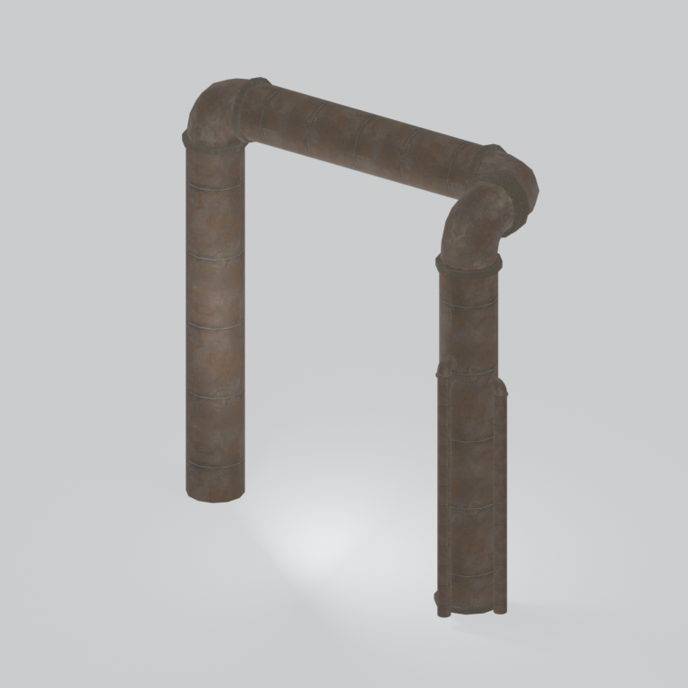
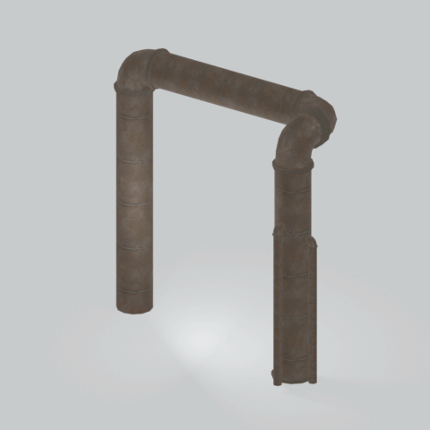

# Unidentified model (mgom_pipe001_vrtn011)

Native model reference; a readable object identification has not been reviewed.

[Library](../README.md) | [Category](../tables/unclassified-components-1.md) | [Source / advanced data](../catalogue.json) | [Credits](../sources-and-credits.md)

**Game filename:** mgom_pipe001_vrtn011.fmdl  
**Category:** Unclassified &gt; Unclassified components  
**Variant:** vrtn011; **LOD:** 0  
**Tags:** 

## Still reference



## 360-degree reference



The camera circles a static model. This is not a native animation. Source base textures and UVs use approximate studio shading; interaction, collision, complete assembly and FOX shader equivalence are not established.

## Identity and naming

| Field | Value |
|---|---|
| Library ID | mgsv-tpp-mgom_pipe001_vrtn011-c51bdb11348c117e |
| Naming status | unidentified |
| Naming confidence | unknown |
| Naming evidence | {} |
| Native model | /Assets/mgo/environ/object/mgo_mafr/pipe/mgom_pipe001/scenes/mgom_pipe001_vrtn011.fmdl |
| Model SHA256 | fc3dcbb18308203dad2819fd06ff9d52b61d8a8ca2e491e8d9e4b22143f822ec |
| Container | /Assets/mgo/pack/location/afc1/pack_common/afc1_common.fpk |
| Container SHA256 | cf9aff37b860d362b6723fe700775983cc61ae7d7f23b6de70df9ba489a966da |
| Captured source / location scope | Selected native member/content and captured installed-source chain; full archive SHA/runtime priority unresolved |
| Raw record SHA256 | a7a5c631093edb1c949b0ddf096bca610b47d2a72e15c6965fe058ac62b3133c |

Naming review is descriptive metadata only. It does not change model completion or identify a working game interaction.

## Native LOD inventory

| Native LOD | Triangles | Preview status | Decoded indices SHA256 |
|---|---:|---|---|
| 0 | 1234 | rendered | 37c77a31700f23c2eb6b9021a919a6b4b48b5d5cde4508a1917dd4d83935ccc5 |
| 1 | 687 | not separately rendered | 55f2e32498e384688df2801b78ab51256d06f7e9079b98c329112107bb240814 |
| 2 | 397 | not separately rendered | 4348e0c2a6441ab5a1bde8fe67b3be36fb7820d36254b9abb3a38de55fbec5ea |
| 3 | 246 | not separately rendered | b408a508b111c15abe119c8dba67c396e935e18e5f2e132a741f289c0ecb5463 |

Mesh detail and texture pixels/mips are separate. Index hashes describe decoded triangle arrays, not packed index-buffer bytes. Only source-recorded native levels are listed.

<details>
<summary>Texture, source and naming technical metadata</summary>

```json
{
  "source": {
    "nativePath": "/Assets/mgo/environ/object/mgo_mafr/pipe/mgom_pipe001/scenes/mgom_pipe001_vrtn011.fmdl",
    "nativeSha256": "fc3dcbb18308203dad2819fd06ff9d52b61d8a8ca2e491e8d9e4b22143f822ec",
    "stableIdentity": "/assets/mgo/environ/object/mgo_mafr/pipe/mgom_pipe001/scenes/mgom_pipe001_vrtn011.fmdl#fc3dcbb18308203dad2819fd06ff9d52b61d8a8ca2e491e8d9e4b22143f822ec#01abd4f2a26d964a18701272993f6a556adb45f0c22c80fdd7e5f50524225447",
    "container": {
      "nativePath": "/Assets/mgo/pack/location/afc1/pack_common/afc1_common.fpk",
      "sha256": "cf9aff37b860d362b6723fe700775983cc61ae7d7f23b6de70df9ba489a966da",
      "status": "Selected installed-source container/member chain captured by community reader"
    },
    "historicalDatOrigin": null,
    "sourceArchiveAtCapture": "master/0/00.dat",
    "locationStatus": "Selected native member/content and captured installed-source chain; full archive SHA/runtime priority unresolved",
    "currentInstalledDatVerified": false,
    "selectedInstalledMemberVerified": true,
    "evidence": {
      "archive_helper_executable_sha256": "6f8e39a436af3b024bbd0504966ab3d5d9d0cb05d86689bf3e83d15e68df613f",
      "archive_helper_source_sha256": "f662d3b63e066a0afc77ffe22ea0e564222d14469648300dba2c4f8e9b43446b",
      "archive_index_recipe": "54acff767f08d76ad6056c5387328759bc883df507788f398de6c2c04fac12db",
      "archive_reader": "Atvaark GzsTool.Core 0.5.3",
      "archive_reader_core_sha256": "9da447ae3c375cce2e46744eeff6af50f1591062afdf479d1a0b49edb47daaa3",
      "archive_tool_and_dictionary_sha256": {
        "CityHash.dll": "def6c4506d461b65e4059b2936b2cbd5f852ba5d1d8a1a527f1c0e6dc7008c8f",
        "GzsTool.Core.dll": "9da447ae3c375cce2e46744eeff6af50f1591062afdf479d1a0b49edb47daaa3",
        "GzsTool.exe": "1a9c5b11e2355383ff485aee7e86abc026f5c1fad729daf8c0fd15ee0aae1c10",
        "Zlib.Portable.dll": "fe84781ba35ca9cc5ff5f73fd08d2a66c59e5257b4573f5fe59743f30bf78e42",
        "fpk_dictionary.txt": "b82f9a8d6c10a68ba9471eca9d815c21355a53b5e68753d8ad7db7fd01bf401d",
        "qar_dictionary.txt": "1558c248ed0a4bb827888261563fbb91a2df4f03999682f85d637ff70d9d5fb2"
      },
      "bytes": 50112,
      "container_chain": [
        {
          "content_sha256": null,
          "depth": 0,
          "id": "3f19555d27c2ebecdfbad26aadd88b9f62e9fb6092c04c712963ef73c67ccb42",
          "index_sha256": "9acd3675d6e1500e0e18430cba0fdc70a5718ad7d6b62f13905891a35d59f18a",
          "kind": "qar",
          "name": "master/0/00.dat",
          "parent_occurrence": null
        },
        {
          "content_sha256": "cf9aff37b860d362b6723fe700775983cc61ae7d7f23b6de70df9ba489a966da",
          "depth": 1,
          "id": "6f51e2cefeb81d4be84fd97795833addfdc97724952faa48b68b04b91276c2d6",
          "index_sha256": "093dbba03abdf3c5222bb14076d11b2f349a959ae6521fed333d73e2731c6090",
          "kind": "fpk",
          "name": "/Assets/mgo/pack/location/afc1/pack_common/afc1_common.fpk",
          "parent_occurrence": "dc78337c139fb86a3d388f65ba968ecf0c752819c6074e53d3482c1ed223b489"
        }
      ],
      "contentSha256": "fc3dcbb18308203dad2819fd06ff9d52b61d8a8ca2e491e8d9e4b22143f822ec",
      "member": {
        "actual_size": 50112,
        "compressed_size": null,
        "content_sha256": "fc3dcbb18308203dad2819fd06ff9d52b61d8a8ca2e491e8d9e4b22143f822ec",
        "declared_size": 50112,
        "extension": "fmdl",
        "hash_hex": null,
        "name": "/Assets/mgo/environ/object/mgo_mafr/pipe/mgom_pipe001/scenes/mgom_pipe001_vrtn011.fmdl",
        "name_origin": "embedded",
        "offset": 5748880,
        "ordinal": 149,
        "path_hash": null,
        "resolved": 1
      },
      "occurrenceId": "a20b52c9e75bcce91a9b5f35cf7268e68a6876595861fa8c8b11074022bee83a",
      "occurrence_id": "a20b52c9e75bcce91a9b5f35cf7268e68a6876595861fa8c8b11074022bee83a",
      "primary_source_revision": "fc4a8196555638c6cf8aa1b7c8dc34ccd5c69cb5",
      "source_adapter": "community_core_selective_export",
      "source_id": "7f6bb743fb4c487f0e9522f9c7fac280c46cf6b1051e0fc75a93602c8eb451f0",
      "source_path": "master/0/00.dat",
      "source_snapshot": "{\"bytes\":768788480,\"device\":621747392682911458,\"file_id\":844424931596481,\"header_sha256\":\"ead50f0a9a37e4285323b9c6fa0ec75fe75e518c63147e63158eeb2892c6589e\",\"mtime_ns\":1791852224238580700}",
      "virtualPath": "/Assets/mgo/environ/object/mgo_mafr/pipe/mgom_pipe001/scenes/mgom_pipe001_vrtn011.fmdl"
    }
  },
  "materials": [
    {
      "sampler": "Base_Tex_SRGB",
      "materialIndex": 0,
      "nativePathHash": "1543521813978966860",
      "nativeVirtualPath": null,
      "nativeBinding": {
        "familyId": "253a9df63db60049ab0fe689ab662d7f8154822ff3a6c273d51b7a83ca2e1cfd",
        "height": 1024,
        "materialIndex": 0,
        "mipCount": 9,
        "nativeMipCountVerified": true,
        "nativePath": null,
        "nativePathHash": "1543521813978966860",
        "nativeTexture": {
          "additionalFtexsFileCount": 2,
          "depth": 1,
          "ftexsFileCount": 3,
          "height": 1024,
          "metadataBytes": 208,
          "mipCount": 9,
          "mips": [
            {
              "chunks": 32,
              "decodedBytes": 524288,
              "mip": 0,
              "offset": 0,
              "storedBytes": 382768,
              "streamNumber": 3
            },
            {
              "chunks": 8,
              "decodedBytes": 131072,
              "mip": 1,
              "offset": 0,
              "storedBytes": 98016,
              "streamNumber": 2
            },
            {
              "chunks": 2,
              "decodedBytes": 32768,
              "mip": 2,
              "offset": 8800,
              "storedBytes": 24704,
              "streamNumber": 1
            },
            {
              "chunks": 1,
              "decodedBytes": 8192,
              "mip": 3,
              "offset": 2440,
              "storedBytes": 6352,
              "streamNumber": 1
            },
            {
              "chunks": 1,
              "decodedBytes": 2048,
              "mip": 4,
              "offset": 736,
              "storedBytes": 1696,
              "streamNumber": 1
            },
            {
              "chunks": 1,
              "decodedBytes": 512,
              "mip": 5,
              "offset": 232,
              "storedBytes": 496,
              "streamNumber": 1
            },
            {
              "chunks": 1,
              "decodedBytes": 128,
              "mip": 6,
              "offset": 80,
              "storedBytes": 144,
              "streamNumber": 1
            },
            {
              "chunks": 1,
              "decodedBytes": 32,
              "mip": 7,
              "offset": 24,
              "storedBytes": 48,
              "streamNumber": 1
            },
            {
              "chunks": 1,
              "decodedBytes": 8,
              "mip": 8,
              "offset": 0,
              "storedBytes": 16,
              "streamNumber": 1
            }
          ],
          "nativeHeaderHash": "c4c5d428a6f8a1021cddd9c08ff9690b",
          "nrtFlag": 2,
          "pixelFormat": 2,
          "requiredStreamNumbers": [
            1,
            2,
            3
          ],
          "textureType": 16777219,
          "unknownFlags": 273,
          "width": 1024
        },
        "samplerName": "Base_Tex_SRGB",
        "samplerNameHash": "72475356961633",
        "sha256": "91a0f9bdff7bfd42b12d7dea2ae55a1002d0b3a538823b5fc8d93e3c4fdcfb1d",
        "sourceOccurrences": [
          {
            "archive_helper_executable_sha256": "6f8e39a436af3b024bbd0504966ab3d5d9d0cb05d86689bf3e83d15e68df613f",
            "archive_helper_source_sha256": "f662d3b63e066a0afc77ffe22ea0e564222d14469648300dba2c4f8e9b43446b",
            "archive_index_recipe": "54acff767f08d76ad6056c5387328759bc883df507788f398de6c2c04fac12db",
            "archive_reader": "Atvaark GzsTool.Core 0.5.3",
            "archive_reader_core_sha256": "9da447ae3c375cce2e46744eeff6af50f1591062afdf479d1a0b49edb47daaa3",
            "archive_tool_and_dictionary_sha256": {
              "CityHash.dll": "def6c4506d461b65e4059b2936b2cbd5f852ba5d1d8a1a527f1c0e6dc7008c8f",
              "GzsTool.Core.dll": "9da447ae3c375cce2e46744eeff6af50f1591062afdf479d1a0b49edb47daaa3",
              "GzsTool.exe": "1a9c5b11e2355383ff485aee7e86abc026f5c1fad729daf8c0fd15ee0aae1c10",
              "Zlib.Portable.dll": "fe84781ba35ca9cc5ff5f73fd08d2a66c59e5257b4573f5fe59743f30bf78e42",
              "fpk_dictionary.txt": "b82f9a8d6c10a68ba9471eca9d815c21355a53b5e68753d8ad7db7fd01bf401d",
              "qar_dictionary.txt": "1558c248ed0a4bb827888261563fbb91a2df4f03999682f85d637ff70d9d5fb2"
            },
            "bytes": 208,
            "container_chain": [
              {
                "content_sha256": null,
                "depth": 0,
                "id": "3f19555d27c2ebecdfbad26aadd88b9f62e9fb6092c04c712963ef73c67ccb42",
                "index_sha256": "9acd3675d6e1500e0e18430cba0fdc70a5718ad7d6b62f13905891a35d59f18a",
                "kind": "qar",
                "name": "master/0/00.dat",
                "parent_occurrence": null
              },
              {
                "content_sha256": "fd97657e1effdfa66faedfaa8aceab8699d5928812f2b7a948d492958f56217f",
                "depth": 1,
                "id": "041de25569b3afa35eafa037a79dbb221550af7c25638c26c5f796237b698a20",
                "index_sha256": "f3d8d59afb06b4309a625ba0dd5dc2f42dabc3d59150229746a05c61ee570d06",
                "kind": "pftxs",
                "name": "/Assets/mgo/pack/location/afc1/pack_common/afc1_common.pftxs",
                "parent_occurrence": "9bb9ddd185492a361b81e97ef73bd7f96ca26f3e99f82de31fecc98df2c24293"
              }
            ],
            "contentSha256": "a907aee8348fbf52f4360e58a8c782eeb77b9461a42bf65f0faee38f6c5f2840",
            "member": {
              "actual_size": 208,
              "compressed_size": null,
              "content_sha256": "a907aee8348fbf52f4360e58a8c782eeb77b9461a42bf65f0faee38f6c5f2840",
              "declared_size": 208,
              "extension": "ftex",
              "hash_hex": "156bb0e971486b4c",
              "name": "156bb0e971486b4c.ftex",
              "name_origin": "hash_fallback",
              "offset": 8361840,
              "ordinal": 782,
              "path_hash": null,
              "resolved": 0
            },
            "occurrenceId": "952b0491d00ba30b825061ae944d39dc396adcfba35e4a472406afb1799cedb7",
            "occurrence_id": "952b0491d00ba30b825061ae944d39dc396adcfba35e4a472406afb1799cedb7",
            "primary_source_revision": "fc4a8196555638c6cf8aa1b7c8dc34ccd5c69cb5",
            "source_adapter": "community_core_selective_export",
            "source_id": "7f6bb743fb4c487f0e9522f9c7fac280c46cf6b1051e0fc75a93602c8eb451f0",
            "source_path": "master/0/00.dat",
            "source_snapshot": "{\"bytes\":768788480,\"device\":621747392682911458,\"file_id\":844424931596481,\"header_sha256\":\"ead50f0a9a37e4285323b9c6fa0ec75fe75e518c63147e63158eeb2892c6589e\",\"mtime_ns\":1791852224238580700}",
            "virtualPath": "156bb0e971486b4c.ftex"
          },
          {
            "archive_helper_executable_sha256": "6f8e39a436af3b024bbd0504966ab3d5d9d0cb05d86689bf3e83d15e68df613f",
            "archive_helper_source_sha256": "f662d3b63e066a0afc77ffe22ea0e564222d14469648300dba2c4f8e9b43446b",
            "archive_index_recipe": "54acff767f08d76ad6056c5387328759bc883df507788f398de6c2c04fac12db",
            "archive_reader": "Atvaark GzsTool.Core 0.5.3",
            "archive_reader_core_sha256": "9da447ae3c375cce2e46744eeff6af50f1591062afdf479d1a0b49edb47daaa3",
            "archive_tool_and_dictionary_sha256": {
              "CityHash.dll": "def6c4506d461b65e4059b2936b2cbd5f852ba5d1d8a1a527f1c0e6dc7008c8f",
              "GzsTool.Core.dll": "9da447ae3c375cce2e46744eeff6af50f1591062afdf479d1a0b49edb47daaa3",
              "GzsTool.exe": "1a9c5b11e2355383ff485aee7e86abc026f5c1fad729daf8c0fd15ee0aae1c10",
              "Zlib.Portable.dll": "fe84781ba35ca9cc5ff5f73fd08d2a66c59e5257b4573f5fe59743f30bf78e42",
              "fpk_dictionary.txt": "b82f9a8d6c10a68ba9471eca9d815c21355a53b5e68753d8ad7db7fd01bf401d",
              "qar_dictionary.txt": "1558c248ed0a4bb827888261563fbb91a2df4f03999682f85d637ff70d9d5fb2"
            },
            "bytes": 33520,
            "container_chain": [
              {
                "content_sha256": null,
                "depth": 0,
                "id": "3f19555d27c2ebecdfbad26aadd88b9f62e9fb6092c04c712963ef73c67ccb42",
                "index_sha256": "9acd3675d6e1500e0e18430cba0fdc70a5718ad7d6b62f13905891a35d59f18a",
                "kind": "qar",
                "name": "master/0/00.dat",
                "parent_occurrence": null
              },
              {
                "content_sha256": "fd97657e1effdfa66faedfaa8aceab8699d5928812f2b7a948d492958f56217f",
                "depth": 1,
                "id": "041de25569b3afa35eafa037a79dbb221550af7c25638c26c5f796237b698a20",
                "index_sha256": "f3d8d59afb06b4309a625ba0dd5dc2f42dabc3d59150229746a05c61ee570d06",
                "kind": "pftxs",
                "name": "/Assets/mgo/pack/location/afc1/pack_common/afc1_common.pftxs",
                "parent_occurrence": "9bb9ddd185492a361b81e97ef73bd7f96ca26f3e99f82de31fecc98df2c24293"
              }
            ],
            "contentSha256": "0822a721935e3babb5029d4fffe4c4f10790fbe045d26ba168f2e81747902c6c",
            "member": {
              "actual_size": 33520,
              "compressed_size": null,
              "content_sha256": "0822a721935e3babb5029d4fffe4c4f10790fbe045d26ba168f2e81747902c6c",
              "declared_size": 33520,
              "extension": "1.ftexs",
              "hash_hex": "b2c3b0e971486b4c",
              "name": "b2c3b0e971486b4c.1.ftexs",
              "name_origin": "hash_fallback",
              "offset": 8362048,
              "ordinal": 783,
              "path_hash": null,
              "resolved": 0
            },
            "occurrenceId": "e59dc49f44a79c8541c5244817fa45809b8696c67c33c5956d7ced544e21d3e2",
            "occurrence_id": "e59dc49f44a79c8541c5244817fa45809b8696c67c33c5956d7ced544e21d3e2",
            "primary_source_revision": "fc4a8196555638c6cf8aa1b7c8dc34ccd5c69cb5",
            "source_adapter": "community_core_selective_export",
            "source_id": "7f6bb743fb4c487f0e9522f9c7fac280c46cf6b1051e0fc75a93602c8eb451f0",
            "source_path": "master/0/00.dat",
            "source_snapshot": "{\"bytes\":768788480,\"device\":621747392682911458,\"file_id\":844424931596481,\"header_sha256\":\"ead50f0a9a37e4285323b9c6fa0ec75fe75e518c63147e63158eeb2892c6589e\",\"mtime_ns\":1791852224238580700}",
            "virtualPath": "b2c3b0e971486b4c.1.ftexs"
          },
          {
            "archive_helper_executable_sha256": "6f8e39a436af3b024bbd0504966ab3d5d9d0cb05d86689bf3e83d15e68df613f",
            "archive_helper_source_sha256": "f662d3b63e066a0afc77ffe22ea0e564222d14469648300dba2c4f8e9b43446b",
            "archive_index_recipe": "54acff767f08d76ad6056c5387328759bc883df507788f398de6c2c04fac12db",
            "archive_reader": "Atvaark GzsTool.Core 0.5.3",
            "archive_reader_core_sha256": "9da447ae3c375cce2e46744eeff6af50f1591062afdf479d1a0b49edb47daaa3",
            "archive_tool_and_dictionary_sha256": {
              "CityHash.dll": "def6c4506d461b65e4059b2936b2cbd5f852ba5d1d8a1a527f1c0e6dc7008c8f",
              "GzsTool.Core.dll": "9da447ae3c375cce2e46744eeff6af50f1591062afdf479d1a0b49edb47daaa3",
              "GzsTool.exe": "1a9c5b11e2355383ff485aee7e86abc026f5c1fad729daf8c0fd15ee0aae1c10",
              "Zlib.Portable.dll": "fe84781ba35ca9cc5ff5f73fd08d2a66c59e5257b4573f5fe59743f30bf78e42",
              "fpk_dictionary.txt": "b82f9a8d6c10a68ba9471eca9d815c21355a53b5e68753d8ad7db7fd01bf401d",
              "qar_dictionary.txt": "1558c248ed0a4bb827888261563fbb91a2df4f03999682f85d637ff70d9d5fb2"
            },
            "bytes": 98080,
            "container_chain": [
              {
                "content_sha256": null,
                "depth": 0,
                "id": "1cc220d9409d7163b6aca295ed89fd8c7befca6a8f849a8d5d09a2499724c863",
                "index_sha256": "5a818609a652a10d90fb90015661d0cb80898096bbb3aac36382172988d8736d",
                "kind": "qar",
                "name": "master/texture5_mgo0.dat",
                "parent_occurrence": null
              }
            ],
            "contentSha256": "ac9a45c7c7444ad7c05d0c4b4603973b982354413189342f7711f8af0a31f07d",
            "member": {
              "actual_size": 98080,
              "compressed_size": 98080,
              "content_sha256": "ac9a45c7c7444ad7c05d0c4b4603973b982354413189342f7711f8af0a31f07d",
              "declared_size": 98080,
              "extension": "2.ftexs",
              "hash_hex": "b573b0e971486b4c",
              "name": "3b0e971486b4c.2.ftexs",
              "name_origin": "hash_fallback",
              "offset": 1117411360,
              "ordinal": 2382,
              "path_hash": "3b0e971486b4c",
              "resolved": 0
            },
            "occurrenceId": "40593141fd9778cb6ece7d7136a50d2db5d7dc169846c94d26a841b1af3f1904",
            "occurrence_id": "40593141fd9778cb6ece7d7136a50d2db5d7dc169846c94d26a841b1af3f1904",
            "primary_source_revision": "fc4a8196555638c6cf8aa1b7c8dc34ccd5c69cb5",
            "source_adapter": "community_core_selective_export",
            "source_id": "24f8989ccaae47940dc20e54ba67442ad562ac0032ab6e3d475e927c81444b56",
            "source_path": "master/texture5_mgo0.dat",
            "source_snapshot": "{\"bytes\":4492370944,\"device\":621747392682911458,\"file_id\":13510798883237422,\"header_sha256\":\"6108fbacb65c84d041742c39e5ca630745240453b336f1059a13b91943f0b011\",\"mtime_ns\":1791224675562234400}",
            "virtualPath": "3b0e971486b4c.2.ftexs"
          },
          {
            "archive_helper_executable_sha256": "6f8e39a436af3b024bbd0504966ab3d5d9d0cb05d86689bf3e83d15e68df613f",
            "archive_helper_source_sha256": "f662d3b63e066a0afc77ffe22ea0e564222d14469648300dba2c4f8e9b43446b",
            "archive_index_recipe": "54acff767f08d76ad6056c5387328759bc883df507788f398de6c2c04fac12db",
            "archive_reader": "Atvaark GzsTool.Core 0.5.3",
            "archive_reader_core_sha256": "9da447ae3c375cce2e46744eeff6af50f1591062afdf479d1a0b49edb47daaa3",
            "archive_tool_and_dictionary_sha256": {
              "CityHash.dll": "def6c4506d461b65e4059b2936b2cbd5f852ba5d1d8a1a527f1c0e6dc7008c8f",
              "GzsTool.Core.dll": "9da447ae3c375cce2e46744eeff6af50f1591062afdf479d1a0b49edb47daaa3",
              "GzsTool.exe": "1a9c5b11e2355383ff485aee7e86abc026f5c1fad729daf8c0fd15ee0aae1c10",
              "Zlib.Portable.dll": "fe84781ba35ca9cc5ff5f73fd08d2a66c59e5257b4573f5fe59743f30bf78e42",
              "fpk_dictionary.txt": "b82f9a8d6c10a68ba9471eca9d815c21355a53b5e68753d8ad7db7fd01bf401d",
              "qar_dictionary.txt": "1558c248ed0a4bb827888261563fbb91a2df4f03999682f85d637ff70d9d5fb2"
            },
            "bytes": 383024,
            "container_chain": [
              {
                "content_sha256": null,
                "depth": 0,
                "id": "e73d96973ade76f7a00afdbea486dd110896ace97da0791f56899647de46f210",
                "index_sha256": "5a818609a652a10d90fb90015661d0cb80898096bbb3aac36382172988d8736d",
                "kind": "qar",
                "name": "mgo/texture0.dat",
                "parent_occurrence": null
              }
            ],
            "contentSha256": "5417634a0482075a7bcd24c1681d183e8786bbeb4215fafd212a757addb879b5",
            "member": {
              "actual_size": 383024,
              "compressed_size": 383024,
              "content_sha256": "5417634a0482075a7bcd24c1681d183e8786bbeb4215fafd212a757addb879b5",
              "declared_size": 383024,
              "extension": "3.ftexs",
              "hash_hex": "571bb0e971486b4c",
              "name": "3b0e971486b4c.3.ftexs",
              "name_origin": "hash_fallback",
              "offset": 1117509664,
              "ordinal": 2383,
              "path_hash": "3b0e971486b4c",
              "resolved": 0
            },
            "occurrenceId": "3bf19ae970847287e8976c0daad379db7b477ef991bca96fc3bd86678977a842",
            "occurrence_id": "3bf19ae970847287e8976c0daad379db7b477ef991bca96fc3bd86678977a842",
            "primary_source_revision": "fc4a8196555638c6cf8aa1b7c8dc34ccd5c69cb5",
            "source_adapter": "community_core_selective_export",
            "source_id": "03f5942f0e1af8040ae05b95c43716d75f5933971d78324bf7cfea291297f3f4",
            "source_path": "mgo/texture0.dat",
            "source_snapshot": "{\"bytes\":4492370944,\"device\":621747392682911458,\"file_id\":562949953639631,\"header_sha256\":\"6108fbacb65c84d041742c39e5ca630745240453b336f1059a13b91943f0b011\",\"mtime_ns\":1791224675562234400}",
            "virtualPath": "3b0e971486b4c.3.ftexs"
          }
        ],
        "width": 1024
      },
      "ddsSha256": "91a0f9bdff7bfd42b12d7dea2ae55a1002d0b3a538823b5fc8d93e3c4fdcfb1d",
      "dimensions": [
        1024,
        1024
      ],
      "mipCount": 9,
      "nativeMipCountVerified": true,
      "connectedInPreview": true
    }
  ],
  "quality": {
    "decodedIndicesHashDerivation": "SHA256 of canonical UTF-8 JSON decoded triangle indices grouped by mesh; not packed buffer bytes",
    "highestRetainedGeometricLod": 0,
    "distinctNativeLods": 4,
    "baseTextureDimensions": [
      1024,
      1024
    ],
    "baseTextureNativeMipCount": 9,
    "largerRetainedBaseTextureFound": null,
    "nativeLods": [
      {
        "indicesSha256": "37c77a31700f23c2eb6b9021a919a6b4b48b5d5cde4508a1917dd4d83935ccc5",
        "nativeLod": 0,
        "triangles": 1234
      },
      {
        "indicesSha256": "55f2e32498e384688df2801b78ab51256d06f7e9079b98c329112107bb240814",
        "nativeLod": 1,
        "triangles": 687
      },
      {
        "indicesSha256": "4348e0c2a6441ab5a1bde8fe67b3be36fb7820d36254b9abb3a38de55fbec5ea",
        "nativeLod": 2,
        "triangles": 397
      },
      {
        "indicesSha256": "b408a508b111c15abe119c8dba67c396e935e18e5f2e132a741f289c0ecb5463",
        "nativeLod": 3,
        "triangles": 246
      }
    ],
    "renderedNativeLods": [
      0
    ],
    "baseTextureSummary": "1024 x 1024; 9 native/DDS mips",
    "highestDetailScope": "Triangle-count comparison within captured FMDL only"
  }
}
```

</details>

[Original source / advanced record](../catalogue.json)
