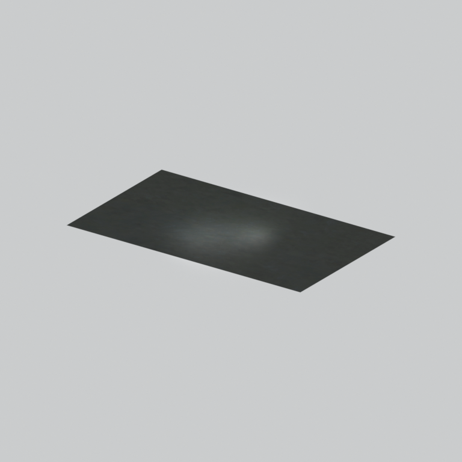
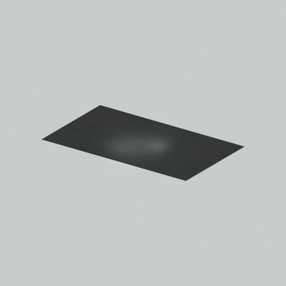

# Unidentified model (mgom_rivr002_oill001)

Native model reference; a readable object identification has not been reviewed.

[Library](../README.md) | [Category](../tables/unclassified-components-1.md) | [Source / advanced data](../catalogue.json) | [Credits](../sources-and-credits.md)

**Game filename:** mgom_rivr002_oill001.fmdl  
**Category:** Unclassified &gt; Unclassified components  
**Variant:** No explicit variant token; **LOD:** 0  
**Tags:** 

## Still reference



## 360-degree reference



The camera circles a static model. This is not a native animation. Source base textures and UVs use approximate studio shading; interaction, collision, complete assembly and FOX shader equivalence are not established.

## Identity and naming

| Field | Value |
|---|---|
| Library ID | mgsv-tpp-mgom_rivr002_oill001-dc8d7f0ddc6bae08 |
| Naming status | unidentified |
| Naming confidence | unknown |
| Naming evidence | {} |
| Native model | /Assets/mgo/environ/object/mgo_mafr/river/mgom_rivr002/scenes/mgom_rivr002_oill001.fmdl |
| Model SHA256 | 24d74c2118c3d5a2f9898a712d5250907af93a6f018112fa17d11962f565fb5a |
| Container | /Assets/mgo/pack/location/afc1/pack_common/afc1_common.fpk |
| Container SHA256 | cf9aff37b860d362b6723fe700775983cc61ae7d7f23b6de70df9ba489a966da |
| Captured source / location scope | Selected native member/content and captured installed-source chain; full archive SHA/runtime priority unresolved |
| Raw record SHA256 | 5b5c097c7b81c0f6a837d53774835cf755fa0257fd1c0340161e07f101461385 |

Naming review is descriptive metadata only. It does not change model completion or identify a working game interaction.

## Native LOD inventory

| Native LOD | Triangles | Preview status | Decoded indices SHA256 |
|---|---:|---|---|
| 0 | 2 | rendered | 6e8424247aea3e20f2c18eb6253a587a5e0647a3e218bd42725ba78248f1c44e |
| 1 | 1 | not separately rendered | 67d4eb32f60662f16e917397151ebdc8e300a013d185ab85e55c2ec57419904e |
| 2 | 1 | not separately rendered | 67d4eb32f60662f16e917397151ebdc8e300a013d185ab85e55c2ec57419904e |
| 3 | 1 | not separately rendered | 67d4eb32f60662f16e917397151ebdc8e300a013d185ab85e55c2ec57419904e |

Mesh detail and texture pixels/mips are separate. Index hashes describe decoded triangle arrays, not packed index-buffer bytes. Only source-recorded native levels are listed.

<details>
<summary>Texture, source and naming technical metadata</summary>

```json
{
  "source": {
    "nativePath": "/Assets/mgo/environ/object/mgo_mafr/river/mgom_rivr002/scenes/mgom_rivr002_oill001.fmdl",
    "nativeSha256": "24d74c2118c3d5a2f9898a712d5250907af93a6f018112fa17d11962f565fb5a",
    "stableIdentity": "/assets/mgo/environ/object/mgo_mafr/river/mgom_rivr002/scenes/mgom_rivr002_oill001.fmdl#24d74c2118c3d5a2f9898a712d5250907af93a6f018112fa17d11962f565fb5a#410b734112235a010837062e8222d4eeb0a77dcdd9844901bee87ae873810554",
    "container": {
      "nativePath": "/Assets/mgo/pack/location/afc1/pack_common/afc1_common.fpk",
      "sha256": "cf9aff37b860d362b6723fe700775983cc61ae7d7f23b6de70df9ba489a966da",
      "status": "Selected installed-source container/member chain captured by community reader"
    },
    "historicalDatOrigin": null,
    "sourceArchiveAtCapture": "master/0/00.dat",
    "locationStatus": "Selected native member/content and captured installed-source chain; full archive SHA/runtime priority unresolved",
    "currentInstalledDatVerified": false,
    "selectedInstalledMemberVerified": true,
    "evidence": {
      "archive_helper_executable_sha256": "6f8e39a436af3b024bbd0504966ab3d5d9d0cb05d86689bf3e83d15e68df613f",
      "archive_helper_source_sha256": "f662d3b63e066a0afc77ffe22ea0e564222d14469648300dba2c4f8e9b43446b",
      "archive_index_recipe": "54acff767f08d76ad6056c5387328759bc883df507788f398de6c2c04fac12db",
      "archive_reader": "Atvaark GzsTool.Core 0.5.3",
      "archive_reader_core_sha256": "9da447ae3c375cce2e46744eeff6af50f1591062afdf479d1a0b49edb47daaa3",
      "archive_tool_and_dictionary_sha256": {
        "CityHash.dll": "def6c4506d461b65e4059b2936b2cbd5f852ba5d1d8a1a527f1c0e6dc7008c8f",
        "GzsTool.Core.dll": "9da447ae3c375cce2e46744eeff6af50f1591062afdf479d1a0b49edb47daaa3",
        "GzsTool.exe": "1a9c5b11e2355383ff485aee7e86abc026f5c1fad729daf8c0fd15ee0aae1c10",
        "Zlib.Portable.dll": "fe84781ba35ca9cc5ff5f73fd08d2a66c59e5257b4573f5fe59743f30bf78e42",
        "fpk_dictionary.txt": "b82f9a8d6c10a68ba9471eca9d815c21355a53b5e68753d8ad7db7fd01bf401d",
        "qar_dictionary.txt": "1558c248ed0a4bb827888261563fbb91a2df4f03999682f85d637ff70d9d5fb2"
      },
      "bytes": 992,
      "container_chain": [
        {
          "content_sha256": null,
          "depth": 0,
          "id": "3f19555d27c2ebecdfbad26aadd88b9f62e9fb6092c04c712963ef73c67ccb42",
          "index_sha256": "9acd3675d6e1500e0e18430cba0fdc70a5718ad7d6b62f13905891a35d59f18a",
          "kind": "qar",
          "name": "master/0/00.dat",
          "parent_occurrence": null
        },
        {
          "content_sha256": "cf9aff37b860d362b6723fe700775983cc61ae7d7f23b6de70df9ba489a966da",
          "depth": 1,
          "id": "6f51e2cefeb81d4be84fd97795833addfdc97724952faa48b68b04b91276c2d6",
          "index_sha256": "093dbba03abdf3c5222bb14076d11b2f349a959ae6521fed333d73e2731c6090",
          "kind": "fpk",
          "name": "/Assets/mgo/pack/location/afc1/pack_common/afc1_common.fpk",
          "parent_occurrence": "dc78337c139fb86a3d388f65ba968ecf0c752819c6074e53d3482c1ed223b489"
        }
      ],
      "contentSha256": "24d74c2118c3d5a2f9898a712d5250907af93a6f018112fa17d11962f565fb5a",
      "member": {
        "actual_size": 992,
        "compressed_size": null,
        "content_sha256": "24d74c2118c3d5a2f9898a712d5250907af93a6f018112fa17d11962f565fb5a",
        "declared_size": 992,
        "extension": "fmdl",
        "hash_hex": null,
        "name": "/Assets/mgo/environ/object/mgo_mafr/river/mgom_rivr002/scenes/mgom_rivr002_oill001.fmdl",
        "name_origin": "embedded",
        "offset": 6367776,
        "ordinal": 159,
        "path_hash": null,
        "resolved": 1
      },
      "occurrenceId": "f14d8d8e267276d4790d67bcf9262b3c7ab39d7005ec982088a4ca2c6bb5f521",
      "occurrence_id": "f14d8d8e267276d4790d67bcf9262b3c7ab39d7005ec982088a4ca2c6bb5f521",
      "primary_source_revision": "fc4a8196555638c6cf8aa1b7c8dc34ccd5c69cb5",
      "source_adapter": "community_core_selective_export",
      "source_id": "7f6bb743fb4c487f0e9522f9c7fac280c46cf6b1051e0fc75a93602c8eb451f0",
      "source_path": "master/0/00.dat",
      "source_snapshot": "{\"bytes\":768788480,\"device\":621747392682911458,\"file_id\":844424931596481,\"header_sha256\":\"ead50f0a9a37e4285323b9c6fa0ec75fe75e518c63147e63158eeb2892c6589e\",\"mtime_ns\":1791852224238580700}",
      "virtualPath": "/Assets/mgo/environ/object/mgo_mafr/river/mgom_rivr002/scenes/mgom_rivr002_oill001.fmdl"
    }
  },
  "materials": [
    {
      "sampler": "Base_Tex_SRGB",
      "materialIndex": 0,
      "nativePathHash": "1542548732139553149",
      "nativeVirtualPath": null,
      "nativeBinding": {
        "familyId": "fb07c120a02fbc152876b4674f7ca3867f8a168acbd73a1cb3cb0c82ab73f7d9",
        "height": 1024,
        "materialIndex": 0,
        "mipCount": 9,
        "nativeMipCountVerified": true,
        "nativePath": null,
        "nativePathHash": "1542548732139553149",
        "nativeTexture": {
          "additionalFtexsFileCount": 2,
          "depth": 1,
          "ftexsFileCount": 3,
          "height": 1024,
          "metadataBytes": 208,
          "mipCount": 9,
          "mips": [
            {
              "chunks": 32,
              "decodedBytes": 524288,
              "mip": 0,
              "offset": 0,
              "storedBytes": 249584,
              "streamNumber": 3
            },
            {
              "chunks": 8,
              "decodedBytes": 131072,
              "mip": 1,
              "offset": 0,
              "storedBytes": 71840,
              "streamNumber": 2
            },
            {
              "chunks": 2,
              "decodedBytes": 32768,
              "mip": 2,
              "offset": 6624,
              "storedBytes": 18704,
              "streamNumber": 1
            },
            {
              "chunks": 1,
              "decodedBytes": 8192,
              "mip": 3,
              "offset": 1864,
              "storedBytes": 4752,
              "streamNumber": 1
            },
            {
              "chunks": 1,
              "decodedBytes": 2048,
              "mip": 4,
              "offset": 592,
              "storedBytes": 1264,
              "streamNumber": 1
            },
            {
              "chunks": 1,
              "decodedBytes": 512,
              "mip": 5,
              "offset": 216,
              "storedBytes": 368,
              "streamNumber": 1
            },
            {
              "chunks": 1,
              "decodedBytes": 128,
              "mip": 6,
              "offset": 80,
              "storedBytes": 128,
              "streamNumber": 1
            },
            {
              "chunks": 1,
              "decodedBytes": 32,
              "mip": 7,
              "offset": 24,
              "storedBytes": 48,
              "streamNumber": 1
            },
            {
              "chunks": 1,
              "decodedBytes": 8,
              "mip": 8,
              "offset": 0,
              "storedBytes": 16,
              "streamNumber": 1
            }
          ],
          "nativeHeaderHash": "991c39a3d0d17fab0bf9d169c9458b50",
          "nrtFlag": 2,
          "pixelFormat": 2,
          "requiredStreamNumbers": [
            1,
            2,
            3
          ],
          "textureType": 16777219,
          "unknownFlags": 273,
          "width": 1024
        },
        "samplerName": "Base_Tex_SRGB",
        "samplerNameHash": "72475356961633",
        "sha256": "a956f24b618fab6fac6fb9c995882fae879363580d629e8a8a8cfdd0bb2405b7",
        "sourceOccurrences": [
          {
            "archive_helper_executable_sha256": "6f8e39a436af3b024bbd0504966ab3d5d9d0cb05d86689bf3e83d15e68df613f",
            "archive_helper_source_sha256": "f662d3b63e066a0afc77ffe22ea0e564222d14469648300dba2c4f8e9b43446b",
            "archive_index_recipe": "54acff767f08d76ad6056c5387328759bc883df507788f398de6c2c04fac12db",
            "archive_reader": "Atvaark GzsTool.Core 0.5.3",
            "archive_reader_core_sha256": "9da447ae3c375cce2e46744eeff6af50f1591062afdf479d1a0b49edb47daaa3",
            "archive_tool_and_dictionary_sha256": {
              "CityHash.dll": "def6c4506d461b65e4059b2936b2cbd5f852ba5d1d8a1a527f1c0e6dc7008c8f",
              "GzsTool.Core.dll": "9da447ae3c375cce2e46744eeff6af50f1591062afdf479d1a0b49edb47daaa3",
              "GzsTool.exe": "1a9c5b11e2355383ff485aee7e86abc026f5c1fad729daf8c0fd15ee0aae1c10",
              "Zlib.Portable.dll": "fe84781ba35ca9cc5ff5f73fd08d2a66c59e5257b4573f5fe59743f30bf78e42",
              "fpk_dictionary.txt": "b82f9a8d6c10a68ba9471eca9d815c21355a53b5e68753d8ad7db7fd01bf401d",
              "qar_dictionary.txt": "1558c248ed0a4bb827888261563fbb91a2df4f03999682f85d637ff70d9d5fb2"
            },
            "bytes": 208,
            "container_chain": [
              {
                "content_sha256": null,
                "depth": 0,
                "id": "3f19555d27c2ebecdfbad26aadd88b9f62e9fb6092c04c712963ef73c67ccb42",
                "index_sha256": "9acd3675d6e1500e0e18430cba0fdc70a5718ad7d6b62f13905891a35d59f18a",
                "kind": "qar",
                "name": "master/0/00.dat",
                "parent_occurrence": null
              },
              {
                "content_sha256": "2d231e65dd0e258bee24869e50bdc46f93eeb650bb81d42404c08a5376b9a1c2",
                "depth": 1,
                "id": "781fdb390fcb62560fac23f19318bc6caca329344eeb7291ba0508686536e328",
                "index_sha256": "dc5f40a4ac0c7a4290c3cccdaa7abd0c87f4b773f96508f9646721d00343f589",
                "kind": "pftxs",
                "name": "/Assets/mgo/pack/location/afn0/pack_common/afn0_common.pftxs",
                "parent_occurrence": "2c020de573d8fb7e811508359bef43a77a42e08aaa94446a176f01bec1414905"
              }
            ],
            "contentSha256": "d49ef29021f9d61247bced3670464b2e0f37ab0e8ed2c15b7cf094ad69812b47",
            "member": {
              "actual_size": 208,
              "compressed_size": null,
              "content_sha256": "d49ef29021f9d61247bced3670464b2e0f37ab0e8ed2c15b7cf094ad69812b47",
              "declared_size": 208,
              "extension": "ftex",
              "hash_hex": "15683be62be8417d",
              "name": "15683be62be8417d.ftex",
              "name_origin": "hash_fallback",
              "offset": 6580128,
              "ordinal": 500,
              "path_hash": null,
              "resolved": 0
            },
            "occurrenceId": "099491f35b66037242189926443b3c3570ef2fdd9ac8a1b8040d57ade6faf0d6",
            "occurrence_id": "099491f35b66037242189926443b3c3570ef2fdd9ac8a1b8040d57ade6faf0d6",
            "primary_source_revision": "fc4a8196555638c6cf8aa1b7c8dc34ccd5c69cb5",
            "source_adapter": "community_core_selective_export",
            "source_id": "7f6bb743fb4c487f0e9522f9c7fac280c46cf6b1051e0fc75a93602c8eb451f0",
            "source_path": "master/0/00.dat",
            "source_snapshot": "{\"bytes\":768788480,\"device\":621747392682911458,\"file_id\":844424931596481,\"header_sha256\":\"ead50f0a9a37e4285323b9c6fa0ec75fe75e518c63147e63158eeb2892c6589e\",\"mtime_ns\":1791852224238580700}",
            "virtualPath": "15683be62be8417d.ftex"
          },
          {
            "archive_helper_executable_sha256": "6f8e39a436af3b024bbd0504966ab3d5d9d0cb05d86689bf3e83d15e68df613f",
            "archive_helper_source_sha256": "f662d3b63e066a0afc77ffe22ea0e564222d14469648300dba2c4f8e9b43446b",
            "archive_index_recipe": "54acff767f08d76ad6056c5387328759bc883df507788f398de6c2c04fac12db",
            "archive_reader": "Atvaark GzsTool.Core 0.5.3",
            "archive_reader_core_sha256": "9da447ae3c375cce2e46744eeff6af50f1591062afdf479d1a0b49edb47daaa3",
            "archive_tool_and_dictionary_sha256": {
              "CityHash.dll": "def6c4506d461b65e4059b2936b2cbd5f852ba5d1d8a1a527f1c0e6dc7008c8f",
              "GzsTool.Core.dll": "9da447ae3c375cce2e46744eeff6af50f1591062afdf479d1a0b49edb47daaa3",
              "GzsTool.exe": "1a9c5b11e2355383ff485aee7e86abc026f5c1fad729daf8c0fd15ee0aae1c10",
              "Zlib.Portable.dll": "fe84781ba35ca9cc5ff5f73fd08d2a66c59e5257b4573f5fe59743f30bf78e42",
              "fpk_dictionary.txt": "b82f9a8d6c10a68ba9471eca9d815c21355a53b5e68753d8ad7db7fd01bf401d",
              "qar_dictionary.txt": "1558c248ed0a4bb827888261563fbb91a2df4f03999682f85d637ff70d9d5fb2"
            },
            "bytes": 25344,
            "container_chain": [
              {
                "content_sha256": null,
                "depth": 0,
                "id": "3f19555d27c2ebecdfbad26aadd88b9f62e9fb6092c04c712963ef73c67ccb42",
                "index_sha256": "9acd3675d6e1500e0e18430cba0fdc70a5718ad7d6b62f13905891a35d59f18a",
                "kind": "qar",
                "name": "master/0/00.dat",
                "parent_occurrence": null
              },
              {
                "content_sha256": "fd97657e1effdfa66faedfaa8aceab8699d5928812f2b7a948d492958f56217f",
                "depth": 1,
                "id": "041de25569b3afa35eafa037a79dbb221550af7c25638c26c5f796237b698a20",
                "index_sha256": "f3d8d59afb06b4309a625ba0dd5dc2f42dabc3d59150229746a05c61ee570d06",
                "kind": "pftxs",
                "name": "/Assets/mgo/pack/location/afc1/pack_common/afc1_common.pftxs",
                "parent_occurrence": "9bb9ddd185492a361b81e97ef73bd7f96ca26f3e99f82de31fecc98df2c24293"
              }
            ],
            "contentSha256": "d01b0c66077e4030ab7c68311cf2bc15daaf32cd215e2394b642bd075aa4aa2b",
            "member": {
              "actual_size": 25344,
              "compressed_size": null,
              "content_sha256": "d01b0c66077e4030ab7c68311cf2bc15daaf32cd215e2394b642bd075aa4aa2b",
              "declared_size": 25344,
              "extension": "1.ftexs",
              "hash_hex": "b2c03be62be8417d",
              "name": "b2c03be62be8417d.1.ftexs",
              "name_origin": "hash_fallback",
              "offset": 9291632,
              "ordinal": 833,
              "path_hash": null,
              "resolved": 0
            },
            "occurrenceId": "09dba55fe063783041ee0b35b1cdd128cba372c7797e7bb6fada3e47c6c18e56",
            "occurrence_id": "09dba55fe063783041ee0b35b1cdd128cba372c7797e7bb6fada3e47c6c18e56",
            "primary_source_revision": "fc4a8196555638c6cf8aa1b7c8dc34ccd5c69cb5",
            "source_adapter": "community_core_selective_export",
            "source_id": "7f6bb743fb4c487f0e9522f9c7fac280c46cf6b1051e0fc75a93602c8eb451f0",
            "source_path": "master/0/00.dat",
            "source_snapshot": "{\"bytes\":768788480,\"device\":621747392682911458,\"file_id\":844424931596481,\"header_sha256\":\"ead50f0a9a37e4285323b9c6fa0ec75fe75e518c63147e63158eeb2892c6589e\",\"mtime_ns\":1791852224238580700}",
            "virtualPath": "b2c03be62be8417d.1.ftexs"
          },
          {
            "archive_helper_executable_sha256": "6f8e39a436af3b024bbd0504966ab3d5d9d0cb05d86689bf3e83d15e68df613f",
            "archive_helper_source_sha256": "f662d3b63e066a0afc77ffe22ea0e564222d14469648300dba2c4f8e9b43446b",
            "archive_index_recipe": "54acff767f08d76ad6056c5387328759bc883df507788f398de6c2c04fac12db",
            "archive_reader": "Atvaark GzsTool.Core 0.5.3",
            "archive_reader_core_sha256": "9da447ae3c375cce2e46744eeff6af50f1591062afdf479d1a0b49edb47daaa3",
            "archive_tool_and_dictionary_sha256": {
              "CityHash.dll": "def6c4506d461b65e4059b2936b2cbd5f852ba5d1d8a1a527f1c0e6dc7008c8f",
              "GzsTool.Core.dll": "9da447ae3c375cce2e46744eeff6af50f1591062afdf479d1a0b49edb47daaa3",
              "GzsTool.exe": "1a9c5b11e2355383ff485aee7e86abc026f5c1fad729daf8c0fd15ee0aae1c10",
              "Zlib.Portable.dll": "fe84781ba35ca9cc5ff5f73fd08d2a66c59e5257b4573f5fe59743f30bf78e42",
              "fpk_dictionary.txt": "b82f9a8d6c10a68ba9471eca9d815c21355a53b5e68753d8ad7db7fd01bf401d",
              "qar_dictionary.txt": "1558c248ed0a4bb827888261563fbb91a2df4f03999682f85d637ff70d9d5fb2"
            },
            "bytes": 71904,
            "container_chain": [
              {
                "content_sha256": null,
                "depth": 0,
                "id": "436c8cfb4f382de93365b167a61aa81383299b7bad18205d60f1d0beeb3919e3",
                "index_sha256": "2d7b45c6ca65418839618e978562cac336091c06eb56dfe99f762b07a4016960",
                "kind": "qar",
                "name": "master/texture4.dat",
                "parent_occurrence": null
              }
            ],
            "contentSha256": "ea2bea64eb9727f8582da5684394249b1621db276ce4a16adea9346dab48759a",
            "member": {
              "actual_size": 71904,
              "compressed_size": 71904,
              "content_sha256": "ea2bea64eb9727f8582da5684394249b1621db276ce4a16adea9346dab48759a",
              "declared_size": 71904,
              "extension": "2.ftexs",
              "hash_hex": "b5703be62be8417d",
              "name": "/Assets/tpp/common_source/environ/middle_africa/cm_mafr_rivr001/sourceimages/cm_mafr_rivr001_bsm.2.ftexs",
              "name_origin": "dictionary",
              "offset": 469641248,
              "ordinal": 2725,
              "path_hash": "3be62be8417d",
              "resolved": 1
            },
            "occurrenceId": "114110c5079b0a5d6bf779a8c8883d6a75b5ff58cb2e244c0d6f21f4de40d2b7",
            "occurrence_id": "114110c5079b0a5d6bf779a8c8883d6a75b5ff58cb2e244c0d6f21f4de40d2b7",
            "primary_source_revision": "fc4a8196555638c6cf8aa1b7c8dc34ccd5c69cb5",
            "source_adapter": "community_core_selective_export",
            "source_id": "6c31b98b4db9b88eb76cfcb538f5f34b4729531266a9459584126720a4fc14aa",
            "source_path": "master/texture4.dat",
            "source_snapshot": "{\"bytes\":2031604736,\"device\":621747392682911458,\"file_id\":562949953639628,\"header_sha256\":\"40ee2c6917b338f7f68c49847c97fe92b978506a1ba847fcc94d28c931c8711a\",\"mtime_ns\":1791224675561235200}",
            "virtualPath": "/Assets/tpp/common_source/environ/middle_africa/cm_mafr_rivr001/sourceimages/cm_mafr_rivr001_bsm.2.ftexs"
          },
          {
            "archive_helper_executable_sha256": "6f8e39a436af3b024bbd0504966ab3d5d9d0cb05d86689bf3e83d15e68df613f",
            "archive_helper_source_sha256": "f662d3b63e066a0afc77ffe22ea0e564222d14469648300dba2c4f8e9b43446b",
            "archive_index_recipe": "54acff767f08d76ad6056c5387328759bc883df507788f398de6c2c04fac12db",
            "archive_reader": "Atvaark GzsTool.Core 0.5.3",
            "archive_reader_core_sha256": "9da447ae3c375cce2e46744eeff6af50f1591062afdf479d1a0b49edb47daaa3",
            "archive_tool_and_dictionary_sha256": {
              "CityHash.dll": "def6c4506d461b65e4059b2936b2cbd5f852ba5d1d8a1a527f1c0e6dc7008c8f",
              "GzsTool.Core.dll": "9da447ae3c375cce2e46744eeff6af50f1591062afdf479d1a0b49edb47daaa3",
              "GzsTool.exe": "1a9c5b11e2355383ff485aee7e86abc026f5c1fad729daf8c0fd15ee0aae1c10",
              "Zlib.Portable.dll": "fe84781ba35ca9cc5ff5f73fd08d2a66c59e5257b4573f5fe59743f30bf78e42",
              "fpk_dictionary.txt": "b82f9a8d6c10a68ba9471eca9d815c21355a53b5e68753d8ad7db7fd01bf401d",
              "qar_dictionary.txt": "1558c248ed0a4bb827888261563fbb91a2df4f03999682f85d637ff70d9d5fb2"
            },
            "bytes": 249840,
            "container_chain": [
              {
                "content_sha256": null,
                "depth": 0,
                "id": "1cc220d9409d7163b6aca295ed89fd8c7befca6a8f849a8d5d09a2499724c863",
                "index_sha256": "5a818609a652a10d90fb90015661d0cb80898096bbb3aac36382172988d8736d",
                "kind": "qar",
                "name": "master/texture5_mgo0.dat",
                "parent_occurrence": null
              }
            ],
            "contentSha256": "616e38f6791f0d3c52626e0d5ec1578a471df17c9619ba07a7180e3a6b5661d0",
            "member": {
              "actual_size": 249840,
              "compressed_size": 249840,
              "content_sha256": "616e38f6791f0d3c52626e0d5ec1578a471df17c9619ba07a7180e3a6b5661d0",
              "declared_size": 249840,
              "extension": "3.ftexs",
              "hash_hex": "57183be62be8417d",
              "name": "/Assets/tpp/common_source/environ/middle_africa/cm_mafr_rivr001/sourceimages/cm_mafr_rivr001_bsm.3.ftexs",
              "name_origin": "dictionary",
              "offset": 2473384992,
              "ordinal": 9044,
              "path_hash": "3be62be8417d",
              "resolved": 1
            },
            "occurrenceId": "200220cc86053892dccf0974b67facaf4f4e859e02c88a59232499d0269ad355",
            "occurrence_id": "200220cc86053892dccf0974b67facaf4f4e859e02c88a59232499d0269ad355",
            "primary_source_revision": "fc4a8196555638c6cf8aa1b7c8dc34ccd5c69cb5",
            "source_adapter": "community_core_selective_export",
            "source_id": "24f8989ccaae47940dc20e54ba67442ad562ac0032ab6e3d475e927c81444b56",
            "source_path": "master/texture5_mgo0.dat",
            "source_snapshot": "{\"bytes\":4492370944,\"device\":621747392682911458,\"file_id\":13510798883237422,\"header_sha256\":\"6108fbacb65c84d041742c39e5ca630745240453b336f1059a13b91943f0b011\",\"mtime_ns\":1791224675562234400}",
            "virtualPath": "/Assets/tpp/common_source/environ/middle_africa/cm_mafr_rivr001/sourceimages/cm_mafr_rivr001_bsm.3.ftexs"
          }
        ],
        "width": 1024
      },
      "ddsSha256": "a956f24b618fab6fac6fb9c995882fae879363580d629e8a8a8cfdd0bb2405b7",
      "dimensions": [
        1024,
        1024
      ],
      "mipCount": 9,
      "nativeMipCountVerified": true,
      "connectedInPreview": true
    }
  ],
  "quality": {
    "decodedIndicesHashDerivation": "SHA256 of canonical UTF-8 JSON decoded triangle indices grouped by mesh; not packed buffer bytes",
    "highestRetainedGeometricLod": 0,
    "distinctNativeLods": 2,
    "baseTextureDimensions": [
      1024,
      1024
    ],
    "baseTextureNativeMipCount": 9,
    "largerRetainedBaseTextureFound": null,
    "nativeLods": [
      {
        "indicesSha256": "6e8424247aea3e20f2c18eb6253a587a5e0647a3e218bd42725ba78248f1c44e",
        "nativeLod": 0,
        "triangles": 2
      },
      {
        "indicesSha256": "67d4eb32f60662f16e917397151ebdc8e300a013d185ab85e55c2ec57419904e",
        "nativeLod": 1,
        "triangles": 1
      },
      {
        "duplicateOf": 1,
        "indicesSha256": "67d4eb32f60662f16e917397151ebdc8e300a013d185ab85e55c2ec57419904e",
        "nativeLod": 2,
        "triangles": 1
      },
      {
        "duplicateOf": 1,
        "indicesSha256": "67d4eb32f60662f16e917397151ebdc8e300a013d185ab85e55c2ec57419904e",
        "nativeLod": 3,
        "triangles": 1
      }
    ],
    "renderedNativeLods": [
      0
    ],
    "baseTextureSummary": "1024 x 1024; 9 native/DDS mips",
    "highestDetailScope": "Triangle-count comparison within captured FMDL only"
  }
}
```

</details>

[Original source / advanced record](../catalogue.json)
