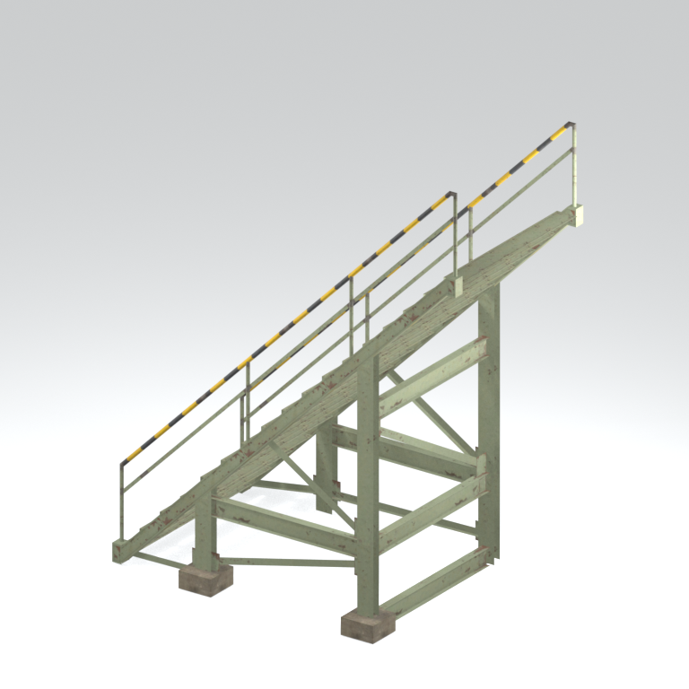
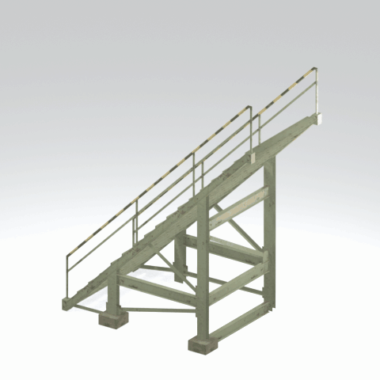

# Unidentified model (mgom_star004_prst002)

Native model reference; a readable object identification has not been reviewed.

[Library](../README.md) | [Category](../tables/unclassified-components-1.md) | [Source / advanced data](../catalogue.json) | [Credits](../sources-and-credits.md)

**Game filename:** mgom_star004_prst002.fmdl  
**Category:** Unclassified &gt; Unclassified components  
**Variant:** No explicit variant token; **LOD:** 0  
**Tags:** 

## Still reference



## 360-degree reference



The camera circles a static model. This is not a native animation. Source base textures and UVs use approximate studio shading; interaction, collision, complete assembly and FOX shader equivalence are not established.

## Identity and naming

| Field | Value |
|---|---|
| Library ID | mgsv-tpp-mgom_star004_prst002-60dfb8bc10b7a651 |
| Naming status | unidentified |
| Naming confidence | unknown |
| Naming evidence | {} |
| Native model | /Assets/mgo/environ/object/mgo_mafr/stairs/mgom_star004/scenes/mgom_star004_prst002.fmdl |
| Model SHA256 | bbd6eb3d05b01f919b873837d172d7e4d9f226c14e6687e4a7144f26a273f57e |
| Container | /Assets/mgo/pack/location/afc1/pack_common/afc1_common.fpk |
| Container SHA256 | cf9aff37b860d362b6723fe700775983cc61ae7d7f23b6de70df9ba489a966da |
| Captured source / location scope | Selected native member/content and captured installed-source chain; full archive SHA/runtime priority unresolved |
| Raw record SHA256 | 63e4d4a6fcbd2d44c6182a5c7c3b5cfdd160adeb6c64b85e045b9a8c76bd6fc5 |

Naming review is descriptive metadata only. It does not change model completion or identify a working game interaction.

## Native LOD inventory

| Native LOD | Triangles | Preview status | Decoded indices SHA256 |
|---|---:|---|---|
| 0 | 386 | rendered | ffd6a2e5f594ed7d28d96e7d2ab56d51412b7dd2b895add203460dc68eda502d |
| 1 | 346 | not separately rendered | 7903bf2bcd4b7cefd9ff111463bd50f88b626d6076266a1e7b657c22cd392343 |
| 2 | 301 | not separately rendered | d28c15c088929f524a3bb138311c16e0471674f72dea1f6d1a44f41ec99a501c |
| 3 | 271 | not separately rendered | 6d3089404268105cca86d0452efff537846acd7524d7f8be08a9419f6e4574e0 |

Mesh detail and texture pixels/mips are separate. Index hashes describe decoded triangle arrays, not packed index-buffer bytes. Only source-recorded native levels are listed.

<details>
<summary>Texture, source and naming technical metadata</summary>

```json
{
  "source": {
    "nativePath": "/Assets/mgo/environ/object/mgo_mafr/stairs/mgom_star004/scenes/mgom_star004_prst002.fmdl",
    "nativeSha256": "bbd6eb3d05b01f919b873837d172d7e4d9f226c14e6687e4a7144f26a273f57e",
    "stableIdentity": "/assets/mgo/environ/object/mgo_mafr/stairs/mgom_star004/scenes/mgom_star004_prst002.fmdl#bbd6eb3d05b01f919b873837d172d7e4d9f226c14e6687e4a7144f26a273f57e#2b249e214d6c0e3017d9530f5c57c3a7f64ed10cc7bc71bc5fdee7c6fc1a7e0a",
    "container": {
      "nativePath": "/Assets/mgo/pack/location/afc1/pack_common/afc1_common.fpk",
      "sha256": "cf9aff37b860d362b6723fe700775983cc61ae7d7f23b6de70df9ba489a966da",
      "status": "Selected installed-source container/member chain captured by community reader"
    },
    "historicalDatOrigin": null,
    "sourceArchiveAtCapture": "master/0/00.dat",
    "locationStatus": "Selected native member/content and captured installed-source chain; full archive SHA/runtime priority unresolved",
    "currentInstalledDatVerified": false,
    "selectedInstalledMemberVerified": true,
    "evidence": {
      "archive_helper_executable_sha256": "6f8e39a436af3b024bbd0504966ab3d5d9d0cb05d86689bf3e83d15e68df613f",
      "archive_helper_source_sha256": "f662d3b63e066a0afc77ffe22ea0e564222d14469648300dba2c4f8e9b43446b",
      "archive_index_recipe": "54acff767f08d76ad6056c5387328759bc883df507788f398de6c2c04fac12db",
      "archive_reader": "Atvaark GzsTool.Core 0.5.3",
      "archive_reader_core_sha256": "9da447ae3c375cce2e46744eeff6af50f1591062afdf479d1a0b49edb47daaa3",
      "archive_tool_and_dictionary_sha256": {
        "CityHash.dll": "def6c4506d461b65e4059b2936b2cbd5f852ba5d1d8a1a527f1c0e6dc7008c8f",
        "GzsTool.Core.dll": "9da447ae3c375cce2e46744eeff6af50f1591062afdf479d1a0b49edb47daaa3",
        "GzsTool.exe": "1a9c5b11e2355383ff485aee7e86abc026f5c1fad729daf8c0fd15ee0aae1c10",
        "Zlib.Portable.dll": "fe84781ba35ca9cc5ff5f73fd08d2a66c59e5257b4573f5fe59743f30bf78e42",
        "fpk_dictionary.txt": "b82f9a8d6c10a68ba9471eca9d815c21355a53b5e68753d8ad7db7fd01bf401d",
        "qar_dictionary.txt": "1558c248ed0a4bb827888261563fbb91a2df4f03999682f85d637ff70d9d5fb2"
      },
      "bytes": 28608,
      "container_chain": [
        {
          "content_sha256": null,
          "depth": 0,
          "id": "3f19555d27c2ebecdfbad26aadd88b9f62e9fb6092c04c712963ef73c67ccb42",
          "index_sha256": "9acd3675d6e1500e0e18430cba0fdc70a5718ad7d6b62f13905891a35d59f18a",
          "kind": "qar",
          "name": "master/0/00.dat",
          "parent_occurrence": null
        },
        {
          "content_sha256": "cf9aff37b860d362b6723fe700775983cc61ae7d7f23b6de70df9ba489a966da",
          "depth": 1,
          "id": "6f51e2cefeb81d4be84fd97795833addfdc97724952faa48b68b04b91276c2d6",
          "index_sha256": "093dbba03abdf3c5222bb14076d11b2f349a959ae6521fed333d73e2731c6090",
          "kind": "fpk",
          "name": "/Assets/mgo/pack/location/afc1/pack_common/afc1_common.fpk",
          "parent_occurrence": "dc78337c139fb86a3d388f65ba968ecf0c752819c6074e53d3482c1ed223b489"
        }
      ],
      "contentSha256": "bbd6eb3d05b01f919b873837d172d7e4d9f226c14e6687e4a7144f26a273f57e",
      "member": {
        "actual_size": 28608,
        "compressed_size": null,
        "content_sha256": "bbd6eb3d05b01f919b873837d172d7e4d9f226c14e6687e4a7144f26a273f57e",
        "declared_size": 28608,
        "extension": "fmdl",
        "hash_hex": null,
        "name": "/Assets/mgo/environ/object/mgo_mafr/stairs/mgom_star004/scenes/mgom_star004_prst002.fmdl",
        "name_origin": "embedded",
        "offset": 7038368,
        "ordinal": 164,
        "path_hash": null,
        "resolved": 1
      },
      "occurrenceId": "2f03db885be5b67e0c1bb24a2717895bae86ddb0cee0fd5f93107095c4c3c38b",
      "occurrence_id": "2f03db885be5b67e0c1bb24a2717895bae86ddb0cee0fd5f93107095c4c3c38b",
      "primary_source_revision": "fc4a8196555638c6cf8aa1b7c8dc34ccd5c69cb5",
      "source_adapter": "community_core_selective_export",
      "source_id": "7f6bb743fb4c487f0e9522f9c7fac280c46cf6b1051e0fc75a93602c8eb451f0",
      "source_path": "master/0/00.dat",
      "source_snapshot": "{\"bytes\":768788480,\"device\":621747392682911458,\"file_id\":844424931596481,\"header_sha256\":\"ead50f0a9a37e4285323b9c6fa0ec75fe75e518c63147e63158eeb2892c6589e\",\"mtime_ns\":1791852224238580700}",
      "virtualPath": "/Assets/mgo/environ/object/mgo_mafr/stairs/mgom_star004/scenes/mgom_star004_prst002.fmdl"
    }
  },
  "materials": [
    {
      "sampler": "Base_Tex_SRGB",
      "materialIndex": 0,
      "nativePathHash": "1543292942967053323",
      "nativeVirtualPath": null,
      "nativeBinding": {
        "familyId": "892514c2e05809fb7a7f05cfd7b2a5c682c296678dbadd0170b187eebcd23164",
        "height": 512,
        "materialIndex": 0,
        "mipCount": 8,
        "nativeMipCountVerified": true,
        "nativePath": null,
        "nativePathHash": "1543292942967053323",
        "nativeTexture": {
          "additionalFtexsFileCount": 2,
          "depth": 1,
          "ftexsFileCount": 3,
          "height": 512,
          "metadataBytes": 192,
          "mipCount": 8,
          "mips": [
            {
              "chunks": 8,
              "decodedBytes": 131072,
              "mip": 0,
              "offset": 0,
              "storedBytes": 93968,
              "streamNumber": 3
            },
            {
              "chunks": 2,
              "decodedBytes": 32768,
              "mip": 1,
              "offset": 0,
              "storedBytes": 24192,
              "streamNumber": 2
            },
            {
              "chunks": 1,
              "decodedBytes": 8192,
              "mip": 2,
              "offset": 2328,
              "storedBytes": 6128,
              "streamNumber": 1
            },
            {
              "chunks": 1,
              "decodedBytes": 2048,
              "mip": 3,
              "offset": 704,
              "storedBytes": 1616,
              "streamNumber": 1
            },
            {
              "chunks": 1,
              "decodedBytes": 512,
              "mip": 4,
              "offset": 232,
              "storedBytes": 464,
              "streamNumber": 1
            },
            {
              "chunks": 1,
              "decodedBytes": 128,
              "mip": 5,
              "offset": 80,
              "storedBytes": 144,
              "streamNumber": 1
            },
            {
              "chunks": 1,
              "decodedBytes": 32,
              "mip": 6,
              "offset": 24,
              "storedBytes": 48,
              "streamNumber": 1
            },
            {
              "chunks": 1,
              "decodedBytes": 8,
              "mip": 7,
              "offset": 0,
              "storedBytes": 16,
              "streamNumber": 1
            }
          ],
          "nativeHeaderHash": "577a61d50cb64fa46cb76b749b04f4f3",
          "nrtFlag": 2,
          "pixelFormat": 2,
          "requiredStreamNumbers": [
            1,
            2,
            3
          ],
          "textureType": 16777219,
          "unknownFlags": 273,
          "width": 512
        },
        "samplerName": "Base_Tex_SRGB",
        "samplerNameHash": "72475356961633",
        "sha256": "80892ff09f955ac26868a498be9929dbb1cf9918e07f28e5c75d3dfe8b065bca",
        "sourceOccurrences": [
          {
            "archive_helper_executable_sha256": "6f8e39a436af3b024bbd0504966ab3d5d9d0cb05d86689bf3e83d15e68df613f",
            "archive_helper_source_sha256": "f662d3b63e066a0afc77ffe22ea0e564222d14469648300dba2c4f8e9b43446b",
            "archive_index_recipe": "54acff767f08d76ad6056c5387328759bc883df507788f398de6c2c04fac12db",
            "archive_reader": "Atvaark GzsTool.Core 0.5.3",
            "archive_reader_core_sha256": "9da447ae3c375cce2e46744eeff6af50f1591062afdf479d1a0b49edb47daaa3",
            "archive_tool_and_dictionary_sha256": {
              "CityHash.dll": "def6c4506d461b65e4059b2936b2cbd5f852ba5d1d8a1a527f1c0e6dc7008c8f",
              "GzsTool.Core.dll": "9da447ae3c375cce2e46744eeff6af50f1591062afdf479d1a0b49edb47daaa3",
              "GzsTool.exe": "1a9c5b11e2355383ff485aee7e86abc026f5c1fad729daf8c0fd15ee0aae1c10",
              "Zlib.Portable.dll": "fe84781ba35ca9cc5ff5f73fd08d2a66c59e5257b4573f5fe59743f30bf78e42",
              "fpk_dictionary.txt": "b82f9a8d6c10a68ba9471eca9d815c21355a53b5e68753d8ad7db7fd01bf401d",
              "qar_dictionary.txt": "1558c248ed0a4bb827888261563fbb91a2df4f03999682f85d637ff70d9d5fb2"
            },
            "bytes": 192,
            "container_chain": [
              {
                "content_sha256": null,
                "depth": 0,
                "id": "436c8cfb4f382de93365b167a61aa81383299b7bad18205d60f1d0beeb3919e3",
                "index_sha256": "2d7b45c6ca65418839618e978562cac336091c06eb56dfe99f762b07a4016960",
                "kind": "qar",
                "name": "master/texture4.dat",
                "parent_occurrence": null
              }
            ],
            "contentSha256": "379d5a982b265f0e36027ea955dc12302a6f1ea3341722026ac5449b68eaa01c",
            "member": {
              "actual_size": 192,
              "compressed_size": 192,
              "content_sha256": "379d5a982b265f0e36027ea955dc12302a6f1ea3341722026ac5449b68eaa01c",
              "declared_size": 192,
              "extension": "ftex",
              "hash_hex": "156ae0c141eb1c0b",
              "name": "2e0c141eb1c0b.ftex",
              "name_origin": "hash_fallback",
              "offset": 324561952,
              "ordinal": 1333,
              "path_hash": "2e0c141eb1c0b",
              "resolved": 0
            },
            "occurrenceId": "7345d34e52d2bf4e0ca1a3d6e3f33a02ee60175bce2b23f228782a1fbe004f25",
            "occurrence_id": "7345d34e52d2bf4e0ca1a3d6e3f33a02ee60175bce2b23f228782a1fbe004f25",
            "primary_source_revision": "fc4a8196555638c6cf8aa1b7c8dc34ccd5c69cb5",
            "source_adapter": "community_core_selective_export",
            "source_id": "6c31b98b4db9b88eb76cfcb538f5f34b4729531266a9459584126720a4fc14aa",
            "source_path": "master/texture4.dat",
            "source_snapshot": "{\"bytes\":2031604736,\"device\":621747392682911458,\"file_id\":562949953639628,\"header_sha256\":\"40ee2c6917b338f7f68c49847c97fe92b978506a1ba847fcc94d28c931c8711a\",\"mtime_ns\":1791224675561235200}",
            "virtualPath": "2e0c141eb1c0b.ftex"
          },
          {
            "archive_helper_executable_sha256": "6f8e39a436af3b024bbd0504966ab3d5d9d0cb05d86689bf3e83d15e68df613f",
            "archive_helper_source_sha256": "f662d3b63e066a0afc77ffe22ea0e564222d14469648300dba2c4f8e9b43446b",
            "archive_index_recipe": "54acff767f08d76ad6056c5387328759bc883df507788f398de6c2c04fac12db",
            "archive_reader": "Atvaark GzsTool.Core 0.5.3",
            "archive_reader_core_sha256": "9da447ae3c375cce2e46744eeff6af50f1591062afdf479d1a0b49edb47daaa3",
            "archive_tool_and_dictionary_sha256": {
              "CityHash.dll": "def6c4506d461b65e4059b2936b2cbd5f852ba5d1d8a1a527f1c0e6dc7008c8f",
              "GzsTool.Core.dll": "9da447ae3c375cce2e46744eeff6af50f1591062afdf479d1a0b49edb47daaa3",
              "GzsTool.exe": "1a9c5b11e2355383ff485aee7e86abc026f5c1fad729daf8c0fd15ee0aae1c10",
              "Zlib.Portable.dll": "fe84781ba35ca9cc5ff5f73fd08d2a66c59e5257b4573f5fe59743f30bf78e42",
              "fpk_dictionary.txt": "b82f9a8d6c10a68ba9471eca9d815c21355a53b5e68753d8ad7db7fd01bf401d",
              "qar_dictionary.txt": "1558c248ed0a4bb827888261563fbb91a2df4f03999682f85d637ff70d9d5fb2"
            },
            "bytes": 8464,
            "container_chain": [
              {
                "content_sha256": null,
                "depth": 0,
                "id": "436c8cfb4f382de93365b167a61aa81383299b7bad18205d60f1d0beeb3919e3",
                "index_sha256": "2d7b45c6ca65418839618e978562cac336091c06eb56dfe99f762b07a4016960",
                "kind": "qar",
                "name": "master/texture4.dat",
                "parent_occurrence": null
              }
            ],
            "contentSha256": "fefaddea4cf7dc5384f7c84965bc19349cfbeb4b9402f0a20b34355b0b7054aa",
            "member": {
              "actual_size": 8464,
              "compressed_size": 8464,
              "content_sha256": "fefaddea4cf7dc5384f7c84965bc19349cfbeb4b9402f0a20b34355b0b7054aa",
              "declared_size": 8464,
              "extension": "1.ftexs",
              "hash_hex": "b2c2e0c141eb1c0b",
              "name": "2e0c141eb1c0b.1.ftexs",
              "name_origin": "hash_fallback",
              "offset": 324433952,
              "ordinal": 1330,
              "path_hash": "2e0c141eb1c0b",
              "resolved": 0
            },
            "occurrenceId": "8d3e6dc32c046b20767dfdc8d27065fb26fa384e488850ca2c467ad32d3ba15b",
            "occurrence_id": "8d3e6dc32c046b20767dfdc8d27065fb26fa384e488850ca2c467ad32d3ba15b",
            "primary_source_revision": "fc4a8196555638c6cf8aa1b7c8dc34ccd5c69cb5",
            "source_adapter": "community_core_selective_export",
            "source_id": "6c31b98b4db9b88eb76cfcb538f5f34b4729531266a9459584126720a4fc14aa",
            "source_path": "master/texture4.dat",
            "source_snapshot": "{\"bytes\":2031604736,\"device\":621747392682911458,\"file_id\":562949953639628,\"header_sha256\":\"40ee2c6917b338f7f68c49847c97fe92b978506a1ba847fcc94d28c931c8711a\",\"mtime_ns\":1791224675561235200}",
            "virtualPath": "2e0c141eb1c0b.1.ftexs"
          },
          {
            "archive_helper_executable_sha256": "6f8e39a436af3b024bbd0504966ab3d5d9d0cb05d86689bf3e83d15e68df613f",
            "archive_helper_source_sha256": "f662d3b63e066a0afc77ffe22ea0e564222d14469648300dba2c4f8e9b43446b",
            "archive_index_recipe": "54acff767f08d76ad6056c5387328759bc883df507788f398de6c2c04fac12db",
            "archive_reader": "Atvaark GzsTool.Core 0.5.3",
            "archive_reader_core_sha256": "9da447ae3c375cce2e46744eeff6af50f1591062afdf479d1a0b49edb47daaa3",
            "archive_tool_and_dictionary_sha256": {
              "CityHash.dll": "def6c4506d461b65e4059b2936b2cbd5f852ba5d1d8a1a527f1c0e6dc7008c8f",
              "GzsTool.Core.dll": "9da447ae3c375cce2e46744eeff6af50f1591062afdf479d1a0b49edb47daaa3",
              "GzsTool.exe": "1a9c5b11e2355383ff485aee7e86abc026f5c1fad729daf8c0fd15ee0aae1c10",
              "Zlib.Portable.dll": "fe84781ba35ca9cc5ff5f73fd08d2a66c59e5257b4573f5fe59743f30bf78e42",
              "fpk_dictionary.txt": "b82f9a8d6c10a68ba9471eca9d815c21355a53b5e68753d8ad7db7fd01bf401d",
              "qar_dictionary.txt": "1558c248ed0a4bb827888261563fbb91a2df4f03999682f85d637ff70d9d5fb2"
            },
            "bytes": 24208,
            "container_chain": [
              {
                "content_sha256": null,
                "depth": 0,
                "id": "436c8cfb4f382de93365b167a61aa81383299b7bad18205d60f1d0beeb3919e3",
                "index_sha256": "2d7b45c6ca65418839618e978562cac336091c06eb56dfe99f762b07a4016960",
                "kind": "qar",
                "name": "master/texture4.dat",
                "parent_occurrence": null
              }
            ],
            "contentSha256": "43b4dd0f45127ce8ec50cc2bed4b058cc6a6dc126786578d76728912a2c51823",
            "member": {
              "actual_size": 24208,
              "compressed_size": 24208,
              "content_sha256": "43b4dd0f45127ce8ec50cc2bed4b058cc6a6dc126786578d76728912a2c51823",
              "declared_size": 24208,
              "extension": "2.ftexs",
              "hash_hex": "b572e0c141eb1c0b",
              "name": "2e0c141eb1c0b.2.ftexs",
              "name_origin": "hash_fallback",
              "offset": 324443168,
              "ordinal": 1331,
              "path_hash": "2e0c141eb1c0b",
              "resolved": 0
            },
            "occurrenceId": "1954dedf251489d94ce290125c4f1f9ba92b74615273b731036a6ddce571fc83",
            "occurrence_id": "1954dedf251489d94ce290125c4f1f9ba92b74615273b731036a6ddce571fc83",
            "primary_source_revision": "fc4a8196555638c6cf8aa1b7c8dc34ccd5c69cb5",
            "source_adapter": "community_core_selective_export",
            "source_id": "6c31b98b4db9b88eb76cfcb538f5f34b4729531266a9459584126720a4fc14aa",
            "source_path": "master/texture4.dat",
            "source_snapshot": "{\"bytes\":2031604736,\"device\":621747392682911458,\"file_id\":562949953639628,\"header_sha256\":\"40ee2c6917b338f7f68c49847c97fe92b978506a1ba847fcc94d28c931c8711a\",\"mtime_ns\":1791224675561235200}",
            "virtualPath": "2e0c141eb1c0b.2.ftexs"
          },
          {
            "archive_helper_executable_sha256": "6f8e39a436af3b024bbd0504966ab3d5d9d0cb05d86689bf3e83d15e68df613f",
            "archive_helper_source_sha256": "f662d3b63e066a0afc77ffe22ea0e564222d14469648300dba2c4f8e9b43446b",
            "archive_index_recipe": "54acff767f08d76ad6056c5387328759bc883df507788f398de6c2c04fac12db",
            "archive_reader": "Atvaark GzsTool.Core 0.5.3",
            "archive_reader_core_sha256": "9da447ae3c375cce2e46744eeff6af50f1591062afdf479d1a0b49edb47daaa3",
            "archive_tool_and_dictionary_sha256": {
              "CityHash.dll": "def6c4506d461b65e4059b2936b2cbd5f852ba5d1d8a1a527f1c0e6dc7008c8f",
              "GzsTool.Core.dll": "9da447ae3c375cce2e46744eeff6af50f1591062afdf479d1a0b49edb47daaa3",
              "GzsTool.exe": "1a9c5b11e2355383ff485aee7e86abc026f5c1fad729daf8c0fd15ee0aae1c10",
              "Zlib.Portable.dll": "fe84781ba35ca9cc5ff5f73fd08d2a66c59e5257b4573f5fe59743f30bf78e42",
              "fpk_dictionary.txt": "b82f9a8d6c10a68ba9471eca9d815c21355a53b5e68753d8ad7db7fd01bf401d",
              "qar_dictionary.txt": "1558c248ed0a4bb827888261563fbb91a2df4f03999682f85d637ff70d9d5fb2"
            },
            "bytes": 94032,
            "container_chain": [
              {
                "content_sha256": null,
                "depth": 0,
                "id": "e73d96973ade76f7a00afdbea486dd110896ace97da0791f56899647de46f210",
                "index_sha256": "5a818609a652a10d90fb90015661d0cb80898096bbb3aac36382172988d8736d",
                "kind": "qar",
                "name": "mgo/texture0.dat",
                "parent_occurrence": null
              }
            ],
            "contentSha256": "367be9fc1b164a5f17db2fbfd70ea3018d3e9c89eed7ced3b572abd4d32d1e6b",
            "member": {
              "actual_size": 94032,
              "compressed_size": 94032,
              "content_sha256": "367be9fc1b164a5f17db2fbfd70ea3018d3e9c89eed7ced3b572abd4d32d1e6b",
              "declared_size": 94032,
              "extension": "3.ftexs",
              "hash_hex": "571ae0c141eb1c0b",
              "name": "2e0c141eb1c0b.3.ftexs",
              "name_origin": "hash_fallback",
              "offset": 2362582048,
              "ordinal": 8418,
              "path_hash": "2e0c141eb1c0b",
              "resolved": 0
            },
            "occurrenceId": "230f45970385af6936b6f5a739de6fb071254f816355bed773961d633dfdb8c3",
            "occurrence_id": "230f45970385af6936b6f5a739de6fb071254f816355bed773961d633dfdb8c3",
            "primary_source_revision": "fc4a8196555638c6cf8aa1b7c8dc34ccd5c69cb5",
            "source_adapter": "community_core_selective_export",
            "source_id": "03f5942f0e1af8040ae05b95c43716d75f5933971d78324bf7cfea291297f3f4",
            "source_path": "mgo/texture0.dat",
            "source_snapshot": "{\"bytes\":4492370944,\"device\":621747392682911458,\"file_id\":562949953639631,\"header_sha256\":\"6108fbacb65c84d041742c39e5ca630745240453b336f1059a13b91943f0b011\",\"mtime_ns\":1791224675562234400}",
            "virtualPath": "2e0c141eb1c0b.3.ftexs"
          }
        ],
        "width": 512
      },
      "ddsSha256": "80892ff09f955ac26868a498be9929dbb1cf9918e07f28e5c75d3dfe8b065bca",
      "dimensions": [
        512,
        512
      ],
      "mipCount": 8,
      "nativeMipCountVerified": true,
      "connectedInPreview": true
    },
    {
      "sampler": "Base_Tex_SRGB",
      "materialIndex": 1,
      "nativePathHash": "1542759032118802783",
      "nativeVirtualPath": null,
      "nativeBinding": {
        "familyId": "aa4ed52b6615360b223c8fb9d6bcfeb30431da7437828946d8ce24a9f29c92fc",
        "height": 512,
        "materialIndex": 1,
        "mipCount": 8,
        "nativeMipCountVerified": true,
        "nativePath": null,
        "nativePathHash": "1542759032118802783",
        "nativeTexture": {
          "additionalFtexsFileCount": 2,
          "depth": 1,
          "ftexsFileCount": 3,
          "height": 512,
          "metadataBytes": 192,
          "mipCount": 8,
          "mips": [
            {
              "chunks": 8,
              "decodedBytes": 131072,
              "mip": 0,
              "offset": 0,
              "storedBytes": 91536,
              "streamNumber": 3
            },
            {
              "chunks": 2,
              "decodedBytes": 32768,
              "mip": 1,
              "offset": 0,
              "storedBytes": 23680,
              "streamNumber": 2
            },
            {
              "chunks": 1,
              "decodedBytes": 8192,
              "mip": 2,
              "offset": 2296,
              "storedBytes": 5984,
              "streamNumber": 1
            },
            {
              "chunks": 1,
              "decodedBytes": 2048,
              "mip": 3,
              "offset": 704,
              "storedBytes": 1584,
              "streamNumber": 1
            },
            {
              "chunks": 1,
              "decodedBytes": 512,
              "mip": 4,
              "offset": 232,
              "storedBytes": 464,
              "streamNumber": 1
            },
            {
              "chunks": 1,
              "decodedBytes": 128,
              "mip": 5,
              "offset": 80,
              "storedBytes": 144,
              "streamNumber": 1
            },
            {
              "chunks": 1,
              "decodedBytes": 32,
              "mip": 6,
              "offset": 24,
              "storedBytes": 48,
              "streamNumber": 1
            },
            {
              "chunks": 1,
              "decodedBytes": 8,
              "mip": 7,
              "offset": 0,
              "storedBytes": 16,
              "streamNumber": 1
            }
          ],
          "nativeHeaderHash": "bf1147c89543acc7ebdf181a99e2464d",
          "nrtFlag": 2,
          "pixelFormat": 2,
          "requiredStreamNumbers": [
            1,
            2,
            3
          ],
          "textureType": 16777219,
          "unknownFlags": 273,
          "width": 512
        },
        "samplerName": "Base_Tex_SRGB",
        "samplerNameHash": "72475356961633",
        "sha256": "c964960f70740f07289d7516a5ba6d8008f9f2d20fffd37a6db37ba12b89dd3f",
        "sourceOccurrences": [
          {
            "archive_helper_executable_sha256": "6f8e39a436af3b024bbd0504966ab3d5d9d0cb05d86689bf3e83d15e68df613f",
            "archive_helper_source_sha256": "f662d3b63e066a0afc77ffe22ea0e564222d14469648300dba2c4f8e9b43446b",
            "archive_index_recipe": "54acff767f08d76ad6056c5387328759bc883df507788f398de6c2c04fac12db",
            "archive_reader": "Atvaark GzsTool.Core 0.5.3",
            "archive_reader_core_sha256": "9da447ae3c375cce2e46744eeff6af50f1591062afdf479d1a0b49edb47daaa3",
            "archive_tool_and_dictionary_sha256": {
              "CityHash.dll": "def6c4506d461b65e4059b2936b2cbd5f852ba5d1d8a1a527f1c0e6dc7008c8f",
              "GzsTool.Core.dll": "9da447ae3c375cce2e46744eeff6af50f1591062afdf479d1a0b49edb47daaa3",
              "GzsTool.exe": "1a9c5b11e2355383ff485aee7e86abc026f5c1fad729daf8c0fd15ee0aae1c10",
              "Zlib.Portable.dll": "fe84781ba35ca9cc5ff5f73fd08d2a66c59e5257b4573f5fe59743f30bf78e42",
              "fpk_dictionary.txt": "b82f9a8d6c10a68ba9471eca9d815c21355a53b5e68753d8ad7db7fd01bf401d",
              "qar_dictionary.txt": "1558c248ed0a4bb827888261563fbb91a2df4f03999682f85d637ff70d9d5fb2"
            },
            "bytes": 192,
            "container_chain": [
              {
                "content_sha256": null,
                "depth": 0,
                "id": "3f19555d27c2ebecdfbad26aadd88b9f62e9fb6092c04c712963ef73c67ccb42",
                "index_sha256": "9acd3675d6e1500e0e18430cba0fdc70a5718ad7d6b62f13905891a35d59f18a",
                "kind": "qar",
                "name": "master/0/00.dat",
                "parent_occurrence": null
              },
              {
                "content_sha256": "fd97657e1effdfa66faedfaa8aceab8699d5928812f2b7a948d492958f56217f",
                "depth": 1,
                "id": "041de25569b3afa35eafa037a79dbb221550af7c25638c26c5f796237b698a20",
                "index_sha256": "f3d8d59afb06b4309a625ba0dd5dc2f42dabc3d59150229746a05c61ee570d06",
                "kind": "pftxs",
                "name": "/Assets/mgo/pack/location/afc1/pack_common/afc1_common.pftxs",
                "parent_occurrence": "9bb9ddd185492a361b81e97ef73bd7f96ca26f3e99f82de31fecc98df2c24293"
              }
            ],
            "contentSha256": "4e90328e804a02eca38c3c04bfc5748e46171c6598282ca626172147436942ed",
            "member": {
              "actual_size": 192,
              "compressed_size": null,
              "content_sha256": "4e90328e804a02eca38c3c04bfc5748e46171c6598282ca626172147436942ed",
              "declared_size": 192,
              "extension": "ftex",
              "hash_hex": "1568fb2a7377795f",
              "name": "1568fb2a7377795f.ftex",
              "name_origin": "hash_fallback",
              "offset": 4504544,
              "ordinal": 484,
              "path_hash": null,
              "resolved": 0
            },
            "occurrenceId": "1e6d39898c9b744e1c6fac06c2459d720af3850abcce2c220a1969bdcb08edf6",
            "occurrence_id": "1e6d39898c9b744e1c6fac06c2459d720af3850abcce2c220a1969bdcb08edf6",
            "primary_source_revision": "fc4a8196555638c6cf8aa1b7c8dc34ccd5c69cb5",
            "source_adapter": "community_core_selective_export",
            "source_id": "7f6bb743fb4c487f0e9522f9c7fac280c46cf6b1051e0fc75a93602c8eb451f0",
            "source_path": "master/0/00.dat",
            "source_snapshot": "{\"bytes\":768788480,\"device\":621747392682911458,\"file_id\":844424931596481,\"header_sha256\":\"ead50f0a9a37e4285323b9c6fa0ec75fe75e518c63147e63158eeb2892c6589e\",\"mtime_ns\":1791852224238580700}",
            "virtualPath": "1568fb2a7377795f.ftex"
          },
          {
            "archive_helper_executable_sha256": "6f8e39a436af3b024bbd0504966ab3d5d9d0cb05d86689bf3e83d15e68df613f",
            "archive_helper_source_sha256": "f662d3b63e066a0afc77ffe22ea0e564222d14469648300dba2c4f8e9b43446b",
            "archive_index_recipe": "54acff767f08d76ad6056c5387328759bc883df507788f398de6c2c04fac12db",
            "archive_reader": "Atvaark GzsTool.Core 0.5.3",
            "archive_reader_core_sha256": "9da447ae3c375cce2e46744eeff6af50f1591062afdf479d1a0b49edb47daaa3",
            "archive_tool_and_dictionary_sha256": {
              "CityHash.dll": "def6c4506d461b65e4059b2936b2cbd5f852ba5d1d8a1a527f1c0e6dc7008c8f",
              "GzsTool.Core.dll": "9da447ae3c375cce2e46744eeff6af50f1591062afdf479d1a0b49edb47daaa3",
              "GzsTool.exe": "1a9c5b11e2355383ff485aee7e86abc026f5c1fad729daf8c0fd15ee0aae1c10",
              "Zlib.Portable.dll": "fe84781ba35ca9cc5ff5f73fd08d2a66c59e5257b4573f5fe59743f30bf78e42",
              "fpk_dictionary.txt": "b82f9a8d6c10a68ba9471eca9d815c21355a53b5e68753d8ad7db7fd01bf401d",
              "qar_dictionary.txt": "1558c248ed0a4bb827888261563fbb91a2df4f03999682f85d637ff70d9d5fb2"
            },
            "bytes": 8288,
            "container_chain": [
              {
                "content_sha256": null,
                "depth": 0,
                "id": "3f19555d27c2ebecdfbad26aadd88b9f62e9fb6092c04c712963ef73c67ccb42",
                "index_sha256": "9acd3675d6e1500e0e18430cba0fdc70a5718ad7d6b62f13905891a35d59f18a",
                "kind": "qar",
                "name": "master/0/00.dat",
                "parent_occurrence": null
              },
              {
                "content_sha256": "fd97657e1effdfa66faedfaa8aceab8699d5928812f2b7a948d492958f56217f",
                "depth": 1,
                "id": "041de25569b3afa35eafa037a79dbb221550af7c25638c26c5f796237b698a20",
                "index_sha256": "f3d8d59afb06b4309a625ba0dd5dc2f42dabc3d59150229746a05c61ee570d06",
                "kind": "pftxs",
                "name": "/Assets/mgo/pack/location/afc1/pack_common/afc1_common.pftxs",
                "parent_occurrence": "9bb9ddd185492a361b81e97ef73bd7f96ca26f3e99f82de31fecc98df2c24293"
              }
            ],
            "contentSha256": "15c63a1e4b4f74e74cce6c56a0e205b91fbd2e0abc7304ea85da272f5ba31326",
            "member": {
              "actual_size": 8288,
              "compressed_size": null,
              "content_sha256": "15c63a1e4b4f74e74cce6c56a0e205b91fbd2e0abc7304ea85da272f5ba31326",
              "declared_size": 8288,
              "extension": "1.ftexs",
              "hash_hex": "b2c0fb2a7377795f",
              "name": "b2c0fb2a7377795f.1.ftexs",
              "name_origin": "hash_fallback",
              "offset": 4504736,
              "ordinal": 485,
              "path_hash": null,
              "resolved": 0
            },
            "occurrenceId": "1df0dfb36c8f037301bd7112c923ee794250b4f5efd5294a7cfc28b6a9fb0574",
            "occurrence_id": "1df0dfb36c8f037301bd7112c923ee794250b4f5efd5294a7cfc28b6a9fb0574",
            "primary_source_revision": "fc4a8196555638c6cf8aa1b7c8dc34ccd5c69cb5",
            "source_adapter": "community_core_selective_export",
            "source_id": "7f6bb743fb4c487f0e9522f9c7fac280c46cf6b1051e0fc75a93602c8eb451f0",
            "source_path": "master/0/00.dat",
            "source_snapshot": "{\"bytes\":768788480,\"device\":621747392682911458,\"file_id\":844424931596481,\"header_sha256\":\"ead50f0a9a37e4285323b9c6fa0ec75fe75e518c63147e63158eeb2892c6589e\",\"mtime_ns\":1791852224238580700}",
            "virtualPath": "b2c0fb2a7377795f.1.ftexs"
          },
          {
            "archive_helper_executable_sha256": "6f8e39a436af3b024bbd0504966ab3d5d9d0cb05d86689bf3e83d15e68df613f",
            "archive_helper_source_sha256": "f662d3b63e066a0afc77ffe22ea0e564222d14469648300dba2c4f8e9b43446b",
            "archive_index_recipe": "54acff767f08d76ad6056c5387328759bc883df507788f398de6c2c04fac12db",
            "archive_reader": "Atvaark GzsTool.Core 0.5.3",
            "archive_reader_core_sha256": "9da447ae3c375cce2e46744eeff6af50f1591062afdf479d1a0b49edb47daaa3",
            "archive_tool_and_dictionary_sha256": {
              "CityHash.dll": "def6c4506d461b65e4059b2936b2cbd5f852ba5d1d8a1a527f1c0e6dc7008c8f",
              "GzsTool.Core.dll": "9da447ae3c375cce2e46744eeff6af50f1591062afdf479d1a0b49edb47daaa3",
              "GzsTool.exe": "1a9c5b11e2355383ff485aee7e86abc026f5c1fad729daf8c0fd15ee0aae1c10",
              "Zlib.Portable.dll": "fe84781ba35ca9cc5ff5f73fd08d2a66c59e5257b4573f5fe59743f30bf78e42",
              "fpk_dictionary.txt": "b82f9a8d6c10a68ba9471eca9d815c21355a53b5e68753d8ad7db7fd01bf401d",
              "qar_dictionary.txt": "1558c248ed0a4bb827888261563fbb91a2df4f03999682f85d637ff70d9d5fb2"
            },
            "bytes": 23696,
            "container_chain": [
              {
                "content_sha256": null,
                "depth": 0,
                "id": "1cc220d9409d7163b6aca295ed89fd8c7befca6a8f849a8d5d09a2499724c863",
                "index_sha256": "5a818609a652a10d90fb90015661d0cb80898096bbb3aac36382172988d8736d",
                "kind": "qar",
                "name": "master/texture5_mgo0.dat",
                "parent_occurrence": null
              }
            ],
            "contentSha256": "70020d8b29d27271c562cf21f0cb283880c8b3385acc095d5aeda8284567ffee",
            "member": {
              "actual_size": 23696,
              "compressed_size": 23696,
              "content_sha256": "70020d8b29d27271c562cf21f0cb283880c8b3385acc095d5aeda8284567ffee",
              "declared_size": 23696,
              "extension": "2.ftexs",
              "hash_hex": "b570fb2a7377795f",
              "name": "fb2a7377795f.2.ftexs",
              "name_origin": "hash_fallback",
              "offset": 2362440736,
              "ordinal": 8415,
              "path_hash": "fb2a7377795f",
              "resolved": 0
            },
            "occurrenceId": "82e614d65a23c840807aa775b2ec25b42b175a949a0c70addec681ce9d3ecc57",
            "occurrence_id": "82e614d65a23c840807aa775b2ec25b42b175a949a0c70addec681ce9d3ecc57",
            "primary_source_revision": "fc4a8196555638c6cf8aa1b7c8dc34ccd5c69cb5",
            "source_adapter": "community_core_selective_export",
            "source_id": "24f8989ccaae47940dc20e54ba67442ad562ac0032ab6e3d475e927c81444b56",
            "source_path": "master/texture5_mgo0.dat",
            "source_snapshot": "{\"bytes\":4492370944,\"device\":621747392682911458,\"file_id\":13510798883237422,\"header_sha256\":\"6108fbacb65c84d041742c39e5ca630745240453b336f1059a13b91943f0b011\",\"mtime_ns\":1791224675562234400}",
            "virtualPath": "fb2a7377795f.2.ftexs"
          },
          {
            "archive_helper_executable_sha256": "6f8e39a436af3b024bbd0504966ab3d5d9d0cb05d86689bf3e83d15e68df613f",
            "archive_helper_source_sha256": "f662d3b63e066a0afc77ffe22ea0e564222d14469648300dba2c4f8e9b43446b",
            "archive_index_recipe": "54acff767f08d76ad6056c5387328759bc883df507788f398de6c2c04fac12db",
            "archive_reader": "Atvaark GzsTool.Core 0.5.3",
            "archive_reader_core_sha256": "9da447ae3c375cce2e46744eeff6af50f1591062afdf479d1a0b49edb47daaa3",
            "archive_tool_and_dictionary_sha256": {
              "CityHash.dll": "def6c4506d461b65e4059b2936b2cbd5f852ba5d1d8a1a527f1c0e6dc7008c8f",
              "GzsTool.Core.dll": "9da447ae3c375cce2e46744eeff6af50f1591062afdf479d1a0b49edb47daaa3",
              "GzsTool.exe": "1a9c5b11e2355383ff485aee7e86abc026f5c1fad729daf8c0fd15ee0aae1c10",
              "Zlib.Portable.dll": "fe84781ba35ca9cc5ff5f73fd08d2a66c59e5257b4573f5fe59743f30bf78e42",
              "fpk_dictionary.txt": "b82f9a8d6c10a68ba9471eca9d815c21355a53b5e68753d8ad7db7fd01bf401d",
              "qar_dictionary.txt": "1558c248ed0a4bb827888261563fbb91a2df4f03999682f85d637ff70d9d5fb2"
            },
            "bytes": 91600,
            "container_chain": [
              {
                "content_sha256": null,
                "depth": 0,
                "id": "436c8cfb4f382de93365b167a61aa81383299b7bad18205d60f1d0beeb3919e3",
                "index_sha256": "2d7b45c6ca65418839618e978562cac336091c06eb56dfe99f762b07a4016960",
                "kind": "qar",
                "name": "master/texture4.dat",
                "parent_occurrence": null
              }
            ],
            "contentSha256": "d8ceaba3a6b8af3b3fe38de7474d6bd854b43069c6223ad2d332fd6cf7ebca0d",
            "member": {
              "actual_size": 91600,
              "compressed_size": 91600,
              "content_sha256": "d8ceaba3a6b8af3b3fe38de7474d6bd854b43069c6223ad2d332fd6cf7ebca0d",
              "declared_size": 91600,
              "extension": "3.ftexs",
              "hash_hex": "5718fb2a7377795f",
              "name": "fb2a7377795f.3.ftexs",
              "name_origin": "hash_fallback",
              "offset": 324340768,
              "ordinal": 1328,
              "path_hash": "fb2a7377795f",
              "resolved": 0
            },
            "occurrenceId": "c9c2e07f3d6f10d1a42699ef73d03de3c4b1ddd20643559e04f929793ad369f5",
            "occurrence_id": "c9c2e07f3d6f10d1a42699ef73d03de3c4b1ddd20643559e04f929793ad369f5",
            "primary_source_revision": "fc4a8196555638c6cf8aa1b7c8dc34ccd5c69cb5",
            "source_adapter": "community_core_selective_export",
            "source_id": "6c31b98b4db9b88eb76cfcb538f5f34b4729531266a9459584126720a4fc14aa",
            "source_path": "master/texture4.dat",
            "source_snapshot": "{\"bytes\":2031604736,\"device\":621747392682911458,\"file_id\":562949953639628,\"header_sha256\":\"40ee2c6917b338f7f68c49847c97fe92b978506a1ba847fcc94d28c931c8711a\",\"mtime_ns\":1791224675561235200}",
            "virtualPath": "fb2a7377795f.3.ftexs"
          }
        ],
        "width": 512
      },
      "ddsSha256": "c964960f70740f07289d7516a5ba6d8008f9f2d20fffd37a6db37ba12b89dd3f",
      "dimensions": [
        512,
        512
      ],
      "mipCount": 8,
      "nativeMipCountVerified": true,
      "connectedInPreview": true
    },
    {
      "sampler": "Base_Tex_SRGB",
      "materialIndex": 2,
      "nativePathHash": "1543292942967053323",
      "nativeVirtualPath": null,
      "nativeBinding": {
        "familyId": "892514c2e05809fb7a7f05cfd7b2a5c682c296678dbadd0170b187eebcd23164",
        "height": 512,
        "materialIndex": 2,
        "mipCount": 8,
        "nativeMipCountVerified": true,
        "nativePath": null,
        "nativePathHash": "1543292942967053323",
        "nativeTexture": {
          "additionalFtexsFileCount": 2,
          "depth": 1,
          "ftexsFileCount": 3,
          "height": 512,
          "metadataBytes": 192,
          "mipCount": 8,
          "mips": [
            {
              "chunks": 8,
              "decodedBytes": 131072,
              "mip": 0,
              "offset": 0,
              "storedBytes": 93968,
              "streamNumber": 3
            },
            {
              "chunks": 2,
              "decodedBytes": 32768,
              "mip": 1,
              "offset": 0,
              "storedBytes": 24192,
              "streamNumber": 2
            },
            {
              "chunks": 1,
              "decodedBytes": 8192,
              "mip": 2,
              "offset": 2328,
              "storedBytes": 6128,
              "streamNumber": 1
            },
            {
              "chunks": 1,
              "decodedBytes": 2048,
              "mip": 3,
              "offset": 704,
              "storedBytes": 1616,
              "streamNumber": 1
            },
            {
              "chunks": 1,
              "decodedBytes": 512,
              "mip": 4,
              "offset": 232,
              "storedBytes": 464,
              "streamNumber": 1
            },
            {
              "chunks": 1,
              "decodedBytes": 128,
              "mip": 5,
              "offset": 80,
              "storedBytes": 144,
              "streamNumber": 1
            },
            {
              "chunks": 1,
              "decodedBytes": 32,
              "mip": 6,
              "offset": 24,
              "storedBytes": 48,
              "streamNumber": 1
            },
            {
              "chunks": 1,
              "decodedBytes": 8,
              "mip": 7,
              "offset": 0,
              "storedBytes": 16,
              "streamNumber": 1
            }
          ],
          "nativeHeaderHash": "577a61d50cb64fa46cb76b749b04f4f3",
          "nrtFlag": 2,
          "pixelFormat": 2,
          "requiredStreamNumbers": [
            1,
            2,
            3
          ],
          "textureType": 16777219,
          "unknownFlags": 273,
          "width": 512
        },
        "samplerName": "Base_Tex_SRGB",
        "samplerNameHash": "72475356961633",
        "sha256": "80892ff09f955ac26868a498be9929dbb1cf9918e07f28e5c75d3dfe8b065bca",
        "sourceOccurrences": [
          {
            "archive_helper_executable_sha256": "6f8e39a436af3b024bbd0504966ab3d5d9d0cb05d86689bf3e83d15e68df613f",
            "archive_helper_source_sha256": "f662d3b63e066a0afc77ffe22ea0e564222d14469648300dba2c4f8e9b43446b",
            "archive_index_recipe": "54acff767f08d76ad6056c5387328759bc883df507788f398de6c2c04fac12db",
            "archive_reader": "Atvaark GzsTool.Core 0.5.3",
            "archive_reader_core_sha256": "9da447ae3c375cce2e46744eeff6af50f1591062afdf479d1a0b49edb47daaa3",
            "archive_tool_and_dictionary_sha256": {
              "CityHash.dll": "def6c4506d461b65e4059b2936b2cbd5f852ba5d1d8a1a527f1c0e6dc7008c8f",
              "GzsTool.Core.dll": "9da447ae3c375cce2e46744eeff6af50f1591062afdf479d1a0b49edb47daaa3",
              "GzsTool.exe": "1a9c5b11e2355383ff485aee7e86abc026f5c1fad729daf8c0fd15ee0aae1c10",
              "Zlib.Portable.dll": "fe84781ba35ca9cc5ff5f73fd08d2a66c59e5257b4573f5fe59743f30bf78e42",
              "fpk_dictionary.txt": "b82f9a8d6c10a68ba9471eca9d815c21355a53b5e68753d8ad7db7fd01bf401d",
              "qar_dictionary.txt": "1558c248ed0a4bb827888261563fbb91a2df4f03999682f85d637ff70d9d5fb2"
            },
            "bytes": 192,
            "container_chain": [
              {
                "content_sha256": null,
                "depth": 0,
                "id": "436c8cfb4f382de93365b167a61aa81383299b7bad18205d60f1d0beeb3919e3",
                "index_sha256": "2d7b45c6ca65418839618e978562cac336091c06eb56dfe99f762b07a4016960",
                "kind": "qar",
                "name": "master/texture4.dat",
                "parent_occurrence": null
              }
            ],
            "contentSha256": "379d5a982b265f0e36027ea955dc12302a6f1ea3341722026ac5449b68eaa01c",
            "member": {
              "actual_size": 192,
              "compressed_size": 192,
              "content_sha256": "379d5a982b265f0e36027ea955dc12302a6f1ea3341722026ac5449b68eaa01c",
              "declared_size": 192,
              "extension": "ftex",
              "hash_hex": "156ae0c141eb1c0b",
              "name": "2e0c141eb1c0b.ftex",
              "name_origin": "hash_fallback",
              "offset": 324561952,
              "ordinal": 1333,
              "path_hash": "2e0c141eb1c0b",
              "resolved": 0
            },
            "occurrenceId": "7345d34e52d2bf4e0ca1a3d6e3f33a02ee60175bce2b23f228782a1fbe004f25",
            "occurrence_id": "7345d34e52d2bf4e0ca1a3d6e3f33a02ee60175bce2b23f228782a1fbe004f25",
            "primary_source_revision": "fc4a8196555638c6cf8aa1b7c8dc34ccd5c69cb5",
            "source_adapter": "community_core_selective_export",
            "source_id": "6c31b98b4db9b88eb76cfcb538f5f34b4729531266a9459584126720a4fc14aa",
            "source_path": "master/texture4.dat",
            "source_snapshot": "{\"bytes\":2031604736,\"device\":621747392682911458,\"file_id\":562949953639628,\"header_sha256\":\"40ee2c6917b338f7f68c49847c97fe92b978506a1ba847fcc94d28c931c8711a\",\"mtime_ns\":1791224675561235200}",
            "virtualPath": "2e0c141eb1c0b.ftex"
          },
          {
            "archive_helper_executable_sha256": "6f8e39a436af3b024bbd0504966ab3d5d9d0cb05d86689bf3e83d15e68df613f",
            "archive_helper_source_sha256": "f662d3b63e066a0afc77ffe22ea0e564222d14469648300dba2c4f8e9b43446b",
            "archive_index_recipe": "54acff767f08d76ad6056c5387328759bc883df507788f398de6c2c04fac12db",
            "archive_reader": "Atvaark GzsTool.Core 0.5.3",
            "archive_reader_core_sha256": "9da447ae3c375cce2e46744eeff6af50f1591062afdf479d1a0b49edb47daaa3",
            "archive_tool_and_dictionary_sha256": {
              "CityHash.dll": "def6c4506d461b65e4059b2936b2cbd5f852ba5d1d8a1a527f1c0e6dc7008c8f",
              "GzsTool.Core.dll": "9da447ae3c375cce2e46744eeff6af50f1591062afdf479d1a0b49edb47daaa3",
              "GzsTool.exe": "1a9c5b11e2355383ff485aee7e86abc026f5c1fad729daf8c0fd15ee0aae1c10",
              "Zlib.Portable.dll": "fe84781ba35ca9cc5ff5f73fd08d2a66c59e5257b4573f5fe59743f30bf78e42",
              "fpk_dictionary.txt": "b82f9a8d6c10a68ba9471eca9d815c21355a53b5e68753d8ad7db7fd01bf401d",
              "qar_dictionary.txt": "1558c248ed0a4bb827888261563fbb91a2df4f03999682f85d637ff70d9d5fb2"
            },
            "bytes": 8464,
            "container_chain": [
              {
                "content_sha256": null,
                "depth": 0,
                "id": "436c8cfb4f382de93365b167a61aa81383299b7bad18205d60f1d0beeb3919e3",
                "index_sha256": "2d7b45c6ca65418839618e978562cac336091c06eb56dfe99f762b07a4016960",
                "kind": "qar",
                "name": "master/texture4.dat",
                "parent_occurrence": null
              }
            ],
            "contentSha256": "fefaddea4cf7dc5384f7c84965bc19349cfbeb4b9402f0a20b34355b0b7054aa",
            "member": {
              "actual_size": 8464,
              "compressed_size": 8464,
              "content_sha256": "fefaddea4cf7dc5384f7c84965bc19349cfbeb4b9402f0a20b34355b0b7054aa",
              "declared_size": 8464,
              "extension": "1.ftexs",
              "hash_hex": "b2c2e0c141eb1c0b",
              "name": "2e0c141eb1c0b.1.ftexs",
              "name_origin": "hash_fallback",
              "offset": 324433952,
              "ordinal": 1330,
              "path_hash": "2e0c141eb1c0b",
              "resolved": 0
            },
            "occurrenceId": "8d3e6dc32c046b20767dfdc8d27065fb26fa384e488850ca2c467ad32d3ba15b",
            "occurrence_id": "8d3e6dc32c046b20767dfdc8d27065fb26fa384e488850ca2c467ad32d3ba15b",
            "primary_source_revision": "fc4a8196555638c6cf8aa1b7c8dc34ccd5c69cb5",
            "source_adapter": "community_core_selective_export",
            "source_id": "6c31b98b4db9b88eb76cfcb538f5f34b4729531266a9459584126720a4fc14aa",
            "source_path": "master/texture4.dat",
            "source_snapshot": "{\"bytes\":2031604736,\"device\":621747392682911458,\"file_id\":562949953639628,\"header_sha256\":\"40ee2c6917b338f7f68c49847c97fe92b978506a1ba847fcc94d28c931c8711a\",\"mtime_ns\":1791224675561235200}",
            "virtualPath": "2e0c141eb1c0b.1.ftexs"
          },
          {
            "archive_helper_executable_sha256": "6f8e39a436af3b024bbd0504966ab3d5d9d0cb05d86689bf3e83d15e68df613f",
            "archive_helper_source_sha256": "f662d3b63e066a0afc77ffe22ea0e564222d14469648300dba2c4f8e9b43446b",
            "archive_index_recipe": "54acff767f08d76ad6056c5387328759bc883df507788f398de6c2c04fac12db",
            "archive_reader": "Atvaark GzsTool.Core 0.5.3",
            "archive_reader_core_sha256": "9da447ae3c375cce2e46744eeff6af50f1591062afdf479d1a0b49edb47daaa3",
            "archive_tool_and_dictionary_sha256": {
              "CityHash.dll": "def6c4506d461b65e4059b2936b2cbd5f852ba5d1d8a1a527f1c0e6dc7008c8f",
              "GzsTool.Core.dll": "9da447ae3c375cce2e46744eeff6af50f1591062afdf479d1a0b49edb47daaa3",
              "GzsTool.exe": "1a9c5b11e2355383ff485aee7e86abc026f5c1fad729daf8c0fd15ee0aae1c10",
              "Zlib.Portable.dll": "fe84781ba35ca9cc5ff5f73fd08d2a66c59e5257b4573f5fe59743f30bf78e42",
              "fpk_dictionary.txt": "b82f9a8d6c10a68ba9471eca9d815c21355a53b5e68753d8ad7db7fd01bf401d",
              "qar_dictionary.txt": "1558c248ed0a4bb827888261563fbb91a2df4f03999682f85d637ff70d9d5fb2"
            },
            "bytes": 24208,
            "container_chain": [
              {
                "content_sha256": null,
                "depth": 0,
                "id": "436c8cfb4f382de93365b167a61aa81383299b7bad18205d60f1d0beeb3919e3",
                "index_sha256": "2d7b45c6ca65418839618e978562cac336091c06eb56dfe99f762b07a4016960",
                "kind": "qar",
                "name": "master/texture4.dat",
                "parent_occurrence": null
              }
            ],
            "contentSha256": "43b4dd0f45127ce8ec50cc2bed4b058cc6a6dc126786578d76728912a2c51823",
            "member": {
              "actual_size": 24208,
              "compressed_size": 24208,
              "content_sha256": "43b4dd0f45127ce8ec50cc2bed4b058cc6a6dc126786578d76728912a2c51823",
              "declared_size": 24208,
              "extension": "2.ftexs",
              "hash_hex": "b572e0c141eb1c0b",
              "name": "2e0c141eb1c0b.2.ftexs",
              "name_origin": "hash_fallback",
              "offset": 324443168,
              "ordinal": 1331,
              "path_hash": "2e0c141eb1c0b",
              "resolved": 0
            },
            "occurrenceId": "1954dedf251489d94ce290125c4f1f9ba92b74615273b731036a6ddce571fc83",
            "occurrence_id": "1954dedf251489d94ce290125c4f1f9ba92b74615273b731036a6ddce571fc83",
            "primary_source_revision": "fc4a8196555638c6cf8aa1b7c8dc34ccd5c69cb5",
            "source_adapter": "community_core_selective_export",
            "source_id": "6c31b98b4db9b88eb76cfcb538f5f34b4729531266a9459584126720a4fc14aa",
            "source_path": "master/texture4.dat",
            "source_snapshot": "{\"bytes\":2031604736,\"device\":621747392682911458,\"file_id\":562949953639628,\"header_sha256\":\"40ee2c6917b338f7f68c49847c97fe92b978506a1ba847fcc94d28c931c8711a\",\"mtime_ns\":1791224675561235200}",
            "virtualPath": "2e0c141eb1c0b.2.ftexs"
          },
          {
            "archive_helper_executable_sha256": "6f8e39a436af3b024bbd0504966ab3d5d9d0cb05d86689bf3e83d15e68df613f",
            "archive_helper_source_sha256": "f662d3b63e066a0afc77ffe22ea0e564222d14469648300dba2c4f8e9b43446b",
            "archive_index_recipe": "54acff767f08d76ad6056c5387328759bc883df507788f398de6c2c04fac12db",
            "archive_reader": "Atvaark GzsTool.Core 0.5.3",
            "archive_reader_core_sha256": "9da447ae3c375cce2e46744eeff6af50f1591062afdf479d1a0b49edb47daaa3",
            "archive_tool_and_dictionary_sha256": {
              "CityHash.dll": "def6c4506d461b65e4059b2936b2cbd5f852ba5d1d8a1a527f1c0e6dc7008c8f",
              "GzsTool.Core.dll": "9da447ae3c375cce2e46744eeff6af50f1591062afdf479d1a0b49edb47daaa3",
              "GzsTool.exe": "1a9c5b11e2355383ff485aee7e86abc026f5c1fad729daf8c0fd15ee0aae1c10",
              "Zlib.Portable.dll": "fe84781ba35ca9cc5ff5f73fd08d2a66c59e5257b4573f5fe59743f30bf78e42",
              "fpk_dictionary.txt": "b82f9a8d6c10a68ba9471eca9d815c21355a53b5e68753d8ad7db7fd01bf401d",
              "qar_dictionary.txt": "1558c248ed0a4bb827888261563fbb91a2df4f03999682f85d637ff70d9d5fb2"
            },
            "bytes": 94032,
            "container_chain": [
              {
                "content_sha256": null,
                "depth": 0,
                "id": "e73d96973ade76f7a00afdbea486dd110896ace97da0791f56899647de46f210",
                "index_sha256": "5a818609a652a10d90fb90015661d0cb80898096bbb3aac36382172988d8736d",
                "kind": "qar",
                "name": "mgo/texture0.dat",
                "parent_occurrence": null
              }
            ],
            "contentSha256": "367be9fc1b164a5f17db2fbfd70ea3018d3e9c89eed7ced3b572abd4d32d1e6b",
            "member": {
              "actual_size": 94032,
              "compressed_size": 94032,
              "content_sha256": "367be9fc1b164a5f17db2fbfd70ea3018d3e9c89eed7ced3b572abd4d32d1e6b",
              "declared_size": 94032,
              "extension": "3.ftexs",
              "hash_hex": "571ae0c141eb1c0b",
              "name": "2e0c141eb1c0b.3.ftexs",
              "name_origin": "hash_fallback",
              "offset": 2362582048,
              "ordinal": 8418,
              "path_hash": "2e0c141eb1c0b",
              "resolved": 0
            },
            "occurrenceId": "230f45970385af6936b6f5a739de6fb071254f816355bed773961d633dfdb8c3",
            "occurrence_id": "230f45970385af6936b6f5a739de6fb071254f816355bed773961d633dfdb8c3",
            "primary_source_revision": "fc4a8196555638c6cf8aa1b7c8dc34ccd5c69cb5",
            "source_adapter": "community_core_selective_export",
            "source_id": "03f5942f0e1af8040ae05b95c43716d75f5933971d78324bf7cfea291297f3f4",
            "source_path": "mgo/texture0.dat",
            "source_snapshot": "{\"bytes\":4492370944,\"device\":621747392682911458,\"file_id\":562949953639631,\"header_sha256\":\"6108fbacb65c84d041742c39e5ca630745240453b336f1059a13b91943f0b011\",\"mtime_ns\":1791224675562234400}",
            "virtualPath": "2e0c141eb1c0b.3.ftexs"
          }
        ],
        "width": 512
      },
      "ddsSha256": "80892ff09f955ac26868a498be9929dbb1cf9918e07f28e5c75d3dfe8b065bca",
      "dimensions": [
        512,
        512
      ],
      "mipCount": 8,
      "nativeMipCountVerified": true,
      "connectedInPreview": true
    }
  ],
  "quality": {
    "decodedIndicesHashDerivation": "SHA256 of canonical UTF-8 JSON decoded triangle indices grouped by mesh; not packed buffer bytes",
    "highestRetainedGeometricLod": 0,
    "distinctNativeLods": 4,
    "baseTextureDimensions": [
      512,
      512
    ],
    "baseTextureNativeMipCount": 8,
    "largerRetainedBaseTextureFound": null,
    "nativeLods": [
      {
        "indicesSha256": "ffd6a2e5f594ed7d28d96e7d2ab56d51412b7dd2b895add203460dc68eda502d",
        "nativeLod": 0,
        "triangles": 386
      },
      {
        "indicesSha256": "7903bf2bcd4b7cefd9ff111463bd50f88b626d6076266a1e7b657c22cd392343",
        "nativeLod": 1,
        "triangles": 346
      },
      {
        "indicesSha256": "d28c15c088929f524a3bb138311c16e0471674f72dea1f6d1a44f41ec99a501c",
        "nativeLod": 2,
        "triangles": 301
      },
      {
        "indicesSha256": "6d3089404268105cca86d0452efff537846acd7524d7f8be08a9419f6e4574e0",
        "nativeLod": 3,
        "triangles": 271
      }
    ],
    "renderedNativeLods": [
      0
    ],
    "baseTextureSummary": "512 x 512; 8 native/DDS mips; 512 x 512; 8 native/DDS mips; 512 x 512; 8 native/DDS mips",
    "highestDetailScope": "Triangle-count comparison within captured FMDL only"
  }
}
```

</details>

[Original source / advanced record](../catalogue.json)
