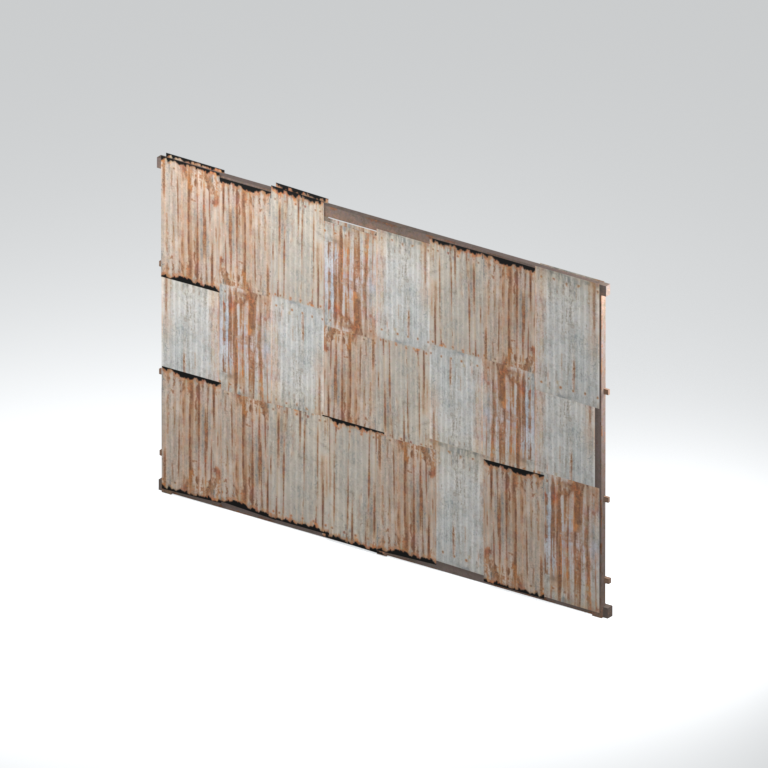
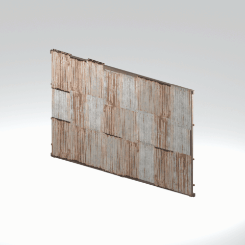

# Unidentified model (mgom_tnwl003)

Native model reference; a readable object identification has not been reviewed.

[Library](../README.md) | [Category](../tables/unclassified-components-1.md) | [Source / advanced data](../catalogue.json) | [Credits](../sources-and-credits.md)

**Game filename:** mgom_tnwl003.fmdl  
**Category:** Unclassified &gt; Unclassified components  
**Variant:** No explicit variant token; **LOD:** 0  
**Tags:** 

## Still reference



## 360-degree reference



The camera circles a static model. This is not a native animation. Source base textures and UVs use approximate studio shading; interaction, collision, complete assembly and FOX shader equivalence are not established.

## Identity and naming

| Field | Value |
|---|---|
| Library ID | mgsv-tpp-mgom_tnwl003-01a9f19ba23b860f |
| Naming status | unidentified |
| Naming confidence | unknown |
| Naming evidence | {} |
| Native model | /Assets/mgo/environ/object/mgo_mafr/tin_wall/mgom_tnwl003/scenes/mgom_tnwl003.fmdl |
| Model SHA256 | 4aba18b7d7eabb0ffea5a0dfa0c4db05c762d000afddf434f1eb436eb2d10d45 |
| Container | /Assets/mgo/pack/location/afc0/pack_common/afc0_common.fpk |
| Container SHA256 | 20a950cab0d6912ac3a270b90dc6dc673f2d13859eb636819bfa3955fca6e320 |
| Captured source / location scope | Selected native member/content and captured installed-source chain; full archive SHA/runtime priority unresolved |
| Raw record SHA256 | 9e3874f7f74ca7167e4feb780c7004d7ea4ddf6f187a3b590039db5056e47416 |

Naming review is descriptive metadata only. It does not change model completion or identify a working game interaction.

## Native LOD inventory

| Native LOD | Triangles | Preview status | Decoded indices SHA256 |
|---|---:|---|---|
| 0 | 240 | rendered | 163ce397cabb0100a2576d567301db8c50cad6fe42808dba5837d0bf97bee204 |
| 1 | 227 | not separately rendered | 7b5120f7a43e42ce83fc7011801b833635c4a5cae9a52569b88e948052454499 |
| 2 | 218 | not separately rendered | 002f7ac86bc7a1ad7527e280ff10df1541be4dfa67b8af8cc2f771d6bafa2f71 |
| 3 | 212 | not separately rendered | 3f03f51c074b28cac6ec47b2f68ebc9e9ded7dfad5e1e72ba998fc2459212c54 |

Mesh detail and texture pixels/mips are separate. Index hashes describe decoded triangle arrays, not packed index-buffer bytes. Only source-recorded native levels are listed.

<details>
<summary>Texture, source and naming technical metadata</summary>

```json
{
  "source": {
    "nativePath": "/Assets/mgo/environ/object/mgo_mafr/tin_wall/mgom_tnwl003/scenes/mgom_tnwl003.fmdl",
    "nativeSha256": "4aba18b7d7eabb0ffea5a0dfa0c4db05c762d000afddf434f1eb436eb2d10d45",
    "stableIdentity": "/assets/mgo/environ/object/mgo_mafr/tin_wall/mgom_tnwl003/scenes/mgom_tnwl003.fmdl#4aba18b7d7eabb0ffea5a0dfa0c4db05c762d000afddf434f1eb436eb2d10d45#5f4c76b82081e9a08106aba5356d20dde0ec8999ab1c238da75436ebfdd82ebf",
    "container": {
      "nativePath": "/Assets/mgo/pack/location/afc0/pack_common/afc0_common.fpk",
      "sha256": "20a950cab0d6912ac3a270b90dc6dc673f2d13859eb636819bfa3955fca6e320",
      "status": "Selected installed-source container/member chain captured by community reader"
    },
    "historicalDatOrigin": null,
    "sourceArchiveAtCapture": "master/0/00.dat",
    "locationStatus": "Selected native member/content and captured installed-source chain; full archive SHA/runtime priority unresolved",
    "currentInstalledDatVerified": false,
    "selectedInstalledMemberVerified": true,
    "evidence": {
      "archive_helper_executable_sha256": "6f8e39a436af3b024bbd0504966ab3d5d9d0cb05d86689bf3e83d15e68df613f",
      "archive_helper_source_sha256": "f662d3b63e066a0afc77ffe22ea0e564222d14469648300dba2c4f8e9b43446b",
      "archive_index_recipe": "54acff767f08d76ad6056c5387328759bc883df507788f398de6c2c04fac12db",
      "archive_reader": "Atvaark GzsTool.Core 0.5.3",
      "archive_reader_core_sha256": "9da447ae3c375cce2e46744eeff6af50f1591062afdf479d1a0b49edb47daaa3",
      "archive_tool_and_dictionary_sha256": {
        "CityHash.dll": "def6c4506d461b65e4059b2936b2cbd5f852ba5d1d8a1a527f1c0e6dc7008c8f",
        "GzsTool.Core.dll": "9da447ae3c375cce2e46744eeff6af50f1591062afdf479d1a0b49edb47daaa3",
        "GzsTool.exe": "1a9c5b11e2355383ff485aee7e86abc026f5c1fad729daf8c0fd15ee0aae1c10",
        "Zlib.Portable.dll": "fe84781ba35ca9cc5ff5f73fd08d2a66c59e5257b4573f5fe59743f30bf78e42",
        "fpk_dictionary.txt": "b82f9a8d6c10a68ba9471eca9d815c21355a53b5e68753d8ad7db7fd01bf401d",
        "qar_dictionary.txt": "1558c248ed0a4bb827888261563fbb91a2df4f03999682f85d637ff70d9d5fb2"
      },
      "bytes": 21072,
      "container_chain": [
        {
          "content_sha256": null,
          "depth": 0,
          "id": "3f19555d27c2ebecdfbad26aadd88b9f62e9fb6092c04c712963ef73c67ccb42",
          "index_sha256": "9acd3675d6e1500e0e18430cba0fdc70a5718ad7d6b62f13905891a35d59f18a",
          "kind": "qar",
          "name": "master/0/00.dat",
          "parent_occurrence": null
        },
        {
          "content_sha256": "20a950cab0d6912ac3a270b90dc6dc673f2d13859eb636819bfa3955fca6e320",
          "depth": 1,
          "id": "f1334a28f5fb887d989a9c548d11dccada12186358e0a4b4e7fc9831f6f42881",
          "index_sha256": "e15578c97612208569f283c28408f389fb560576e3976adf9d7aa8ed9c9aaf87",
          "kind": "fpk",
          "name": "/Assets/mgo/pack/location/afc0/pack_common/afc0_common.fpk",
          "parent_occurrence": "348190d8da3d429c2cdae58af0494f023c46b80f66da14d484dc54a7e17a97df"
        }
      ],
      "contentSha256": "4aba18b7d7eabb0ffea5a0dfa0c4db05c762d000afddf434f1eb436eb2d10d45",
      "member": {
        "actual_size": 21072,
        "compressed_size": null,
        "content_sha256": "4aba18b7d7eabb0ffea5a0dfa0c4db05c762d000afddf434f1eb436eb2d10d45",
        "declared_size": 21072,
        "extension": "fmdl",
        "hash_hex": null,
        "name": "/Assets/mgo/environ/object/mgo_mafr/tin_wall/mgom_tnwl003/scenes/mgom_tnwl003.fmdl",
        "name_origin": "embedded",
        "offset": 5024928,
        "ordinal": 144,
        "path_hash": null,
        "resolved": 1
      },
      "occurrenceId": "eac28c091374ce80886a3201552ffc33c46ee1cb7c150217a1a570fead6a8672",
      "occurrence_id": "eac28c091374ce80886a3201552ffc33c46ee1cb7c150217a1a570fead6a8672",
      "primary_source_revision": "fc4a8196555638c6cf8aa1b7c8dc34ccd5c69cb5",
      "source_adapter": "community_core_selective_export",
      "source_id": "7f6bb743fb4c487f0e9522f9c7fac280c46cf6b1051e0fc75a93602c8eb451f0",
      "source_path": "master/0/00.dat",
      "source_snapshot": "{\"bytes\":768788480,\"device\":621747392682911458,\"file_id\":844424931596481,\"header_sha256\":\"ead50f0a9a37e4285323b9c6fa0ec75fe75e518c63147e63158eeb2892c6589e\",\"mtime_ns\":1791852224238580700}",
      "virtualPath": "/Assets/mgo/environ/object/mgo_mafr/tin_wall/mgom_tnwl003/scenes/mgom_tnwl003.fmdl"
    }
  },
  "materials": [
    {
      "sampler": "Base_Tex_SRGB",
      "materialIndex": 0,
      "nativePathHash": "1542920551201752423",
      "nativeVirtualPath": null,
      "nativeBinding": {
        "familyId": "d4224e505f2f09d8eadf718d56055dc4c83d3d88fba9ba6f1517c1abb9decfd3",
        "height": 512,
        "materialIndex": 0,
        "mipCount": 8,
        "nativeMipCountVerified": true,
        "nativePath": null,
        "nativePathHash": "1542920551201752423",
        "nativeTexture": {
          "additionalFtexsFileCount": 2,
          "depth": 1,
          "ftexsFileCount": 3,
          "height": 512,
          "metadataBytes": 192,
          "mipCount": 8,
          "mips": [
            {
              "chunks": 16,
              "decodedBytes": 262144,
              "mip": 0,
              "offset": 0,
              "storedBytes": 127840,
              "streamNumber": 3
            },
            {
              "chunks": 4,
              "decodedBytes": 65536,
              "mip": 1,
              "offset": 0,
              "storedBytes": 34672,
              "streamNumber": 2
            },
            {
              "chunks": 1,
              "decodedBytes": 16384,
              "mip": 2,
              "offset": 3928,
              "storedBytes": 9344,
              "streamNumber": 1
            },
            {
              "chunks": 1,
              "decodedBytes": 4096,
              "mip": 3,
              "offset": 1264,
              "storedBytes": 2656,
              "streamNumber": 1
            },
            {
              "chunks": 1,
              "decodedBytes": 1024,
              "mip": 4,
              "offset": 408,
              "storedBytes": 848,
              "streamNumber": 1
            },
            {
              "chunks": 1,
              "decodedBytes": 256,
              "mip": 5,
              "offset": 128,
              "storedBytes": 272,
              "streamNumber": 1
            },
            {
              "chunks": 1,
              "decodedBytes": 64,
              "mip": 6,
              "offset": 40,
              "storedBytes": 80,
              "streamNumber": 1
            },
            {
              "chunks": 1,
              "decodedBytes": 16,
              "mip": 7,
              "offset": 0,
              "storedBytes": 32,
              "streamNumber": 1
            }
          ],
          "nativeHeaderHash": "b38a399e2b9307347871678627c26f6d",
          "nrtFlag": 2,
          "pixelFormat": 4,
          "requiredStreamNumbers": [
            1,
            2,
            3
          ],
          "textureType": 16777219,
          "unknownFlags": 273,
          "width": 512
        },
        "samplerName": "Base_Tex_SRGB",
        "samplerNameHash": "72475356961633",
        "sha256": "6fcda252891fbda9f169022308221f8e9d27234e23cd55ccb4aa8f2b8b436bfc",
        "sourceOccurrences": [
          {
            "archive_helper_executable_sha256": "6f8e39a436af3b024bbd0504966ab3d5d9d0cb05d86689bf3e83d15e68df613f",
            "archive_helper_source_sha256": "f662d3b63e066a0afc77ffe22ea0e564222d14469648300dba2c4f8e9b43446b",
            "archive_index_recipe": "54acff767f08d76ad6056c5387328759bc883df507788f398de6c2c04fac12db",
            "archive_reader": "Atvaark GzsTool.Core 0.5.3",
            "archive_reader_core_sha256": "9da447ae3c375cce2e46744eeff6af50f1591062afdf479d1a0b49edb47daaa3",
            "archive_tool_and_dictionary_sha256": {
              "CityHash.dll": "def6c4506d461b65e4059b2936b2cbd5f852ba5d1d8a1a527f1c0e6dc7008c8f",
              "GzsTool.Core.dll": "9da447ae3c375cce2e46744eeff6af50f1591062afdf479d1a0b49edb47daaa3",
              "GzsTool.exe": "1a9c5b11e2355383ff485aee7e86abc026f5c1fad729daf8c0fd15ee0aae1c10",
              "Zlib.Portable.dll": "fe84781ba35ca9cc5ff5f73fd08d2a66c59e5257b4573f5fe59743f30bf78e42",
              "fpk_dictionary.txt": "b82f9a8d6c10a68ba9471eca9d815c21355a53b5e68753d8ad7db7fd01bf401d",
              "qar_dictionary.txt": "1558c248ed0a4bb827888261563fbb91a2df4f03999682f85d637ff70d9d5fb2"
            },
            "bytes": 192,
            "container_chain": [
              {
                "content_sha256": null,
                "depth": 0,
                "id": "3f19555d27c2ebecdfbad26aadd88b9f62e9fb6092c04c712963ef73c67ccb42",
                "index_sha256": "9acd3675d6e1500e0e18430cba0fdc70a5718ad7d6b62f13905891a35d59f18a",
                "kind": "qar",
                "name": "master/0/00.dat",
                "parent_occurrence": null
              },
              {
                "content_sha256": "c371a18745c941878107bdaf7aef71c13b09b8b3a574360f6e38e0a7172b74e6",
                "depth": 1,
                "id": "13570131ff9ebc75c266205cbdf3461ff4dc51e8a0cb4f7407b0a08fe357052a",
                "index_sha256": "5b8e60a5e6b705cb87973f15c3215fb3733b7a49171030a4c7640da4622a5ca2",
                "kind": "pftxs",
                "name": "/Assets/mgo/pack/location/afc0/pack_common/afc0_common.pftxs",
                "parent_occurrence": "abc314b7f418d61ea6a3e5525bf8f85d22b454b81d3407e6645bfc43339658ac"
              }
            ],
            "contentSha256": "60a26beb2bc92b15b886f7880eb42d5c288705de0938782c52a9ae80fcf7c0e8",
            "member": {
              "actual_size": 192,
              "compressed_size": null,
              "content_sha256": "60a26beb2bc92b15b886f7880eb42d5c288705de0938782c52a9ae80fcf7c0e8",
              "declared_size": 192,
              "extension": "ftex",
              "hash_hex": "15698e110b07c567",
              "name": "15698e110b07c567.ftex",
              "name_origin": "hash_fallback",
              "offset": 8882480,
              "ordinal": 529,
              "path_hash": null,
              "resolved": 0
            },
            "occurrenceId": "4021f72f3b2597c6fd419220564a603b6ad81aa970d96b9b084321f7cfe2c0f3",
            "occurrence_id": "4021f72f3b2597c6fd419220564a603b6ad81aa970d96b9b084321f7cfe2c0f3",
            "primary_source_revision": "fc4a8196555638c6cf8aa1b7c8dc34ccd5c69cb5",
            "source_adapter": "community_core_selective_export",
            "source_id": "7f6bb743fb4c487f0e9522f9c7fac280c46cf6b1051e0fc75a93602c8eb451f0",
            "source_path": "master/0/00.dat",
            "source_snapshot": "{\"bytes\":768788480,\"device\":621747392682911458,\"file_id\":844424931596481,\"header_sha256\":\"ead50f0a9a37e4285323b9c6fa0ec75fe75e518c63147e63158eeb2892c6589e\",\"mtime_ns\":1791852224238580700}",
            "virtualPath": "15698e110b07c567.ftex"
          },
          {
            "archive_helper_executable_sha256": "6f8e39a436af3b024bbd0504966ab3d5d9d0cb05d86689bf3e83d15e68df613f",
            "archive_helper_source_sha256": "f662d3b63e066a0afc77ffe22ea0e564222d14469648300dba2c4f8e9b43446b",
            "archive_index_recipe": "54acff767f08d76ad6056c5387328759bc883df507788f398de6c2c04fac12db",
            "archive_reader": "Atvaark GzsTool.Core 0.5.3",
            "archive_reader_core_sha256": "9da447ae3c375cce2e46744eeff6af50f1591062afdf479d1a0b49edb47daaa3",
            "archive_tool_and_dictionary_sha256": {
              "CityHash.dll": "def6c4506d461b65e4059b2936b2cbd5f852ba5d1d8a1a527f1c0e6dc7008c8f",
              "GzsTool.Core.dll": "9da447ae3c375cce2e46744eeff6af50f1591062afdf479d1a0b49edb47daaa3",
              "GzsTool.exe": "1a9c5b11e2355383ff485aee7e86abc026f5c1fad729daf8c0fd15ee0aae1c10",
              "Zlib.Portable.dll": "fe84781ba35ca9cc5ff5f73fd08d2a66c59e5257b4573f5fe59743f30bf78e42",
              "fpk_dictionary.txt": "b82f9a8d6c10a68ba9471eca9d815c21355a53b5e68753d8ad7db7fd01bf401d",
              "qar_dictionary.txt": "1558c248ed0a4bb827888261563fbb91a2df4f03999682f85d637ff70d9d5fb2"
            },
            "bytes": 13280,
            "container_chain": [
              {
                "content_sha256": null,
                "depth": 0,
                "id": "436c8cfb4f382de93365b167a61aa81383299b7bad18205d60f1d0beeb3919e3",
                "index_sha256": "2d7b45c6ca65418839618e978562cac336091c06eb56dfe99f762b07a4016960",
                "kind": "qar",
                "name": "master/texture4.dat",
                "parent_occurrence": null
              }
            ],
            "contentSha256": "b49104b7e90adf1a8fb921ecb8f104f8eb299e2408466211c2636bae99e41fa5",
            "member": {
              "actual_size": 13280,
              "compressed_size": 13280,
              "content_sha256": "b49104b7e90adf1a8fb921ecb8f104f8eb299e2408466211c2636bae99e41fa5",
              "declared_size": 13280,
              "extension": "1.ftexs",
              "hash_hex": "b2c18e110b07c567",
              "name": "/Assets/tpp/environ/object/middle_africa/tin_wall/mafr_tnwl003/sourceimages/mafr_tnwl003_ir_bsm_alp.1.ftexs",
              "name_origin": "dictionary",
              "offset": 1684542496,
              "ordinal": 13269,
              "path_hash": "18e110b07c567",
              "resolved": 1
            },
            "occurrenceId": "66631415fd170f2ddf7c137493d866f621b1e4b6141e6eccf0c9e6fc3a9fe280",
            "occurrence_id": "66631415fd170f2ddf7c137493d866f621b1e4b6141e6eccf0c9e6fc3a9fe280",
            "primary_source_revision": "fc4a8196555638c6cf8aa1b7c8dc34ccd5c69cb5",
            "source_adapter": "community_core_selective_export",
            "source_id": "6c31b98b4db9b88eb76cfcb538f5f34b4729531266a9459584126720a4fc14aa",
            "source_path": "master/texture4.dat",
            "source_snapshot": "{\"bytes\":2031604736,\"device\":621747392682911458,\"file_id\":562949953639628,\"header_sha256\":\"40ee2c6917b338f7f68c49847c97fe92b978506a1ba847fcc94d28c931c8711a\",\"mtime_ns\":1791224675561235200}",
            "virtualPath": "/Assets/tpp/environ/object/middle_africa/tin_wall/mafr_tnwl003/sourceimages/mafr_tnwl003_ir_bsm_alp.1.ftexs"
          },
          {
            "archive_helper_executable_sha256": "6f8e39a436af3b024bbd0504966ab3d5d9d0cb05d86689bf3e83d15e68df613f",
            "archive_helper_source_sha256": "f662d3b63e066a0afc77ffe22ea0e564222d14469648300dba2c4f8e9b43446b",
            "archive_index_recipe": "54acff767f08d76ad6056c5387328759bc883df507788f398de6c2c04fac12db",
            "archive_reader": "Atvaark GzsTool.Core 0.5.3",
            "archive_reader_core_sha256": "9da447ae3c375cce2e46744eeff6af50f1591062afdf479d1a0b49edb47daaa3",
            "archive_tool_and_dictionary_sha256": {
              "CityHash.dll": "def6c4506d461b65e4059b2936b2cbd5f852ba5d1d8a1a527f1c0e6dc7008c8f",
              "GzsTool.Core.dll": "9da447ae3c375cce2e46744eeff6af50f1591062afdf479d1a0b49edb47daaa3",
              "GzsTool.exe": "1a9c5b11e2355383ff485aee7e86abc026f5c1fad729daf8c0fd15ee0aae1c10",
              "Zlib.Portable.dll": "fe84781ba35ca9cc5ff5f73fd08d2a66c59e5257b4573f5fe59743f30bf78e42",
              "fpk_dictionary.txt": "b82f9a8d6c10a68ba9471eca9d815c21355a53b5e68753d8ad7db7fd01bf401d",
              "qar_dictionary.txt": "1558c248ed0a4bb827888261563fbb91a2df4f03999682f85d637ff70d9d5fb2"
            },
            "bytes": 34704,
            "container_chain": [
              {
                "content_sha256": null,
                "depth": 0,
                "id": "436c8cfb4f382de93365b167a61aa81383299b7bad18205d60f1d0beeb3919e3",
                "index_sha256": "2d7b45c6ca65418839618e978562cac336091c06eb56dfe99f762b07a4016960",
                "kind": "qar",
                "name": "master/texture4.dat",
                "parent_occurrence": null
              }
            ],
            "contentSha256": "aa485a4cc486d4fcbc6e269c6d8739446ce640a8301dae23b742403f613b0eba",
            "member": {
              "actual_size": 34704,
              "compressed_size": 34704,
              "content_sha256": "aa485a4cc486d4fcbc6e269c6d8739446ce640a8301dae23b742403f613b0eba",
              "declared_size": 34704,
              "extension": "2.ftexs",
              "hash_hex": "b5718e110b07c567",
              "name": "/Assets/tpp/environ/object/middle_africa/tin_wall/mafr_tnwl003/sourceimages/mafr_tnwl003_ir_bsm_alp.2.ftexs",
              "name_origin": "dictionary",
              "offset": 1684555808,
              "ordinal": 13270,
              "path_hash": "18e110b07c567",
              "resolved": 1
            },
            "occurrenceId": "71fc83caabadfe6cf01308171c8217078bda726e7cfffa0bb38b874baacdad91",
            "occurrence_id": "71fc83caabadfe6cf01308171c8217078bda726e7cfffa0bb38b874baacdad91",
            "primary_source_revision": "fc4a8196555638c6cf8aa1b7c8dc34ccd5c69cb5",
            "source_adapter": "community_core_selective_export",
            "source_id": "6c31b98b4db9b88eb76cfcb538f5f34b4729531266a9459584126720a4fc14aa",
            "source_path": "master/texture4.dat",
            "source_snapshot": "{\"bytes\":2031604736,\"device\":621747392682911458,\"file_id\":562949953639628,\"header_sha256\":\"40ee2c6917b338f7f68c49847c97fe92b978506a1ba847fcc94d28c931c8711a\",\"mtime_ns\":1791224675561235200}",
            "virtualPath": "/Assets/tpp/environ/object/middle_africa/tin_wall/mafr_tnwl003/sourceimages/mafr_tnwl003_ir_bsm_alp.2.ftexs"
          },
          {
            "archive_helper_executable_sha256": "6f8e39a436af3b024bbd0504966ab3d5d9d0cb05d86689bf3e83d15e68df613f",
            "archive_helper_source_sha256": "f662d3b63e066a0afc77ffe22ea0e564222d14469648300dba2c4f8e9b43446b",
            "archive_index_recipe": "54acff767f08d76ad6056c5387328759bc883df507788f398de6c2c04fac12db",
            "archive_reader": "Atvaark GzsTool.Core 0.5.3",
            "archive_reader_core_sha256": "9da447ae3c375cce2e46744eeff6af50f1591062afdf479d1a0b49edb47daaa3",
            "archive_tool_and_dictionary_sha256": {
              "CityHash.dll": "def6c4506d461b65e4059b2936b2cbd5f852ba5d1d8a1a527f1c0e6dc7008c8f",
              "GzsTool.Core.dll": "9da447ae3c375cce2e46744eeff6af50f1591062afdf479d1a0b49edb47daaa3",
              "GzsTool.exe": "1a9c5b11e2355383ff485aee7e86abc026f5c1fad729daf8c0fd15ee0aae1c10",
              "Zlib.Portable.dll": "fe84781ba35ca9cc5ff5f73fd08d2a66c59e5257b4573f5fe59743f30bf78e42",
              "fpk_dictionary.txt": "b82f9a8d6c10a68ba9471eca9d815c21355a53b5e68753d8ad7db7fd01bf401d",
              "qar_dictionary.txt": "1558c248ed0a4bb827888261563fbb91a2df4f03999682f85d637ff70d9d5fb2"
            },
            "bytes": 127968,
            "container_chain": [
              {
                "content_sha256": null,
                "depth": 0,
                "id": "436c8cfb4f382de93365b167a61aa81383299b7bad18205d60f1d0beeb3919e3",
                "index_sha256": "2d7b45c6ca65418839618e978562cac336091c06eb56dfe99f762b07a4016960",
                "kind": "qar",
                "name": "master/texture4.dat",
                "parent_occurrence": null
              }
            ],
            "contentSha256": "e4b9a3430f31258b516bcde0bfb8524cbe669dc105476cbc593755e85a0f4779",
            "member": {
              "actual_size": 127968,
              "compressed_size": 127968,
              "content_sha256": "e4b9a3430f31258b516bcde0bfb8524cbe669dc105476cbc593755e85a0f4779",
              "declared_size": 127968,
              "extension": "3.ftexs",
              "hash_hex": "57198e110b07c567",
              "name": "/Assets/tpp/environ/object/middle_africa/tin_wall/mafr_tnwl003/sourceimages/mafr_tnwl003_ir_bsm_alp.3.ftexs",
              "name_origin": "dictionary",
              "offset": 1684590624,
              "ordinal": 13271,
              "path_hash": "18e110b07c567",
              "resolved": 1
            },
            "occurrenceId": "0dbbb04b828729ae433426fbb5994932564ea12160d322f4cd97b29f0bb16db2",
            "occurrence_id": "0dbbb04b828729ae433426fbb5994932564ea12160d322f4cd97b29f0bb16db2",
            "primary_source_revision": "fc4a8196555638c6cf8aa1b7c8dc34ccd5c69cb5",
            "source_adapter": "community_core_selective_export",
            "source_id": "6c31b98b4db9b88eb76cfcb538f5f34b4729531266a9459584126720a4fc14aa",
            "source_path": "master/texture4.dat",
            "source_snapshot": "{\"bytes\":2031604736,\"device\":621747392682911458,\"file_id\":562949953639628,\"header_sha256\":\"40ee2c6917b338f7f68c49847c97fe92b978506a1ba847fcc94d28c931c8711a\",\"mtime_ns\":1791224675561235200}",
            "virtualPath": "/Assets/tpp/environ/object/middle_africa/tin_wall/mafr_tnwl003/sourceimages/mafr_tnwl003_ir_bsm_alp.3.ftexs"
          }
        ],
        "width": 512
      },
      "ddsSha256": "6fcda252891fbda9f169022308221f8e9d27234e23cd55ccb4aa8f2b8b436bfc",
      "dimensions": [
        512,
        512
      ],
      "mipCount": 8,
      "nativeMipCountVerified": true,
      "connectedInPreview": true
    },
    {
      "sampler": "Base_Tex_SRGB",
      "materialIndex": 1,
      "nativePathHash": "1543276963785070273",
      "nativeVirtualPath": null,
      "nativeBinding": {
        "familyId": "9addf44a20e4d652b2a21ac411fed0a5723575918721c59519d29d731061e131",
        "height": 1024,
        "materialIndex": 1,
        "mipCount": 9,
        "nativeMipCountVerified": true,
        "nativePath": null,
        "nativePathHash": "1543276963785070273",
        "nativeTexture": {
          "additionalFtexsFileCount": 2,
          "depth": 1,
          "ftexsFileCount": 3,
          "height": 1024,
          "metadataBytes": 208,
          "mipCount": 9,
          "mips": [
            {
              "chunks": 32,
              "decodedBytes": 524288,
              "mip": 0,
              "offset": 0,
              "storedBytes": 395200,
              "streamNumber": 3
            },
            {
              "chunks": 8,
              "decodedBytes": 131072,
              "mip": 1,
              "offset": 0,
              "storedBytes": 102720,
              "streamNumber": 2
            },
            {
              "chunks": 2,
              "decodedBytes": 32768,
              "mip": 2,
              "offset": 9248,
              "storedBytes": 25872,
              "streamNumber": 1
            },
            {
              "chunks": 1,
              "decodedBytes": 8192,
              "mip": 3,
              "offset": 2536,
              "storedBytes": 6704,
              "streamNumber": 1
            },
            {
              "chunks": 1,
              "decodedBytes": 2048,
              "mip": 4,
              "offset": 752,
              "storedBytes": 1776,
              "streamNumber": 1
            },
            {
              "chunks": 1,
              "decodedBytes": 512,
              "mip": 5,
              "offset": 232,
              "storedBytes": 512,
              "streamNumber": 1
            },
            {
              "chunks": 1,
              "decodedBytes": 128,
              "mip": 6,
              "offset": 80,
              "storedBytes": 144,
              "streamNumber": 1
            },
            {
              "chunks": 1,
              "decodedBytes": 32,
              "mip": 7,
              "offset": 24,
              "storedBytes": 48,
              "streamNumber": 1
            },
            {
              "chunks": 1,
              "decodedBytes": 8,
              "mip": 8,
              "offset": 0,
              "storedBytes": 16,
              "streamNumber": 1
            }
          ],
          "nativeHeaderHash": "6d7dba5391fa4cab2b3f837adfbdc390",
          "nrtFlag": 2,
          "pixelFormat": 2,
          "requiredStreamNumbers": [
            1,
            2,
            3
          ],
          "textureType": 16777219,
          "unknownFlags": 273,
          "width": 1024
        },
        "samplerName": "Base_Tex_SRGB",
        "samplerNameHash": "72475356961633",
        "sha256": "6d68ed79a989bae1e12721ffcdc2e6b8da6334b32cd9542a7d276356298ad987",
        "sourceOccurrences": [
          {
            "archive_helper_executable_sha256": "6f8e39a436af3b024bbd0504966ab3d5d9d0cb05d86689bf3e83d15e68df613f",
            "archive_helper_source_sha256": "f662d3b63e066a0afc77ffe22ea0e564222d14469648300dba2c4f8e9b43446b",
            "archive_index_recipe": "54acff767f08d76ad6056c5387328759bc883df507788f398de6c2c04fac12db",
            "archive_reader": "Atvaark GzsTool.Core 0.5.3",
            "archive_reader_core_sha256": "9da447ae3c375cce2e46744eeff6af50f1591062afdf479d1a0b49edb47daaa3",
            "archive_tool_and_dictionary_sha256": {
              "CityHash.dll": "def6c4506d461b65e4059b2936b2cbd5f852ba5d1d8a1a527f1c0e6dc7008c8f",
              "GzsTool.Core.dll": "9da447ae3c375cce2e46744eeff6af50f1591062afdf479d1a0b49edb47daaa3",
              "GzsTool.exe": "1a9c5b11e2355383ff485aee7e86abc026f5c1fad729daf8c0fd15ee0aae1c10",
              "Zlib.Portable.dll": "fe84781ba35ca9cc5ff5f73fd08d2a66c59e5257b4573f5fe59743f30bf78e42",
              "fpk_dictionary.txt": "b82f9a8d6c10a68ba9471eca9d815c21355a53b5e68753d8ad7db7fd01bf401d",
              "qar_dictionary.txt": "1558c248ed0a4bb827888261563fbb91a2df4f03999682f85d637ff70d9d5fb2"
            },
            "bytes": 208,
            "container_chain": [
              {
                "content_sha256": null,
                "depth": 0,
                "id": "436c8cfb4f382de93365b167a61aa81383299b7bad18205d60f1d0beeb3919e3",
                "index_sha256": "2d7b45c6ca65418839618e978562cac336091c06eb56dfe99f762b07a4016960",
                "kind": "qar",
                "name": "master/texture4.dat",
                "parent_occurrence": null
              }
            ],
            "contentSha256": "ba70a7743a862162da959f91c34ddd2a2b7e339410089660d5618b4fd9710e44",
            "member": {
              "actual_size": 208,
              "compressed_size": 208,
              "content_sha256": "ba70a7743a862162da959f91c34ddd2a2b7e339410089660d5618b4fd9710e44",
              "declared_size": 208,
              "extension": "ftex",
              "hash_hex": "156ad238d073d6c1",
              "name": "/Assets/tpp/environ/object/middle_africa/tin_wall/mafr_tnwl003/sourceimages/mafr_tnwl003_bsm.ftex",
              "name_origin": "dictionary",
              "offset": 1684541472,
              "ordinal": 13268,
              "path_hash": "2d238d073d6c1",
              "resolved": 1
            },
            "occurrenceId": "bfe16ff2f7af41d65c23f85fa65881ac736733d37b0ca5610be210ea5b9dfe4e",
            "occurrence_id": "bfe16ff2f7af41d65c23f85fa65881ac736733d37b0ca5610be210ea5b9dfe4e",
            "primary_source_revision": "fc4a8196555638c6cf8aa1b7c8dc34ccd5c69cb5",
            "source_adapter": "community_core_selective_export",
            "source_id": "6c31b98b4db9b88eb76cfcb538f5f34b4729531266a9459584126720a4fc14aa",
            "source_path": "master/texture4.dat",
            "source_snapshot": "{\"bytes\":2031604736,\"device\":621747392682911458,\"file_id\":562949953639628,\"header_sha256\":\"40ee2c6917b338f7f68c49847c97fe92b978506a1ba847fcc94d28c931c8711a\",\"mtime_ns\":1791224675561235200}",
            "virtualPath": "/Assets/tpp/environ/object/middle_africa/tin_wall/mafr_tnwl003/sourceimages/mafr_tnwl003_bsm.ftex"
          },
          {
            "archive_helper_executable_sha256": "6f8e39a436af3b024bbd0504966ab3d5d9d0cb05d86689bf3e83d15e68df613f",
            "archive_helper_source_sha256": "f662d3b63e066a0afc77ffe22ea0e564222d14469648300dba2c4f8e9b43446b",
            "archive_index_recipe": "54acff767f08d76ad6056c5387328759bc883df507788f398de6c2c04fac12db",
            "archive_reader": "Atvaark GzsTool.Core 0.5.3",
            "archive_reader_core_sha256": "9da447ae3c375cce2e46744eeff6af50f1591062afdf479d1a0b49edb47daaa3",
            "archive_tool_and_dictionary_sha256": {
              "CityHash.dll": "def6c4506d461b65e4059b2936b2cbd5f852ba5d1d8a1a527f1c0e6dc7008c8f",
              "GzsTool.Core.dll": "9da447ae3c375cce2e46744eeff6af50f1591062afdf479d1a0b49edb47daaa3",
              "GzsTool.exe": "1a9c5b11e2355383ff485aee7e86abc026f5c1fad729daf8c0fd15ee0aae1c10",
              "Zlib.Portable.dll": "fe84781ba35ca9cc5ff5f73fd08d2a66c59e5257b4573f5fe59743f30bf78e42",
              "fpk_dictionary.txt": "b82f9a8d6c10a68ba9471eca9d815c21355a53b5e68753d8ad7db7fd01bf401d",
              "qar_dictionary.txt": "1558c248ed0a4bb827888261563fbb91a2df4f03999682f85d637ff70d9d5fb2"
            },
            "bytes": 35136,
            "container_chain": [
              {
                "content_sha256": null,
                "depth": 0,
                "id": "436c8cfb4f382de93365b167a61aa81383299b7bad18205d60f1d0beeb3919e3",
                "index_sha256": "2d7b45c6ca65418839618e978562cac336091c06eb56dfe99f762b07a4016960",
                "kind": "qar",
                "name": "master/texture4.dat",
                "parent_occurrence": null
              }
            ],
            "contentSha256": "20429b0b1b8a04b5eca838dec01c2b9052ac263e6badc1bb60c8380daf70c0f4",
            "member": {
              "actual_size": 35136,
              "compressed_size": 35136,
              "content_sha256": "20429b0b1b8a04b5eca838dec01c2b9052ac263e6badc1bb60c8380daf70c0f4",
              "declared_size": 35136,
              "extension": "1.ftexs",
              "hash_hex": "b2c2d238d073d6c1",
              "name": "/Assets/tpp/environ/object/middle_africa/tin_wall/mafr_tnwl003/sourceimages/mafr_tnwl003_bsm.1.ftexs",
              "name_origin": "dictionary",
              "offset": 1684005920,
              "ordinal": 13265,
              "path_hash": "2d238d073d6c1",
              "resolved": 1
            },
            "occurrenceId": "780b482edcde4d9b22b476b760939a73d485d0e2438425ea2d5d58fad72e76fb",
            "occurrence_id": "780b482edcde4d9b22b476b760939a73d485d0e2438425ea2d5d58fad72e76fb",
            "primary_source_revision": "fc4a8196555638c6cf8aa1b7c8dc34ccd5c69cb5",
            "source_adapter": "community_core_selective_export",
            "source_id": "6c31b98b4db9b88eb76cfcb538f5f34b4729531266a9459584126720a4fc14aa",
            "source_path": "master/texture4.dat",
            "source_snapshot": "{\"bytes\":2031604736,\"device\":621747392682911458,\"file_id\":562949953639628,\"header_sha256\":\"40ee2c6917b338f7f68c49847c97fe92b978506a1ba847fcc94d28c931c8711a\",\"mtime_ns\":1791224675561235200}",
            "virtualPath": "/Assets/tpp/environ/object/middle_africa/tin_wall/mafr_tnwl003/sourceimages/mafr_tnwl003_bsm.1.ftexs"
          },
          {
            "archive_helper_executable_sha256": "6f8e39a436af3b024bbd0504966ab3d5d9d0cb05d86689bf3e83d15e68df613f",
            "archive_helper_source_sha256": "f662d3b63e066a0afc77ffe22ea0e564222d14469648300dba2c4f8e9b43446b",
            "archive_index_recipe": "54acff767f08d76ad6056c5387328759bc883df507788f398de6c2c04fac12db",
            "archive_reader": "Atvaark GzsTool.Core 0.5.3",
            "archive_reader_core_sha256": "9da447ae3c375cce2e46744eeff6af50f1591062afdf479d1a0b49edb47daaa3",
            "archive_tool_and_dictionary_sha256": {
              "CityHash.dll": "def6c4506d461b65e4059b2936b2cbd5f852ba5d1d8a1a527f1c0e6dc7008c8f",
              "GzsTool.Core.dll": "9da447ae3c375cce2e46744eeff6af50f1591062afdf479d1a0b49edb47daaa3",
              "GzsTool.exe": "1a9c5b11e2355383ff485aee7e86abc026f5c1fad729daf8c0fd15ee0aae1c10",
              "Zlib.Portable.dll": "fe84781ba35ca9cc5ff5f73fd08d2a66c59e5257b4573f5fe59743f30bf78e42",
              "fpk_dictionary.txt": "b82f9a8d6c10a68ba9471eca9d815c21355a53b5e68753d8ad7db7fd01bf401d",
              "qar_dictionary.txt": "1558c248ed0a4bb827888261563fbb91a2df4f03999682f85d637ff70d9d5fb2"
            },
            "bytes": 102784,
            "container_chain": [
              {
                "content_sha256": null,
                "depth": 0,
                "id": "436c8cfb4f382de93365b167a61aa81383299b7bad18205d60f1d0beeb3919e3",
                "index_sha256": "2d7b45c6ca65418839618e978562cac336091c06eb56dfe99f762b07a4016960",
                "kind": "qar",
                "name": "master/texture4.dat",
                "parent_occurrence": null
              }
            ],
            "contentSha256": "e4ba8cb6cfbafb5c3cf32ef8cd788d1d421571fa98141bb12d0fde27b11feb60",
            "member": {
              "actual_size": 102784,
              "compressed_size": 102784,
              "content_sha256": "e4ba8cb6cfbafb5c3cf32ef8cd788d1d421571fa98141bb12d0fde27b11feb60",
              "declared_size": 102784,
              "extension": "2.ftexs",
              "hash_hex": "b572d238d073d6c1",
              "name": "/Assets/tpp/environ/object/middle_africa/tin_wall/mafr_tnwl003/sourceimages/mafr_tnwl003_bsm.2.ftexs",
              "name_origin": "dictionary",
              "offset": 1684041760,
              "ordinal": 13266,
              "path_hash": "2d238d073d6c1",
              "resolved": 1
            },
            "occurrenceId": "90b5a4857cb7814d3923d458c4ececece3debeca7ce3dda3df381bfcdfd033e7",
            "occurrence_id": "90b5a4857cb7814d3923d458c4ececece3debeca7ce3dda3df381bfcdfd033e7",
            "primary_source_revision": "fc4a8196555638c6cf8aa1b7c8dc34ccd5c69cb5",
            "source_adapter": "community_core_selective_export",
            "source_id": "6c31b98b4db9b88eb76cfcb538f5f34b4729531266a9459584126720a4fc14aa",
            "source_path": "master/texture4.dat",
            "source_snapshot": "{\"bytes\":2031604736,\"device\":621747392682911458,\"file_id\":562949953639628,\"header_sha256\":\"40ee2c6917b338f7f68c49847c97fe92b978506a1ba847fcc94d28c931c8711a\",\"mtime_ns\":1791224675561235200}",
            "virtualPath": "/Assets/tpp/environ/object/middle_africa/tin_wall/mafr_tnwl003/sourceimages/mafr_tnwl003_bsm.2.ftexs"
          },
          {
            "archive_helper_executable_sha256": "6f8e39a436af3b024bbd0504966ab3d5d9d0cb05d86689bf3e83d15e68df613f",
            "archive_helper_source_sha256": "f662d3b63e066a0afc77ffe22ea0e564222d14469648300dba2c4f8e9b43446b",
            "archive_index_recipe": "54acff767f08d76ad6056c5387328759bc883df507788f398de6c2c04fac12db",
            "archive_reader": "Atvaark GzsTool.Core 0.5.3",
            "archive_reader_core_sha256": "9da447ae3c375cce2e46744eeff6af50f1591062afdf479d1a0b49edb47daaa3",
            "archive_tool_and_dictionary_sha256": {
              "CityHash.dll": "def6c4506d461b65e4059b2936b2cbd5f852ba5d1d8a1a527f1c0e6dc7008c8f",
              "GzsTool.Core.dll": "9da447ae3c375cce2e46744eeff6af50f1591062afdf479d1a0b49edb47daaa3",
              "GzsTool.exe": "1a9c5b11e2355383ff485aee7e86abc026f5c1fad729daf8c0fd15ee0aae1c10",
              "Zlib.Portable.dll": "fe84781ba35ca9cc5ff5f73fd08d2a66c59e5257b4573f5fe59743f30bf78e42",
              "fpk_dictionary.txt": "b82f9a8d6c10a68ba9471eca9d815c21355a53b5e68753d8ad7db7fd01bf401d",
              "qar_dictionary.txt": "1558c248ed0a4bb827888261563fbb91a2df4f03999682f85d637ff70d9d5fb2"
            },
            "bytes": 395456,
            "container_chain": [
              {
                "content_sha256": null,
                "depth": 0,
                "id": "e73d96973ade76f7a00afdbea486dd110896ace97da0791f56899647de46f210",
                "index_sha256": "5a818609a652a10d90fb90015661d0cb80898096bbb3aac36382172988d8736d",
                "kind": "qar",
                "name": "mgo/texture0.dat",
                "parent_occurrence": null
              }
            ],
            "contentSha256": "cd271efa40b0d085251bec6be2a374e089bd455050db5600a2ac93b52ce044da",
            "member": {
              "actual_size": 395456,
              "compressed_size": 395456,
              "content_sha256": "cd271efa40b0d085251bec6be2a374e089bd455050db5600a2ac93b52ce044da",
              "declared_size": 395456,
              "extension": "3.ftexs",
              "hash_hex": "571ad238d073d6c1",
              "name": "/Assets/tpp/environ/object/middle_africa/tin_wall/mafr_tnwl003/sourceimages/mafr_tnwl003_bsm.3.ftexs",
              "name_origin": "dictionary",
              "offset": 4044188704,
              "ordinal": 16608,
              "path_hash": "2d238d073d6c1",
              "resolved": 1
            },
            "occurrenceId": "250b1105b7ae918a1a7fed224367047d4be979560559a617d362092c74ff1759",
            "occurrence_id": "250b1105b7ae918a1a7fed224367047d4be979560559a617d362092c74ff1759",
            "primary_source_revision": "fc4a8196555638c6cf8aa1b7c8dc34ccd5c69cb5",
            "source_adapter": "community_core_selective_export",
            "source_id": "03f5942f0e1af8040ae05b95c43716d75f5933971d78324bf7cfea291297f3f4",
            "source_path": "mgo/texture0.dat",
            "source_snapshot": "{\"bytes\":4492370944,\"device\":621747392682911458,\"file_id\":562949953639631,\"header_sha256\":\"6108fbacb65c84d041742c39e5ca630745240453b336f1059a13b91943f0b011\",\"mtime_ns\":1791224675562234400}",
            "virtualPath": "/Assets/tpp/environ/object/middle_africa/tin_wall/mafr_tnwl003/sourceimages/mafr_tnwl003_bsm.3.ftexs"
          }
        ],
        "width": 1024
      },
      "ddsSha256": "6d68ed79a989bae1e12721ffcdc2e6b8da6334b32cd9542a7d276356298ad987",
      "dimensions": [
        1024,
        1024
      ],
      "mipCount": 9,
      "nativeMipCountVerified": true,
      "connectedInPreview": true
    }
  ],
  "quality": {
    "decodedIndicesHashDerivation": "SHA256 of canonical UTF-8 JSON decoded triangle indices grouped by mesh; not packed buffer bytes",
    "highestRetainedGeometricLod": 0,
    "distinctNativeLods": 4,
    "baseTextureDimensions": [
      512,
      512
    ],
    "baseTextureNativeMipCount": 8,
    "largerRetainedBaseTextureFound": null,
    "nativeLods": [
      {
        "indicesSha256": "163ce397cabb0100a2576d567301db8c50cad6fe42808dba5837d0bf97bee204",
        "nativeLod": 0,
        "triangles": 240
      },
      {
        "indicesSha256": "7b5120f7a43e42ce83fc7011801b833635c4a5cae9a52569b88e948052454499",
        "nativeLod": 1,
        "triangles": 227
      },
      {
        "indicesSha256": "002f7ac86bc7a1ad7527e280ff10df1541be4dfa67b8af8cc2f771d6bafa2f71",
        "nativeLod": 2,
        "triangles": 218
      },
      {
        "indicesSha256": "3f03f51c074b28cac6ec47b2f68ebc9e9ded7dfad5e1e72ba998fc2459212c54",
        "nativeLod": 3,
        "triangles": 212
      }
    ],
    "renderedNativeLods": [
      0
    ],
    "baseTextureSummary": "512 x 512; 8 native/DDS mips; 1024 x 1024; 9 native/DDS mips",
    "highestDetailScope": "Triangle-count comparison within captured FMDL only"
  }
}
```

</details>

[Original source / advanced record](../catalogue.json)
