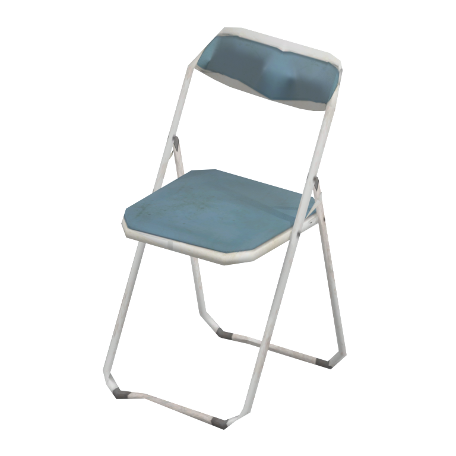
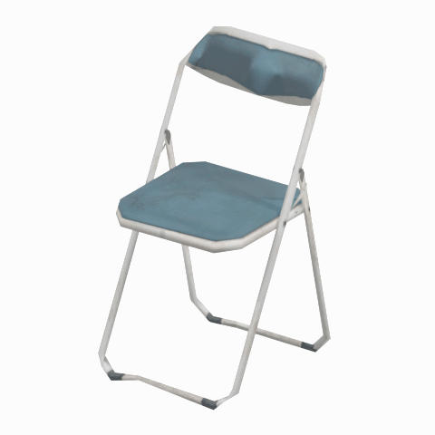

# Folding chair - LOD2

A weathered blue folding chair with a white metal frame, suitable as a visual reference for hangar, office or rest-area seating.

[Folding chair overview and comparison](mgsv-tpp-mtbs_char002-5f80c9bdacda.md#native-lod-comparison) | [Seating table](../tables/seating-1.md) | [Quality/source evidence](../quality-provenance.json) | [Credits](../sources-and-credits.md)

**LOD2: Reduced geometric detail 2; 196 triangles.** Base texture: 512x256 pixels with 8 native mip levels. This selects a real face set in the same original model; it is not a synthetic simplification or a separate source-model version.

## Still reference

## 360-degree reference

Camera orbit only: 48angles at 7.5-degree increments, 100ms/frame, 4.8-second loop. The asset is static; this is not native animation. Framing/native bounds and base texture are held fixed across all four geometric LODs.

## Source identity

| Field | Value |
|---|---|
| Original native FMDL | `/Assets/tpp/environ/object/mother_base/chair/mtbs_char002/scenes/mtbs_char002.fmdl` |
| Native FMDL SHA256 | `5f80c9bdacdab46673a783adc5bd997618f1a13738e2f4401f99b799974eab43` |
| Native LOD | 2 |
| Triangles | 196 |
| Native LOD index bytes SHA256 | `5d530af7f733a4525c866a8202d60326784ceeb3d2d7fbc1ea5dcfe8c1f7fb29` |
| Retained FPK | `/Assets/tpp/pack/mission2/free/f30050/f30050_hanger_btg00.fpk` |
| Retained FPK SHA256 | `4ad3d31598aff8eff00f8d507f80e5b6e491c71c0bda03fb991391a2560453c9` |
| Historical DAT | `master/chunk3.dat`; current installed DAT content/version unverified |
| Base texture | 512x256 pixels; 8 native mip levels; actual retained content |

Native FMDL LOD index-buffer ranges were directly checked against retained face caches. Identical model copies in other retained containers are deduplicated in the quality/source record. LOD0 is the most detailed by triangle count in this retained family; runtime distance/selection thresholds have not been tested. Mip chains are recorded/preserved privately, not rendered as a LOD-by-mip product.

Game model/textures: Konami. Project owner: arsenal-pt. Authored reference preparation: OpenAI Codex (AI/LLM); [community tool credits](../sources-and-credits.md). Only actual base-color texture/UVs drive approximate studio shading; native normal/specular/material maps are recorded separately. No higher detail was invented, upscaled or subdivided; no FOX shader, physics or native gameplay equivalence is claimed. Original game assets and clean render frames remain private.
