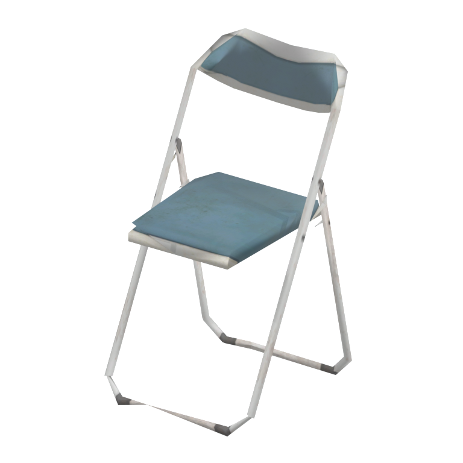
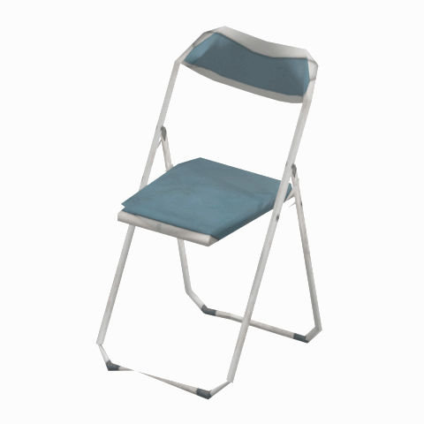

# Folding chair

A weathered blue folding chair with a white metal frame, suitable as a visual reference for hangar, office or rest-area seating.

[Library](../README.md) | [Category](../tables/seating-1.md) | [Source / advanced data](../catalogue.json) | [Credits](../sources-and-credits.md)

**Game filename:** mtbs_char002.fmdl  
**Category:** Furniture &gt; Seating  
**Variant:** No explicit variant token; **LOD:** 3  
**Tags:** chair, folding-chair, seating, furniture, metal-frame, blue-upholstery, hangar, mother-base

## Still reference



## 360-degree reference



The camera circles a static model. This is not a native animation. Source base textures and UVs use approximate studio shading; interaction, collision, complete assembly and FOX shader equivalence are not established.

## Identity and naming

| Field | Value |
|---|---|
| Library ID | mgsv-tpp-mtbs_char002-5f80c9bdacda-lod3 |
| Naming status | reviewed |
| Naming confidence | high |
| Naming evidence | {"kind": "accepted-existing", "native_path": "/Assets/tpp/environ/object/mother_base/chair/mtbs_char002/scenes/mtbs_char002.fmdl", "note": "Original accepted display name, category, subcategory, description and tags retained exactly; no relabeling.", "source": "media/asset-previews/2026-10-16-seating/mgsv-tpp-mtbs_char002-5f80c9bdacda.png"} |
| Native model | /Assets/tpp/environ/object/mother_base/chair/mtbs_char002/scenes/mtbs_char002.fmdl |
| Model SHA256 | 5f80c9bdacdab46673a783adc5bd997618f1a13738e2f4401f99b799974eab43 |
| Container | /Assets/tpp/pack/mission2/free/f30050/f30050_hanger_btg00.fpk |
| Container SHA256 | 4ad3d31598aff8eff00f8d507f80e5b6e491c71c0bda03fb991391a2560453c9 |
| Captured source / location scope | Exact retained native member/container checked; historical outer DAT origin only |
| Raw record SHA256 | db75d82516e917e5be1ac0a8b7ed244ff29630fd0a36bb81e46b4eb0e6b697be |

Naming review is descriptive metadata only. It does not change model completion or identify a working game interaction.

## Native LOD inventory

| Native LOD | Triangles | Preview status | Decoded indices SHA256 |
|---|---:|---|---|
| 0 | 358 | rendered | 17454f7ec6beae5602cb56acd330967c74cca3290b59f35ce83b9345a905408d |
| 1 | 270 | rendered | 17a1b8cbdc6104d97f4acb46331d8c5cb5e3ac7c3379dceafb920096336d4dd9 |
| 2 | 196 | rendered | 5d530af7f733a4525c866a8202d60326784ceeb3d2d7fbc1ea5dcfe8c1f7fb29 |
| 3 | 150 | rendered | 3e9724ebf2920878de47a759ea0a8e514f405c46746bf65c5f5c0767a29882b6 |

Mesh detail and texture pixels/mips are separate. Index hashes describe decoded triangle arrays, not packed index-buffer bytes. Only source-recorded native levels are listed.

<details>
<summary>Texture, source and naming technical metadata</summary>

```json
{
  "source": {
    "nativePath": "/Assets/tpp/environ/object/mother_base/chair/mtbs_char002/scenes/mtbs_char002.fmdl",
    "nativeSha256": "5f80c9bdacdab46673a783adc5bd997618f1a13738e2f4401f99b799974eab43",
    "stableIdentity": "/assets/tpp/environ/object/mother_base/chair/mtbs_char002/scenes/mtbs_char002.fmdl#5f80c9bdacdab46673a783adc5bd997618f1a13738e2f4401f99b799974eab43",
    "container": {
      "nativePath": "/Assets/tpp/pack/mission2/free/f30050/f30050_hanger_btg00.fpk",
      "sha256": "4ad3d31598aff8eff00f8d507f80e5b6e491c71c0bda03fb991391a2560453c9",
      "status": "retained FPK payload/path-string and saved member receipt verified"
    },
    "historicalDatOrigin": "master/chunk3.dat",
    "locationStatus": "Exact retained native member/container checked; historical outer DAT origin only",
    "currentInstalledDatVerified": false,
    "dictionaryResolutionRequiredForModelPath": false
  },
  "materials": [
    {
      "sampler": "Base_Tex_SRGB",
      "nativePathHash": "1542935154948558078",
      "nativeVirtualPath": null,
      "ddsSha256": "105362d96275cb39c12d25ece58841b1a7dfe89c2628d1e85559acd1b9f67c7f",
      "dimensions": [
        512,
        256
      ],
      "sourceIdentityStatus": "retained native sampler/hash binding; converted DDS content rehashed for this reference",
      "connectedInPreview": true
    },
    {
      "sampler": "NormalMap_Tex_NRM",
      "nativePathHash": "1543544073143106902",
      "nativeVirtualPath": null,
      "ddsSha256": "e05db30fb6e7a68d664599b7734b5848fd3929e6a5136f4d5a3adc96b32187d5",
      "dimensions": [
        512,
        256
      ],
      "sourceIdentityStatus": "retained native sampler/hash binding; converted DDS content rehashed for this reference",
      "connectedInPreview": false
    },
    {
      "sampler": "SpecularMap_Tex_LIN",
      "nativePathHash": "1542766372082993548",
      "nativeVirtualPath": null,
      "ddsSha256": "7af34bf62110276d1692eb94d0e9901aed9b4d27a1a1d1603fea54e4202c6505",
      "dimensions": [
        512,
        256
      ],
      "sourceIdentityStatus": "retained native sampler/hash binding; converted DDS content rehashed for this reference",
      "connectedInPreview": false
    },
    {
      "sampler": "MatParamMap_Tex_LIN",
      "nativePathHash": "1542914060993304892",
      "nativeVirtualPath": null,
      "ddsSha256": "cbc88981516d43e65c57e26504284d6694169be0d56d5a3be9a2195b51aff6e8",
      "dimensions": [
        512,
        256
      ],
      "sourceIdentityStatus": "retained native sampler/hash binding; converted DDS content rehashed for this reference",
      "connectedInPreview": false
    }
  ],
  "quality": {
    "scope": "Retained exact family/source records only; not all-game maximum quality",
    "highestRetainedGeometricLod": 0,
    "distinctNativeLods": 4,
    "baseTextureDimensions": [
      512,
      256
    ],
    "baseTextureNativeMipCount": 8,
    "largerRetainedBaseTextureFound": false,
    "geometryAndTextureQualityAreSeparate": true,
    "shaderFidelity": "Actual base texture/UVs; approximate studio shading; normal/specular/material channels not used",
    "comparisonImage": "media/asset-previews/2026-10-16-seating-quality/mgsv-tpp-mtbs_char002-5f80c9bdacda-lod-comparison.png",
    "variants": [
      {
        "id": "mgsv-tpp-mtbs_char002-5f80c9bdacda-lod0",
        "nativeLod": 0,
        "triangles": 358,
        "qualityLabel": "Highest retained geometric detail",
        "nativeIndicesSha256": "17454f7ec6beae5602cb56acd330967c74cca3290b59f35ce83b9345a905408d",
        "reusesOriginalPreview": true,
        "preview": {
          "still": "media/asset-previews/2026-10-16-seating/mgsv-tpp-mtbs_char002-5f80c9bdacda.png",
          "turntable": "media/asset-previews/2026-10-16-seating/mgsv-tpp-mtbs_char002-5f80c9bdacda-360.gif",
          "thumbnail": "media/asset-previews/2026-10-16-seating/mgsv-tpp-mtbs_char002-5f80c9bdacda-thumb.png",
          "stillDimensions": [
            768,
            768
          ],
          "gifDimensions": [
            480,
            480
          ],
          "thumbnailDimensions": [
            160,
            160
          ],
          "gifFrames": 48,
          "frameDelayMs": 100,
          "durationMs": 4800,
          "loop": 0,
          "angleStepDegrees": 7.5,
          "cameraStartAngleDegrees": 35,
          "cameraOrbitDegrees": 360,
          "nativeAnimation": false,
          "background": "light neutral/white studio",
          "blenderVersion": "5.2.2",
          "textureRendering": "Actual retained base-color DDS/UVs; approximate Principled studio material/lighting",
          "nativeShaderEquivalent": false,
          "media": [
            {
              "name": "mgsv-tpp-mtbs_char002-5f80c9bdacda.png",
              "sha256": "1aa3da5a20f3e4c6e3e1c323ac1d34c654ba542308a2049df1a0507404ced432",
              "bytes": 185558,
              "path": "media/asset-previews/2026-10-16-seating/mgsv-tpp-mtbs_char002-5f80c9bdacda.png"
            },
            {
              "name": "mgsv-tpp-mtbs_char002-5f80c9bdacda-360.gif",
              "sha256": "cb8fa10a12c52eb2a5ea013e404cb92d7d43455619d48dd9d947b01754125e69",
              "bytes": 1179625,
              "path": "media/asset-previews/2026-10-16-seating/mgsv-tpp-mtbs_char002-5f80c9bdacda-360.gif"
            },
            {
              "name": "mgsv-tpp-mtbs_char002-5f80c9bdacda-thumb.png",
              "sha256": "9998738db15f0cf5f2714a287bd7dbd01db23f11c8d670f8fc4a30333ba79e00",
              "bytes": 13409,
              "path": "media/asset-previews/2026-10-16-seating/mgsv-tpp-mtbs_char002-5f80c9bdacda-thumb.png"
            }
          ]
        }
      },
      {
        "id": "mgsv-tpp-mtbs_char002-5f80c9bdacda-lod1",
        "nativeLod": 1,
        "triangles": 270,
        "qualityLabel": "Reduced geometric detail 1",
        "nativeIndicesSha256": "17a1b8cbdc6104d97f4acb46331d8c5cb5e3ac7c3379dceafb920096336d4dd9",
        "reusesOriginalPreview": false,
        "preview": {
          "still": "media/asset-previews/2026-10-16-seating-quality/mgsv-tpp-mtbs_char002-5f80c9bdacda-lod1.png",
          "turntable": "media/asset-previews/2026-10-16-seating-quality/mgsv-tpp-mtbs_char002-5f80c9bdacda-lod1-360.gif",
          "thumbnail": "media/asset-previews/2026-10-16-seating-quality/mgsv-tpp-mtbs_char002-5f80c9bdacda-lod1-thumb.png",
          "stillDimensions": [
            768,
            768
          ],
          "gifDimensions": [
            480,
            480
          ],
          "thumbnailDimensions": [
            160,
            160
          ],
          "gifFrames": 48,
          "frameDelayMs": 100,
          "durationMs": 4800,
          "loop": 0,
          "nativeAnimation": false,
          "nativeShaderEquivalent": false,
          "media": [
            {
              "name": "mgsv-tpp-mtbs_char002-5f80c9bdacda-lod1.png",
              "sha256": "25c59360c65d5d07a8d08687a921034f886f51759394ec575fdee74ef72b1a3c",
              "bytes": 185756,
              "path": "media/asset-previews/2026-10-16-seating-quality/mgsv-tpp-mtbs_char002-5f80c9bdacda-lod1.png"
            },
            {
              "name": "mgsv-tpp-mtbs_char002-5f80c9bdacda-lod1-360.gif",
              "sha256": "05b111997dc3923be907d631dbb2c992171d5696e29bc035e4ec684470e5c3a7",
              "bytes": 1184000,
              "path": "media/asset-previews/2026-10-16-seating-quality/mgsv-tpp-mtbs_char002-5f80c9bdacda-lod1-360.gif"
            },
            {
              "name": "mgsv-tpp-mtbs_char002-5f80c9bdacda-lod1-thumb.png",
              "sha256": "1cfd3a538cc958cddfe89bff6469daac3cd25ca9bdec5ed5e028ecb06520483c",
              "bytes": 13513,
              "path": "media/asset-previews/2026-10-16-seating-quality/mgsv-tpp-mtbs_char002-5f80c9bdacda-lod1-thumb.png"
            }
          ]
        }
      },
      {
        "id": "mgsv-tpp-mtbs_char002-5f80c9bdacda-lod2",
        "nativeLod": 2,
        "triangles": 196,
        "qualityLabel": "Reduced geometric detail 2",
        "nativeIndicesSha256": "5d530af7f733a4525c866a8202d60326784ceeb3d2d7fbc1ea5dcfe8c1f7fb29",
        "reusesOriginalPreview": false,
        "preview": {
          "still": "media/asset-previews/2026-10-16-seating-quality/mgsv-tpp-mtbs_char002-5f80c9bdacda-lod2.png",
          "turntable": "media/asset-previews/2026-10-16-seating-quality/mgsv-tpp-mtbs_char002-5f80c9bdacda-lod2-360.gif",
          "thumbnail": "media/asset-previews/2026-10-16-seating-quality/mgsv-tpp-mtbs_char002-5f80c9bdacda-lod2-thumb.png",
          "stillDimensions": [
            768,
            768
          ],
          "gifDimensions": [
            480,
            480
          ],
          "thumbnailDimensions": [
            160,
            160
          ],
          "gifFrames": 48,
          "frameDelayMs": 100,
          "durationMs": 4800,
          "loop": 0,
          "nativeAnimation": false,
          "nativeShaderEquivalent": false,
          "media": [
            {
              "name": "mgsv-tpp-mtbs_char002-5f80c9bdacda-lod2.png",
              "sha256": "83d5b09149402404675368c303cbaff4a181978a939b9e4dd83bc88b21752e51",
              "bytes": 181845,
              "path": "media/asset-previews/2026-10-16-seating-quality/mgsv-tpp-mtbs_char002-5f80c9bdacda-lod2.png"
            },
            {
              "name": "mgsv-tpp-mtbs_char002-5f80c9bdacda-lod2-360.gif",
              "sha256": "d9382f960435e222818d515e21582617a0fe576cb3b56addcf4205cd5f3b5f6c",
              "bytes": 1145104,
              "path": "media/asset-previews/2026-10-16-seating-quality/mgsv-tpp-mtbs_char002-5f80c9bdacda-lod2-360.gif"
            },
            {
              "name": "mgsv-tpp-mtbs_char002-5f80c9bdacda-lod2-thumb.png",
              "sha256": "523caca96487457d3c4eeb3f7c0a9a40fdaac5e0d3d4bbcfb2a55fa350b3bdb4",
              "bytes": 13226,
              "path": "media/asset-previews/2026-10-16-seating-quality/mgsv-tpp-mtbs_char002-5f80c9bdacda-lod2-thumb.png"
            }
          ]
        }
      },
      {
        "id": "mgsv-tpp-mtbs_char002-5f80c9bdacda-lod3",
        "nativeLod": 3,
        "triangles": 150,
        "qualityLabel": "Reduced geometric detail 3",
        "nativeIndicesSha256": "3e9724ebf2920878de47a759ea0a8e514f405c46746bf65c5f5c0767a29882b6",
        "reusesOriginalPreview": false,
        "preview": {
          "still": "media/asset-previews/2026-10-16-seating-quality/mgsv-tpp-mtbs_char002-5f80c9bdacda-lod3.png",
          "turntable": "media/asset-previews/2026-10-16-seating-quality/mgsv-tpp-mtbs_char002-5f80c9bdacda-lod3-360.gif",
          "thumbnail": "media/asset-previews/2026-10-16-seating-quality/mgsv-tpp-mtbs_char002-5f80c9bdacda-lod3-thumb.png",
          "stillDimensions": [
            768,
            768
          ],
          "gifDimensions": [
            480,
            480
          ],
          "thumbnailDimensions": [
            160,
            160
          ],
          "gifFrames": 48,
          "frameDelayMs": 100,
          "durationMs": 4800,
          "loop": 0,
          "nativeAnimation": false,
          "nativeShaderEquivalent": false,
          "media": [
            {
              "name": "mgsv-tpp-mtbs_char002-5f80c9bdacda-lod3.png",
              "sha256": "56103532aa81a186d9112997f8a460f61c0ab2adbb1dae5adf2773b7ca7b475a",
              "bytes": 171759,
              "path": "media/asset-previews/2026-10-16-seating-quality/mgsv-tpp-mtbs_char002-5f80c9bdacda-lod3.png"
            },
            {
              "name": "mgsv-tpp-mtbs_char002-5f80c9bdacda-lod3-360.gif",
              "sha256": "211ff47cd06e2faaadddbd60da9d1a37a47bd5176ee5748f71027bd23749f439",
              "bytes": 1069842,
              "path": "media/asset-previews/2026-10-16-seating-quality/mgsv-tpp-mtbs_char002-5f80c9bdacda-lod3-360.gif"
            },
            {
              "name": "mgsv-tpp-mtbs_char002-5f80c9bdacda-lod3-thumb.png",
              "sha256": "17cf839a6e0b1fae8ce47dd5ede3733689cc71433a1d43e48f0051d608545f05",
              "bytes": 12775,
              "path": "media/asset-previews/2026-10-16-seating-quality/mgsv-tpp-mtbs_char002-5f80c9bdacda-lod3-thumb.png"
            }
          ]
        }
      }
    ],
    "textureBindings": [
      {
        "sampler": "Base_Tex_SRGB",
        "nativePathHash": "1542935154948558078",
        "nativeTexturePath": null,
        "dimensions": [
          512,
          256
        ],
        "nativeMipCount": 8,
        "ddsMipCount": 8,
        "ddsSha256": "105362d96275cb39c12d25ece58841b1a7dfe89c2628d1e85559acd1b9f67c7f",
        "ftexHeaderSha256": "00b2be3ee7ac7055decb6759231cbba92de4ed017e21d9886698980b3e056171",
        "nativeMipDimensionsFromHeader": [
          [
            512,
            256
          ],
          [
            256,
            128
          ],
          [
            128,
            64
          ],
          [
            64,
            32
          ],
          [
            32,
            16
          ],
          [
            16,
            8
          ],
          [
            8,
            4
          ],
          [
            4,
            2
          ]
        ],
        "usedInPreview": true,
        "note": "Mip dimensions derived from actual native/DDS header counts; retained chain preserved privately; no mip-level comparison renders"
      },
      {
        "sampler": "NormalMap_Tex_NRM",
        "nativePathHash": "1543544073143106902",
        "nativeTexturePath": null,
        "dimensions": [
          512,
          256
        ],
        "nativeMipCount": 8,
        "ddsMipCount": 8,
        "ddsSha256": "e05db30fb6e7a68d664599b7734b5848fd3929e6a5136f4d5a3adc96b32187d5",
        "ftexHeaderSha256": "9a17a8c2996404a8e7a2ca2794d035d878c5c7e9b6f3b5faffdea3ac9565cd2c",
        "nativeMipDimensionsFromHeader": [
          [
            512,
            256
          ],
          [
            256,
            128
          ],
          [
            128,
            64
          ],
          [
            64,
            32
          ],
          [
            32,
            16
          ],
          [
            16,
            8
          ],
          [
            8,
            4
          ],
          [
            4,
            2
          ]
        ],
        "usedInPreview": false,
        "note": "Mip dimensions derived from actual native/DDS header counts; retained chain preserved privately; no mip-level comparison renders"
      },
      {
        "sampler": "SpecularMap_Tex_LIN",
        "nativePathHash": "1542766372082993548",
        "nativeTexturePath": null,
        "dimensions": [
          512,
          256
        ],
        "nativeMipCount": 8,
        "ddsMipCount": 8,
        "ddsSha256": "7af34bf62110276d1692eb94d0e9901aed9b4d27a1a1d1603fea54e4202c6505",
        "ftexHeaderSha256": "d374d4132ebe1fb303f48b2c859cb95c6df7bc63ef9d6471f3ff152a71e54b58",
        "nativeMipDimensionsFromHeader": [
          [
            512,
            256
          ],
          [
            256,
            128
          ],
          [
            128,
            64
          ],
          [
            64,
            32
          ],
          [
            32,
            16
          ],
          [
            16,
            8
          ],
          [
            8,
            4
          ],
          [
            4,
            2
          ]
        ],
        "usedInPreview": false,
        "note": "Mip dimensions derived from actual native/DDS header counts; retained chain preserved privately; no mip-level comparison renders"
      },
      {
        "sampler": "MatParamMap_Tex_LIN",
        "nativePathHash": "1542914060993304892",
        "nativeTexturePath": null,
        "dimensions": [
          512,
          256
        ],
        "nativeMipCount": 8,
        "ddsMipCount": 8,
        "ddsSha256": "cbc88981516d43e65c57e26504284d6694169be0d56d5a3be9a2195b51aff6e8",
        "ftexHeaderSha256": "ca2a4acc68a9f34035d0596768d14888c51ddb01605a2deb909966f8ad9d02cd",
        "nativeMipDimensionsFromHeader": [
          [
            512,
            256
          ],
          [
            256,
            128
          ],
          [
            128,
            64
          ],
          [
            64,
            32
          ],
          [
            32,
            16
          ],
          [
            16,
            8
          ],
          [
            8,
            4
          ],
          [
            4,
            2
          ]
        ],
        "usedInPreview": false,
        "note": "Mip dimensions derived from actual native/DDS header counts; retained chain preserved privately; no mip-level comparison renders"
      }
    ],
    "provenance": "quality-provenance.json"
  }
}
```

</details>

[Original source / advanced record](../catalogue.json)

[Parent reference and LOD comparison](mgsv-tpp-mtbs_char002-5f80c9bdacda.md#native-lod-comparison)
